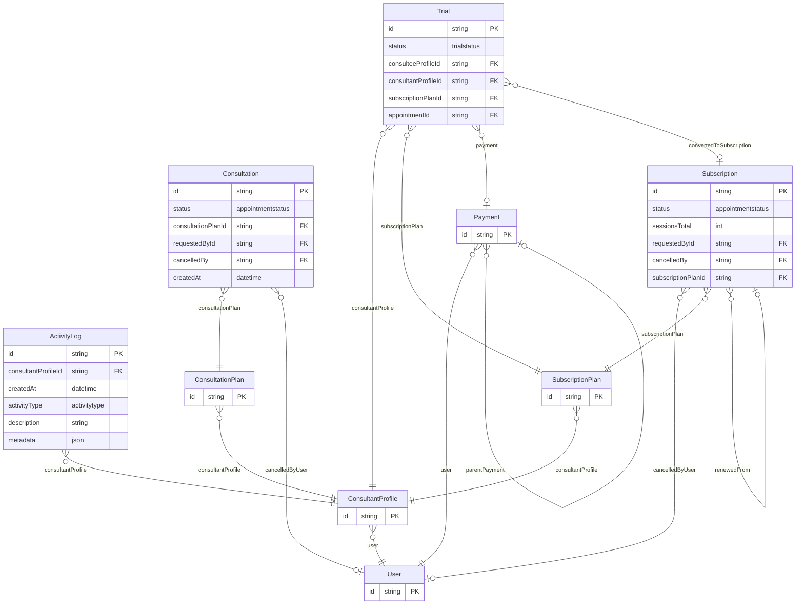
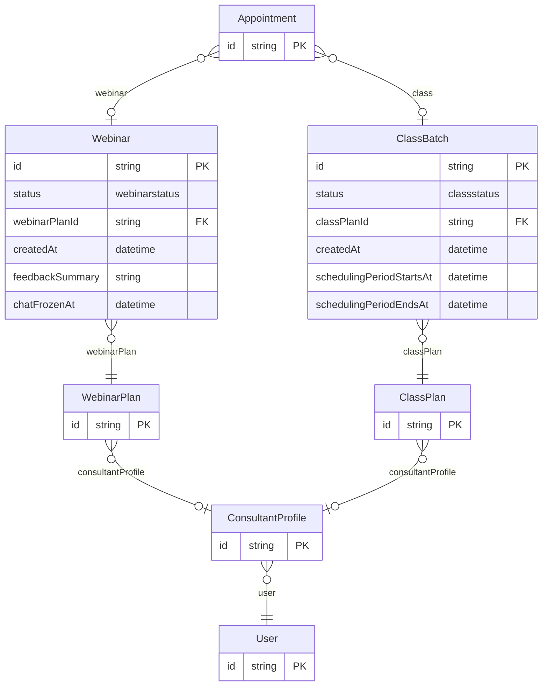
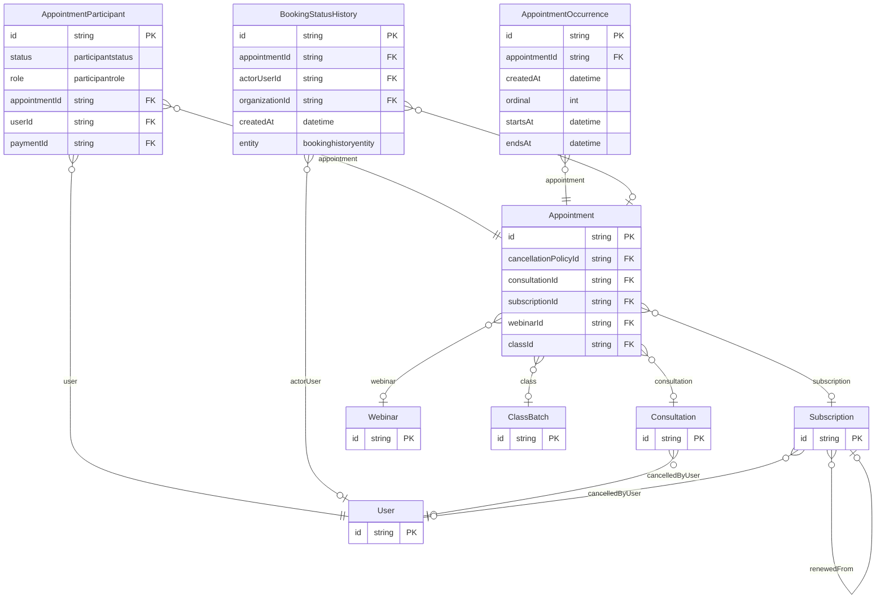

# Schema map — Bookings & Appointments

The request-to-payment chain, and the appointment every booking resolves to.

Part 3 of 10 of the domain map. The
[map index](../00-schema-map.md) holds the master diagram, the enforcer
inventory and the enum reference.

## 1. One-to-One Bookings

The request-to-approval-to-payment chain for one-to-one services. `Consultation` and `Subscription` are the bookings; `Trial` is a time-boxed free or discounted first session that can convert into a `Subscription`. `ActivityLog` is the generic per-user activity feed.

- **Every booking row is a request first and a payment second.** `pendingPaymentUrl` is written before money moves, and the booking only becomes confirmed when the payment confirmation pipeline says so.
- **A trial that converts leaves a pointer, it does not mutate.** `Trial.convertedToSubscriptionId` is the one-way link, so the trial's own history stays intact for the refund and tax trail.

## 2. Group Bookings — Webinar & Class

A webinar is one session with many registrants; a class is a cohort that runs over many sessions. In both cases the registrants share a single `Appointment` row, which is what makes a group event cheap to fan out and hard to over-book: capacity is checked against the appointment's participants, not against a per-registrant row.

- **`maxParticipants` is a per-instance override.** A null on `Webinar` or `Class` inherits the plan's value; the per-instance value is what the capacity check reads.

## 3. Appointment — The Pivot Model

`Appointment` is the pivot that every booking type resolves to. A one-to-one consultation has exactly one; a subscription has one per session; a webinar has one shared by all registrants; a class has one per session; a trial has one. `AppointmentOccurrence` is a concrete time slot inside it, `AppointmentParticipant` is the per-person seat row, and `BookingStatusHistory` is the append-only record of every status transition.

- **`BookingStatusHistory` is immutable and enforced as such.** `booking_status_history_immutable` in `prisma/sql/check-constraints.sql` refuses an update or delete, so the transition history is a ledger rather than a log.
- **An occurrence may be tentative.** A tentative occurrence holds its time but is not a confirmed booking, which is why `occurrence_no_confirmed_overlap` deliberately ignores tentative rows — the app-enforced slot lock covers that window instead.
