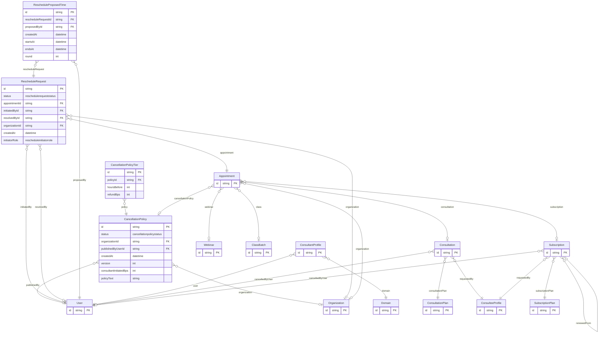
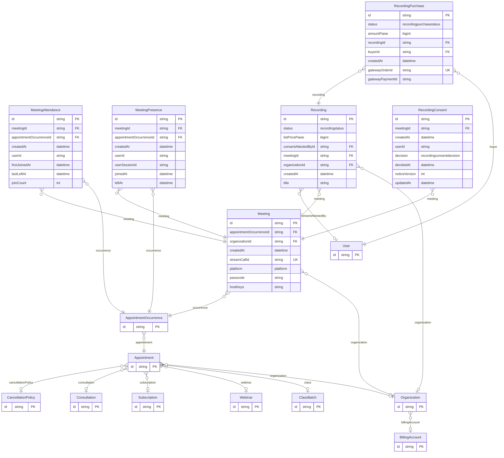
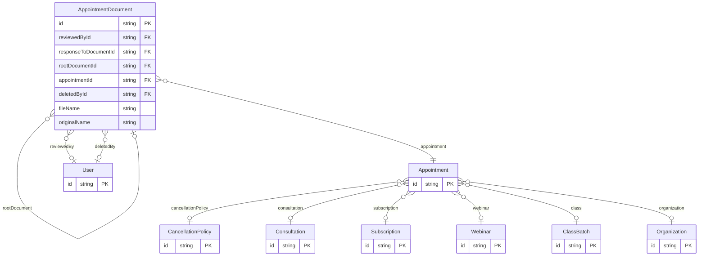

# Schema map — Lifecycle & Sessions

Ending a booking early, moving it, and running the session it becomes.

Part 4 of 10 of the domain map. The
[map index](../00-schema-map.md) holds the master diagram, the enforcer
inventory and the enum reference.

## 1. Cancellation Policy & Reschedule

The refund-shape side of a booking. `CancellationPolicy` is a published, versioned document owned by the consultant; `CancellationPolicyTier` is the percentage ladder inside it. `RescheduleRequest` is the ask, and `RescheduleProposedTime` holds the candidate windows the consultant offers back.

- **A booking snapshots the policy version it was sold under.** The policy is versioned rather than edited, so a policy change never retroactively re-dates an existing booking's refund tier.
- **`cancellation_policy_one_active_per_scope` is a partial unique.** Exactly one active policy may exist per scope, enforced by the database rather than by a read-then-write in application code.

## 2. Session Infrastructure, Attendance & Recordings

The Stream.io video layer and the recording store. `Meeting` is the live call for one occurrence. `MeetingAttendance` and `MeetingPresence` are two different attendance records — one is the settled record, one is the live signal. `Recording` is the media asset; `RecordingConsent` is the publish-time redistribution attestation; `RecordingPurchase` is a replay purchase.

- **Dual storage.** `STREAM_S3` is temporary (the free tier's two-week window); `SUPABASE` is permanent on the premium path. The `RecordingStatus` lifecycle runs `RECORDING` → `PROCESSING` → `READY` → `TRANSFERRING` → `AVAILABLE`, and `Recording_storage_and_publish_check` refuses a row that claims a permanent path without having transferred to it.
- **Recording retention is bounded by the organisation.** `org_stream_recording_retention_days_range` on `organizations` keeps the per-organisation retention window inside the range the platform can honour.

## 3. Session Documents

Files exchanged inside a booking — briefs, follow-ups, receipts. `AppointmentDocument` is versioned within a thread: `rootDocumentId` anchors the thread and `responseToDocumentId` chains the replies.

- **Deletion is a soft-delete with a named deleter.** `deletedAt` plus `documentsDeleted` on `User` keep the audit trail; `appointment_doc_thread_version_unique` keeps a version number unique inside one thread.
