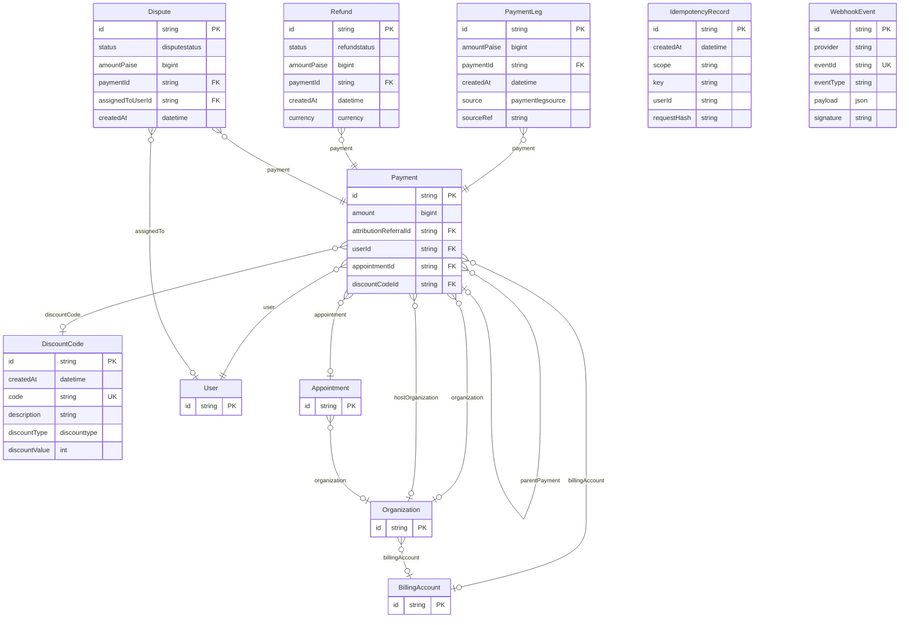
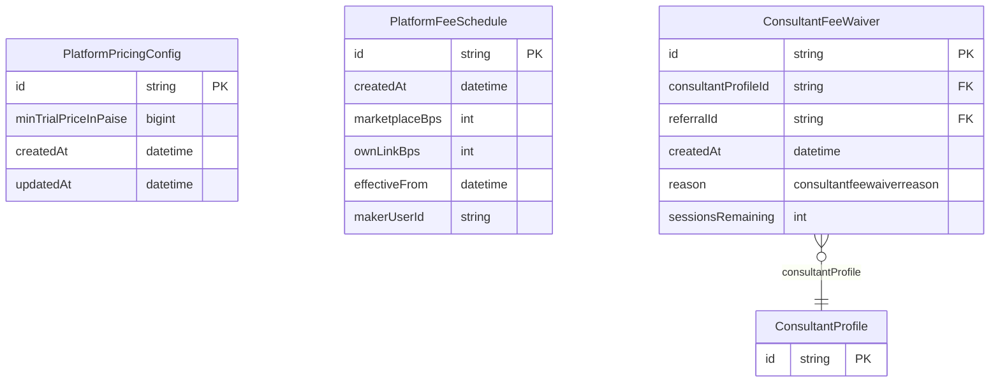

# Schema map — Payments & Pricing

Money in, money back, and the platform's own fee policy.

Part 5 of 10 of the domain map. The
[map index](../00-schema-map.md) holds the master diagram, the enforcer
inventory and the enum reference.

## 1. Payments, Refunds & Disputes

Money enters through `Payment` and is funded by one or more `PaymentLeg` rows. A `Refund` reverses it, a `Dispute` is the gateway's chargeback, `IdempotencyRecord` makes a write replay-safe, `WebhookEvent` deduplicates gateway callbacks, and `DiscountCode` carries the promotional reduction.

- **All money columns are `BigInt` paise.** Settlement is INR only, and `payment_currency_inr`, `refund_currency_inr` and `dispute_currency_inr` refuse any other currency at the database level.
- **The legs must sum to the payment.** `payment_legs_sum_to_amount` is a constraint trigger that refuses a `Payment` whose legs do not add up, and `payment_amount_vs_legs` keeps the header amount consistent with them. `payment_refunds_within_amount` refuses refunds beyond the captured amount.
- **`Payment.paymentStatus = SUCCEEDED` is written by exactly one pipeline** — the payment confirmation handler. Every other status transition is a conditional update that names the expected prior status in its `WHERE` clause.

## 2. Platform Pricing & Fee Policy

The platform's own pricing knobs. `PlatformPricingConfig` holds global floors such as the minimum trial price; `PlatformFeeSchedule` is the effective fee table with a validity window; `ConsultantFeeWaiver` is a per-consultant concession.

- **Fee policy is versioned by validity window, not edited.** `platform_fee_schedule_valid` refuses a schedule whose window or basis points are nonsense, and the pricing code reads the schedule effective on the booking date, not the newest one.
