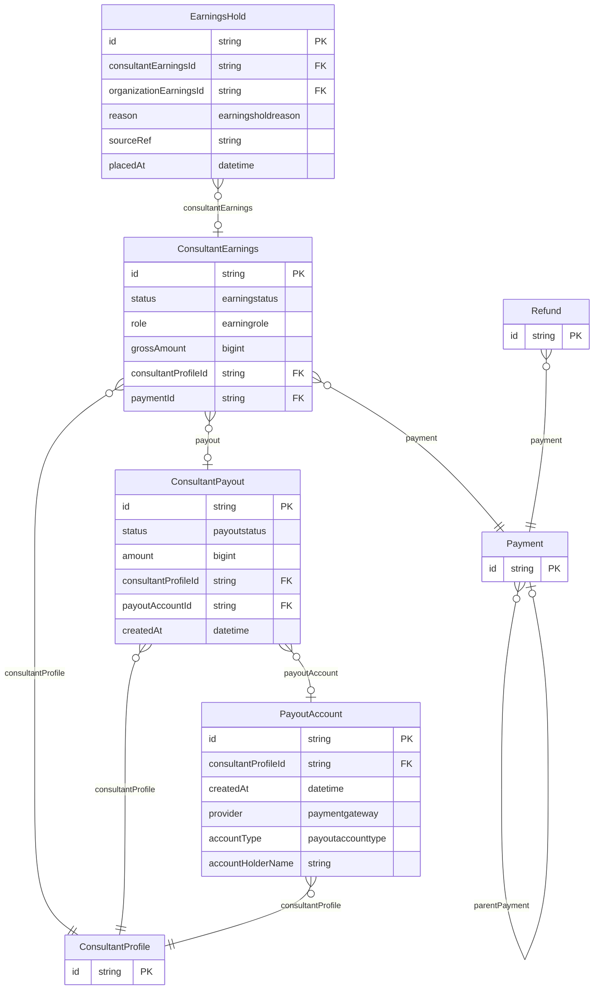
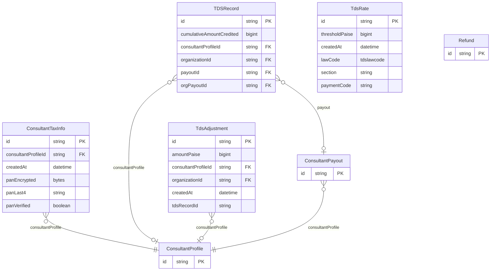

# Schema map — Earnings & Tax

From a captured payment to money in a bank account, and the tax withheld on the way.

Part 6 of 10 of the domain map. The
[map index](../00-schema-map.md) holds the master diagram, the enforcer
inventory and the enum reference.

## 1. Consultant Earnings & Payouts

The lifecycle from a captured payment to money in a bank account. `ConsultantEarnings` is the per-occurrence earning row; `EarningsHold` is a reason-scoped block on it; `ConsultantPayout` is a batch that settles a set of earnings; `PayoutAccount` is a verified destination.

- **A hold is scoped by reason and by owner.** `earnings_hold_one_earning` keeps at most one active hold per earning, and the two partial uniques — `earnings_hold_active_consultant_key` and `earnings_hold_active_org_key` — stop a second consultant-side or organisation-side hold from stacking on the same earning. A service complaint alone does not freeze earnings; a gateway chargeback does, and it keeps its own lifecycle.
- **`consultant_earnings_occurrence_key` is a partial unique** that stops the same occurrence being paid out twice, and `consultant_earnings_batched_has_payout` refuses a row in a batched state with no payout attached.
- **The payout destination is snapshotted at mint.** A bank-change cooling-off window (`payoutsAllowedAfter`) and a payee-initiated freeze (`payoutsFrozenAt`) both live on the account, and a payout records the account it was minted against, so processing sends to exactly the destination that was approved.

## 2. Tax — TDS, GST & Adjustments

Withholding tax at the source. `ConsultantTaxInfo` is the consultant's PAN, GSTIN, residency and MSME standing. `TdsRate` is the rate table with its validity window. `TDSRecord` is the per-payout withholding, and `TdsAdjustment` reverses previously withheld tax when a refund lands.

- **The rate is looked up by date, not stored on the consultant.** `tds_rate_bps_and_window_sane` and `tds_rate_bps_bounds` keep the rate table honest, and `tds_record_financial_year_format` keeps the FY stamp in the `2026-27` shape the Form 26Q filing expects.
- **A TDS row points at exactly one of a consultant or an organisation** (`tds_record_deductee_xor`), because the deductee is the entity the withholding is reported against, and the two are not interchangeable.
