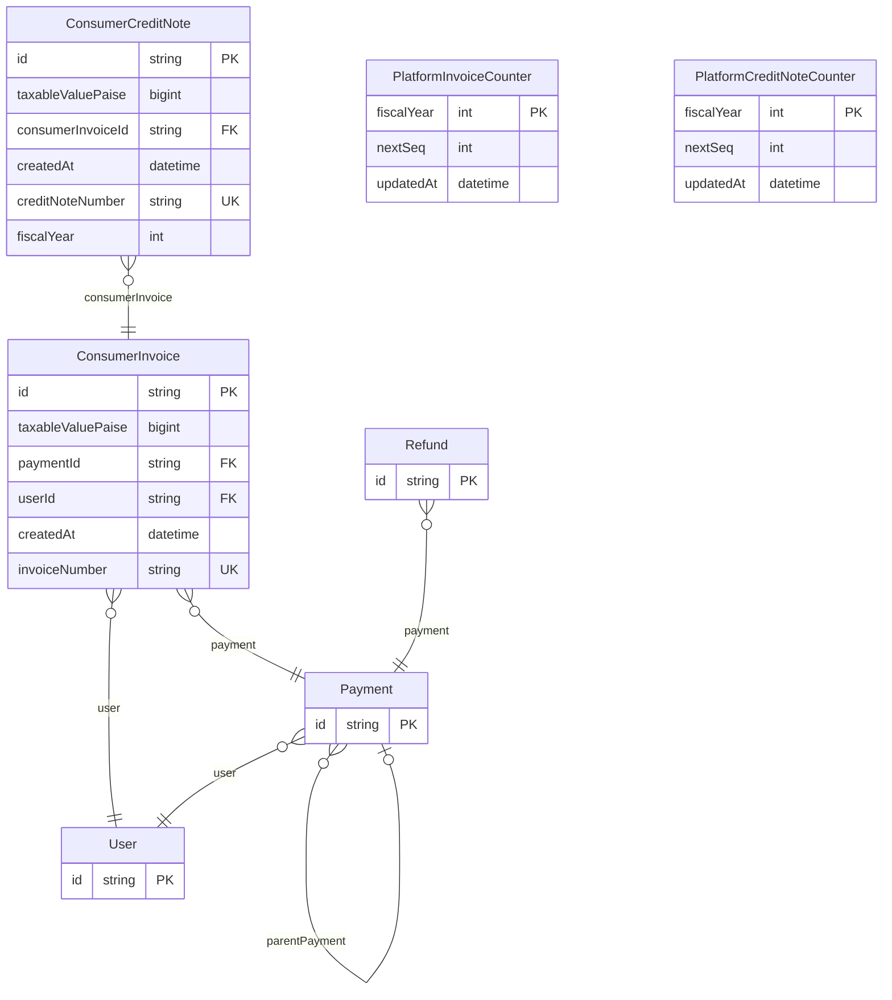
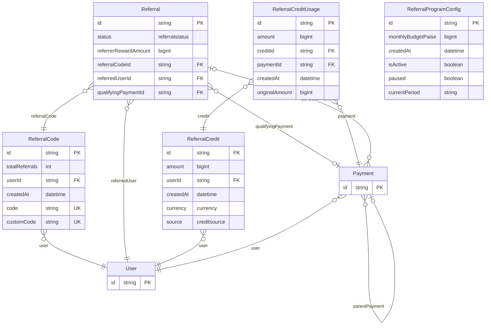
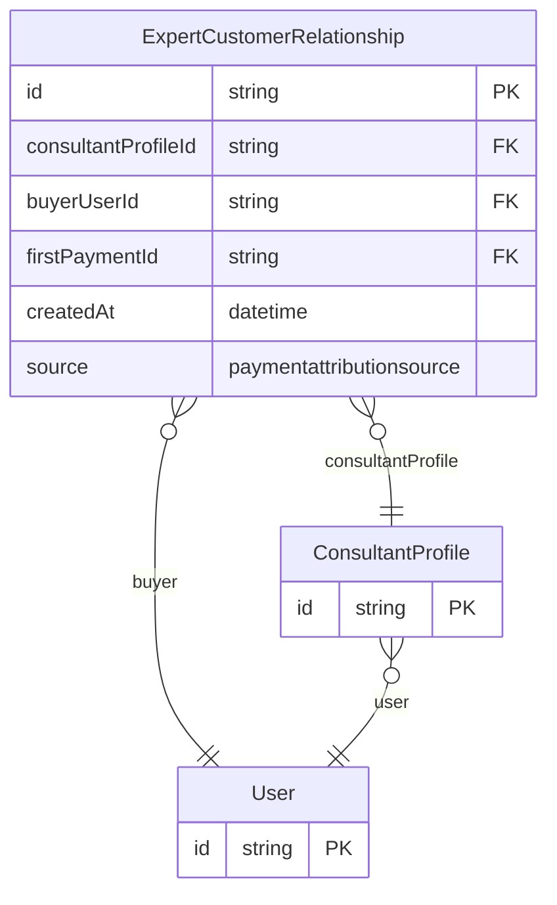

# Schema map — Invoicing & Referrals

The tax documents a buyer receives, and the credits that bring them back.

Part 7 of 10 of the domain map. The
[map index](../00-schema-map.md) holds the master diagram, the enforcer
inventory and the enum reference.

## 1. Consumer Invoicing & Credit Notes

The B2C side of tax invoicing. `ConsumerInvoice` is the tax invoice issued to a buyer; `ConsumerCreditNote` cancels or reduces it. `PlatformInvoiceCounter` and `PlatformCreditNoteCounter` are the per-year sequence allocators behind the document numbers.

- **A tax invoice carries exactly one tax head.** `consumer_invoice_tax_head_xor` refuses a row with both IGST and CGST/SGST, and `consumer_credit_note_tax_head_xor` does the same for the note — a partially-populated GST split is not a legal document.
- **The counters are the serialisation point.** Each is allocated with an insert-on-conflict update, so two concurrent invoices cannot read the same next sequence.

## 2. Referrals & Credit Pools

Acquisition by referral. `ReferralCode` is a user's code, `Referral` is one tracked referral, `ReferralCredit` is a credit balance that can be spent, `ReferralCreditUsage` is the spend against a payment, and `ReferralProgramConfig` is the rules the programme runs on.

- **Credit is a balance with a ledger behind it.** `referral_credit_balance_consistent` keeps the remaining amount equal to the issued amount minus the uses, and `referral_credit_usage_nonnegative` refuses a negative spend.
- **A referral credit is applied as a payment leg, not as a discount.** That is why the funding-leg sum identity still holds when a credit is spent.

## 3. Expert–Customer Relationships

The durable record that a user has bought from an expert, with the source that owns the relationship. It is what a consultant's client list and an organisation's spend history are both read from, without re-deriving either from payments.

- **The relationship is a projection, not the money record.** `Payment` remains the source of truth for what was paid; this table answers "who has bought from whom" without a join across the payment tables.
