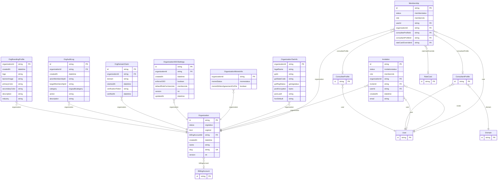
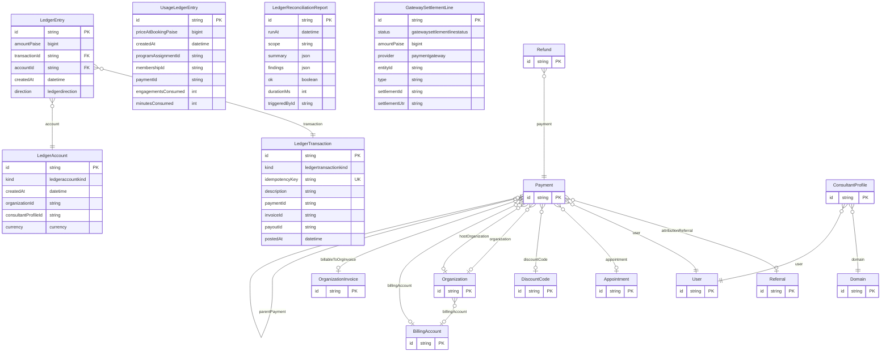

# Schema map — Enterprise

The organisation, what it buys, what it is billed, and the ledger underneath.

Part 8 of 10 of the domain map. The
[map index](../00-schema-map.md) holds the master diagram, the enforcer
inventory and the enum reference.

## 1. Enterprise Core — Organisation & Membership

An `Organization` can sponsor employees (`canSponsor`), host consultants (`canHost`), or both. `Membership` is the only membership table in the system: it joins a `User` to an `Organization` with a role, a status and a payout recipient. `Invitation` covers both the organisation-scoped and the platform-scoped operator door. `OrganizationTaxInfo` and `OrganizationMsmeInfo` carry the statutory profile; `OrgSSOSettings` and `OrgDomainClaim` carry the identity perimeter; `OrgAuditLog` is the trail; `OrgBrandingProfile` is the white-label surface.

- **`Membership` is typed, not a join table.** `MemberRole` and `MemberStatus` decide what the member may do and whether the seat is live; `Membership.status = ERASED` is what an erasure request flips every active row to.
- **A verified domain claim is unique per domain.** `org_domain_claims_verified_domain_key` means a domain can be claimed by exactly one organisation, so an SSO assertion can be trusted to identify one tenant.
- **The organisation's own tax and MSME data is separate from the consultant's.** An organisation is a `principal supplier` to the platform and files its own GST, so its registration and MSME standing live on `OrganizationTaxInfo` and `OrganizationMsmeInfo`, not on `ConsultantTaxInfo`.

## 2. Enterprise Billing, Programs & Wallets

The commercial spine: `BillingAccount` → `Contract` → `Program` → `ProgramAssignment` → `BookingUtilization`. Each link adds a layer of budget control. `BillingSubscription` is the billing cycle, `WalletTopUp` is the top-up lifecycle, `RateCard` is the three-way basis-point split, `LicensedSeatConfig` and `CreditPoolConfig` are the two overage shapes, `OverageEvent` is the append-only over-cap charge ledger, and `PurchaseOrder` is the org's pre-authorisation.

```mermaid
erDiagram
    BillingAccount {
        id string PK
        walletBalance bigint
        createdAt datetime
        ownerOrgId string UK
        billingEmail string
        currency currency
        fundingSource fundingsource
        creditLimit bigint
    }
    Contract {
        id string PK
        status contractstatus
        organizationId string FK
        billingAccountId string FK
        purchaseOrderId string FK
        rateCardId string FK
        supersededByContractId string FK
        createdAt datetime
    }
    BillingSubscription {
        id string PK
        ratePerSeatPaise bigint
        contractId string FK
        billingAccountId string FK
        createdAt datetime
        model subscriptionmodel
        cycle billingcycle
        flatFeePaise bigint
    }
    WalletTopUp {
        id string PK
        status wallettopupstatus
        amountPaise bigint
        billingAccountId string FK
        createdAt datetime
        providerOrderId string UK
        providerPaymentId string
        currency currency
    }
    RateCard {
        id string PK
        minGrossPaise bigint
        ownerOrgId string FK
        ownerContractId string FK
        createdAt datetime
        planType coveredplantype
        planId string
        maxGrossPaise bigint
    }
    Program {
        id string PK
        status programstatus
        type programtype
        contractId string FK
        createdAt datetime
        name string
        coveredPlanTypes coveredplantype
        allowedCategories string
    }
    ProgramAssignment {
        id string PK
        status assignmentstatus
        consumedPaise bigint
        programId string FK
        membershipId string FK
        rolledToAssignmentId string FK
        createdAt datetime
        periodStart datetime
    }
    ProgramConsultantAllowlist {
        id string PK
        programId string FK
        consultantProfileId string FK
        createdAt datetime
    }
    LicensedSeatConfig {
        programId string PK
        ratePerSeatPaise bigint
        cycle billingcycle
        coveredEngagementsPerCycle int
        overageBehavior overagebehavior
        activeSeatCount int
        priceCapPerEngagementPaise bigint
        overageSurchargeBps int
    }
    CreditPoolConfig {
        programId string PK
        creditBudgetPerCycle int
        cycle billingcycle
        priceCapPerEngagementPaise bigint
        overageBehavior overagebehavior
        overageSurchargeBps int
        maxOveragePerCyclePaise bigint
    }
    BookingUtilization {
        id string PK
        priceAtBookingPaise bigint
        programAssignmentId string FK
        paymentId string FK
        createdAt datetime
        engagementsConsumed int
        wasOverage boolean
        platformBpsAtBooking int
    }
    OverageEvent {
        id string PK
        basePaise bigint
        programAssignmentId string FK
        bookingUtilizationId string FK
        paymentId string FK
        invoiceLineItemId string FK
        createdAt datetime
        batchKey string
    }
    PurchaseOrder {
        id string PK
        status postatus
        totalAmountPaise bigint
        organizationId string FK
        createdAt datetime
        poNumber string
        poDate datetime
        validUntil datetime
    }
    OrgInvoiceCounter {
        organizationId string FK
        fiscalYear int
        nextSeq int
        updatedAt datetime
    }
    Organization {
        id string PK
    }
    Membership {
        id string PK
    }
    Payment {
        id string PK
    }
    ConsultantProfile {
        id string PK
    }
    InvoiceLineItem {
        id string PK
    }
    User {
        id string PK
    }
    ConsulteeProfile {
        id string PK
    }
    Referral {
        id string PK
    }
    Appointment {
        id string PK
    }
    DiscountCode {
        id string PK
    }
    OrganizationInvoice {
        id string PK
    }
    Contract }o--|| Organization : "organization"
    Contract }o--|| BillingAccount : "billingAccount"
    Contract }o--o| PurchaseOrder : "purchaseOrder"
    Contract }o--o| RateCard : "rateCard"
    Contract }o--o| Contract : "supersededByContract"
    BillingSubscription }o--|| Contract : "contract"
    BillingSubscription }o--|| BillingAccount : "billingAccount"
    WalletTopUp }o--|| BillingAccount : "billingAccount"
    RateCard }o--o| Organization : "ownerOrg"
    RateCard }o--o| Contract : "ownerContract"
    Program }o--|| Contract : "contract"
    ProgramAssignment }o--|| Program : "program"
    ProgramAssignment }o--|| Membership : "membership"
    ProgramAssignment }o--o| ProgramAssignment : "rolledToAssignment"
    ProgramConsultantAllowlist }o--|| Program : "program"
    ProgramConsultantAllowlist }o--|| ConsultantProfile : "consultantProfile"
    LicensedSeatConfig }o--|| Program : "program"
    CreditPoolConfig }o--|| Program : "program"
    BookingUtilization }o--|| ProgramAssignment : "programAssignment"
    BookingUtilization }o--|| Payment : "payment"
    OverageEvent }o--|| ProgramAssignment : "programAssignment"
    OverageEvent }o--|| BookingUtilization : "bookingUtilization"
    OverageEvent }o--o| Payment : "payment"
    OverageEvent }o--o| InvoiceLineItem : "invoiceLineItem"
    PurchaseOrder }o--|| Organization : "organization"
    OrgInvoiceCounter }o--|| Organization : "organization"
    Organization }o--o| BillingAccount : "billingAccount"
    Membership }o--|| User : "user"
    Membership }o--|| Organization : "organization"
    Membership }o--o| ConsulteeProfile : "consulteeProfile"
    Membership }o--o| ConsultantProfile : "consultantProfile"
    Membership }o--o| RateCard : "rateCardOverride"
    Payment }o--o| Referral : "attributionReferral"
    Payment }o--|| User : "user"
    Payment }o--o| Appointment : "appointment"
    Payment }o--o| DiscountCode : "discountCode"
    Payment }o--o| Organization : "organization"
    Payment }o--o| Organization : "hostOrganization"
    Payment }o--o| BillingAccount : "billingAccount"
    Payment }o--o| OrganizationInvoice : "billableToOrgInvoice"
    Payment }o--o| Payment : "parentPayment"
```

- **The wallet balance is a liability account in the double-entry ledger, not a standalone table.** `BillingAccount.walletBalance` is retained only as a denormalised cache for the atomic-debit guard, and the nightly reconciliation asserts it equals the `WALLET` account balance. `billing_account_wallet_nonnegative` refuses a negative balance.
- **A contract is superseded, never edited.** `Contract.supersededByContractId` is a self-relation with a `ContractSupersessionReason`, and `contract_one_active_per_billing_account_idx` keeps exactly one active contract per billing account.
- **A program assignment cannot overlap itself.** `program_assignment_no_active_overlap` refuses two active assignments for the same member and program, and `ProgramAssignment.rolledToAssignmentId` is the one-way link when a cycle rolls over.
- **The rate card must divide the whole.** `rate_card_bps_sum_is_whole` refuses a split that is not exactly 10,000 bps across platform, organisation and consultant, and `rate_card_one_open_window` keeps one open validity window at a time.
- **Overage is a formula, not a number.** `overage_marginal_is_base_plus_surcharge` refuses a marginal charge that is not the base plus its surcharge, so the two can never drift apart.

## 3. Enterprise Invoicing, Receipts & Organisation Payouts

Month-end invoicing for the organisation side. `OrganizationInvoice` is the tax invoice, `InvoiceLineItem` its lines, `OrganizationInvoiceReceipt` the money received against it, `OrganizationEarnings` the organisation's share of a host booking, `OrganizationPayout` the batch that disburses it, `OrganizationPayoutAccount` the destination, and `CreditNote` the Section 34 / CGST Rule 53 document that cancels or reduces an invoice.

```mermaid
erDiagram
    OrganizationInvoice {
        id string PK
        status orginvoicestatus
        inrEquivalentPaise bigint
        billingAccountId string FK
        organizationId string FK
        purchaseOrderId string FK
        contractId string FK
        paymentId string FK
    }
    OrganizationInvoiceReceipt {
        id string PK
        amountPaise bigint
        organizationId string FK
        invoiceId string FK
        createdAt datetime
        method invoicereceiptmethod
        reference string
        receivedOn datetime
    }
    InvoiceLineItem {
        id string PK
        unitPricePaise bigint
        invoiceId string FK
        paymentId string FK
        createdAt datetime
        position int
        description string
        quantity int
    }
    OrganizationEarnings {
        id string PK
        status earningstatus
        role earningrole
        grossAmountPaise bigint
        organizationId string FK
        paymentId string FK
        consultantProfileId string FK
        orgPayoutId string FK
    }
    OrganizationPayout {
        id string PK
        status payoutstatus
        amountPaise bigint
        organizationId string FK
        orgPayoutAccountId string FK
        createdAt datetime
        currency currency
        paymentGateway paymentgateway
    }
    OrganizationPayoutAccount {
        id string PK
        status orgpayoutaccountstatus
        organizationId string FK
        createdAt datetime
        accountHolderName string
        accountNumberEncrypted string
        accountNumberLast4 string
        bankName string
    }
    CreditNote {
        id string PK
        status creditnotestatus
        subtotalPaise bigint
        organizationId string FK
        invoiceId string FK
        createdAt datetime
        creditNoteNumber string
        fiscalYear int
    }
    OrgCreditNoteCounter {
        organizationId string FK
        fiscalYear int
        nextSeq int
        updatedAt datetime
    }
    Organization {
        id string PK
    }
    Payment {
        id string PK
    }
    Refund {
        id string PK
    }
    Dispute {
        id string PK
    }
    BillingAccount {
        id string PK
    }
    PurchaseOrder {
        id string PK
    }
    Contract {
        id string PK
    }
    ConsultantProfile {
        id string PK
    }
    Referral {
        id string PK
    }
    User {
        id string PK
    }
    Appointment {
        id string PK
    }
    DiscountCode {
        id string PK
    }
    OrganizationInvoice }o--|| BillingAccount : "billingAccount"
    OrganizationInvoice }o--|| Organization : "organization"
    OrganizationInvoice }o--o| PurchaseOrder : "purchaseOrder"
    OrganizationInvoice }o--o| Contract : "contract"
    OrganizationInvoice }o--o| Payment : "payment"
    OrganizationInvoiceReceipt }o--|| Organization : "organization"
    OrganizationInvoiceReceipt }o--|| OrganizationInvoice : "invoice"
    InvoiceLineItem }o--|| OrganizationInvoice : "invoice"
    InvoiceLineItem }o--o| Payment : "payment"
    OrganizationEarnings }o--|| Organization : "organization"
    OrganizationEarnings }o--|| Payment : "payment"
    OrganizationEarnings }o--o| ConsultantProfile : "consultantProfile"
    OrganizationEarnings }o--o| OrganizationPayout : "orgPayout"
    OrganizationPayout }o--|| Organization : "organization"
    OrganizationPayout }o--o| OrganizationPayoutAccount : "orgPayoutAccount"
    OrganizationPayoutAccount }o--|| Organization : "organization"
    CreditNote }o--|| Organization : "organization"
    CreditNote }o--o| OrganizationInvoice : "invoice"
    OrgCreditNoteCounter }o--|| Organization : "organization"
    Organization }o--o| BillingAccount : "billingAccount"
    Payment }o--o| Referral : "attributionReferral"
    Payment }o--|| User : "user"
    Payment }o--o| Appointment : "appointment"
    Payment }o--o| DiscountCode : "discountCode"
    Payment }o--o| Organization : "organization"
    Payment }o--o| Organization : "hostOrganization"
    Payment }o--o| BillingAccount : "billingAccount"
    Payment }o--o| OrganizationInvoice : "billableToOrgInvoice"
    Payment }o--o| Payment : "parentPayment"
    Refund }o--|| Payment : "payment"
    Dispute }o--|| Payment : "payment"
    Dispute }o--o| User : "assignedTo"
```

- **An invoice is paid when its receipts and credit notes cover its total.** A bank transfer is recorded as a `BANK_TRANSFER` receipt with a UTR; a gateway capture is a `GATEWAY` receipt with the gateway payment id. `organizationId` plus `reference` is unique, so the same UTR cannot be recorded twice.
- **A voided invoice is not a deleted invoice.** `CreditNote.voidedInvoiceId` is unique, so a platform void produces exactly one credit note against that invoice, and the audit trail survives.
- **The invoice number is per-organisation and per fiscal year.** `OrgInvoiceCounter` allocates it with an insert-on-conflict update, and the format is `<PREFIX>-<FY>-<SEQ>` under CGST Rule 46.
- **The organisation's split must fit inside the gross.** `org_earnings_split_within_gross` refuses a split whose platform fee plus consultant share exceeds the gross, and `organization_earnings_split_key` stops the same split being recorded twice.

## 4. Double-Entry Ledger & Gateway Settlement

The single source of truth for cash. Every cash event is one `LedgerTransaction` whose `LedgerEntry` rows satisfy the sum-of-debits-equals-sum-of-credits identity, and each `LedgerAccount` balance is derived from those postings. `UsageLedgerEntry` counts non-cash engagement consumption and is deliberately outside the cash journal. `GatewaySettlementLine` holds the gateway's own settlement report for matching, and `LedgerReconciliationReport` is the nightly audit output.

- **Balances are derived, not stored.** There is no balance table on `dev`: the balance is the sum of the postings, and the reconciliation job recomputes it. The earlier `LedgerAccountBalance` cache was removed in #2251 in favour of computing the balance from the journal.
- **The journal is immutable.** `ledger_entry_immutable` and `ledger_transaction_immutable` refuse updates and deletes, and `ledger_txn_balanced` is the constraint trigger that enforces the debit-equals-credit identity at commit.
- **A reversal is a counter-transaction, never an edited row.** That is why the ledger can be re-derived at any time and compared against the gateway.
- **The usage ledger is a different thing.** `usage_ledger_entry_immutable` keeps the engagement counter append-only, but it is not part of the cash balance identity and does not carry money.
