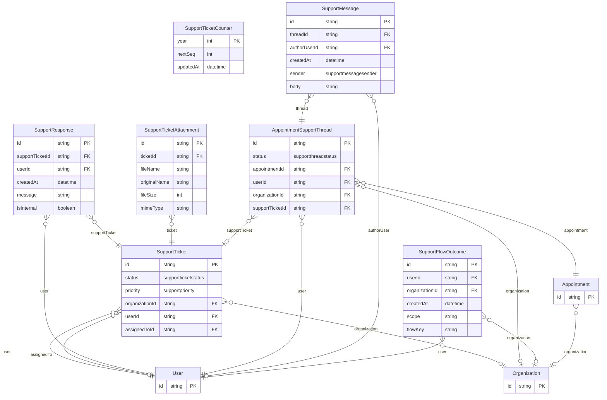
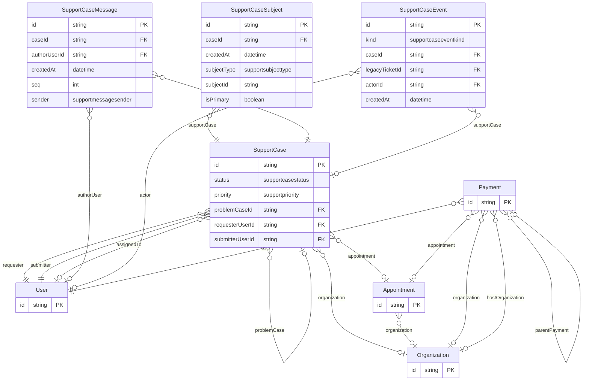
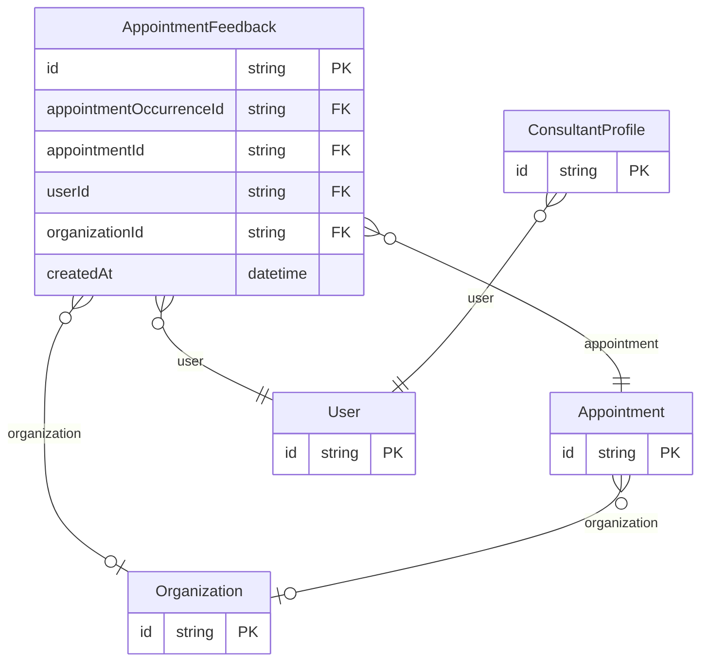
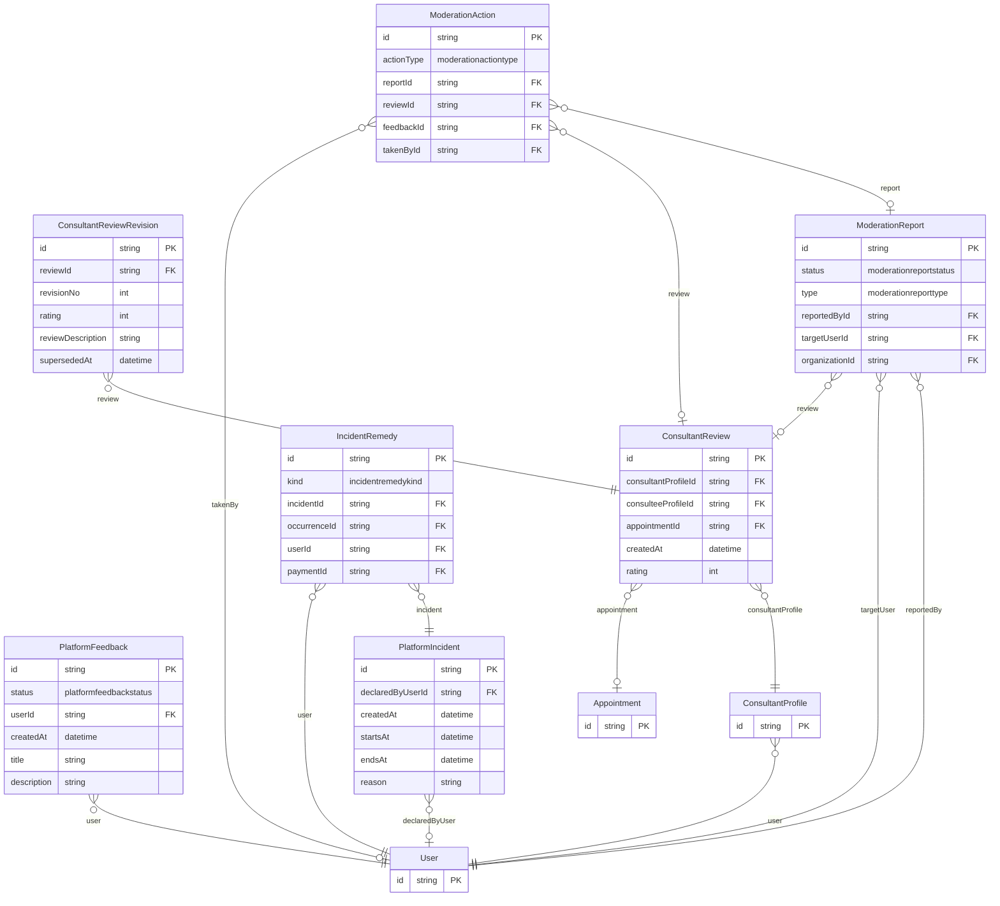

# Schema map — Support & Moderation

The case a support conversation becomes, the rating that follows, and the moderation over both.

Part 9 of 10 of the domain map. The
[map index](../00-schema-map.md) holds the master diagram, the enforcer
inventory and the enum reference.

## 1. Support — Legacy Queues & Self-Serve Threads

The older support surfaces, kept alive while the canonical case record takes over. `SupportTicket` is the general queue with its SLA clocks and speakable reference number. `AppointmentSupportThread` is the per-appointment conversation that a deterministic flowchart drives, with `SupportMessage` as its transcript and `SupportFlowOutcome` as the counter that says whether the tree resolved the turn without a human.

- **The reference number is year-scoped and forward-only.** `SupportTicketCounter` allocates it with an insert-on-conflict update. A unique index permits unlimited nulls, so tickets that predate the column keep their uuid and no backfill is owed.
- **A thread's transcript is ordered by `seq`, not by `createdAt`.** The user's turn and the bot's reply are written in one transaction, and Postgres `CURRENT_TIMESTAMP` is transaction start time, so the two can carry a byte-identical timestamp. `seq` is a strict per-thread total order allocated from the thread's own counter, and the row lock that counter takes is the serialisation point between a user typing on a phone and an agent replying on a desktop.
- **Deflection is measured, not assumed.** `SupportFlowOutcome` records one row per terminal turn, so the rate of conversations the tree resolves without a human is answerable. It carries counts and timings, never a transcript.

## 2. Support — The Canonical Case

`SupportCase` is the canonical record from intake through private evidence, decisions, appeals and resolution. It owns the transcript (`SupportCaseMessage`), the event trail (`SupportCaseEvent`), and the links to whatever the case is about (`SupportCaseSubject`, which names the subject type and id rather than a foreign key per type).

- **The case is addressed by scope, not by a free-text key.** `ownershipScope` and `scopeKey` say whose conversation this is — a personal account, organisation operations, or organisation billing — and `support_case_open_scope_key` keeps exactly one open case per scope tuple. `support_case_scope_and_shape_chk` refuses a case whose scope and its columns disagree.
- **A subject is polymorphic by design.** `SupportCaseSubject.subjectType` plus `subjectId` names the appointment, occurrence, payment, refund, invoice, organisation or account a case concerns, and `support_case_subject_primary_key` allows exactly one primary subject per case.
- **The message stream is retry-safe.** `clientTurnId` is unique per case, so a client that retries a turn does not create a second message.

## 3. Feedback & Ratings

The private per-call rating, distinct from the public `ConsultantReview`. It covers calls that a public review does not, such as a webinar or a class, and it feeds the organisation-level quality aggregate. The rater's role is recorded so a consultant's rating of their own session can be excluded.

- **One rating per person per call, and one per person per whole appointment.** That is a unique index on `(appointmentId, appointmentOccurrenceId, userId)` where nulls are distinct, which Prisma cannot express — so it lives in `prisma/sql/check-constraints.sql` as `appointment_feedback_level_key`.
- **An aggregate that can be adjudicated needs a rater role.** `raterRole` is nullable and never backfilled: rows written before the column cannot be attributed, and asserting `CONSULTEE` over them would re-admit the self-ratings being excluded. The aggregate filters on `CONSULTEE`, so unknown provenance fails closed.

## 4. Moderation, Trust & Incidents

The public reputation rail and the machinery around it. `ConsultantReview` is a public review of a consultant; `ConsultantReviewRevision` is the append-only chain of superseded versions of its text. `ModerationReport` is a report against content or a person; `ModerationAction` is every enforcement step and it can exist without a report behind it since #1562. `PlatformFeedback` is feedback about the platform rather than a rating of a call. `PlatformIncident` and `IncidentRemedy` are the declared-incident record.

- **An action must name its target, and the target must match the action type.** `moderation_action_has_target` and `moderation_action_target_matches_type` refuse a row that points at nothing, or at the wrong kind of thing for the action it claims to be.
- **A report that names a review must name a real one.** `moderation_report_review_has_review` refuses the reverse edge.
- **Public and private reputation are separate surfaces.** Removing a public review and excluding a private rating are different actions with different restoration paths, which is why the two have separate removed-pair constraints.
- **A review's text is versioned, never edited.** `review_revision_immutable` refuses an update or delete of a revision, and `consultant_review_pair_track_event_key` keeps a reviewer's one review per track. `consultant_review_group_has_event` requires a group review to have the event it was written for.
- **A removed review keeps its shape.** `consultant_review_removed_pair` and `consultant_review_reply_removed_pair` enforce that removal is expressed as a pair of flags rather than by deleting the row, so the moderation audit stays complete.
