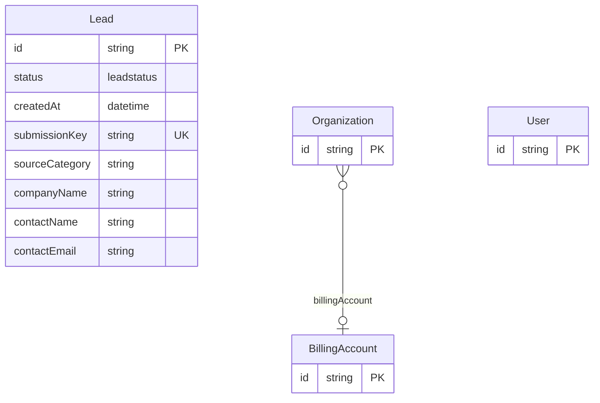
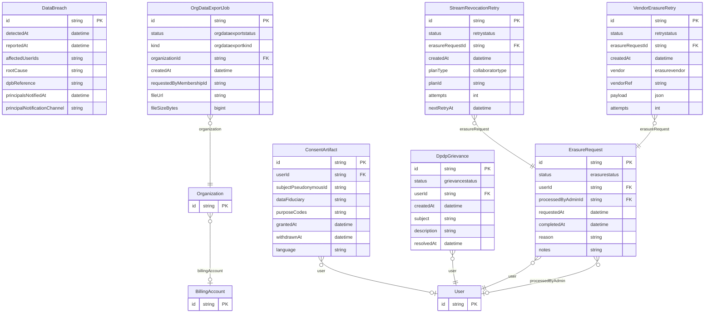

# Schema map — Compliance & System

Consent, erasure and the operational substrate everything else runs on.

Part 10 of 10 of the domain map. The
[map index](../00-schema-map.md) holds the master diagram, the enforcer
inventory and the enum reference.

## 1. Leads

The pre-account funnel. A `Lead` captures an organisation that has not yet signed up, and the state it is in.

- **A lead is not a `User` and not a `Membership`.** It is a separate record with its own status, so an unqualified enquiry never has to be coerced into the membership model and later deleted from it.

## 2. Compliance — DPDP Consent, Erasure & Data Rights

The India-first compliance subsystem. `ConsentArtifact` is the append-only record of what a user consented to and when. `DataBreach` is the incident record, `DpdpGrievance` the grievance register, `ErasureRequest` the right-to-erasure workflow, and `OrgDataExportJob` the organisation's data-export request.

- **The consent gate is fail-closed.** A request with no matching artefact is refused, not treated as implicit consent. The artefact records the terms version and the privacy-policy version, so a later change to either does not retroactively alter what a user agreed to.
- **Erasure is a workflow with a human gate, not a delete.** The request is filed, processed, and only then does the selective scrub described in the identity section run. The two retry tables — `StreamRevocationRetry` and `VendorErasureRetry` — exist because revocation at an external vendor is a separate, retryable action that cannot be rolled back with the database transaction.
- **Reconciliation across vendor boundaries is the one place an application sweep is correct.** The database cannot enforce that a third-party service has actually deleted a video, so that reconciliation lives in application code and is the deliberate exception to the no-reconciler rule.

## 3. System, Operations & Notification Delivery

The operational substrate. `SystemEvent` and `SystemJobExecution` are the observability record, `OpsActionLog` is the audit of every privileged action, and `OpsActionProposal` is the second-admin queue for money doors above the threshold. `NotificationOutbox` is the durable outbox every notification is written to, with `EmailEvent`, `EmailSuppression`, `FailedEmail` and `FailedEmailBatch` recording what happened to each send. `WebhookEndpoint` and `OutboundWebhookDelivery` are the platform's own outbound webhooks.

```mermaid
erDiagram
    SystemEvent {
        id string PK
        organizationId string FK
        createdAt datetime
        category string
        severity systemeventseverity
        message string
        context json
        correlationId string
    }
    SystemJobExecution {
        id string PK
        status systemjobstatus
        createdAt datetime
        jobId string
        jobName string
        startedAt datetime
        endedAt datetime
        triggeredBy string
    }
    OpsActionLog {
        id string PK
        actorUserId string FK
        createdAt datetime
        actorRole string
        surface string
        action string
        targetKind string
        targetId string
    }
    OpsActionProposal {
        id string PK
        status opsactionproposalstatus
        amountPaise bigint
        proposedById string FK
        decidedById string FK
        createdAt datetime
        action string
        surface string
    }
    Announcement {
        id string PK
        createdAt datetime
        title string
        content string
        isActive boolean
        startDate datetime
        endDate datetime
        backgroundColor string
    }
    MaintenanceWindow {
        id string PK
        organizationId string FK
        createdAt datetime
        phase maintenancephase
        reason string
        scheduledAt datetime
        startedAt datetime
        endedAt datetime
    }
    WebhookEndpoint {
        id string PK
        status webhookendpointstatus
        organizationId string FK
        createdAt datetime
        url string
        secret string
        eventSubscriptions string
        failureCount int
    }
    OutboundWebhookDelivery {
        id string PK
        status deliverystatus
        webhookEndpointId string FK
        createdAt datetime
        eventType string
        payload json
        signature string
        httpStatusCode int
    }
    FailedEmail {
        id string PK
        status emaildeliverystatus
        createdAt datetime
        recipient string
        fromAddress string
        replyTo string
        subject string
        htmlBody string
    }
    FailedEmailBatch {
        id string PK
        status emaildeliverystatus
        createdAt datetime
        idempotencyKey string UK
        emailType string
        payload json
        attempts int
        nextRetryAt datetime
    }
    NotificationOutbox {
        id string PK
        status emaildeliverystatus
        kind notificationoutboxkind
        createdAt datetime
        workflowId string
        recipients string
        payload json
        transactionId string UK
    }
    EmailEvent {
        id string PK
        svixId string UK
        resendId string
        type string
        recipient string
        payload json
        receivedAt datetime
    }
    EmailSuppression {
        email string PK
        createdAt datetime
        reason emailsuppressionreason
        sourceEventId string
    }
    User {
        id string PK
    }
    Payment {
        id string PK
    }
    Organization {
        id string PK
    }
    Referral {
        id string PK
    }
    Appointment {
        id string PK
    }
    DiscountCode {
        id string PK
    }
    BillingAccount {
        id string PK
    }
    OrganizationInvoice {
        id string PK
    }
    SystemEvent }o--o| Organization : "organization"
    OpsActionLog }o--o| User : "actor"
    OpsActionProposal }o--o| User : "proposedBy"
    OpsActionProposal }o--o| User : "decidedBy"
    MaintenanceWindow }o--o| Organization : "organization"
    WebhookEndpoint }o--|| Organization : "organization"
    OutboundWebhookDelivery }o--|| WebhookEndpoint : "endpoint"
    Payment }o--o| Referral : "attributionReferral"
    Payment }o--|| User : "user"
    Payment }o--o| Appointment : "appointment"
    Payment }o--o| DiscountCode : "discountCode"
    Payment }o--o| Organization : "organization"
    Payment }o--o| Organization : "hostOrganization"
    Payment }o--o| BillingAccount : "billingAccount"
    Payment }o--o| OrganizationInvoice : "billableToOrgInvoice"
    Payment }o--o| Payment : "parentPayment"
```

- **Notifications are written to an outbox, not sent inline.** A row lands in `NotificationOutbox` in the same transaction as the event that caused it, and a leased sweep delivers it. That is why a delivery failure never loses the message, and why `FailedEmail_active_outbox_idx` and `NotificationOutbox_active_outbox_idx` are partial indexes over the active rows only.
- **A money door above the threshold is a proposal, not an execution.** `OpsActionProposal` holds the validated request body and the route it was proposed against, so the approver's run replays exactly what the proposer saw. `ops_action_proposal_one_open_key` allows only one open proposal per action and target.
- **A processed webhook is either processed or failed, never both.** `webhook_event_processed_error_exclusive` refuses a row that claims both, and `webhook_event_processed_timestamp_consistent` requires the processed stamp to exist whenever the processed flag is set.
