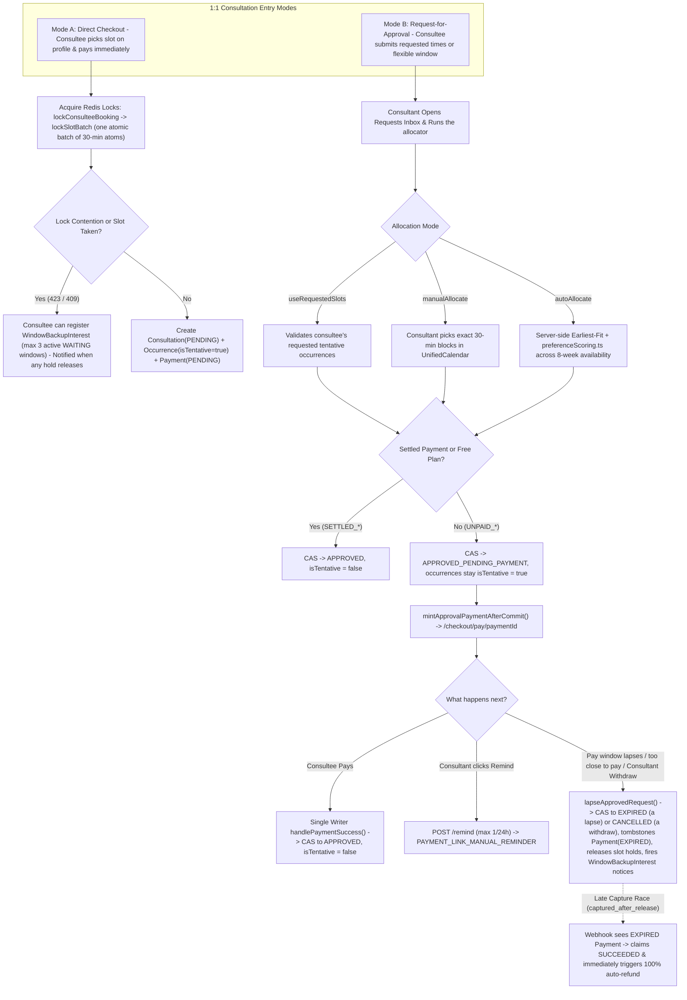
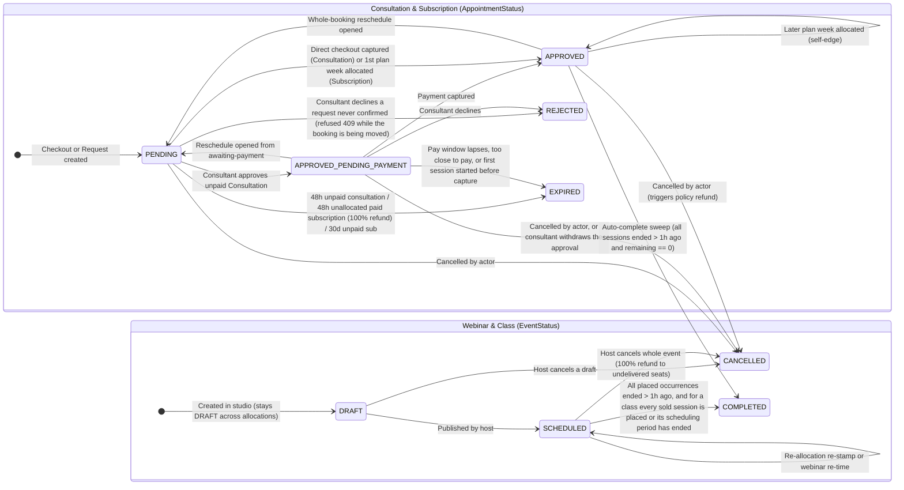
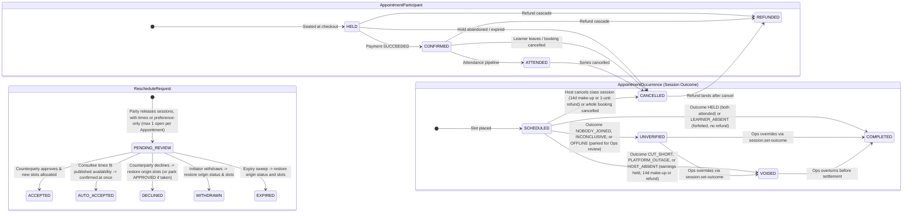

# Booking System — High-Level Design

This document describes the booking system as it is on `dev` today, then marks where the booking productionization program takes it next. Every behaviour is labelled **current** when it is merged on `dev` and **landing in Wave N** when it belongs to an open or planned pull request. The money half of the story lives in [02-money-system-hld.md](./02-money-system-hld.md), and [03-booking-and-money-machinery.md](./03-booking-and-money-machinery.md) holds the seeded cast, the data model and the worked end-to-end examples.

## 1. End-to-end pipeline

```text
 EXPERT SIDE                                   CONSULTEE SIDE
 ───────────                                   ──────────────
 Publish availability                          Explore expert page
  ├ Weekly rows (local clock + IANA zone)            │
  └ Custom rows (absolute timestamptz)               ▼
        │                                   ┌──────────────────────┐
        ▼                                   │ Availability grid    │  GET /api/... (ETag, max-age 30s)
 ┌──────────────────┐   recurrence expand   │ (heatmap cells)      │◄── poll 60s (both grids)
 │ Candidate slots  │──────────────────────►│ available/partial/   │
 │ 30-min atoms     │                       │ full/past/selected   │
 └──────────────────┘                       └──────────┬───────────┘
        ▲                                              │ pick slot
        │ minus OCCUPANCY                              ▼
 ┌──────────────────────────────┐          ┌──────────────────────┐
 │ occupancyPolicy.ts           │          │ Checkout / Request   │
 │  PENDING, APPROVED, APPROVED_│          └──────────┬───────────┘
 │  PENDING_PAYMENT, SCHEDULED, │                     │
 │  trials, co-host seats,      │          ┌──────────┴───────────┐
 │  consultant-as-client,       │          ▼                      ▼
 │  live tentative holds        │   INSTANT (pay now)     REQUEST (approval first)
 │  (dead holds = clock filter) │          │                      │
 └──────────────────────────────┘          ▼                      ▼
                                    HOLD 30 min              Consultation PENDING
                                    tentative occurrence     + tentative slots
                                    + Payment PENDING              │ expert approves
                                           │                      ▼
                                           │               ALLOCATE (auto/manual/requested)
                                           │               → APPROVED_PENDING_PAYMENT
                                           │               → pay-link minted
                                           ▼                      ▼
                                    ┌──────────────────────────────────┐
                                    │ Razorpay capture → webhook       │
                                    │ Payment PENDING→SUCCEEDED (CAS)  │
                                    │ tentative→confirmed occurrence   │
                                    │ EXCLUDE constraint backstop      │
                                    │   (23P01 → auto-refund)          │
                                    └──────────────────────────────────┘
                                                   │
                                                   ▼
                              Session → Stream meeting (lazy) → outcome
                              (auto-complete / no-show / void) → earnings hold → payout
```

The left column is the expert's supply side and the right column is the consultee's demand side. Published availability is cut into 30-minute atoms, the occupancy policy subtracts everything that already commits the expert's time, and the grid shows what is left. A consultee then either pays immediately (instant mode) or asks for approval first (request mode), and in both cases the booking only becomes a confirmed occurrence when the single payment-confirmation writer flips the payment to `SUCCEEDED`.

### 1.1 Guards at the front door

Several checks run before any gateway call or any row is written. The table lists them with their status so that the reader knows which ones exist today.

| Guard                                                                                                                                                                                                                                                                                                                                                                                                                                                            | Refusal                                                                                                                          | Where it lives                                                                                                                                                                                                                                                                                        | Status  |
| ---------------------------------------------------------------------------------------------------------------------------------------------------------------------------------------------------------------------------------------------------------------------------------------------------------------------------------------------------------------------------------------------------------------------------------------------------------------- | -------------------------------------------------------------------------------------------------------------------------------- | ----------------------------------------------------------------------------------------------------------------------------------------------------------------------------------------------------------------------------------------------------------------------------------------------------- | ------- |
| Allocation is a host-side act: only the expert, the plan's host-organisation operators and staff may set times                                                                                                                                                                                                                                                                                                                                                   | 403 `ALLOCATE_FORBIDDEN`                                                                                                         | `lib/scheduling/allocate-route.ts`                                                                                                                                                                                                                                                                    | Current |
| A sponsoring organisation may allocate only a booking the expert has already approved                                                                                                                                                                                                                                                                                                                                                                            | 409 `EXPERT_APPROVAL_REQUIRED`                                                                                                   | `app/api/organizations/[orgId]/appointments/[appointmentId]/allocate/route.ts`                                                                                                                                                                                                                        | Current |
| Only the expert and staff may waive availability rules (`override`), place fewer sessions (`allowPartial`) or top up                                                                                                                                                                                                                                                                                                                                             | The flags are ignored for host-organisation operators                                                                            | `lib/scheduling/allocate-route.ts`                                                                                                                                                                                                                                                                    | Current |
| A webinar or class `PUT` cannot change `status` or re-point relations                                                                                                                                                                                                                                                                                                                                                                                            | 409 `USE_CANCEL_ROUTE`                                                                                                           | `app/api/bookings/webinars/[webinarId]/route.ts`, `app/api/bookings/classes/[classId]/route.ts`                                                                                                                                                                                                       | Current |
| A reschedule accept closes its proposal inside the move transaction                                                                                                                                                                                                                                                                                                                                                                                              | 409 `RESCHEDULE_NO_LONGER_OPEN` rolls the move back                                                                              | `lib/booking/reschedule-respond.ts`, `lib/booking/reschedule-confirm.ts`                                                                                                                                                                                                                              | Current |
| A restore after a withdrawn or expired reschedule refuses an unknown origin status instead of guessing `APPROVED`                                                                                                                                                                                                                                                                                                                                                | Nothing is written and one Sentry report is made                                                                                 | `lib/booking/reschedule-restore.ts`                                                                                                                                                                                                                                                                   | Current |
| A meeting extension never moves the booked `endsAt`; one compare-and-set adds 15 minutes to `Meeting.extendedSeconds` (once), then Stream is mirrored from Postgres                                                                                                                                                                                                                                                                                              | 409 `SESSION_NOT_EXTENDABLE`, 409 `alreadyExtended`, 409 on a schedule conflict, 503 `EXTEND_SYNC_PENDING` (saved, retry)        | `app/api/meetings/[meetingId]/extend/route.ts`, `lib/meetings/duration-cap.ts`                                                                                                                                                                                                                        | Current |
| Booking and money writes fail closed with 503 and `Retry-After` when the maintenance state cannot be read, and four more routes are on the degraded write-block list                                                                                                                                                                                                                                                                                             | 503                                                                                                                              | `lib/maintenance-edge.ts`                                                                                                                                                                                                                                                                             | Current |
| The booked window must match the plan duration on request-for-approval, direct consultation checkout and trial scheduling                                                                                                                                                                                                                                                                                                                                        | 400 `WINDOW_DURATION_MISMATCH`                                                                                                   | `lib/booking/slot-validation.ts`                                                                                                                                                                                                                                                                      | Current |
| A 1:1 request and a trial keep the price they were requested at; a plan edit never changes it (`Consultation.agreedPricePaise`, `Trial.agreedPricePaise`; the sidecar CHECKs `consultation_agreed_price_valid` and `trial_agreed_price_valid` bound them). The length is the booked session's, read by `bookedSessionMinutes`                                                                                                                                    | The approval pay link charges the agreed price, and every later move needs the booked length                                     | `agreedConsultationPricePaise`, `agreedTrialPricePaise` in `lib/booking/sold-terms.ts`; `bookedSessionMinutes` in `lib/appointments/occurrences.ts`                                                                                                                                                   | Current |
| A request is checked against the expert's published hours once, at the request door; once held, it keeps its time for every approver                                                                                                                                                                                                                                                                                                                             | 400 `OUTSIDE_AVAILABILITY` at the door only                                                                                      | `assertSlotsStillPublished` in `app/api/scheduling/request-for-approval/route.ts`; `heldSlotStarts` in `ScheduleValidationService`                                                                                                                                                                    | Current |
| A 1:1 is one consecutive block of its exact length and may cross midnight; the calendar day is not part of the rule                                                                                                                                                                                                                                                                                                                                              | 400 on a gap or a wrong length                                                                                                   | `validateConsultation` in `utils/scheduling-engine/ScheduleValidationService.ts`                                                                                                                                                                                                                      | Current |
| A subscription plan is published, or its cadence (sessions a week or session length) changed, only when the expert's published hours can hold it; a published plan saved unchanged is not re-checked                                                                                                                                                                                                                                                             | 422 `PLAN_NOT_FEASIBLE`                                                                                                          | `lib/booking/feasibility.ts`                                                                                                                                                                                                                                                                          | Current |
| A class given a start must start on the UTC half-hour grid, at least an hour ahead, and place every session                                                                                                                                                                                                                                                                                                                                                      | 400 `EVENT_TIME_INVALID`, before any write                                                                                       | `lib/booking/event-time-rules.ts`                                                                                                                                                                                                                                                                     | Current |
| A booking holding a live, unexpired `PENDING` payment cannot be rescheduled                                                                                                                                                                                                                                                                                                                                                                                      | 409 `PAY_LINK_LIVE`                                                                                                              | `app/api/appointments/[appointmentId]/reschedule/route.ts`                                                                                                                                                                                                                                            | Current |
| A webinar or class re-plan takes the event checkout lock first, so it waits for seat checkouts                                                                                                                                                                                                                                                                                                                                                                   | 409 `EVENT_CHECKOUT_BUSY`                                                                                                        | the event checkout lock in `utils/appointmentlock.ts`                                                                                                                                                                                                                                                 | Current |
| A paused expert (`acceptingRequests = false`) refuses new 1:1 bookings and trials; webinars and classes keep selling                                                                                                                                                                                                                                                                                                                                             | 409 `NOT_ACCEPTING_BOOKINGS`                                                                                                     | the purchasability gate in `lib/payments/checkout/pricing.ts`                                                                                                                                                                                                                                         | Current |
| An expert who is not verified takes no new booking or payment: checkout and its in-lock re-read, free and paid trials, 1:1 requests, the approval of an unpaid request and every approval or trial pay-link mint refuse; their plans are listed and served to the owner only; a moderation reject ends their unpaid links, requests, trial holds and group seats right after it commits, once the gateway clears each order, and bookings already paid still run | 409 `EXPERT_NOT_VERIFIED`; a plan page 404                                                                                       | `assertExpertVerified` in `lib/booking/booking-rule-error.ts`; `assertUnpaidApprovalVerified` in `lib/booking/approval-verification.ts`; `endUnpaidSalesInTx` in `lib/booking/unverified-expert-sales.ts`; `isPublicExpertProfile` and `publicExpertProfileWhere` in `lib/profiles/public-profile.ts` |         |
| A plan checkout counts the expert's other sold plans that are paid or held in a live checkout but not yet placed: their owed weekly sessions are placed first as whole sessions, and the buyer gets only what is left of the first week, checked before the gateway order and again in the commit, under one `request-cap:` lock per expert across the count and the new hold                                                                                    | 409 `NOT_PLACEABLE` when the first week then holds none of the buyer's sessions                                                  | `readUnplacedPlanSessions` (`lib/booking/plan-demand.ts`) through `assessExpertFeasibility`, `lockExpertPlanSales` (`lib/payments/checkout/locks.ts`)                                                                                                                                                 | Current |
| An expert may limit how many people hold one of their plans at once (`maxActivePlanClients`); a current client is never refused by it, and the storefront shows "Fully booked" from a server flag, never the number                                                                                                                                                                                                                                              | 409 `PLAN_CLIENTS_FULL`                                                                                                          | `assertPlanClientRoom` and `planClientsFull` (`lib/booking/plan-demand.ts`)                                                                                                                                                                                                                           | Current |
| Request-for-approval accepts an `Idempotency-Key` stored on the request row                                                                                                                                                                                                                                                                                                                                                                                      | A replay returns the original 201; another user's key answers 422 `IDEMPOTENCY_KEY_REUSED`                                       | `app/api/scheduling/request-for-approval/route.ts`                                                                                                                                                                                                                                                    | Current |
| An expert's open-request cap is counted under one lock per expert, across the count and the insert; a booking being moved (an open reschedule or released sessions) never counts                                                                                                                                                                                                                                                                                 | 409 `CONSULTANT_AT_CAPACITY`; a consultee's own cap of three answers 429 `REQUEST_CAP_REACHED`                                   | `lib/booking/request-caps.ts`, `lockRequestCap` in `utils/appointmentlock.ts`                                                                                                                                                                                                                         | Current |
| A booking being moved is answered, never declined: every decline door refuses it                                                                                                                                                                                                                                                                                                                                                                                 | 409 `USE_RESCHEDULE_RESPOND` (an open proposal), 409 `USE_CANCEL_ENDPOINT` (released sessions with no proposal)                  | `assertNotBeingMoved` in `lib/booking/request-route-guards.ts`                                                                                                                                                                                                                                        | Current |
| No booking is cancelled from 15 minutes before a confirmed session starts until it ends, or after it was delivered                                                                                                                                                                                                                                                                                                                                               | 409 `SESSION_IN_PROGRESS`, 409 `SESSION_ALREADY_DELIVERED`                                                                       | `lib/booking/session-window.ts`                                                                                                                                                                                                                                                                       | Current |
| Every session start obeys one lead time per purpose: book 15 minutes, request and allocate 15 minutes once paid and 2 hours while unpaid, reschedule 24 hours; a pay window always closes 15 minutes before the first session                                                                                                                                                                                                                                    | 409 `REQUEST_TOO_SOON`, 409 `TOO_CLOSE_TO_START`                                                                                 | `leadMsFor` in `lib/booking/lead-time.ts`, `lib/payments/operations/approval-payment.ts`                                                                                                                                                                                                              | Current |
| A 1:1 session, request or trial starts at most 90 days ahead, placed or moved (`MAX_BOOKING_HORIZON_DAYS`); a subscription's plan weeks, a webinar and a class are not bound by it. The grid marks such cells "Too far ahead"                                                                                                                                                                                                                                    | 400 `SLOT_TOO_FAR` at checkout, request-for-approval, trials and the reschedule route; a `[TOO_FAR]` refusal from the allocator  | `isBeyondBookingHorizon` in `lib/booking/lead-time.ts`, `slotStartRefusal` in `lib/payments/utils/slot-validation.ts`, `ScheduleValidationService`                                                                                                                                                    | Current |
| An unanswered request stops holding the expert's time when its hold window passes by the clock (48 hours for a 1:1, 30 days for a plan), swept or not, at the same instant the request caps stop counting it; a booking being moved keeps its hold                                                                                                                                                                                                               | The time reads free on the grid and to every writer; the `expire-stale-requests` sweep then tidies the row and tells the learner | `buildDeadHoldFilter` in `utils/scheduling-engine/occupancyPolicy.ts` and its JS twin `isOccupiedByLiveAppointment`; `requestHoldDeadline` in `lib/dashboard/money-state.ts`                                                                                                                          | Current |

## 2. The 30-minute atom and coverage

```text
Expert availability row:  09:00 ─────────────────────── 12:00
Atoms:                    |09:00|09:30|10:00|10:30|11:00|11:30|
1h plan candidate starts: 09:00 09:30 10:00 10:30 11:00         (start+1h ≤ end)

Union coverage: a booking is valid if EVERY atom it spans is covered
by ANY availability row (findUncoveredAtom), so adjacent rows can combine.
```

Each heatmap cell's status is the share of the cell covered by occupancy, computed on the server. Holds, tentative rows and confirmed rows all render as "Booked", because there is no separate "held" state. The grid asks for the writer it is drawn for (`?purpose=book|request|allocate|reschedule`, plus `unpaid=1`), and the server flags cells that start at or before now plus that writer's lead time ("Too soon"), the same boundary the writer refuses. It returns the lead time it used, and the browser re-applies it between polls, so a cell turns "Too soon" on time. For a subscription the server also flags cells before the open plan week, beyond the plan's weekly or per-day quota, or past its fixed plan end ("Limit reached"), and the footer reads "Week 3 of 26 · 2 of 3 booked". Cells always start on the absolute UTC half-hour, and each one is filed under the viewer's day that its own start falls on, so a viewer in a :45 zone such as Kathmandu still sees every half-hour, and the last half-hour of a day is painted. Every state has a colour and a pattern or icon, drawn from one table in `lib/scheduling/interval-status-tokens.ts`, and the grid draws each day's rows in the viewer's profile time zone, with a switch to the device's zone. On a phone a consultee picks from a day list instead of the grid, held to the same lead time, and the expert page never offers a partly booked window to a buyer. A consultant on a phone cannot use the allocate grid, but can tap "Auto-schedule this week", which runs the auto mode below.

## 3. Allocation modes (`lib/booking/allocation/`)

```text
               ┌─────────────── allocate(eventId, mode) ───────────────┐
               │                                                        │
   mode=auto ──┤ earliest-fit by (day, time-of-day); prefs reorder only │
               │ subscription: a spaced pass (a free day between        │
               │ sessions) first, then the packing pass                 │
               │ deterministic; window 8w (consult) / 4w (webinar) /    │
               │ open plan week (sub) / class dates; 10s search budget  │
   mode=manual ┤ expert picks ISO slots (30-min multiples)              │
   mode=       │                                                        │
   requested ──┤ use consultee's stored tentative slots                 │
               └────────────────────────────┬───────────────────────────┘
                                            ▼
   OUTSIDE TX (under Redis auto-allocate:<cp>):
     search + validate(): availability containment, caps (sessionsPerWeek,
     per-day), scheduling period, lead time (leadMsFor: 15m paid / 2h unpaid), conflicts
                                            ▼
   consultee lock → ONE ATOMIC SLOT BATCH (host + ACCEPTED co-hosts +
     an expert consultee's own calendar); never waits:
       auto: held time → exclude it, re-search (≤2, one 10s budget)
             → else 409 ALLOCATION_RACE
       manual / requested: held time → 409 TIMES_TAKEN (names the times)
                                            ▼
   INSIDE TX (Read Committed):
     pg_advisory_xact_lock(event) → idempotency replay check →
     revalidateConflicts → co-host check → tentative-count check →
     DELETE old rows → CREATE occurrences → CAS parent status
```

The allocation route is the only place that decides who may allocate, and it does so before the service runs. `allocate` (`lib/booking/allocation/allocate.ts`) itself never checks the actor, because the reschedule-accept and auto-confirm paths legitimately call it on behalf of the consultee. Three kinds of caller reach the route:

- The expert (the plan's own consultant) and staff may use every flag.
- An operator of the plan's host organisation may allocate, but only inside the published availability, so `override`, `allowPartial` and `topUp` are ignored for them.
- The sponsoring organisation uses a separate route that fixes those flags to false and narrows the status compare-and-swap to `APPROVED`, so a sponsor can place times on a booking the expert approved but can never approve a pending request on the expert's behalf.

**Worked example, a request survives a plan edit.** On Mon 9 Nov 2026 at 10:00 IST Priya Anderson requests Hannah Anderson's 1:1, which the plan lists at ₹500 (50,000 paise) for 60 minutes, for Thu 12 Nov 10:00 to 11:00 IST. The request door checks the time against Hannah's published hours, finds it inside them, and writes the request with `agreedPricePaise` 50,000, and the request's held session is 60 minutes long. At 12:00 IST Hannah edits the plan to ₹2,000 and 30 minutes; the plan edit freezes the price of any request still without one first, then changes the plan. Later, Hannah shrinks her Thursday hours to end at 10:30 IST. When she approves on Tue 10 Nov, Priya's pay link is ₹500 plus 18 % GST, which is ₹590 (59,000 paise). The approval keeps the requested time even though it now lies partly outside her hours, because "use requested times" treats every requested time as held. If Priya moves the booking later, the new window must be 60 minutes, because that is the length of the session she holds, and it may run across midnight.

The allocator now takes the same 30-minute slot atoms as checkout, after its search and before its write, as one all-or-nothing batch over every calendar the placement makes busy. An allocation and a checkout for the same time therefore serialize: exactly one commits, and the other gets a typed answer. It also refuses a placement inside the lead time (15 minutes for a paid booking, 2 hours for an unpaid one, so the client has time to pay), and it refuses (409 `PROPOSAL_AWAITING_CLIENT`) to place times over the consultant's own open reschedule proposal that names times, because that proposal waits on the client's answer. Two gaps remain:

- It hard-deletes occurrences when it re-plans, which cascades to meetings, attendance and feedback. Until **Wave 3** replaces the delete with a status change, it refuses (409 `SESSION_HAS_REMEDY`) rather than delete a session that carries an incident remedy.
- It does not model buffers or blackout dates, and its only booking horizon is the 90-day limit on a 1:1 (section 1.1). **Wave 3** adds the rest as scheduling rules.

### 3.1 Subscription weeks and reminders

A subscription is paced in fixed plan weeks, computed by `subscriptionEntitlement()` in `lib/booking/entitlement.ts`. Week 1 starts on the plan start's calendar day in the plan's scheduling time zone, and every later week starts seven days after the one before. The consultant may place into the current plan week, or into the next one as soon as the current week is full, but never further ahead. The number they may place now is the plan's sessions per week minus the sessions already held in that week, and never more than the plan has left. Delivering sessions does not open the next week; the calendar does.

For example, Priya buys Arjun's "3 a week for 6 months" plan starting Mon 12 Jan 2026 in Asia/Kolkata. Week 1 is Mon 12 Jan to Sun 18 Jan, and the plan ends on 12 Jul, so it has 26 plan weeks. On Wed 14 Jan, with Mon and Wed placed, the allocate heading reads "Week 1 of 26 · pick 1 for 14 Jan – 18 Jan 2026 · 2 of 72 booked". Once Fri is placed, week 2 (19–25 Jan) opens at once, and once week 2 is full too the heading reads "Week 2 of 26 is set · next opens" followed by 26 Jan. The auto search tries Mon/Wed/Fri before Mon/Tue/Wed, because it first keeps a free day between sessions and only packs them when spacing would leave a session unplaced.

Nothing is placed on a calendar unless a person clicks. Two things keep a plan moving without the consultant remembering:

- **Reminders.** `nudgeUnplacedPlanWeeks()` in `lib/booking/week-nudge.ts` runs inside the `expire-stale-requests` job. For an `APPROVED` plan with at least one confirmed session and no move in flight, when the **current** plan week still has sessions to place, the consultant is reminded from 09:00 on the week's first day in their own zone, again the next day and three days after the first (days 0, 1 and 3: Monday, Tuesday and Thursday for a week that starts on Monday), only between 08:00 and 21:00 local and outside their quiet hours. Every plan follows the same three days, however its earlier weeks were placed. A consultant gets one bell and one email a day that list every plan due (the email has an "Auto-schedule this week" button per plan). A week opened early by filling the current one is never nagged. The outbox `transactionId` and the email's `entityRef` (per consultant and local day) dedupe it, and the scan pages consultants by id from a start that moves every hour and wraps, reading each one's plans in full, so no consultant is missed and no daily reminder is split.
- **One tap.** The reminder opens the allocate page, where "Auto-schedule this week" runs one auto allocation for the open week. No background job places a week: the hourly `reconcile-occurrence-availability` sweep only clears stale tentative flags, detects double bookings and reports appointments with no live seat. Each allocation records how its batch was placed (`schedule:auto`, `schedule:by-hand` or `schedule:reschedule`) as the `reason` on its history row (`lib/booking/allocation/schedule-choice.ts`); the timeline shows it in words, and nothing else reads it.
- **The phone.** The allocate page on a phone offers "Auto-schedule this week", one auto allocation (a top-up for a plan that already has sessions); the desktop Auto button reads the same for a plan.

The consultee's cycle-done notice says "Your latest {plan} sessions are done" and claims no week number, because it can fire while a session of that week is still unplaced. The booking card reads "Week done · the next 3 to be scheduled." for either side, only while a week is open to place into. A plan that ended with sessions never delivered reads "Plan ended · N sessions were not held.", plus the plan-end refund once it is stored ("₹X refunded.").

## 4. Concurrency layers

```text
 Layer 1  Redis locks (fail-CLOSED → 503)
          global order: event-checkout → appointment → approval →
            auto-allocate:<cp> | request-cap:<cp> → consultee →
            ONE ATOMIC BATCH of slot-booking:<cp>:<atom>
          every writer that makes host time busy takes the batch:
            checkout, request, trial, allocator (all modes), event
            create/publish/re-time, make-up, co-host accept, extension
          Lua all-or-nothing, 1.5s Redis timeout → 503 when slow
 Layer 2  Postgres isolation
          checkout + capture = SERIALIZABLE (+ retry P2034/40P01)
          allocation / cancel / reschedule = READ COMMITTED
 Layer 3  CAS-in-WHERE status helpers (transitions.ts, 7 helpers)
          illegal edge → 0 rows → IllegalTransitionError 409
 Layer 4  DB constraints
          occurrence_no_confirmed_overlap (EXCLUDE, CONFIRMED host rows only)
          wallet ≥ 0 CHECK, uniques (idempotency key, one open reschedule)
```

The one database constraint that protects time is `occurrence_no_confirmed_overlap`, defined in `prisma/sql/check-constraints.sql`. It is a `btree_gist` exclusion on `AppointmentOccurrence` keyed on the host's `consultantProfileId` and `tstzrange("startsAt", "endsAt")`, and it applies only to rows that are not tentative, not tombstoned (`deletedAt IS NULL`) and not `CANCELLED` or `RESCHEDULED`. Because every occurrence of every offering type carries its host's `consultantProfileId`, the constraint covers consultations, subscription sessions, webinars, classes and trials alike, but only for the host side. Tentative holds, co-host overlaps, consultant-as-client overlaps, consultee overlaps and seat capacity are enforced by application code alone today, and Wave 3 moves them into the database. In application code the slot batch covers more than the host: it includes each ACCEPTED co-host and, when the buyer is an expert too, the buyer's own calendar, so those overlaps are serialized by Redis and re-checked inside the transaction.

```mermaid
flowchart LR
  subgraph L0["Layer 0: Postgres Triggers & Constraints"]
    T1["ledger_txn_balanced (DEFERRABLE INITIALLY DEFERRED): Sum DEBIT == Sum CREDIT"]
    T2["payment_legs_sum_to_amount: Sum funding legs == Payment.amount"]
    T3["occurrence_no_confirmed_overlap (GiST): No overlapping non-tentative slots per consultant"]
    T4["~30 CHECK constraints: wallet_nonnegative, rate_card_bps_sum_is_whole, etc."]
  end

  subgraph L1_L2["Layer 1 & 2: CAS-in-WHERE + Serializable Retry"]
    CAS["updateMany WHERE status IN ALLOWED_FROM (count == 0 -> lost race)"]
    SSI["withSerializableRetry() on P2034 serialization conflicts"]
  end

  subgraph L4["Layer 4: Redis Locks (Coordination Only)"]
    RL["lockConsulteeBooking -> tryLockSlotBatch (one atomic batch of 30-min atoms) & withCronLock (fail-closed for money jobs)"]
  end

  subgraph Reconciler["Nightly Control Loop (reconcile-ledgers.ts)"]
    R_CHK["Verifies 26 invariants across Journal, Wallet caches, Earnings caches, Program counters, Invoices, and TDS"]
    R_FRZ["On WALLET_BALANCE_DRIFT: Calls freezeWalletSpend() & pages Sentry"]
  end

  RL --> SSI --> CAS --> L0 --> Reconciler
```



### 4.1 The serializable retry engine

Under PostgreSQL `SERIALIZABLE` isolation, concurrent transactions with overlapping read and write sets are aborted by the database (`SQLSTATE 40001`, mapped by Prisma to `P2034`). `withSerializableRetry` in `lib/db/serializable-retry.ts` catches that error, waits `50 * 2^attempt` milliseconds plus up to 25 ms of jitter, and runs the transaction again from the top, up to three retries. On the retry the second writer now sees the slot taken and answers 409.

```text
Writer A (Learner 1 Checkout)             Writer B (Learner 2 Checkout)
+---------------------------------+       +---------------------------------+
| BEGIN (SERIALIZABLE)            |       | BEGIN (SERIALIZABLE)            |
| Read Slot Availability (Free)   |       | Read Slot Availability (Free)   |
| Write Occurrence Hold           |       | Write Occurrence Hold           |
| COMMIT -> OK                    |       | COMMIT                          |
+---------------------------------+       +----------------+----------------+
                                                           |
                                                           v
                                                ERROR: P2034 (40001)
                                                           |
                                                           v
                                            withSerializableRetry() catches P2034
                                            Retries transaction from the top
                                            (Now sees Slot Taken -> Rejects 409)
```

The engine retries serialization failures and deadlocks (`40P01`) only. A serialization failure raised at `COMMIT` arrives as an unmapped driver-adapter error rather than `P2034`, and `isWriteConflict` in `lib/db/pg-errors.ts` recognises both shapes, so a commit-time conflict is retried like any other. Validation errors, foreign-key violations (`P2003`) and `IllegalTransitionError` are business refusals and fail on the first attempt. Everything inside the closure must be a pure database mutation with no uncommitted external side effect, because the closure may run up to four times.

## 5. Booking modes and contention



Instant mode locks the consultee and then every 30-minute atom of the interval as one atomic batch, creates the tentative occurrence and a pending payment in one Serializable transaction, and waits for the capture. Request mode first takes the expert's `request-cap:` lock, so the expert's open-request cap is counted and enforced in one step, then the same consultee lock and slot batch, and writes a `PENDING` consultation with a tentative occurrence, and that occurrence does block the expert's calendar: `OCCUPIED_REQUEST_STATUSES` in `utils/scheduling-engine/occupancyPolicy.ts` counts `PENDING` as occupied, so no other checkout or request can take the time until the expert declines the request or its hold window passes by the clock (48 hours for a 1:1, 30 days for a plan), whichever comes first. An approval keeps the time for the booking. What request mode defers is the money, and a consultee may hold at most three such pending requests at once (`MAX_ACTIVE_REQUESTS_PER_USER` in `lib/booking/request-caps.ts`). A request that is already settled (a free plan or an existing `SUCCEEDED` payment) lands directly in `APPROVED`; an unpaid one lands in `APPROVED_PENDING_PAYMENT` and mints its pay order after the commit. The pay window is 24 hours but always closes 15 minutes before the first session; if less than 30 minutes would be left, no link is minted and the approval lapses to `EXPIRED`. A capture that arrives after the first session started closes the request as `EXPIRED` and refunds in full.

When the allocator and a checkout want the same time, they meet at the slot batch. Neither waits on the other's held time for long: the checkout retries briefly inside its request budget, and the allocator either searches around the held time (auto mode) or answers 409 `TIMES_TAKEN` naming the times (manual and requested modes). A webinar or class seat checkout holds the event's lock only around its database commit and mints the gateway order afterwards, so one buyer's gateway round trip never queues the next buyer. The seat holds for 12 minutes plus a 3-minute capture grace, and a seat whose payment lapsed stops counting at once.

### 5.1 Notify me on a sold-out webinar or class

A webinar or class that has no seat left offers a signed-in learner a "Notify me" button. It is notify-only: nothing is reserved, nobody is queued ahead of anybody, and there is no offer window. When a seat frees, every waiter hears at once and the first to pay gets it. The list lives in `AppointmentWaitlist` (one row per learner per event, unique on the appointment and the user), and the decision record is [the event seat waitlist decision](../decisions/2026-11-07-event-seat-waitlist.md).

**Example.** Hannah Anderson's webinar costs ₹500 (50,000 paise) and has two seats, both paid on Mon 9 Nov 2026. Priya Anderson and Raj open the page at 10:00 IST, see "Sold out" and press "Notify me". Each row is `WAITING`. At 11:30 IST one buyer leaves the webinar. In the same transaction that frees the seat, `stageSeatOpenedNotices` flips both rows to `NOTIFIED` (`notifiedAt` 11:30 IST) in one compare-and-set and stages a bell for each. After the commit, `finishSeatOpenedNotices` sends the bells and stages one email each, and both messages link straight to checkout. Priya pays first and her row becomes `BOOKED`; Raj finds the seat gone. If a second seat frees at 15:00 IST the same day, Raj is not told again, because a notified waiter is eligible again only after 12 hours (`INTEREST_RENOTIFY_COOLDOWN_MS`), so a waiter gets at most two notices a day per event. A new notice at 23:45 IST would reach Raj, still `NOTIFIED`, and it ignores quiet hours.

Who may join, and what keeps it small:

- The learner must be signed in, may view the plan, and must not be the host or an accepted co-host. The route is `POST /api/scheduling/event-waitlist`, and the middleware already requires a session under `/api/scheduling/`.
- The event must be sold out. If a seat remains, the join is refused with `EVENT_NOT_FULL`, so the button never competes with checkout. A host can switch the waitlist off per plan (`waitlistEnabled`) and cap it (`waitlistMax`, never above 200).
- A learner can wait on at most five sessions (`EVENT_WAITLIST_USER_CAP`), and a learner who already holds a seat or may not buy one again (a removed, refunded, or left paid or credit-funded seat) is refused with the checkout's own messages (`seatRebuyRefusal` in `lib/payments/checkout/seats.ts`); a learner who left a price-free seat may wait and rejoin.

Which seat releases notify: a learner leaving or the host removing an attendee (`leaveEventSeat`), an unpaid hold lapsing (`releaseGroupSeats` in the abandoned-payments sweep), a buyer abandoning or cancelling a pending checkout (`abandonSeat`, `cancel-pending.ts`), and the host raising capacity above the enrolled count. Two doors are deliberately left silent: a whole-event cancel, which the expiry arm of the stale-requests job closes within 15 minutes, and rare admin doors (admin seat refund, moderation, organisation member removal). The database makes a double notice impossible: the compare-and-set carries the status and the cooldown in its `WHERE`, so two releases at once notify each waiter once. The bell is durable because it is staged in the releasing transaction. The email is best-effort, because it is staged after the commit and is lost if the process dies in between.

For an organisation-only plan, only active members of that organisation are notified and the bell carries the organisation's scope. A host or an accepted co-host sees only a count, never names: "N waiting" on the participants page, on each webinar or class card (`waitingCount` in the planner payload, one grouped read per request), and in the editor (`waitingCount` on the plan's offering-stats row), where switching the waitlist off asks first because every open row on the plan then expires. A learner reads their own open rows through `GET /api/scheduling/event-waitlist`. A waiting row ends as `BOOKED` when the learner pays (or gets a no-payment seat), as `EXPIRED` when they leave or the event ends, and is deleted 30 days after its last change or on erasure.

The capacity a host edits is the event's effective capacity: the instance override when there is one, otherwise the plan's default. The editor loads that value from the host-only editor read (`GET /api/plans/webinars/{id}/editor` or `/api/plans/classes/{id}/editor`), which is never cached, because the public plan GET is held by the CDN for up to a minute and a stale copy once raised a capacity on a no-edit save. A save sends `maxParticipants` only when the host changed the field (`withoutUntouchedCapacity` in `components/offerings/editor/adapters.ts`), and a save that sends a value equal to the plan's default stores no override (`capacityOverrideFor` in `lib/events/capacity.ts`). So a title-only save never pins an override and never stages a notice, while a real raise above the enrolled count still notifies the waiters. In the example above, Hannah's plan default is 2; saving the editor unchanged writes nothing, and raising it to 3 writes an override of 3 and tells Priya and Raj at once.

### 5.2 Notify me on a 1:1 time someone holds

Slot backup interest (`WindowBackupInterest`) is the same idea for a 1:1 window another learner holds: a learner may wait on at most three windows, and a release path tells every eligible learner at once. Both lists share one lifecycle in `lib/booking/interest/lifecycle.ts`: a `NOTIFIED` row becomes eligible again 12 hours after its last notice while its window has not started, each notice is keyed on the row and its 12-hour bucket so a row hears at most once per bucket, and settled rows are deleted after 30 days by the `expire-stale-requests` run. For example, Priya is told at 10:00 IST on Mon 9 Nov that Hannah's 18:00 IST Wednesday slot opened, but Raj books it first and then cancels at 23:00 IST; Priya is told again, because her last notice was 13 hours earlier. Had Raj cancelled at 21:00 IST instead, only 11 hours after her notice, Priya would not have been told a second time.

---

## 6. Lifecycle and state machines

```text
            ┌──────────┐ approve+alloc ┌───────────────────────┐ capture ┌───────────┐
 create ───►│ PENDING  │──────────────►│APPROVED_PENDING_PAYMENT│────────►│ APPROVED  │
            └────┬─────┘               └───────────┬───────────┘         └─────┬─────┘
                 │reject                           │pay-link lapses             │sessions end
                 ▼                                 ▼                            ▼
            REJECTED                            EXPIRED                    COMPLETED
   (any live state) ── cancel ──► CANCELLED      (reschedule: → PENDING, then restore/accept)
```

The generated reference for every transition map is [docs/booking/18-state-machines.md](../booking/18-state-machines.md); the code in `lib/booking/transitions.ts` is the single source of legality, and the diagrams below project it.

### 6.1 Request and group-event status



### 6.2 Participant seat, reschedule request and session outcome



The approved-but-unpaid request has two honest endings. When the window runs out (the pay-link lapses, the window is too short to open, or the session starts before the money lands) the request is `EXPIRED`. When the consultant withdraws the approval, a party with standing ended it, so it is `CANCELLED` (`lapseApprovedRequest` in `lib/booking/lapse-approved-request.ts`). A webinar or class has no "in progress" status: an event goes from `SCHEDULED` straight to `COMPLETED` or `CANCELLED`, and "under way" is read from the clock.

A completed trial counts as converted only once a plan with the same expert is paid for. `convertCompletedTrial()` in `lib/trials/conversion.ts` moves the trial from `COMPLETED` to `CONVERTED` and stamps `convertedToSubscriptionId`, either when the subscription's payment is captured or at a checkout that settles with no gateway; a learner who starts checkout and walks away leaves the trial `COMPLETED`. Any plan of the same expert counts, not only the plan that was trialled, as long as it is paid within 30 days of the trial's completion.

Cancelling is refused from 15 minutes before a confirmed session starts until it ends, and after a session was delivered with nothing still owed (409 `SESSION_IN_PROGRESS` or `SESSION_ALREADY_DELIVERED`, `lib/booking/session-window.ts`); the outcome sweep settles those sessions instead. A cancel's compare-and-swap is pinned to the status it read, and its own commit expires the live payment, so a capture that lands mid-cancel makes the cancel re-quote instead of ending a paid booking for free. A released session whose original time passed with no replacement counts as full notice when the booking is cancelled, unless the consultee released it themselves, in which case the notice they gave still caps the refund. The consultant's cancel dialog says "Priya gets a full refund of ₹1,180.00 (118,000 paise). Cancelling a paid booking counts against your reliability." with the buttons "Keep booking" and "Cancel and refund"; the consultee's confirm button reads "Cancel booking".

Every party release opens a `RescheduleRequest`. With proposed times it is a proposal; with none ("any time works") it is preference-only, and the expert places the new time. Either way it holds the one-open reservation, can be withdrawn, and expires back to the original time. The release records the parent's prior status (`originStatus`) and the sessions it released (`releasedSessions`), so a restore is exact, and a restored request is stamped `restoredAt` and costs no reschedule. A consultee may move each session twice; an expert may reschedule a booking twice. A published webinar is never rescheduled: its host re-times it in one step, attendees busy at the new time are flagged rather than blocking it, and anyone who bought before the move may leave with a full refund until `retimeBy` (at most seven days, never past the new start).

A reschedule confirmation is one transaction: the allocator commits the new times and, through its `inTx` hook, flips the proposal from `PENDING_REVIEW` to `ACCEPTED` (the counterparty accepted) or `AUTO_ACCEPTED` (a consultee's times landed in the expert's published hours with both calendars free) in the same commit. If the proposal is no longer open, the whole move rolls back with 409 `RESCHEDULE_NO_LONGER_OPEN`. A proposal nobody answers is never auto-accepted: the `reschedule-proposals` sweep moves it to `EXPIRED` and restores the original time.

A booking being moved is answered, never declined. Every status door (the consultation and subscription list and detail `PATCH` to `REJECTED`, and the detail `PATCH` to `APPROVED`) calls `assertNotBeingMoved()` in `lib/booking/request-route-guards.ts` and carries `NOT_BEING_MOVED` in its CAS WHERE: an open proposal answers 409 `USE_RESCHEDULE_RESPOND`, and released sessions with no proposal answer 409 `USE_CANCEL_ENDPOINT` (decline) or `PLACE_RELEASED_SESSIONS` (approve). The Requests inbox offers the matching answers instead of Approve and Decline:

| The booking is being moved because              | Primary action                                   | Other action                                |
| ----------------------------------------------- | ------------------------------------------------ | ------------------------------------------- |
| The client proposed new times                   | "Accept new times" (respond accept)              | "Keep the original time" (respond decline)  |
| The client released a session, "any time works" | "Pick a new time" (the allocator)                | "Keep the original time"                    |
| The consultant proposed new times               | none; the row sits under "Waiting on the client" | "Withdraw my request" (reschedule withdraw) |
| The consultant released a session with no times | "Pick a new time"                                | "Withdraw my request"                       |
| Sessions are released and no proposal is left   | "Pick a new time"                                | none                                        |

A row's clock is the proposal's `expiresAt`. The inbox buckets rows by who acts next: a request to answer, and sessions to schedule (a paid plan's first week or its open plan week), are the consultant's and are banded by deadline ("This week" when a plan week has no clock of its own); a pay link, a checkout in progress and the consultant's own proposal with times sit under "Waiting on the client". The "requests to answer" badge (`countRequestsToAnswer()` in `lib/data/needs-you.ts`) leaves out the consultant's own open proposals with times, and the request caps leave out every booking being moved.

## 7. Session outcomes

One hour after any `SCHEDULED` occurrence's `endsAt`, the `auto-complete-appointments` sweep (every 30 minutes on the ticker) runs `classifySessionOutcome()` in `lib/booking/session-outcome.ts` over device-level presence intervals and maintenance windows. The decision records are [ADR 2026-09-25](../decisions/2026-09-25-session-outcomes.md) and [Session outcomes from Stream's settled record](../decisions/2026-11-22-session-outcomes-from-settled-stream-record.md).

The intervals are Stream's own settled record of the call, never a webhook mirror. `decideSlotOutcome()` in `lib/booking/session-outcome-sweep.ts` first checks for a declared incident, which voids the session without any read. Otherwise it calls `settleOccurrenceAttendance()` in `lib/meetings/settle-attendance.ts`, which asks Stream for every call id the occurrence used (the current one plus each rotation Stream lists under `custom.occurrenceId`) and every session of each call, and accepts the answer only after Stream has announced each session's report ready (`call.stats_report_ready`; 6 hours past the room end it reads without the announcement only when our webhooks corroborate the session list), and when every session has ended, none is live, the call's own current session is listed and ended, an announced session ended after the booked start (before that fallback, so a camera check at 09:50 cannot stand in for a 10:00 session), and the device stays collected equal the detail's own total exactly and reach at least session stats' counts of stays and people. It then stores them in one transaction as `MeetingPresence` rows with `Meeting.attendanceSettledAt`. Nothing is read before the room end plus the 30-minute rejoin grace, and an empty record (a call nobody joined) is believed only six hours past the room end (`REPORT_READY_FALLBACK_MS`), since no session can announce a report. When Stream is unreachable or not final, nothing is stored, the session stays `SCHEDULED`, and the next run tries again; after 72 hours past the booked end it is parked `UNVERIFIED` as `INCONCLUSIVE` with no host attribution, named once per run as a standing finding, and ops can ask Stream again from the queue until day 80. The outcome is written only if the room's end and call id are unchanged once the write holds the occurrence and room locks; otherwise the session stays `SCHEDULED` for the next run. The consultant no-show detector and the rating gate call the same settle step and act only on a stored record.

| Verdict (`SessionOutcome`)                 | Occurrence status                          | Who was present and the rule                                                                                                                                                                                                                                                                                                                                                                                                                                                                                           | Financial and booking effect                                                                                                                                                                                                               |
| :----------------------------------------- | :----------------------------------------- | :--------------------------------------------------------------------------------------------------------------------------------------------------------------------------------------------------------------------------------------------------------------------------------------------------------------------------------------------------------------------------------------------------------------------------------------------------------------------------------------------------------------------- | :----------------------------------------------------------------------------------------------------------------------------------------------------------------------------------------------------------------------------------------- |
| `HELD`                                     | `COMPLETED`                                | The host side and a learner both joined, and the host-side absence was shorter than min(15 min, duration / 2).                                                                                                                                                                                                                                                                                                                                                                                                         | Normal completion. Earnings release after `holdUntil`.                                                                                                                                                                                     |
| `LEARNER_ABSENT`                           | `COMPLETED`                                | The host was present and no learner joined.                                                                                                                                                                                                                                                                                                                                                                                                                                                                            | The learner forfeits the session. The expert is paid in full and nothing is refunded.                                                                                                                                                      |
| `HOST_ABSENT`                              | `VOIDED`, or the consultation is cancelled | A learner waited and no host-side person ever joined.                                                                                                                                                                                                                                                                                                                                                                                                                                                                  | A consultation is claimed by `detect-consultant-no-shows`, cancelled and refunded in full. A class or webinar void gets a 14-day make-up window and then a one-unit refund. A subscription void returns the session to the plan allowance. |
| `CUT_SHORT`                                | `VOIDED`                                   | The host dropped while learners stayed for at least min(15 min, duration / 2).                                                                                                                                                                                                                                                                                                                                                                                                                                         | A host-attributed miss that counts toward the class reliability flag. The remedy is the same 14-day make-up or refund.                                                                                                                     |
| `PLATFORM_OUTAGE`                          | `VOIDED`                                   | The session overlapped an ops-declared platform incident (checked before any other rule, with no loss threshold), or the net loss reached the void line of min(15 min, duration / 2) and the platform's share of it was larger than the host's. Minutes count as platform loss when they fall in a degraded or offline maintenance window, or after everyone left within five minutes (`RECONNECT_GRACE_MINUTES`) of each other without a host's deliberate end; a simultaneous departure alone never voids a session. | Counts toward a learner's class exit right but never toward the host's reliability flag. A declared incident also makes every learner whole (see below).                                                                                   |
| `NOBODY_JOINED`, `INCONCLUSIVE`, `OFFLINE` | `UNVERIFIED`                               | Stream's settled record shows nobody, Stream's record could not be read within 72 hours, or no room was created.                                                                                                                                                                                                                                                                                                                                                                                                       | A doubtful verdict never moves money automatically. The session waits in the Backoffice needs-human queue (see below).                                                                                                                     |

A session waiting for a human is defined once, as `AWAITING_HUMAN` in `lib/booking/misses.ts`. It covers every `INCONCLUSIVE` verdict, a consultation host no-show the detector declined, a call the maintenance drain cut, and a `NOBODY_JOINED` or `OFFLINE` verdict on a booking that has a `SUCCEEDED` payment of any rail (card, credits or organisation funding). The same predicate keeps the booking from auto-completing in `auto-complete-appointments`, keeps its earnings `PENDING` in `release-earnings`, and lists the session on the Appointments page's "Sessions that need a decision" card (`readSessionsNeedingHuman()` in `lib/backoffice/session-outcomes.ts`). The door is **Set outcome** (`session.set-outcome`): an attended outcome completes the session and lets the booking complete and its earnings release, and a void outcome hands it to the 14-day make-up or refund machinery in `settle-cancelled-sessions`. Nothing is refunded or released while the session waits, an item older than 72 hours is recorded as a standing finding that is not repeated the same day while the waiting set is unchanged, and an item older than 7 days escalates with a Sentry warning once per new session per day (`escalateAgedNeedsHuman`) and heads the card, because plan-end settlement waits on it. A free session where nobody joined, such as an unpaid trial, has no money to hold, so its booking completes without waiting for ops.

**Example.** Priya Anderson pays ₹1,180 (118,000 paise) for a 1-hour consultation with Hannah Anderson on Mon 19 Oct 2026 at 18:00 IST. Hannah opens the room, so a call exists, but neither of them joins it. The room ends at 19:00 IST, and Stream's empty record is believed only from 01:00 IST on Tue 20 Oct, six hours later; the first slot pass after that writes `NOBODY_JOINED` and `UNVERIFIED`. The consultation stays `SCHEDULED`, Hannah's earning stays `PENDING` past its 48-hour hold, and the session appears on the ops card until an operator sets an outcome.

A platform-wide outage leaves no presence evidence, so without help it could be misread as a learner absence (a forfeit) or a host absence. Ops therefore declare an incident window in the back office (Money, Incidents tab; see [the money console](../finance/70-operations/02-admin-money-doors.md#platform-incidents)). `classifySessionOutcome()` checks the declared windows first: a session whose booked interval overlaps one at all is `PLATFORM_OUTAGE`, before any absence verdict, because ops chose the window. A maintenance window is weaker: its minutes count as platform loss rather than host loss, so a void is `PLATFORM_OUTAGE` only when platform loss exceeds host loss, and when no host-side person ever joined the overlap turns a possible `HOST_ABSENT` into `INCONCLUSIVE`. The no-show detector claims only `HOST_ABSENT` verdicts, so it never claims, cancels or strikes a session inside a declared window, and the expert reliability count (`countExpertStrikes()` in `lib/booking/expert-reliability.ts`) drops any strike on an appointment that has a session inside one.

**Example.** Hannah Anderson's 1-hour consultation with the learner Priya Anderson, paid by card, runs Sun 18 Oct 2026 01:15 IST and the call platform is down, so nobody ever joins. Ops declare the window 18 Oct 2026 00:30 to 02:30 IST. Once the session is an hour past its booked end, the next hourly run of the `settle-platform-incidents` sweep moves the session to `VOIDED` with outcome `PLATFORM_OUTAGE` (the learner's money is untouched by any forfeit rule), writes a refund remedy for Priya's seat due 48 hours later, and at that time refunds her full ₹1,180 (118,000 paise), with the platform bearing the gateway fee. Hannah gets no strike, even if the no-show detector would otherwise have read the empty room as a host absence.

What each product's learner gets is a property of the sweep (`lib/booking/platform-incidents.ts`, `scripts/appointments/settle-platform-incidents.ts`):

| Product      | Remedy                                                                                                          |
| ------------ | --------------------------------------------------------------------------------------------------------------- |
| Consultation | Full refund of the remaining balance 48 hours after the void.                                                   |
| Paid trial   | Full refund 48 hours after the void; the trial is cancelled in the same commit, which frees the expert pair.    |
| Free trial   | The trial is cancelled straight away, which frees the pair so the learner can ask again.                        |
| Subscription | The session returns to the allowance and the plan end moves seven days later, straight away.                    |
| Webinar      | Full refund of the seat straight away.                                                                          |
| Class        | Nothing beyond the void: the existing 14-day make-up window, then a one-unit refund, or the exit right applies. |

The free-rebook offer within 48 hours for a voided one-to-one session is landing next (W1-b2); until then the learner's choice is the refund. A re-run door for a voided webinar is tracked in #2185.

## 8. Maintenance sweeps and the cron architecture

Every scheduled job runs on the Netlify scheduled ticker, `netlify/functions/cron-tick.mts`, which fires every five minutes and posts `CRON_SECRET`-gated requests to `/api/cleanup/<job>`. Each target has its own cadence in `TARGET_EVERY_MINUTES`, its own batch size in `TARGET_LIMITS`, and a phase offset so that no tick fires more than twelve targets (the busiest fires 11). Every job is one function registered once in `lib/cron/cleanup-registry.ts` and wrapped in `withCronLock`, which is backed by the `SystemJobExecution` lease in Postgres. No GitHub Actions workflow schedules a job, so a registered job that is missing from the ticker runs nowhere.

| Sweep                                                                 | Cadence and batch       | What it releases                                                                  |
| --------------------------------------------------------------------- | ----------------------- | --------------------------------------------------------------------------------- |
| `abandoned-payments`                                                  | 15 min, 10 payments     | Lapsed holds and seats, and lapsed approval pay-links                             |
| `tentative-occurrences`                                               | 15 min, 200 rows        | Stale tentatives older than 24 hours                                              |
| `expire-stale-requests`                                               | 15 min, 20 rows per arm | Unanswered requests and unpaid pay-links, moved to `EXPIRED`; plan-week reminders |
| `reschedule-proposals`                                                | 15 min, 25 rows         | Unanswered reschedule proposals, restored to their origin                         |
| `auto-complete-appointments`                                          | 30 min, 25 rows         | Session outcomes, then the earnings hold or a refund                              |
| `detect-consultant-no-shows`                                          | 30 min, 10 rows         | Consultant no-show cancellations with a full refund                               |
| `settle-cancelled-sessions`                                           | 30 min, 10 sessions     | One-unit refunds for host-cancelled class sessions nobody made up                 |
| `reconcile-payment-status`, `reconcile-refunds`, `retry-auto-refunds` | 15 min                  | Money healing against the gateway                                                 |

Every job is guarded by `withCronLock` (`lib/cron/with-cron-lock.ts`) and by a partial unique index on the lease table, so two runs of one job can never both hold the lease:

```sql
CREATE UNIQUE INDEX "SystemJobExecution_running_jobName_key"
  ON "SystemJobExecution" ("jobName")
  WHERE "status" = 'RUNNING';
```

Money sweeps use `failMode: "closed"` and abort when the lease cannot be verified, because a skipped sweep is safer than a duplicate dunning, invoice or payout run. Idempotent cleanup sweeps use `failMode: "open"` and proceed with a warning.

Every sweep repeats the money predicate in its compare-and-swap, so it never expires a paid booking. The two session-outcome sweeps have no GitHub Actions twin: the batch sizes above are the only throughput they have, which is 50 sessions an hour for auto-complete and 20 for the no-show detector. Landing in Wave 0 (W0-4), a time-boxed drain loop will clear a backlog inside one lease instead of one batch per tick. The full per-job reference is [docs/booking/13-cron-jobs-and-background-tasks.md](../booking/13-cron-jobs-and-background-tasks.md).

## 9. Target state (Waves 0–3)

```text
                  ┌────────────────────────────────────────┐
  checkout ──────►│  claimBlocks(tx, persons[], range)     │◄────── allocator
  allocator       │   1. UPDATE expired HELD → RELEASED    │        reschedule
  reschedule ────►│      (clock_timestamp())               │        blackouts
                  │   2. INSERT CalendarBlock HELD/CONFIRMED│
                  │      canonical personId order          │
                  └───────────────┬────────────────────────┘
                                  ▼
          CalendarBlock (host, co-host, as-client, consultee)
          EXCLUDE USING gist (personId WITH =, busyRange WITH &&)
            WHERE status IN (HELD, CONFIRMED)
          busyRange = raw range + end-buffer (0/30/60, host side only)
                                  │
                  23P01 = loser → 409 / auto-refund on late capture
          Seats: counter + CHECK (seatsHeld ≤ capacity)
```

In the target state Postgres is the only arbiter of time and capacity, and Redis keeps rate limits and short interactive mutexes. The waves get there in this order:

- **Wave 0** fixes the defects that exist on today's schema: authorization and checkout correctness (both merged), durable "refund owed" markers, correctly scoped sweeps, a 60-second consultee grid poll that is freshness only and never correctness, and the subscription session-return policy.
- **Wave 1** flips the availability readers to per-date daylight-saving offsets computed from the IANA zone, and adds platform-incident voiding (landed: ops declare an incident, every eligible overlapping session is voided and each learner gets the remedy for their product; the free-rebook offer is landing next). Seat transfer is deferred until after launch, and it would cover webinars only if it is ever built (#2140).
- **Wave 2** (landed) split the allocator and checkout along their module seams without changing behaviour: the allocator is now `lib/booking/allocation/` and checkout is `lib/payments/checkout/`.
- **Wave 3** lands inside the owner's database reset window: the schema batch, the busy-time ledger that makes the database the arbiter of every person's time, and the scheduling rules.
- **Wave 4** proves it with a concurrency harness on real Postgres, which is the launch gate. The first real-Postgres race suites already run in CI (`__tests__/db/booking/`), pinning each writer pair on today's schema.

The end-state invariants and what enforces each of them:

| Invariant                                                                       | Enforced by                                                                                                                                                                                             |
| ------------------------------------------------------------------------------- | ------------------------------------------------------------------------------------------------------------------------------------------------------------------------------------------------------- |
| A person is never in two live commitments (host, co-host, as-client, consultee) | Exclusion constraint on live `CalendarBlock` rows (Wave 3)                                                                                                                                              |
| Seats never exceed capacity                                                     | Counter with a CHECK constraint (Wave 3)                                                                                                                                                                |
| Refunds never exceed the payment                                                | Deferred trigger (Wave 3)                                                                                                                                                                               |
| A paid booking is never expired                                                 | The money predicate in every sweep's compare-and-swap (exists), plus the harness                                                                                                                        |
| A refund owed is never lost                                                     | An owed marker written in the cancel transaction and a keyed re-drive (Wave 0)                                                                                                                          |
| One live payment per buyer per event                                            | Partial unique index (Wave 3)                                                                                                                                                                           |
| Only the host side approves or allocates                                        | Route authorization and tests (current)                                                                                                                                                                 |
| Buffer, notice and horizon                                                      | Minimum notice is the lead time in shared validation (current); a 1:1 starts at most 90 days ahead (current); buffer, and any horizon rule beyond that, through a padded `busyRange` exclusion (Wave 3) |
| An outage never forfeits a learner's money                                      | A declared incident window classifies as `PLATFORM_OUTAGE` first (`classifySessionOutcome`) and the `settle-platform-incidents` sweep refunds each seat (current)                                       |

## 10. Glossary

The money terms (pre-mint, tombstone, dedupe key, leg, earnings hold and credit note) are defined in [the money HLD's glossary](./02-money-system-hld.md#15-glossary).

- **Hold.** A booking that is reserved but not yet paid: a tentative occurrence plus a `PENDING` payment whose `expiresAt` is thirty minutes out on direct checkout (`DIRECT_CHECKOUT_HOLD_MS` in `lib/payments/constants.ts`) or 24 hours out on an approval pay-link. The `abandoned-payments` and `expire-stale-requests` sweeps release a hold once it lapses.
- **Tentative.** An `AppointmentOccurrence` with `isTentative = true`, which is a hold or a requested time rather than a confirmed session. It still blocks the expert's calendar through the occupancy filter in `utils/scheduling-engine/occupancyPolicy.ts`, but the database overlap constraint `occurrence_no_confirmed_overlap` ignores it, so the Redis slot locks are what keep two holds apart.
- **CAS-in-WHERE.** A compare-and-swap status change: an `updateMany` whose `WHERE` names the expected prior status, so a row that has already moved matches zero rows and the write fails instead of overwriting it. The helpers in `lib/booking/transitions.ts` do this for every booking status and throw `IllegalTransitionError` on a miss.
- **Sweep.** A background job that finds rows in a stale state and moves them on, for example an unpaid hold to `EXPIRED`. Every sweep is registered in `lib/cron/cleanup-registry.ts`, runs under the Postgres lease in `withCronLock`, and is fired by the five-minute ticker `netlify/functions/cron-tick.mts` or by a GitHub Actions batch workflow.

## Related issues

Program umbrella #2137. Pull requests: #2141 (merged), #2142 (merged). Platform incident voiding #2139 (merged); seat transfer deferred #2140; webinar re-run door #2185.

## Deprecated & Superseded Approaches

These patterns existed earlier and are gone or going. Recognising them lets an engineer delete a leftover instead of rediscovering it.

1. **Consultee-callable allocation.** The allocation route used to admit any participant, so a consultee could move their own request from `PENDING` to `APPROVED`. It is now host-side only, and the sponsor-organisation route allocates only `APPROVED` bookings.
2. **Status and relation writes through the event `PUT`.** Webinar and class updates once accepted `status` and `connect` re-pointing in the body. Cancelling goes through the cancel route so that refunds and history are written, and the body is parsed with a Zod schema.
3. **Hourly per-job GitHub Actions twins for booking sweeps.** The booking sweeps used to be driven by one workflow per job at an hourly cadence, which GitHub delivered roughly once every hundred minutes. They now run on the five-minute ticker, and no per-job workflow exists; a job missing from the ticker runs nowhere.
4. **A gateway call before any durable payment row on the approval path.** The pay-link mint now writes a pre-mint row first.
5. **A reschedule accept that committed the move and then closed the proposal in a second transaction.** The proposal is now closed inside the move.
6. **Restoring an unknown origin status to `APPROVED`.** A booking whose origin cannot be read is now left alone and reported once.
7. **An allocator with no slot atoms.** Allocation once took only its own consultant lock, a family disjoint from checkout's slot atoms, so it could place a session over a live checkout hold. It now takes the shared atomic slot batch.
8. **"Unschedule" for a group event.** A host could pull a webinar's or class's date and leave attendees with no time. Re-time moves the session in one step and opens a free-refund leave.
9. **Reading a platform-wide outage as a learner or host absence.** A session with no presence evidence during an outage used to be classified `LEARNER_ABSENT` (a forfeit) or `NOBODY_JOINED` before any outage rule ran. A declared incident window now classifies it `PLATFORM_OUTAGE` first.
10. **Delivery-gated subscription cycles.** The next seven-day window once opened only after the previous batch was delivered, so a consultant who scheduled promptly packed a weekly plan into near-daily sessions. Plan weeks are now fixed from the plan start.
11. **Decline as a cancel.** Declining a booking that a reschedule had put back to `PENDING` once cancelled every session and refunded in full with no strike. Every decline door now refuses it.
12. **Trial conversion at checkout start.** A trial was marked `CONVERTED` as soon as a subscription checkout began, so abandoned checkouts counted. It now converts at payment.
13. **One 15-minute "Too soon" on every grid, and cells cut at the viewer's midnight.** Each grid now uses its writer's lead time, and cells sit on the UTC half-hour whatever the viewer's offset.
14. **A reserved or queued event waitlist.** An ordered queue with a reservation window and a claim for the next waiter was designed and not built. The notify-only list above replaced it: nothing is held, and an ordered offer wave later is a `take` plus `orderBy createdAt` on the same compare-and-set, with no migration.
15. **`NewsletterSource.EVENT_SOLD_OUT`.** The enum value was meant for a sold-out signup into the newsletter table. Nothing writes or reads it, and the sold-out path uses `AppointmentWaitlist`; delete any reference rather than reusing it.
16. **A pending request priced and sized from the plan, published hours re-checked at approval, and a same-day rule for 1:1s.** Superseded by the agreed price and the booked session's length, the single check at the request door and one consecutive block that may cross midnight.
17. **A job that placed sessions, and a plan-level Auto choice.** The hourly `reconcile-occurrence-availability` sweep used to re-run auto allocation for short classes and for plans first scheduled with Auto, and those plans skipped the first reminder day. It placed a second session beside an owed make-up and filled classes their hosts were scheduling by hand, so the pass and the plan-level choice are removed. See the [19 Nov decision record](../decisions/2026-11-19-booking-audit-decisions.md).
18. **A class completed one hour after its last placed session.** That closed a class whose later sessions were not placed yet and refunded them. A class now completes only when every sold session is placed or its scheduling period has ended (`classIsFinished` in `lib/booking/class-completion.ts`).
