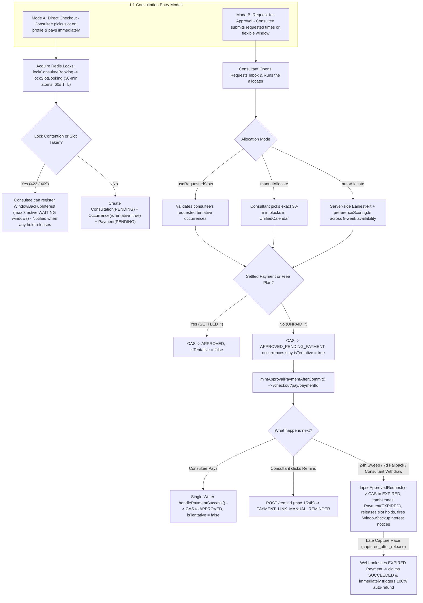
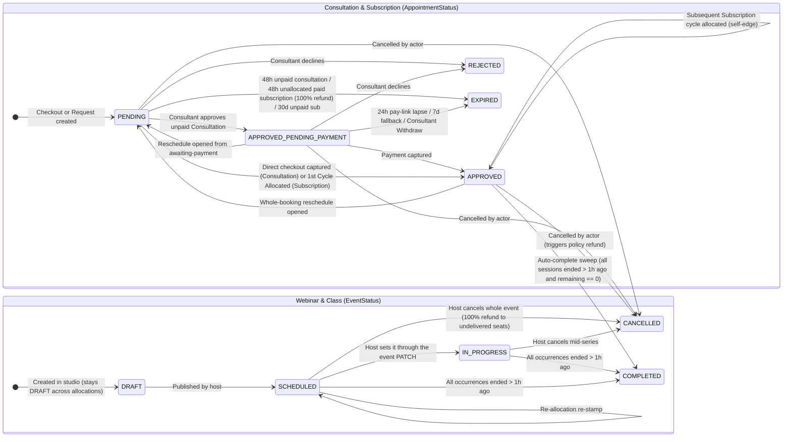
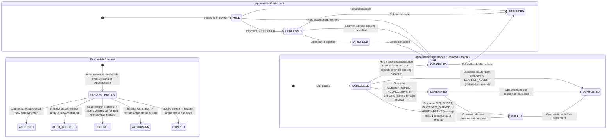

# Booking System — High-Level Design

This document describes the booking system as it is on `dev` today, then marks where the booking productionization program takes it next. Every behaviour is labelled **current** when it is merged on `dev` and **landing in Wave N** when it belongs to an open or planned pull request. The money half of the story lives in [02-money-system-hld.md](./02-money-system-hld.md), and [03-booking-and-money-machinery.md](./03-booking-and-money-machinery.md) holds the seeded cast, the data model and the worked end-to-end examples.

## 1. End-to-end pipeline

```text
 EXPERT SIDE                                   CONSULTEE SIDE
 ───────────                                   ──────────────
 Publish availability                          Explore expert page
  ├ Weekly rows (local clock + IANA zone)            │
  └ Custom rows (absolute timestamptz)               ▼
        │                                   ┌──────────────────────┐
        ▼                                   │ Availability grid    │  GET /api/... (ETag, max-age 30s)
 ┌──────────────────┐   recurrence expand   │ (heatmap cells)      │◄── poll 60s (allocator only today)
 │ Candidate slots  │──────────────────────►│ available/partial/   │
 │ 30-min atoms     │                       │ full/past/selected   │
 └──────────────────┘                       └──────────┬───────────┘
        ▲                                              │ pick slot
        │ minus OCCUPANCY                              ▼
 ┌──────────────────────────────┐          ┌──────────────────────┐
 │ occupancyPolicy.ts           │          │ Checkout / Request   │
 │  PENDING, APPROVED, APPROVED_│          └──────────┬───────────┘
 │  PENDING_PAYMENT, SCHEDULED, │                     │
 │  trials, co-host seats,      │          ┌──────────┴───────────┐
 │  consultant-as-client,       │          ▼                      ▼
 │  live tentative holds        │   INSTANT (pay now)     REQUEST (approval first)
 │  (dead holds = clock filter) │          │                      │
 └──────────────────────────────┘          ▼                      ▼
                                    HOLD 30 min              Consultation PENDING
                                    tentative occurrence     + tentative slots
                                    + Payment PENDING              │ expert approves
                                           │                      ▼
                                           │               ALLOCATE (auto/manual/requested)
                                           │               → APPROVED_PENDING_PAYMENT
                                           │               → pay-link minted
                                           ▼                      ▼
                                    ┌──────────────────────────────────┐
                                    │ Razorpay capture → webhook       │
                                    │ Payment PENDING→SUCCEEDED (CAS)  │
                                    │ tentative→confirmed occurrence   │
                                    │ EXCLUDE constraint backstop      │
                                    │   (23P01 → auto-refund)          │
                                    └──────────────────────────────────┘
                                                   │
                                                   ▼
                              Session → Stream meeting (lazy) → outcome
                              (auto-complete / no-show / void) → earnings hold → payout
```

The left column is the expert's supply side and the right column is the consultee's demand side. Published availability is cut into 30-minute atoms, the occupancy policy subtracts everything that already commits the expert's time, and the grid shows what is left. A consultee then either pays immediately (instant mode) or asks for approval first (request mode), and in both cases the booking only becomes a confirmed occurrence when the single payment-confirmation writer flips the payment to `SUCCEEDED`.

### 1.1 Guards at the front door

Several checks run before any gateway call or any row is written. The table lists them with their status so that the reader knows which ones exist today.

| Guard                                                                                                                                                                | Refusal                                                                                    | Where it lives                                                                                  | Status  |
| -------------------------------------------------------------------------------------------------------------------------------------------------------------------- | ------------------------------------------------------------------------------------------ | ----------------------------------------------------------------------------------------------- | ------- |
| Allocation is a host-side act: only the expert, the plan's host-organisation operators and staff may set times                                                       | 403 `ALLOCATE_FORBIDDEN`                                                                   | `lib/scheduling/allocate-route.ts`                                                              | Current |
| A sponsoring organisation may allocate only a booking the expert has already approved                                                                                | 409 `EXPERT_APPROVAL_REQUIRED`                                                             | `app/api/organizations/[orgId]/appointments/[appointmentId]/allocate/route.ts`                  | Current |
| Only the expert and staff may waive availability rules (`override`), place fewer sessions (`allowPartial`) or top up                                                 | The flags are ignored for host-organisation operators                                      | `lib/scheduling/allocate-route.ts`                                                              | Current |
| A webinar or class `PUT` cannot change `status` or re-point relations                                                                                                | 409 `USE_CANCEL_ROUTE`                                                                     | `app/api/bookings/webinars/[webinarId]/route.ts`, `app/api/bookings/classes/[classId]/route.ts` | Current |
| A reschedule accept closes its proposal inside the move transaction                                                                                                  | 409 `RESCHEDULE_NO_LONGER_OPEN` rolls the move back                                        | `lib/booking/reschedule-respond.ts`, `lib/booking/reschedule-confirm.ts`                        | Current |
| A restore after a withdrawn or expired reschedule refuses an unknown origin status instead of guessing `APPROVED`                                                    | Nothing is written and one Sentry report is made                                           | `lib/booking/reschedule-restore.ts`                                                             | Current |
| A meeting extension writes `endsAt` in the database first, then calls Stream, and reverts by compare-and-swap if Stream fails                                        | 409 `EXTEND_CONFLICT` or 503                                                               | `app/api/meetings/[meetingId]/extend/route.ts`                                                  | Current |
| Booking and money writes fail closed with 503 and `Retry-After` when the maintenance state cannot be read, and four more routes are on the degraded write-block list | 503                                                                                        | `lib/maintenance-edge.ts`                                                                       | Current |
| The booked window must match the plan duration on request-for-approval, direct consultation checkout and trial scheduling                                            | 400 `WINDOW_DURATION_MISMATCH`                                                             | `lib/booking/slot-validation.ts`                                                                | Current |
| A paused expert (`acceptingRequests = false`) refuses every new booking, including direct checkout and trials                                                        | 409 `NOT_ACCEPTING_BOOKINGS`                                                               | the purchasability gate in `lib/payments/checkout/pricing.ts`                                   | Current |
| Request-for-approval accepts an `Idempotency-Key` stored on the request row                                                                                          | A replay returns the original 201; another user's key answers 422 `IDEMPOTENCY_KEY_REUSED` | `app/api/scheduling/request-for-approval/route.ts`                                              | Current |

## 2. The 30-minute atom and coverage

```text
Expert availability row:  09:00 ─────────────────────── 12:00
Atoms:                    |09:00|09:30|10:00|10:30|11:00|11:30|
1h plan candidate starts: 09:00 09:30 10:00 10:30 11:00         (start+1h ≤ end)

Union coverage: a booking is valid if EVERY atom it spans is covered
by ANY availability row (findUncoveredAtom), so adjacent rows can combine.
```

Each heatmap cell's status is the share of the cell covered by occupancy, computed on the server. Holds, tentative rows and confirmed rows all render as "fully booked", because there is no separate "held" colour.

## 3. Allocation modes (`lib/booking/allocation/`)

```text
               ┌─────────────── allocate(eventId, mode) ───────────────┐
               │                                                        │
   mode=auto ──┤ earliest-fit by (day, time-of-day); prefs reorder only │
               │ deterministic; window 8w (consult) / 4w (webinar) /    │
               │ whole period (sub/class); 10s search budget            │
   mode=manual ┤ expert picks ISO slots (30-min multiples)              │
   mode=       │                                                        │
   requested ──┤ use consultee's stored tentative slots                 │
               └────────────────────────────┬───────────────────────────┘
                                            ▼
   OUTSIDE TX (under Redis auto-allocate:<cp> + consultee lock):
     validate(): availability containment, caps (sessionsPerWeek,
     per-day), scheduling period, lead time, conflicts
                                            ▼
   INSIDE TX (Read Committed):
     pg_advisory_xact_lock(event) → idempotency replay check →
     revalidateConflicts → co-host check → tentative-count check →
     DELETE old rows → CREATE occurrences → CAS parent status
```

The allocation route is the only place that decides who may allocate, and it does so before the service runs. `allocate` (`lib/booking/allocation/allocate.ts`) itself never checks the actor, because the reschedule-accept and auto-confirm paths legitimately call it on behalf of the consultee. Three kinds of caller reach the route:

- The expert (the plan's own consultant) and staff may use every flag.
- An operator of the plan's host organisation may allocate, but only inside the published availability, so `override`, `allowPartial` and `topUp` are ignored for them.
- The sponsoring organisation uses a separate route that fixes those flags to false and narrows the status compare-and-swap to `APPROVED`, so a sponsor can place times on a booking the expert approved but can never approve a pending request on the expert's behalf.

Three gaps remain in the allocator after Wave 0 PR 1:

- Allocation takes no slot atoms, so it does not serialize against checkout. Closing this is part of the busy-time ledger in Wave 3.
- It hard-deletes occurrences when it re-plans, which cascades to meetings, attendance and feedback. Wave 3 replaces the delete with a status change.
- It does not model buffers, minimum notice, a booking horizon or blackout dates. Wave 3 adds them as scheduling rules.

## 4. Concurrency layers

```text
 Layer 1  Redis locks (fail-CLOSED → 503)
          global order: appointment/event/consultant → consultee → slot atoms
          slot-booking:<cp>:<atom>   (checkout)
          auto-allocate:<cp>         (allocator)   ← disjoint families!
          event-checkout:<type>:<id> (webinar/class/subscription)
 Layer 2  Postgres isolation
          checkout + capture = SERIALIZABLE (+ retry P2034/40P01)
          allocation / cancel / reschedule = READ COMMITTED
 Layer 3  CAS-in-WHERE status helpers (transitions.ts, 7 helpers)
          illegal edge → 0 rows → IllegalTransitionError 409
 Layer 4  DB constraints
          occurrence_no_confirmed_overlap (EXCLUDE, CONFIRMED host rows only)
          wallet ≥ 0 CHECK, uniques (idempotency key, one open reschedule)
```

The one database constraint that protects time is `occurrence_no_confirmed_overlap`, defined in `prisma/sql/check-constraints.sql`. It is a `btree_gist` exclusion on `AppointmentOccurrence` keyed on the host's `consultantProfileId` and `tstzrange("startsAt", "endsAt")`, and it applies only to rows that are not tentative, not tombstoned (`deletedAt IS NULL`) and not `CANCELLED` or `RESCHEDULED`. Because every occurrence of every offering type carries its host's `consultantProfileId`, the constraint covers consultations, subscription sessions, webinars, classes and trials alike, but only for the host side. Tentative holds, co-host overlaps, consultant-as-client overlaps, consultee overlaps and seat capacity are enforced by application code alone today, and Wave 3 moves them into the database.

```mermaid
flowchart LR
  subgraph L0["Layer 0: Postgres Triggers & Constraints"]
    T1["ledger_txn_balanced (DEFERRABLE INITIALLY DEFERRED): Sum DEBIT == Sum CREDIT"]
    T2["payment_legs_sum_to_amount: Sum funding legs == Payment.amount"]
    T3["occurrence_no_confirmed_overlap (GiST): No overlapping non-tentative slots per consultant"]
    T4["~30 CHECK constraints: wallet_nonnegative, rate_card_bps_sum_is_whole, etc."]
  end

  subgraph L1_L2["Layer 1 & 2: CAS-in-WHERE + Serializable Retry"]
    CAS["updateMany WHERE status IN ALLOWED_FROM (count == 0 -> lost race)"]
    SSI["withSerializableRetry() on P2034 serialization conflicts"]
  end

  subgraph L4["Layer 4: Redis Locks (Coordination Only)"]
    RL["lockConsulteeBooking -> lockSlotBooking (30-min atoms) & withCronLock (fail-closed for money jobs)"]
  end

  subgraph Reconciler["Nightly Control Loop (reconcile-ledgers.ts)"]
    R_CHK["Verifies 26 invariants across Journal, Wallet caches, Earnings caches, Program counters, Invoices, and TDS"]
    R_FRZ["On WALLET_BALANCE_DRIFT: Calls freezeWalletSpend() & pages Sentry"]
  end

  RL --> SSI --> CAS --> L0 --> Reconciler
```



### 4.1 The serializable retry engine

Under PostgreSQL `SERIALIZABLE` isolation, concurrent transactions with overlapping read and write sets are aborted by the database (`SQLSTATE 40001`, mapped by Prisma to `P2034`). `withSerializableRetry` in `lib/db/serializable-retry.ts` catches that error, waits `50 * 2^attempt` milliseconds plus up to 25 ms of jitter, and runs the transaction again from the top, up to three retries. On the retry the second writer now sees the slot taken and answers 409.

```text
Writer A (Learner 1 Checkout)             Writer B (Learner 2 Checkout)
+---------------------------------+       +---------------------------------+
| BEGIN (SERIALIZABLE)            |       | BEGIN (SERIALIZABLE)            |
| Read Slot Availability (Free)   |       | Read Slot Availability (Free)   |
| Write Occurrence Hold           |       | Write Occurrence Hold           |
| COMMIT -> OK                    |       | COMMIT                          |
+---------------------------------+       +----------------+----------------+
                                                           |
                                                           v
                                                ERROR: P2034 (40001)
                                                           |
                                                           v
                                            withSerializableRetry() catches P2034
                                            Retries transaction from the top
                                            (Now sees Slot Taken -> Rejects 409)
```

The engine retries serialization failures and deadlocks (`40P01`) only. Validation errors, foreign-key violations (`P2003`) and `IllegalTransitionError` are business refusals and fail on the first attempt. Everything inside the closure must be a pure database mutation with no uncommitted external side effect, because the closure may run up to four times.

## 5. Booking modes and contention



Instant mode locks the consultee and then each 30-minute atom of the interval, creates the tentative occurrence and a pending payment in one Serializable transaction, and waits for the capture. Request mode takes the same consultee and slot locks and writes a `PENDING` consultation with a tentative occurrence, and that occurrence does block the expert's calendar: `OCCUPIED_REQUEST_STATUSES` in `utils/scheduling-engine/occupancyPolicy.ts` counts `PENDING` as occupied, so no other checkout or request can take the time. What request mode defers is the money, and a consultee may hold at most three such pending requests at once (`MAX_ACTIVE_REQUESTS_PER_USER` in `lib/booking/request-caps.ts`). A request that is already settled (a free plan or an existing `SUCCEEDED` payment) lands directly in `APPROVED`; an unpaid one lands in `APPROVED_PENDING_PAYMENT` and mints its pay order after the commit.

## 6. Lifecycle and state machines

```text
            ┌──────────┐ approve+alloc ┌───────────────────────┐ capture ┌───────────┐
 create ───►│ PENDING  │──────────────►│APPROVED_PENDING_PAYMENT│────────►│ APPROVED  │
            └────┬─────┘               └───────────┬───────────┘         └─────┬─────┘
                 │reject                           │pay-link lapses             │sessions end
                 ▼                                 ▼                            ▼
            REJECTED                            EXPIRED                    COMPLETED
   (any live state) ── cancel ──► CANCELLED      (reschedule: → PENDING, then restore/accept)
```

The generated reference for every transition map is [docs/booking/18-state-machines.md](../booking/18-state-machines.md); the code in `lib/booking/transitions.ts` is the single source of legality, and the diagrams below project it.

### 6.1 Request and group-event status



### 6.2 Participant seat, reschedule request and session outcome



A reschedule confirmation is one transaction: the allocator commits the new times and, through its `inTx` hook, flips the proposal from `PENDING_REVIEW` to `ACCEPTED` or `AUTO_ACCEPTED` in the same commit. If the proposal is no longer open, the whole move rolls back with 409 `RESCHEDULE_NO_LONGER_OPEN`.

## 7. Session outcomes

One hour after any `SCHEDULED` occurrence's `endsAt`, the `auto-complete-appointments` sweep (every 30 minutes on the ticker) runs `classifySessionOutcome()` in `lib/booking/session-outcome.ts` over device-level presence intervals, Stream call reports and maintenance windows. The decision record is [ADR 2026-09-25](../decisions/2026-09-25-session-outcomes.md).

| Verdict (`SessionOutcome`)                 | Occurrence status                          | Who was present and the rule                                                                                                                                                                                                                                | Financial and booking effect                                                                                                                                                                                                               |
| :----------------------------------------- | :----------------------------------------- | :---------------------------------------------------------------------------------------------------------------------------------------------------------------------------------------------------------------------------------------------------------- | :----------------------------------------------------------------------------------------------------------------------------------------------------------------------------------------------------------------------------------------- |
| `HELD`                                     | `COMPLETED`                                | The host side and a learner both joined, and the host-side absence was shorter than min(15 min, duration / 2).                                                                                                                                              | Normal completion. Earnings release after `holdUntil`.                                                                                                                                                                                     |
| `LEARNER_ABSENT`                           | `COMPLETED`                                | The host was present and no learner joined.                                                                                                                                                                                                                 | The learner forfeits the session. The expert is paid in full and nothing is refunded.                                                                                                                                                      |
| `HOST_ABSENT`                              | `VOIDED`, or the consultation is cancelled | A learner waited and no host-side person ever joined.                                                                                                                                                                                                       | A consultation is claimed by `detect-consultant-no-shows`, cancelled and refunded in full. A class or webinar void gets a 14-day make-up window and then a one-unit refund. A subscription void returns the session to the plan allowance. |
| `CUT_SHORT`                                | `VOIDED`                                   | The host dropped while learners stayed for at least min(15 min, duration / 2).                                                                                                                                                                              | A host-attributed miss that counts toward the class reliability flag. The remedy is the same 14-day make-up or refund.                                                                                                                     |
| `PLATFORM_OUTAGE`                          | `VOIDED`                                   | The session overlapped an ops-declared platform incident (checked before any other rule), or everyone dropped within two minutes of each other, or the minutes lost overlapped a degraded or offline maintenance window and outweighed the host's own loss. | Counts toward a learner's class exit right but never toward the host's reliability flag. A declared incident also makes every learner whole (see below).                                                                                   |
| `NOBODY_JOINED`, `INCONCLUSIVE`, `OFFLINE` | `UNVERIFIED`                               | Nobody joined, a presence interval is still open, Stream disagrees with our records, or no room was created.                                                                                                                                                | A doubtful verdict never moves money automatically. The row is held for the Backoffice ops queue (`session.set-outcome`).                                                                                                                  |

A platform-wide outage leaves no presence evidence, so without help it could be misread as a learner absence (a forfeit) or a host absence. Ops therefore declare an incident window in the back office (Money, Incidents tab; see [the money console](../finance/70-operations/02-admin-money-doors.md#platform-incidents)). `classifySessionOutcome()` checks the declared windows first: a session whose booked interval overlaps one at all is `PLATFORM_OUTAGE`, before any absence verdict, because ops chose the window. A maintenance window is weaker: its minutes count as platform loss rather than host loss, so a void is `PLATFORM_OUTAGE` only when platform loss exceeds host loss, and when no host-side person ever joined the overlap turns a possible `HOST_ABSENT` into `INCONCLUSIVE`. The no-show detector claims only `HOST_ABSENT` verdicts, so it never claims, cancels or strikes a session inside a declared window, and the expert reliability count (`countExpertStrikes()` in `lib/booking/expert-reliability.ts`) drops any strike on an appointment that has a session inside one.

**Example.** Hannah Anderson's 1-hour consultation with the learner Priya Anderson, paid by card, runs Sun 18 Oct 2026 01:15 IST and the call platform is down, so nobody ever joins. Ops declare the window 18 Oct 2026 00:30 to 02:30 IST. Once the session is an hour past its booked end, the next hourly run of the `settle-platform-incidents` sweep moves the session to `VOIDED` with outcome `PLATFORM_OUTAGE` (the learner's money is untouched by any forfeit rule), writes a refund remedy for Priya's seat due 48 hours later, and at that time refunds her full ₹1,180 (118,000 paise), with the platform bearing the gateway fee. Hannah gets no strike, even if the no-show detector would otherwise have read the empty room as a host absence.

What each product's learner gets is a property of the sweep (`lib/booking/platform-incidents.ts`, `scripts/appointments/settle-platform-incidents.ts`):

| Product      | Remedy                                                                                                          |
| ------------ | --------------------------------------------------------------------------------------------------------------- |
| Consultation | Full refund of the remaining balance 48 hours after the void.                                                   |
| Paid trial   | Full refund 48 hours after the void; the trial is cancelled in the same commit, which frees the expert pair.    |
| Free trial   | The trial is cancelled straight away, which frees the pair so the learner can ask again.                        |
| Subscription | The session returns to the allowance and the plan end moves seven days later, straight away.                    |
| Webinar      | Full refund of the seat straight away.                                                                          |
| Class        | Nothing beyond the void: the existing 14-day make-up window, then a one-unit refund, or the exit right applies. |

The free-rebook offer within 48 hours for a voided one-to-one session is landing next (W1-b2); until then the learner's choice is the refund. A re-run door for a voided webinar is tracked in #2185.

## 8. Maintenance sweeps and the cron architecture

Latency-sensitive sweeps run on the Netlify scheduled ticker, `netlify/functions/cron-tick.mts`, which fires every five minutes and posts `CRON_SECRET`-gated requests to `/api/cleanup/<job>`. Each target has its own cadence in `TARGET_EVERY_MINUTES`, its own batch size in `TARGET_LIMITS`, and a phase offset so that no tick fires more than eight targets. Every job is one function registered once in `lib/cron/cleanup-registry.ts` and wrapped in `withCronLock`, which is backed by the `SystemJobExecution` lease in Postgres. GitHub Actions runs the daily, weekly and intra-day batch fleets (`cron-daily.yml`, `cron-weekly.yml`, `cron-intra-day.yml`) and a heartbeat workflow that alerts when the fleet goes silent; it is not a backstop for a ticker target.

| Sweep                                                                 | Cadence and batch       | What it releases                                                  |
| --------------------------------------------------------------------- | ----------------------- | ----------------------------------------------------------------- |
| `abandoned-payments`                                                  | 15 min, 10 payments     | Lapsed holds and seats, and lapsed approval pay-links             |
| `tentative-occurrences`                                               | 15 min, 200 rows        | Stale tentatives older than 24 hours                              |
| `expire-stale-requests`                                               | 15 min, 20 rows per arm | Unanswered requests and unpaid pay-links, moved to `EXPIRED`      |
| `reschedule-proposals`                                                | 15 min, 25 rows         | Unanswered reschedule proposals, restored to their origin         |
| `auto-complete-appointments`                                          | 30 min, 25 rows         | Session outcomes, then the earnings hold or a refund              |
| `detect-consultant-no-shows`                                          | 30 min, 10 rows         | Consultant no-show cancellations with a full refund               |
| `settle-cancelled-sessions`                                           | 30 min, 10 sessions     | One-unit refunds for host-cancelled class sessions nobody made up |
| `reconcile-payment-status`, `reconcile-refunds`, `retry-auto-refunds` | 15 min                  | Money healing against the gateway                                 |

Every job is guarded by `withCronLock` (`lib/cron/with-cron-lock.ts`) and by a partial unique index on the lease table, so two runs of one job can never both hold the lease:

```sql
CREATE UNIQUE INDEX "SystemJobExecution_running_jobName_key"
  ON "SystemJobExecution" ("jobName")
  WHERE "status" = 'RUNNING';
```

Money sweeps use `failMode: "closed"` and abort when the lease cannot be verified, because a skipped sweep is safer than a duplicate dunning, invoice or payout run. Idempotent cleanup sweeps use `failMode: "open"` and proceed with a warning.

Every sweep repeats the money predicate in its compare-and-swap, so it never expires a paid booking. The two session-outcome sweeps have no GitHub Actions twin: the batch sizes above are the only throughput they have, which is 50 sessions an hour for auto-complete and 20 for the no-show detector. Landing in Wave 0 (W0-4), a time-boxed drain loop will clear a backlog inside one lease instead of one batch per tick. The full per-job reference is [docs/booking/13-cron-jobs-and-background-tasks.md](../booking/13-cron-jobs-and-background-tasks.md).

## 9. Target state (Waves 0–3)

```text
                  ┌────────────────────────────────────────┐
  checkout ──────►│  claimBlocks(tx, persons[], range)     │◄────── allocator
  allocator       │   1. UPDATE expired HELD → RELEASED    │        reschedule
  reschedule ────►│      (clock_timestamp())               │        blackouts
                  │   2. INSERT CalendarBlock HELD/CONFIRMED│
                  │      canonical personId order          │
                  └───────────────┬────────────────────────┘
                                  ▼
          CalendarBlock (host, co-host, as-client, consultee)
          EXCLUDE USING gist (personId WITH =, busyRange WITH &&)
            WHERE status IN (HELD, CONFIRMED)
          busyRange = raw range + end-buffer (0/30/60, host side only)
                                  │
                  23P01 = loser → 409 / auto-refund on late capture
          Seats: counter + CHECK (seatsHeld ≤ capacity)
```

In the target state Postgres is the only arbiter of time and capacity, and Redis keeps rate limits and short interactive mutexes. The waves get there in this order:

- **Wave 0** fixes the defects that exist on today's schema: authorization and checkout correctness (both merged), durable "refund owed" markers, correctly scoped sweeps, a 60-second consultee grid poll that is freshness only and never correctness, and the subscription session-return policy.
- **Wave 1** flips the availability readers to per-date daylight-saving offsets computed from the IANA zone, and adds platform-incident voiding (landed: ops declare an incident, every eligible overlapping session is voided and each learner gets the remedy for their product; the free-rebook offer is landing next). Seat transfer is deferred until after launch, and it would cover webinars only if it is ever built (#2140).
- **Wave 2** (landed) split the allocator and checkout along their module seams without changing behaviour: the allocator is now `lib/booking/allocation/` and checkout is `lib/payments/checkout/`.
- **Wave 3** lands inside the owner's database reset window: the schema batch, the busy-time ledger that makes the database the arbiter of every person's time, and the scheduling rules.
- **Wave 4** proves it with a concurrency harness on real Postgres, which is the launch gate.

The end-state invariants and what enforces each of them:

| Invariant                                                                       | Enforced by                                                                                                                                                       |
| ------------------------------------------------------------------------------- | ----------------------------------------------------------------------------------------------------------------------------------------------------------------- |
| A person is never in two live commitments (host, co-host, as-client, consultee) | Exclusion constraint on live `CalendarBlock` rows (Wave 3)                                                                                                        |
| Seats never exceed capacity                                                     | Counter with a CHECK constraint (Wave 3)                                                                                                                          |
| Refunds never exceed the payment                                                | Deferred trigger (Wave 3)                                                                                                                                         |
| A paid booking is never expired                                                 | The money predicate in every sweep's compare-and-swap (exists), plus the harness                                                                                  |
| A refund owed is never lost                                                     | An owed marker written in the cancel transaction and a keyed re-drive (Wave 0)                                                                                    |
| One live payment per buyer per event                                            | Partial unique index (Wave 3)                                                                                                                                     |
| Only the host side approves or allocates                                        | Route authorization and tests (current)                                                                                                                           |
| Buffer, notice and horizon                                                      | Padded `busyRange` exclusion and shared validation (Wave 3)                                                                                                       |
| An outage never forfeits a learner's money                                      | A declared incident window classifies as `PLATFORM_OUTAGE` first (`classifySessionOutcome`) and the `settle-platform-incidents` sweep refunds each seat (current) |

## 10. Glossary

The money terms (pre-mint, tombstone, dedupe key, leg, earnings hold and credit note) are defined in [the money HLD's glossary](./02-money-system-hld.md#15-glossary).

- **Hold.** A booking that is reserved but not yet paid: a tentative occurrence plus a `PENDING` payment whose `expiresAt` is thirty minutes out on direct checkout (`DIRECT_CHECKOUT_HOLD_MS` in `lib/payments/constants.ts`) or 24 hours out on an approval pay-link. The `abandoned-payments` and `expire-stale-requests` sweeps release a hold once it lapses.
- **Tentative.** An `AppointmentOccurrence` with `isTentative = true`, which is a hold or a requested time rather than a confirmed session. It still blocks the expert's calendar through the occupancy filter in `utils/scheduling-engine/occupancyPolicy.ts`, but the database overlap constraint `occurrence_no_confirmed_overlap` ignores it, so the Redis slot locks are what keep two holds apart.
- **CAS-in-WHERE.** A compare-and-swap status change: an `updateMany` whose `WHERE` names the expected prior status, so a row that has already moved matches zero rows and the write fails instead of overwriting it. The helpers in `lib/booking/transitions.ts` do this for every booking status and throw `IllegalTransitionError` on a miss.
- **Sweep.** A background job that finds rows in a stale state and moves them on, for example an unpaid hold to `EXPIRED`. Every sweep is registered in `lib/cron/cleanup-registry.ts`, runs under the Postgres lease in `withCronLock`, and is fired by the five-minute ticker `netlify/functions/cron-tick.mts` or by a GitHub Actions batch workflow.

## Related issues

Program umbrella #2137. Pull requests: #2141 (merged), #2142 (merged). Platform incident voiding #2139 (merged); seat transfer deferred #2140; webinar re-run door #2185.

## Deprecated & Superseded Approaches

These patterns existed earlier and are gone or going. Recognising them lets an engineer delete a leftover instead of rediscovering it.

1. **Consultee-callable allocation.** The allocation route used to admit any participant, so a consultee could move their own request from `PENDING` to `APPROVED`. It is now host-side only, and the sponsor-organisation route allocates only `APPROVED` bookings.
2. **Status and relation writes through the event `PUT`.** Webinar and class updates once accepted `status` and `connect` re-pointing in the body. Cancelling goes through the cancel route so that refunds and history are written, and the body is parsed with a Zod schema.
3. **Hourly per-job GitHub Actions twins for booking sweeps.** The booking sweeps used to be driven by one workflow per job at an hourly cadence, which GitHub delivered roughly once every hundred minutes. They now run on the five-minute ticker, and no per-job workflow exists; a job missing from the ticker runs nowhere.
4. **A gateway call before any durable payment row on the approval path.** The pay-link mint now writes a pre-mint row first.
5. **A reschedule accept that committed the move and then closed the proposal in a second transaction.** The proposal is now closed inside the move.
6. **Restoring an unknown origin status to `APPROVED`.** A booking whose origin cannot be read is now left alone and reported once.
7. **Reading a platform-wide outage as a learner or host absence.** A session with no presence evidence during an outage used to be classified `LEARNER_ABSENT` (a forfeit) or `NOBODY_JOINED` before any outage rule ran. A declared incident window now classifies it `PLATFORM_OUTAGE` first.
