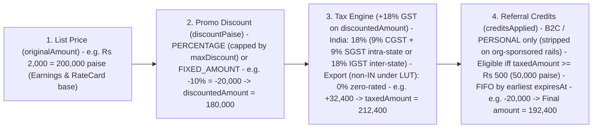

# Money System — High-Level Design

This document is the finance counterpart of [01-booking-system-hld.md](./01-booking-system-hld.md). It follows one rupee from price derivation to payout or refund, names the file that owns each step, and records the policy decisions that govern refunds. Behaviour is labelled **current** when it is merged on `dev` and **landing in Wave N** when it belongs to an open or planned pull request. Worked numeric examples live in [03-booking-and-money-machinery.md](./03-booking-and-money-machinery.md).

## 1. The pipeline in one picture

```text
 price derivation ──► order mint ──► capture webhook ──► payment legs ──► double-entry ledger
 deriveCheckoutAmount  handleCheckout   handlePaymentSuccess  PaymentLeg rows    postLedgerTxn
 (pure, integer paise) (Razorpay order  (the only writer of   + funding-sum      (booking:<paymentId>)
                        or synthetic     SUCCEEDED)            trigger at COMMIT   │
                        org intent)                                                ▼
                                                                         earnings (hold window)
                                                                                   │
        refunds (three front doors) ◄── cancellation / no-show / void             ▼
          │   two-phase gateway call                                  payout batch (TDS) ──► RazorpayX
          ▼
 cascade: legs, earnings, utilization, credit note, ledger reversal      reconcilers heal every external boundary
```

Three rules hold the pipeline together. There is one checkout function, `handleCheckout()` in `lib/payments/checkout/orchestrate.ts`. There is one writer of `SUCCEEDED` for gateway captures, `handlePaymentSuccess()` in `lib/payments/webhooks/handlers.ts`; the sponsored and free rails create their payment as `SUCCEEDED` inline inside checkout's own transaction because no gateway is involved. And there is one append-only journal, written only through `postLedgerTxn()` in `lib/payments/ledger/post.ts`. Consumer and enterprise flows differ only in which `PaymentLeg` rows fund the payment and whether an organisation claims a host share.

## 2. End-to-end architecture

```mermaid
flowchart TB
  subgraph Actors["1. Buyer & Context Selection"]
    B2C_BUYER["Marketplace Consultee (e.g. Charlotte Brown) - organizationId = null"]
    B2B_BUYER["Org Learner (e.g. Olivia Anderson @ Wipro or Rachel Anderson @ IIT Madras) - passes organizationId"]
  end

  subgraph Checkout["2. Unified Checkout Pipeline - POST /api/checkout - handleCheckout()"]
    direction TB
    ORG_GATES["Org Resolution Chain (9 Fail-Closed Gates if organizationId present) - Org ACTIVE/PENDING, canSponsor, Dunning check, ACTIVE Membership, DPDP SESSION_BOOKING consent, Domain/CreditLimit, ACTIVE ProgramAssignment"]
    STEP1["Step 1: Pure Price Derivation - deriveCheckoutAmount() - Base Price -> DiscountCode -> +18% GST -> -ReferralCredit (B2C only, min Rs 500)"]
    STEP2["Step 2: Distributed Redis Locks - lockConsulteeBooking(userId) -> lockSlotBooking(consultantId, 30m atoms)"]
    STEP3["Step 3: In-Lock Revalidation - revalidateInsideLock() - Slot conflict check, self-booking guard, ADR-18 allowlist & exclusiveEngagement"]
    STEP4["Step 4: Serializable DB Transaction - withSerializableRetry() - Appointment + AppointmentOccurrence + AppointmentParticipant + Payment + PaymentLeg[]"]
    TRIG1["DB Constraint Trigger at COMMIT: payment_legs_sum_to_amount & occurrence_no_confirmed_overlap (GiST)"]

    ORG_GATES --> STEP1 --> STEP2 --> STEP3 --> STEP4 --> TRIG1
  end

  B2C_BUYER --> STEP1
  B2B_BUYER --> ORG_GATES

  TRIG1 --> RAIL_FORK{"Funding Rail?"}

  subgraph Rail_Gateway["3A. Gateway Rail (B2C / PERSONAL Org Tag / Member Overage)"]
    GW_PEND["Payment status = PENDING (expiresAt = +30m) - Occurrence isTentative = true - Participant status = HELD - Razorpay Order minted"]
    GW_DOORS["4 Confirmation Doors: 1. Webhook payment.captured  2. /checkout/verify-signature  3. /checkout/verify?sync=true  4. Cron reconcile-payment-status"]
    SINGLE_WRITER["Single Writer: handlePaymentSuccess() - Phase 1 (Serializable Tx): Amount parity check -> CAS PENDING to SUCCEEDED -> isTentative = false -> Participant HELD to CONFIRMED -> Request APPROVED"]
    GW_PEND --> GW_DOORS --> SINGLE_WRITER
  end

  subgraph Rail_Skip["3B. Instant-Confirm Rail (skipPayment = true: WALLET / INVOICE / LICENSE / 100% Free Credit)"]
    SKIP_TX["Inside Step 4 Transaction: Payment created SUCCEEDED immediately - Synthetic intent (org_wallet_*, org_invoice_*, org_license_*, free_*) - walletDebit() CAS or recordBookingUtilization() + recordOverageAtCheckout()"]
  end

  RAIL_FORK -->|"CARD (amount > 0)"| GW_PEND
  RAIL_FORK -->|"WALLET / INVOICE / LICENSE / Rs 0"| SKIP_TX

  SINGLE_WRITER --> SETTLE
  SKIP_TX --> SETTLE

  subgraph Downstream["4. Shared Settlement, Ledger, Payout & Reversal Spine"]
    direction TB
    SETTLE["Phase 2 Settlement: createEarningsFromPayment() - Resolves RateCard (10/10/80) or Marketplace (20/80) + Collaborator bps - Writes ConsultantEarnings + OrganizationEarnings - Calls postLedgerTxn(booking:paymentId)"]
    TRIG2["DB Constraint Trigger at COMMIT: ledger_txn_balanced (Sum DEBIT == Sum CREDIT)"]
    HOLD["Earnings Hold Window - 24h Consultation and Class / 48h Webinar / 168h Subscription, anchored on the later of capture and last session end - PENDING (or PENDING_TRUST) -> READY"]
    PAYOUTS["Payout Pipeline (Weekly Batch) - ConsultantPayout (<Rs 5k auto-approve) & OrganizationPayout (2-person approval) - Computes TDS 194-O (0.1% or 5% no-PAN) -> RazorpayX -> postLedgerTxn(payout:id)"]
    INVOICES["B2B Monthly Rollup (settle-invoice-accruals) - Sums INVOICE_ACCRUAL legs -> OrganizationInvoice (ISSUED, NET-60) - Dunning cron (3x 7d reminders -> suspend) -> Paid: postLedgerTxn(invoicepaid:id)"]
    REFUNDS["Refunds, Voids & Disputes - quoteBookingRefund() -> Two-Phase Gateway Refund -> applyRefundCascade() - Reverses PaymentLegs, Utilization, Earnings, Overage, issues CreditNote, posts refund:id"]
    RECON["Nightly Control Loop (reconcile-ledgers) - Re-derives the cached balances from the LedgerEntry journal - Auto-freezes drifted org wallets (freezeWalletSpend)"]

    SETTLE --> TRIG2 --> HOLD --> PAYOUTS
    TRIG2 --> INVOICES
    TRIG2 --> REFUNDS
    PAYOUTS --> RECON
    INVOICES --> RECON
    REFUNDS --> RECON
  end
```



## 3. Price derivation

Every checkout computes the payable amount in integer paise in four ordered steps in `lib/payments/pricing/derive-checkout-amount.ts`.



The platform fee, the host-organisation share and the expert share are always calculated on `Payment.originalAmount`, the list price before discounts and tax. A promo code or referral credit is a marketing subsidy funded by the platform, so it is booked as `Dr DISCOUNT` or `Dr PLATFORM_PROMO` and never reduces what the expert earns. GST is charged on the discounted amount, because a discount shown on the invoice before supply reduces the taxable value under section 15(3)(a) of the CGST Act.

## 4. Order mint and funding rails

`handleCheckout()` resolves the organisation context, takes the Redis locks, re-validates inside the lock, and then writes the appointment, occurrence, participant, `Payment` and `PaymentLeg` rows in one Serializable transaction. The rail decides what happens next:

- On the gateway rail (card), the payment is `PENDING` with `expiresAt` thirty minutes out, and a Razorpay order is minted. The booking is confirmed only when a capture arrives.
- On the instant-confirm rail (`WALLET`, `INVOICE`, `LICENSE`, or a free booking covered entirely by credit), the payment is written as `SUCCEEDED` in the same transaction with a synthetic intent (`org_wallet_*`, `org_invoice_*`, `org_license_*`, `free_*`), and settlement runs inline. See [docs/booking/17-org-funded-checkout.md](../booking/17-org-funded-checkout.md).
- On the approval path, `createApprovalPaymentIntent()` in `lib/payments/operations/approval-payment.ts` mints a card order for an approved request. It writes a `PENDING` row with a `premint_<uuid>` intent and its card leg first, calls the gateway, then fills the real order id by compare-and-swap on the pre-mint marker. A gateway failure expires the pre-mint row. The order's Razorpay `notes` carry `familiarisePaymentId`, so if neither the fill nor the tombstone lands, the capture webhook adopts the named row by compare-and-swap on its pre-mint intent. The sweeps never send a `premint_` intent to Razorpay.
- When a buyer re-buys a webinar or class seat after an `EXPIRED` or `FAILED` payment, checkout re-mints the same row in place by compare-and-swap and parks the old order on an `EXPIRED` tombstone (`lib/payments/operations/prior-intent-tombstone.ts`) that carries the old legs, so a late capture on the old order is auto-refunded.

## 5. Capture: four doors, one writer

Four doors converge on `routeCapturedPayment()` and then `handlePaymentSuccess()`: the Razorpay webhook (`app/api/webhooks/razorpay/route.ts`), `POST /api/checkout/verify-signature`, `GET /api/checkout/verify?sync=true`, and the `reconcile-payment-status` sweep for payments pending longer than fifteen minutes.

```text
  routeCapturedPayment() -> handlePaymentSuccess(paymentIntentId)
    |-- Pre-Tx: planEarningsForPayment() resolves RateCard / ShareBand / Collaborator bps
    +-- BEGIN ISOLATION LEVEL SERIALIZABLE (withSerializableRetry)
          |-- 1. CAS Payment: WHERE status = 'PENDING' -> 'SUCCEEDED' (0 rows = already settled)
          |-- 2. Confirm slots: AppointmentOccurrence.isTentative = false
          |-- 3. Confirm seat:  AppointmentParticipant.status = 'CONFIRMED'
          |-- 4. Advance request: Consultation/Subscription -> 'APPROVED'
          |-- 5. SAVEPOINT sp_phase1_earnings
          |        |-- createEarningsFromPayment({ tx }): ConsultantEarnings + OrganizationEarnings
          |        +-- postLedgerTxn({ tx, idempotencyKey: "booking:<paymentId>" }): balanced entries
          +-- COMMIT
```

If the savepoint rolls back, the `sync-payment-earnings` sweep re-drives settlement from row state. A capture that cannot be honoured (the booking was released, the slot is now taken, or the payer already holds another live booking at that time) is claimed as `SUCCEEDED` and immediately auto-refunded through the `Auto-refund pending:` marker, and `retry-auto-refunds` re-drives any refund the webhook tried once. The recheck counts the payer's own other live bookings as well as the expert's.

## 6. Payment legs and the funding-sum trigger

A `Payment` is funded by one or more `PaymentLeg` rows (`CARD`, `WALLET`, `INVOICE_ACCRUAL`, `LICENSE`, `REFERRAL_CREDIT`, and negative `*_REVERSAL` legs). The deferred constraint trigger `payment_legs_sum_to_amount` in `prisma/sql/payment-legs-triggers.sql` fires at COMMIT and rejects any payment whose non-reversal legs, excluding `REFERRAL_CREDIT` and `LICENSE`, do not sum to `Payment.amount`, or whose reversal exceeds its original sibling. `payment_amount_vs_legs` re-checks the same rule when the payment row itself changes. Because Postgres enforces it, no application sweep re-verifies it.

## 7. The double-entry ledger

Every state change posts a balanced journal through `postLedgerTxn()`. The deferred trigger `ledger_txn_balanced` rejects an unbalanced transaction at COMMIT, and `ledger_entry_immutable` and `ledger_transaction_immutable` forbid updates. Account ids are deterministic (`kind|organizationId-or-_|consultantProfileId-or-_|INR`), and every entry amount is strictly positive with direction carried separately. The enum `LedgerAccountKind` has sixteen kinds.

| Account kind                | Scope                | Normal side | Increases with                                                                | Decreases with                                            | Meaning                                                                               |
| :-------------------------- | :------------------- | :---------: | :---------------------------------------------------------------------------- | :-------------------------------------------------------- | :------------------------------------------------------------------------------------ |
| `CASH`                      | Platform             |    Debit    | A Razorpay settlement, or a bank-transfer invoice receipt (`invoicereceipt:`) | Consultant or organisation payout                         | Settled bank cash; RazorpayX payouts leave from here                                  |
| `GATEWAY_CLEARING`          | Platform             |    Debit    | Card capture, wallet top-up, invoice paid                                     | Gateway fee, gateway refund, chargeback, settlement       | Captured money Razorpay still holds for the platform                                  |
| `GATEWAY_FEE`               | Platform             |    Debit    | The gateway fee on a capture, net of its GST                                  | —                                                         | Payment-processing expense                                                            |
| `GST_INPUT_CREDIT`          | Platform             |    Debit    | The GST Razorpay charges on its fee                                           | —                                                         | Input tax credit claimable against output GST                                         |
| `ORG_RECEIVABLE`            | Sponsor organisation |    Debit    | `INVOICE_ACCRUAL` booking                                                     | `INVOICE_PAID`, or a refund of an unpaid accrual          | What an invoiced sponsor owes the platform                                            |
| `PLATFORM_PROMO`            | Platform             |    Debit    | Referral credit consumed at checkout                                          | Credit restored on refund                                 | Marketing expense for redeemed credits                                                |
| `DISCOUNT`                  | Platform             |    Debit    | Coupon discount at booking                                                    | Pro-rata reversal on refund                               | Contra-revenue for coupons                                                            |
| `WALLET`                    | Sponsor organisation |   Credit    | Top-up confirmed, or a wallet booking refunded                                | Wallet-funded booking, or top-up refund                   | Prepaid liability owed to the organisation (cached in `BillingAccount.walletBalance`) |
| `CONSULTANT_PAYABLE`        | Expert               |   Credit    | Booking settlement                                                            | Payout completed, or refund                               | Liability owed to an expert (cached in `ConsultantEarnings`)                          |
| `ORG_PAYABLE`               | Host organisation    |   Credit    | Booking host share, overage relief                                            | Organisation payout, or refund                            | Liability owed to a host organisation (cached in `OrganizationEarnings`)              |
| `GST_PAYABLE`               | Platform             |   Credit    | 18% GST at booking                                                            | Credit note on refund or lost dispute                     | Output GST owed to the government                                                     |
| `TDS_PAYABLE`               | Platform             |   Credit    | TDS withheld at payout                                                        | Payout reversal                                           | Income tax withheld at source                                                         |
| `PLATFORM_FEE`              | Platform             |   Credit    | Platform commission and any overage surcharge                                 | Refund reversal (absorbs a one-paisa rounding difference) | Platform revenue                                                                      |
| `REFERRAL_CREDIT_LIABILITY` | Platform             |   Credit    | Referral credit vests                                                         | Credit redeemed                                           | Vested, unredeemed credit owed as a future discount                                   |
| `CONSULTANT_RECEIVABLE`     | Expert               |    Debit    | Lost dispute or refund on an already-paid earning                             | Netted against the next payout                            | Clawback owed by an expert                                                            |
| `UNAPPLIED_RECEIPTS`        | Platform             |   Credit    | A capture that funds no booking                                               | The refund that returns it                                | Cash parked for an auto-refund (`lib/payments/ledger/unapplied-receipts.ts`)          |

Razorpay PG money moves through `GATEWAY_CLEARING`, never straight to `CASH`; `gatewayCashAccount()` in `lib/payments/ledger/gateway-account.ts` is the one place that picks the account. A capture debits the clearing account. The fee is booked as its own journal, `gatewayfee:<pay_id>` (`lib/payments/ledger/gateway-fee.ts`): Dr `GATEWAY_FEE` for the fee net of GST, Dr `GST_INPUT_CREDIT` for the GST, Cr `GATEWAY_CLEARING` for the whole fee. The `payment.captured` webhook posts it from the payload's `fee` and `tax`. A capture confirmed by verify-signature or a sync carries no fee, and the settlement job books it under the same key, so the two paths cannot double-post. Razorpay keeps its fee when a refund is issued, and the platform's books do not pass that cost to the expert or the buyer, which is the D14 policy below.

The daily `reconcile-gateway-settlements` job (`jobs/reconcile/reconcile-gateway-settlements.ts`) reads Razorpay's settlement recon report into `GatewaySettlementLine` rows and matches each line to a `Payment`, `WalletTopUp`, `OrganizationInvoice`, `Refund` or `Dispute`. Once a day is fully read it posts one `settlement:<setl_id>` journal per settlement: Dr `CASH` / Cr `GATEWAY_CLEARING` for Σ(credit − debit) of its lines. Because the fee already left the clearing account, that net is exactly what reached the bank. A worked example: a ₹1,000 capture with a ₹23.60 fee (₹20 + ₹3.60 GST) posts Dr clearing 100000, then Dr fee 2000, Dr GST input 360, Cr clearing 2360; the settlement posts Dr CASH 97640 / Cr clearing 97640, and the clearing balance returns to zero. Lines that disagree are marked `AMOUNT_MISMATCH`, `FEE_MISMATCH` or `UNMATCHED`, reported once per run to Sentry, and listed at `GET /api/admin/settlements/lines?status=`; the money rows are never edited. RazorpayX payouts and their reversals stay on `CASH`.

## 8. Earnings, the hold window and the money state machines

Settlement writes `ConsultantEarnings` (and `OrganizationEarnings` for host organisations) as `PENDING`. They become `READY` once `holdUntil` passes, where `holdUntil = max(capture time, end of the last live occurrence) + hold hours` (`lib/payments/payouts/earnings-hold.ts`). The hold hours are in `PAYOUT_CONSTANTS.HOLD_PERIOD_HOURS`: 24 for a consultation, 48 for a webinar, 168 for a subscription and 24 for a class. Earnings for a booking sponsored by an unverified, never-invoiced organisation park in `PENDING_TRUST` instead (see [ADR 12](../enterprise/70-design-decisions/12-pending-trust-earnings-parking.md)).

```text
  PaymentStatus:
    PENDING ──(capture)──▶ SUCCEEDED ──(partial refund)──▶ PARTIALLY_REFUNDED ──▶ REFUNDED
       ├──(gateway fail)─▶ FAILED
       └──(30m timeout)──▶ EXPIRED  (late capture on EXPIRED triggers 100% auto-refund)

  EarningsStatus (ConsultantEarnings & OrganizationEarnings):
    PENDING / PENDING_TRUST
       ├──(holdUntil elapsed)──────────────────────────────────────────▶ READY
       ├──(dispute.created or session VOIDED/UNVERIFIED)──────────────▶ HELD ──(won/resolved)──▶ READY
       └──(full refund before payout)─────────────────────────────────▶ REFUNDED
    READY ──(claimed by weekly batch)──▶ BATCHED ──(payout.processed)──▶ PAID ──(payout.reversed)──▶ READY

  PayoutStatus:
    PENDING ──(under 5,000 rupees auto, or admin / two-person organisation approval)──▶ APPROVED ──▶ PROCESSING ──▶ COMPLETED / FAILED / REVERSED

  RefundStatus:
    PENDING (Phase-1 Serializable reservation) ──(gateway 2xx + applyRefundCascade)──▶ SUCCEEDED (or FAILED)
```

Every transition on `Payment`, `Appointment`, `Refund` and `Payout` is a conditional `updateMany` with the expected prior status in the `WHERE`.

## 9. Payouts and TDS

The weekly workflow `cron-weekly.yml` creates consultant and organisation payout batches on Mondays at 20:00 UTC and processes the approved ones at 21:00 UTC. A consultant payout below `AUTO_APPROVE_THRESHOLD` (5,000 rupees) is approved by the system; larger ones wait for an admin, and organisation payouts need two approvers. Claiming is claim-first: `READY` earnings move to `BATCHED` before the payout is computed.

TDS is computed in `computeTdsForPayout` (`lib/compliance/tds.ts`), which applies the rate to the taxable base that `resolve194OTaxablePaise` (`lib/compliance/tds-194o.ts`) returns under the section 194-O rules (section 393 of the Income-tax Act 2025). The base is the gross sale amount, not the expert's net share. An individual or HUF with a PAN on file is exempt while the financial-year gross stays at or below 5,00,000 rupees; every other payee is withheld from the first rupee. The rate is 10 basis points with a PAN and 500 basis points without one.

The payout that first takes the year past 5,00,000 rupees withholds on the **whole year-to-date gross**, including the earlier amounts that were exempt, and every later payout that financial year withholds on its own gross. This reading is pending CA confirmation (#1901); reverting to the excess-only reading is a one-line change in `crossingTaxablePaise()` in `lib/compliance/tds-194o.ts`. For example, an expert with 4,90,000 rupees of gross already paid this year who is paid for another 20,000 rupees has 510 rupees withheld (0.1 % of 5,10,000 rupees, `51,000` paise), where the excess-only reading gave 10 rupees. The next 20,000-rupee payout withholds 20 rupees.

`planConsultantPayoutTds()` in `lib/payments/payouts/consultant-tds.ts` turns that rule into a running total for the financial year. It works out the TDS the whole year owes so far (0.1 % of the year-to-date gross once the gross passes 5,00,000 rupees, otherwise nothing) and subtracts the TDS already assigned to the expert's other live payouts that year: what they withheld, plus what they carried forward, less what they credited back or reversed for refunds. The difference is what this payout owes. The same planner runs for the instant-payout preview (`previewInstantPayout()`), so the preview shows the figure the payout then withholds.

The year-to-date gross is the gross of the expert's earnings in other `PROCESSING` or `COMPLETED` payouts whose TDS was stamped for this Indian financial year (`tdsFinancialYear`, 1 April to 31 March, IST), less refunds pro-rated from the refunded share. A paid earning whose payout carries no stamp falls back to its `paidAt` date inside `getFYDateRange()`. A batch that is still queued is not counted, because it is taxed when it runs. The payout being computed is excluded from every read, so a retried payout recomputes the same figure, and a failed, cancelled or reversed payout drops out so the next payout takes over its share.

Four rules sit on top of the running total. They are pending CA confirmation (#1901).

- **One catch-up per expert per financial year, enforced by the database.** The payout that takes the catch-up stamps `tdsCatchUpFy`. The partial unique index `consultant_payout_one_tds_catch_up_per_fy` (`prisma/sql/check-constraints.sql`) refuses a second live payout with the same stamp, so two runs racing on the same expert cannot both take it. The losing run catches the unique violation, rereads the history (which now includes the winner) and stages only what is left.
- **A refund reverses only the refunded booking's own TDS.** `recordTdsReversal()` in `lib/payments/tax/tds-service.ts` reverses 0.1 % of the refunded gross, never more than the payout's proportional share. The catch-up stays withheld while the year remains above 5,00,000 rupees. If refunds pull the year back to 5,00,000 rupees or below, the year owes nothing, and the next payout credits back the TDS already withheld. The credit is paid as extra cash on that payout (`tdsCreditPaise`), never outside a payout. It posts as a debit to `TDS_PAYABLE` and files as a negative `TDSRecord` with a `TdsAdjustment`.
- **A payout too small for its TDS withholds what fits and carries the rest.** `settle194OWithholding()` in `lib/compliance/tds-194o.ts` never withholds more than the payout's amount less clawback recovery. It records the remainder as a positive `tdsCarryPaise`, and the next payouts collect it as a negative `tdsCarryPaise`. The carry follows the expert across a financial-year change. A payout whose TDS absorbs all of its cash completes without a gateway transfer (`completeZeroCashConsultantPayout()`).
- **The whole amount lands on the payout's own `TDSRecord`**, so the quarterly return shows it in the quarter that payout completes. No code caps TDS at the rate times one payout's own gross.

For example, a ₹300 payout (`30,000` paise) that owes the ₹510 catch-up withholds ₹300, carries ₹210 (`tdsCarryPaise` = `21,000`) and moves no cash. The expert's next ₹20,000 gross payout withholds ₹230: ₹20 of its own plus the ₹210 carried.

Withholding posts to `TDS_PAYABLE` in the payout journal (`payout:<id>`), and a bank-returned payout posts `payout-reversal:<id>` with a negative `TDSRecord`. A refund or lost dispute on an already-paid earning raises a clawback that the next payout nets in its creation transaction (`lib/payments/payouts/clawback-recovery.ts`).

## 10. Refunds

Refunds have three front doors, and no code calls the gateway refund directly:

1. `refundBookingPayment()` in `lib/payments/operations/booking-refund.ts` refunds one booking and splits the rails by intent prefix: card money goes through the two-phase gateway refund, `org_*` money reverses in-ledger, and `free_*` credit-funded bookings restore their credits.
2. `refundWholeEventPayments()` in `lib/payments/operations/event-refunds.ts` refunds every seat of a cancelled webinar or class.
3. `refundRemovedAttendeeSeat()` in the same module refunds one removed or departing seat.

The gateway refund is two-phase: a Serializable transaction reserves a `PENDING` refund row against the refundable balance, the gateway is called with the reservation id as the idempotency key, and `applyRefundCascade()` then reverses legs, utilization, earnings and the ledger and mints the credit note, claimed once through `Refund.cascadedAt`. A `dedupeKey` on `Refund` makes a repeated call return the first refund.

**Current.** The cancel route computes the refund quote inside the cancel transaction (`quoteBookingRefund`) and checks it against the amount the dialog displayed: a request that carries `expectedRefundPaise` and gets a different server quote answers 409 `REFUND_QUOTE_CHANGED` (`assertQuoteMatchesClick` in the cancel route). The field is optional, and a request without it is logged and goes through unbound. The cancel dialogs send the displayed quote through `shownQuoteBody()` in `lib/appointments/cancel-requote.ts` (callers: `useEventActions.tsx`, `useConsultantEventActions.ts`, `OrgActorDetail.tsx` and `SubscriptionsPage.tsx`), and on a 409 they re-quote with `readRefundQuoteChanged()` and `applyRefundRequote()`. The same transaction stamps the per-payment refund-owed marker (`refundOwedPaise`, `refundOwedKey` unique, `refundOwedReason`, `refundOwedAt`, `refundOwedAttempts`) through `stampRefundOwed()` in `lib/payments/operations/refund-owed.ts`. After the commit `driveRefundOwed()` calls the front door under `dedupeKey: "cancel:<appointmentId>:<paymentId>"`, and the `retry-auto-refunds` sweep re-drives any marker older than fifteen minutes that still has no refund under its key, fewest attempts first, then clears it. A process death between the commit and the refund therefore leaves a `CANCELLED` booking, a `SUCCEEDED` payment and a marker that the sweep finishes. The marker is deliberately not a pre-created `Refund` row, because that would short-circuit the dedupe lookup and reduce the refundable balance. The trial cancel, rejection, moderation, maintenance-freeze and no-show doors stamp markers the same way, and a whole-event cancel stamps every seat in the cancelling commit and drives a bounded bite under `event-cancel:<eventId>:pay:<paymentId>`, leaving the rest to the sweep.

### 10.1 Refunds a declared platform incident owes

When ops declare a platform incident, the `settle-platform-incidents` sweep writes one remedy row per learner seat and session, and a refund remedy uses the same marker-then-drive pattern as a cancel. `refundIncidentSeat()` (`lib/payments/operations/incident-refunds.ts`) stamps the per-payment refund-owed marker with `stampRefundOwed()` under the key `incident:<incident>:<occurrence>:<user>` (`incidentRefundKey()` in `lib/booking/incident-keys.ts`), then drives the refund for the payment's full remaining balance through `refundBookingPayment()`, so card, in-ledger `org_*` and credit-funded payments each take their usual rail and the platform bears the gateway fee. There is no platform-funded leg: `applyRefundCascade()` reverses the expert's earnings exactly as it does for every other void.

Three rules keep this safe. First, the key is unique per seat and session, so a replay or a second sweep run returns the first refund. Second, a payment that already owes another door's refund is never overwritten: the remedy records a marker conflict, counts an attempt and waits, and after three attempts (`MAX_REMEDY_ATTEMPTS`) it is dead-lettered for an operator. Third, under the appointment lock the refund re-checks that the session is still `VOIDED`, so an ops un-void wins over a pending incident refund. Prefix scans that sum what a payment has already got back (`occurrenceRefundsPaise()` for series cancels and seat exits, `voidRefundExists()` for the un-void guard) read the `incident:` prefix as well as `occ:`, so a seat is never refunded twice across the two doors.

**Example.** Priya Anderson paid ₹1,180 (118,000 paise) for a consultation that an incident voided. Forty-eight hours later the sweep stamps the marker `incident:<incident>:<occurrence>:<priya's user id>` for 118,000 paise and refunds it in full; ops see the refund in the Refunds section under that key.

### 10.2 Credit notes and GST

A refund mints a consumer credit note covering only the refunded part (`mintRefundCreditNote` in `lib/payments/operations/refund.ts`), reversing GST pro rata. Under section 34(2) of the CGST Act a tax credit note is possible only until 30 November after the financial year of the supply; past that, `isPastGstCreditNoteCutoff` in `lib/compliance/gst-credit-note-cutoff.ts` switches the note to a commercial credit note with no tax.

## 11. Refund and cancellation policy decisions

The refund ladder implemented in `lib/payments/operations/cancellation-policy.ts` is unchanged. The decisions below were taken by the owner for the productionization program.

| Decision                       | Rule                                                                                                                                                                                                                                                                                                                                                                           | Status                                              |
| :----------------------------- | :----------------------------------------------------------------------------------------------------------------------------------------------------------------------------------------------------------------------------------------------------------------------------------------------------------------------------------------------------------------------------- | :-------------------------------------------------- |
| D7 Refund ladder               | Notice of 24 hours or more refunds 100%, 2 to 24 hours refunds 50%, under 2 hours refunds 0%. An expert, admin or platform cancel refunds 100%. An expert no-show refunds 100% and a learner no-show 0%. A webinar window is 24 to 168 hours and a class is refunded per session unit. A credit note covers only the refunded part, and the platform fee is returned pro rata. | Current                                             |
| D3 Cancel quote                | The dialog sends the refund it displayed, and a different server quote answers 409 `REFUND_QUOTE_CHANGED`.                                                                                                                                                                                                                                                                     | Current                                             |
| D8 Subscription session return | One session cancelled 24 hours or more ahead returns to the plan allowance with no cash, at most two per plan. Inside 24 hours it is forfeited and counts as delivered.                                                                                                                                                                                                        | Current                                             |
| D9 Plan extension              | A returned session extends the plan end by up to seven days.                                                                                                                                                                                                                                                                                                                   | Current                                             |
| D10 Expert friction            | At most two expert reschedules per booking, and every expert cancel or no-show records a reliability strike. No money is taken from experts.                                                                                                                                                                                                                                   | Current                                             |
| D11 Outage void of a 1:1       | An immediate free-rebook offer, then 100% cash at 48 hours, with the platform bearing the gateway fee. The 100% cash refund at 48 hours has landed (a webinar seat is refunded straight away, and the expert's earnings are reversed by the normal refund cascade). The free-rebook offer is landing next (W1-b2).                                                             | Cash refund current; rebook offer landing in Wave 1 |
| D12 Sponsor organisations      | They allocate only bookings the expert has already approved and never approve a pending request.                                                                                                                                                                                                                                                                               | Current                                             |
| D13 Pause                      | `acceptingRequests = false` blocks every new booking: direct checkout, trials and requests. Existing bookings are unaffected.                                                                                                                                                                                                                                                  | Current                                             |
| D14 Gateway fee                | The platform absorbs the gateway fee on any refund, so the buyer always receives exactly the quoted percentage.                                                                                                                                                                                                                                                                | Policy; ledger posting verified in W0-3             |
| D15 Webinar seat transfer      | Deferred until after launch. A webinar buyer who cannot attend uses self-leave, which refunds in full while the refund window is open. The design is kept in #2140.                                                                                                                                                                                                            | Deferred (#2140)                                    |

**India note.** The program's market research (Topmate, Preplaced, Clarity, MentorCruise, Cult.fit, Townscript, KonfHub, upGrad, the Consumer Protection Act 2019, the Consumer Protection (E-Commerce) Rules 2020 rules 4(8), 4(10) and 6(3), the 2023 dark-pattern guidelines, Razorpay, and CGST section 34) supports keeping the ladder. Rule 4(8) bars a marketplace from charging a consumer a cancellation fee unless it bears a similar charge when it cancels unilaterally. That symmetry is why an expert cancel refunds 100% and why experts get reliability strikes rather than fees, and why the platform, not the buyer, absorbs the gateway fee. A counsel review of rule 4(8), the 2025 payment-aggregator directions and the GST treatment of retained fees is planned before launch.

## 12. Reconcilers

Application sweeps reconcile only across vendor boundaries; invariants that Postgres enforces (balanced journal, funding-sum, immutability) are not re-checked in JavaScript.

| Boundary                            | Job                                                                                                                            | Cadence                  |
| :---------------------------------- | :----------------------------------------------------------------------------------------------------------------------------- | :----------------------- |
| Razorpay payments                   | `reconcile-payment-status`, `reconcile-orphaned-payments`, `reconcile-orphaned-confirmations`, `sweep-orphaned-topup-captures` | Ticker, 15 to 30 minutes |
| Razorpay refunds                    | `reconcile-refunds`, `retry-auto-refunds`                                                                                      | Ticker, 15 minutes       |
| Razorpay disputes and payouts       | `reconcile-disputes`, `reconcile-payout-status`, `handle-stuck-payouts`                                                        | `cron-intra-day.yml`     |
| Razorpay settlements                | `reconcile-gateway-settlements` (`jobs/reconcile/reconcile-gateway-settlements.ts`)                                            | Ticker, 06:30–12:30 UTC  |
| Cached balances against the journal | `reconcile-ledgers` (`scripts/reconcile/reconcile-ledgers.ts`)                                                                 | `cron-daily.yml`         |

`reconcile-ledgers` re-derives every cached balance from `LedgerEntry` rows and writes a `LedgerReconciliationReport`. Its checks fall into four groups: journal soundness, money caches against the journal (including `WALLET_BALANCE_DRIFT`, which freezes the organisation's wallet spend and pages), usage and program counters, and tax and filing coherence. The checks, by group, are:

```text
Reconciliation engine: set-based invariant checks in four groups
  |
  +-- Group 1: Journal Soundness (Full-Scope Only)
  |     |-- LEDGER_TXN_IMBALANCE: Sum(DEBIT) - Sum(CREDIT) == 0
  |     +-- REFUND_BOOKING_COHERENCE: Refunded bookings have released capacity
  |
  +-- Group 2: Money Caches vs. Journal
  |     |-- WALLET_BALANCE_DRIFT: Calls freezeWalletSpend(isWalletFrozen=true) & Pages P0
  |     |-- EARNINGS_LEDGER_DRIFT: ConsultantEarnings == Journal payables
  |     |-- EARNINGS_WITHOUT_BOOKING_TXN: Earnings rows with no booking journal
  |     |-- PAYMENT_LEG_SUM_MISMATCH: Sum(Legs) == Payment.amount
  |     |-- ORG_PAYOUT_TOTAL_MISMATCH: Batched earnings sum == netPayoutPaise
  |     +-- LEDGER_DUAL_WRITE_GAP: Payout clawbacks match posted CASH debits
  |
  +-- Group 3: Usage & Program Counters
  |     |-- PROGRAM_ASSIGNMENT_ENGAGEMENTS_DRIFT: Sum(UsageLedger) == engagementsUsed
  |     |-- CREDIT_POOL_CONSUMED_DRIFT: Sum(UsageLedger.paise) == consumedPaise
  |     |-- OVERAGE_COUNT_DRIFT: Active events count == overageCount
  |     |-- OVERAGE_CHARGESTATUS_INTEGRITY: CHARGED events have side-payments
  |     +-- ACTIVE_SEAT_COUNT_DRIFT: Active assignments == activeSeatCount
  |
  +-- Group 4: Tax & Filing Compliance
        |-- INVOICE_TOTAL_MISMATCH: Total == Subtotal + CGST + SGST + IGST
        +-- OVERAGE_RECARVE_COHERENCE: Every overage-recarve-invoice matches CreditNote
```

INR-only currency is not a reconcile check: the sidecar CHECKs `*_currency_inr` in `prisma/sql/check-constraints.sql` reject a non-INR `LedgerAccount`, `Payment`, `Refund`, `Dispute`, `ConsultantEarnings` or `ConsultantPayout` row at write time.

An earnings row and its `booking:<paymentId>` journal commit in one transaction, so there is no grace window for a fresh payment.

## 13. Glossary

The booking terms (hold, tentative, CAS-in-WHERE and sweep) are defined in [the booking HLD's glossary](./01-booking-system-hld.md#10-glossary).

- **Pre-mint.** A `PENDING` payment row written before its Razorpay order exists, carrying a `premint_<uuid>` intent (`PRE_MINT_INTENT_PREFIX` in `lib/payments/pre-mint-intent.ts`). `createApprovalPaymentIntent()` writes it first, so an order can never exist at the gateway without a row that names it.
- **Tombstone.** An `EXPIRED` payment with `appointmentId: null` that keeps an old gateway order and its legs after the live row has moved on (`tombstonePriorIntent()` in `lib/payments/operations/prior-intent-tombstone.ts`). A late capture on the old order lands on the tombstone and is auto-refunded instead of confirming anything.
- **Dedupe key.** The optional unique `Refund.dedupeKey` column. A caller that must never refund twice names its refund, for example `event-cancel:<eventId>:pay:<paymentId>` in `lib/payments/operations/event-refunds.ts`, and Postgres refuses a second row with that name, so a retried call returns the first refund instead of paying twice. Landing in Wave 0 (W0-3), the cancel route will pass the key `cancel:<appointmentId>`.
- **Leg.** A `PaymentLeg` row that says how part of a payment is funded (`CARD`, `WALLET`, `INVOICE_ACCRUAL`, `LICENSE`, `REFERRAL_CREDIT`, or a negative reversal). The deferred trigger `payment_legs_sum_to_amount` in `prisma/sql/payment-legs-triggers.sql` rejects a payment whose legs do not add up at COMMIT.
- **Earnings hold.** The window after delivery during which an expert's earnings stay `PENDING` before they become `READY` for a payout: 24 hours for consultations and classes, 48 hours for webinars and 168 hours for subscriptions (`HOLD_PERIOD_HOURS` in `lib/payments/payouts/constants.ts`), counted from the later of capture and the last session end (`computeHoldUntil()` in `lib/payments/payouts/earnings-hold.ts`). The `release-earnings` sweep makes the move.
- **Credit note.** The GST document that reverses the refunded part of a tax invoice, minted once per refund by `mintRefundCreditNote()` in `lib/payments/operations/refund.ts`. Past the section 34(2) cut-off it becomes a commercial credit note with no tax.

## Related issues

Program umbrella #2137. Pull requests: #2141 (merged), #2142 (merged). Platform incident voiding #2139 (merged); seat transfer deferred #2140; webinar re-run door #2185.

## Deprecated & Superseded Approaches

1. **Single-entry ledgers** (`FundingLedgerEntry`, `WalletEntry`, `SettlementLedgerEntry`) with float percentages were replaced by the double-entry journal enforced at COMMIT, with all splits in basis points.
2. **Reading `appointment.payments[0]` as the payment of an appointment.** A webinar or class shares one appointment across many seats, so money is per seat, keyed `(userId, appointmentId)`.
3. **`CHARGE_MEMBER` overage and wallet `CHARGE_ORG` overage on new programs** are refused at configuration time; rows saved earlier keep settling.
4. **Manual recovery of post-payout clawbacks** was replaced by netting the receivable in the next payout.
5. **The 194J flat-percentage consultant calculator** (`TDS_ENGINE=LEGACY`) survives only as a fallback; the 194-O gross engine is the engine of record.
6. **A gateway call before any durable row on the approval path** was replaced by the pre-mint row.
7. **Withholding only the excess over 5,00,000 rupees on the crossing payout** was replaced by withholding on the whole year-to-date gross, pending CA confirmation. Counting queued, untaxed batches in the prior gross was dropped with it, because under the whole-gross reading it double-counted their gross. Failing a crossing payout whose net could not cover the catch-up was replaced by the carry, and reversing a payout's TDS pro rata to the refund was replaced by reversing only the refunded booking's own share.
8. **Gateway captures, refunds and chargebacks posted straight to `CASH`**, with no account for the gateway fee, were replaced by `GATEWAY_CLEARING`, the `gatewayfee:` journal and the daily `settlement:` journal. Journals posted before the change stay on `CASH`, because entries are immutable.
9. **The `LEDGER_ACCOUNT_NON_INR` reconcile check** was documented but never implemented; the sidecar `*_currency_inr` CHECKs replaced it.
