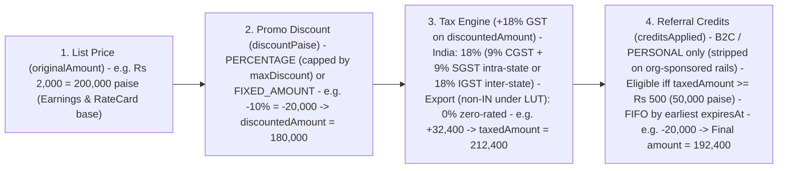

# Money System — High-Level Design

This document is the finance counterpart of [01-booking-system-hld.md](./01-booking-system-hld.md). It follows one rupee from price derivation to payout or refund, names the file that owns each step, and records the policy decisions that govern refunds. Behaviour is labelled **current** when it is merged on `dev` and **landing in Wave N** when it belongs to an open or planned pull request. Worked numeric examples live in [03-booking-and-money-machinery.md](./03-booking-and-money-machinery.md).

## 1. The pipeline in one picture

```text
 price derivation ──► order mint ──► capture webhook ──► payment legs ──► double-entry ledger
 deriveCheckoutAmount  handleCheckout   handlePaymentSuccess  PaymentLeg rows    postLedgerTxn
 (pure, integer paise) (Razorpay order  (booking capture      + funding-sum      (booking:<paymentId>)
                        or synthetic     writer)               trigger at COMMIT   │
                        org intent)                                                ▼
                                                                         earnings (hold window)
                                                                                   │
        refunds (three front doors) ◄── cancellation / no-show / void             ▼
          │   two-phase gateway call                                  payout batch (TDS) ──► RazorpayX
          ▼
 cascade: legs, earnings, utilization, credit note, ledger reversal      reconcilers heal every external boundary
```

Three rules hold the pipeline together. There is one checkout function, `handleCheckout()` in `lib/payments/checkout/orchestrate.ts`. `Payment.paymentStatus = SUCCEEDED` has several writers, listed below, and each one is either a compare-and-set on the prior status or the transaction that creates the row together with its legs. And there is one append-only journal, written only through `postLedgerTxn()` in `lib/payments/ledger/post.ts`. Consumer and enterprise flows differ only in which `PaymentLeg` rows fund the payment and whether an organisation claims a host share.

The writers of `SUCCEEDED` are these five:

1. `handlePaymentSuccess()` in `lib/payments/webhooks/handlers.ts` confirms a booking capture. The capture-race stamps in the same file also write `SUCCEEDED` when a late or mismatched capture must be kept and auto-refunded.
2. `handleOverageMemberSuccess()` in `lib/payments/webhooks/overage-handlers.ts` confirms a member's overage side-payment.
3. `handleRecordingPurchaseSuccess()` in `lib/payments/webhooks/recording-purchase.ts` confirms a replay purchase.
4. The payment row that `handleCheckout()` commits (`lib/payments/checkout/commit/payment-row.ts`) is born `SUCCEEDED` on the wallet, invoice, licence and free rails, because no gateway is involved.
5. `mintChildOverageAccrualPayment()` in `lib/payments/billing/overage-settlement.ts` creates the child accrual payment of an invoiced overage already `SUCCEEDED`, so the next invoice rollup bills it.

## 2. End-to-end architecture

```mermaid
flowchart TB
  subgraph Actors["1. Buyer & Context Selection"]
    B2C_BUYER["Marketplace Consultee (e.g. Charlotte Brown) - organizationId = null"]
    B2B_BUYER["Org Learner (e.g. Olivia Anderson @ Wipro or Rachel Anderson @ IIT Madras) - passes organizationId"]
  end

  subgraph Checkout["2. Unified Checkout Pipeline - POST /api/checkout - handleCheckout()"]
    direction TB
    ORG_GATES["Org Resolution Chain (9 Fail-Closed Gates if organizationId present) - Org ACTIVE/PENDING, canSponsor, Dunning check, ACTIVE Membership, DPDP SESSION_BOOKING consent, Domain/CreditLimit, ACTIVE ProgramAssignment"]
    STEP1["Step 1: Pure Price Derivation - deriveCheckoutAmount() - Base Price -> DiscountCode -> +18% GST -> -ReferralCredit (B2C only, min Rs 500)"]
    STEP2["Step 2: Distributed Redis Locks - lockConsulteeBooking(userId) -> lockSlotBooking(consultantId, 30m atoms)"]
    STEP3["Step 3: In-Lock Revalidation - revalidateInsideLock() - Slot conflict check, self-booking guard, ADR-18 allowlist & exclusiveEngagement"]
    STEP4["Step 4: Serializable DB Transaction - withSerializableRetry() - Appointment + AppointmentOccurrence + AppointmentParticipant + Payment + PaymentLeg[]"]
    TRIG1["DB Constraint Trigger at COMMIT: payment_legs_sum_to_amount & occurrence_no_confirmed_overlap (GiST)"]

    ORG_GATES --> STEP1 --> STEP2 --> STEP3 --> STEP4 --> TRIG1
  end

  B2C_BUYER --> STEP1
  B2B_BUYER --> ORG_GATES

  TRIG1 --> RAIL_FORK{"Funding Rail?"}

  subgraph Rail_Gateway["3A. Gateway Rail (B2C / PERSONAL Org Tag / Member Overage)"]
    GW_PEND["Payment status = PENDING (expiresAt = +30m) - Occurrence isTentative = true - Participant status = HELD - Razorpay Order minted"]
    GW_DOORS["4 Confirmation Doors: 1. Webhook payment.captured  2. /checkout/verify-signature  3. /checkout/verify?sync=true  4. Cron reconcile-payment-status"]
    SINGLE_WRITER["Booking capture writer: handlePaymentSuccess() - Phase 1 (Serializable Tx): Amount parity check -> CAS PENDING to SUCCEEDED -> isTentative = false -> Participant HELD to CONFIRMED -> Request APPROVED"]
    GW_PEND --> GW_DOORS --> SINGLE_WRITER
  end

  subgraph Rail_Skip["3B. Instant-Confirm Rail (skipPayment = true: WALLET / INVOICE / LICENSE / 100% Free Credit)"]
    SKIP_TX["Inside Step 4 Transaction: Payment created SUCCEEDED immediately - Synthetic intent (org_wallet_*, org_invoice_*, org_license_*, free_*) - walletDebit() CAS or recordBookingUtilization() + recordOverageAtCheckout()"]
  end

  RAIL_FORK -->|"CARD (amount > 0)"| GW_PEND
  RAIL_FORK -->|"WALLET / INVOICE / LICENSE / Rs 0"| SKIP_TX

  SINGLE_WRITER --> SETTLE
  SKIP_TX --> SETTLE

  subgraph Downstream["4. Shared Settlement, Ledger, Payout & Reversal Spine"]
    direction TB
    SETTLE["Phase 2 Settlement: createEarningsFromPayment() - Resolves RateCard (10/10/80) or Marketplace (20/80) + Collaborator bps - Writes ConsultantEarnings + OrganizationEarnings - Calls postLedgerTxn(booking:paymentId)"]
    TRIG2["DB Constraint Trigger at COMMIT: ledger_txn_balanced (Sum DEBIT == Sum CREDIT)"]
    HOLD["Earnings Hold Window - 24h Consultation and Class / 48h Webinar / 168h Subscription (+7 days for a new expert), anchored on the later of capture and last session end - PENDING (or PENDING_TRUST) -> READY - EarningsHold rows freeze it"]
    PAYOUTS["Payout Pipeline (Monday ticker window, hourly disbursement) - ConsultantPayout (<Rs 5k auto-approve) & OrganizationPayout (2-person approval, plus platform co-approval above Rs 50k) - Computes TDS 194-O (0.1% or 5% no-PAN) -> RazorpayX via static egress -> postLedgerTxn(payout:id)"]
    INVOICES["B2B Monthly Rollup (settle-invoice-accruals) - Sums INVOICE_ACCRUAL legs -> OrganizationInvoice (ISSUED, NET-60) - Dunning cron (3x 7d reminders -> suspend) -> Paid: postLedgerTxn(invoicepaid:id)"]
    REFUNDS["Refunds, Voids & Disputes - quoteBookingRefund() -> Two-Phase Gateway Refund -> applyRefundCascade() - Reverses PaymentLegs, Utilization, Earnings, Overage, issues CreditNote, posts refund:id"]
    RECON["Nightly Control Loop (reconcile-ledgers) - Read-only audit of the cached balances against the LedgerEntry journal - Every door that runs it freezes drifted org wallets (freezeDriftedWallets); nothing is repaired"]

    SETTLE --> TRIG2 --> HOLD --> PAYOUTS
    TRIG2 --> INVOICES
    TRIG2 --> REFUNDS
    PAYOUTS --> RECON
    INVOICES --> RECON
    REFUNDS --> RECON
  end
```



## 3. Price derivation

Every checkout computes the payable amount in integer paise in four ordered steps in `lib/payments/pricing/derive-checkout-amount.ts`.



The platform fee, the host-organisation share and the expert share are always calculated on `Payment.originalAmount`, the list price before discounts and tax. A promo code or referral credit is a marketing subsidy funded by the platform, so it is booked as `Dr DISCOUNT` or `Dr PLATFORM_PROMO` and never reduces what the expert earns. GST is charged on the discounted amount, because a discount shown on the invoice before supply reduces the taxable value under section 15(3)(a) of the CGST Act.

## 4. Order mint and funding rails

`handleCheckout()` resolves the organisation context, takes the Redis locks, re-validates inside the lock, and then writes the appointment, occurrence, participant, `Payment` and `PaymentLeg` rows in one Serializable transaction. The rail decides what happens next:

- On the gateway rail (card), the payment is `PENDING` with `expiresAt` thirty minutes out, and a Razorpay order is minted. The booking is confirmed only when a capture arrives.
- On the instant-confirm rail (`WALLET`, `INVOICE`, `LICENSE`, or a free booking covered entirely by credit), the payment is written as `SUCCEEDED` in the same transaction with a synthetic intent (`org_wallet_*`, `org_invoice_*`, `org_license_*`, `free_*`), and settlement runs inline. See [docs/booking/17-org-funded-checkout.md](../booking/17-org-funded-checkout.md).
- On the approval path, `createApprovalPaymentIntent()` in `lib/payments/operations/approval-payment.ts` mints a card order for an approved request. It writes a `PENDING` row with a `premint_<uuid>` intent and its card leg first, calls the gateway, then fills the real order id by compare-and-swap on the pre-mint marker. A gateway failure expires the pre-mint row. The order's Razorpay `notes` carry `familiarisePaymentId`, so if neither the fill nor the tombstone lands, the capture webhook adopts the named row by compare-and-swap on its pre-mint intent. The sweeps never send a `premint_` intent to Razorpay.
- When a buyer re-buys a webinar or class seat after an `EXPIRED` or `FAILED` payment, checkout re-mints the same row in place by compare-and-swap and parks the old order on an `EXPIRED` tombstone (`lib/payments/operations/prior-intent-tombstone.ts`) that carries the old legs, so a late capture on the old order is auto-refunded.

## 5. Capture: four doors, one booking writer

Four doors converge on `routeCapturedPayment()` and then `handlePaymentSuccess()`: the Razorpay webhook (`app/api/webhooks/razorpay/route.ts`), `POST /api/checkout/verify-signature`, `GET /api/checkout/verify?sync=true`, and the `reconcile-payment-status` sweep for payments pending longer than fifteen minutes.

```text
  routeCapturedPayment() -> handlePaymentSuccess(paymentIntentId)
    |-- Pre-Tx: planEarningsForPayment() resolves RateCard / ShareBand / Collaborator bps
    +-- BEGIN ISOLATION LEVEL SERIALIZABLE (withSerializableRetry)
          |-- 1. CAS Payment: WHERE status = 'PENDING' -> 'SUCCEEDED' (0 rows = already settled)
          |-- 2. Confirm slots: AppointmentOccurrence.isTentative = false
          |-- 3. Confirm seat:  AppointmentParticipant.status = 'CONFIRMED'
          |-- 4. Advance request: Consultation/Subscription -> 'APPROVED'
          |-- 5. SAVEPOINT sp_phase1_earnings
          |        |-- createEarningsFromPayment({ tx }): ConsultantEarnings + OrganizationEarnings
          |        +-- postLedgerTxn({ tx, idempotencyKey: "booking:<paymentId>" }): balanced entries
          +-- COMMIT
```

If the savepoint rolls back, the `sync-payment-earnings` sweep re-drives settlement from row state. A capture that cannot be honoured (the booking was released, the slot is now taken, or the payer already holds another live booking at that time) is claimed as `SUCCEEDED` and immediately auto-refunded through the `Auto-refund pending:` marker, and `retry-auto-refunds` re-drives any refund the webhook tried once. The recheck counts the payer's own other live bookings as well as the expert's.

## 6. Payment legs and the funding-sum trigger

A `Payment` is funded by one or more `PaymentLeg` rows (`CARD`, `WALLET`, `INVOICE_ACCRUAL`, `LICENSE`, `REFERRAL_CREDIT`, and negative `*_REVERSAL` legs). The deferred constraint trigger `payment_legs_sum_to_amount` in `prisma/sql/payment-legs-triggers.sql` fires at COMMIT and rejects any payment whose non-reversal legs, excluding `REFERRAL_CREDIT` and `LICENSE`, do not sum to `Payment.amount`, or whose reversal exceeds its original sibling. `payment_amount_vs_legs` re-checks the same rule when the payment row itself changes. Because Postgres enforces it, no application sweep re-verifies it.

## 7. The double-entry ledger

Every state change posts a balanced journal through `postLedgerTxn()`. The deferred trigger `ledger_txn_balanced` rejects an unbalanced transaction at COMMIT, and `ledger_entry_immutable` and `ledger_transaction_immutable` forbid updates. Account ids are deterministic (`kind|organizationId-or-_|consultantProfileId-or-_|INR`), and every entry amount is strictly positive with direction carried separately. The enum `LedgerAccountKind` has sixteen kinds.

| Account kind                | Scope                | Normal side | Increases with                                                                | Decreases with                                            | Meaning                                                                               |
| :-------------------------- | :------------------- | :---------: | :---------------------------------------------------------------------------- | :-------------------------------------------------------- | :------------------------------------------------------------------------------------ |
| `CASH`                      | Platform             |    Debit    | A Razorpay settlement, or a bank-transfer invoice receipt (`invoicereceipt:`) | Consultant or organisation payout                         | Settled bank cash; RazorpayX payouts leave from here                                  |
| `GATEWAY_CLEARING`          | Platform             |    Debit    | Card capture, wallet top-up, invoice paid                                     | Gateway fee, gateway refund, chargeback, settlement       | Captured money Razorpay still holds for the platform                                  |
| `GATEWAY_FEE`               | Platform             |    Debit    | The gateway fee on a capture, net of its GST                                  | —                                                         | Payment-processing expense                                                            |
| `GST_INPUT_CREDIT`          | Platform             |    Debit    | The GST Razorpay charges on its fee                                           | —                                                         | Input tax credit claimable against output GST                                         |
| `ORG_RECEIVABLE`            | Sponsor organisation |    Debit    | `INVOICE_ACCRUAL` booking                                                     | `INVOICE_PAID`, or a refund of an unpaid accrual          | What an invoiced sponsor owes the platform                                            |
| `PLATFORM_PROMO`            | Platform             |    Debit    | Referral credit consumed at checkout                                          | Credit restored on refund                                 | Marketing expense for redeemed credits                                                |
| `DISCOUNT`                  | Platform             |    Debit    | Coupon discount at booking                                                    | Pro-rata reversal on refund                               | Contra-revenue for coupons                                                            |
| `WALLET`                    | Sponsor organisation |   Credit    | Top-up confirmed, or a wallet booking refunded                                | Wallet-funded booking, or top-up refund                   | Prepaid liability owed to the organisation (cached in `BillingAccount.walletBalance`) |
| `CONSULTANT_PAYABLE`        | Expert               |   Credit    | Booking settlement                                                            | Payout completed, or refund                               | Liability owed to an expert (cached in `ConsultantEarnings`)                          |
| `ORG_PAYABLE`               | Host organisation    |   Credit    | Booking host share, overage relief                                            | Organisation payout, or refund                            | Liability owed to a host organisation (cached in `OrganizationEarnings`)              |
| `GST_PAYABLE`               | Platform             |   Credit    | 18% GST at booking                                                            | Credit note on refund or lost dispute                     | Output GST owed to the government                                                     |
| `TDS_PAYABLE`               | Platform             |   Credit    | TDS withheld at payout                                                        | Payout reversal                                           | Income tax withheld at source                                                         |
| `PLATFORM_FEE`              | Platform             |   Credit    | Platform commission and any overage surcharge                                 | Refund reversal (absorbs a one-paisa rounding difference) | Platform revenue                                                                      |
| `REFERRAL_CREDIT_LIABILITY` | Platform             |   Credit    | Referral credit vests                                                         | Credit redeemed                                           | Vested, unredeemed credit owed as a future discount                                   |
| `CONSULTANT_RECEIVABLE`     | Expert               |    Debit    | Lost dispute or refund on an already-paid earning                             | Netted against the next payout                            | Clawback owed by an expert                                                            |
| `UNAPPLIED_RECEIPTS`        | Platform             |   Credit    | A capture that funds no booking                                               | The refund that returns it                                | Cash parked for an auto-refund (`lib/payments/ledger/unapplied-receipts.ts`)          |

Razorpay PG money moves through `GATEWAY_CLEARING`, never straight to `CASH`; `gatewayCashAccount()` in `lib/payments/ledger/gateway-account.ts` is the one place that picks the account. A capture debits the clearing account. The fee is booked as its own journal, `gatewayfee:<pay_id>` (`lib/payments/ledger/gateway-fee.ts`): Dr `GATEWAY_FEE` for the fee net of GST, Dr `GST_INPUT_CREDIT` for the GST, Cr `GATEWAY_CLEARING` for the whole fee. The `payment.captured` webhook posts it from the payload's `fee` and `tax`. A capture confirmed by verify-signature or a sync carries no fee, and the settlement job books it under the same key, so the two paths cannot double-post. Razorpay keeps its fee when a refund is issued, and the platform's books do not pass that cost to the expert or the buyer, which is the D14 policy below.

The daily `reconcile-gateway-settlements` job (`jobs/reconcile/reconcile-gateway-settlements.ts`) reads Razorpay's settlement recon report into `GatewaySettlementLine` rows and matches each line to a `Payment`, `WalletTopUp`, `OrganizationInvoice`, `Refund` or `Dispute`. A `refund` line matches its `Refund` row by `rfnd_` id; wallet top-up and org invoice refunds have no such row, so the line falls back to its `payment_id`: a `CONFIRMED` `WalletTopUp` checks the amount against the `topup-refund:<rfnd_id>` journal, then an `OrganizationInvoice` against `invoice-refund:<rfnd_id>`, each by that journal's debit total (the separate `topup-refund-shortfall:` journal is not counted). A matched refund with no journal is `AMOUNT_MISMATCH` ("ours unbooked"), so a missed refund webhook stays visible. Once a day is fully read it posts one `settlement:<setl_id>` journal per settlement: Dr `CASH` / Cr `GATEWAY_CLEARING` for Σ(credit − debit) of its lines. Because the fee already left the clearing account, that net is exactly what reached the bank. A worked example: a ₹1,000 capture with a ₹23.60 fee (₹20 + ₹3.60 GST) posts Dr clearing 100000, then Dr fee 2000, Dr GST input 360, Cr clearing 2360; the settlement posts Dr CASH 97640 / Cr clearing 97640, and the clearing balance returns to zero. Lines that disagree are marked `AMOUNT_MISMATCH`, `FEE_MISMATCH` or `UNMATCHED`, reported once per run to Sentry, and listed at `GET /api/admin/settlements/lines?status=`; the money rows are never edited. RazorpayX payouts and their reversals stay on `CASH`.

## 8. Earnings, the hold window and the money state machines

Settlement writes `ConsultantEarnings` (and `OrganizationEarnings` for host organisations) as `PENDING`. They become `READY` once `holdUntil` passes, where `holdUntil = max(capture time, end of the last live occurrence) + hold hours` (`lib/payments/payouts/earnings-hold.ts`). The hold hours are in `PAYOUT_CONSTANTS.HOLD_PERIOD_HOURS`: 24 for a consultation, 48 for a webinar, 168 for a subscription and 24 for a class. The `release-earnings` sweep on the ticker makes the `PENDING` to `READY` move every fifteen minutes. Earnings for a booking sponsored by an unverified, never-invoiced organisation park in `PENDING_TRUST` instead (see [ADR 12](../enterprise/70-design-decisions/12-pending-trust-earnings-parking.md)).

**A new expert waits seven days longer.** `withNewExpertHold()` adds `NEW_EXPERT_EXTRA_HOLD_DAYS` (7) to `holdUntil` when the expert's first earning on a succeeded payment is younger than 30 days (or they have none yet), or when their lifetime share, net of refunds, is under ₹50,000 (5,000,000 paise). The test runs per consultant payee. Deferred holds (subscription tranches, trial cancellations and the settlement of cancelled sessions) get the same extra days through `stampConsultantHolds()`. For example, Hannah Anderson, an independent consultant with no earlier earnings, delivers a ₹1,000 consultation on Mon 26 Oct 2026, 10:00 to 11:00 IST. The normal hold ends Tue 27 Oct 11:00 IST, and the new-expert hold ends Tue 3 Nov 11:00 IST.

```text
  PaymentStatus:
    PENDING ──(capture)──▶ SUCCEEDED ──(partial refund)──▶ PARTIALLY_REFUNDED ──▶ REFUNDED
       ├──(gateway fail)─▶ FAILED
       └──(30m timeout)──▶ EXPIRED  (late capture on EXPIRED triggers 100% auto-refund)

  EarningsStatus (ConsultantEarnings & OrganizationEarnings):
    PENDING / PENDING_TRUST
       ├──(holdUntil elapsed)──────────────────────────────────────────▶ READY
       ├──(first active EarningsHold placed)───────────────────────────▶ HELD ──(last hold released)──▶ back to the prior status
       └──(fully reversed by a refund or a lost dispute)───────────────▶ REFUNDED
    READY ──(claimed by the Monday batch)──▶ BATCHED ──(payout.processed)──▶ PAID ──(payout.reversed)──▶ READY

  PayoutStatus:
    PENDING ──(under 5,000 rupees auto, or admin / two-person organisation approval)──▶ APPROVED ──▶ PROCESSING ──▶ COMPLETED / FAILED / REVERSED

  RefundStatus:
    PENDING (Phase-1 Serializable reservation) ──(gateway 2xx + applyRefundCascade)──▶ SUCCEEDED (or FAILED)
```

Every transition on `Payment`, `Appointment`, `Refund` and `Payout` is a conditional `updateMany` with the expected prior status in the `WHERE`.

### 8.1 Reason-scoped earnings holds

An earning is `HELD` exactly when it carries at least one active `EarningsHold` row, and each hold names its reason and its source:

| Reason         | Placed by                                                                                                                            | Source reference      | Released by                                                                |
| :------------- | :----------------------------------------------------------------------------------------------------------------------------------- | :-------------------- | :------------------------------------------------------------------------- |
| `DISPUTE`      | `placeDisputeHolds()` when a dispute opens (`app/api/webhooks/utils.ts`)                                                             | The `Dispute` row id  | The settlement of that same dispute, whatever its verdict                  |
| `MODERATION`   | A ban of the consultant (`lib/moderation/side-effects.ts`)                                                                           | The banned user's id  | An admin through the operator release door                                 |
| `OPERATOR`     | An admin through `POST /api/admin/earnings/[id]/hold`                                                                                | The ops-log row id    | An admin through `POST /api/admin/earnings/[id]/release`                   |
| `OVERAGE`      | An unpaid member overage (`lib/payments/billing/overage-settlement.ts`)                                                              | The parent payment id | The overage being paid, reversed or settled to the organisation            |
| `SUPPORT_CASE` | A staff or admin hold on a support case (`lib/support/case-holds.ts`), and earnings created later for a payment the case still holds | The `SupportCase` id  | A staff or admin release on the case, or the case being resolved or closed |

`lib/payments/payouts/earnings-holds.ts` (`placeEarningsHolds()` and `releaseEarningsHolds()`) is the only writer of the `HELD` status. The first hold stores the row's prior status in `preHoldStatus`, and the last release restores it, so releasing one owner's hold never frees money another owner still holds. A dispute that settles cannot free a moderation, operator or overage hold, and the operator release door clears only `OPERATOR` and `MODERATION` holds and refuses while the payment has an open refund or dispute. Applying a `SUPPORT_CASE` hold first cancels payouts not yet sent that batched the payment's earnings, the same way as a dispute hold (`cancelOpenPayoutsForPayment()`), and refuses while a payout is being sent. The database keeps one active hold per earning, reason and source (the partial unique indexes `earnings_hold_active_consultant_key` and `earnings_hold_active_org_key`) and requires each hold to name exactly one earning (`earnings_hold_one_earning`), all in `prisma/sql/check-constraints.sql`.

### 8.2 Dispute settlement

When a dispute opens, `placeDisputeHolds()` first cancels any `PENDING` or `APPROVED` payout that already batched one of the payment's earnings (a compare-and-set on the payout, and only the payouts it actually cancelled hand their other earnings back to `READY`), then places a `DISPUTE` hold on the unpaid earnings.

The verdict is settled by one function, `settleDisputeVerdict()` in `app/api/webhooks/utils.ts`, which both the Razorpay webhook (`handleDisputeUpdated()`) and the `reconcile-disputes` poll call. The poll adopts the gateway status and settles the verdict in a single Serializable transaction, so a failed settlement rolls the adoption back for the next run, and a later webhook replay finds the dispute already in its verdict and does nothing. The rules are:

- **Won, or a closed early-fraud warning.** The money stays, and only this dispute's hold is released.
- **Lost or charge refunded.** `settleLostDispute()` reverses `amount_deducted / payment.amount` of every share, floored per share and capped at what is left to reverse, then releases this dispute's hold. Razorpay's `amount_deducted` is used, and the disputed amount is the fallback when it is absent. A partial loss therefore leaves the remainder payable, and a share goes `REFUNDED` only once its whole amount is reversed.
- **Closed.** `settleClosedDispute()` follows `amount_deducted`: a positive amount is settled as a loss for that amount, and zero or none is settled as a release.
- **Who bears it.** A paid consultant earning on a completed payout raises a clawback receivable (`CONSULTANT_RECEIVABLE`) for the net-of-TDS cash, and the withholding is reversed separately. The sponsoring organisation bears the chargeback only when the payment was funded on an organisation rail (a `WALLET`, `INVOICE_ACCRUAL` or `LICENSE` leg exists). A card payment that is merely tagged to an organisation follows the consumer path.
- **Documents.** A lost chargeback mints a credit note for the lost amount (`CreditNote.disputeId`, unique), and a replay purchase loses its playback entitlement.

For example, Charlotte Brown pays ₹1,180 (118,000 paise) by card for Hannah Anderson's ₹1,000 consultation, and Hannah's share is ₹800 (80,000 paise). The bank opens a dispute and her earning goes `HELD` under a `DISPUTE` hold. Razorpay later reports the dispute lost with `amount_deducted` of ₹590 (59,000 paise). The factor is 59,000 / 118,000 = 0.5, so ₹400 (40,000 paise) of Hannah's share is reversed, the dispute's hold is released, and the remaining ₹400 returns to the status it had before the hold and stays payable. If that earning had already been paid out, the ₹400 (less the TDS fraction of that payout) becomes a clawback receivable that her next payouts net.

## 9. Payouts and TDS

The payout jobs run on the five-minute Netlify ticker (`netlify/functions/cron-tick.mts`), not in GitHub Actions. `create-payout-batch` fires on its slots inside a window that opens on Mondays at 20:00 UTC and lasts three hours, minting at most ten consultant payouts and ten organisation payouts per slice. `process-payouts` fires hourly at minute :00 and disburses at most five approved payouts per rail per run, so an approved payout leaves within the hour rather than waiting for a weekly run. Disbursement is still gated on `ENABLE_LIVE_PAYOUTS`. A consultant payout below `AUTO_APPROVE_THRESHOLD` (5,000 rupees) is approved by the system; larger ones wait for an admin. Organisation payouts need an organisation approver, and sometimes a Familiarise admin as well (see section 9.4). Claiming is claim-first: `READY` earnings move to `BATCHED` before the payout is computed, and a database check (`consultant_earnings_batched_has_payout` and `org_earnings_batched_has_payout`, defined in `prisma/sql/check-constraints.sql`) requires a `BATCHED` earning to name its payout.

A windowed job sends its window start with every slice, and each slice treats its cohort as of that instant, so a later slice of the same window finds nothing new to do. Every money job reads the `limit` it is given, runs under `withCronLock`, and answers 207 when some rows failed, which the ticker counts as a failed run. The other windowed money jobs are `settle-invoice-accruals` (the 1st of each month from 04:00 UTC), `expire-referral-credits` (the 1st from 03:10 UTC), `generate-subscription-invoices`, `abandoned-org-top-ups`, `advance-program-cycles`, `auto-renew-contracts`, `irp-uploader`, `sweep-abandoned-overage-charges` and `expire-contracts` (daily 03:00 to 20:00 UTC), `msme-payment-alerts` (once a day, between 03:00 and 04:00 UTC), and `timeout-member-overages`, `dunning` and `wallet-low-balance` (daily from 23:30 UTC for three hours). The ledger audit advances in bounded hourly `:55` slices when capacity permits; `reconcile-disputes`, `reconcile-payout-status` and `handle-stuck-payouts` also run on the ticker.

TDS is computed in `computeTdsForPayout` (`lib/compliance/tds.ts`), which applies the rate to the taxable base that `resolve194OTaxablePaise` (`lib/compliance/tds-194o.ts`) returns under the section 194-O rules (section 393 of the Income-tax Act 2025). The base is the gross sale amount, not the expert's net share. An individual or HUF with a PAN on file is exempt while the financial-year gross stays at or below 5,00,000 rupees; every other payee is withheld from the first rupee. The rate is 10 basis points with a PAN and 500 basis points without one.

The payout that first takes the year past 5,00,000 rupees withholds on the **whole year-to-date gross**, including the earlier amounts that were exempt, and every later payout that financial year withholds on its own gross. This reading is pending CA confirmation (#1901); reverting to the excess-only reading is a one-line change in `crossingTaxablePaise()` in `lib/compliance/tds-194o.ts`. For example, an expert with 4,90,000 rupees of gross already paid this year who is paid for another 20,000 rupees has 510 rupees withheld (0.1 % of 5,10,000 rupees, `51,000` paise), where the excess-only reading gave 10 rupees. The next 20,000-rupee payout withholds 20 rupees.

`planConsultantPayoutTds()` in `lib/payments/payouts/consultant-tds.ts` turns that rule into a running total for the financial year. It works out the TDS the whole year owes so far (0.1 % of the year-to-date gross once the gross passes 5,00,000 rupees, otherwise nothing) and subtracts the TDS already assigned to the expert's other live payouts that year: what they withheld, plus what they carried forward, less what they credited back or reversed for refunds. The difference is what this payout owes. The same planner runs for the instant-payout preview (`previewInstantPayout()`), so the preview shows the figure the payout then withholds.

The year-to-date gross is the gross of the expert's earnings in other `PROCESSING` or `COMPLETED` payouts whose TDS was stamped for this Indian financial year (`tdsFinancialYear`, 1 April to 31 March, IST), less refunds pro-rated from the refunded share. A paid earning whose payout carries no stamp falls back to its `paidAt` date inside `getFYDateRange()`. A batch that is still queued is not counted, because it is taxed when it runs. The payout being computed is excluded from every read, so a retried payout recomputes the same figure, and a failed, cancelled or reversed payout drops out so the next payout takes over its share.

Four rules sit on top of the running total. They are pending CA confirmation (#1901).

- **One catch-up per expert per financial year, enforced by the database.** The payout that takes the catch-up stamps `tdsCatchUpFy`. The partial unique index `consultant_payout_one_tds_catch_up_per_fy` (`prisma/sql/check-constraints.sql`) refuses a second live payout with the same stamp, so two runs racing on the same expert cannot both take it. The losing run catches the unique violation, rereads the history (which now includes the winner) and stages only what is left.
- **A refund reverses only the refunded booking's own TDS.** `recordTdsReversal()` in `lib/payments/tax/tds-service.ts` reverses 0.1 % of the refunded gross, never more than the payout's proportional share. The catch-up stays withheld while the year remains above 5,00,000 rupees. If refunds pull the year back to 5,00,000 rupees or below, the year owes nothing, and the next payout credits back the TDS already withheld. The credit is paid as extra cash on that payout (`tdsCreditPaise`), never outside a payout. It posts as a debit to `TDS_PAYABLE` and files as a negative `TDSRecord` with a `TdsAdjustment`.
- **A payout too small for its TDS withholds what fits and carries the rest.** `settle194OWithholding()` in `lib/compliance/tds-194o.ts` never withholds more than the payout's amount less clawback recovery. It records the remainder as a positive `tdsCarryPaise`, and the next payouts collect it as a negative `tdsCarryPaise`. The carry follows the expert across a financial-year change. A payout whose TDS absorbs all of its cash completes without a gateway transfer (`completeZeroCashConsultantPayout()`).
- **The whole amount lands on the payout's own `TDSRecord`**, so the quarterly return shows it in the quarter that payout completes. No code caps TDS at the rate times one payout's own gross.

For example, a ₹300 payout (`30,000` paise) that owes the ₹510 catch-up withholds ₹300, carries ₹210 (`tdsCarryPaise` = `21,000`) and moves no cash. The expert's next ₹20,000 gross payout withholds ₹230: ₹20 of its own plus the ₹210 carried.

Withholding posts to `TDS_PAYABLE` in the payout journal (`payout:<id>`), and a bank-returned payout posts `payout-reversal:<id>` with a negative `TDSRecord`. A refund or lost dispute on an already-paid earning raises a clawback that the next payout nets in its creation transaction (`lib/payments/payouts/clawback-recovery.ts`).

### 9.1 Payout safety rules

- **A failed mint does not stop the batch.** If minting one consultant's payout throws, the batch collects the failure, reports it to Sentry once for the run, counts it, and carries on, so the ticker sees a 207.
- **Clawback pause.** `mintConsultantPayout()` skips an expert whose unrecovered clawback receivable is above `CLAWBACK_RECOVERY_PAUSE_PAISE` (₹10,000, 1,000,000 paise) instead of netting it, until the receivable comes down. The mint runs Serializable with bounded retries, so a clawback that commits after the pause read forces a retry rather than slipping through. The expert sees the reason `CLAWBACK_RECOVERY_PAUSE` on the payout-eligibility panel (`payoutEligibilityReason()` in `lib/payments/payouts/payout-requirements.ts`).
- **The gateway paid a payout we had already failed.** `completeLocallyFailedPayoutInTx()` completes the payout, re-attaches the earnings that are still `READY` (each failed payout stamps `ConsultantEarnings.releasedFromPayoutId`), books `payout:<id>`, and raises a clawback receivable for whatever part of the paid amount is no longer backed by an earning. It also records a `SystemEvent` and a Sentry message for an operator.
- **A bank-reversed payout voids its own clawbacks.** `voidClawbacksRaisedOnPayout()` voids the still-unrecovered part of every clawback raised on that payout, because its earnings reopen as `READY` and would otherwise be netted twice. Any part that later payouts already recovered stays booked and raises an alert that this sum is owed back to the expert.
- **Refunds and chargebacks stay within the payment.** The deferred constraint trigger `payment_refunds_within_amount` in `prisma/sql/payment-legs-triggers.sql` rejects at COMMIT a refund write that would take the sum of pending and succeeded refunds plus lost chargebacks above `Payment.amount`, and it locks the payment row so concurrent refunds serialise. Dispute rows are deliberately not guarded, because a lost chargeback is the bank's verdict and must always be storable. The trigger is defined in the sidecar and takes effect where the sidecar has been applied.

### 9.2 Payout account changes, cooling-off and freeze

A payout goes only to an account that has been the default for 48 hours. When a consultant or an organisation makes a new account the default, the account is stamped with `payoutsAllowedAfter` (now plus `PAYOUT_ACCOUNT_COOLING_OFF_MS`, 48 hours), and the payee gets one security email (`emailPayoutAccountChanged()` in `lib/payments/payouts/payout-account-change.ts`) with a link to a confirm page. Only the page's same-origin POST (`POST /api/consultant/payout-accounts/freeze` or `POST /api/organizations/[orgId]/payout-account/freeze`) sets `payoutsFrozenAt`, so a cross-site link cannot freeze anything. A payee's first account is exempt only while no payout exists and no earning has accrued. A freeze the payee placed carries over to whatever account becomes the default next, and only an admin lifts it, through `POST /api/admin/payout-accounts/unfreeze` (ADMIN, step-up, reason, ops-log row).

Mint skips a default account that is cooling off or frozen. At mint, the payout records the account it will use (`payoutAccountId` on `ConsultantPayout`, `orgPayoutAccountId` on `OrganizationPayout`), and disbursement sends to exactly that account and refuses it if it has since been frozen or is unverified. A payout minted before the snapshot existed falls back to the payee's current default account, which must also be out of cooling-off. An organisation's payout account is edited in place, so an organisation payout whose account changed after mint is failed and its earnings are re-batched.

### 9.3 RazorpayX static egress

Live RazorpayX APIs answer only requests from allowlisted IP addresses, and Netlify has no static egress address. Every RazorpayX call therefore goes through `apiRequest()` in `lib/payments/payouts/razorpay-payouts.ts`, which sends it through an undici proxy agent when `RAZORPAYX_EGRESS_PROXY_URL` is set. With a live key (`rzp_live_`) and no proxy URL, the call is refused with `RAZORPAYX_EGRESS_NOT_CONFIGURED` before any request leaves. Payment-gateway calls (checkout, refunds, disputes) do not use the proxy.

### 9.4 Organisation payouts: co-approval and platform hold

An organisation payout needs an approver at the organisation, who cannot be the person who created the batch while the organisation has a second approver. It also needs a Familiarise admin's co-approval when its amount is above ₹50,000 (`ORG_PAYOUT_PLATFORM_APPROVAL_ABOVE_PAISE`, 5,000,000 paise) or when it was minted within seven days of its payout account changing. In that case the organisation's approval leaves the payout `PENDING` with `platformApprovalRequiredAt` set, and `POST /api/admin/org-payouts/[id]/approve` (`approveOrgPayout()`) moves it to `APPROVED`. The admin cannot be the batch's creator or its organisation approver. That door also falls under the second-admin rule in section 14 when the net amount is above ₹25,000. Independently of approval, an admin can place a platform hold on a `PENDING` or `APPROVED` payout (`POST /api/admin/org-payouts/[id]/hold`) and clear it (`.../release`); the payout run refuses a held payout. `GET /api/admin/org-payouts` lists them for the Money console (staff may read it).

## 10. Refunds

Refunds have three front doors, and no code calls the gateway refund directly:

1. `refundBookingPayment()` in `lib/payments/operations/booking-refund.ts` refunds one booking and splits the rails by intent prefix: card money goes through the two-phase gateway refund, `org_*` money reverses in-ledger, and `free_*` credit-funded bookings restore their credits.
2. `refundWholeEventPayments()` in `lib/payments/operations/event-refunds.ts` refunds every seat of a cancelled webinar or class.
3. `refundRemovedAttendeeSeat()` in the same module refunds one removed or departing seat.

The gateway refund is two-phase: a Serializable transaction reserves a `PENDING` refund row against the refundable balance, the gateway is called with the reservation id as the idempotency key, and `applyRefundCascade()` then reverses legs, utilization, earnings and the ledger and mints the credit note, claimed once through `Refund.cascadedAt`. A `dedupeKey` on `Refund` makes a repeated call return the first refund.

**Current.** The cancel route computes the refund quote inside the cancel transaction (`quoteBookingRefund`) and checks it against the amount the dialog displayed: a request that carries `expectedRefundPaise` and gets a different server quote answers 409 `REFUND_QUOTE_CHANGED` (`assertQuoteMatchesClick` in the cancel route). The field is optional, and a request without it is logged and goes through unbound. The cancel dialogs send the displayed quote through `shownQuoteBody()` in `lib/appointments/cancel-requote.ts` (callers: `useEventActions.tsx`, `useConsultantEventActions.ts`, `OrgActorDetail.tsx` and `SubscriptionsPage.tsx`), and on a 409 they re-quote with `readRefundQuoteChanged()` and `applyRefundRequote()`. The same transaction stamps the per-payment refund-owed marker (`refundOwedPaise`, `refundOwedKey` unique, `refundOwedReason`, `refundOwedAt`, `refundOwedAttempts`) through `stampRefundOwed()` in `lib/payments/operations/refund-owed.ts`. After the commit `driveRefundOwed()` calls the front door under `dedupeKey: "cancel:<appointmentId>:<paymentId>"`, and the `retry-auto-refunds` sweep re-drives any marker older than fifteen minutes that still has no refund under its key, fewest attempts first, then clears it. A process death between the commit and the refund therefore leaves a `CANCELLED` booking, a `SUCCEEDED` payment and a marker that the sweep finishes. The marker is deliberately not a pre-created `Refund` row, because that would short-circuit the dedupe lookup and reduce the refundable balance. The trial cancel, rejection, moderation, maintenance-freeze and no-show doors stamp markers the same way, and a whole-event cancel stamps every seat in the cancelling commit and drives a bounded bite under `event-cancel:<eventId>:pay:<paymentId>`, leaving the rest to the sweep.

### 10.1 Refunds a declared platform incident owes

When ops declare a platform incident, the `settle-platform-incidents` sweep writes one remedy row per learner seat and session, and a refund remedy uses the same marker-then-drive pattern as a cancel. `refundIncidentSeat()` (`lib/payments/operations/incident-refunds.ts`) stamps the per-payment refund-owed marker with `stampRefundOwed()` under the key `incident:<incident>:<occurrence>:<user>` (`incidentRefundKey()` in `lib/booking/incident-keys.ts`), then drives the refund for the payment's full remaining balance through `refundBookingPayment()`, so card, in-ledger `org_*` and credit-funded payments each take their usual rail and the platform bears the gateway fee. There is no platform-funded leg: `applyRefundCascade()` reverses the expert's earnings exactly as it does for every other void.

Three rules keep this safe. First, the key is unique per seat and session, so a replay or a second sweep run returns the first refund. Second, a payment that already owes another door's refund is never overwritten: the remedy records a marker conflict, counts an attempt and waits, and after three attempts (`MAX_REMEDY_ATTEMPTS`) it is dead-lettered for an operator. Third, under the appointment lock the refund re-checks that the session is still `VOIDED`, so an ops un-void wins over a pending incident refund. Prefix scans that sum what a payment has already got back (`occurrenceRefundsPaise()` for series cancels and seat exits, `voidRefundExists()` for the un-void guard) read the `incident:` prefix as well as `occ:`, so a seat is never refunded twice across the two doors.

**Example.** Priya Anderson paid ₹1,180 (118,000 paise) for a consultation that an incident voided. Forty-eight hours later the sweep stamps the marker `incident:<incident>:<occurrence>:<priya's user id>` for 118,000 paise and refunds it in full; ops see the refund in the Refunds section under that key.

### 10.2 Credit notes and GST

A refund mints a consumer credit note covering only the refunded part (`mintRefundCreditNote` in `lib/payments/operations/refund.ts`), reversing GST pro rata. Under section 34(2) of the CGST Act a tax credit note is possible only until 30 November after the financial year of the supply; past that, `isPastGstCreditNoteCutoff` in `lib/compliance/gst-credit-note-cutoff.ts` switches the note to a commercial credit note with no tax.

## 11. Refund and cancellation policy decisions

The refund ladder implemented in `lib/payments/operations/cancellation-policy.ts` is unchanged. The decisions below were taken by the owner for the productionization program.

| Decision                       | Rule                                                                                                                                                                                                                                                                                                                                                                           | Status                                              |
| :----------------------------- | :----------------------------------------------------------------------------------------------------------------------------------------------------------------------------------------------------------------------------------------------------------------------------------------------------------------------------------------------------------------------------- | :-------------------------------------------------- |
| D7 Refund ladder               | Notice of 24 hours or more refunds 100%, 2 to 24 hours refunds 50%, under 2 hours refunds 0%. An expert, admin or platform cancel refunds 100%. An expert no-show refunds 100% and a learner no-show 0%. A webinar window is 24 to 168 hours and a class is refunded per session unit. A credit note covers only the refunded part, and the platform fee is returned pro rata. | Current                                             |
| D3 Cancel quote                | The dialog sends the refund it displayed, and a different server quote answers 409 `REFUND_QUOTE_CHANGED`.                                                                                                                                                                                                                                                                     | Current                                             |
| D8 Subscription session return | One session cancelled 24 hours or more ahead returns to the plan allowance with no cash, at most two per plan. Inside 24 hours it is forfeited and counts as delivered.                                                                                                                                                                                                        | Current                                             |
| D9 Plan extension              | A returned session extends the plan end by up to seven days.                                                                                                                                                                                                                                                                                                                   | Current                                             |
| D10 Expert friction            | At most two expert reschedules per booking, and every expert cancel or no-show records a reliability strike. No money is taken from experts.                                                                                                                                                                                                                                   | Current                                             |
| D11 Outage void of a 1:1       | An immediate free-rebook offer, then 100% cash at 48 hours, with the platform bearing the gateway fee. The 100% cash refund at 48 hours has landed (a webinar seat is refunded straight away, and the expert's earnings are reversed by the normal refund cascade). The free-rebook offer is landing next (W1-b2).                                                             | Cash refund current; rebook offer landing in Wave 1 |
| D12 Sponsor organisations      | They allocate only bookings the expert has already approved and never approve a pending request.                                                                                                                                                                                                                                                                               | Current                                             |
| D13 Pause                      | `acceptingRequests = false` blocks every new booking: direct checkout, trials and requests. Existing bookings are unaffected.                                                                                                                                                                                                                                                  | Current                                             |
| D14 Gateway fee                | The platform absorbs the gateway fee on any refund, so the buyer always receives exactly the quoted percentage.                                                                                                                                                                                                                                                                | Policy; ledger posting verified in W0-3             |
| D15 Webinar seat transfer      | Deferred until after launch. A webinar buyer who cannot attend uses self-leave, which refunds in full while the refund window is open. The design is kept in #2140.                                                                                                                                                                                                            | Deferred (#2140)                                    |

**India note.** The program's market research (Topmate, Preplaced, Clarity, MentorCruise, Cult.fit, Townscript, KonfHub, upGrad, the Consumer Protection Act 2019, the Consumer Protection (E-Commerce) Rules 2020 rules 4(8), 4(10) and 6(3), the 2023 dark-pattern guidelines, Razorpay, and CGST section 34) supports keeping the ladder. Rule 4(8) bars a marketplace from charging a consumer a cancellation fee unless it bears a similar charge when it cancels unilaterally. That symmetry is why an expert cancel refunds 100% and why experts get reliability strikes rather than fees, and why the platform, not the buyer, absorbs the gateway fee. A counsel review of rule 4(8), the 2025 payment-aggregator directions and the GST treatment of retained fees is planned before launch.

## 12. Reconcilers

Application sweeps reconcile only across vendor boundaries; invariants that Postgres enforces (balanced journal, funding-sum, immutability) are not re-checked in JavaScript.

| Boundary                            | Job                                                                                                                            | Cadence                                   |
| :---------------------------------- | :----------------------------------------------------------------------------------------------------------------------------- | :---------------------------------------- |
| Razorpay payments                   | `reconcile-payment-status`, `reconcile-orphaned-payments`, `reconcile-orphaned-confirmations`, `sweep-orphaned-topup-captures` | Ticker, 15 to 30 minutes                  |
| Razorpay refunds                    | `reconcile-refunds`, `retry-auto-refunds`                                                                                      | Ticker, 15 minutes                        |
| Razorpay disputes                   | `reconcile-disputes`                                                                                                           | Ticker, hourly at `:00`                   |
| Razorpay payouts                    | `reconcile-payout-status`, `handle-stuck-payouts`                                                                              | `cron-intra-day.yml`                      |
| Razorpay settlements                | `reconcile-gateway-settlements` (`jobs/reconcile/reconcile-gateway-settlements.ts`)                                            | Ticker, 06:30–12:30 UTC                   |
| Cached balances against the journal | `reconcile-ledgers` (`scripts/reconcile/reconcile-ledgers.ts`)                                                                 | Hourly `:55` slices when capacity permits |

`reconcile-ledgers` (`scripts/reconcile/reconcile-ledgers.ts`) is a read-only auditor. It compares cached balances and counters with the journal, writes one `LedgerReconciliationReport` per logical audit and repairs nothing. The ticker offers an hourly `:55` slice, yielding when settlement or statutory jobs fill the dispatch cap. Each comparison uses a coherent read-only snapshot over at most 100 primary entities and their complete related history. Checkpoints retain finished pages across dates; partial reports remain RUNNING and return HTTP 200. A completed report returns 200 when clean or 207 when unbaselined findings remain; exceptions record FAILED and return 500. Completed daily audits are reused for the rest of the UTC day.

Every reconcile door freezes a drifting wallet immediately after its page through `freezeDriftedWallets()`. Freeze failures prevent progress past that page. The scheduled twin aggregates wallet evidence and uses a persisted logical-report key to deduplicate fatal alerts for seven days; final discrepancies also produce a `RECONCILE` event and standing-finding alert. Admin runs share the same lease and can resume idle checkpoints. A wallet stays frozen until an admin reconciles the drift and calls `POST /api/admin/billing-accounts/[billingAccountId]/unfreeze`, which re-reads that wallet and refuses with `409 WALLET_STILL_DRIFTED` while the cache and journal disagree. Missing-booking findings identify each payment, so repairing one cannot hide another through an unchanged aggregate count. See [ledger integrity](../enterprise/10-money-and-ledger/13-ledger-integrity.md) for bounds, recovery and baseline rules. The checks, by group, are:

```text
Reconciliation checks (one report per run; findings only, no repairs)
  |
  +-- Group 1: Journal coherence
  |     |-- REFUND_BOOKING_COHERENCE: refunded bookings have released capacity (full scope only)
  |     |-- EARNINGS_WITHOUT_BOOKING_TXN: earnings rows with no booking journal
  |     |-- REVERSED_EARNING_WITHOUT_REFUND_TXN: a reversed earning has no REFUND journal
  |     |-- COMPLETED_PAYOUT_WITHOUT_LEDGER_TXN: a completed payout has no payout journal
  |     |-- LEDGER_DUAL_WRITE_GAP: payout clawbacks match the posted entries
  |     +-- SPLIT_SUM_MISMATCH: platform + organisation + expert shares add up to the paise
  |
  +-- Group 2: Money caches against the journal
  |     |-- WALLET_BALANCE_DRIFT: BillingAccount.walletBalance vs the WALLET account (every reconcile door freezes spend)
  |     |-- EARNINGS_LEDGER_DRIFT: earnings rows vs the journal payables
  |     |-- ORG_PAYOUT_TOTAL_MISMATCH: batched earnings add up to the payout's net amount
  |     |-- REFERRAL_CREDIT_LIABILITY_DRIFT: the liability account vs vested, unredeemed credit
  |     +-- UNAPPLIED_RECEIPTS_RESIDUE: a settled refund of a parked capture left a balance
  |
  +-- Group 3: Usage and program counters
  |     |-- PROGRAM_ASSIGNMENT_ENGAGEMENTS_DRIFT, CREDIT_POOL_CONSUMED_DRIFT, OVERAGE_COUNT_DRIFT
  |     |-- OVERAGE_CHARGESTATUS_INTEGRITY, OVERAGE_SETTLEMENT_MISMATCH
  |     +-- ACTIVE_SEAT_COUNT_DRIFT
  |
  +-- Group 4: Tax and standing items
        |-- ORG_INVOICE_GST_MISMATCH: an invoice's output tax vs the GST its bookings posted
        |-- PENDING_TRUST_PARK_STALE: a trust park older than 24 hours (detect-only)
        +-- CLAWBACK_RECEIVABLE_STALE: clawbacks unrecovered after 90 days
```

INR-only currency is not a reconcile check: the sidecar CHECKs `*_currency_inr` in `prisma/sql/check-constraints.sql` reject a non-INR `LedgerAccount`, `Payment`, `Refund`, `Dispute`, `ConsultantEarnings` or `ConsultantPayout` row at write time.

An earnings row and its `booking:<paymentId>` journal commit in one transaction, so there is no grace window for a fresh payment.

## 13. B2B invoicing and organisation credit

Only the platform extends credit and changes invoices. The tenant doors that used to do so are gone, and the platform doors are all `withOpsAction()` doors (section 14).

- **Credit.** An organisation's owner or billing admin may lower the credit limit, but cannot raise or remove it and cannot switch the organisation to `INVOICE` funding (`403 CREDIT_LIMIT_PLATFORM_ONLY` and `403 INVOICE_FUNDING_PLATFORM_ONLY` from the tenant `PATCH /api/organizations/[orgId]/billing-account`). Ops do both through `PATCH /api/admin/organizations/[orgId]/billing-account`.
- **Invoices.** A tenant can only cancel a `DRAFT` invoice (`403 INVOICE_CHANGE_PLATFORM_ONLY` for anything else), and there is no tenant door that raises one. The platform raises a manual invoice (`POST /api/admin/organizations/[orgId]/invoices`) or lets the billing crons raise it.
- **Purchase-order coverage.** When an organisation requires a purchase order and none covers a rollup or subscription invoice, the job leaves that invoice as a `DRAFT` and records one `SystemEvent` for the run (`ROLLUP_PO_NOT_COVERED` or `SUBSCRIPTION_PO_NOT_COVERED`). An admin issues it with the purchase order it draws on through `POST .../invoices/[invoiceId]/issue`. Every credit note returns its share of the purchase-order draw.
- **Void is a credit note.** `voidOrgInvoice()` (`lib/payments/billing/org-invoice-void.ts`) moves an `ISSUED` or `OVERDUE` invoice to `VOID` with a compare-and-set, mints a credit note for what the invoice still carries (keyed by `CreditNote.voidedInvoiceId`, one of the four mutually exclusive triggers enforced by `credit_note_trigger_xor`), and takes one of two modes. `REBILL` clears the bookings' `billableToOrgInvoiceId` so the next rollup bills them again, and reverses no revenue. `FORGIVE` writes the receivable off in the journal `invoice-voided:<invoiceId>` against the note's GST and the platform fee, and the experts keep their share. A paid invoice answers `INVOICE_PAID_USE_REFUND`, and an invoice with recorded receipts answers `INVOICE_PART_PAID_USE_REFUND`.
- **Bank-transfer receipts.** `OrganizationInvoiceReceipt` records each payment against an invoice, either a bank transfer (the UTR is unique per organisation) or a gateway capture. `recordBankTransferReceipt()` writes the receipt and the journal `invoicereceipt:<receiptId>` (`Dr CASH / Cr ORG_RECEIVABLE`), and once nothing is outstanding it settles the invoice through `settleOrgInvoicePaid()`, the same transition the gateway webhook uses.
- **`/pay` charges what is outstanding.** The tenant `POST .../invoices/[invoiceId]/pay` mints an order for `invoiceOutstandingPaise()`, which is the invoice total less issued credit notes and receipts, and reuses a cached order only while it is unpaid and for that amount. A capture that does not equal the outstanding amount cannot settle the invoice. It is parked in `UNAPPLIED_RECEIPTS` with one `SystemEvent` (`ORG_INVOICE_CAPTURE_UNAPPLIED`) for an operator, and it is never auto-refunded. An organisation awaiting verification may pay, and a suspended one may not.
- **Overage the member never paid.** When a member's overage payment fails and its base cannot go back to the organisation's accrual (the parent payment is already invoiced, or the organisation is licence-funded), an admin settles it to the organisation through `POST .../overages/[overageEventId]/settle-to-org`. That accrues a `CHARGE_ORG` child to the next rollup and releases the parent's `OVERAGE` hold.

For example, Wipro Limited's rollup invoice totals ₹1,18,000 (11,800,000 paise): ₹1,00,000 plus ₹18,000 GST. If ops void it as `REBILL`, a credit note for 11,800,000 paise is minted, the purchase-order draw comes back, and the bookings roll into next month's invoice. If ops void it as `FORGIVE`, the same credit note is minted and the journal posts `Cr ORG_RECEIVABLE 11,800,000`, `Dr GST_PAYABLE 1,800,000` and `Dr PLATFORM_FEE 10,000,000`. If instead Wipro pays by bank transfer, Patrick Brown records ₹50,000 (UTR from the bank statement) and the invoice stays `ISSUED` with ₹68,000 (6,800,000 paise) outstanding, so `/pay` now charges ₹68,000. A second transfer of ₹68,000 settles it.

## 14. Admin money doors and second-admin approval

Every back-office door that moves money follows one rule, applied by `withOpsAction()` in `lib/backoffice/ops-action-log.ts`. The caller must hold an ADMIN-only surface in `lib/auth/backoffice-permissions.ts` (`payments.manage`, `refunds.manage`, `payouts.manage` or `invoices.manage`), or one of the bounded surfaces staff also hold (`supportRefunds.executeBounded` for a support-case refund review and `appointments.cancelForPlatform` for a platform cancel, where `lib/support/money-policy.ts` caps staff at ₹5,000 per payment across its support remedies and ₹50,000 per rolling 24 hours summed from their own `OpsActionLog` rows, and `supportHolds.manage` for a support payout hold), must have re-authenticated within the last 15 minutes (`STEP_UP_WINDOW_MS`), must give a typed reason of at least five characters, and produces exactly one `OpsActionLog` row (in the door's own transaction, or right after the gateway call for a gateway door). The doors under this rule are admin refunds (the console's `refunds/issue` and the legacy `POST /api/admin/refunds`), payout batch creation, payout processing, payout approve and reject, wallet unfreeze, wallet adjustment, wallet refund-remaining, the ledger run and the console's reconcile job, payout-account unfreeze, org-payout approve, hold and release, the admin refund-credit door, payment recovery, and every invoice, receipt, void, issue, credit and overage door in section 13. The operator earnings hold and release doors use the same shell with a reason and an ops-log row but without the step-up requirement. Two details are worth knowing. The legacy refund door requires an `Idempotency-Key` header of 10 to 255 characters and builds the refund's `dedupeKey` from the admin, the payment and that key, so a reused key cannot answer for another payment. Payout processing records the caller as `triggeredByUserId`, so an approver cannot disburse their own approval.

**Second-admin approval.** When at least two ADMINs are active, a door that would move more than ₹25,000 (`SECOND_APPROVAL_THRESHOLD_PAISE`, 2,500,000 paise) does not act. It answers `202` with a `PROPOSED` row in `ops_action_proposals` (`OpsActionProposal`), and a different ADMIN must approve it through `POST /api/admin/ops-proposals/[id]/approve` (step-up and a reason). The approval replays the stored request through the same door as the approver, links the door's `OpsActionLog` row to the proposal and marks it `EXECUTED`. A failed replay leaves the proposal `APPROVED` with the failure noted. `POST .../reject` closes a proposal without running it, and the proposer may withdraw their own. A proposal expires after 24 hours, which is read at query time, so no sweep runs. The partial unique index `ops_action_proposal_one_open_key` allows one open proposal per action and target. An amount that cannot be priced counts as above the threshold, and the Money console's Approvals tab lists proposals with approve and reject buttons. The doors that take a second approver are: both refund doors, invoice void, invoice issue, the bank-transfer receipt, overage settle-to-org, the credit-limit door (a switch to `INVOICE` funding counts as raising the limit from zero, and an unlimited limit is unbounded), and the org-payout approve door (priced at the payout's net amount), the wallet adjustment (priced at its absolute amount) and wallet refund-remaining (priced at the whole cached balance).

For example, with three active admins, Olivia Brown asks to refund ₹40,000 (4,000,000 paise) on Wed 21 Oct 2026 at 11:00 IST. The door answers `202` and the proposal expires at 11:00 IST on Thu 22 Oct. Patrick Brown approves at 15:30 IST on the Wednesday after a fresh step-up. The refund then runs as Patrick, under his own dedupe key. A refund of exactly ₹25,000 would have run at once, and if nobody approved by Thursday 11:00 IST, Olivia would have to propose it again.

**Wallet doors.** Two admin doors change an organisation's wallet, both `payments.manage`, step-up and second-approver doors. `POST /api/admin/billing-accounts/[billingAccountId]/wallet-adjustment` takes a non-zero `amountPaise` and a UUID `idempotencyKey`, and posts the journal `walletadj:<billingAccountId>:<idempotencyKey>` (kind `WALLET_ADJUSTMENT`) together with the cached balance in one transaction. A credit is `Dr PLATFORM_PROMO / Cr WALLET` and a debit is `Dr WALLET / Cr PLATFORM_FEE`. A repeated key replays, the same key with a different amount is `409 IDEMPOTENCY_KEY_REUSED`, and a debit larger than the balance is `409 WALLET_INSUFFICIENT_FUNDS`. `POST .../refund-remaining` returns the balance as gateway refunds against the organisation's CONFIRMED top-ups, newest first, each keyed `wallet-refund:<billingAccountId>:<topUpId>`. Each refund books the journal `topup-refund:<refundId>` (`Dr WALLET / Cr GATEWAY_CLEARING`), the same key the Razorpay refund webhook books, so whichever arrives second is a no-op. A drifted wallet is refused with `409 WALLET_DRIFTED` before any money moves, and wallet spend stays frozen for the run. Above ₹25,000 both doors answer `202` with a second-admin proposal.

## 15. Glossary

The booking terms (hold, tentative, CAS-in-WHERE and sweep) are defined in [the booking HLD's glossary](./01-booking-system-hld.md#10-glossary).

- **Pre-mint.** A `PENDING` payment row written before its Razorpay order exists, carrying a `premint_<uuid>` intent (`PRE_MINT_INTENT_PREFIX` in `lib/payments/pre-mint-intent.ts`). `createApprovalPaymentIntent()` writes it first, so an order can never exist at the gateway without a row that names it.
- **Tombstone.** An `EXPIRED` payment with `appointmentId: null` that keeps an old gateway order and its legs after the live row has moved on (`tombstonePriorIntent()` in `lib/payments/operations/prior-intent-tombstone.ts`). A late capture on the old order lands on the tombstone and is auto-refunded instead of confirming anything.
- **Dedupe key.** The optional unique `Refund.dedupeKey` column. A caller that must never refund twice names its refund, for example `event-cancel:<eventId>:pay:<paymentId>` in `lib/payments/operations/event-refunds.ts`, and Postgres refuses a second row with that name, so a retried call returns the first refund instead of paying twice. The cancel route passes `cancel:<appointmentId>:<paymentId>`.
- **Leg.** A `PaymentLeg` row that says how part of a payment is funded (`CARD`, `WALLET`, `INVOICE_ACCRUAL`, `LICENSE`, `REFERRAL_CREDIT`, or a negative reversal). The deferred trigger `payment_legs_sum_to_amount` in `prisma/sql/payment-legs-triggers.sql` rejects a payment whose legs do not add up at COMMIT.
- **Earnings hold window.** The window after delivery during which an expert's earnings stay `PENDING` before they become `READY` for a payout: 24 hours for consultations and classes, 48 hours for webinars and 168 hours for subscriptions (`HOLD_PERIOD_HOURS` in `lib/payments/payouts/constants.ts`), counted from the later of capture and the last session end (`computeHoldUntil()` in `lib/payments/payouts/earnings-hold.ts`), plus seven days for a new expert. The `release-earnings` sweep makes the move.
- **`EarningsHold`.** A row that freezes one earning for one reason (`DISPUTE`, `MODERATION`, `OPERATOR` or `OVERAGE`). An earning is `HELD` while at least one hold is active, and each owner releases only its own hold (`lib/payments/payouts/earnings-holds.ts`).
- **Ops proposal.** A money-door request held in `ops_action_proposals` until a second ADMIN approves it, because it moves more than ₹25,000.
- **Cooling-off.** The 48 hours a newly default payout account waits before a payout may be sent to it, during which the payee can freeze payouts from the change email.
- **Credit note.** The GST document that reverses the refunded part of a tax invoice, minted once per refund by `mintRefundCreditNote()` in `lib/payments/operations/refund.ts`. Past the section 34(2) cut-off it becomes a commercial credit note with no tax.

## Related issues

Program umbrella #2137. Pull requests: #2141 (merged), #2142 (merged). Platform incident voiding #2139 (merged); seat transfer deferred #2140; webinar re-run door #2185.

## Deprecated & Superseded Approaches

1. **Single-entry ledgers** (`FundingLedgerEntry`, `WalletEntry`, `SettlementLedgerEntry`) with float percentages were replaced by the double-entry journal enforced at COMMIT, with all splits in basis points.
2. **Reading `appointment.payments[0]` as the payment of an appointment.** A webinar or class shares one appointment across many seats, so money is per seat, keyed `(userId, appointmentId)`.
3. **`CHARGE_MEMBER` overage and wallet `CHARGE_ORG` overage on new programs** are refused at configuration time; rows saved earlier keep settling.
4. **Manual recovery of post-payout clawbacks** was replaced by netting the receivable in the next payout.
5. **The 194J flat-percentage consultant calculator** (`TDS_ENGINE=LEGACY`) survives only as a fallback; the 194-O gross engine is the engine of record.
6. **A gateway call before any durable row on the approval path** was replaced by the pre-mint row.
7. **Withholding only the excess over 5,00,000 rupees on the crossing payout** was replaced by withholding on the whole year-to-date gross, pending CA confirmation. Counting queued, untaxed batches in the prior gross was dropped with it, because under the whole-gross reading it double-counted their gross. Failing a crossing payout whose net could not cover the catch-up was replaced by the carry, and reversing a payout's TDS pro rata to the refund was replaced by reversing only the refunded booking's own share.
8. **Gateway captures, refunds and chargebacks posted straight to `CASH`**, with no account for the gateway fee, were replaced by `GATEWAY_CLEARING`, the `gatewayfee:` journal and the daily `settlement:` journal. Journals posted before the change stay on `CASH`, because entries are immutable.
9. **The `LEDGER_ACCOUNT_NON_INR` reconcile check** was documented but never implemented; the sidecar `*_currency_inr` CHECKs replaced it.
10. **A single dispute-time `HELD` flip with a `preDisputeStatus` column** let one dispute release money that a ban or an operator still held. It was replaced by `EarningsHold` rows with a reason, and the column is now mapped as `preHoldStatus`. Settling a lost dispute in full (the whole earning `REFUNDED`) and treating Razorpay's `closed` as always a release were replaced by pro-rata reversal and by following `amount_deducted`.
11. **Weekly GitHub Actions payout jobs** (`create-payout-batch` and `process-payouts` as Monday workflows) moved to the ticker, together with the other money batch jobs.
12. **Reconcile checks that Postgres now enforces** (`LEDGER_TXN_IMBALANCE`, `PAYMENT_LEG_SUM_MISMATCH`, `INVOICE_TOTAL_MISMATCH`, `OVERAGE_RECARVE_COHERENCE`) were deleted from the auditor; the deferred triggers and CHECK constraints are the enforcers.
13. **Tenant-side credit raises, `INVOICE` funding switches, manual invoice creation and invoice voiding** were removed from the organisation routes. Only the platform doors in section 13 do these.
14. **Treating a payment's `SUCCEEDED` write as a single-function privilege.** Section 1 lists the five real writers; a rule that assumes one will miss four of them.
