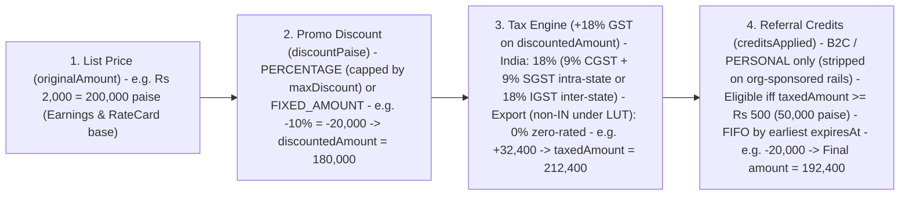

# Money System — High-Level Design

This document is the finance counterpart of [01-booking-system-hld.md](./01-booking-system-hld.md). It follows one rupee from price derivation to payout or refund, names the file that owns each step, and records the policy decisions that govern refunds. Behaviour is labelled **current** when it is merged on `dev` and **landing in Wave N** when it belongs to an open or planned pull request. Worked numeric examples live in [03-booking-and-money-machinery.md](./03-booking-and-money-machinery.md).

## 1. The pipeline in one picture

```text
 price derivation ──► order mint ──► capture webhook ──► payment legs ──► double-entry ledger
 deriveCheckoutAmount  handleCheckout   handlePaymentSuccess  PaymentLeg rows    postLedgerTxn
 (pure, integer paise) (Razorpay order  (the only writer of   + funding-sum      (booking:<paymentId>)
                        or synthetic     SUCCEEDED)            trigger at COMMIT   │
                        org intent)                                                ▼
                                                                         earnings (hold window)
                                                                                   │
        refunds (three front doors) ◄── cancellation / no-show / void             ▼
          │   two-phase gateway call                                  payout batch (TDS) ──► RazorpayX
          ▼
 cascade: legs, earnings, utilization, credit note, ledger reversal      reconcilers heal every external boundary
```

Three rules hold the pipeline together. There is one checkout function, `handleCheckout()` in `lib/payments/operations/checkout.ts`. There is one writer of `Payment.paymentStatus = SUCCEEDED`, `handlePaymentSuccess()` in `lib/payments/webhooks/handlers.ts`. And there is one append-only journal, written only through `postLedgerTxn()` in `lib/payments/ledger/post.ts`. Consumer and enterprise flows differ only in which `PaymentLeg` rows fund the payment and whether an organisation claims a host share.

## 2. End-to-end architecture

```mermaid
flowchart TB
  subgraph Actors["1. Buyer & Context Selection"]
    B2C_BUYER["Marketplace Consultee (e.g. Charlotte Brown) - organizationId = null"]
    B2B_BUYER["Org Learner (e.g. Olivia Anderson @ Wipro or Rachel Anderson @ IIT Madras) - passes organizationId"]
  end

  subgraph Checkout["2. Unified Checkout Pipeline - POST /api/checkout - handleCheckout()"]
    direction TB
    ORG_GATES["Org Resolution Chain (9 Fail-Closed Gates if organizationId present) - Org ACTIVE/PENDING, canSponsor, Dunning check, ACTIVE Membership, DPDP SESSION_BOOKING consent, Domain/CreditLimit, ACTIVE ProgramAssignment"]
    STEP1["Step 1: Pure Price Derivation - deriveCheckoutAmount() - Base Price -> DiscountCode -> +18% GST -> -ReferralCredit (B2C only, min Rs 500)"]
    STEP2["Step 2: Distributed Redis Locks - lockConsulteeBooking(userId) -> lockSlotBooking(consultantId, 30m atoms)"]
    STEP3["Step 3: In-Lock Revalidation - revalidateInsideLock() - Slot conflict check, self-booking guard, ADR-18 allowlist & exclusiveEngagement"]
    STEP4["Step 4: Serializable DB Transaction - withSerializableRetry() - Appointment + AppointmentOccurrence + AppointmentParticipant + Payment + PaymentLeg[]"]
    TRIG1["DB Constraint Trigger at COMMIT: payment_legs_sum_to_amount & occurrence_no_confirmed_overlap (GiST)"]

    ORG_GATES --> STEP1 --> STEP2 --> STEP3 --> STEP4 --> TRIG1
  end

  B2C_BUYER --> STEP1
  B2B_BUYER --> ORG_GATES

  TRIG1 --> RAIL_FORK{"Funding Rail?"}

  subgraph Rail_Gateway["3A. Gateway Rail (B2C / PERSONAL Org Tag / Member Overage)"]
    GW_PEND["Payment status = PENDING (expiresAt = +30m) - Occurrence isTentative = true - Participant status = HELD - Razorpay Order minted"]
    GW_DOORS["4 Confirmation Doors: 1. Webhook payment.captured  2. /checkout/verify-signature  3. /checkout/verify?sync=true  4. Cron reconcile-payment-status"]
    SINGLE_WRITER["Single Writer: handlePaymentSuccess() - Phase 1 (Serializable Tx): Amount parity check -> CAS PENDING to SUCCEEDED -> isTentative = false -> Participant HELD to CONFIRMED -> Request APPROVED"]
    GW_PEND --> GW_DOORS --> SINGLE_WRITER
  end

  subgraph Rail_Skip["3B. Instant-Confirm Rail (skipPayment = true: WALLET / INVOICE / LICENSE / 100% Free Credit)"]
    SKIP_TX["Inside Step 4 Transaction: Payment created SUCCEEDED immediately - Synthetic intent (org_wallet_*, org_invoice_*, org_license_*, free_*) - walletDebit() CAS or recordBookingUtilization() + recordOverageAtCheckout()"]
  end

  RAIL_FORK -->|"CARD (amount > 0)"| GW_PEND
  RAIL_FORK -->|"WALLET / INVOICE / LICENSE / Rs 0"| SKIP_TX

  SINGLE_WRITER --> SETTLE
  SKIP_TX --> SETTLE

  subgraph Downstream["4. Shared Settlement, Ledger, Payout & Reversal Spine"]
    direction TB
    SETTLE["Phase 2 Settlement: createEarningsFromPayment() - Resolves RateCard (10/10/80) or Marketplace (20/80) + Collaborator bps - Writes ConsultantEarnings + OrganizationEarnings - Calls postLedgerTxn(booking:paymentId)"]
    TRIG2["DB Constraint Trigger at COMMIT: ledger_txn_balanced (Sum DEBIT == Sum CREDIT)"]
    HOLD["Earnings Hold Window - 24h Consultation and Class / 48h Webinar / 168h Subscription, anchored on the later of capture and last session end - PENDING (or PENDING_TRUST) -> READY"]
    PAYOUTS["Payout Pipeline (Weekly Batch) - ConsultantPayout (<Rs 5k auto-approve) & OrganizationPayout (2-person approval) - Computes TDS 194-O (0.1% or 5% no-PAN) -> RazorpayX / Stripe Connect -> postLedgerTxn(payout:id)"]
    INVOICES["B2B Monthly Rollup (settle-invoice-accruals) - Sums INVOICE_ACCRUAL legs -> OrganizationInvoice (ISSUED, NET-60) - Dunning cron (3x 7d reminders -> suspend) -> Paid: postLedgerTxn(invoicepaid:id)"]
    REFUNDS["Refunds, Voids & Disputes - quoteBookingRefund() -> Two-Phase Gateway Refund -> applyRefundCascade() - Reverses PaymentLegs, Utilization, Earnings, Overage, issues CreditNote, posts refund:id"]
    RECON["Nightly Control Loop (reconcile-ledgers) - Re-derives the cached balances from the LedgerEntry journal - Auto-freezes drifted org wallets (freezeWalletSpend)"]

    SETTLE --> TRIG2 --> HOLD --> PAYOUTS
    TRIG2 --> INVOICES
    TRIG2 --> REFUNDS
    PAYOUTS --> RECON
    INVOICES --> RECON
    REFUNDS --> RECON
  end
```



## 3. Price derivation

Every checkout computes the payable amount in integer paise in four ordered steps in `lib/payments/pricing/derive-checkout-amount.ts`.



The platform fee, the host-organisation share and the expert share are always calculated on `Payment.originalAmount`, the list price before discounts and tax. A promo code or referral credit is a marketing subsidy funded by the platform, so it is booked as `Dr DISCOUNT` or `Dr PLATFORM_PROMO` and never reduces what the expert earns. GST is charged on the discounted amount, because a discount shown on the invoice before supply reduces the taxable value under section 15(3)(a) of the CGST Act.

## 4. Order mint and funding rails

`handleCheckout()` resolves the organisation context, takes the Redis locks, re-validates inside the lock, and then writes the appointment, occurrence, participant, `Payment` and `PaymentLeg` rows in one Serializable transaction. The rail decides what happens next:

- On the gateway rail (card), the payment is `PENDING` with `expiresAt` thirty minutes out, and a Razorpay order is minted. The booking is confirmed only when a capture arrives.
- On the instant-confirm rail (`WALLET`, `INVOICE`, `LICENSE`, or a free booking covered entirely by credit), the payment is written as `SUCCEEDED` in the same transaction with a synthetic intent (`org_wallet_*`, `org_invoice_*`, `org_license_*`, `free_*`), and settlement runs inline. See [docs/booking/17-org-funded-checkout.md](../booking/17-org-funded-checkout.md).
- On the approval path, `createApprovalPaymentIntent()` in `lib/payments/operations/approval-payment.ts` mints a card order for an approved request. Today it calls the gateway first and writes the row afterwards. **Landing in Wave 0:** it writes a `PENDING` row with a `premint_<uuid>` intent and its card leg first, calls the gateway, then fills the real order id by compare-and-swap on the pre-mint marker. A gateway failure expires the pre-mint row. The order's Razorpay `notes` carry `familiarisePaymentId`, so if neither the fill nor the tombstone lands, the capture webhook adopts the named row by compare-and-swap on its pre-mint intent. The sweeps never send a `premint_` intent to Razorpay.
- **Landing in Wave 0:** when a buyer re-buys a webinar or class seat after an `EXPIRED` or `FAILED` payment, checkout re-mints the same row in place by compare-and-swap and parks the old order on an `EXPIRED` tombstone (`lib/payments/operations/prior-intent-tombstone.ts`) that carries the old legs, so a late capture on the old order is auto-refunded.

## 5. Capture: four doors, one writer

Four doors converge on `routeCapturedPayment()` and then `handlePaymentSuccess()`: the Razorpay webhook (`app/api/webhooks/razorpay/route.ts`), `POST /api/checkout/verify-signature`, `GET /api/checkout/verify?sync=true`, and the `reconcile-payment-status` sweep for payments pending longer than fifteen minutes.

```text
  routeCapturedPayment() -> handlePaymentSuccess(paymentIntentId)
    |-- Pre-Tx: planEarningsForPayment() resolves RateCard / ShareBand / Collaborator bps
    +-- BEGIN ISOLATION LEVEL SERIALIZABLE (withSerializableRetry)
          |-- 1. CAS Payment: WHERE status = 'PENDING' -> 'SUCCEEDED' (0 rows = already settled)
          |-- 2. Confirm slots: AppointmentOccurrence.isTentative = false
          |-- 3. Confirm seat:  AppointmentParticipant.status = 'CONFIRMED'
          |-- 4. Advance request: Consultation/Subscription -> 'APPROVED'
          |-- 5. SAVEPOINT sp_phase1_earnings
          |        |-- createEarningsFromPayment({ tx }): ConsultantEarnings + OrganizationEarnings
          |        +-- postLedgerTxn({ tx, idempotencyKey: "booking:<paymentId>" }): balanced entries
          +-- COMMIT
```

If the savepoint rolls back, the `sync-payment-earnings` sweep re-drives settlement from row state. A capture that cannot be honoured (the booking was released, the slot is now taken, or the payer already holds another live booking at that time) is claimed as `SUCCEEDED` and immediately auto-refunded through the `Auto-refund pending:` marker, and `retry-auto-refunds` re-drives any refund the webhook tried once. The payer's own other bookings are part of that recheck **landing in Wave 0**.

## 6. Payment legs and the funding-sum trigger

A `Payment` is funded by one or more `PaymentLeg` rows (`CARD`, `WALLET`, `INVOICE_ACCRUAL`, `LICENSE`, `REFERRAL_CREDIT`, and negative `*_REVERSAL` legs). The deferred constraint trigger `payment_legs_sum_to_amount` in `prisma/sql/payment-legs-triggers.sql` fires at COMMIT and rejects any payment whose non-reversal legs, excluding `REFERRAL_CREDIT` and `LICENSE`, do not sum to `Payment.amount`, or whose reversal exceeds its original sibling. `payment_amount_vs_legs` re-checks the same rule when the payment row itself changes. Because Postgres enforces it, no application sweep re-verifies it.

## 7. The double-entry ledger

Every state change posts a balanced journal through `postLedgerTxn()`. The deferred trigger `ledger_txn_balanced` rejects an unbalanced transaction at COMMIT, and `ledger_entry_immutable` and `ledger_transaction_immutable` forbid updates. Account ids are deterministic (`kind|organizationId-or-_|consultantProfileId-or-_|INR`), and every entry amount is strictly positive with direction carried separately. The enum `LedgerAccountKind` has thirteen kinds.

| Account kind                | Scope                | Normal side | Increases with                                    | Decreases with                                            | Meaning                                                                               |
| :-------------------------- | :------------------- | :---------: | :------------------------------------------------ | :-------------------------------------------------------- | :------------------------------------------------------------------------------------ |
| `CASH`                      | Platform             |    Debit    | Card capture, wallet top-up, invoice paid         | Gateway refund, consultant or organisation payout         | Cash settled through the gateway or RazorpayX                                         |
| `ORG_RECEIVABLE`            | Sponsor organisation |    Debit    | `INVOICE_ACCRUAL` booking                         | `INVOICE_PAID`, or a refund of an unpaid accrual          | What an invoiced sponsor owes the platform                                            |
| `PLATFORM_PROMO`            | Platform             |    Debit    | Referral credit consumed at checkout              | Credit restored on refund                                 | Marketing expense for redeemed credits                                                |
| `DISCOUNT`                  | Platform             |    Debit    | Coupon discount at booking                        | Pro-rata reversal on refund                               | Contra-revenue for coupons                                                            |
| `WALLET`                    | Sponsor organisation |   Credit    | Top-up confirmed, or a wallet booking refunded    | Wallet-funded booking, or top-up refund                   | Prepaid liability owed to the organisation (cached in `BillingAccount.walletBalance`) |
| `CONSULTANT_PAYABLE`        | Expert               |   Credit    | Booking settlement                                | Payout completed, or refund                               | Liability owed to an expert (cached in `ConsultantEarnings`)                          |
| `ORG_PAYABLE`               | Host organisation    |   Credit    | Booking host share, overage relief                | Organisation payout, or refund                            | Liability owed to a host organisation (cached in `OrganizationEarnings`)              |
| `GST_PAYABLE`               | Platform             |   Credit    | 18% GST at booking                                | Credit note on refund or lost dispute                     | Output GST owed to the government                                                     |
| `TDS_PAYABLE`               | Platform             |   Credit    | TDS withheld at payout                            | Payout reversal                                           | Income tax withheld at source                                                         |
| `PLATFORM_FEE`              | Platform             |   Credit    | Platform commission and any overage surcharge     | Refund reversal (absorbs a one-paisa rounding difference) | Platform revenue                                                                      |
| `REFERRAL_CREDIT_LIABILITY` | Platform             |   Credit    | Referral credit vests                             | Credit redeemed                                           | Vested, unredeemed credit owed as a future discount                                   |
| `CONSULTANT_RECEIVABLE`     | Expert               |    Debit    | Lost dispute or refund on an already-paid earning | Netted against the next payout                            | Clawback owed by an expert                                                            |
| `UNAPPLIED_RECEIPTS`        | Platform             |   Credit    | A capture that funds no booking                   | The refund that returns it                                | Cash parked for an auto-refund (`lib/payments/ledger/unapplied-receipts.ts`)          |

No account models the gateway's processing fee. Razorpay keeps its fee when a refund is issued, and the platform's books do not pass that cost to the expert or the buyer, which is the D14 policy below; Wave 0 PR 3 verifies the posting.

## 8. Earnings, the hold window and the money state machines

Settlement writes `ConsultantEarnings` (and `OrganizationEarnings` for host organisations) as `PENDING`. They become `READY` once `holdUntil` passes, where `holdUntil = max(capture time, end of the last live occurrence) + hold hours` (`lib/payments/payouts/earnings-hold.ts`). The hold hours are in `PAYOUT_CONSTANTS.HOLD_PERIOD_HOURS`: 24 for a consultation, 48 for a webinar, 168 for a subscription and 24 for a class. Earnings for a booking sponsored by an unverified, never-invoiced organisation park in `PENDING_TRUST` instead (see [ADR 12](../enterprise/70-design-decisions/12-pending-trust-earnings-parking.md)).

```text
  PaymentStatus:
    PENDING ──(capture)──▶ SUCCEEDED ──(partial refund)──▶ PARTIALLY_REFUNDED ──▶ REFUNDED
       ├──(gateway fail)─▶ FAILED
       └──(30m timeout)──▶ EXPIRED  (late capture on EXPIRED triggers 100% auto-refund)

  EarningsStatus (ConsultantEarnings & OrganizationEarnings):
    PENDING / PENDING_TRUST
       ├──(holdUntil elapsed)──────────────────────────────────────────▶ READY
       ├──(dispute.created or session VOIDED/UNVERIFIED)──────────────▶ HELD ──(won/resolved)──▶ READY
       └──(full refund before payout)─────────────────────────────────▶ REFUNDED
    READY ──(claimed by weekly batch)──▶ BATCHED ──(payout.processed)──▶ PAID ──(payout.reversed)──▶ READY

  PayoutStatus:
    PENDING ──(under 5,000 rupees auto, or admin / two-person organisation approval)──▶ APPROVED ──▶ PROCESSING ──▶ COMPLETED / FAILED / REVERSED

  RefundStatus:
    PENDING (Phase-1 Serializable reservation) ──(gateway 2xx + applyRefundCascade)──▶ SUCCEEDED (or FAILED)
```

Every transition on `Payment`, `Appointment`, `Refund` and `Payout` is a conditional `updateMany` with the expected prior status in the `WHERE`.

## 9. Payouts and TDS

The weekly workflow `cron-weekly.yml` creates consultant and organisation payout batches on Mondays at 20:00 UTC and processes the approved ones at 21:00 UTC. A consultant payout below `AUTO_APPROVE_THRESHOLD` (5,000 rupees) is approved by the system; larger ones wait for an admin, and organisation payouts need two approvers. Claiming is claim-first: `READY` earnings move to `BATCHED` before the payout is computed.

TDS is computed in `computeTdsForPayout` (`lib/payments/payouts/payout-service.ts`) using the section 194-O rules in `lib/compliance/tds-194o.ts` (section 393 of the Income-tax Act 2025). The base is the gross sale amount, not the expert's net share. An individual or HUF with a PAN on file is exempt until the financial-year gross passes 5,00,000 rupees, and only the excess is taxable; every other payee is withheld from the first rupee. The rate is 10 basis points with a PAN and 500 basis points without one. Withholding posts to `TDS_PAYABLE` in the payout journal (`payout:<id>`), and a bank-returned payout posts `payout-reversal:<id>` with a negative `TDSRecord`. A refund or lost dispute on an already-paid earning raises a clawback that the next payout nets in its creation transaction (`lib/payments/payouts/clawback-recovery.ts`).

## 10. Refunds

Refunds have three front doors, and no code calls the gateway refund directly:

1. `refundBookingPayment()` in `lib/payments/operations/booking-refund.ts` refunds one booking and splits the rails by intent prefix: card money goes through the two-phase gateway refund, `org_*` money reverses in-ledger, and `free_*` credit-funded bookings restore their credits.
2. `refundWholeEventPayments()` in `lib/payments/operations/event-refunds.ts` refunds every seat of a cancelled webinar or class.
3. `refundRemovedAttendeeSeat()` in the same module refunds one removed or departing seat.

The gateway refund is two-phase: a Serializable transaction reserves a `PENDING` refund row against the refundable balance, the gateway is called with the reservation id as the idempotency key, and `applyRefundCascade()` then reverses legs, utilization, earnings and the ledger and mints the credit note, claimed once through `Refund.cascadedAt`. A `dedupeKey` on `Refund` makes a repeated call return the first refund.

**Today** the cancel route computes the refund quote after the booking transaction commits and then calls the front door, with no durable record that a refund is owed. If the process dies in between, the booking is `CANCELLED` and the payment `SUCCEEDED` with nothing re-driving it, and the same shape exists in the trial cancel, rejection refund, moderation and maintenance-freeze doors and in the whole-event loop. A failed refund is recorded as a system error for ops rather than as a retryable obligation.

**Landing in Wave 0 (planned PR W0-3):** the pure `quoteBookingRefund` moves inside the cancel transaction, which also stamps a per-payment "refund owed" marker (`refundOwedPaise`, `refundOwedKey` unique, `refundOwedReason`, `refundOwedAt`). After the commit the door is called with `dedupeKey: "cancel:<appointmentId>"`, and `retry-auto-refunds` gains a cohort that re-drives any marker with no refund under that key and then clears it. The marker is deliberately not a pre-created `Refund` row, because that would short-circuit the dedupe lookup and reduce the refundable balance. Whole-event refunds become a bounded keyed sweep, and the cancel dialog sends the refund it displayed so that a different server quote answers 409 `REFUND_QUOTE_CHANGED` (trials already do this in `lib/trials/cancellation.ts`).

### 10.1 Credit notes and GST

A refund mints a consumer credit note covering only the refunded part (`mintRefundCreditNote` in `lib/payments/operations/refund.ts`), reversing GST pro rata. Under section 34(2) of the CGST Act a tax credit note is possible only until 30 November after the financial year of the supply; past that, `isPastGstCreditNoteCutoff` in `lib/compliance/gst-credit-note-cutoff.ts` switches the note to a commercial credit note with no tax.

## 11. Refund and cancellation policy decisions

The refund ladder implemented in `lib/payments/operations/cancellation-policy.ts` is unchanged. The decisions below were taken by the owner for the productionization program.

| Decision                       | Rule                                                                                                                                                                                                                                                                                                                                                                           | Status                                  |
| :----------------------------- | :----------------------------------------------------------------------------------------------------------------------------------------------------------------------------------------------------------------------------------------------------------------------------------------------------------------------------------------------------------------------------- | :-------------------------------------- |
| D7 Refund ladder               | Notice of 24 hours or more refunds 100%, 2 to 24 hours refunds 50%, under 2 hours refunds 0%. An expert, admin or platform cancel refunds 100%. An expert no-show refunds 100% and a learner no-show 0%. A webinar window is 24 to 168 hours and a class is refunded per session unit. A credit note covers only the refunded part, and the platform fee is returned pro rata. | Current                                 |
| D3 Cancel quote                | The dialog sends the refund it displayed, and a different server quote answers 409 `REFUND_QUOTE_CHANGED`.                                                                                                                                                                                                                                                                     | Landing in Wave 0 (W0-3)                |
| D8 Subscription session return | One session cancelled 24 hours or more ahead returns to the plan allowance with no cash, at most two per plan. Inside 24 hours it is forfeited and counts as delivered.                                                                                                                                                                                                        | Landing in Wave 0 (W0-7)                |
| D9 Plan extension              | A returned session extends the plan end by up to seven days.                                                                                                                                                                                                                                                                                                                   | Landing in Wave 0 (W0-7)                |
| D10 Expert friction            | At most two expert reschedules per booking, and every expert cancel or no-show records a reliability strike. No money is taken from experts.                                                                                                                                                                                                                                   | Landing in Wave 0 (W0-7)                |
| D11 Outage void of a 1:1       | An immediate free-rebook offer, then 100% cash at 48 hours, with the platform bearing the gateway fee.                                                                                                                                                                                                                                                                         | Landing in Wave 1                       |
| D12 Sponsor organisations      | They allocate only bookings the expert has already approved and never approve a pending request.                                                                                                                                                                                                                                                                               | Current                                 |
| D13 Pause                      | `acceptingRequests = false` blocks every new booking: direct checkout, trials and requests. Existing bookings are unaffected.                                                                                                                                                                                                                                                  | Landing in Wave 0                       |
| D14 Gateway fee                | The platform absorbs the gateway fee on any refund, so the buyer always receives exactly the quoted percentage.                                                                                                                                                                                                                                                                | Policy; ledger posting verified in W0-3 |
| D15 Webinar seat transfer      | Inside the refund window, transferring the seat to another email is the alternative to a refund.                                                                                                                                                                                                                                                                               | Landing in Wave 1                       |

**India note.** The program's market research (Topmate, Preplaced, Clarity, MentorCruise, Cult.fit, Townscript, KonfHub, upGrad, the Consumer Protection Act 2019, the Consumer Protection (E-Commerce) Rules 2020 rules 4(8), 4(10) and 6(3), the 2023 dark-pattern guidelines, Razorpay, and CGST section 34) supports keeping the ladder. Rule 4(8) bars a marketplace from charging a consumer a cancellation fee unless it bears a similar charge when it cancels unilaterally. That symmetry is why an expert cancel refunds 100% and why experts get reliability strikes rather than fees, and why the platform, not the buyer, absorbs the gateway fee. A counsel review of rule 4(8), the 2025 payment-aggregator directions and the GST treatment of retained fees is planned before launch.

## 12. Reconcilers

Application sweeps reconcile only across vendor boundaries; invariants that Postgres enforces (balanced journal, funding-sum, immutability) are not re-checked in JavaScript.

| Boundary                            | Job                                                                                                                            | Cadence                  |
| :---------------------------------- | :----------------------------------------------------------------------------------------------------------------------------- | :----------------------- |
| Razorpay payments                   | `reconcile-payment-status`, `reconcile-orphaned-payments`, `reconcile-orphaned-confirmations`, `sweep-orphaned-topup-captures` | Ticker, 15 to 30 minutes |
| Razorpay refunds                    | `reconcile-refunds`, `retry-auto-refunds`                                                                                      | Ticker, 15 minutes       |
| Razorpay disputes and payouts       | `reconcile-disputes`, `reconcile-payout-status`, `handle-stuck-payouts`                                                        | `cron-intra-day.yml`     |
| Cached balances against the journal | `reconcile-ledgers` (`scripts/reconcile/reconcile-ledgers.ts`)                                                                 | `cron-daily.yml`         |

`reconcile-ledgers` re-derives every cached balance from `LedgerEntry` rows and writes a `LedgerReconciliationReport`. Its checks fall into four groups: journal soundness, money caches against the journal (including `WALLET_BALANCE_DRIFT`, which freezes the organisation's wallet spend and pages), usage and program counters, and tax and filing coherence. The checks, by group, are:

```text
Reconciliation engine: set-based invariant checks in four groups
  |
  +-- Group 1: Journal Soundness (Full-Scope Only)
  |     |-- LEDGER_TXN_IMBALANCE: Sum(DEBIT) - Sum(CREDIT) == 0
  |     +-- REFUND_BOOKING_COHERENCE: Refunded bookings have released capacity
  |
  +-- Group 2: Money Caches vs. Journal
  |     |-- WALLET_BALANCE_DRIFT: Calls freezeWalletSpend(isWalletFrozen=true) & Pages P0
  |     |-- EARNINGS_LEDGER_DRIFT: ConsultantEarnings == Journal payables
  |     |-- EARNINGS_WITHOUT_BOOKING_TXN: Earnings rows with no booking journal
  |     |-- PAYMENT_LEG_SUM_MISMATCH: Sum(Legs) == Payment.amount
  |     |-- ORG_PAYOUT_TOTAL_MISMATCH: Batched earnings sum == netPayoutPaise
  |     +-- LEDGER_DUAL_WRITE_GAP: Payout clawbacks match posted CASH debits
  |
  +-- Group 3: Usage & Program Counters
  |     |-- PROGRAM_ASSIGNMENT_ENGAGEMENTS_DRIFT: Sum(UsageLedger) == engagementsUsed
  |     |-- CREDIT_POOL_CONSUMED_DRIFT: Sum(UsageLedger.paise) == consumedPaise
  |     |-- OVERAGE_COUNT_DRIFT: Active events count == overageCount
  |     |-- OVERAGE_CHARGESTATUS_INTEGRITY: CHARGED events have side-payments
  |     +-- ACTIVE_SEAT_COUNT_DRIFT: Active assignments == activeSeatCount
  |
  +-- Group 4: Tax & Filing Compliance
        |-- INVOICE_TOTAL_MISMATCH: Total == Subtotal + CGST + SGST + IGST
        |-- OVERAGE_RECARVE_COHERENCE: Every overage-recarve-invoice matches CreditNote
        +-- LEDGER_ACCOUNT_NON_INR: All accounts strictly INR-denominated
```

An earnings row and its `booking:<paymentId>` journal commit in one transaction, so there is no grace window for a fresh payment.

## Related issues

Program umbrella #2137. Pull requests: #2141 (merged), #2142 (open).

## Deprecated & Superseded Approaches

1. **Single-entry ledgers** (`FundingLedgerEntry`, `WalletEntry`, `SettlementLedgerEntry`) with float percentages were replaced by the double-entry journal enforced at COMMIT, with all splits in basis points.
2. **Reading `appointment.payments[0]` as the payment of an appointment.** A webinar or class shares one appointment across many seats, so money is per seat, keyed `(userId, appointmentId)`.
3. **`CHARGE_MEMBER` overage and wallet `CHARGE_ORG` overage on new programs** are refused at configuration time; rows saved earlier keep settling.
4. **Manual recovery of post-payout clawbacks** was replaced by netting the receivable in the next payout.
5. **The 194J flat-percentage consultant calculator** (`TDS_ENGINE=LEGACY`) survives only as a fallback; the 194-O gross engine is the engine of record.
6. **A gateway call before any durable row on the approval path** is being replaced by the pre-mint row (landing in Wave 0).
