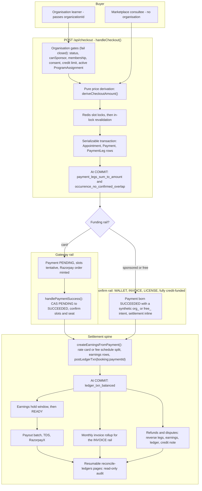

# Money System — High-Level Design

This document is the finance counterpart of [01-booking-system-hld.md](./01-booking-system-hld.md). It follows one rupee from price derivation to payout or refund, names the file that owns each step, and sends you to the finance reference pages for depth. Behaviour is described only if it is merged on `dev`. Worked numeric examples live in [03-booking-and-money-machinery.md](./03-booking-and-money-machinery.md) and in the [B2B worked examples](../finance/50-b2b/05-worked-examples.md). The full map of finance pages is in [docs/finance/README.md](../finance/README.md).

## 1. The pipeline in one picture

```text
 price derivation ──► order mint ──► capture webhook ──► payment legs ──► double-entry ledger
 deriveCheckoutAmount  handleCheckout   handlePaymentSuccess  PaymentLeg rows    postLedgerTxn
 (pure, integer paise) (Razorpay order  (booking capture      + funding-sum      (booking:<paymentId>)
                        or synthetic     writer)               trigger at COMMIT   │
                        org intent)                                                ▼
                                                                         earnings (hold window)
                                                                                   │
        refunds (three front doors) ◄── cancellation / no-show / void             ▼
          │   two-phase gateway call                                  payout batch (TDS) ──► RazorpayX
          ▼
 cascade: legs, earnings, utilization, credit note, ledger reversal      reconcilers heal every external boundary
```

Three rules hold the pipeline together. There is one checkout function, `handleCheckout()` in `lib/payments/checkout/orchestrate.ts`. `Payment.paymentStatus = SUCCEEDED` has several writers, listed below, and each is either a compare-and-set on the prior status or the transaction that creates the row together with its legs. And there is one append-only journal, written only through `postLedgerTxn()` in `lib/payments/ledger/post.ts`. Consumer and enterprise flows differ only in which `PaymentLeg` rows fund the payment and whether an organisation claims a host share. `PaymentStatus` has four values: `PENDING`, `SUCCEEDED`, `FAILED`, `EXPIRED`. A refund does not change it; refunds live in their own `Refund` rows.

The writers of `SUCCEEDED` are these six:

1. `handlePaymentSuccess()` in `lib/payments/webhooks/handlers.ts` confirms a booking capture. The capture-race stamps in the same file also write `SUCCEEDED` when a late or mismatched capture must be kept and auto-refunded.
2. `handleOverageMemberSuccess()` in `lib/payments/webhooks/overage-handlers.ts` confirms a member's overage side-payment.
3. `handleRecordingPurchaseSuccess()` in `lib/payments/webhooks/recording-purchase.ts` confirms a replay purchase.
4. `handleDigitalProductPurchaseSuccess()` in `lib/payments/webhooks/digital-product-purchase.ts` confirms a digital product sale: it compare-and-sets the purchase from `PENDING` (or `FAILED` on a late retry) to `SUCCEEDED` and creates the `SUCCEEDED` Payment with its one `CARD` leg in the same transaction. A capture on either standalone rail that fulfils nothing is kept as a `SUCCEEDED` Payment under the auto-refund marker by the shared plumbing in `lib/payments/webhooks/standalone-sale-capture.ts`, then refunded. See [Digital products](../digital-products/01-architecture.md).
5. The payment row that `handleCheckout()` commits (`lib/payments/checkout/commit/payment-row.ts`) is born `SUCCEEDED` on the wallet, invoice, licence and free rails, because no gateway is involved.
6. `mintChildOverageAccrualPayment()` in `lib/payments/billing/overage-settlement.ts` creates the child accrual payment of an invoiced overage already `SUCCEEDED`, so the next invoice rollup bills it.

## 2. End-to-end architecture



## 3. Price derivation

Every checkout computes the payable amount in integer paise in four ordered steps in `lib/payments/pricing/derive-checkout-amount.ts`: list price, then at most one promo discount, then GST on the discounted amount (18 % once the platform is GST-registered, nothing while `PLATFORM_GSTIN` is unset; [the tax regime](../finance/60-tax/05-gst-registration-and-tax-regime.md)), then referral credits against the tax-inclusive total (only on a personal-card rail, only above a minimum order, capped in basis points). Everything the platform funds on one order is also held to the profitability floor, `platformFundedCapPaise`: the platform fee less the estimated gateway cost. For example, while registered, a ₹2,000 marketplace list price with a 10 % code is ₹1,800 discounted, ₹324 GST and a ₹2,124 total; the floor is ₹400 − ₹83.55 = ₹316.45 (the gateway estimate is Razorpay's worst case, 3.54 % of ₹2,360), so after the ₹200 code at most ₹116.45 of credit applies, leaving ₹2,007.55 (200,755 paise).

The platform fee, the host-organisation share and the expert share are always calculated on `Payment.originalAmount`, the list price before discounts and tax. A promo or credit is a platform-funded subsidy, booked as `Dr DISCOUNT` or `Dr PLATFORM_PROMO`, and it never reduces what the expert earns. GST is charged on the discounted amount because a discount shown before supply reduces the taxable value under section 15(3)(a) of the CGST Act. The platform's cut is not a fixed 20 %: it is read from the latest approved `PlatformFeeSchedule` and stamped on the payment, with 20 % only as the fallback when none exists; a host organisation's rate card sets the cut for its experts. See [checkout and pricing](../finance/10-money-in/01-checkout-and-pricing.md) and [rate cards and overage](../finance/50-b2b/03-rate-cards-and-overage.md).

## 4. Order mint and funding rails

`handleCheckout()` resolves the organisation context, takes the Redis locks, re-validates inside the lock, and writes the appointment, occurrence, participant, `Payment` and `PaymentLeg` rows in one Serializable transaction. On the gateway rail the payment is `PENDING` with an expiry thirty minutes out, a Razorpay order is minted, and the booking is confirmed only when a capture arrives. A webinar or class seat is the exception: it is committed under the event's lock with a placeholder intent, the order is minted after the lock is released, and the seat holds for 15 minutes (a 12-minute gateway window plus a 3-minute capture grace), after which it stops counting at once. A replay under the same idempotency key must match the priced inputs it was minted with (`Payment.requestFingerprint`), and a buyer's live order for a different time is never superseded, so two tabs can hold two checkouts. A reload or second tab for the same item prices as if the buyer's own open order were released, so the credit and one-use code that order holds are counted again and the order is reused: with a ₹2,990.47 plan and ₹200.00 of referral credit, the first order is ₹2,790.47 and the reload shows the same ₹200.00 and ₹2,790.47 instead of charging ₹2,990.47. A payment that ends unpaid (a cancel, a superseded order, the abandoned sweep, a failure, the reconcile or an expert declining) returns the credits, the code use and the organisation's metered programme engagement together. On the instant-confirm rail (`WALLET`, `INVOICE`, `LICENSE`, or an order with nothing left to charge after credits or a full discount, which never reaches the gateway) the payment is written `SUCCEEDED` in the same transaction with a synthetic intent (`org_wallet_*`, `org_invoice_*`, `org_license_*`, `free_*`) and settlement runs inline. On the approval path the pay window is 24 hours but always closes 15 minutes before the first session, and a window shorter than 30 minutes is never minted (409 `TOO_CLOSE_TO_START`; the approval lapses to `EXPIRED`). `createApprovalPaymentIntent()` writes a `PENDING` row with a `premint_<uuid>` intent first, then calls the gateway, then fills the order id by compare-and-set, so an order can never exist without a row that names it. A re-bought webinar or class seat re-mints the same row in place and parks the old order on an `EXPIRED` tombstone, so a late capture on the old order is auto-refunded. The rails are defined in [funding rails](../finance/50-b2b/01-funding-rails-and-permutations.md) and the approval path in [approval payments](../finance/10-money-in/05-approval-payments.md).

## 5. Capture: four doors, one booking writer

Four doors converge on `routeCapturedPayment()`, which picks the rail from the app's own rows for that order id (`resolveCaptureRail`: booking payment, overage side payment, replay or digital product purchase, wallet top-up, organisation invoice) and treats the gateway's notes as a cross-check only, and then, for a booking, on `handlePaymentSuccess()`: the Razorpay webhook (`app/api/webhooks/razorpay/route.ts`), `POST /api/checkout/verify-signature`, `GET /api/checkout/verify?sync=true`, and the `reconcile-payment-status` sweep. Request again's post-commit re-check (`lib/booking/request-again.ts`) calls `handlePaymentSuccess()` directly for a capture it finds on an order it has just closed, so that capture takes the late-capture refund. In one Serializable transaction the writer flips the payment `PENDING` to `SUCCEEDED` by compare-and-set (zero rows means it was already settled), confirms the slots and the seat, advances the request, and, inside a savepoint, creates the earnings rows and posts the `booking:<paymentId>` journal. If the savepoint rolls back, `sync-payment-earnings` re-drives settlement from row state. A capture that cannot be honoured (the booking was released, the slot is taken by a row that still holds its time, the payer already holds another live booking then, the first session has already started, or a held webinar or class seat is one checkout would no longer sell because the event is over or a class has closed enrolment; a seat whose hold was still live at the gateway's time for the payment is confirmed unless the event is over or the buyer is busy) is claimed `SUCCEEDED` and auto-refunded through the `Auto-refund pending:` marker, which `retry-auto-refunds` re-drives. After commit the capture path mints the consumer tax invoice best-effort, except for a payment stamped `UNREGISTERED`, which never gets one; a registered payment it missed, for example after a crash, is minted by the six-hourly `heal-consumer-invoices` job for payments created in the last 90 days ([GST invoices and credit notes](../finance/60-tax/02-gst-invoices-and-credit-notes.md#healing-a-missed-invoice)). The admin recover door is a fifth, manual route to the same writer. It refuses a payment that has a pending or paid refund, an owed-refund or auto-refund marker, or an open or lost dispute (409 `PAYMENT_RETURNED`), because there is no "refunded" payment status: a refunded late capture still reads `SUCCEEDED` with no booking, and booking it would pay an expert on money that went back. Detail: [capture confirmation and webhooks](../finance/10-money-in/02-capture-confirmation-and-webhooks.md).

## 6. Payment legs and the funding-sum trigger

A `Payment` is funded by `PaymentLeg` rows with source `CARD`, `WALLET`, `REFERRAL_CREDIT`, `INVOICE_ACCRUAL`, `OVERAGE_INVOICE_ACCRUAL`, `LICENSE`, and the two negative `*_REVERSAL` sources. The deferred constraint trigger `payment_legs_sum_to_amount` (`prisma/sql/payment-legs-triggers.sql`) rejects at COMMIT any payment whose non-reversal legs, excluding `REFERRAL_CREDIT` and `LICENSE`, do not sum to `Payment.amount`, or whose reversal exceeds its original sibling. Because Postgres enforces it, no application sweep re-verifies it. See [payment legs](../finance/20-ledger/03-payment-legs.md).

## 7. The double-entry ledger

Every state change posts a balanced journal through `postLedgerTxn()`. The deferred trigger `ledger_txn_balanced` rejects an unbalanced transaction at COMMIT, and `ledger_entry_immutable` and `ledger_transaction_immutable` forbid updates. Account ids are deterministic and every amount is strictly positive with the direction carried separately. The sixteen account kinds are in the [chart of accounts](../finance/20-ledger/02-chart-of-accounts.md); the six that carry the story are:

| Account                             | Normal side | Meaning                                                                                |
| :---------------------------------- | :---------: | :------------------------------------------------------------------------------------- |
| `GATEWAY_CLEARING`                  |    Debit    | Card money Razorpay still holds for the platform; a settlement moves the net to `CASH` |
| `WALLET`                            |   Credit    | Prepaid liability owed to an organisation (cached in `BillingAccount.walletBalance`)   |
| `ORG_RECEIVABLE`                    |    Debit    | What an invoiced sponsor owes the platform                                             |
| `CONSULTANT_PAYABLE`, `ORG_PAYABLE` |   Credit    | Liabilities to experts and host organisations (cached in the earnings tables)          |
| `PLATFORM_FEE`                      |   Credit    | Platform revenue, including any overage surcharge                                      |
| `GST_PAYABLE`, `TDS_PAYABLE`        |   Credit    | Output GST owed, and income tax withheld at source                                     |

Razorpay card money moves through `GATEWAY_CLEARING`, never straight to `CASH`; `gatewayCashAccount()` picks the account. The capture fee is its own journal (`gatewayfee:<pay_id>`) and the daily `reconcile-gateway-settlements` job walks the settlement report day by day from its checkpoint and posts one `settlement:<setl_id>` journal per settlement moving the net to `CASH`, only when the stored lines add up to the settlement entity's amount. A worked case: a ₹1,000 capture with a ₹23.60 fee posts clearing 100,000, fee 2,000, GST input 360 and clearing credit 2,360, then settlement posts `CASH` 97,640 against clearing 97,640, and the clearing balance returns to zero. See [gateway clearing and settlement](../finance/20-ledger/05-gateway-clearing-and-settlement.md) and [postings](../finance/20-ledger/04-postings.md).

## 8. Earnings, holds and the state machines

Settlement writes `ConsultantEarnings` (and `OrganizationEarnings` for host organisations) as `PENDING`. They become `READY` once `holdUntil` passes, where `holdUntil` is the later of capture and the last live session end plus the hold hours (48 for a consultation, 48 for a webinar, 168 for a subscription, 24 for a class), plus 3 more days for a new expert (`computeHoldUntil`, `withNewExpertHold`), and while no money is owed back on the payment: no refund pending or waiting for its cascade, no owed-refund marker, no active chargeback. A subscription's earnings are one tranche per cycle, each dated when its own cycle is delivered and released on that date while later sessions are still scheduled. Earnings for a booking sponsored by an unverified, never-invoiced organisation park in `PENDING_TRUST` instead ([ADR 12](../enterprise/70-design-decisions/12-pending-trust-earnings-parking.md)). An earning is `HELD` exactly while it carries an active `EarningsHold` row (reasons `DISPUTE`, `MODERATION`, `OPERATOR`, `OVERAGE`, `SUPPORT_CASE`); `lib/payments/payouts/earnings-holds.ts` is the only writer of `HELD`, the first hold stores the prior status and the last release restores it. Details: [earnings lifecycle](../finance/40-payouts/02-earnings-lifecycle.md).

```text
  PaymentStatus:   PENDING ──(capture)──▶ SUCCEEDED
                      ├──(gateway failure)─▶ FAILED
                      └──(timeout)─────────▶ EXPIRED   (a late capture on EXPIRED is auto-refunded in full)

  EarningStatus:   PENDING / PENDING_TRUST ──(holdUntil elapsed)──▶ READY ──(Monday batch)──▶ BATCHED ──(payout.processed)──▶ PAID
                   any holdable status ──(first hold)──▶ HELD ──(last hold released)──▶ prior status
                   fully reversed by a refund or lost dispute ──▶ REFUNDED

  PayoutStatus:    PENDING ──(auto-approve, or admin / organisation approval)──▶ APPROVED ──▶ PROCESSING ──▶ COMPLETED / FAILED / REVERSED

  RefundStatus:    PENDING (Serializable reservation) ──(gateway success + applyRefundCascade)──▶ SUCCEEDED (or FAILED)
```

Every status change on `Payment`, `Appointment`, `Refund` and `Payout` is a conditional `updateMany` with the expected prior status in the `WHERE`. Every status value is listed in the [glossary and status reference](../finance/00-overview/02-glossary-and-status-reference.md).

## 9. Payouts and TDS

The payout jobs run on the Netlify ticker, not in GitHub Actions (see [scheduled money jobs](../finance/70-operations/01-scheduled-jobs.md)). `create-payout-batch` runs in a window that opens Mondays at 20:00 UTC and lasts three hours; `process-payouts` fires hourly and disburses a bounded number per rail. Disbursement is gated on `ENABLE_LIVE_PAYOUTS`. A consultant payout below `AUTO_APPROVE_THRESHOLD` (₹5,000) is approved by the system and larger ones wait for an admin; an organisation payout needs an organisation approver and, above ₹50,000 or within seven days of a payout-account change, a platform co-approval. Claiming is claim-first: `READY` earnings move to `BATCHED` before the payout is computed, and the database requires a `BATCHED` earning to name its payout (`consultant_earnings_batched_has_payout`). A batch leaves out an earning whose payment has money owed back on it, by the same three tests the release uses; the claim before the send repeats them, and a refund that becomes owed on a batched earning cancels the unsent payout so the next batch pays the rest. A new default payout account waits 48 hours before a payout may use it, during which the payee can freeze payouts from the change email. Live RazorpayX only answers allowlisted IPs, so every call goes through a static-egress proxy and is refused without one (`RAZORPAYX_EGRESS_NOT_CONFIGURED`).

TDS is computed under the section 194-O engine by default (section 393 of the Income-tax Act 2025). The base is the gross sale amount, not the expert's net share. An individual or HUF with a PAN is exempt while the financial-year gross stays at or below ₹5,00,000; everyone else is withheld from the first rupee. The rate is 10 basis points with a PAN and 500 without. The payout that first crosses ₹5,00,000 withholds on the whole year-to-date gross, a reading pending CA confirmation. For example, an expert with ₹4,90,000 already paid who is paid another ₹20,000 has ₹510 withheld (51,000 paise). The rules, the running total, the carry and the reversal cap are in [TDS withholding](../finance/40-payouts/06-tds-withholding.md); the payout steps are in [how payouts work](../finance/40-payouts/01-how-payouts-work.md), [consultant payouts](../finance/40-payouts/03-consultant-payouts.md) and [organisation payouts](../finance/40-payouts/05-org-payouts-and-clawbacks.md).

## 10. Refunds

Refunds have three front doors, and no code calls the gateway refund directly: `refundBookingPayment()` (`lib/payments/operations/booking-refund.ts`) for one booking, which splits the rails by intent prefix (card through the gateway, `org_*` reversed in the ledger, `free_*` credits restored); `refundWholeEventPayments()` for every seat of a cancelled webinar or class; and `refundRemovedAttendeeSeat()` for one removed seat. The gateway refund is two-phase: a Serializable transaction reserves a `PENDING` refund row against the refundable balance, the gateway is called with the reservation id as idempotency key, and `applyRefundCascade()` reverses legs, utilisation, earnings and the ledger and mints the credit note, claimed once through `Refund.cascadedAt`. The refund journal credits `DISCOUNT` back pro rata, and the refund that completes the payment takes the exact remainder of every share, so a full refund nets every profit-and-loss line to zero (`refundReversalBasis`).

The cancel route quotes the refund inside the cancel transaction and compares it to the amount the dialog displayed; a different quote answers 409 `REFUND_QUOTE_CHANGED`. The same transaction stamps a refund-owed marker on the payment, the door drives the refund after commit under a stable `dedupeKey`, and `retry-auto-refunds` finishes any marker the process died on, so a crash leaves a `CANCELLED` booking, a `SUCCEEDED` payment and a marker that a sweep completes. A payment carries one owed marker at a time and the first door wins it. A door that finds another door's marker refuses with nothing committed: 409 `REFUND_IN_PROGRESS` while that marker is still retrying, 409 `REFUND_NEEDS_SUPPORT` once it has spent its attempts or a dispute holds the payment, which support then settles through the admin refund door (`lib/payments/operations/refund-owed.ts`). A seat leave stamps its marker in the commit that releases the seat. The cancel's compare-and-swap is pinned to the status it read and the same commit expires any live `PENDING` payment, so a capture that lands mid-cancel makes the cancel re-quote instead of cancelling a paid booking for nothing. When ops declare a platform incident, the same marker pattern refunds each learner under the key `incident:<incident>:<occurrence>:<user>`; see [refunds](../finance/30-refunds-disputes/01-refunds.md). A subscription settles once at its fixed plan end (`Subscription.planEndsAt`, start plus the plan's months on the expert's calendar, month-end clamped): every session not delivered is refunded pro rata under a `plan-end:<subscription>:pay:<payment>` marker (`scripts/appointments/settle-cancelled-sessions.ts`). A discount code's use comes back only when its `PENDING` payment ends unpaid, never on a refund. A subscription paid wholly in referral credit restores the credit in full only while nothing was delivered; after a delivered session the undelivered share goes to ops by hand, because restoring everything would reverse delivered earnings. A refund mints a credit note for the refunded part only; past 30 November after the financial year of the supply it becomes a commercial note with no tax ([GST invoices and credit notes](../finance/60-tax/02-gst-invoices-and-credit-notes.md)).

### 10.1 Disputes

A `Dispute` is a gateway chargeback, never a support complaint. When one opens, `placeDisputeHolds()` cancels any unsent payout that batched the payment's earnings and places a `DISPUTE` hold; `settleDisputeVerdict()` (`app/api/webhooks/utils.ts`), called by both the webhook and the `reconcile-disputes` poll, settles the verdict. A win releases the hold, and a loss settles on `amount_deducted`, never above the disputed amount, reverses that fraction of `payment.amount` from every share on integer paise and raises a clawback receivable for anything already paid out. A buyer's service complaint follows a different path (a recommendation decided by a second operator). Both are in [chargebacks](../finance/30-refunds-disputes/02-chargebacks.md) and [service complaints](../finance/30-refunds-disputes/03-service-complaints-and-remedies.md).

## 11. Refund and cancellation policy decisions

The owner's policy decisions, all current: notice of 24 hours or more refunds 100 %, 2 to 24 hours refunds 50 %, under 2 hours 0 %; nothing can be cancelled from 15 minutes before a session starts until it ends, or after it was delivered (409 `SESSION_IN_PROGRESS` or `SESSION_ALREADY_DELIVERED`, `lib/booking/session-window.ts`), so a delivered session is never refunded by a cancel; the notice is floored only by the consultee's own earlier reschedule of the same session, never the expert's; an expert, admin, platform or host-organisation operator cancel refunds 100 %, and the org policy cannot lower that; the public `/refund` page renders these tiers from the engine's own constants; a returned subscription session goes back to the plan allowance (at most two per plan) and extends the plan up to seven days; an outage void of a 1:1 session refunds 100 % in cash after 48 hours with the platform bearing the gateway fee; the platform absorbs the gateway fee on every refund; sponsors allocate only bookings the expert has already approved; and a webinar seat transfer is deferred, with self-leave refunding in full while the window is open. Rule 4(8) of the Consumer Protection (E-Commerce) Rules 2020 bars charging a cancellation fee unless the platform bears a similar charge when it cancels, which is why an expert cancel refunds in full and experts get reliability strikes rather than fees.

## 12. Reconcilers

Application sweeps reconcile only across vendor boundaries: Razorpay payments, refunds, disputes, payouts and settlements, each by a ticker job. Invariants that Postgres enforces (balanced journal, funding sum, immutability) are not re-checked in JavaScript. Most of those jobs ask the gateway about rows the database already holds. `reconcile-refunds` also discovers: it lists the refunds Razorpay created since its checkpoint and imports, through the refund webhook's handler, any the database holds no row for, so a refund made in the Razorpay dashboard is found when its webhook is lost. It does not import a refund whose payment the database does not hold as captured (it reports it), a refund the gateway lists as failed, or a refund created more than 7 days before the pass first ran. `reconcile-disputes` discovers the same way: after polling the open disputes it holds, it pages Razorpay's whole dispute list and sends a dispute with no row through `handleDisputeCreated` and then `handleDisputeUpdated`, and one whose row is in another status through `handleDisputeUpdated`, so a missed dispute places its holds and a missed verdict is settled. It writes nothing for a dispute whose payment the database does not hold (it reports it), and it cannot move a decided dispute: a won dispute listed open again is recorded as an error for an operator, not re-opened. `reconcile-ledgers` is a read-only auditor that compares cached balances and counters with the journal and writes one `LedgerReconciliationReport`; it repairs nothing. When it finds `WALLET_BALANCE_DRIFT`, every door that runs it freezes that organisation's wallet spend. After someone posts the correcting journal, the next audit that finds the cache equal to the journal lifts that drift freeze itself as actor `SYSTEM` (never a freeze an ops door set), and the admin unfreeze door can lift it sooner. One ongoing drift pages once per billing account, with a weekly reminder. See [integrity and reconciliation](../finance/20-ledger/06-integrity-and-reconciliation.md) and [scheduled money jobs](../finance/70-operations/01-scheduled-jobs.md).

The scheduled ledger door advances persisted pages under a shared fail-closed lease, offered hourly at `:55` when capacity permits. RUNNING reports are continuation, not clean results or final discrepancies. Each wallet page freezes drift before advancing, including admin calls. The authenticated admin door advances the same bounded core and offers continuation. It starts a fresh audit after a completed verdict, while scheduled requests reuse the completed daily audit. See [ledger integrity](../finance/20-ledger/06-integrity-and-reconciliation.md).

## 13. B2B invoicing and organisation credit

Only the platform extends credit and changes invoices. A tenant owner may lower the credit limit but cannot raise it or switch to `INVOICE` funding, and a tenant can only cancel a `DRAFT` invoice. The platform doors raise, issue and void invoices, record bank-transfer receipts and settle unpaid member overage to the organisation. For example, Wipro Limited's rollup invoice of ₹1,18,000 (11,800,000 paise) can be voided as `REBILL` (the bookings roll into next month and no revenue is reversed) or `FORGIVE` (the receivable is written off against GST and platform fee). A ₹50,000 bank transfer leaves it `ISSUED` with ₹68,000 outstanding. Details: [invoices, purchase orders and dunning](../finance/50-b2b/04-invoices-purchase-orders-and-dunning.md).

## 14. Admin money doors and second-admin approval

Every back-office door that moves money is built on `withOpsAction()` (`lib/backoffice/ops-action-log.ts`): the caller holds the right surface, has re-authenticated within the last 15 minutes, gives a typed reason of at least five characters, and produces exactly one `OpsActionLog` row. When at least two admins are active, a door that would move more than ₹25,000 (`SECOND_APPROVAL_THRESHOLD_PAISE`, 2,500,000 paise) answers `202` with a `PROPOSED` row, and a different admin approves it within 24 hours, which replays the stored request through the same door. Staff can execute only bounded support refunds: ₹5,000 per payment across every live refund and approved remedy, and ₹50,000 per operator over a rolling 24 hours, where a credit restoration counts at the credit it restores. The wallet refund-to-card door returns only the organisation's own top-up money; credit an operator granted stays in the wallet. A wallet top-up that was abandoned is kept as `FAILED`, and a late payment on its gateway order is still credited ([wallet and top-ups](../finance/50-b2b/02-wallet-and-top-ups.md)). During DEGRADED maintenance the admin money writes are blocked at the edge (`WRITE_BLOCKED_IN_DEGRADED`). The full rules, the list of doors that take a second approver and the console are in [admin money doors](../finance/70-operations/02-admin-money-doors.md) and [the maintenance gate](../finance/70-operations/03-maintenance-gate-and-recovery.md).

## 15. Glossary

The booking terms (hold, tentative, CAS-in-WHERE and sweep) are in [the booking HLD's glossary](./01-booking-system-hld.md#10-glossary); the money glossary is in [the finance glossary](../finance/00-overview/02-glossary-and-status-reference.md). The terms you need on this page:

- **Pre-mint.** A `PENDING` payment row written before its Razorpay order exists, carrying a `premint_<uuid>` intent.
- **Tombstone.** An `EXPIRED` payment with no appointment that keeps an old gateway order, so a late capture on it is auto-refunded instead of confirming anything.
- **Dedupe key.** The unique `Refund.dedupeKey` that makes a retried refund return the first one.
- **Leg.** A `PaymentLeg` row saying how part of a payment is funded.
- **Ops proposal.** A money-door request held until a second admin approves it.
- **Credit note.** The GST document reversing the refunded part of a tax invoice.

## Deprecated & Superseded Approaches

1. **Single-entry ledgers** (`FundingLedgerEntry`, `WalletEntry`, `SettlementLedgerEntry`) with float percentages were replaced by the double-entry journal and integer basis points.
2. **`CHARGE_MEMBER` and wallet `CHARGE_ORG` overage are not refused.** Every combination is accepted and classified by guidance tiers (`overageConfigRefusals` returns none). Any note saying new programmes refuse them is stale.
3. **Manual recovery of post-payout clawbacks** was replaced by netting the receivable in the next payout.
4. **The 194J flat-percentage consultant calculator** (`calculateTDS` and its two rate constants in `lib/payments/tax/tds-service.ts`) was deleted. `TDS_ENGINE=LEGACY` keeps only the old ₹50,000 threshold, at the 194-O rate; the 194-O gross engine is the default and the engine of record.
5. **Gateway captures, refunds and chargebacks posted straight to `CASH`** were replaced by `GATEWAY_CLEARING`, the `gatewayfee:` journal and the daily `settlement:` journal. Journals posted before the change stay on `CASH` because entries are immutable.
6. **A single dispute-time `HELD` flip** let one dispute release money that a ban or an operator still held. It was replaced by reason-scoped `EarningsHold` rows.
7. **Reconcile checks that Postgres now enforces** (`LEDGER_TXN_IMBALANCE`, `PAYMENT_LEG_SUM_MISMATCH`, `INVOICE_TOTAL_MISMATCH`) were deleted from the auditor.
8. **Tenant-side credit raises, `INVOICE` funding switches, manual invoice creation and invoice voiding** were removed from the organisation routes; only the platform doors do these.
9. **A `PARTIALLY_REFUNDED` payment status.** It is not a persisted `PaymentStatus`; refunds are `Refund` rows and the payment stays `SUCCEEDED`. `paymentDisplayStatus` (`lib/appointments/seat-payments.ts`) derives it for display only.
10. **A notice floor that outlived the session.** The refund quote once fell back to a reschedule notice floor when no live session remained, so a delivered consultation or paid trial could quote 100 %. The cancel window now refuses those bookings before any quote, and the floor counts only the consultee's own release records.
11. **A void refunded in the middle of a subscription.** A voided session was once paid back while it could still be re-booked; it now waits for the plan-end settlement.
