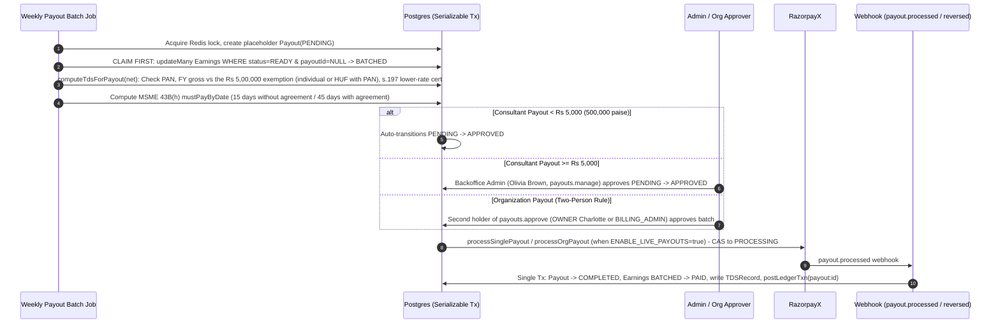

# The Booking & Money Machinery — Visual Guide, Organizational Scoping & Worked Permutations

> **The Core Architectural Spine in One Sentence**
> There is **one checkout pipeline** (`handleCheckout()` in `lib/payments/checkout/orchestrate.ts`), **one payment confirmation writer** (`handlePaymentSuccess()` in `lib/payments/webhooks/handlers.ts`), and **one append-only double-entry journal** (`postLedgerTxn()` in `lib/payments/ledger/post.ts`); consumer (B2C) and enterprise (B2B) flows differ **only in which [`PaymentLeg`](../finance/20-ledger/03-payment-legs.md) rows fund the `Payment`** and **whether an organization claims a host share via [`RateCard`](../finance/50-b2b/03-rate-cards-and-overage.md)**.

---

## 1. Cast of Real Seeded People & Organizations

All examples below use the canonical seed cohort from `prisma/seedFiles/1a-create-users.ts`, `prisma/seedFiles/14a-create-organizations.ts`, and [`docs/team/mock-credentials.md`](../team/mock-credentials.md) (non-operator dev password: the seed default in `prisma/seedFiles/1a-create-users.ts`; operator accounts use `SEED_OPERATOR_PASSWORD` from your local `.env`, ask the lead). All money in the database is stored as **integer paise** (`BigInt` in Postgres, converted to JS `number` via `lib/prisma.ts`, where `₹1 = 100 paise`), and all percentage splits are stored in **basis points** (`10,000 bps = 100%`).

### 1.1 Organizations Cohort

| Organization (`slug`)                                          | Capability Booleans                  | Derived Kind      | Sponsor Funding & Commercial Setup                                                                                                                                                                                                                                                                                                                        | Host Payout & RateCard Setup                                                                                                                                | Key Seeded People (`MemberRole` / `UserRole`)                                                                                                                                                                                                                                                                                    |
| :------------------------------------------------------------- | :----------------------------------- | :---------------- | :-------------------------------------------------------------------------------------------------------------------------------------------------------------------------------------------------------------------------------------------------------------------------------------------------------------------------------------------------------- | :---------------------------------------------------------------------------------------------------------------------------------------------------------- | :------------------------------------------------------------------------------------------------------------------------------------------------------------------------------------------------------------------------------------------------------------------------------------------------------------------------------- |
| **Wipro Limited** (`wipro`)                                    | `canSponsor=true` `canHost=false` | **`SPONSOR`**     | `FundingSource.INVOICE` (NET-60, GSTIN `29AABCW1234K1Z5`, KA). Credit limit: **₹1,00,00,000** (`1,000,000,000` paise). Backed by `PurchaseOrder` of **₹50,00,000**. `LICENSED_SEAT` program (_"Wipro Engineer Leadership Program"_): **200 seats** @ **₹25,000/seat/yr**, **12 engagements/cycle**, `priceCap = ₹10,000`, `overageBehavior = CHARGE_ORG`. | None (No `OrganizationPayoutAccount`; never earns).                                                                                                         | • **Samantha Anderson** (`samantha.anderson@yahoo.com`) — `OWNER` (`CONSULTEE`) • **Olivia Anderson** (`olivia.anderson@gmail.com`) — `LEARNER` • **Patrick Anderson** (`patrick.anderson@outlook.com`) — `LEARNER` • **Priya Anderson** (`priya.anderson@yahoo.com`) — `LEARNER`                                       |
| **LearnPro Academy** (`learnpro-academy`)                      | `canSponsor=false` `canHost=true` | **`HOST`**        | None (No `BillingAccount`; never sponsors learners).                                                                                                                                                                                                                                                                                                      | `OrganizationPayoutAccount` + default `RateCard` **10% Platform / 10% Org / 80% Expert** (`1000 / 1000 / 8000` bps).                                        | • **Daniel Anderson** (`daniel.anderson@outlook.com`) — `OWNER` (`CONSULTANT`) • **Aarav, Aditi, Alex, Amit, Ananya Anderson** — 5 `EXPERT`s (`payoutRecipient = SELF`)                                                                                                                                                       |
| **IIT Madras** (`iit-madras`)                                  | `canSponsor=true` `canHost=true`  | **`HYBRID`**      | `FundingSource.WALLET`. Seeded with **3 × ₹5,00,000** top-ups (**₹15,00,000**) minus **5 × ₹5,000** bookings = **₹14,75,000** (`147,500,000` paise) `walletBalance`. `CREDIT_POOL` program (_"IIT Student Coaching Pool"_): **10,000 credits/mo** (`₹10,000/mo`), `overageBehavior = BLOCK`.                                                              | `OrganizationPayoutAccount` + `RateCard` **10% / 10% / 80%** (`1000 / 1000 / 8000` bps). Hosts both salaried faculty and external experts.                  | • **Charlotte Anderson** (`charlotte.anderson@gmail.com`) — `OWNER` (`ORG_WORKSPACE`) • **Andrew & Angela Anderson** — `EXPERT`s (`payoutRecipient = ORGANIZATION`, salaried) • **Arjun, Benjamin, Catherine Anderson** — `EXPERT`s (`payoutRecipient = SELF`) • **Rachel, Raj, Rebecca, Robert Anderson** — `LEARNER`s |
| **Arjun Anderson's Coaching** (`arjun-anderson-coaching-vghi`) | `canSponsor=false` `canHost=true` | **`HOST` (Solo)** | None. Convenience single-member org for a solo freelancer.                                                                                                                                                                                                                                                                                                | `OrganizationPayoutAccount`, `10 / 10 / 80` default card (when booked via org) or **20% / 80%** marketplace split when booked directly without org context. | • **Arjun Anderson** (`arjun.anderson@yahoo.com`) — `OWNER` (`CONSULTANT`, `SELF`)                                                                                                                                                                                                                                               |
| **Acmeware** _(Architecture Reference Archetype)_              | `canSponsor=true` `canHost=false` | **`SPONSOR`**     | `FundingSource.INVOICE` + `CREDIT_POOL` (_"Acmeware IC Growth Pool"_): **50,000 credits/mo** (**₹50,000/mo**), `CHARGE_ORG`, `overageSurchargeBps = 1000` (10%), `maxOveragePerCyclePaise = ₹10,000`.                                                                                                                                                     | None.                                                                                                                                                       | • **Dev** — `LEARNER` (Product Engineer)                                                                                                                                                                                                                                                                                         |
| **Acme Advisory** _(Architecture Reference Archetype)_         | `canSponsor=false` `canHost=true` | **`HOST` (Firm)** | None.                                                                                                                                                                                                                                                                                                                                                     | Custom `RateCard` **15% Platform / 10% Org / 75% Consultant** (`1500 / 1000 / 7500` bps), all experts `payoutRecipient = ORGANIZATION` (85% paid to firm).  | • Salaried Senior Advisors (`EXPERT`, `ORGANIZATION`)                                                                                                                                                                                                                                                                            |

### 1.2 Independent Marketplace & Platform Operator Cast

| Persona Category                        | Real Seeded People                                                                                                                                                      | Role & Mechanics                                                                                                                                                                                                                                                                               |
| :-------------------------------------- | :---------------------------------------------------------------------------------------------------------------------------------------------------------------------- | :--------------------------------------------------------------------------------------------------------------------------------------------------------------------------------------------------------------------------------------------------------------------------------------------- |
| **Independent Marketplace Consultants** | **Grace Anderson** (`grace.anderson@outlook.com`), **Hannah Anderson** (`hannah.anderson@yahoo.com`), **James Anderson** (`james.anderson@protonmail.com`)              | `UserRole.CONSULTANT`, `isIndependent = true` (zero `ACTIVE` `EXPERT` memberships at `canHost` orgs). Settled on the **20% Platform / 80% Consultant** marketplace split (`PLATFORM_FEE_PERCENTAGE = 20`).                                                                                     |
| **Independent Marketplace Consultees**  | **Charlotte Brown** (`charlotte.brown@protonmail.com`), **Daniel Brown** (`daniel.brown@gmail.com`), **David Brown** (`david.brown@outlook.com`)                        | `UserRole.CONSULTEE`, no org membership. Pay via `CARD` (Razorpay), can apply promo `DiscountCode`s and personal `ReferralCredit`s.                                                                                                                                                            |
| **Platform Backoffice Admins**          | **Olivia Brown** (`qa-admin-1@qa.familiarise.invalid`), **Patrick Brown** (`qa-admin-2@qa.familiarise.invalid`), **Priya Brown** (`qa-admin-3@qa.familiarise.invalid`)  | `UserRole.ADMIN`. Full access to `/dashboard/admin/money/*`. Can execute refunds, payouts, earnings holds/releases, ledger reconcilers, and read any organisation through a synthetic `__admin_stub_<userId>` `OWNER` membership on read-only gates (org writes answer 403 `ADMIN_READ_ONLY`). |
| **Platform Backoffice Staff**           | **Maria Brown** (`qa-staff-1@qa.familiarise.invalid`), **Michael Brown** (`qa-staff-2@qa.familiarise.invalid`), **Natalie Brown** (`qa-staff-3@qa.familiarise.invalid`) | `UserRole.STAFF`. Own support tickets, user verification, moderation, and non-money class doors (`classSeries.support`); hold **read-only** visibility into all money tabs (`payments.read`, `refunds.read`, `payouts.read`, `disputes.read`).                                                 |

---

## 2. Master End-to-End Architecture Diagram

The master money-flow diagram, from checkout through settlement, payout, refund and reconciliation, now lives in [02-money-system-hld.md](./02-money-system-hld.md#2-end-to-end-architecture). The booking-side pipeline is in [01-booking-system-hld.md](./01-booking-system-hld.md#1-end-to-end-pipeline).

---

## 3. Complete Entity-Relationship Model (Booking + Orgs + Money + Ledger)

```mermaid
erDiagram
  User ||--o| ConsulteeProfile : "consumer facet"
  User ||--o| ConsultantProfile : "expert facet"
  User ||--o| OrgWorkspaceProfile : "org operator facet"
  User ||--o{ Membership : "1 role per (user, org)"

  Organization ||--o{ Membership : "OWNER/MAINTAINER/BILLING_ADMIN/MANAGER/SUPPORT/EXPERT/LEARNER"
  Organization ||--o| BillingAccount : "if canSponsor=true"
  Organization ||--o| OrganizationPayoutAccount : "if canHost=true"
  Organization ||--o{ RateCard : "platformBps + orgBps + consultantBps = 10000"
  Organization ||--o{ Contract : "DRAFT -> ACTIVE -> EXPIRED/TERMINATED"

  Contract ||--o{ Program : "LICENSED_SEAT or CREDIT_POOL"
  Program ||--o| LicensedSeatConfig : "ratePerSeat, coveredEngagementsPerCycle, overageBehavior"
  Program ||--o| CreditPoolConfig : "creditBudgetPerCycle, overageBehavior"
  Program ||--o{ ProgramAssignment : "per member per cycle (engagementsUsed, consumedPaise)"

  BillingAccount ||--o{ WalletTopUp : "Dr CASH / Cr WALLET(org)"
  BillingAccount ||--o{ OrganizationInvoice : "monthly accrual rollup"
  BillingAccount ||--o{ PurchaseOrder : "3-way match drawdown"

  ConsultationPlan ||--o{ Consultation : "1:1 single call"
  SubscriptionPlan ||--o{ Subscription : "1:1 multi-call cycles"
  SubscriptionPlan ||--o{ Trial : "1 per (consultee, consultant)"
  WebinarPlan ||--o{ Webinar : "1:many single call"
  ClassPlan ||--o{ ClassEvent : "1:many multi-call series"

  Consultation ||--o| Appointment : "1 wrapper"
  Subscription ||--o| Appointment : "1 wrapper"
  Webinar ||--o| Appointment : "1 shared wrapper"
  ClassEvent ||--o| Appointment : "1 shared wrapper"
  Trial ||--o| Appointment : "1 wrapper"

  Appointment ||--o{ AppointmentOccurrence : "1 row per held call (startsAt, endsAt, isTentative, completionStatus)"
  Appointment ||--o{ AppointmentParticipant : "sole roster (HELD -> CONFIRMED -> ATTENDED / CANCELLED / REFUNDED)"
  Appointment }o--o| CancellationPolicy : "snapshotted policy version"

  Appointment ||--o{ Payment : "unique per (userId, appointmentId)"
  Payment ||--o{ PaymentLeg : "CARD, WALLET, INVOICE_ACCRUAL, OVERAGE_INVOICE_ACCRUAL, LICENSE, REFERRAL_CREDIT"
  Payment ||--o| BookingUtilization : "links to ProgramAssignment"
  BookingUtilization ||--o| OverageEvent : "basePaise + surchargePaise = marginalPaise"
  Payment ||--o{ ConsultantEarnings : "1 row per owner/collaborator"
  Payment ||--o{ OrganizationEarnings : "1 row per (payment, hostOrg)"
  Payment ||--o{ Refund : "PENDING -> SUCCEEDED"
  Payment ||--o{ Dispute : "chargebacks"
  Payment ||--o| ConsumerInvoice : "FAM-FY-SEQ5"

  ConsultantEarnings }o--o| ConsultantPayout : "batched weekly"
  OrganizationEarnings }o--o| OrganizationPayout : "batched weekly"
  ConsultantPayout ||--o| TDSRecord : "194-O withholding"
  OrganizationPayout ||--o| TDSRecord : "194-O withholding"

  LedgerTransaction ||--|{ LedgerEntry : "2+ entries (Sum DEBIT == Sum CREDIT)"
  LedgerEntry }o--|| LedgerAccount : "deterministic ID: kind|orgId|consultantId|INR"
```

---

## 4. The Complete Booking Machinery

### 4.1 All 6 Deliverable Offerings & Their Mechanics

| Offering Type           | Cardinality                                                               | Wrapper & Occurrence Structure                                                                                                                                                                                | How & When Slots Are Allocated                                                                                                                                                                                                                                                                                             | How & When Paid                                                                                                                                                                                                                                                                                                      | Org Program Cap Metering (`BookingUtilization`)                                                                                              |
| :---------------------- | :------------------------------------------------------------------------ | :------------------------------------------------------------------------------------------------------------------------------------------------------------------------------------------------------------ | :------------------------------------------------------------------------------------------------------------------------------------------------------------------------------------------------------------------------------------------------------------------------------------------------------------------------- | :------------------------------------------------------------------------------------------------------------------------------------------------------------------------------------------------------------------------------------------------------------------------------------------------------------------- | :------------------------------------------------------------------------------------------------------------------------------------------- |
| **1. Consultation**     | 1:1, single call (`0.5h–4h`)                                              | `1 Consultation` → `1 Appointment` → `1 AppointmentOccurrence` + `2 AppointmentParticipant`s (Consultant + Consultee)                                                                                         | **Direct Checkout**: Consultee picks consecutive 30-min blocks at checkout (`isTentative=true` until capture). **Request Mode**: Consultee requests slots (or window); Consultant approves via the allocator (`lib/booking/allocation`: `useRequestedSlots`, `manualAllocate`, or `autoAllocate`).                      | **Direct**: At checkout. **Request**: After approval via `/checkout/pay/[paymentId]` within **24h** (or **7d** fallback) before `lapseApprovedRequest` expires it.                                                                                                                                                | Consumes **1 engagement** (or full price in paise for `CREDIT_POOL`) at checkout.                                                            |
| **2. Subscription**     | 1:1, recurring (`M` calls across fill-order cycles)                       | `1 Subscription` → `1 Appointment` wrapper → initially **0 occurrences** (placeholder at checkout); the allocator (`createAppointments`) adds `1 AppointmentOccurrence` per call as cycles are scheduled.     | **Always allocated after payment** by the consultant in **fill-order tranches** (`capacity = sessionsPerWeek`, `nextBatch = min(capacity - filledInCycle, remaining)` in `lib/booking/entitlement.ts`). First cycle **must be allocated within 48h of capture** or `expireUnallocatedPaidSubscriptions` auto-refunds 100%. | **Always paid upfront at purchase**. Request-then-pay is forbidden (`409 SUBSCRIPTION_UNPAID`).                                                                                                                                                                                                                      | **0 at checkout** (`engagementsForCap = null`). Debited **lazily** in the allocator's `createAppointments` as each cycle batch is allocated. |
| **3. Webinar**          | 1:many, single call                                                       | `1 Webinar` → `1 shared Appointment` → `1 master AppointmentOccurrence`. Each enrollee adds `1 AppointmentParticipant` row (`status = HELD -> CONFIRMED`).                                                    | Pre-scheduled by the consultant before publishing (`DRAFT -> SCHEDULED`). Enrollees never create occurrences; they only claim a seat on the roster up to `maxParticipants`.                                                                                                                                                | Paid at enrollment (`1 Payment` per `(userId, appointmentId)`). Host sees aggregated seat summary; each attendee sees only their own `Payment` ([ADR 2026-09-13](../decisions/2026-09-13-appointment-money-is-per-seat.md)).                                                                                         | Consumes **1 engagement** at checkout.                                                                                                       |
| **4. Class**            | 1:many, recurring series (`M` calls)                                      | `1 Class` → `1 shared Appointment` wrapper → `M AppointmentOccurrence` rows (one per session ordinal `1..M`). Each enrollee gets **1 `AppointmentParticipant` row** on the wrapper covering all `M` sessions. | Pre-scheduled by the consultant (`M` occurrences). Enrolment is open while `remaining > 0` and next session ordinal ≤ `lateJoinUntilSession` (default `1`). Late joiners pay **pro-rata** for `sessionsPurchased` remaining sessions.                                                                                      | Paid upfront in full (or via Razorpay card EMI when ≥ ₹3,000 and `ENABLE_CHECKOUT_EMI` is on).                                                                                                                                                                                                                       | Consumes **`N` engagements** at checkout (`classResult.engagementsConsumed`).                                                                |
| **5. Trial**            | 1:1, single call (default `30m`), max **1 per `(consultee, consultant)`** | `1 Trial` → `1 Appointment` (`TRIAL`) → `1 AppointmentOccurrence`. Linked to a `SubscriptionPlan` with `trialEnabled = true`.                                                                                 | Consultee picks a time and requests the trial (`POST /api/trials`) under `lockConsulteeBooking` + `lockSlotBatch`; the expert is not asked.                                                                                                                                                                                | **Free (`trialPriceInPaise = 0`)**: No payment. **Priced (`> 0`)**: Created `AWAITING_PAYMENT` holding the picked time; paid on `/checkout/plans/trial/[trialId]` before the pay window closes (15 minutes before the start at the latest), then `SCHEDULED`. Unpaid at the deadline → cancelled, no money moves. | Not org-sponsored. Purchasing a `Subscription` after a `COMPLETED` trial flips `Trial.status` to `CONVERTED`.                                |
| **6. Recording Replay** | Standalone digital purchase                                               | `1 Recording` (`status=AVAILABLE`, `storageType=PLATFORM`, `listingStatus=PUBLISHED`) → `1 RecordingPurchase` per buyer.                                                                                      | No calendar slot. Webinar/Class recordings only (1:1 recordings are private and never sellable).                                                                                                                                                                                                                           | `POST /api/recordings/[id]/purchase` → Razorpay order (`notes.type = recording_purchase`) → webhook flips `RecordingPurchase` `PENDING -> SUCCEEDED`.                                                                                                                                                                | Settles as a `Payment` with earnings and a journal (`recording-purchase.ts`); grants 1h presigned R2 playback URLs.                          |

---

### 4.2 Booking Modes, State Machines and Session Outcomes

The booking-mode and contention flow, the request, participant, reschedule and occurrence state machines, and the session-outcome classification table moved to [01-booking-system-hld.md](./01-booking-system-hld.md) (sections 5, 6 and 7), because they describe the system rather than any one scenario. The examples in section 8 below use them.

---

## 5. Organizational Scoping

The organisational scoping reference lives in the domain docs, and the examples in sections 7 and 8 rely on it:

- The worked permutations of `UserRole`, organisation capability and `MemberRole`, and the backoffice surfaces by category, are in [the authorization matrices](../authorization/01-authorization-matrices.md).
- What each organisation permission key controls, and how `?orgScope=` resolves and downgrades, are in [roles and permissions](../enterprise/00-foundations/04-roles-and-permissions.md).
- The valid and refused funding, program and overage combinations are in [funding and programs](../enterprise/00-foundations/03-funding-and-programs.md).
- The contract, program and assignment rollover is in [the contract lifecycle](../enterprise/30-programs-and-lifecycle/07-contract-lifecycle.md).

---

## 6. The Complete Money Machinery & Double-Entry Ledger

Price derivation, the chart of accounts (thirteen account kinds), the four confirmation doors and the money state machines are in [02-money-system-hld.md](./02-money-system-hld.md) (sections 3, 5, 7 and 8). The twenty canonical double-entry permutations, each balanced at COMMIT by the deferred trigger `ledger_txn_balanced`, are in [ledger and postings](../finance/20-ledger/04-postings.md#7-the-twenty-ledger-permutations).

---

## 7. Worked Numeric Examples Across All Permutations (Real People, Orgs & Ledger Postings)

### Permutation 1: Pure B2C Marketplace Booking + Promo Discount + Referral Credit

- **Buyer**: **Charlotte Brown** (`charlotte.brown@protonmail.com`, independent `CONSULTEE` in Karnataka, `buyerCountry = "IN"`).
- **Seller**: **Grace Anderson** (`grace.anderson@outlook.com`, independent `CONSULTANT`, `isIndependent = true` → **20% Platform / 80% Consultant** split).
- **Offering**: 1-hour 1:1 Consultation Plan priced at **₹2,000** (`200,000` paise).
- **Discounts & Credits**: Charlotte applies a **10% promo code** (`WELCOME10`) and redeems her **₹200** (`20,000` paise) `REFEREE_BONUS` referral credit.

#### Step-by-Step Math (`deriveCheckoutAmount`)

1. `originalAmount` (List Price / Earnings Base) = **₹2,000.00** (`200,000` paise)
2. `discountPaise` (10% of `200,000`) = **₹200.00** (`20,000` paise) → `discountedAmount` = **₹1,800.00** (`180,000` paise)
3. `taxAmount` (18% GST on `180,000` = 9% CGST ₹162 + 9% SGST ₹162) = **₹324.00** (`32,400` paise) → `taxedAmount` = **₹2,124.00** (`212,400` paise ≥ ₹500 floor ✅)
4. `creditsApplied` (FIFO `ReferralCredit`) = **₹200.00** (`20,000` paise)
5. `Payment.amount` (Charged to Razorpay Card) = `212,400 - 20,000` = **₹1,924.00** (`192,400` paise)

#### `PaymentLeg` Rows Written at Checkout

- `PaymentLeg(source = CARD, amountPaise = 192,400)` — satisfies trigger: `∑(non-reversal, non-REFERRAL_CREDIT legs) = 192,400 == Payment.amount`.
- `PaymentLeg(source = REFERRAL_CREDIT, amountPaise = 20,000)`

#### Earnings & Double-Entry Ledger Posting (`booking:<paymentId>`)

- **Grace Anderson's `ConsultantEarnings`**: `grossAmount = 200,000`, `platformFeePaise = 40,000` (20% of ₹2,000), `consultantSharePaise = 160,000` (80% of ₹2,000 = **₹1,600.00**), `shareBps = 10000`, `status = PENDING` (`holdUntil = +48h`).

| Ledger Account (`id`)                  |  Direction   |                   Amount (Paise) |    Amount (₹) | Explanation                                                     |
| :------------------------------------- | :----------: | -------------------------------: | ------------: | :-------------------------------------------------------------- |
| `CASH\|_\|\_\|INR`                     |  **DEBIT**   |                        `192,400` |     ₹1,924.00 | `CARD` leg captured via Razorpay                                |
| `PLATFORM_PROMO\|_\|\_\|INR`           |  **DEBIT**   |                         `20,000` |       ₹200.00 | `REFERRAL_CREDIT` leg absorbed by platform                      |
| `DISCOUNT\|_\|\_\|INR`                 |  **DEBIT**   |                         `20,000` |       ₹200.00 | Plug: `(original 200,000 + tax 32,400) - fundingDebits 212,400` |
| `PLATFORM_FEE\|_\|\_\|INR`             |  **CREDIT**  |                         `40,000` |       ₹400.00 | 20% of `originalAmount` (`200,000`)                             |
| `CONSULTANT_PAYABLE\|_\|grace_cp\|INR` |  **CREDIT**  |                        `160,000` |     ₹1,600.00 | 80% of `originalAmount` (`200,000`) owed to Grace               |
| `GST_PAYABLE\|_\|\_\|INR`              |  **CREDIT**  |                         `32,400` |       ₹324.00 | 18% GST on `discountedAmount` (`180,000`)                       |
| **Total**                              | **BALANCED** | **Dr `232,400` == Cr `232,400`** | **₹2,324.00** | Verified by `ledger_txn_balanced` trigger at COMMIT             |

---

### Permutation 2: B2C Buyer Books a `HOST` Org Expert (`payoutRecipient = SELF`)

- **Buyer**: **Daniel Brown** (`daniel.brown@gmail.com`, independent `CONSULTEE`).
- **Seller**: **Aarav Anderson** (`aarav.anderson@gmail.com`), who holds an `ACTIVE` `EXPERT` membership (`payoutRecipient = SELF`) at **LearnPro Academy** (`learnpro-academy`, `canHost = true`, `RateCard` = **10% Platform / 10% Org / 80% Expert** = `1000 / 1000 / 8000` bps).
- **Offering**: Consultation priced at **₹8,000** (`800,000` paise) + 18% GST (**₹1,440** = `144,000` paise) = **₹9,440** (`944,000` paise) paid via `CARD`.

#### Earnings & Double-Entry Ledger Posting (`booking:<paymentId>`)

`resolveOrgSplit()` detects Aarav's `ACTIVE` `EXPERT` membership at **LearnPro Academy** and applies the `1000 / 1000 / 8000` `RateCard`:

- **`ConsultantEarnings` (Aarav Anderson)**: `consultantSharePaise = floor(800,000 × 8000 / 10000) = 640,000` (**₹6,400.00**).
- **`OrganizationEarnings` (LearnPro Academy)**: `platformFeePaise = 80,000` (**₹800.00**), `orgSharePaise = 800,000 - 80,000 - 640,000 = 80,000` (**₹800.00**, absorbs any rounding paisa), `consultantSharePaise = 640,000`, `platformBpsApplied = 1000`, `orgBpsApplied = 1000`, `consultantBpsApplied = 8000`.

| Ledger Account (`id`)                  |  Direction   |                   Amount (Paise) |    Amount (₹) | Explanation                                              |
| :------------------------------------- | :----------: | -------------------------------: | ------------: | :------------------------------------------------------- |
| `CASH\|_\|\_\|INR`                     |  **DEBIT**   |                        `944,000` |     ₹9,440.00 | `CARD` leg paid by Daniel Brown                          |
| `PLATFORM_FEE\|_\|\_\|INR`             |  **CREDIT**  |                         `80,000` |       ₹800.00 | 10% (`1000` bps) Platform Fee                            |
| `ORG_PAYABLE\|learnpro\|\_\|INR`       |  **CREDIT**  |                         `80,000` |       ₹800.00 | 10% (`1000` bps) Host Org share to LearnPro Academy      |
| `CONSULTANT_PAYABLE\|_\|aarav_cp\|INR` |  **CREDIT**  |                        `640,000` |     ₹6,400.00 | 80% (`8000` bps) Expert share to Aarav Anderson (`SELF`) |
| `GST_PAYABLE\|_\|\_\|INR`              |  **CREDIT**  |                        `144,000` |     ₹1,440.00 | 18% GST                                                  |
| **Total**                              | **BALANCED** | **Dr `944,000` == Cr `944,000`** | **₹9,440.00** | 3-way split settled cleanly                              |

---

### Permutation 3: Buyer Books a Salaried `HOST` Org Expert (`payoutRecipient = ORGANIZATION`)

- **Buyer**: **Daniel Brown** (`daniel.brown@gmail.com`).
- **Seller**: **Andrew Anderson** (`andrew.anderson@gmail.com`), salaried professor at **IIT Madras** (`iit-madras`, `RateCard` `1000 / 1000 / 8000` bps) with `Membership.payoutRecipient = ORGANIZATION` (or an advisor at **Acme Advisory** with `1500 / 1000 / 7500` bps and `payoutRecipient = ORGANIZATION`).
- **Offering**: **₹10,000** (`1,000,000` paise) session + 18% GST (**₹1,800** = `180,000` paise) = **₹11,800** (`1,180,000` paise).

#### How `payoutRecipient = ORGANIZATION` Changes the Split

Because Andrew is salaried by **IIT Madras**, his 80% consultant share (`800,000` paise) is folded directly into **IIT Madras's `OrganizationEarnings`** (`orgSharePaise = 100,000 + 800,000 = 900,000` paise = **₹9,000.00**), and **no `CONSULTANT_PAYABLE` credit** is posted (Andrew's `ConsultantEarnings.consultantSharePaise = 0`):

| Ledger Account (`id`)              |  Direction   |                       Amount (Paise) |     Amount (₹) | Explanation                                                             |
| :--------------------------------- | :----------: | -----------------------------------: | -------------: | :---------------------------------------------------------------------- |
| `CASH\|_\|\_\|INR`                 |  **DEBIT**   |                          `1,180,000` |     ₹11,800.00 | `CARD` leg paid by Daniel Brown                                         |
| `PLATFORM_FEE\|_\|\_\|INR`         |  **CREDIT**  |                            `100,000` |      ₹1,000.00 | 10% Platform Fee                                                        |
| `ORG_PAYABLE\|iit-madras\|\_\|INR` |  **CREDIT**  |                            `900,000` |      ₹9,000.00 | **90% Combined Share** (10% Host + 80% Salaried Expert)                 |
| `GST_PAYABLE\|_\|\_\|INR`          |  **CREDIT**  |                            `180,000` |      ₹1,800.00 | 18% GST                                                                 |
| **Total**                          | **BALANCED** | **Dr `1,180,000` == Cr `1,180,000`** | **₹11,800.00** | IIT Madras receives ₹9,000 via `ORG_PAYOUT` and pays Andrew via payroll |

---

### Permutation 4: Multi-Collaborator Webinar Across Multiple Host Orgs

- **Buyer**: **Charlotte Brown** enrolls in a Webinar priced at **₹1,000** (`100,000` paise) + 18% GST (**₹180** = `18,000` paise) = **₹1,180** (`118,000` paise).
- **Collaborators on the Webinar Plan**:
  1. **Owner (Primary Host)**: **Grace Anderson** (Independent Marketplace Consultant — keeps remainder of pool: `6000` bps = **60%**).
  2. **Co-Host (`COLLABORATOR`)**: **Aarav Anderson** (`revenueShareBps = 2500` = **25% of pool**; member of **LearnPro Academy** on `10 / 10 / 80` RateCard, `SELF`).
  3. **Moderator (`COLLABORATOR`)**: **Benjamin Anderson** (`revenueShareBps = 1500` = **15% of pool**; member of **IIT Madras** on `10 / 10 / 80` RateCard, `SELF`).

#### Step-by-Step Collaborator & Per-Collaborator Host-Org Split ([`docs/collaborators/03-revenue-sharing.md`](../collaborators/03-revenue-sharing.md))

1. **Primary Marketplace Fee & Consultant Pool** (since plan is owned by independent **Grace Anderson**):
   - Primary `platformFeePaise = floor(100,000 × 20 / 100) = 20,000` paise (**₹200.00**).
   - Total `pool = 100,000 - 20,000 = 80,000` paise (**₹800.00**).
2. **Pool Division (`calculateRevenueSplit`)**:
   - **Aarav's Raw Pool Slice** (25%): `floor(80,000 × 2500 / 10000) = 20,000` paise (**₹200.00**).
   - **Benjamin's Raw Pool Slice** (15%): `floor(80,000 × 1500 / 10000) = 12,000` paise (**₹120.00**).
   - **Grace's Owner Remainder** (60%): `80,000 - 20,000 - 12,000 = 48,000` paise (**₹480.00**).
3. **Collaborator Host-Org Decomposition (`resolveOrgSplit` per collaborator)**:
   - **Grace (Independent)**: Keeps full **₹480.00** (`48,000` paise).
   - **Aarav (`LearnPro Academy` 10/10/80 on `20,000` paise)**:
     - Additional Platform Fee slice = `floor(20,000 × 1000 / 10000) = 2,000` paise (**₹20.00**)
     - Aarav Net (`ConsultantEarnings`) = `floor(20,000 × 8000 / 10000) = 16,000` paise (**₹160.00**)
     - LearnPro Host Cut (`OrganizationEarnings`) = `20,000 - 2,000 - 16,000 = 2,000` paise (**₹20.00**)
   - **Benjamin (`IIT Madras` 10/10/80 on `12,000` paise)**:
     - Additional Platform Fee slice = `floor(12,000 × 1000 / 10000) = 1,200` paise (**₹12.00**)
     - Benjamin Net (`ConsultantEarnings`) = `floor(12,000 × 8000 / 10000) = 9,600` paise (**₹96.00**)
     - IIT Madras Host Cut (`OrganizationEarnings`) = `12,000 - 1,200 - 9,600 = 1,200` paise (**₹12.00**)

#### Resulting `BOOKING` Journal Posting (`booking:<paymentId>`)

| Ledger Account (`id`)                     |  Direction   |                   Amount (Paise) |    Amount (₹) | Explanation                                                     |
| :---------------------------------------- | :----------: | -------------------------------: | ------------: | :-------------------------------------------------------------- |
| `CASH\|_\|\_\|INR`                        |  **DEBIT**   |                        `118,000` |     ₹1,180.00 | `CARD` leg from Charlotte Brown                                 |
| `PLATFORM_FEE\|_\|\_\|INR`                |  **CREDIT**  |                         `23,200` |       ₹232.00 | Primary `20,000` + Aarav slice `2,000` + Benjamin slice `1,200` |
| `CONSULTANT_PAYABLE\|_\|grace_cp\|INR`    |  **CREDIT**  |                         `48,000` |       ₹480.00 | Owner Grace Anderson (60% of ₹800 pool)                         |
| `CONSULTANT_PAYABLE\|_\|aarav_cp\|INR`    |  **CREDIT**  |                         `16,000` |       ₹160.00 | Co-host Aarav Anderson (80% of his ₹200 slice)                  |
| `ORG_PAYABLE\|learnpro\|\_\|INR`          |  **CREDIT**  |                          `2,000` |        ₹20.00 | LearnPro Academy host share (10% of Aarav's ₹200 slice)         |
| `CONSULTANT_PAYABLE\|_\|benjamin_cp\|INR` |  **CREDIT**  |                          `9,600` |        ₹96.00 | Moderator Benjamin Anderson (80% of his ₹120 slice)             |
| `ORG_PAYABLE\|iit-madras\|\_\|INR`        |  **CREDIT**  |                          `1,200` |        ₹12.00 | IIT Madras host share (10% of Benjamin's ₹120 slice)            |
| `GST_PAYABLE\|_\|\_\|INR`                 |  **CREDIT**  |                         `18,000` |       ₹180.00 | 18% GST                                                         |
| **Total**                                 | **BALANCED** | **Dr `118,000` == Cr `118,000`** | **₹1,180.00** | 3 `ConsultantEarnings` rows + 2 `OrganizationEarnings` rows     |

---

### Permutations 5 to 7: organisation-sponsored bookings

The sponsored-rail permutations (a licensed-seat programme on the `INVOICE` rail covered, over the cap with a surcharge and refused by the circuit breaker; a credit pool straddling its budget; and a hybrid organisation on the `WALLET` rail where sponsor and host share one payment) now live, with corrected arithmetic, in [the B2B worked examples](../finance/50-b2b/05-worked-examples.md). The rules behind them are in [rate cards and overage](../finance/50-b2b/03-rate-cards-and-overage.md) and [funding rails](../finance/50-b2b/01-funding-rails-and-permutations.md).

---

### Permutation 8: Payout Pipeline, TDS Section 194-O Withholding, & MSME 43B(h) Deadlines

Once `holdUntil` passes (`48h` Consultation and Webinar, `24h` Class, `168h` Subscription; anchored on the later of capture and the last live session end) and no live dispute, unsettled session void, pending refund or owed-refund marker (`Payment.refundOwedKey`) exists, `release-earnings` flips `ConsultantEarnings` and `OrganizationEarnings` from `PENDING → READY`.

#### Worked Payout & TDS Numbers (Section 194-O)

Suppose **Arjun Anderson** (an individual with a PAN on file) has already passed the ₹5,00,000 financial-year gross exemption of section 194-O (`lib/compliance/tds-194o.ts`; companies, firms and LLPs are withheld from the first rupee, and the base is the gross sale rather than the net share) and has **₹80,000** (`8,000,000` paise) of `READY` earnings batched into `ConsultantPayout`. That amount is his 80% share of a ₹1,00,000 gross sale, so TDS is computed on the gross of `10,000,000` paise:

| Tax Profile of Payee                                               | TDS Rate (Sec 194-O) | Gross Payable Debited (`Dr *_PAYABLE`) |                 TDS Withheld (`Cr TDS_PAYABLE`) |                      Net Cash Sent (`Cr CASH`) |
| :----------------------------------------------------------------- | :------------------: | -------------------------------------: | ----------------------------------------------: | ---------------------------------------------: |
| **Valid Encrypted PAN on File** (`ConsultantTaxInfo.panEncrypted`) | **0.1%** (`10` bps)  |           **₹80,000.00** (`8,000,000`) |                    **₹100.00** (`10,000` paise) |             **₹79,900.00** (`7,990,000` paise) |
| **No PAN on File** (Higher rate under Sec 206AA)                   | **5.0%** (`500` bps) |           **₹80,000.00** (`8,000,000`) |                 **₹5,000.00** (`500,000` paise) |             **₹75,000.00** (`7,500,000` paise) |
| **Non-Resident Consultant** (`ResidencyStatus.NON_RESIDENT`)       | DTAA / Sec 195 rate  |           **₹80,000.00** (`8,000,000`) | Per `lib/compliance/dtaa-rates.json` + Form 10F | `Gross - TDS` via the non-resident payout path |

- **The payout that crosses ₹5,00,000** (pending CA confirmation, #1901). Suppose instead that Arjun's paid gross this financial year is ₹4,90,000 (`49,000,000` paise) and the next payout carries a ₹20,000 gross sale (`2,000,000` paise; his 80% share is ₹16,000, `1,600,000` paise). The year-to-date gross becomes ₹5,10,000, so `resolve194OTaxablePaise()` returns the whole `51,000,000` paise and the payout withholds 0.1% of it: ₹510 (`51,000` paise), leaving ₹15,490 (`1,549,000` paise) of cash. The excess-only reading would have withheld ₹10 (`1,000` paise). His next ₹20,000 gross payout that year withholds ₹20 (`2,000` paise): the year now owes ₹530, and ₹510 is already assigned. Only one payout per financial year can take the catch-up; the partial unique index `consultant_payout_one_tds_catch_up_per_fy` refuses a second, and the losing run stages only the ₹20 left. If the crossing payout is retried, it recomputes the same ₹510, because it never counts itself. The first payout on 1 April starts a new financial year below the threshold and withholds nothing. A refund before the crossing lowers the year-to-date gross. With ₹24,500 of that ₹4,90,000 refunded, the next ₹20,000 brings the year to ₹4,85,500, which is still under the threshold.
- **Refunds and small payouts after the crossing** (pending CA confirmation, #1901). If Arjun's ₹20,000 booking in the crossing payout is refunded, `recordTdsReversal()` reverses only its own ₹20 (`2,000` paise), and the ₹490 catch-up on the earlier gross stays withheld. If further refunds pull his year back to ₹5,00,000 or below, the year owes nothing, and his next payout pays the ₹490 back as extra cash (`tdsCreditPaise` = `49,000`), filed as a negative `TDSRecord`. If instead the crossing payout were only ₹300 (`30,000` paise), it would withhold ₹300, carry ₹210 (`tdsCarryPaise` = `21,000`) and move no cash. His next ₹20,000 gross payout would then withhold ₹230 (`23,000` paise). An unpaid carry is still collected after 1 April.
- **If `payout.reversed` fires later**: `markPayoutReversed` flips `COMPLETED → REVERSED`, returns earnings `PAID → READY`, writes a negative `TDSRecord`, and posts `payout-reversal:<payoutId>` (`Dr CASH 7,990,000` + `Dr TDS_PAYABLE 10,000` / `Cr CONSULTANT_PAYABLE 8,000,000`).

---

### Permutation 9: Refunds, Cancellation Tiers, Clawbacks & Chargeback Disputes

#### A. Cancellation Policy Ladder (`quoteBookingRefund` in `lib/payments/operations/cancellation-policy.ts`)

- **Whose policy applies?**
  - **B2C & `PERSONAL`-tagged bookings**: Platform default ladder (`>= 24h` before start → **100%**, `2h to < 24h` → **50%**, `< 2h` → **0%**).
  - **Org-sponsored (`WALLET`, `INVOICE`, `LICENSE`) 1:1 & Subscription bookings**: The sponsoring org's published `CancellationPolicy` version snapshotted onto `Appointment.cancellationPolicyId` at checkout (falls back to platform ladder if org has none).
  - **Consultant-initiated cancellation**: Always **100% refund** regardless of notice window (note: an Org Admin cancelling via `appointments.actForOrg.cancel` acts on the _payer_ side and is subject to the notice tier).
  - **Subscriptions**: Prorated by undelivered sessions (`remaining / totalSessions × tierPct`).
  - **Class Series**: Per-seat `unit = floor(seat.amount / sessionsPurchased)`. Leaving before `refundWindowHours` (or after a host reschedules `movedAt > seat.createdAt`, or after ≥ 3 host/outage misses) refunds undelivered units ([ADR 2026-09-25](../decisions/2026-09-25-class-series-money-rules.md)).

#### B. Worked 50% Partial Refund Cascade (`applyRefundCascade` in `lib/payments/operations/refund.ts`)

Take **Daniel Brown's** booking of **Aarav Anderson** at **LearnPro Academy** from **Permutation 2** (List **₹8,000** + GST **₹1,440** = **₹9,440** = `944,000` paise). Daniel cancels **10 hours** before the session (falls into the `2h–24h` **50% tier**):

1. **Quote**: `refundAmount = 50% of 944,000 = 472,000` paise (**₹4,720.00**).
2. **Two-Phase Gateway Call**:
   - Phase 1 (`Serializable` tx): Re-verifies refundable cap (`amount - sum(SUCCEEDED/PENDING refunds) - sum(LOST disputes)`), creates `Refund(status = PENDING, refundId = "pending_<uuid>")`.
   - Phase 2: Calls Razorpay `refunds.create` with `idempotencyKey = reservation.id`.
   - Phase 3 (`applyRefundCascade`, claimed once via `Refund.cascadedAt`):
     - **Step 4 (Legs)**: Gateway `CARD` refund (or if `WALLET`, calls `walletCredit()`; if unpaid `INVOICE_ACCRUAL`, upserts negative `INVOICE_ACCRUAL_REVERSAL = -472,000`).
     - **Step 5 (Utilization)**: If B2B full refund, reverses `BookingUtilization` (`engagementsUsed--` or `consumedPaise -= ...`).
     - **Step 6 (Consultant Earnings)**: Increments `Aarav.refundedShareAmount += floor(640,000 × 0.5) = 320,000` (**₹3,200.00**). (If Aarav's earning was already `PAID`, creates a negative `TDSRecord` adjustment).
     - **Step 7 (Org Earnings & Clawback)**: Increments `LearnPro.refundedShareAmount += 40,000` (**₹400.00**). If LearnPro's `OrganizationPayout` was already `COMPLETED`, stamps `OrganizationPayout.clawbackAmountPaise += 40,000` and writes `PAYOUT_CLAWBACK` to `OrgAuditLog`.
     - **Step 7.5 (Statutory Credit Note)**: Mints `ConsumerCreditNote` (`CN-FY-SEQ5`) for **₹4,000 base + ₹720 GST = ₹4,720**.
     - **Step 9 (Ledger Reversal `refund:<refundId>`)**:

| Ledger Account (`id`)                  |  Direction   |                   Amount (Paise) |    Amount (₹) | Explanation                                                                 |
| :------------------------------------- | :----------: | -------------------------------: | ------------: | :-------------------------------------------------------------------------- |
| `PLATFORM_FEE\|_\|\_\|INR`             |  **DEBIT**   |                         `40,000` |       ₹400.00 | 50% of Platform Fee reversed (plug absorbs any ±1 paisa rounding)           |
| `ORG_PAYABLE\|learnpro\|\_\|INR`       |  **DEBIT**   |                         `40,000` |       ₹400.00 | 50% of LearnPro Academy's host share reversed                               |
| `CONSULTANT_PAYABLE\|_\|aarav_cp\|INR` |  **DEBIT**   |                        `320,000` |     ₹3,200.00 | 50% of Aarav Anderson's share reversed                                      |
| `GST_PAYABLE\|_\|\_\|INR`              |  **DEBIT**   |                         `72,000` |       ₹720.00 | 50% of Output GST reversed via Credit Note                                  |
| `CASH\|_\|\_\|INR`                     |  **CREDIT**  |                        `472,000` |     ₹4,720.00 | Cash returned to Daniel Brown's card (or `Cr WALLET` / `Cr ORG_RECEIVABLE`) |
| **Total**                              | **BALANCED** | **Dr `472,000` == Cr `472,000`** | **₹4,720.00** | Books tie out across partial & full refunds                                 |

---

## 8. Worked End-to-End Examples (Seeded Cast)

These nine examples follow one booking at a time from the first click to the last ledger line, using people from the cast in section 1. Dates are in 2026 and times are IST unless a zone is named. Plan prices are illustrative, because the seed draws plan prices at random (`prisma/seedFiles/4a-create-consultation-plans.ts`); every other number is computed with the rules in the code that the text cites. Each heading says whether the behaviour is **current** on `dev`, or lands **after Wave N** of the productionization program (see [01-booking-system-hld.md](./01-booking-system-hld.md) and [02-money-system-hld.md](./02-money-system-hld.md)). Where an example mixes both, each step says which.

### Example 1 — Instant consultation, booked, paid, completed and paid out (current)

**Cast.** Charlotte Brown (independent consultee) books Grace Anderson (independent consultant, 20% platform / 80% expert). The plan is one hour at ₹2,000, so the price is `200,000` paise plus `36,000` paise GST, and the card is charged `236,000` paise.

| Time                                        | What happens                                                                                                      | Rows and checks                                                                                                                                                                                                                                                                                                                                                                 |
| :------------------------------------------ | :---------------------------------------------------------------------------------------------------------------- | :------------------------------------------------------------------------------------------------------------------------------------------------------------------------------------------------------------------------------------------------------------------------------------------------------------------------------------------------------------------------------ |
| Mon 19 Oct 10:00:00                         | Charlotte picks Tue 20 Oct 16:00–17:00 and checks out.                                                            | Redis locks are taken on her consultee key and then on the 16:00 and 16:30 atoms. One Serializable transaction writes the `Appointment`, a tentative `AppointmentOccurrence`, two `AppointmentParticipant` rows (the consultee seat is `HELD`), a `Payment` with status `PENDING` and `expiresAt` at 10:30:00, and one `PaymentLeg(CARD, 236,000)`. A Razorpay order is minted. |
| Mon 19 Oct 10:02:14                         | The card is captured and the webhook arrives.                                                                     | `handlePaymentSuccess` flips the payment `PENDING` to `SUCCEEDED` by compare-and-swap, makes the occurrence non-tentative (the `occurrence_no_confirmed_overlap` constraint is checked at commit), confirms the participant, and moves the consultation to `APPROVED`.                                                                                                          |
| Same transaction                            | Earnings and the booking journal are written.                                                                     | `ConsultantEarnings`: gross `200,000`, platform fee `40,000`, expert share `160,000`, `holdUntil` = max(capture, session end) + 48 h = Thu 22 Oct 17:00.                                                                                                                                                                                                                        |
| Tue 20 Oct 16:00–17:00                      | The session runs and both sides join.                                                                             | Presence intervals are recorded by the Stream webhooks, and a leave a webhook missed is read from Stream's participant sessions at the outcome sweep.                                                                                                                                                                                                                           |
| First run after Tue 18:00                   | `auto-complete-appointments` (every 30 minutes, one hour after the session end) classifies the session as `HELD`. | Occurrence `COMPLETED`, consultation `COMPLETED`.                                                                                                                                                                                                                                                                                                                               |
| Thu 22 Oct after 17:00                      | `release-earnings` (every 15 minutes) moves the earning `PENDING` to `READY`.                                     |                                                                                                                                                                                                                                                                                                                                                                                 |
| Mon 26 Oct 20:00 UTC (Tue 27 Oct 01:30 IST) | The weekly batch claims Grace's `READY` earnings, assuming this is her only one that week.                        | The earning moves to `BATCHED`. The payout is `160,000`, below the 5,000-rupee threshold, so it is auto-approved.                                                                                                                                                                                                                                                               |
| Mon 26 Oct 21:00 UTC                        | The batch is processed through RazorpayX and `payout.processed` arrives.                                          | Payout `COMPLETED`, earning `PAID`, journal `payout:<id>`.                                                                                                                                                                                                                                                                                                                      |

Booking journal `booking:<paymentId>` (balanced at `236,000`):

| Account                     | Direction |   Paise |
| :-------------------------- | :-------: | ------: |
| `CASH`                      |   Debit   | 236,000 |
| `PLATFORM_FEE`              |  Credit   |  40,000 |
| `CONSULTANT_PAYABLE(grace)` |  Credit   | 160,000 |
| `GST_PAYABLE`               |  Credit   |  36,000 |

Payout journal `payout:<id>`: Debit `CONSULTANT_PAYABLE(grace)` `160,000` and credit `CASH` `160,000`. Grace is an individual with a PAN on file and her financial-year gross is far below 5,00,000 rupees, so the section 194-O exemption in `lib/compliance/tds-194o.ts` applies and nothing is withheld. Once her year-to-date gross passes that line, 10 basis points of the gross sale (`200,000 × 10 / 10,000 = 200` paise, ₹2) would be withheld, the payout would credit `TDS_PAYABLE` `200` and `CASH` `159,800`.

### Example 2 — Request-mode consultation, approval, pay-link and payment (current)

**Cast.** Daniel Brown requests a one-hour consultation from Hannah Anderson (independent) priced at ₹3,000, which is `300,000` paise plus `54,000` GST, so `354,000` paise.

1. **Wed 21 Oct 09:00, the request.** `POST /api/scheduling/request-for-approval` creates a `Consultation` in `PENDING` with a tentative occurrence for Thu 22 Oct 16:00–17:00. No money moves, but the tentative occurrence already blocks Hannah's calendar for that hour. The route refuses a window whose length does not match the plan (400 `WINDOW_DURATION_MISMATCH`), and it accepts an `Idempotency-Key` so that a double tap returns the original 201 instead of a second request.
2. **Wed 21 Oct 15:00, the approval.** Hannah uses "Use requested times". Only she, her host-organisation operators or staff may do this (a consultee gets 403 `ALLOCATE_FORBIDDEN`). Nobody has paid, so the compare-and-swap lands in `APPROVED_PENDING_PAYMENT` and the occurrence stays tentative.
3. **Wed 21 Oct 15:00:02, the pay-link.** After the commit, `mintApprovalPaymentAfterCommit` first writes a `PENDING` payment with a `premint_<uuid>` intent, a card leg of `354,000` and `expiresAt` at Thu 22 Oct 15:00 (24 hours). It then mints the Razorpay order and fills the real order id in by compare-and-swap on the pre-mint intent, so an order never exists without a row. The link is `/checkout/pay/<paymentId>` and carries GST like any checkout.
4. **Thu 22 Oct 10:12, the payment.** The capture flows through the single writer exactly as in example 1: payment `SUCCEEDED`, consultation `APPROVED`, occurrence confirmed. The journal is `Dr CASH 354,000`, `Cr PLATFORM_FEE 60,000`, `Cr CONSULTANT_PAYABLE(hannah) 240,000`, `Cr GST_PAYABLE 54,000`.
5. **The unhappy path.** If nothing is paid by Thu 22 Oct 15:00, `lapseApprovedRequest` moves the consultation to `EXPIRED`, tombstones the payment, and releases the hold. A capture that still arrives afterwards finds an `EXPIRED` payment and is auto-refunded in full.

### Example 3 — Subscription: allocate, return a session, cancel the plan (allocation and cancel math current; the return is after Wave 0)

**Cast.** Daniel Brown buys a four-session plan from Hannah Anderson with two sessions per week for ₹6,000, which is `600,000` plus `108,000` GST, so `708,000` paise. The unit value of one session is `177,000` paise.

- **Mon 19 Oct 11:00, payment.** A subscription is always paid upfront. The journal is `Dr CASH 708,000`, `Cr PLATFORM_FEE 120,000`, `Cr CONSULTANT_PAYABLE(hannah) 480,000`, `Cr GST_PAYABLE 108,000`. The first cycle must be allocated within 48 hours or `expireUnallocatedPaidSubscriptions` refunds 100%.
- **Mon 19 Oct 14:00, first tranche.** The cycle capacity is `sessionsPerWeek = 2`, so `nextBatch = 2` and Hannah places session 1 on Thu 22 Oct 18:00 and session 2 on Mon 26 Oct 18:00. The subscription moves `PENDING` to `APPROVED`. Sessions 3 and 4 can only be placed once the first cycle is delivered, which is the fill-order rule in `lib/booking/entitlement.ts`.
- **Cycle two.** After sessions 1 and 2 are delivered, Hannah places session 3 on Thu 29 Oct 18:00 and session 4 on Mon 2 Nov 18:00. The earnings `holdUntil` is re-anchored on the latest live session end plus 168 hours.
- **Return one session (after Wave 0, W0-7).** On Wed 28 Oct 09:00 Daniel returns session 3, which is 33 hours away. Because that is at least 24 hours ahead, the occurrence is released by a status compare-and-swap, the session returns to the plan allowance with no cash (the cap is two returns per plan), and `schedulingPeriodEndsAt` is extended by up to seven days. Hannah then places a replacement, say Thu 5 Nov 18:00. Had he tried on Thu 29 Oct 10:00, eight hours ahead, the action would be refused and the session forfeited as delivered.
- **Cancel the whole plan (current).** After sessions 1 and 2 are delivered, Daniel cancels on Thu 5 Nov 10:00 with session 3 at Thu 5 Nov 18:00 (8 hours, the 50% tier) and session 4 at Mon 9 Nov 18:00 (104 hours, the 100% tier). `quoteBookingRefund` tiers every undelivered session separately: `708,000 × 1 × 5,000 / 40,000 = 88,500` for session 3 and `708,000 × 1 × 10,000 / 40,000 = 177,000` for session 4. The refund is `265,500` paise (₹2,655), which is 75% of the `354,000` undelivered base, and delivered sessions come back at nothing. The refund runs after the commit through `refundBookingPayment`. _After Wave 0 (W0-3):_ the cancel dialog sends the quote it displayed, and the refund owed is recorded in the cancel transaction.

### Example 4 — Webinar: two buyers race for the last seat, one hold lapses, a re-buy (race and re-buy current; sweep scoping after Wave 0 W0-4)

**Cast.** Aarav Anderson (LearnPro Academy, `SELF`) hosts a five-seat webinar on Tue 20 Oct at ₹1,000 plus `18,000` GST, so `118,000` paise a seat. Three seats are already `CONFIRMED`. Charlotte Brown, Daniel Brown and David Brown are the buyers.

1. **10:00:00, Charlotte takes seat 4.** Checkout takes `lockEventCheckout`, opens a Serializable transaction, and recounts participants tentative-inclusive: 3 of 5. She gets a `HELD` seat and a `PENDING` payment expiring at 10:30:00. The count is now 4.
2. **10:20:00, Daniel and David race for seat 5.** Both requests queue on the per-event mutex. Whoever commits first wins, here Daniel: his recount sees 4 of 5, so he is `HELD` with a payment expiring at 10:50:00. David's recount sees 5 of 5 and he receives "Webinar is full". If their snapshots had overlapped, serializable snapshot isolation would abort David with `P2034`, `withSerializableRetry` would retry him, and he would see the same full event. The mutex makes the abort rare and the Serializable recount is what makes the cap correct.
3. **10:30, Charlotte's hold lapses.** She never paid.
4. **First `abandoned-payments` run after 10:30, say 10:45.** Daniel has not paid yet; he means to pay at 10:48, inside his window. _Current:_ `ABANDONED_INCLUDE.payment` loads every `PENDING` payment on the appointment, so Daniel's still-live payment (expiring 10:50) is cancelled at the gateway and his seat is released together with Charlotte's, and his 10:48 attempt finds no live order. _After Wave 0 (W0-4):_ the include is scoped by the expiry predicate, so only Charlotte's payment is cancelled and expired, and only her `HELD` seat moves to `CANCELLED`, and only when the per-row flip count is 1. Daniel's payment is untouched, he pays at 10:48 and keeps seat 5.
5. **11:05, Charlotte comes back.** Her old payment row is `EXPIRED`, and `@@unique([userId, appointmentId])` forbids a second row, so checkout re-mints her row in place by compare-and-swap with `WHERE paymentStatus IN (EXPIRED, FAILED)`, with a new order, amount and expiry, and in the same transaction inserts an `EXPIRED` tombstone carrying the old order with `appointmentId: null`, moving the old legs onto it. If she had in fact paid the old order from another tab at 10:31, the capture lands on the tombstone and is auto-refunded as `captured_after_release`.

### Example 5 — Class: leaving mid-series and a host-cancelled session (current, with the calendar fix after Wave 0 W0-5)

**Cast.** Aarav Anderson hosts an eight-session class. David Brown's seat cost ₹8,000 plus ₹1,440 GST, so `944,000` paise, and the seat unit is `floor(944,000 / 8) = 118,000` paise (`seatLedger` in `lib/booking/class-series.ts`).

- **Leaving.** After session 3 is delivered David leaves, and the next session starts in 10 hours. `quoteClassSeatRefund` tiers each of the five remaining units at its own notice: the next one at 50% (`118,000 × 5,000 / 10,000 = 59,000`) and the other four at 100% (`4 × 118,000 = 472,000`). The refund is `531,000` paise (₹5,310), sent through `refundRemovedAttendeeSeat` with the key `seat-leave:<participantId>`. A webinar seat or a class with no delivered session would instead be refused inside the host's refund window.
- **A host-cancelled session.** On Mon 2 Nov at 10:00 Aarav cancels session 6. The occurrence moves `SCHEDULED` to `CANCELLED` with `hostCancelledAt` set and `deletedAt` left null, so it stays countable as a miss. Aarav has 14 days, until Mon 16 Nov 10:00. If he schedules a make-up at the same ordinal, for example Sat 14 Nov 11:00, no money moves. If he does not, `settle-cancelled-sessions` (every 30 minutes) refunds every seat one unit of `118,000` under the key `occ:<occurrence>:pay:<payment>`. One miss does not trip the exit right, which needs 3 host misses inside any rolling 30 days, or max(3, 15 % of N) misses in all (3 of eight here).
- **Calendar.** _Current:_ the cancelled session still counts as busy time for Aarav on the availability grid because its `deletedAt` stays null. _After Wave 0 (W0-5):_ the shared occupancy filter excludes host-cancelled class sessions.

### Example 6 — Cancelling at 23 hours while the dialog showed 100% (current behaviour, then the D3 fix landing in Wave 0 W0-3)

**Cast.** Daniel Brown holds the confirmed `354,000` paise consultation from example 2, with the session on Fri 23 Oct at 16:00.

1. Thu 22 Oct 15:50: he opens the cancel dialog. The preview calls `quoteBookingRefund` and shows 100%, `354,000` paise, because the session is 24 hours 10 minutes away.
2. Thu 22 Oct 17:00: he clicks Cancel. The session is now 23 hours away, in the 2-to-24-hour tier.
3. _Current:_ the route recomputes the quote after the commit, gets 50% (`177,000` paise) and refunds that. The dialog's number was never part of the request, so he is surprised. The credit note covers the refunded part only: `150,000` base plus `27,000` GST.
4. _After Wave 0 (W0-3):_ the dialog sends `expectedRefundPaise = 354,000`. The server quotes inside the cancel transaction, finds `177,000`, and answers 409 `REFUND_QUOTE_CHANGED` with the current quote. The dialog redraws at 50% and Daniel confirms again, now sending `177,000`. The same transaction stamps the refund owed, so a crash after the commit is re-driven by `retry-auto-refunds`. Under D14 the gateway fee is absorbed by the platform, so he receives exactly `177,000`. Trials already behave this way in `lib/trials/cancellation.ts`.

### Example 7 — Wallet-funded subscription, expert approval, then sponsor allocation (current)

**Cast.** Rachel Anderson (learner at IIT Madras, a `HYBRID` organisation with a `WALLET` and a wallet balance of `147,500,000` paise) buys a four-session plan from Benjamin Anderson (`EXPERT` at IIT Madras, `payoutRecipient = SELF`, 10 / 10 / 80 rate card) priced at ₹8,000 plus `144,000` GST, so `944,000` paise. Charlotte Anderson is the organisation `OWNER`.

1. **Wed 21 Oct 11:00, checkout.** The wallet rail skips the gateway. In one transaction `walletDebit` takes `944,000` from the balance (`147,500,000` becomes `146,556,000`), the payment is written `SUCCEEDED` with an `org_wallet_*` intent and a `WALLET` leg, and the subscription stays `PENDING` with no times. The booking journal is `Dr WALLET(iit-madras) 944,000`, `Cr PLATFORM_FEE 80,000`, `Cr ORG_PAYABLE(iit-madras) 80,000`, `Cr CONSULTANT_PAYABLE(benjamin) 640,000`, `Cr GST_PAYABLE 144,000`. The 48-hour first-allocation clock now runs until Fri 23 Oct 11:00.
2. **Wed 21 Oct 11:30, too early.** Charlotte sees the booking in the organisation's Unscheduled queue as "Awaiting expert approval" with no Allocate button. A direct call to `POST /api/organizations/<orgId>/appointments/<id>/allocate` answers 409 `EXPERT_APPROVAL_REQUIRED`. Earlier the sponsor route could approve a pending request on the expert's behalf, and a consultee could call the host allocate route on their own request.
3. **Wed 21 Oct 15:00, expert approval.** Benjamin approves. The booking is already paid, so the compare-and-swap lands in `APPROVED` rather than `APPROVED_PENDING_PAYMENT`.
4. **Thu 22 Oct 09:00, sponsor allocation.** Charlotte opens the queue, which now offers Allocate, and places the first tranche. The route calls `allocate` with `initialAllocation`, `override`, `allowPartial` and `topUp` all fixed to false and the status compare-and-swap narrowed to `APPROVED`, writes an `APPOINTMENT_ALLOCATED_FOR_ORG` audit row, and answers 409 `ALREADY_ALLOCATED` on a repeat. The program engagement meter is debited lazily per tranche, so a `BLOCK` cap can still refuse the allocation.

### Example 8 — Reschedule: propose, then accept in the same transaction (current)

**Cast.** Hannah Anderson proposes moving Daniel Brown's Thu 22 Oct 16:00 session to Fri 23 Oct 16:00.

1. **Tue 20 Oct 10:00, the proposal.** The reschedule is 54 hours ahead, so the 24-hour policy gate passes. A consultant-initiated proposal never auto-confirms, because a consultee being free is not consent to be moved. The proposal expires at the earlier of the session minus 24 hours (Wed 21 Oct 16:00) and 72 hours from now (Fri 23 Oct 10:00), so Wed 21 Oct 16:00, per `computeProposalExpiry`.
2. **Tue 20 Oct 18:30, Daniel accepts.** `acceptProposal` passes the proposed times to `allocate` in manual mode under the wide lock. Inside the allocator's transaction, after the status compare-and-swap, an `inTx` hook moves the proposal `PENDING_REVIEW` to `ACCEPTED`. The new occurrence, the proposal state and the earnings re-anchor (`holdUntil` = Fri 23 Oct 17:00 + 48 h) all commit together.
3. **The race.** Suppose Daniel taps accept at 15:59:58 on Wed 21 Oct and the expiry sweep gets there first at 16:00. The sweep moves the proposal to `EXPIRED` and restores the booking. The accept's hook then finds a proposal that is no longer `PENDING_REVIEW`, throws 409 `RESCHEDULE_NO_LONGER_OPEN`, and the whole move rolls back, so the booking stays on Thursday. Earlier the move committed first and the `ACCEPTED` write happened in a second transaction, so a booking could move while its audit trail said the opposite.

### Example 9 — Daylight saving: a New York expert's Monday 09:00

**Cast.** No seeded profile uses a daylight-saving zone, because the QA accounts all use `Asia/Kolkata`. This example therefore changes James Anderson's profile zone to `America/New_York`.

- **Publishing.** On Mon 26 Oct James publishes a weekly Monday 09:00–10:00 row. The editor labels it "Times are in America/New_York and follow daylight saving automatically". The row's meaning is its local columns: `timezone = America/New_York`, `localStartDay = MONDAY`, `localStartMinutes = 540` and `localEndMinutes = 600`.
- **Across the change.** The clocks fall back to Eastern Standard Time (UTC−5) at 02:00 on Sun 1 Nov. `weeklyRowIntervalsInRange` resolves each Monday in New York's own rules. Mon 26 Oct is 13:00–14:00 UTC (18:30 IST), and Mon 2 Nov is 14:00–15:00 UTC (19:30 IST). James is always offered at 09:00 his time, while an Indian consultee sees the hour move from 18:30 to 19:30 IST. Sessions already booked keep their absolute instants.
- **Transition nights.** A local time that does not exist, such as 02:30 on Sun 14 Mar 2027, is skipped for that date. A local time that occurs twice, such as 01:30 on Sun 1 Nov 2026, takes its first occurrence (05:30 UTC).
- **Moving zone.** If James later sets his profile to `Europe/London`, the account page asks "Convert my weekly hours to Europe/London?". Converting keeps 09:00–10:00 but in London. Keeping them leaves the hours in New York, and the availability page says so.

---

## 9. Deprecated & Superseded Approaches

To prevent re-introducing retired models or legacy financial patterns, the following approaches are permanently superseded:

1. **Single-Entry Ledger Logs (`FundingLedgerEntry`, `WalletEntry`, `SettlementLedgerEntry`)**:
   - **What it was**: Three separate single-entry audit tables with float percentages (`platformFeePct`, `orgSharePct`, `consultantSharePct`) and no cross-table balance invariant.
   - **Why it was superseded**: Single-entry logs drifted whenever a partial refund, overage surcharge, or multi-collaborator split touched multiple parties. Replaced by the unified double-entry journal (`LedgerAccount`, `LedgerTransaction`, `LedgerEntry`) enforced at `COMMIT` by `ledger_txn_balanced`, with all splits expressed in integer basis points (`10,000 bps = 100%`).
2. **Legacy `SlotOfAppointment` Table & Implicit `Appointment.payments[0]` Reads**:
   - **What it was**: Scheduling times and participants were stored together on `SlotOfAppointment` with a legacy M:N `_SlotOfAppointmentToUser` join table, and UI surfaces read `appointment.payments[0]` as "the" payment of an appointment.
   - **Why it was superseded**: A group Webinar or Class shares one `Appointment` across N seats (`N` distinct `Payment` rows), while a multi-session Class or Subscription has `M` distinct session times. Time is now modeled strictly on `AppointmentOccurrence`, roster/seat state is modeled strictly on `AppointmentParticipant`, and money is isolated per seat (`(userId, appointmentId)`).
3. **`CHARGE_MEMBER` Overage Behavior on New Programs**:
   - **What it was**: Allowing a learner who breached a `LICENSED_SEAT` or `CREDIT_POOL` cap to complete the booking immediately on the org's `INVOICE_ACCRUAL` or `WALLET` leg while minting a post-checkout side-`Payment` (`overage:<parentPaymentId>`) due from the learner within 14 days.
   - **Why it was superseded**: Because `createEarningsFromPayment` recognized consultant earnings on the full booking price at checkout, an abandoned 14-day member side-payment left an uncollected overage gap unless earnings were held. `overageConfigRefusals()` now refuses `CHARGE_MEMBER` at program creation/edit (`CHARGE_MEMBER_NEEDS_EARNINGS_HOLD`), while keeping the settlement handler intact for pre-existing legacy rows.
4. **Request-for-Approval on Subscriptions (`SUBSCRIPTION_UNPAID`)**:
   - **What it was**: Allowing consultees to submit unpaid subscription requests for consultant slot allocation prior to payment capture.
   - **Why it was superseded**: Allocating multi-week recurring slot batches before payment tied up consultant inventory without financial commitment. Subscriptions now require upfront payment at checkout (`POST /api/checkout`), and the allocator refuses unpaid subscription allocation with `409 SUBSCRIPTION_UNPAID`.
5. **Wallet `CHARGE_ORG` overage and overage surcharges on new programmes**:
   - **What it was**: A wallet-funded `CREDIT_POOL` could save `CHARGE_ORG`, and any `CHARGE_ORG` programme could add an `overageSurchargeBps` markup credited to `PLATFORM_FEE`.
   - **Why it was superseded**: The wallet debit already took the whole price, so wallet `CHARGE_ORG` sold nothing a `BLOCK` programme does not, and a surcharge was booked as platform revenue while no invoice charged GST on it. `overageConfigRefusals()` refuses both on new configuration (`WALLET_CHARGE_ORG_RETIRED`, `OVERAGE_SURCHARGE_UNSUPPORTED`); programmes saved earlier keep settling.
6. **Manual recovery of post-payout clawbacks**:
   - **What it was**: A refund or lost dispute on an already-paid earning raised `clawbackAmountPaise` and a receivable that an operator was expected to recover by hand.
   - **Why it was superseded**: Nothing collected it. The next payout now nets the outstanding receivable in its creation transaction (`lib/payments/payouts/clawback-recovery.ts`), and `reconcile-ledgers` raises one `CLAWBACK_RECEIVABLE_STALE` finding per run for anything unrecovered after 90 days.

---

## 10. Architecture Verdict & Scale Posture

| Question                                           | Verdict                                                                                                                                                                  | Rationale                                                                                                                                                                                                                                                         |
| :------------------------------------------------- | :----------------------------------------------------------------------------------------------------------------------------------------------------------------------- | :---------------------------------------------------------------------------------------------------------------------------------------------------------------------------------------------------------------------------------------------------------------- |
| **Separate microservices for Booking vs. Money?**  | **No — keep in one modular monolith on one Postgres database.**                                                                                                          | Checkout (`withSerializableRetry`), Phase-1 confirmation (`sp_phase1_earnings`), and `applyRefundCascade` rely on atomic ACID transactions across `AppointmentOccurrence`, `Payment`, `PaymentLeg`, `BillingAccount`, and `LedgerEntry` (`ledger_txn_balanced`).  |
| **Async event bus (Kafka / RabbitMQ) for Ledger?** | **No — keep synchronous in-tx `postLedgerTxn()` (`#1758`) + Postgres outbox for external webhooks.**                                                                     | Moving ledger postings onto an async bus introduces an eventual-consistency window where `Payment` is `SUCCEEDED` while the journal lags. Writing `LedgerEntry` rows inside the same `COMMIT` guarantees zero unjournaled payments.                               |
| **Where is the first database scale wall?**        | **Hot-row contention on `BillingAccount.walletBalance` (`walletDebit` CAS) and `PLATFORM_FEE` / `CASH` `LedgerAccount` rows when one enterprise books `>50` seats/sec.** | Mitigated today by `withSerializableRetry` (`P2034`) and append-only `LedgerEntry` inserts (no mutable balance column on `LedgerAccount`). Above `~50` concurrent bookings/sec for a single Sponsor Org, shard `walletBalance` across `K` sub-buckets (`0..K-1`). |
| **How should analytics & BI queries scale?**       | **Read replica + CDC / set-based chunked cursor (`#1454`).**                                                                                                             | Keep OLTP checkout and webhook writers on the primary connection pool; route finance exports, dashboard rollups, and `reconcile-ledgers` chunked scans to a read replica.                                                                                         |
