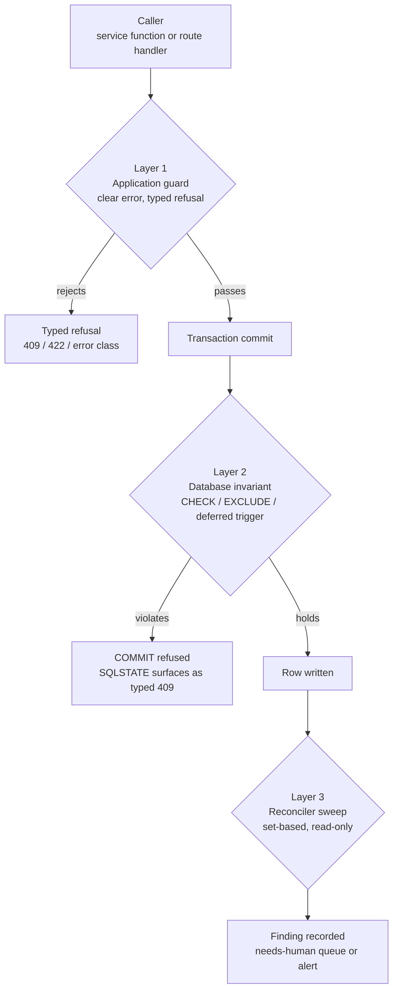
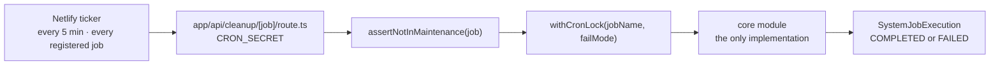

# Platform Architecture — The Load-Bearing Ideas

> **Status (pre-launch).** The scheduled job fleet is paused: the Upstash key `ops:active_cron_platform` is set to `paused-prelaunch`, so every tick of `netlify/functions/cron-tick.mts` returns before running a job, and the monitors that watch the fleet are paused or disabled with it (see [the pause decision](../decisions/2026-11-06-pause-scheduled-jobs-prelaunch.md)). Read the live-monitor descriptions below as the design that applies once the fleet is resumed; the resume step is the first item of the [go-live skill](../../.claude/skills/go-live/SKILL.md). Jobs can still be run by hand from the System Jobs page.

The booking and money systems have their own high-level designs in [01-booking-system-hld.md](./01-booking-system-hld.md) and [02-money-system-hld.md](./02-money-system-hld.md), and [03-booking-and-money-machinery.md](./03-booking-and-money-machinery.md) walks a seeded cast through nine worked examples. This document covers the layer _underneath_ all three: the set of decisions that every other subsystem inherits, and the machinery — the database invariants, the scheduler, and the reconcilers — that keeps them honest.

It is written for a reader who has never opened the repository, and it deliberately names the enforcer of every rule it states so you can find it later without reading the prose twice.

## What Familiarise is

Familiarise is a marketplace where people book time with experts. An expert publishes **offerings** in five shapes:

| Offering     | What one purchase buys                            |
| ------------ | ------------------------------------------------- |
| Consultation | One live session                                  |
| Subscription | A fixed number of live sessions over a term       |
| Webinar      | A seat at one scheduled broadcast                 |
| Class        | A seat in a series of scheduled sessions          |
| Trial        | One free session that can convert into a purchase |

On top of the consumer marketplace sits an **enterprise layer**. An organisation can sponsor its members: it buys licensed seats or a credit pool, tops up a wallet, receives a consolidated invoice, and its members then book against that budget instead of paying personally.

Three actor classes meet here, and a fourth watches from the back office:

- A **consultant** (expert) publishes offerings, opens availability, allocates sessions, approves or rejects requests, earns, and is paid out.
- A **consultee** (learner) books, pays, uploads documents, rates sessions, and asks for reschedules.
- An **organisation member** holds a role inside a sponsoring organisation (`OWNER`, `MAINTAINER`, `BILLING_ADMIN`, `MANAGER`, `EXPERT`, `LEARNER`, `SUPPORT`). `EXPERT` is an expert employed by the organisation; `LEARNER` is a sponsored seat.
- **Staff** and **admin** operate the back office: moderation, support, manual refunds, disputes, payouts, compliance filings and system jobs.

Everything below explains how those actors' intentions are made safe.

## The seven decisions everything else inherits

### 1. The database is the last line of defence, not the first

This is the single most consequential decision in the codebase, and it inverts the usual instinct to validate in application code and hope.

Prisma's schema language cannot express the things that make this system safe. It has no syntax for a `CHECK` constraint, no way to declare a deferrable constraint trigger, no `NULLS NOT DISTINCT`, and no `EXCLUDE USING gist`. Partial unique indexes are a near miss: the repository pins Prisma 7.10.0, where `partialIndexes` is still a preview feature and this schema enables only `relationJoins`, so the capability exists but is off here — and it was buggy at 7.7.0. So this repository maintains a second layer of hand-written SQL in `prisma/sql/`, applied on top of every `prisma db push`.

Today that layer is roughly 80 named constraints, 28 indexes and 8 triggers. Every money column is constrained to be non-negative; every ledger transaction must balance at `COMMIT`; two confirmed sessions for one expert can never overlap; a payment's funding legs must sum to its amount. None of those statements are enforced by application code alone, and none of them can be.

The consequence for you as a reader: **when you ask "what stops this from happening?", the answer is often a named object in `prisma/sql/`, not a service function.** Search the sidecars before you write a guard.

### 2. There is no message broker, and there is no generic outbox table

Most systems reach for an outbox: one table, one dispatcher, every side effect written as a row. This repository deliberately does not, because the durable state an outbox would provide already exists on the domain rows the platform writes anyway.

`WebhookEvent` is the **inbox**, carrying a processed flag. `NotificationOutbox`, `FailedEmail` and `OutboundWebhookDelivery` are **outboxes**, each with its own retry state. Every money-bearing follow-up is keyed on a row that already must exist — a `Payment`, an `Appointment`, a `Refund`, a `WalletTopUp`.

Where a follow-up must survive a crash, it is expressed as a **nullable stamp on the row it belongs to**. An appointment whose Stream chat channel still needs creating carries `Appointment.chatChannelEnsuredAt`. An idempotent ensure-step inside an existing sweeper checks that stamp before doing the work again. Nothing is lost if the process dies between the commit and the side effect; the next sweep simply re-checks.

This is recorded as [ADR 27](../enterprise/70-design-decisions/27-state-as-outbox-and-scheduled-ticker.md). The missing piece it identified was never a table — it was a scheduler reliable enough to re-check those stamps on a short interval.

### 3. One implementation, one HTTP twin, one scheduler

A scheduled job in this repository is a single function in a single domain module. It is registered once in `lib/cron/cleanup-registry.ts` under a slug, and exposed at `/api/cleanup/<slug>` by a single dynamic route, `app/api/cleanup/[job]/route.ts`.

Adding a parallel `route.ts` plus a `jobs/` wrapper plus a `scripts/` wrapper for the same job is explicitly banned, because in practice those three copies drift apart and only one of them gets updated.

There is exactly one scheduler, and every job is reached by it: `netlify/functions/cron-tick.mts` runs every five minutes and dispatches every registered job (see the generated inventory [`docs/maintenance/04-cron-jobs-reference.md`](../maintenance/04-cron-jobs-reference.md)), from the **latency-sensitive recovery sweeps** (every 5 to 15 minutes) to the **daily, weekly and statutory batch work** (a window inside which a target fires on its slot). No GitHub Actions workflow schedules a registry job, so a job that is missing from the ticker runs nowhere. The ticker dispatches at most 12 targets per tick and the busiest tick has 11. Overlapping runs of the same job are safe because of the shared Postgres lease: whichever runner loses answers 409.

There is no silent gap: a test, `__tests__/maintenance/cleanup-job-scheduler-drift.test.ts`, fails the build if a registered job has no ticker target and no explicit manual-only entry.

### 4. Status transitions are compare-and-set, never read-then-write

Every money and booking state change is a conditional update that names the state it expects to find:

```
updateMany({ where: { id, paymentStatus: "PENDING" }, data: { paymentStatus: "SUCCEEDED" } })
```

If the update matches zero rows, something else already moved the row and this caller does nothing. There is no window between reading a status and writing the next one.

`lib/booking/transitions.ts` is the authority for the booking side. It declares, per target state, the exact set of states a row may currently be in, and that set is pasted straight into the `WHERE` clause. `lib/enterprise/transitions.ts` does the same for payouts and organisation state. Every successful transition appends one `BookingStatusHistory` row in the same transaction, so the audit trail cannot disagree with the state.

### 5. Exactly one writer for the payment capture

A gateway card capture is confirmed by exactly one function, `handlePaymentSuccess()` in `lib/payments/webhooks/handlers.ts`. The webhook, the client verify route, the reconcile sweep and the admin recover door all call into it, so the checkout route and the console never confirm a capture themselves. A few rails write `SUCCEEDED` directly because no card capture is involved (the wallet, invoice, licence and free rows, overage side-payments and replay purchases); the money HLD (`02-money-system-hld.md`, section 1) lists all five writers.

This is what makes the money system auditable. There is one place to read when you want to know how a payment became confirmed.

### 6. Cron mutual exclusion is a Postgres lease, not a Redis lock

`withCronLock` in `lib/cron/with-cron-lock.ts` enforces that only one copy of a job runs at a time. It does so by inserting a row into `SystemJobExecution` and relying on a partial unique index that permits only one row per job name in the `RUNNING` state.

Redis is deliberately kept off this path. An incident on 2026-09-21 showed why: with locks on Redis, a fleet of eighteen targets spent roughly 430,000 of the account's 500,000 monthly commands on locking alone. The lock now costs zero commands.

A killed invocation does leak its lease until the next run sweeps it, which is why the lease has a time-to-live — 15 minutes by default, 35 for the payout and reconcile family.

### 7. Money is an integer number of paise, everywhere

Every monetary column is a `BigInt` holding paise. At the Prisma client boundary a result extension converts those to JavaScript `number`s, and a drift test plus `scripts/ci/check-money-columns.ts` fail the build if anyone introduces an `Int` money column or forgets to register one in that map.

There is no floating-point money, no rounding rule to remember, and no currency conversion before posting — settlement is INR only.

## The three-layer enforcement model

Almost every rule in this system is enforced more than once, at three layers. This is the shape to expect when you read a service function and wonder where its guarantee actually comes from.



**Layer 1 is the application guard.** It produces the clearest error and the best user-facing message. It is also the layer you should expect to be missing cases, because it only sees the rows the caller happened to load.

**Layer 2 is the database invariant.** This is the layer that cannot be bypassed. A `CHECK` constraint refuses the statement. A deferrable constraint trigger refuses the whole transaction at `COMMIT`, so a transaction that is transiently unbalanced while it inserts its legs is fine, but it may never finish unbalanced. A violation arrives as a SQLSTATE that the codebase maps to a typed refusal — the exclusion-constraint violation on overlapping occurrences becomes a `SCHEDULE_CONFLICT` 409, not a 500.

**Layer 3 is the reconciler.** A periodic, set-based, read-only sweep that re-derives what should be true and reports what is not. It exists for two jobs only: comparing against an external vendor that can disagree with us, and checking an internal cached value against its authoritative source.

The rule that follows from this shape is written into the repository's own agent instructions: **do not write an application-level sweep to re-verify something a `CHECK` constraint, an exclusion index or a trigger already prevents at `COMMIT`.** Reconciling across a vendor boundary is legitimate. Re-checking arithmetic the database already refuses is waste, and it rots.

## How scheduled work runs

Seventy-six jobs are registered in `lib/cron/cleanup-registry.ts`. Each entry declares a slug, the cron job name, a lazy import of its core module, and an optional summariser. The registry is the only place a job is defined, and it is read by tests that check the job holds a lock and has a scheduler.

The dispatch path is:



Three decisions in that path are worth understanding before you operate it.

**The bearer secret is compared in constant time.** `cleanup-route.ts` hashes both operands with SHA-256 and then compares them with `timingSafeEqual`, so neither the length of the secret nor a matching prefix is observable. A missing `CRON_SECRET` is a 401, never an open door.

**Every route honours a batch cap.** `parseLimitParam()` reads an optional `?limit=` query parameter, rejects a malformed value with a `400` and caps the rest. It defaults rather than trusting the caller, so no route can be invoked unbounded by any path, not just by the ticker.

**The status codes carry meaning beyond success and failure.** This is the part that trips people up:

| Status               | Meaning                                                                                                                                     |
| -------------------- | ------------------------------------------------------------------------------------------------------------------------------------------- |
| `200`                | The run completed cleanly.                                                                                                                  |
| `207`                | The run succeeded, but **a human has to look at something**. A double-booking was detected, a row was escrowed, a cascade is still failing. |
| `409`                | Another copy of this job holds the lease. This is expected under overlap, not an error.                                                     |
| `503` with a `phase` | Maintenance mode held the job. Also expected.                                                                                               |
| `400`                | The request was malformed.                                                                                                                  |
| `401`                | The bearer secret was missing or wrong.                                                                                                     |

The `207` exists because "nothing broke" and "something needs attention" are different facts, and collapsing them loses the second one. A previous implementation tested for a flagged row before it tested for failure, so a run that both failed and found a problem answered `207` — a 2xx that reads as healthy. The current code checks failure first, deliberately.

The ticker's own response is fixed at `200` no matter how many targets failed. Netlify re-invokes a scheduled function that answers 5xx up to three times within seconds of each other, and every retry re-fires every due target — production once ran the whole ticker at triple rate for weeks as a result. A 5xx buys three invocations and nothing else. Failures are recorded on a structured log line and reported to a Sentry cron monitor instead.

## What a reconciler may and may not do

Reconcilers come in exactly two families, and telling them apart is the fastest way to know whether a given sweep is behaving correctly.

**Vendor-boundary reconcilers** compare a local row against the one external system that gets to disagree with us. The local row says `PENDING`; Razorpay, Stream or Supabase Storage says otherwise; the reconciler adopts the vendor's answer. `reconcile-payment-status`, `reconcile-payout-status`, `handle-stuck-payouts`, `reconcile-disputes`, `reconcile-refunds`, `reconcile-orphaned-recordings`, `reconcile-document-storage` and `sweep-stuck-webhook-events` are all of this kind. Their correctness depends entirely on an external contract, which is exactly why application code cannot do the job.

**Internal-cache reconcilers** re-derive a value that this system computed and cached, from the authoritative source that computed it. `reconcile-ledgers` is the largest of these: it walks about seventeen derivation families and compares the result against the cached copy, writing a reconciliation report. `BillingAccount.walletBalance` exists only as a cache for an atomic debit guard, and is asserted against the ledger's own wallet balance by this sweep.

Neither family re-verifies a database invariant. A reconciler that did so would be the third layer standing in for the second, which is the waste the enforcement model is designed to avoid.

## Failure modes and recovery

| Failure                                                         | What catches it                                                                                              | Recovery                                                                                                                                                                              |
| --------------------------------------------------------------- | ------------------------------------------------------------------------------------------------------------ | ------------------------------------------------------------------------------------------------------------------------------------------------------------------------------------- |
| Two requests book the same slot at once                         | The `occurrence_no_confirmed_overlap` exclusion index refuses the second commit                              | The losing request gets a typed `SCHEDULE_CONFLICT` 409; no cleanup needed                                                                                                            |
| A payment is captured but the process dies before confirming it | The capture webhook is the only `SUCCEEDED` writer; a sweep re-polls the gateway for aged `PENDING` payments | `reconcile-payment-status` adopts the gateway's terminal state                                                                                                                        |
| A ledger posting is left half-written                           | The deferred constraint trigger refuses the unbalanced transaction at `COMMIT`                               | Nothing was written; the caller retries                                                                                                                                               |
| A refund is requested but the process dies                      | The refund row carries its own retry state, and any unpaid obligation is stamped on the payment              | `reconcile-refunds` re-drives it; after a bounded number of attempts it is dead-lettered for a human                                                                                  |
| A job's process is killed mid-run                               | The `SystemJobExecution` lease expires                                                                       | The next run sweeps the stale `RUNNING` row before acquiring; worst case the job waits one lease duration                                                                             |
| A sweep finds a state the application never permits             | The sweep's own finding list                                                                                 | It is routed to a needs-human queue or raises an alert; it is never silently repaired                                                                                                 |
| Redis is unreachable                                            | Maintenance reads fail open. The `withCronLock` leases are Postgres rows, so they are unaffected             | The site stays up. `create-payout-batch` and `process-payouts` are the exception: they hold Redis locks, so payout work is deferred until Redis recovers rather than running unlocked |

## Glossary

| Term               | Meaning                                                                                                                                 |
| ------------------ | --------------------------------------------------------------------------------------------------------------------------------------- |
| **CAS-in-WHERE**   | A conditional update that names the status it expects to find, so a concurrent writer causes a zero-row match rather than a lost update |
| **Sidecar**        | A hand-written SQL file under `prisma/sql/` holding invariants Prisma's schema language cannot express                                  |
| **Lease**          | A time-limited right to run a job, represented by a row in `SystemJobExecution`                                                         |
| **Tombstone**      | A soft delete: the row survives with a deletion timestamp so references and history stay intact                                         |
| **Sweep**          | A periodic batch job that repairs, expires or alerts on rows a request path left in an unfinished state                                 |
| **Reconciler**     | A sweep whose job is to compare two sources of truth and adopt or report the difference                                                 |
| **Needs-human**    | A finding the system deliberately does not auto-repair; it is queued for an operator                                                    |
| **Occurrence**     | One scheduled instance of a booking. A five-session subscription purchase has one `Appointment` and five occurrences                    |
| **Leg**            | One source of funding within a payment. A wallet top-up plus a card charge produces two legs                                            |
| **Money in paise** | Every amount is stored as an integer count of paise (one hundredth of a rupee)                                                          |
| **Basis points**   | One hundredth of one percentage point, used for platform fee rates, so 250 bps is 2.5 %                                                 |

## Where to read next

| Question                                         | Document                                                                                                         |
| ------------------------------------------------ | ---------------------------------------------------------------------------------------------------------------- |
| How the booking pipeline works end to end        | [01-booking-system-hld.md](./01-booking-system-hld.md)                                                           |
| How the money pipeline works end to end          | [02-money-system-hld.md](./02-money-system-hld.md)                                                               |
| Worked examples with real numbers                | [03-booking-and-money-machinery.md](./03-booking-and-money-machinery.md)                                         |
| Every scheduled job, lock mode and response code | [../maintenance/10-cron-and-reconciliation-reference.md](../maintenance/10-cron-and-reconciliation-reference.md) |
| Entity relationship diagrams                     | [../prisma/00-schema-map.md](../prisma/00-schema-map.md)                                                         |
| Why the scheduler is shaped this way             | [ADR 27](../enterprise/70-design-decisions/27-state-as-outbox-and-scheduled-ticker.md)                           |
| Why Postgres does the concurrency work           | [ADR 13](../enterprise/70-design-decisions/13-postgres-native-concurrency.md)                                    |
| Why GitHub Actions still exists                  | [ADR 05](../enterprise/70-design-decisions/05-github-actions-crons.md)                                           |
| Redis locking and caching posture                | [../architecture/distributed-systems-explained.md](../architecture/distributed-systems-explained.md)             |

Related issues: the infrastructure and maintenance audit tracked as issue 2157, and the booking productionization programme tracked as issue 2137.

## Deprecated & Superseded Approaches

**A generic outbox table and a queue worker.** Replaced by state-as-outbox (ADR 27), which keeps every obligation on the domain row it belongs to. The ADR 27 diagram still shows a Redis platform switch that was never implemented; see the maintenance reference for the current shape.

**Redis as the cron mutual-exclusion backend.** Replaced by a `SystemJobExecution` lease after the 2026-09-21 command-budget incident. Some stale text survives: the `CronLockUnavailableError` message in `lib/cron/cron-lock-errors.ts` still says the lock "requires a real Redis lock".

**A keep-warm pinger for the ticker.** Added to fight cold starts, then deleted once `preloadEntriesOnStart: false` and `appDocumentPreloading: false` in `next.config.mjs` brought cold starts down to about one second. `__tests__/lib/next-config-preload.test.ts` actively asserts the file stays deleted.

**A third scheduler layer.** The `jobs/` directory once held bare Node entrypoints that GitHub Actions invoked directly. Those wrappers are deleted; the modules left under `jobs/` are core implementations that the registry imports, and the ticker is the only scheduler.

**Named constraint drift.** Earlier agent instructions cited a constraint called `slot_no_confirmed_overlap`. No such object exists; the real name is `occurrence_no_confirmed_overlap` in `prisma/sql/check-constraints.sql`. If you find a name in prose that does not grep in the sidecars, assume the prose is wrong and verify before building on it.
