# Support system design

This document explains how Familiarise handles a customer who needs help, from the first "something went wrong" to a refund, a payout hold, a staff visit to a booking chat, or a decision that can be appealed. You should be able to read it in 20 to 30 minutes without the code open. Each rule names the thing that enforces it, and each flow has a worked example with real numbers.

The source baseline is `dev` at commit `9e0da236c`, reviewed on 23 October 2026, which includes the platform reschedule door, the Ops-panel reschedule and cancel, and case-linked chat access with visible "Familiarise Support" intervention (#2343). Anything not in that code is labelled **planned (P2)** or with its priority from the support roadmap. The module-level detail lives in [`docs/support/`](../support/README.md), and the patterns other subsystems can copy are in [the support platform blueprint](../blueprints/support-platform/README.md). Terms such as CAS, door, sweep and hold are defined in the [glossary](#17-glossary).

## Contents

| #   | Section                                                       | Main question                                                             |
| --- | ------------------------------------------------------------- | ------------------------------------------------------------------------- |
| 1   | [The one rule](#1-the-one-rule)                               | Where does support decide, and where does the fix actually happen?        |
| 2   | [Big picture](#2-big-picture)                                 | Which parts exist and what does each own?                                 |
| 3   | [Intake](#3-intake-how-a-problem-becomes-a-case)              | How does a customer's problem become a case, or get answered without one? |
| 4   | [Case lifecycle](#4-the-case-lifecycle)                       | Which status moves are allowed, by whom, and when does a case close?      |
| 5   | [Decisions and appeals](#5-decisions-appeals-and-supersede)   | How is a decision recorded, corrected and appealed?                       |
| 6   | [Evidence](#6-evidence-from-the-other-party)                  | How does staff hear the expert's side?                                    |
| 7   | [Money](#7-money-refunds-staff-caps-and-payout-holds)         | How does a refund or a payout hold move, and who may move it?             |
| 8   | [Cross-domain map](#8-the-cross-domain-map)                   | For each kind of problem, what actually happens and is it live?           |
| 9   | [Chat access](#9-chat-access-transcripts-and-intervention)    | When may staff read or enter a booking chat?                              |
| 10  | [Visibility](#10-who-can-see-a-case)                          | Who sees which case, including organisations?                             |
| 11  | [The sweep](#11-the-support-sweep)                            | What runs in the background, and how is it bounded?                       |
| 12  | [Privacy and retention](#12-privacy-retention-and-legal-hold) | What is exported, erased and purged, and what stops a purge?              |
| 13  | [Invariants](#13-invariants-and-their-enforcers)              | Which rules must never break, and what enforces each one?                 |
| 14  | [Worked examples](#14-worked-examples)                        | What do real cases look like step by step?                                |
| 15  | [Failure modes](#15-failure-modes-and-recovery)               | What goes wrong and how does it recover?                                  |
| 16  | [Live and planned](#16-what-is-live-and-what-is-planned)      | What ships at launch and what comes after (P0 to P4)?                     |
| 17  | [Glossary](#17-glossary)                                      | What do the terms mean?                                                   |

## 1. The one rule

**The case deliberates; the owning domain executes.** A support case is where the platform gathers context, asks the other party for their side, and records a decision. It never edits another domain's tables. When the decision needs money to move, a seat to change or a chat to be entered, the case calls that domain's own audited **door**, the same entry point an operator would use from the back office, with the same guards, caps, idempotency and audit row. The door's result is written back onto the case timeline.

This rule is why a support refund cannot skip the refund rails, why a payout hold is an ordinary `EarningsHold` row that the payout batcher already respects, and why a refund refuses itself while the platform is in maintenance. Support adds deliberation, not a second copy of finance or booking.

## 2. Big picture

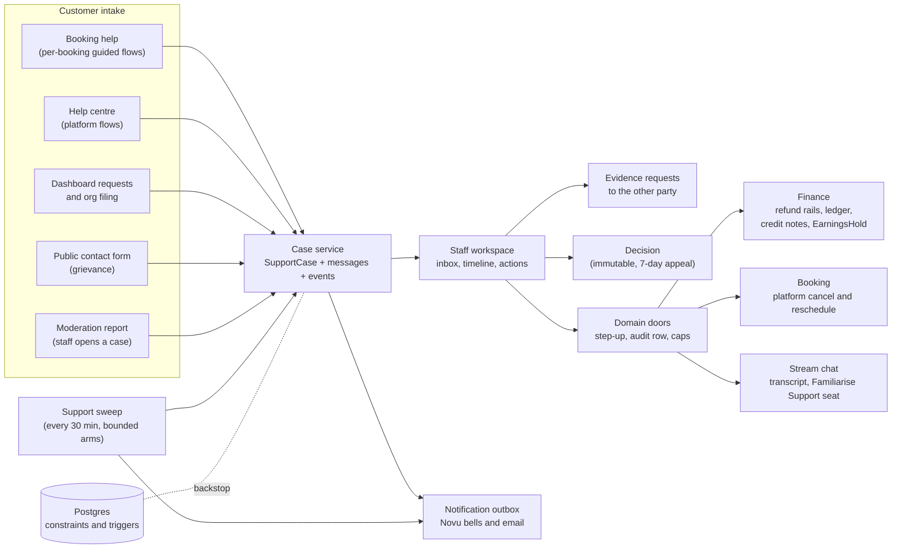

| Component             | What it owns                                                                                            | Where in code                                                                                                                     |
| --------------------- | ------------------------------------------------------------------------------------------------------- | --------------------------------------------------------------------------------------------------------------------------------- |
| Case service          | Creating or reusing a case, appending turns, status moves, holds release at resolution, CSAT            | `lib/support/case-service.ts`, `lib/support/case-transitions.ts`                                                                  |
| Guided flows          | The per-booking help trees and the platform help trees, escalation and deflection records               | `lib/support/flows.ts`, `lib/support/platform-flows.ts`, `lib/support/service.ts`, `lib/support/deflection.ts`                    |
| Case actions          | Evidence requests, decisions, refund recommendations and reviews, holds, idempotent replay              | `lib/support/case-actions.ts`, `lib/support/case-holds.ts`                                                                        |
| Doors                 | The audited entry points for money and holds; each writes exactly one `OpsActionLog` row                | `lib/support/refund-door.ts`, `lib/support/case-doors.ts`, `lib/backoffice/ops-action-log.ts`                                     |
| Money policy          | Staff refund caps, the staff refund lock, and maker-checker                                             | `lib/support/money-policy.ts`, `lib/backoffice/ops-proposals.ts`                                                                  |
| Chat access           | Read and intervention grants, the transcript reader, the Familiarise Support Stream user                | `lib/support/chat-access.ts`, `lib/support/chat-doors.ts`, `lib/support/chat-transcript.ts`, `lib/stream/support-intervention.ts` |
| Access and visibility | Who may correspond on, list or see a case                                                               | `lib/support/case-access.ts`                                                                                                      |
| Support sweep         | SLA notices, auto-close, the problem cascade, the evidence purge, the chat backstop and deadline alerts | `lib/support/sla-sweep.ts`, `lib/support/problem-cascade.ts`, `lib/support/evidence-retention.ts`, `lib/support/chat-sweep.ts`    |
| Privacy               | DPDP export and erasure of support data                                                                 | `lib/support/privacy-export.ts`, `lib/support/erasure.ts`                                                                         |

## 3. Intake: how a problem becomes a case

A customer reaches support in one of five ways. **Booking help** walks a short guided tree for one booking (no-show, cancel and refund, reschedule, payment, recording, quality, technical, documents, sponsorship billing, org disputes and, with the chat-intervention change, a safety concern). The **help centre** runs stateless platform flows for problems not tied to a booking: payments and billing, account access, platform technical issues, org operator billing, expert tax, and general questions. Dashboard **requests** let an organisation owner or maintainer file on behalf of a member. The public **contact form** files an anonymous grievance with an email that must be confirmed. Staff can also open a case from a **moderation report**.

Most problems end inside the tree. Booking help keeps one self-serve thread per booking and person, which is a `SupportCase` on the `SELF_SERVE` channel with no SLA and no staff notification; help-centre flows are stateless and write nothing until they escalate. When a tree answers the question, the turn writes a `SupportFlowOutcome` row with outcome `RESOLVED`, which is how the deflection rate is measured, and the customer can rate whether it helped. A turn hands off to a person when the tree reaches an escalating answer, when the customer types words such as "human", "complaint", "chargeback" or "fraud", when the refund at stake is ₹500 (50,000 paise) or more, or after two unrecognised replies in a row (`decideEscalation()` in `lib/support/escalation.ts`, plus the extra reasons in `runSupportTurn()`).

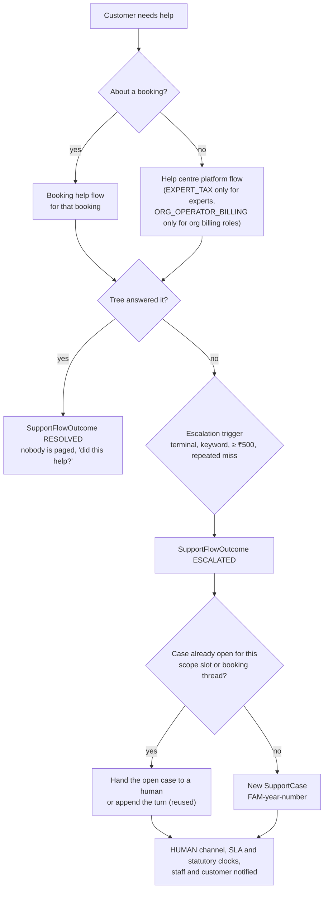

The case factory `createOrReuseSupportCase()` runs in one transaction. A repeated submission with the same `clientIntakeId` returns the first case. A matching open case in the same **scope slot** (same requester, submitter, booking or occurrence, category, organisation and ownership scope) gets the new turn appended instead of a duplicate; the database backs this with the partial unique index `support_case_open_scope_key`. A turn that lands on a `RESOLVED` case is a follow-up and does not reopen it. A new case gets a reference such as `FAM-2026-000412`, numbered per IST year from `SupportCaseCounter` (`allocateTicketReference()` in `lib/support/reference.ts`).

When a case first reaches a human (`activeChannel` becomes `HUMAN`), it gets two clocks. The **SLA** clock depends on priority and the **statutory** clock depends on the category, and the earlier one wins. The resolution clock pauses while staff are waiting on the customer; the acknowledgement clock and the statutory clock never pause (`lib/support/sla.ts`, `lib/support/deadline-policy.ts`). The channel change is written as a `CHANNEL_CHANGED` event, and code never moves a case back from `HUMAN` to `SELF_SERVE`.

| Priority | First response due | Resolution due | Typical source                                             |
| -------- | ------------------ | -------------- | ---------------------------------------------------------- |
| URGENT   | 2 h                | 1 day          | Safety concern (threat, scam, other)                       |
| HIGH     | 8 h                | 3 days         | Expert no-show, double charge, refund ≥ ₹500, every appeal |
| MEDIUM   | 24 h               | 7 days         | Default                                                    |
| LOW      | 24 h               | 7 days         | Set by staff                                               |

The statutory deadline is 168 hours (7 days) for a general request or a grievance, and much shorter for content takedown categories (36 h, 3 h and 2 h). Tax questions get their own issue types, `TAX_GST`, `TDS_CERTIFICATE` and `PAN_CARD_MISMATCH`, which land in the payments topic; the expert tax flow is offered only to a user with a live expert profile.

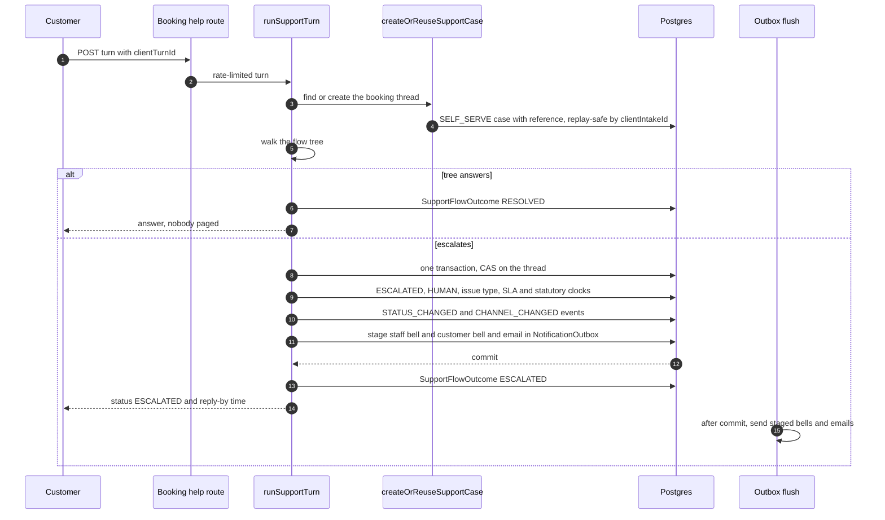

## 4. The case lifecycle

A case has five statuses. The allowed moves live in one table, `CASE_TRANSITIONS` in `lib/support/case-transitions.ts`. A move that is not in the table is refused with 409 `INVALID_TRANSITION`, and a reopen of a case that already has a decision is refused with 409 `CASE_DECIDED` and a pointer to the appeal. Writers still do their own compare-and-set on the row, so two staff members cannot both move the same case from the same state.

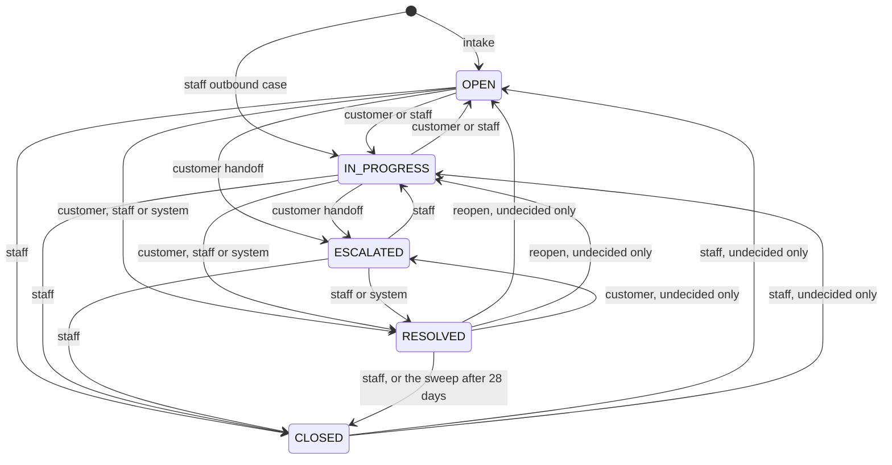

Three time rules shape the life of a case. A customer may press "This didn't fix it" within **14 days** of resolution to reopen an undecided case; only the requester or submitter may do so, and later attempts get 409 `REOPEN_WINDOW_EXPIRED` (`REOPEN_WINDOW_MS`). The sweep closes a `RESOLVED` case **28 days** after resolution and writes `AUTO_CLOSED` (`AUTO_CLOSE_DAYS_MS`). The satisfaction survey (CSAT, a 1 to 5 rating) is prompted no earlier than 24 hours after resolution and accepted for 28 days, once per case.

When staff resolve or close a case, or record a decision, every payout hold the case placed is released and every chat-access grant on it ends, inside the same transaction. Because releasing a hold lets money flow, a case with active holds can only make that move with a fresh step-up sign-in, never while a refund recommendation on it is still undecided (`RECOMMENDATION_OPEN`), and never while money doors are closed for maintenance.

A **problem** case groups many **incident** cases that share a root cause, such as a video outage. An incident may link only to a problem that is not yet resolved, problems cannot nest, and a problem itself cannot receive a decision (400 `DECISION_NOT_ALLOWED`). Resolving the problem resolves its incidents through the sweep, as shown in [section 11](#11-the-support-sweep).

## 5. Decisions, appeals and supersede

A decision is the platform's formal answer: `NO_REMEDY`, `SERVICE_REMEDY`, `REFUND_APPROVED` or `REFUND_DECLINED` on an ordinary case, and `UPHELD` or `OVERTURNED` on an appeal. Recording one moves the case to `RESOLVED` and sets an appeal window of **7 days** (`recordCaseDecisionTx()`). A decision must match the money on the case: `REFUND_APPROVED` needs an approved recommendation whose refund is live, and `REFUND_DECLINED` is refused once any recommendation is approved.

Decision rows can never be edited or deleted; the trigger `support_case_decision_immutable` refuses it. A mistake is corrected by **supersede**: an ADMIN appends a new decision that names the one it replaces, only before the appeal window ends and only if nobody has appealed. The new decision inherits the original window, so a correction cannot extend or reset the customer's time to appeal. Two admins racing to correct the same decision cannot both win, because `supersedesDecisionId` is unique and the partial index `support_decision_one_original_per_case` allows one original per case.

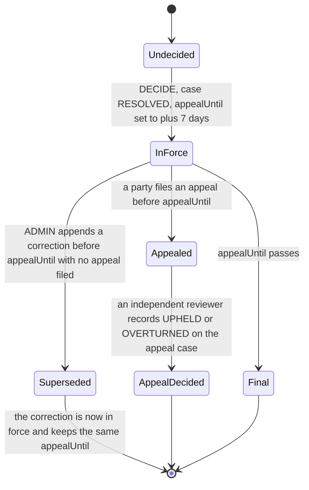

An appeal is a new case that points at the decision. Any correspondent on the case, or anyone who was asked for evidence on it, may appeal once (`@@unique([appealOfDecisionId, submitterUserId])`). Appeals are HIGH priority with a 7-day grievance deadline, and the person who made the original decision cannot review the appeal (403 `INDEPENDENT_REVIEW_REQUIRED`). An appeal of a superseded decision is refused with 409 `DECISION_SUPERSEDED`, and an appeal's own decision is final. Moderation appeals use the same case machinery with a 6-month window, and an `OVERTURNED` moderation appeal restores the removed reviews and ratings (`reverseAppealedModeration()`). An `OVERTURNED` appeal of a service decision does not move money by itself; staff issue any remedy through the normal refund door.

## 6. Evidence from the other party

Before deciding, staff can ask the other side for their account. The eligible recipients are the people who delivered the booking: the expert, the plan owner, collaborators who presented (accepted presenter seats, never crew), and the host organisation's owners, maintainers, managers and support members (`evidenceRecipientsByAppointment()`). A request is due in **48 hours** by default, and never later than the case's statutory deadline. Recipients see only their own request and the decision outcome, not the customer's private conversation.

The request has no status column; its state comes from three timestamps.

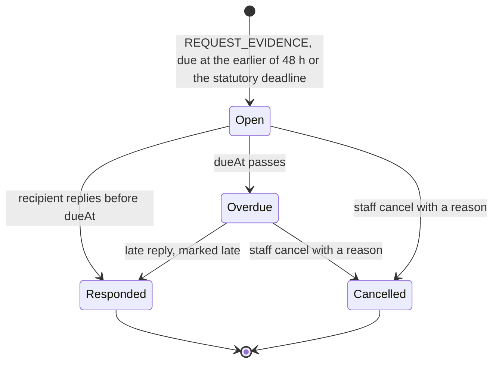

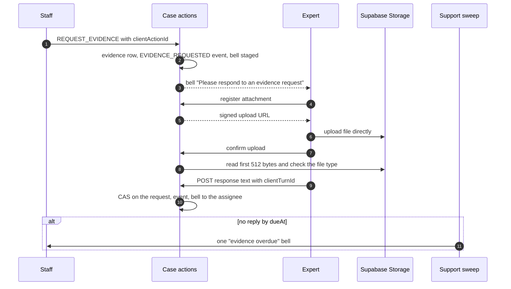

Attachments live in the private `support-attachments` bucket. Each file is at most 20 MiB, must be one of six types (PDF, JPEG, PNG, WebP, plain text, DOCX), and must match its declared type by its first bytes. One person may attach at most 20 files to one case, and downloads use signed links that expire after 60 seconds (`lib/support/attachment-policy.ts`, `lib/support/case-attachments.ts`).

## 7. Money: refunds, staff caps and payout holds

### 7.1 From recommendation to refund

A refund starts as a **recommendation** on a payment linked to the case. Any operator may propose one, with an amount and a choice about the buyer's seat. A reviewer, who must be a different person whenever two or more admins are active, then approves or declines it through the refund door, `reviewSupportRefundDoor`. The door shows a side-effect-free preview first, and the approval must carry the refundable amount the reviewer saw; if it changed in the meantime, the approval is refused with `PREVIEW_CHANGED`.

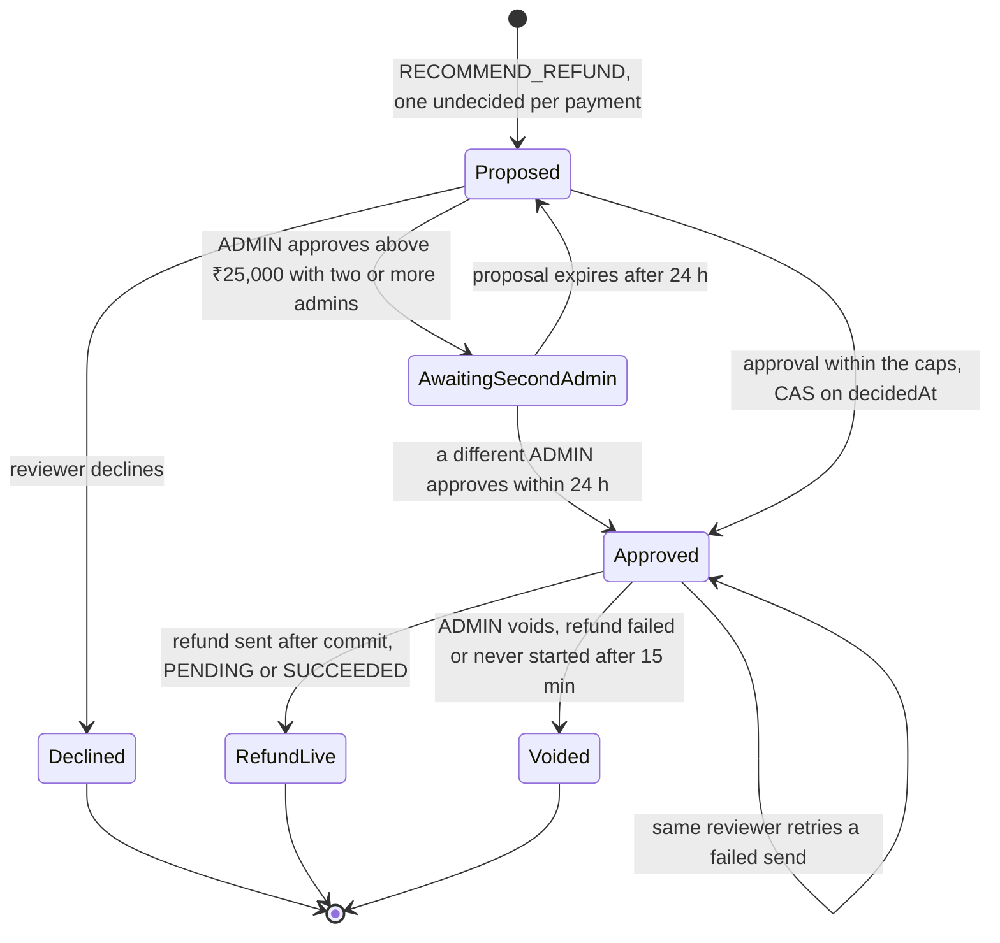

The approval commits first and the money moves after the commit, through `refundBookingPayment()` in `lib/payments/operations/booking-refund.ts`. That is the same function a normal cancellation uses, so the refund goes down the same rail as the original payment (card gateway, organisation wallet or invoice, or platform credits), reverses the payment legs and the expert's earnings, reverses TDS, mints a GST credit note for the refunded part, and posts a reversing ledger entry. The refund is keyed `case-recommendation:<id>`, so a retry can never send it twice.

The seat choice is narrow. Leaving "Also release the customer's seat" unticked, the default, refunds money only and keeps the buyer's participant seat live, which suits a goodwill or per-session refund. Ticking it marks the participant seat that payment funded as `REFUNDED` once the refund is sent: the customer loses access to the sessions, recordings and session documents, and a class or webinar seat can be booked by someone else. It does **not** cancel the booking or its future sessions; cancelling a booking with its policy refund is done with **Cancel booking** on the booking's Ops panel, through the platform cancel door. On the platform-credits rail the seat is always marked `REFUNDED` when the credits are restored, whatever the choice.

### 7.2 Who may move how much

| Rule                 | Limit                                                                                                                                                                                                                                                                                                                                                                                                                                                      | Enforcer                                                                                                                                       |
| -------------------- | ---------------------------------------------------------------------------------------------------------------------------------------------------------------------------------------------------------------------------------------------------------------------------------------------------------------------------------------------------------------------------------------------------------------------------------------------------------- | ---------------------------------------------------------------------------------------------------------------------------------------------- |
| STAFF per payment    | At most ₹5,000 (500,000 paise) refunded on one payment in total, counting every live refund from any door (customer cancels included) plus approved support remedies; a credit restoration counts at the credit it restores (`remedyValuePaise`); above it, 403 `ADMIN_REQUIRED`                                                                                                                                                                           | `assertBoundedRefund()` with `committedSupportPaiseByPayment()`                                                                                |
| STAFF per day        | At most ₹50,000 (5,000,000 paise) per staff member over a rolling 24 hours, summed from their own support refund and platform cancel audit rows; above it, 403 `STAFF_DAILY_LIMIT`                                                                                                                                                                                                                                                                         | `assertBoundedRefund()`, serialised per person by `lockStaffRefunds()`, kept after any outcome other than a refusal decided before money moved |
| ADMIN                | No per-payment or daily cap; bounded only by what is still refundable                                                                                                                                                                                                                                                                                                                                                                                      | `assertBoundedRefund()` returns early for ADMIN                                                                                                |
| Second admin         | A support refund approval is priced as this recommendation (at its credit value when it restores credit) plus the money already committed on the same payment (other approved, unvoided remedies and live refunds that no remedy owns), as priced by `priceCaseRefundReview()`. Above ₹25,000 (2,500,000 paise), while two or more admins are active, it is held as a proposal for a different ADMIN. Other admin money doors price only their own action. | `priceCaseRefundReview()`, `requiresSecondApprover()`, `ops_action_proposal_one_open_key`                                                      |
| Maker and checker    | With two or more active admins, the author of a recommendation cannot approve it (403 `SAME_AUTHOR`)                                                                                                                                                                                                                                                                                                                                                       | `assertNotOwnRemedy()`                                                                                                                         |
| Chargeback           | A live gateway chargeback on the payment blocks the refund (`REFUND_BLOCKED_BY_DISPUTE`)                                                                                                                                                                                                                                                                                                                                                                   | `quoteCaseRefund()`, re-checked inside `refundPayment()`                                                                                       |
| Never more than paid | Live refunds plus lost chargebacks never exceed the payment                                                                                                                                                                                                                                                                                                                                                                                                | Trigger `payment_refunds_within_amount`                                                                                                        |
| Maintenance          | Approvals, hold placements and hold releases refuse with 503 `MAINTENANCE` whenever maintenance is on                                                                                                                                                                                                                                                                                                                                                      | `assertMoneyDoorsOpen()`                                                                                                                       |

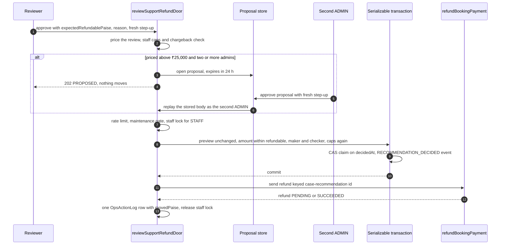

Staff can see their own headroom on the Support spend tab: rupees moved since IST midnight and over the rolling 24 hours, what is left of the ₹50,000, and what is left of the ₹5,000 on each payment they touched (`readSupportSpend()` in `lib/backoffice/support-spend.ts`).

### 7.3 Payout holds

If a complaint means the expert should not be paid yet, staff place a **payout hold**. It is an ordinary `EarningsHold` row with reason `SUPPORT_CASE` and the case id as its source, so it uses the same machinery as dispute and moderation holds. It freezes both the expert's earnings (collaborator earnings on the same payment included) and the host organisation's earnings.

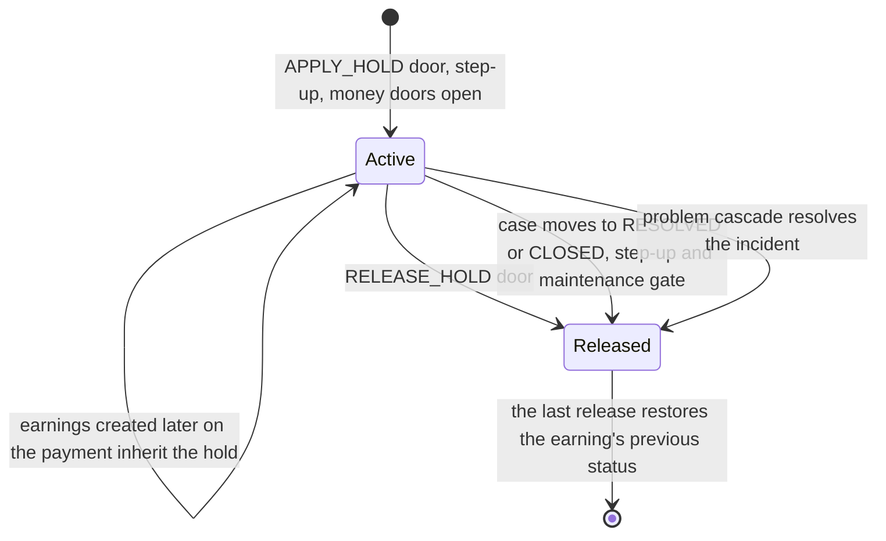

Placing a hold cancels any payout for that money that is still pending or approved, and refuses with `PAYOUT_IN_FLIGHT` if a payout is already processing or batched. Held earnings never reach a payout batch, because the batchers pick only `READY` earnings. An operator cannot free a support hold from the general earnings console; only the case can release it.

## 8. The cross-domain map

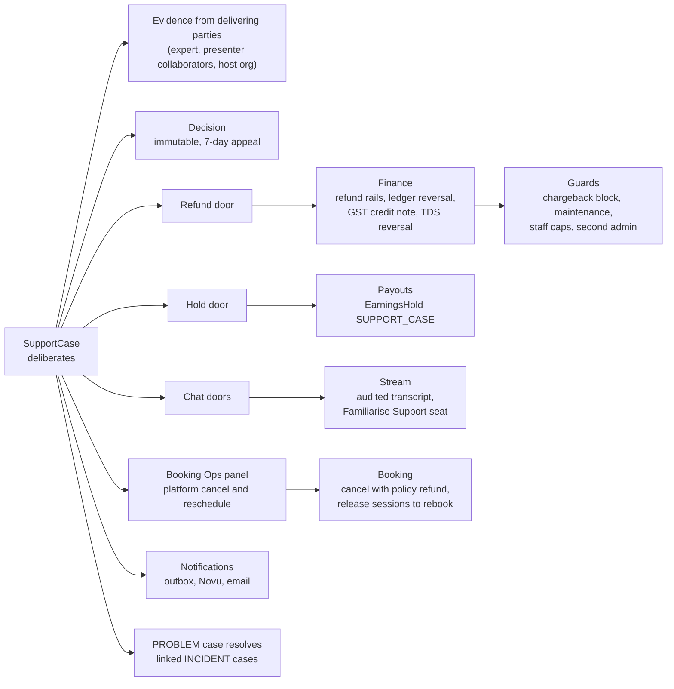

| Customer problem                                                          | Subsystems                      | What actually happens                                                                                                                                                                                                                                                                                                                        | Status                                                                                                                                                                    |
| ------------------------------------------------------------------------- | ------------------------------- | -------------------------------------------------------------------------------------------------------------------------------------------------------------------------------------------------------------------------------------------------------------------------------------------------------------------------------------------- | ------------------------------------------------------------------------------------------------------------------------------------------------------------------------- |
| "The expert didn't show up."                                              | Booking, finance, notifications | A host absence that clears the outcome threshold is voided automatically: a full refund for a consultation, a make-up then refund for a class, an allowance return for a subscription. If the customer disagrees, the flow escalates (HIGH), staff ask the expert for evidence and can refund through the door, keeping the seat by default. | Live                                                                                                                                                                      |
| "Refund me" after a poor or short session                                 | Finance                         | Recommendation, preview, review within staff caps or by ADMIN, refund on the original rail with ledger reversal and a credit note, then a `REFUND_APPROVED` decision with its appeal date.                                                                                                                                                   | Live                                                                                                                                                                      |
| "I already disputed it with my bank."                                     | Finance (gateway disputes)      | A live chargeback blocks any support refund on that payment; the dispute flow handles the money. The sweep pages admins as dispute deadlines approach.                                                                                                                                                                                       | Live                                                                                                                                                                      |
| "The expert was abusive; don't pay them yet."                             | Payouts                         | A `SUPPORT_CASE` payout hold freezes unpaid earnings and cancels pending payouts. It releases when the case resolves or closes.                                                                                                                                                                                                              | Live                                                                                                                                                                      |
| "Move my session" or "cancel the booking" as staff                        | Booking                         | The booking's Ops panel offers platform cancel (policy refund, counted against staff caps) and platform reschedule (releases sessions for rebooking; nothing is refunded). Operators who are not parties see an Ops-panel hint instead of the participant buttons, and the participant routes refuse them.                                   | Live                                                                                                                                                                      |
| "Give me a make-up session" as a typed remedy                             | Booking                         | No typed remedy yet; staff use the Ops panel or the customer reschedules.                                                                                                                                                                                                                                                                    | Planned (P2): CaseAction registry with `SupportRemedy`                                                                                                                    |
| "He's asking me to pay outside the platform" or a threat                  | Stream chat, trust              | The safety-concern flow opens an URGENT case. Staff may read the booking chat under a 24-hour audited grant and may visibly enter it as Familiarise Support. A moderation report can be turned into a case; the report alone never unlocks the chat.                                                                                         | Live                                                                                                                                                                      |
| "The video platform was down and the class failed."                       | Infra, booking, finance         | Staff open one PROBLEM case and link each customer's INCIDENT; resolving the problem resolves the incidents in bounded batches with a notice and a CSAT prompt. Declared platform incidents are settled by booking's own incident sweep. Refunds stay per customer.                                                                          | Live; automatic `PlatformIncident` link and `ServiceDisruption` banner are planned (P2)                                                                                   |
| "The session was 20 minutes short because of lag."                        | Video, finance                  | Today a refund decision through the door. Pro-rata remedies based on call-quality stats do not exist yet.                                                                                                                                                                                                                                    | Refund live; video remedies planned (P2)                                                                                                                                  |
| "My GST invoice is wrong", "Where is my TDS certificate?", "PAN mismatch" | Finance (tax)                   | Tax issue types route to the payments topic; experts get the expert tax flow first.                                                                                                                                                                                                                                                          | Live                                                                                                                                                                      |
| "Our organisation was overcharged."                                       | Enterprise, finance             | An org billing dispute becomes an `ORG_BILLING` case visible to the org's billing admins, or stays with operations if the filer lacks billing rights.                                                                                                                                                                                        | Live                                                                                                                                                                      |
| "A collaborator ran the session."                                         | Booking (collaborators)         | Presenter collaborators are delivering parties: they receive evidence requests, their earnings are held with the expert's, and they count as parties in chat access.                                                                                                                                                                         | Live                                                                                                                                                                      |
| "My referral credit is missing" or a trial problem                        | Referrals, trials               | No integration: a generic case handled by hand. A credit-funded refund restores credits through the credits rail.                                                                                                                                                                                                                            | Planned (P2), issue #2302                                                                                                                                                 |
| "Half of my class sessions were missed."                                  | Booking, support, payouts       | A customer-visible support case opens automatically at the threshold (twice the exit-right threshold, or 3 misses in a row); that class's unpaid host earnings are held until the case closes; host and learners see warning banners and emails as misses build up.                                                                          | Planned, [#2563](https://github.com/Practitionist/familiarise_web/issues/2563)                                                                                            |
| "Cancel the whole class for everyone."                                    | Booking, finance                | STAFF recommend; an ADMIN executes one class-wide cancel (`classSeries.money`) that refunds every attendee for the sessions not yet held through the normal refund rails. No second admin.                                                                                                                                                   | Planned, [#2563](https://github.com/Practitionist/familiarise_web/issues/2563)                                                                                            |
| "My refund still hasn't arrived."                                         | Finance, support                | A refund still failing after 72 hours opens a customer-visible case on its own.                                                                                                                                                                                                                                                              | Planned, [#2563](https://github.com/Practitionist/familiarise_web/issues/2563)                                                                                            |
| "Give me extra sessions instead of money."                                | Booking, support                | Staff grant a no-money remedy from the case ("add N sessions" or "add up to 4 weeks"), logged and visible to both sides; the same mechanism as the plan-end extra-weeks choice.                                                                                                                                                              | Planned, [#2563](https://github.com/Practitionist/familiarise_web/issues/2563), [#2561](https://github.com/Practitionist/familiarise_web/issues/2561)                     |
| A money action above ₹25,000 by the one ADMIN                             | Back office, finance            | No second-admin proposal: the ADMIN acts with step-up sign-in, a typed confirm and the ops log; a daily digest lists actions over ₹10,000. STAFF caps become ₹5,000 per payment and ₹30,000 per rolling 24 hours.                                                                                                                            | Planned, [#2572](https://github.com/Practitionist/familiarise_web/issues/2572) (multi-admin later: [#2573](https://github.com/Practitionist/familiarise_web/issues/2573)) |
| "Delete my data" or "send me my data"                                     | Compliance (DPDP)               | Support data is in the DPDP export and is scrubbed on erasure. Evidence is purged 180 days after closure unless held.                                                                                                                                                                                                                        | Live                                                                                                                                                                      |
| Platform in maintenance                                                   | Maintenance                     | In `DEGRADED`, intake and messaging stay open while money doors refuse. In `OFFLINE`, every support route is closed.                                                                                                                                                                                                                         | Live                                                                                                                                                                      |

## 9. Chat access, transcripts and intervention

Staff do not read booking chats by default. Stream tokens are minted only for the signed-in user themselves (`assertCanMintToken()`), and every platform role maps to an ordinary Stream `user`, so an operator cannot open someone else's chat from the client. Reading a chat needs a **grant** tied to a case, written through a door with a fresh step-up sign-in and a reason.

A grant is allowed only on an open case (`OPEN`, `IN_PROGRESS` or `ESCALATED`) that a human is handling and that links a booking with a chat (trials have none). A **read** grant lasts 24 hours and is invisible to the parties until the case resolves; then the sweep tells them "our team read messages from your booking chat", unless staff withheld the notice. An **intervention** grant seats a visible "Familiarise Support" member in the chat for 24, 72 or 168 hours (72 by default) and notifies the parties at once. Intervention needs a basis: an overdue evidence request (checked), or a safety or fraud concern (checked when the case came from the safety-concern flow, otherwise asserted by staff with the reason on record).

While an intervention is live, the channel is locked in Stream: `syncSupportBoundary()` sets per-channel grant modifiers that stop the parties (the `user` and `channel_moderator` roles) from changing members, removing Familiarise Support or clearing the history, and clears them when the last intervention ends. The doors lock before Support joins and unlock after it leaves; the sweep re-syncs every channel whose grants changed in the last hour. A covert read changes nothing in Stream, so a party could still clear their own DM during a read; when evidence must be kept, staff open an intervention.

A one-to-one chat is read from seven days before the booking was made. In a group chat staff pick the target attendees, and only the reporter's and the targets' messages are shown. Organisation admins never see transcripts; they get a content-free audit row instead. Grants are append-only: the trigger `support_chat_access_append_only` lets only the end, Stream and notice timestamps be set, once each, so a grant can never be extended, only replaced by a new one.

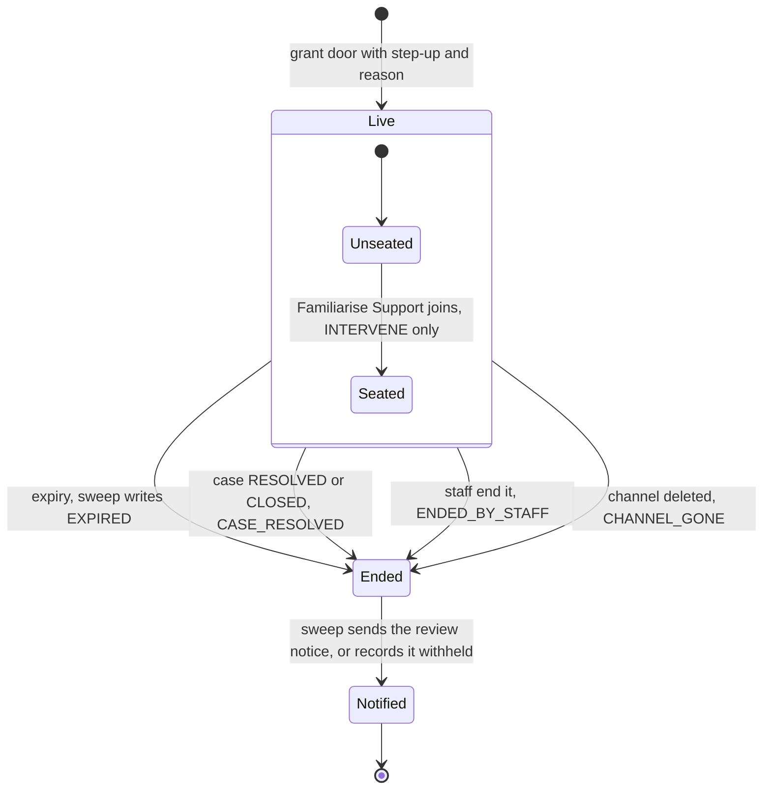

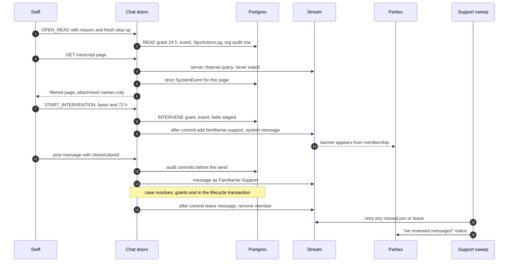

## 10. Who can see a case

Every case has an **ownership scope**. A `PERSONAL` case belongs to the person who filed it. An `ORG_OPERATIONS` case is shared with organisation members who hold the support operations permission (owner, maintainer, manager, support). An `ORG_BILLING` case is shared with members who hold the billing permission (owner, maintainer, billing admin). Staff with the ticket surface see every case. Internal notes, the assignee and most timeline events are staff-only.

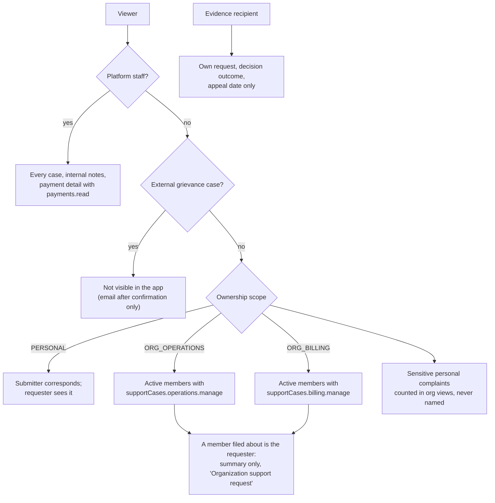

An owner or maintainer may file on behalf of an active member, only about the organisation's own bookings, and such a case is never `PERSONAL`. Sensitive personal categories such as an expert no-show, an early end, or (with the chat-intervention change) a safety concern are counted in organisation views but never show who raised them (`ORG_SENSITIVE_PERSONAL_CATEGORIES`).

## 11. The support sweep

One background job, `runSupportSlaSweep()`, does all of support's scheduled work. The five-minute ticker fires it every 30 minutes with a limit of 20, under the Postgres cron lease `support-sla-sweep`, so two runs never overlap. Every arm has its own cap, each row commits in its own small transaction, notifications are staged in the outbox and sent once after the run, and failures are collected and reported to Sentry at most once per run.

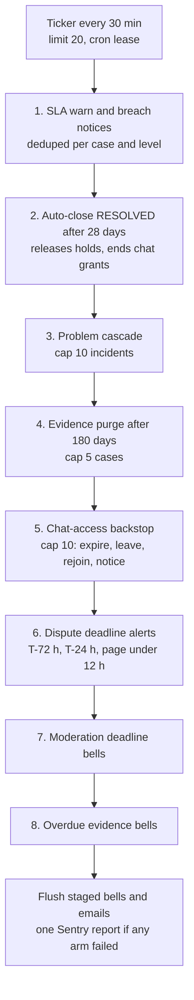

The auto-close moves a case resolved 28 days ago to CLOSED and, in the same transaction, releases any payout hold it still has and ends its live chat grants. No person acts, so it releases as the system (an ops-log row with actor role `SYSTEM`) without step-up (`releaseAutoClosedCaseTx()`). A case that still holds a payment is skipped, and stays RESOLVED for a later run, while a refund recommendation on it is open or the money doors are closed.

The problem cascade resolves each incident in its own transaction. It copies the problem's closing note to the incident as a public reply, releases the incident's payout holds, ends its chat grants, and stages a "resolved" bell and email plus the CSAT prompt. An incident stays open, and is retried later, if a hold was placed after the problem resolved, if a refund recommendation is still undecided, or if money doors are closed.

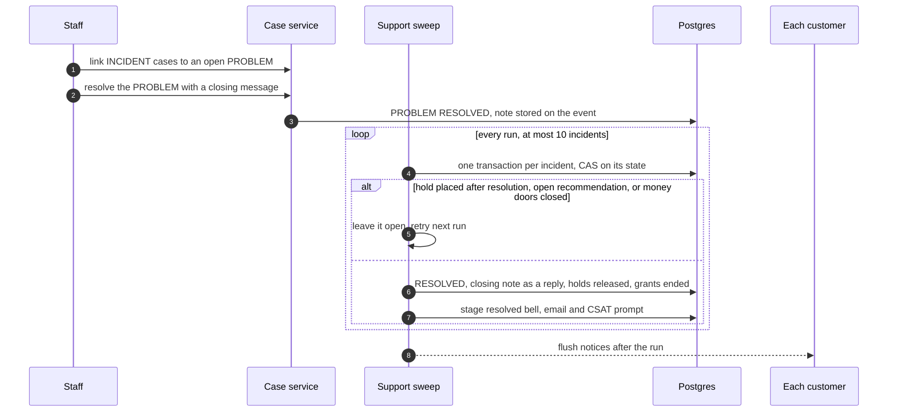

## 12. Privacy, retention and legal hold

Support data is part of the DPDP export: a user's own cases (cases filed about them by an organisation appear as summaries), their messages without staff notes, evidence requests addressed to them, attachment metadata, ratings and, with the chat-intervention change, staff chat-access grants on cases where the user is a party: only once that grant's "we reviewed messages" notice was released, never when any grant on the case was withheld, and never with the operator's identity or any chat content; a party who did not file the case sees neither the basis nor the case reference (`readSupportExport()`). On erasure, `scrubSupportPiiTx()` replaces the user's case text, messages and evidence answers with "[erased]", soft-deletes their attachments and deletes the files after commit. Decisions stay, because they are immutable records.

Evidence does not live forever. **180 days** after a case closes, the sweep deletes its attachment files and scrubs its free text, one case per transaction, at most five cases per run (`purgeExpiredSupportEvidence()`). The clock runs from the latest close across the case and any appeal of its decisions. The case skeleton, the decisions, the refund recommendations and the money links are kept, and an `EVIDENCE_PURGED` event records how many files went.

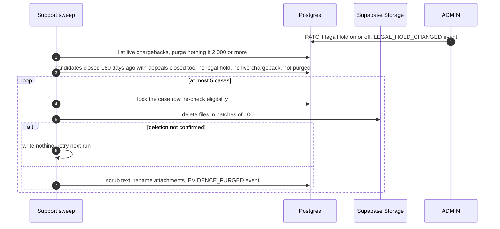

A purge is blocked by a **legal hold**, which only an ADMIN can place or lift, even on a closed case, and by two **derived holds**: a live chargeback on a payment linked to the case, and an appeal that is still open. The purge locks the case row, so an admin placing a legal hold at the same moment waits for the purge to finish or wins before it starts.

## 13. Invariants and their enforcers

| Rule, in plain English                                                                                                           | Enforcer                                                                                                              |
| -------------------------------------------------------------------------------------------------------------------------------- | --------------------------------------------------------------------------------------------------------------------- |
| A double-tapped intake creates one case.                                                                                         | Database unique on submitter and `clientIntakeId`                                                                     |
| One open case per scope slot.                                                                                                    | Partial unique index `support_case_open_scope_key`; the app reuses the open case                                      |
| Every customer and staff status move is in the transition table.                                                                 | `assertCaseTransition()`; the sweep's own moves use compare-and-set                                                   |
| A decided case is never reopened; it is appealed.                                                                                | `caseTransitionRefusal()` returns `CASE_DECIDED`                                                                      |
| Decisions are never edited or deleted.                                                                                           | Trigger `support_case_decision_immutable`                                                                             |
| One original decision per case, and one correction per decision.                                                                 | Index `support_decision_one_original_per_case` and the unique `supersedesDecisionId`                                  |
| One appeal per person per decision, reviewed by someone else.                                                                    | Database unique on decision and submitter; `assertIndependentReviewer()`                                              |
| One undecided refund recommendation per payment.                                                                                 | Index `support_recommendation_one_open_per_payment`                                                                   |
| An approval commits before money moves, and one remedy sends one refund.                                                         | CAS on `decidedAt`, refund dedupe key `case-recommendation:<id>`, unique `refundId`                                   |
| Staff refund at most ₹5,000 per payment and ₹50,000 per rolling day.                                                             | `assertBoundedRefund()` under `lockStaffRefunds()`                                                                    |
| A support refund approval priced above ₹25,000 (this remedy plus what is already committed on the payment) needs a second admin. | `priceCaseRefundReview()`, `requiresSecondApprover()` and `ops_action_proposal_one_open_key`                          |
| Refunds never exceed what was paid.                                                                                              | Trigger `payment_refunds_within_amount`                                                                               |
| A live chargeback blocks a support refund.                                                                                       | `quoteCaseRefund()` and the in-transaction check in `refundPayment()`                                                 |
| Held earnings are never paid out, and one hold per earning per source.                                                           | Payout batchers select only `READY`; indexes `earnings_hold_active_consultant_key` and `earnings_hold_active_org_key` |
| Money doors close during maintenance.                                                                                            | `assertMoneyDoorsOpen()`                                                                                              |
| Every door action leaves exactly one audit row.                                                                                  | `withOpsAction()`                                                                                                     |
| A chat grant cannot be extended or rewritten.                                                                                    | Trigger `support_chat_access_append_only`                                                                             |
| One Familiarise Support seat per channel, one live read per operator per case.                                                   | Indexes `support_chat_one_live_intervention_per_channel` and `support_chat_one_live_read_per_operator`                |
| No transcript page is served without an audit record.                                                                            | Strict `SystemEvent` written before the page returns in `readTranscriptPage()`                                        |
| Notifications are sent only for committed changes, and never lost.                                                               | Staged in `NotificationOutbox` inside the business transaction, sent after commit                                     |
| Evidence is purged 180 days after closure unless held.                                                                           | `purgeExpiredSupportEvidence()` in the sweep                                                                          |

Case events, messages, recommendations and `OpsActionLog` rows are append-only by convention, not by a database trigger. The purge and erasure scrubs legitimately rewrite event notes and message text.

## 14. Worked examples

The cast comes from the seed data described in [start-here 03](./03-booking-and-money-machinery.md): Daniel Brown and Charlotte Brown are customers, Hannah Anderson and Grace Anderson are experts, Maria Brown and Michael Brown are STAFF, and Olivia Brown, Patrick Brown and Priya Brown are the three ADMINs. Because three admins are active, the maker-checker and second-admin rules are switched on. Times are IST.

### 14.1 A ₹4,000 staff refund under the ₹5,000 cap

Daniel booked Hannah's one-hour consultation for Thu 15 Oct 2026 18:00, priced ₹4,000 plus ₹720 GST, so he paid ₹4,720 (472,000 paise). Hannah ended the call after 20 minutes.

1. **Thu 15 Oct 19:20.** Daniel opens booking help, picks "Session quality" and then "Session ended much earlier than booked". His booking thread, `FAM-2026-000412`, was created as a self-serve case on his first turn. The flow escalates it with reason `quality_ended_early`, issue type `SESSION_ENDED_EARLY` and priority MEDIUM, so it becomes `ESCALATED` on the `HUMAN` channel, with first response due Fri 16 Oct 19:20 and resolution due Thu 22 Oct 19:20.
2. **Fri 16 Oct 10:00.** Michael takes the case (`IN_PROGRESS`) and asks Hannah for her side. The request is due Sun 18 Oct 10:00. Hannah answers on Sat 17 Oct 09:00.
3. **Sat 17 Oct 11:00.** Michael recommends a ₹4,000 (400,000 paise) refund with the seat box unticked.
4. **Sat 17 Oct 11:30.** Maria opens the preview: refundable ₹4,720, nothing committed on the payment. She has moved ₹12,000 (1,200,000 paise) in the last 24 hours. She approves within her 15-minute step-up window. The checks pass: 0 + 400,000 ≤ 500,000 on the payment; 1,200,000 + 400,000 = 1,600,000 ≤ 5,000,000 for the day; 400,000 is below the ₹25,000 second-admin line; and Maria is not the author.
5. **Same transaction, then after commit.** The recommendation is claimed, the commit lands, and `refundBookingPayment()` refunds ₹4,000 on the card rail. The refund reverses the payment legs and Hannah's earnings, reverses TDS, mints a credit note for the refunded part, and posts the ledger reversal. One `support.refund.review` audit row records `movedPaise: 400000`.
6. **Sat 17 Oct 12:00.** Maria records `REFUND_APPROVED`. The case becomes `RESOLVED` with an appeal window to Sat 24 Oct 12:00. The CSAT prompt goes out no earlier than Sun 18 Oct 12:00. The sweep closes the case on its first run after Sat 14 Nov 12:00.

**What if?** If Daniel had already been refunded ₹1,500 by a self-cancel, 150,000 + 400,000 = 550,000 is above 500,000, so Maria gets `ADMIN_REQUIRED` and an admin must approve. If Maria had moved ₹47,000 that day, 4,700,000 + 400,000 is above 5,000,000, so she gets `STAFF_DAILY_LIMIT`. If Daniel's bank had opened a chargeback, the preview shows `REFUND_BLOCKED_BY_DISPUTE`. If maintenance is on, the approval gets 503 `MAINTENANCE`, while Daniel can still message the case in `DEGRADED` mode.

### 14.2 A ₹30,000 refund that needs a second admin

David Brown paid ₹35,400 (3,540,000 paise, which is ₹30,000 plus ₹5,400 GST) for a mentoring plan whose expert stopped delivering. Michael recommends ₹30,000 (3,000,000 paise).

1. **Mon 19 Oct 10:00.** Maria tries to approve. 3,000,000 is above 500,000, so the door answers `ADMIN_REQUIRED` before anything else happens.
2. **Mon 19 Oct 10:15.** Olivia (ADMIN) approves. The priced amount, 3,000,000 plus nothing already committed, is above 2,500,000 and three admins are active, so the door answers 202 `PROPOSED` with an expiry of Tue 20 Oct 10:15. No money moves, and the recommendation is still undecided, so nobody can record a decision yet (`RECOMMENDATION_OPEN`).
3. **Mon 19 Oct 14:30.** Patrick (ADMIN) approves the proposal with a fresh step-up. The door replays Olivia's stored request as Patrick: maintenance gate, preview unchanged against what Olivia saw, amount within the refundable ₹35,400, Patrick is not the author. The claim commits and ₹30,000 is refunded. The audit trail has the proposal row, the approval row and one `support.refund.review` row for Patrick.

**What if?** If Olivia tried to approve her own proposal, she gets `SAME_ADMIN`. If nobody approves by Tue 10:15, the proposal expires and the recommendation goes back to waiting for review. A ₹20,000 recommendation on a payment that already has ₹10,000 refunded also prices at ₹30,000 and needs a second admin, because the support refund door prices a review as the remedy plus what is already live or approved on the same payment (`priceCaseRefundReview()`), and the threshold is strictly above ₹25,000; exactly ₹25,000 does not. With only one active admin, that admin approves directly.

### 14.3 A missed class session with the seat kept

Charlotte holds a seat in Grace's four-session class, paid ₹4,720 (472,000 paise: ₹4,000 plus ₹720 GST), so one session is worth ₹1,180 (118,000 paise). On Tue 20 Oct 19:00 Grace joined 25 minutes late. The absence did not clear the automatic void threshold, so no make-up or refund was issued.

1. **Tue 20 Oct 20:30.** Charlotte opens booking help, picks "The expert didn't join" and "The expert never showed up". The flow explains the automatic rules and escalates with reason `provider_no_show`, priority HIGH: first response due Wed 21 Oct 04:30, resolution due Fri 23 Oct 20:30.
2. **Wed 21 Oct 09:00.** Michael asks Grace for evidence, due Fri 23 Oct 09:00. Grace confirms she was late.
3. **Thu 22 Oct 11:00.** Michael recommends ₹1,180 (118,000 paise) and leaves "release seat" unticked. Maria approves: 0 + 118,000 ≤ 500,000.
4. The refund goes out with the seat kept. Charlotte's participant row stays live, so sessions 3 and 4 still appear in her bookings and on the class roster. Maria records `REFUND_APPROVED`.

**What if?** If Michael had ticked "release seat", Charlotte's participant row would be marked `REFUNDED`, which frees her roster place, but the remaining sessions would not be cancelled. To cancel the rest of the class with its policy refund, staff use **Cancel booking** on the booking's Ops panel, which applies the same staff caps.

### 14.4 The 180-day purge, a legal hold and an appeal

Case `FAM-2026-000412` from 14.1 was closed by the sweep on Sat 14 Nov 2026.

1. **Thu 13 May 2027**, 180 days later, the case becomes eligible. On the next sweep run (at most five cases per run) the purge locks the row, deletes Hannah's uploaded files from `support-attachments`, replaces the title with "Support request", replaces Daniel's description, the messages, the evidence prompt and Hannah's answer with "[deleted after the retention period]", and writes `EVIDENCE_PURGED` with the file count.
2. What remains: the case skeleton, Maria's `REFUND_APPROVED` decision and its explanation, the ₹4,000 recommendation, the refund, the credit note and the ledger entries.

**What if?** If Priya (ADMIN) had placed a legal hold on Sat 1 May 2027, the purge skips the case until the hold is lifted; lifting it on Sun 1 Aug 2027 lets the next run purge it. If Hannah had appealed the decision and the appeal case closed on Mon 30 Nov 2026, the clock runs from that later close, so the purge waits until Sat 29 May 2027. If Daniel's bank had a chargeback still live on the payment, the purge skips the case until the dispute ends.

### 14.5 A scam report with a visible intervention

On Wed 21 Oct 21:00 Daniel reports that an expert asked him to pay outside Familiarise. The safety-concern flow escalates with reason `fraud_scam`, priority URGENT, so first response is due by 23:00. At 21:40 Michael opens a 24-hour read grant with a reason, reads two transcript pages (each audited before it is shown), and starts a 72-hour intervention with basis fraud or scam, verified by the category. Familiarise Support joins the chat with a system message and the banner appears for both parties. Michael posts a warning as Familiarise Support. On Fri 23 Oct 10:00 Maria resolves the case: both grants end in that transaction, Familiarise Support leaves the chat after commit, and the next sweep run sends Daniel and the expert the "we reviewed messages" notice.

## 15. Failure modes and recovery

| Failure                                                  | What happens                                                                                               | Recovery                                                                |
| -------------------------------------------------------- | ---------------------------------------------------------------------------------------------------------- | ----------------------------------------------------------------------- |
| Gateway error after an approval committed                | The recommendation stays approved with no live refund.                                                     | The same reviewer retries, or an ADMIN voids it after 15 minutes.       |
| A refund outcome is ambiguous                            | The refund row stays `PENDING`.                                                                            | The payments reconcile job settles it.                                  |
| Two staff act on one case at once                        | One compare-and-set wins; the other gets 409 `CONFLICT`.                                                   | Refresh and retry.                                                      |
| The same action is submitted twice                       | The second returns the first result; a different body with the same key gets 409 `IDEMPOTENCY_KEY_REUSED`. | None needed.                                                            |
| A Stream join or leave fails                             | The grant is recorded but the seat is not yet changed.                                                     | The sweep retries joins after 2 minutes and retries every missed leave. |
| Storage deletion fails during a purge                    | Nothing is written for that case.                                                                          | The next run retries it.                                                |
| An incident cannot release its holds                     | The cascade leaves it open with a reason code.                                                             | It resolves on a later run once the cause clears.                       |
| A sweep arm throws for one row                           | The error is collected; other rows and arms continue.                                                      | One Sentry report per run; the row is retried next run.                 |
| Production still reads the dropped legacy support tables | The SLA sweep, the export and staff metrics fail in production.                                            | Owner step 1 of the database end-phase (P0, issue #2271).               |

## 16. What is live and what is planned

| Priority | Meaning                                   | Support items                                                                                                                                                                                                                                                                                                                                                                                                                                             |
| -------- | ----------------------------------------- | --------------------------------------------------------------------------------------------------------------------------------------------------------------------------------------------------------------------------------------------------------------------------------------------------------------------------------------------------------------------------------------------------------------------------------------------------------- |
| P0       | Live breakage, security or data loss now  | Open: production still queries dropped legacy support tables (#2271, owner). Fixed: operators minting Stream tokens for other users and holding Stream global admin (#2300); the owner still downgrades existing operator Stream users once.                                                                                                                                                                                                              |
| P1       | Launch blocker                            | In code: everything in sections 3 to 12. Owner and legal: apply the database changes in the end-phase, the Grievance Officer contact (#2288), counsel sign-off on the disclosure copy, and the launch gates (#1873, #2168, #1933, #2065, #2164, #1604, #2286).                                                                                                                                                                                            |
| P2       | Within about 30 days after launch (#2270) | CaseAction registry with typed `SupportRemedy`; privileged-access tiers and recording playback under dual control; in-chat resolution offers and Stream moderation v2; video pro-rata remedies and call-quality stats; `ServiceDisruption` and `PlatformIncident` to PROBLEM linkage; customer-health panel and repeat contacts; audio and video evidence; renames (ticket to case); console ergonomics and money overview; referrals and trials (#2302). |
| P3       | Backlog                                   | Listed in #2270.                                                                                                                                                                                                                                                                                                                                                                                                                                          |
| P4       | Deferred by decision                      | AI copilot, propose-only over the CaseAction registry (#739).                                                                                                                                                                                                                                                                                                                                                                                             |

## 17. Glossary

- **Case.** One `SupportCase` row with its messages, events, evidence requests, decisions and recommendations. Older code and copy still say "ticket" or "thread"; the rename is planned (P2).
- **Incident and problem.** An incident is one customer's case. A problem groups incidents with a shared cause, and resolving it resolves them.
- **Scope slot.** The combination of requester, submitter, booking, category, organisation and ownership scope; at most one open case may hold it.
- **Door.** An audited entry point built with `withOpsAction()`: it checks the back-office surface, optionally demands a fresh step-up sign-in, validates the body with a reason, runs the action, and writes exactly one `OpsActionLog` row.
- **Step-up.** A fresh sign-in within the last 15 minutes, required for money, holds and chat access.
- **CAS (compare-and-set).** A write whose `WHERE` names the state the writer expects, so a row that has already moved matches nothing and the write fails instead of overwriting it.
- **Recommendation and remedy.** A proposed refund on one payment. Once approved and not voided it is a live remedy and counts toward the staff caps.
- **Maker-checker.** The rule that the person who proposed a refund cannot approve it while two or more admins are active.
- **Payout hold.** An `EarningsHold` row that freezes unpaid earnings until it is released.
- **Supersede.** An ADMIN's correction that appends a new decision naming the old one, within the original appeal window.
- **Grant.** A time-boxed, append-only permission for staff to read a booking chat or to seat Familiarise Support in it.
- **Sweep and arm.** A background job and one bounded step inside it. Support has one sweep with eight arms.
- **Outbox.** The `NotificationOutbox` table. Bells and emails are written in the same transaction as the change and sent after commit, so a rolled-back change never notifies anyone.
- **Legal hold and derived hold.** A legal hold is an ADMIN flag that stops the purge. Derived holds are a live chargeback or an open appeal, which also stop it.
- **Deflection.** A problem answered by a guided flow without a case, recorded as `SupportFlowOutcome` `RESOLVED`.

## Related issues

Support roadmap #2270 and launch umbrella #2293. Merged: #2257, #2268, #2269, #2291, #2292, #2298, #2299, #2303, #2304, #2307, #2317 to #2320, and #2341 (platform reschedule door, Ops-panel reschedule and cancel, operator hint). Closed: #2301 (fixed in #2317). Merging with this document: the chat-intervention change (#2290).

## Deprecated & Superseded Approaches

These existed earlier and are gone. Recognising them lets an engineer delete a leftover instead of rebuilding it.

1. **The ticket model.** `SupportTicket`, `SupportResponse` and the per-booking thread tables were replaced by one `SupportCase` with messages, events and subjects. The tables are dropped from the schema; production reading them is the open P0. Function names such as `createSupportTicket()` and the `/api/support/tickets` route are naming residue awaiting the rename.
2. **A separate support payment hold.** `SupportPaymentHold` was folded into `EarningsHold` with reason `SUPPORT_CASE`, so payouts need to understand only one kind of hold.
3. **Approved refunds with no way out.** An approval committed and then a failed refund (a live chargeback, an over-long gateway note) left the case saying "Approved" with nothing to do next, and a `REFUND_APPROVED` decision was not tied to any refund. Approvals still commit before money moves, but the door now checks for chargebacks and the refundable amount first, the same reviewer can retry, an ADMIN can void, and the decision requires a live refund.
4. **Unbounded staff refunds through the participant cancel route.** Staff used to cancel bookings through the customer's own cancel and reschedule routes. Those routes now refuse a non-party operator (`PLATFORM_CANCEL_DOOR_REQUIRED`, `PLATFORM_RESCHEDULE_DOOR_REQUIRED`), and the platform doors apply the staff caps and audit. The request decline routes and the trial routes refuse the same way, because a decline or a trial cancel also refunds in full; no staff door ends a paid trial yet.
5. **Decisions that were not terminal.** Any reply or matching intake reopened a decided case, which bypassed the independent appeal, and a repeated decision reset the 7-day appeal clock. A decided case now never reopens, a reply is a follow-up, a correction is an ADMIN supersede that keeps the original window, and the database refuses edits to decision rows.
6. **Operator Stream superpowers.** Operators could mint chat tokens for any user and held Stream global admin, which allowed unaudited reads. Tokens are now self-only, and chat access goes through case grants.
7. **A storage-reconcile purge and a script-based race check.** Evidence retention was once meant to live in the storage reconciler, and support races were checked by a standalone CI concurrency script that had stopped working. The purge is now an arm of the support sweep, and races are tested by the database test tier (`jest.db.config.ts`).
8. **An inline problem cascade.** Resolving a problem used to resolve every linked incident inside one long request transaction, staged its notices after commit where they could be lost, and let a decision on the problem broadcast its explanation to other customers. The cascade is now a capped sweep arm with one transaction per incident and notices in the outbox, and a problem cannot be decided.
9. **Silent channel downgrades.** A self-serve turn on a case a human had already handled wrote it back to `SELF_SERVE` with no audit row, which dropped it out of the staff queue and the monthly compliance report. Code now never downgrades `HUMAN`, and every channel change writes `CHANNEL_CHANGED`.
10. **An organisation billing dead end.** The org operator flow's "billing or charge dispute" answer sent operators to the read-only chargeback panel. It now escalates to an `ORG_BILLING` case for the organisation's billing admins.
11. **An unhandled scope collision.** Reopening a closed case into a slot that already had an open case surfaced as a 500. It now returns 409 `OPEN_CASE_EXISTS`.
12. **Unused enum values.** `SupportChannel.AI` and the `DUPLICATE_CLOSED` event kind remain in the schema with no writer. Treat them as leftovers rather than features; the AI copilot is deferred (P4).
