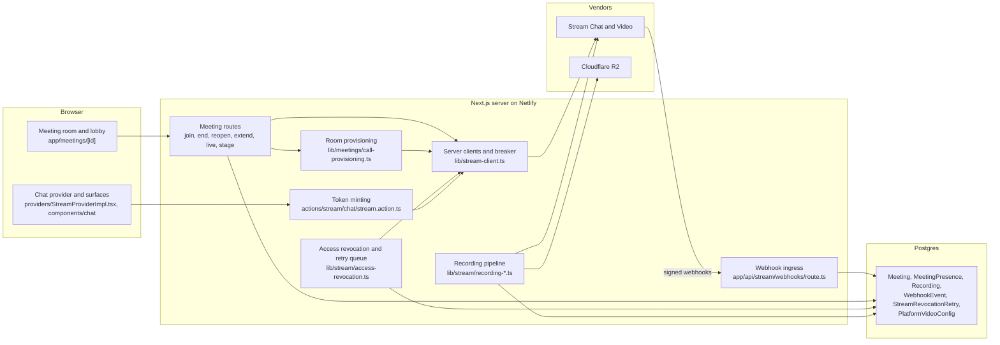
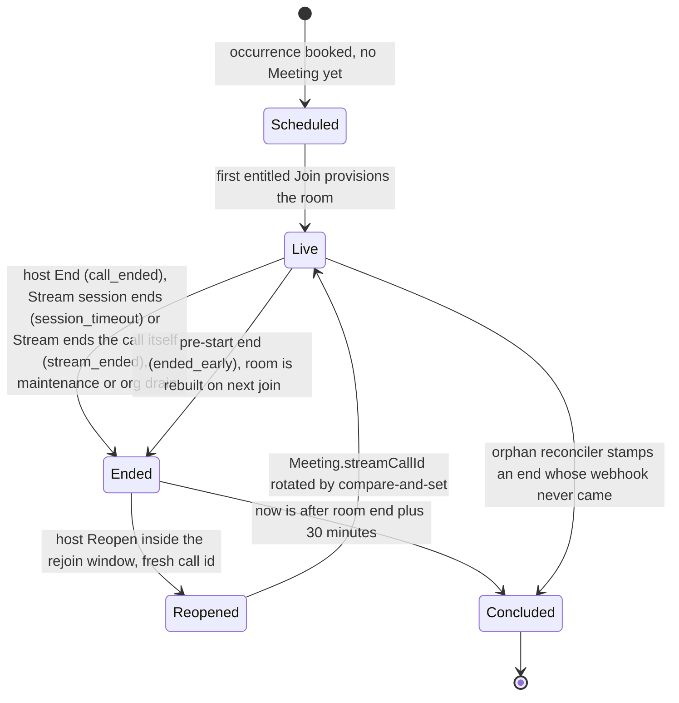
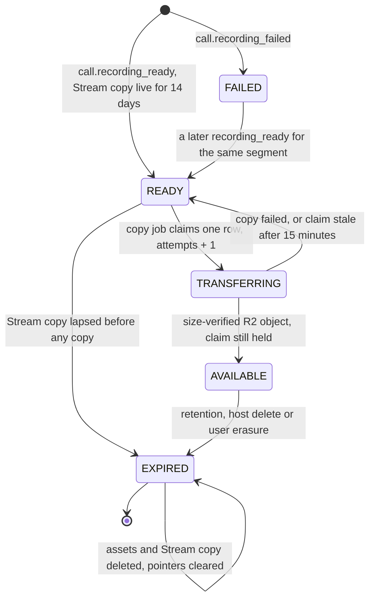
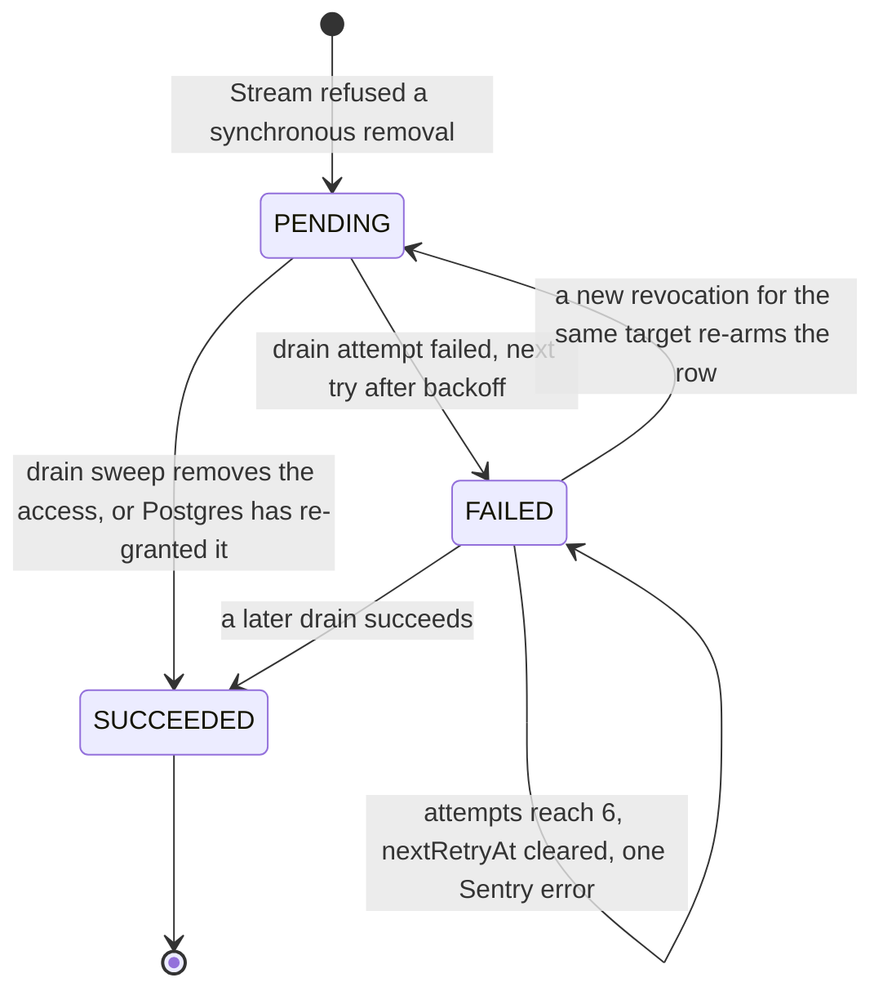
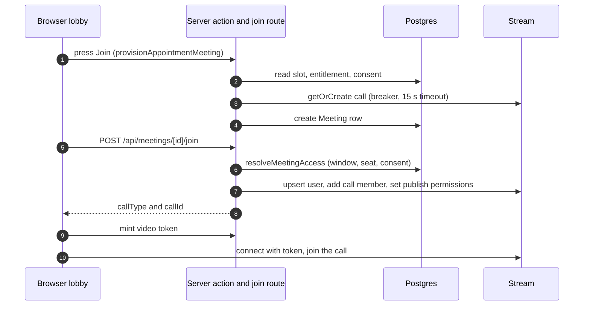
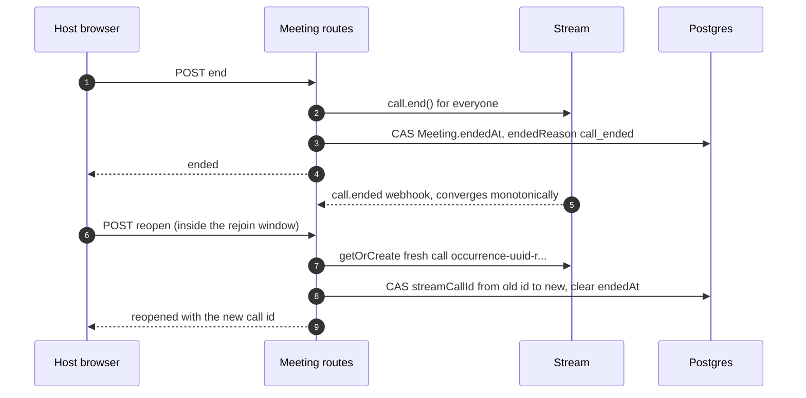
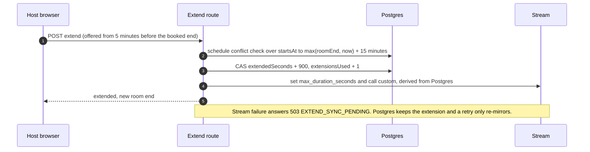
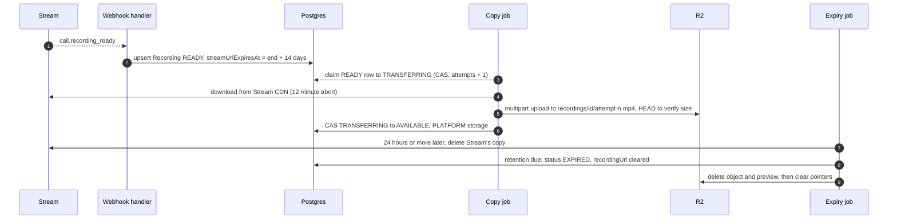
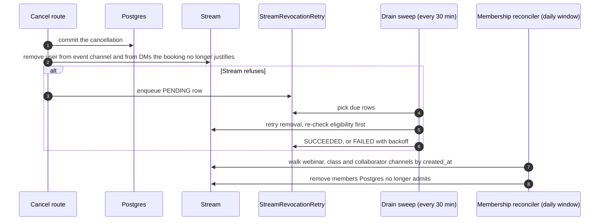
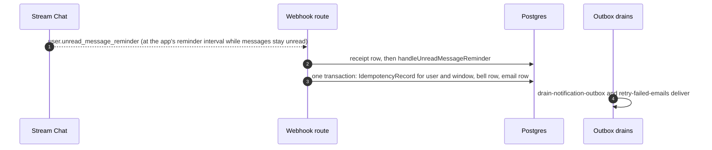

# Chat and Video System — High-Level Design

This document is the real-time counterpart of [01-booking-system-hld.md](./01-booking-system-hld.md) and [02-money-system-hld.md](./02-money-system-hld.md). It explains what the chat and video subsystem is for, which system owns which fact, how a session moves through its states, what happens when Stream, Cloudflare R2 or our own jobs fail, and which of the recovery jobs actually run today. It describes only behaviour merged on `dev`. Anything that is not wired yet is labelled **(planned)**. The reference pages are in [docs/stream/](../stream/README.md), and the decisions behind this design are in [docs/stream/18-architecture-decision-records.md](../stream/18-architecture-decision-records.md).

A reader with no code open should be able to answer three questions after this page: who is allowed in a room or a chat, what is true when a vendor is down, and which job repairs it.

## 1. What the subsystem is for, and what it is not

Stream.io supplies two products under one API key: Stream Chat (text threads) and Stream Video (WebRTC rooms). Familiarise uses them for exactly the following at launch.

| In scope at launch                                                                                                                | Why it is bounded this way                                                                                                                                                                                                                        |
| :-------------------------------------------------------------------------------------------------------------------------------- | :------------------------------------------------------------------------------------------------------------------------------------------------------------------------------------------------------------------------------------------------ |
| Booking-scoped, text-only chat (direct messages, webinar and class channels, collaborator channels) plus an unread-message digest | The owner chose a thread that supports a booking, not a general messenger. File uploads are disabled on the Stream channel types (`scripts/stream/ensure-chat-text-only.ts`), so there is no user-file storage or moderation story to build.      |
| 1:1 and 1:N video rooms over WebRTC, with a 200-participant cap on webinars and classes                                           | The interactive WebRTC room lets every attendee ask a question or be brought on stage. At 200 people it is the right tool; see ADR-07.                                                                                                            |
| Recordings copied from Stream into Cloudflare R2                                                                                  | Stream keeps its own copy for 14 days only, so the platform pulls the file into storage it controls.                                                                                                                                              |
| Not in scope: HLS or livestream broadcasts                                                                                        | HLS adds 10 to 30 seconds of latency, which breaks Q&A and stage requests, and costs an extra per-viewer add-on. It is only worth considering above 1,000 viewers, after launch (**planned**, parked).                                            |
| Not in scope: 4K                                                                                                                  | Stream recording tops out at 1440p. The staff-editable `PlatformVideoConfig` offers 480p, 720p and 1080p only, and defaults to 720p calls, 720p recordings and 1080p screen share (ADR-08).                                                       |
| Not in scope: a Supabase or second-store fallback for recordings                                                                  | The risk to recordings is scheduling and alarms, not durability. R2 is the single store, Supabase's Free plan caps every object at 50 MB, far below a multi-gigabyte recording, and a second copy path would double the failure surface (ADR-11). |
| Not in scope: Stream pushing recordings straight into our bucket                                                                  | Stream documents no retry for a failed push, so a bad credential could lose a recording. Pulling keeps Stream's own copy as the retry source (ADR-11).                                                                                            |

## 2. Who owns which fact

The central rule is that Postgres is the source of truth and Stream is a projection of it. If the two disagree, Postgres wins and a job or a retry brings Stream back into line.

| Fact                                          | Owner                                                          | Who writes it                                                                                              | What Stream holds                                                                 |
| :-------------------------------------------- | :------------------------------------------------------------- | :--------------------------------------------------------------------------------------------------------- | :-------------------------------------------------------------------------------- |
| Who booked, who hosts, the sold start and end | Postgres: `Appointment`, `AppointmentOccurrence`               | The booking pipeline. `AppointmentOccurrence.endsAt` is never rewritten by a session.                      | Nothing authoritative; the call `custom` carries a copy for the in-room clock.    |
| The room and its end state                    | Postgres: `Meeting` (`streamCallId`, `endedAt`, `endedReason`) | The meeting routes (`end`, `reopen`) by compare-and-set, and the Stream webhooks.                          | The call object, which becomes permanently sealed once ended.                     |
| The `+15m` extension                          | Postgres: `Meeting.extendedSeconds`, `Meeting.extensionsUsed`  | The `extend` route, one compare-and-set.                                                                   | A mirror: `max_duration_seconds` and call `custom`, always derived from Postgres. |
| Who may be in a chat channel or call          | Postgres: bookings, seats, collaborators, memberships          | Predicates in `lib/stream/channel-access.ts`, `lib/stream/dm-eligibility.ts` and `lib/meetings/access.ts`. | Channel and call membership lists, written by server code only.                   |
| Who was present, and the session outcome      | Postgres: `MeetingPresence`, `AppointmentOccurrence.outcome`   | The settle step stores Stream's settled record once; the outcome sweep is the only writer of the outcome.  | Stream's participant sessions, which the settle step reads.                       |
| Recordings and their retention                | Postgres: `Recording`                                          | The recording webhooks, the copy job and the expiry job.                                                   | A 14-day copy and the raw video.                                                  |
| Message text and unread counters              | Stream                                                         | Users, through the client SDK under Stream's role grants.                                                  | Everything. The platform never stores message text.                               |

Stream also holds a small identity record per user: id, display name, avatar and role, built only by `toStreamUser()` (`lib/stream/user-payload.ts`). New upserts never send an email address or other contact detail, because Stream shows a user's fields to every co-member of a channel. Users written before that rule may still carry an email until the scheduled `stream-sync` job reaches them and unsets it. Stream is the owner of exactly one thing: message content. Everything else it holds is rebuilt from Postgres if it is lost. Two consequences follow. First, no Stream call is ever made inside a Postgres transaction, because Prisma runs on a single connection on Netlify (`PG_POOL_MAX=1`) and a network wait there would stall every query. Second, every state change that matters is a compare-and-set (a conditional `updateMany` whose `WHERE` carries the expected prior state), so a webhook arriving late or twice cannot move a row backwards.

## 3. Component map

The responsibilities, in the order a request meets them:

- **Server clients and circuit breaker** (`lib/stream-client.ts`). The chat client has a 30-second timeout and the video client 15 seconds, which stays under the roughly 26-second Netlify function ceiling. Every Stream call goes through `withStreamCircuitBreaker`. An expected miss such as a channel not found, a 429 and a billing refusal do not trip it. When it is open, callers get a `StreamUnavailableError`, which the routes turn into a 503 with "Video is temporarily unavailable".
- **Token minting** (`actions/stream/chat/stream.action.ts`, `lib/stream/token-ttl.ts`). A chat or video token lives 3,600 seconds and the client reuses it for 50 minutes. Tokens always carry both `iat` and `exp`, because Stream rejects tokens without `iat` once `revoke_tokens_issued_before` is set on a user. `assertCanMintToken` refuses banned, erased, missing or consent-less users.
- **Room provisioning** (`provisionAppointmentMeeting` in `actions/stream/meetings/meeting.action.ts`, `buildRoomCallPlan` in `lib/meetings/call-provisioning.ts`). A room is created lazily, by the server, the first time an entitled participant presses Join. The browser never creates or ends a call. One `AppointmentOccurrence` has one `Meeting` and one active Stream call id (`occurrence-<uuid>`, rotated to `occurrence-<uuid>-r<base36>` when the host reopens).
- **Webhook ingress** (`app/api/stream/webhooks/route.ts`, `lib/stream/webhook-receipt.ts`, `lib/stream/webhook-dispatch.ts`). Described in section 7.
- **Revocation, retry queue and reconciler** (`lib/stream/access-revocation.ts`, `scripts/cleanup/retry-moderation-enforcement.ts`, `lib/stream/membership-reconciler.ts`). Described in section 6.
- **Recording pipeline** (`lib/stream/recording-handlers.ts`, `recording-transfer-service.ts`, `recording-retention.ts`, `recording-stream-delete.ts`). Described in section 8.
- **Control-plane contract and drift job** (`lib/stream/control-plane-contract.ts`, `control-plane-drift.ts`, `scripts/stream/ensure*.ts`). The contract is the intended state of the Stream app, which lives outside this repository: webhook hooks, call-type grants, app settings and chat reminders. The `ensure` scripts write it and the read-only drift job compares it with the live app.
- **Staff video config** (`lib/stream/video-config.ts`, `app/api/admin/video-config/route.ts`, backoffice page `app/dashboard/(backoffice)/[tree]/video-config/page.tsx`). A singleton `PlatformVideoConfig` row. Call, recording and screen-share quality are applied when a room is created, reopened or extended. An unreadable row falls back to the defaults, so quality never fails a room.
- **Chat client and provider** (`providers/StreamProviderImpl.tsx`, `lib/stream/connection-store.ts`, `components/chat/`). The provider keeps the layout mounted through a reconnect and shows a visible failure for an unsent message.

## 4. State machines

### 4.1 Meeting

A `Meeting` has no status column. Its state is read from `endedAt`, `endedReason`, the occurrence window and Stream. The typed end reasons live in `lib/meetings/end-reasons.ts`, and the database refuses any other value through the sidecar CHECK `meeting_ended_reason_known` in `prisma/sql/check-constraints.sql`.

Each end reason carries a policy, which is the table the code reads. A deliberate end (`call_ended`, `maintenance`, `org_deactivated`, `org_deleted`) can never be overwritten by a later webhook. The host may reopen after `call_ended`, `maintenance` or `stream_ended`. After `session_timeout` or `ended_early` the room is simply rejoinable, so a participant's next join rebuilds it. `maintenance` counts as a platform outage for money and `call_ended` as a host's own close; every other reason counts as neither. The enforcers are `END_REASON_POLICY`, `recordedEndHolds` and `endAllowsHostReopen`. The join window is `[startsAt - 15 minutes, roomEndsAt + 30 minutes]` (`CONSULTEE_JOIN_WINDOW_MS`, `CONSULTANT_JOIN_WINDOW_MS`, `REJOIN_GRACE_MS` in `lib/appointments/occurrences.ts`), and the room end is `endsAt + extendedSeconds`.

### 4.2 Recording

Only a `READY` row on `STREAM_S3` storage with a live Stream URL can be claimed (`claimForTransfer` in `lib/stream/recording-transfer-service.ts`). An erasure claim is the same `EXPIRED` write: `scrubUser` (`lib/compliance/erasure/scrub-user.ts`) marks the row `EXPIRED` first and captures its asset identities in one `updateManyAndReturn`. A copy that finishes afterwards cannot publish, because its completion update requires status `TRANSFERRING`. The pointers are cleared only after the R2 object and Stream's copy are confirmed deleted.

### 4.3 Revocation retry row

The kinds are `COLLAB_REVOKE`, `EVENT_CHANNEL_REMOVE`, `DM_REMOVE`, `ORG_REVOKE`, `SEAT_ACCESS_REVOKE` (an ended seat's channel, DM and room access, keyed by appointment) and `REFUND_ACCESS_REVOKE` (a refund's seats, keyed by the `Refund` row), plus `ERASURE_REVOKE` for DPDP erasure, which is written by the erasure scrub rather than by `access-revocation.ts`. The attempt cap is `REVOCATION_ATTEMPT_CAP = 6` in `lib/stream/revocation-retry-policy.ts`, and the waits between attempts come from `lib/retry/backoff.ts`: 1 minute, 5 minutes, 30 minutes, 2 hours, then 8 hours. Seat, refund and erasure rows do not give up at the cap; they retry once a day, and the ops digest counts them.

## 5. Sequence diagrams

### 5.1 Join

The enforcers are `resolveMeetingAccess` (`lib/meetings/access.ts`) for who may enter and when, and `guardMeetingRoute` (`lib/meetings/route-guard.ts`) for authentication, the per-user rate limit and the "Stream is configured" check. An attendee of a webinar or class is admitted on their seat alone, so the seat must hold a fulfilled entitlement (`paidParticipant`): a confirmed or attended seat with a `SUCCEEDED` payment or none, or a held seat whose `SUCCEEDED` capture owes no refund, has no pending or completed refund, and carries no settled-elsewhere marker (auto-refund, `REQUIRES_MANUAL_RECOVERY:` or replay sale). In a 1:N room only the host keeps publish permissions, and the join route skips the membership write when Stream already shows the caller with the right role, because that write is broadcast to the whole room.

### 5.2 End and host reopen

On end, Stream is told first and Postgres second: if the Stream call fails the route answers 503 and nothing changes, and if the Postgres stamp fails the route answers 500 and the `call.ended` webhook (or the orphan reconciler, section 9) writes the end. On reopen the order is the same. The fresh Stream call is created first and `Meeting.streamCallId` is rotated only after it exists, by a compare-and-set on the old call id and `endedAt`. A reopen that loses a race leaves its new call unused. Older call ids still resolve to the same `Meeting` through `parseOccurrenceIdFromCallId`, and recordings and presence from earlier segments attach by occurrence id.

### 5.3 The `+15m` extension

The booked end never moves, so "extend, then leave on time" cannot be classified as cutting the session short (ADR-04). The extension is free, once per `Meeting`, and refused with `409 SESSION_NOT_EXTENDABLE` if the room has ended, the occurrence already has an outcome or it is no longer `SCHEDULED`. The database overlap constraint `occurrence_no_confirmed_overlap` sees booked ends only, so the only guard against a collision with the host's next booking is the conflict check inside this route.

### 5.4 Recording ready, copy, expiry and erasure

### 5.5 Cancellation, synchronous revocation, retry and reconciler

### 5.6 Unread reminder webhook to digest

The digest names counterparts, counts and session dates, and never message text, because the event schema does not declare the text. The enforcer of "one per user per window" is the unique `IdempotencyRecord` on scope `stream.chat-digest`, the window start and the user. The app's `reminders_interval` and `CHAT_DIGEST_WINDOW_MS` are both 30 minutes (ADR-09).

## 6. Access: who may be in a chat or call

Entry is decided at join time by Postgres predicates. Leaving is the hard part, because Stream keeps membership until told otherwise.

1. **Intent first, then removal on the action.** The cancel route and the seat-leave path call `revokeEndedSeatAccess`, and a refund that ends a seat calls `revokeRefundedSeatAccess` (its intent is written before the seat is stamped refunded), after their commit; the seat-leave path writes its intent before any refund work. The parked-consultation sweep only writes the intent and leaves the removal to the retry sweep, so no Stream call spends its money job's budget. Each writes a `StreamRevocationRetry` intent before any lookup or Stream call, then removes the user from the event channel, from every direct-message channel the ended booking no longer justifies (checking `isDmContextEligible` first, so a DM that another booking still justifies is kept), and from every room the appointment provisioned. The request spends at most 8 seconds on Stream and the sweep finishes the rest. `/join`, seat-holder adds and room provisioning re-check the seat after writing membership (`fenceSeatGrants`), so a grant racing a cancel cannot restore access. If that re-check cannot be read, `/join` refuses a non-host with 503 `SEAT_UNVERIFIED` and a retry row is persisted; hosts are admitted. Staff (the plan owner, accepted collaborators, occurrence hosts) are never removed by the drive. Collaborator removal and organisation-member removal use the same pattern.
2. **Durable retry.** Any removal Stream refuses becomes a `StreamRevocationRetry` row. The `retry-moderation-enforcement` job drains the queue every 30 minutes on the Netlify ticker, stops starting rows at its 16-second start deadline, resumes a seat's room removal from a saved per-room cursor (`resumeAfter`), re-checks eligibility before acting, and gives up after six attempts with one Sentry error, except that seat, refund and erasure rows retry daily past the cap. Without Stream's keys nothing is attempted and the rows stay owed, and the sweep warns Sentry at most once a day. The same holds for organisation-member removal: `revokeMemberStreamAccess` reports the removal incomplete, so an `ORG_REVOKE` row is queued and stays owed until the keys are back.
3. **Daily reconciler.** `reconcile-stream-memberships` walks webinar, class and collaborator channels, in 50-channel slices on the hours 00:20, 01:20 and 02:20 UTC, resuming from a persisted checkpoint. It removes members the channel's own access predicate no longer admits. It skips direct messages entirely, so a DM's only backstops are steps 1 and 2. It also refuses to act on a channel where more than half the members would go, because that is more likely a bad read than a real revocation, and it never removes the support user, `system-` users or staff.

The client no longer takes part in revocation. The old session-flag gates that waited for the affected user's browser to resync were deleted.

## 7. Webhooks: durable receipt, then work

Stream gives a failed delivery a 6-second timeout and then drops the event, which a cold Netlify instance cannot always beat. The route therefore does only what must be synchronous.

1. It checks the header formats, the `x-api-key`, the body size limits, and the HMAC signature (`lib/stream/webhook-signature.ts`).
2. It acknowledges but ignores a delivery whose `created_at` is more than 10 minutes old or more than 2 minutes in the future (`classifyStreamDeliveryAge`).
3. It writes a `WebhookEvent` receipt with one `create`, through `recordStreamEventReceipt` (`lib/stream/webhook-receipt.ts`). The unique `eventId` index is the duplicate check. Stored payloads are scrubbed to the fields the handlers read (`lib/stream/webhook-payload-scrub.ts`). If the receipt cannot be written the route answers 503 so Stream retries.
4. It acknowledges and processes the event after the response (`runAfterOrInline`).

If the process dies after step 3, the row stays unprocessed. `sweep-stuck-webhook-events` runs every 15 minutes on the ticker, reclaims receipts that have been claimed or waiting for more than 5 minutes (a fenced compare-and-set on the claim stamp), and re-drives them, up to 5 reclaims per event. A redelivery from Stream can re-claim an abandoned receipt the same way. The dispatcher (`processStreamEvent`) always receives the claim from its caller and never claims for itself. Handlers advance state monotonically and by compare-and-set, so a replay is harmless. The handled events are listed once in `lib/stream/webhook-events.ts`: the recording events, `call.session_ended`, `call.ended`, `call.session_participant_joined` (room state only: it reopens a room Stream resumed after a timeout), `call.stats_report_ready` (a readiness signal: it records the session id as ready on the room and writes no attendance intervals) and `user.unread_message_reminder`. No webhook writes attendance. Events for call types other than `default` are ignored.

## 8. Attendance, outcomes and the Stream witness

Attendance is Stream's own settled record of the call, stored once; no webhook writes it. From one hour after the booked end, the outcome sweep (`lib/booking/session-outcome-sweep.ts`, run by `auto-complete-appointments` on the ticker every 30 minutes) checks for a declared incident and otherwise calls `settleOccurrenceAttendance` (`lib/meetings/settle-attendance.ts`). That step lists every call id the occurrence used (the current one plus each rotation Stream returns for `custom.occurrenceId`), every session of each call, and every device stay of each session (`lib/stream/call-presence.ts`). It reads nothing until six hours (`ATTENDANCE_SETTLE_DELAY_MS`) past the room's last known activity, the latest of the room end, the recorded end and the last join, to give late webhooks and lagging session stats time to arrive (time, not a guarantee that they have). It then accepts the answer only when every session has ended, none is live, each session is announced ready by Stream (`call.stats_report_ready`) or corroborated by our room-state webhooks, the call's own current session is listed and ended, and the rows collected equal Stream's detail total exactly and reach at least session stats' counts of stays and people. A second check follows: if session stats report a session that ended less than six hours before the read, nothing is stored yet (a room recorded as ending at 11:00 whose stats show a session ending at 11:20 is stored only from 17:20). Then it writes the `MeetingPresence` rows, `Meeting.attendanceSettledAt` and `Meeting.attendanceCorroboratedSessionIds` (the sessions accepted without Stream's ready announcement, which later decides whether a negative verdict's evidence is strong) in one compare-and-set transaction. Stream's answers stay distinct: read, no session, not final, expired (past its 90 days), unavailable, and out of time (the caller's own deadline passed first, which is always retried and never parked). A session that cannot be settled is retried at each run and, 72 hours past the booked end, parked `UNVERIFIED` for ops, who can ask Stream again until day 80. The no-show detector and the rating gate call the same step. This is ADR-06, revised by [Session outcomes from Stream's settled record](../decisions/2026-11-22-session-outcomes-from-settled-stream-record.md).

The verdict is then computed by `classifySessionOutcome` (`lib/booking/session-outcome.ts`). A session is voided when minutes inside the booked window with no host-side person present reach `min(15, booked minutes / 2)`; minutes both sides spend together after the booked end, up to 30, are credited back. The outcomes are `HELD` and `LEARNER_ABSENT` (completed), `CUT_SHORT`, `PLATFORM_OUTAGE` and `HOST_ABSENT` (voided), and `NOBODY_JOINED`, `INCONCLUSIVE` and `OFFLINE` (unverified, for a human). The money consequence is in the [session outcomes ADR](../decisions/2026-09-25-session-outcomes.md).

## 9. Failure promises

Only numbers that exist in code are stated here. Where a target is a goal rather than a measurement, it says so.

| Failure                                   | What the user sees                                                                                                                                                                                         | What recovers it, and the enforcer                                                                                                                                                                                                                                                                                                                                                                  |
| :---------------------------------------- | :--------------------------------------------------------------------------------------------------------------------------------------------------------------------------------------------------------- | :-------------------------------------------------------------------------------------------------------------------------------------------------------------------------------------------------------------------------------------------------------------------------------------------------------------------------------------------------------------------------------------------------- |
| Stream is down or slow when someone joins | The room shows a designed "video provider unavailable" face with a retry button (`app/meetings/[id]/join-failure.ts`, `app/meetings/[id]/components/JoinFailureCard.tsx`). A full room shows its own face. | The join route answers 503 on an open breaker, a Stream 5xx or a 429, and does not page Sentry for provider outages. The user retries. The 15-second video timeout and the breaker bound how long a request waits. If the outage swallowed a session, the outcome sweep can classify `PLATFORM_OUTAGE` using Stream participant sessions and declared incident windows.                             |
| A webhook never arrives                   | A dashboard card may lag. An ended room still ends through the host's own End.                                                                                                                             | `recordMeetingEndedSynchronously` stamps the end on the host path. `reconcile-orphaned-sessions` (`lib/meetings/reconcile-orphaned-sessions.ts`) stamps rooms whose end never came. The outcome sweep asks Stream for lost leaves. The receipt sweeper re-drives events that arrived but were not processed.                                                                                        |
| Stream returns 5xx when removing a member | The cancelled user may remain in a channel for a while; the cancellation itself is already committed.                                                                                                      | A `StreamRevocationRetry` row is queued and drained every 30 minutes, with 1 min, 5 min, 30 min, 2 h and 8 h waits; seat, refund and erasure rows then retry daily, and other kinds give up at six attempts. The membership reconciler is the backstop for event and collaborator channels.                                                                                                         |
| The R2 copy fails                         | Nothing yet. The recording stays playable from Stream's copy until it lapses.                                                                                                                              | The row returns to `READY` and is retried with waits of 15 min, 1 h, 6 h and 24 h, up to `MAX_TRANSFER_ATTEMPTS = 12`. A stale claim older than 15 minutes is reclaimed. Each run emits at most one bounded Sentry message for remaining READY Stream sources expiring within 72 hours or with at least three attempts. Only one recording is copied per run, inside a fail-closed 15-minute lease. |
| Stream's copy cannot be deleted           | Nothing. The viewer plays the R2 object.                                                                                                                                                                   | The row keeps its Stream pointer and `recordingUrl`, counts as a failure, and the daily expiry job retries it. Erasure keeps the admin request `IN_PROGRESS` and the pointers on the row until Stream confirms.                                                                                                                                                                                     |
| The extension cannot reach Stream         | The host sees "saved, room has not picked it up yet, try again".                                                                                                                                           | `503 EXTEND_SYNC_PENDING`; the retry re-mirrors from Postgres without adding time twice.                                                                                                                                                                                                                                                                                                            |
| The Stream app drifts from the contract   | Possibly no unread digest, or a missing webhook hook.                                                                                                                                                      | `stream-control-plane-drift` runs once a day at 01:15 UTC (06:45 IST), read-only, and sends one Sentry message of finding keys.                                                                                                                                                                                                                                                                     |

There is no stated service-level number for how quickly any of these recover. The cadences above are the only timing promises the code makes.

## 10. Scheduling truth

`lib/cron/schedule.ts` owns the five-minute ticker's roster, UTC phases, daily
windows and admission timeouts. Stream's jobs have one automatic owner: the active
Netlify ticker. Their former GitHub Actions steps and manual dispatch allowlists
are removed. No Actions workflow schedules a registry job. Configuration
must still be verified on the published deployment.

| Job                                                               | Configured cadence (UTC) | Execution                                  |
| ----------------------------------------------------------------- | ------------------------ | ------------------------------------------ |
| `sweep-stuck-webhook-events`                                      | Every 15 minutes         | Bounded HTTP sweep                         |
| `retry-moderation-enforcement`                                    | Every 30 minutes         | Revocation retry queue                     |
| `reconcile-stream-memberships`                                    | 00:20, 01:20, 02:20      | Bounded HTTP sweep                         |
| `stream-control-plane-drift`                                      | 01:15 daily              | Read-only HTTP check                       |
| `auto-complete-appointments`, `detect-consultant-no-shows`        | Every 30 minutes         | Outcome sweeps                             |
| `transfer-recordings`                                             | :00/:15/:30/:45          | Recording background worker; one copy      |
| `reconcile-orphaned-sessions` (`reconcile-sessions` cleanup slug) | :10/:40                  | At most five rooms; rotating ID checkpoint |
| `expire-recordings`                                               | 00:05, 01:05, 02:05      | Lifecycle background worker                |
| `reconcile-orphaned-recordings`                                   | 00:25, 01:25, 02:25      | Lifecycle background worker                |
| `wind-down-deactivated-orgs`                                      | 03:55, 04:55, 05:55      | Lifecycle background worker                |
| `stream-sync`                                                     | 08:50, 09:50, 10:50      | Lifecycle background worker                |
| `expire-event-channels`                                           | 08:55, 09:55, 10:55      | Registered lifecycle background worker     |

The week and 400-day calendar tests enforce at most eleven targets on every tick (the cap is twelve, leaving one free slot),
including monthly/quarterly collisions. The resumable ledger job retains its
crowded-slot yield. Existing Stream membership and control-plane coverage stays
in the roster. Daily windows run bounded slices rather than an unbounded nightly
fleet. See [background sync](../stream/09-background-sync.md) for limits, progress,
failure handling and the distinction between slices and complete backlog coverage.

Background dispatch accepts only HTTP 202 and appears in `accepted`, separately
from completed HTTP targets. Cleanup and staff recovery queue the same adapters.
The recording core retains a fail-closed 15-minute Postgres lease, a 12-minute
copy abort, claim-time attempt consumption and attempt-specific R2 keys. Reclaiming
a stale claim preserves its consumed attempt. All five lifecycle cores also fail
closed on unavailable ownership. The adapters have no independent schedules.

`/api/health/jobs` requires a successful environment-scoped transfer completion
within 60 minutes, session recovery within 90 minutes, and each daily lifecycle
capability within 28.5 hours (budgets derived from the schedule). Admission cannot satisfy completion health. The risk
alarm samples at most 100 READY Stream sources with a future expiry that is within
72 hours or with at least three attempts. Each recording is conditionally claimed
for an alarm at most once per six hours; expired sources are excluded. Alert
bookkeeping preserves `updatedAt`, so it does not postpone transfer retry backoff.
A crash between claim and telemetry can defer that recording's next alert by six
hours. The sample is not a backlog count; one successful slice cannot prove
capacity. One copy every 15 minutes has a theoretical ceiling of 96 copies/day.

Current background destinations are Netlify function URLs. Automatic background
work requires Netlify as the active cron host; switching hosts requires equivalent
worker adapters. Retain Netlify standby configuration. The [worker runbook](../stream/recording-background-worker.md)
contains deployment verification and manual orphan-object recovery gates. No
configuration change proves a real source was copied or authorizes fixture copies.

## 11. Worked example: one 60-minute session with an extension and a recording

**Cast.** Grace Anderson (independent consultant) hosts a one-hour consultation for Charlotte Brown (independent consultee), both from the seeded cohort in `prisma/seedFiles/1a-create-users.ts`. The price is illustrative: ₹2,000 plus ₹360 GST, so Charlotte paid ₹2,360 (236,000 paise). The booked slot is Tuesday 3 November 2026, 16:00 to 17:00 IST (10:30 to 11:30 UTC).

| Time (IST)                                                                   | What happens                                                                                                                                                                                       | State afterwards                                                                                                                                                                       |
| :--------------------------------------------------------------------------- | :------------------------------------------------------------------------------------------------------------------------------------------------------------------------------------------------- | :------------------------------------------------------------------------------------------------------------------------------------------------------------------------------------- |
| Tue 15:50                                                                    | The join window opened at 15:45 (`startsAt - 15m`). Grace presses Join; `provisionAppointmentMeeting` creates the call `occurrence-<uuid>` with a 6-person pair cap, and `/join` admits her.       | `Meeting` row exists, `endedAt` null. Call cap `max_duration_seconds` is 6,300 (3,600 booked + 900 early + 1,800 grace).                                                               |
| 15:58                                                                        | Charlotte joins.                                                                                                                                                                                   | Nothing is written about who is in the call; Stream keeps that record.                                                                                                                 |
| 16:03                                                                        | Grace starts recording; Charlotte sees the recording notice.                                                                                                                                       | `Meeting.isRecording` true.                                                                                                                                                            |
| 16:56                                                                        | The overrun banner (shown from 16:55) offers the extension. Grace accepts. The conflict check covers 16:00 to 17:15 and finds nothing.                                                             | `extendedSeconds` 900, `extensionsUsed` 1. Room end 17:15 IST. Stream cap mirrored to 7,200 seconds. Booked `endsAt` still 17:00.                                                      |
| 17:08                                                                        | Grace stops the recording; Stream's recording ends.                                                                                                                                                | Stream copy will lapse on Tue 17 Nov 17:08 IST.                                                                                                                                        |
| 17:10                                                                        | Grace leaves.                                                                                                                                                                                      | No webhook is needed for the leave.                                                                                                                                                    |
| 17:12                                                                        | Charlotte leaves. Stream ends the empty session (`call.session_ended`).                                                                                                                            | `endedAt` 17:12, `endedReason` `session_timeout` (rejoinable).                                                                                                                         |
| ~17:25 (illustrative)                                                        | `call.recording_ready` arrives; it is scrubbed, receipted and processed.                                                                                                                           | `Recording` is `READY`, `streamUrlExpiresAt` 17 Nov 17:08 IST. Ready notices go out at most once.                                                                                      |
| Tue 18:15 (12:45 UTC tick)                                                   | The outcome sweep runs. Stream reports one ended session and two device stays: Grace to 17:10:12 and Charlotte to 17:12.                                                                           | Both stays are stored with `attendanceSettledAt`. Both were present for the whole booked hour, so the outcome is `HELD` and the occurrence `COMPLETED`. The extension changed nothing. |
| Next eligible 15-minute tick (illustrative: Tue 3 Nov 17:30 IST / 12:00 UTC) | The ticker queues the background worker. If this row wins the next eligible claim, the worker streams about 730 MB (illustrative) to `recordings/<id>/attempt-1.mp4` and verifies its stored size. | Admission is 202; after successful copy the row is `AVAILABLE` / `PLATFORM` with `transferredAt` set. Backlog, backoff or a held lease can defer it.                                   |
| Thu 5 Nov 08:30 IST (03:00 UTC batch)                                        | The expiry job finds an `AVAILABLE` row copied at least 24 hours ago and deletes Stream's copy, then clears `recordingUrl`.                                                                        | Stream holds nothing. The delete lands between 24 and 48 hours after the copy.                                                                                                         |
| Tue 2 Feb 2027 08:30 IST (03:00 UTC batch)                                   | Retention for a 1:1 is 90 days after the session ended (`endedAt` Tue 3 Nov 17:12 IST), so the deadline was Mon 1 Feb 2027 17:12 IST.                                                              | The row is `EXPIRED` with `removalReason` `RETENTION`; the R2 object and preview are deleted and the pointers cleared.                                                                 |

The two expiry rows above describe the configured lifecycle batch after its S1 handoff; until then, the blocked Actions clock requires an authorized operator invocation as noted in section 10.

**What if** Grace had actually dropped for good at 16:40? Stream's record shows her stay ending at 16:40, so the 20 minutes with no host before the booked end exceed `min(15, 60 / 2) = 15`, and the verdict is `CUT_SHORT`, a voided session attributed to the host; no webhook could have hidden that. **What if** Stream had been down at 18:15? Nothing is stored, no verdict is written, and the next run tries again; 72 hours past the booked end the session would park `UNVERIFIED` for ops.

## 12. Operator pointers

- **After deploying a change to the Stream contract**, run `npx tsx scripts/stream/ensure.ts` (dry run) and then with `--apply --routes-are-deployed`, which writes app settings, `default` and unused call-type grants, the `co_presenter` role, the 300-second inactivity timeout, the messaging grants and the chat reminders. Run `npx tsx scripts/stream/ensure-chat-text-only.ts --apply` after any control-plane restore. Run `scripts/stream/ensure-webhook-subscription.ts` (`--check`, then `--apply`) for the two hooks. Details: [02-setup-configuration.md](../stream/02-setup-configuration.md).
- **Read the live app before trusting the code.** On 25 October 2026 a read-only settings read showed one video hook and `reminders_interval` of 300 seconds, which is not the contract's 1,800 seconds, so the unread digest receives no events until the reminder settings and the chat hook are applied by the owner. The drift job reports exactly this on its daily run.
- **Staff video quality** is edited in the backoffice page `video-config`.
- **Dev, preview and production share one Stream app** until the separate dev app lands (a separate non-production Stream app is **planned**). The streamio MCP in `.mcp.json` should stay read-only.
- **Troubleshooting** symptoms and live checks: [troubleshooting.md](../stream/troubleshooting.md).

## 13. Glossary

- **Compare-and-set (CAS):** a conditional `updateMany` whose `WHERE` states the expected prior value, so a stale writer changes zero rows.
- **Receipt:** the `WebhookEvent` row written before a webhook is acknowledged, so the work survives a killed process.
- **Sweeper:** a ticker job that finds rows stuck between states and re-drives them.
- **Witness:** a second source of truth for presence; here, Stream's own participant sessions.
- **Breaker:** the circuit breaker around Stream calls that fails fast once Stream looks down.
- **Projection:** state Stream holds that is derived from Postgres and can be rebuilt.
- **Segment:** one Stream call id for an occurrence; a reopen starts a new segment.

## 14. Appendix: review of the 2026-10-24 productionization brief

The brief gave 63 findings. Checked against code and the live Stream app, it overstated several items: it framed the state as "already an incident" when the system is pre-launch and only one real recording exists, it treated the generic client-side findings as launch-blocking when many are post-launch, and it claimed grants that the live call types already deny. It missed things that mattered more. There was no removal from chat on booking cancellation at all; the outcome sweep force-closed open presences before classification; Stream's copy of a recording was never deleted; a copy that kept being killed never counted as a failed attempt; `expire-event-channels` had been failing since 6 October; the Stream region is `gcp-us-east4` (placement `gcp-us-east4.vega`), not east5; and Stream's built-in unread reminders were not considered. It also over-prescribed a stack of separate product, authority and race documents, which this page and the ADRs replace. The first five of those are fixed on `dev`. The scheduling gap in section 10 is the one that remains.

## 15. Related

- [docs/stream/README.md](../stream/README.md) and the numbered pages `01` to `19` for reference depth.
- [Recording storage, retention and visibility ADR](../decisions/2026-10-09-recording-storage-retention-visibility.md).
- Umbrella issue #2364.

## Deprecated & Superseded Approaches

- **Extending a session by moving `AppointmentOccurrence.endsAt`, with the counter in Stream `custom`:** superseded by `Meeting.extendedSeconds` (ADR-04). Delete any extend-path write to `endsAt`.
- **Client-cooperative revocation** (a browser sync gate and a session flag deciding when a removed user left a channel): superseded by synchronous removal, `StreamRevocationRetry` and the daily reconciler (ADR-10).
- **Closing every open presence at the end stamp as fact:** superseded by the Stream witness (ADR-06).
- **A webhook mirror of attendance, patched from Stream:** presence and `MeetingAttendance` rows built from join and leave webhooks, with assumed closes resolved from Stream's latest session. Superseded by Stream's settled record, stored once (ADR-06 as revised on 2026-11-22).
- **Supabase Storage as a recording destination, and R2-only deletes that left Stream's copy for 14 days:** superseded by the R2 pull model and the Stream-copy delete (ADR-11).
- **Browser-created or browser-ended calls:** superseded by server-only provisioning and the `end` and `reopen` routes.
- **`logWebhookEvent` as the Stream receipt writer:** superseded by `recordStreamEventReceipt`, a single `create` guarded by the unique `eventId` index. The dispatcher's own self-claim branch (`claimAlreadyHeld`) went with it, and the one stale-reclaim function with two modes is now two: `reclaimStaleProcessingWebhookEvent` and `reclaimAbandonedWebhookReceipt`.
