# Enterprise system design

This document explains Familiarise's entire enterprise subsystem in one place: its data model, identity and governance, commercial axes, programs, overage, billing and settlement, dashboards, compliance, and operational machinery. It includes individual component designs, sequence and data diagrams, numerical examples, failure behavior, and recommendations with alternatives and reasons.

The source baseline is `dev` commit `29fbe05bc`, reviewed on 19 October 2026. “Current” means implemented in that source, with any gate or integration limitation identified. It does not certify production configuration, vendor readiness or legal compliance. The sidecars that guard earnings holds, batched earnings and refund totals are defined in `prisma/sql/*.sql`. The owner recorded them as applied to the shared database on 2026-10-20; this review did not verify that independently (see the evidence boundary below). Proposed changes are explicitly recommendations; this is a documentation-only change.

## Contents

The nine main sections follow the path from organization identity through booking, money, delivery and recovery. Use the component lookup to jump directly to an individual design. Shared terminology and superseded approaches are collected at the end.

| #   | Section                                                                         | Main questions                                                                                                                             |
| --- | ------------------------------------------------------------------------------- | ------------------------------------------------------------------------------------------------------------------------------------------ |
| 01  | [Enterprise system design](#1-enterprise-architecture-and-data-boundaries)      | What are the system boundaries, data relationships, transaction boundaries and shared invariants?                                          |
| 02  | [Identity, governance and lifecycle](#2-identity-governance-and-lifecycle)      | Who belongs to an organization, who may act, how do SSO and domain verification work, and what happens at suspension or removal?           |
| 03  | [Commercial axes and programs](#3-commercial-axes-and-programs)                 | What do the three-, five- and seven-axis views mean, and how do funding, program meters, configuration locks and cycles interact?          |
| 04  | [Checkout and overage](#4-checkout-and-overage)                                 | How is an allowance consumed, how is the marginal calculated, who pays it, and how do retries, allocation and partial reversal behave?     |
| 05  | [Ledger, billing and settlement](#5-ledger-billing-and-settlement)              | How do wallets, invoices, purchase orders, earnings, refunds, disputes, organization payouts and TDS fit together?                         |
| 06  | [Dashboards and user journeys](#6-dashboards-and-user-journeys)                 | Why are there several dashboards, what does each page read or change, and how do payer, attendee, expert and operator perspectives differ? |
| 07  | [Compliance, privacy and data](#7-compliance-privacy-and-data)                  | What do consent, export, erasure, retention, tax, grievances, breach response and regional attributes actually guarantee?                  |
| 08  | [Operations and integrations](#8-operations-and-integrations)                   | Which durable rows and workers drive recovery, how are jobs scheduled and locked, and how do external systems and hosting boundaries fail? |
| 09  | [Design decisions and recommendations](#9-design-decisions-and-recommendations) | Which options are recommended, why, what are the alternatives, and which future behavior changes need an explicit owner decision?          |

## Individual component design lookup

The sections explain each component's responsibility, durable data, input and output boundaries, authority, failure behavior, and important examples. This table is the lookup index rather than a second copy of those designs.

| Component                                                           | Primary design                                       | Connected components                                                              |
| ------------------------------------------------------------------- | ---------------------------------------------------- | --------------------------------------------------------------------------------- |
| Global user, personal profiles and typed membership                 | [02](#2-identity-governance-and-lifecycle)           | [Personal and organizational dashboards](#6-dashboards-and-user-journeys).        |
| Organization capabilities, taxonomies and identity satellites       | [01](#1-enterprise-architecture-and-data-boundaries) | [Organization lifecycle](#2-identity-governance-and-lifecycle).                   |
| Invitation, acceptance, suspension and removal                      | [02](#2-identity-governance-and-lifecycle)           | [Erasure and vendor revocation](#7-compliance-privacy-and-data).                  |
| Domain verification, SSO, JIT and session enforcement               | [02](#2-identity-governance-and-lifecycle)           | [Provider and runtime boundaries](#8-operations-and-integrations).                |
| Action permissions and organization scoping                         | [02](#2-identity-governance-and-lifecycle)           | [Dashboard query and command boundaries](#6-dashboards-and-user-journeys).        |
| Reachable triples, five-axis scenarios and seven-axis configuration | [03](#3-commercial-axes-and-programs)                | [Recommended commercial recipes](#9-design-decisions-and-recommendations).        |
| RECOMMENDED, ADVANCED and DISCOURAGED UI guidance                   | [03](#3-commercial-axes-and-programs)                | [Configuration experience](#6-dashboards-and-user-journeys).                      |
| Billing account and four funding rails                              | [03](#3-commercial-axes-and-programs)                | [Funding legs and journal](#5-ledger-billing-and-settlement).                     |
| Contract, billing subscription, lock and supersession               | [02](#2-identity-governance-and-lifecycle)           | [Program economics and cycles](#3-commercial-axes-and-programs).                  |
| Licensed seats, credit pools, assignments and cycle rollover        | [03](#3-commercial-axes-and-programs)                | [Usage and allocation](#4-checkout-and-overage).                                  |
| Program eligibility, curated panel and price caps                   | [03](#3-commercial-axes-and-programs)                | [Checkout validation](#4-checkout-and-overage).                                   |
| Usage ledger, booking utilization and subscription batches          | [04](#4-checkout-and-overage)                        | [Program allowance](#3-commercial-axes-and-programs).                             |
| BLOCK, CHARGE_ORG and CHARGE_MEMBER                                 | [04](#4-checkout-and-overage)                        | [Collection risk recommendations](#9-design-decisions-and-recommendations).       |
| Surcharge, GST, marginal split and cycle breaker                    | [04](#4-checkout-and-overage)                        | [Invoice and credit-note accounting](#5-ledger-billing-and-settlement).           |
| Wallet top-up, sufficient-funds debit and NULL cache                | [05](#5-ledger-billing-and-settlement)               | [Low-balance alerts and recovery](#8-operations-and-integrations).                |
| Invoice rollup, purchase-order draw, dunning and credit notes       | [05](#5-ledger-billing-and-settlement)               | [GST and IRP boundaries](#7-compliance-privacy-and-data).                         |
| Buyer/host split, rate-card snapshot and collaborators              | [05](#5-ledger-billing-and-settlement)               | [Expert membership and payout recipient](#2-identity-governance-and-lifecycle).   |
| Earnings holds, refund clawback and disputes                        | [05](#5-ledger-billing-and-settlement)               | [Member co-pay](#4-checkout-and-overage).                                         |
| Organization payout, provider identity, reversal and TDS            | [05](#5-ledger-billing-and-settlement)               | [Tax evidence and external delivery](#7-compliance-privacy-and-data).             |
| Immutable journal and SQL sidecar invariants                        | [01](#1-enterprise-architecture-and-data-boundaries) | [Detailed postings](#5-ledger-billing-and-settlement).                            |
| Organization home, members, programs, catalog and appointments      | [06](#6-dashboards-and-user-journeys)                | [Permission policy](#2-identity-governance-and-lifecycle).                        |
| Organization billing, purchase orders, payouts and spend            | [06](#6-dashboards-and-user-journeys)                | [Settlement](#5-ledger-billing-and-settlement).                                   |
| Organization audit, analytics, support, settings and exports        | [06](#6-dashboards-and-user-journeys)                | [Data boundaries](#7-compliance-privacy-and-data).                                |
| Cross-company workspace and platform backoffice                     | [06](#6-dashboards-and-user-journeys)                | [Operational evidence](#8-operations-and-integrations).                           |
| Enterprise marketing, contact intake and sales leads                | [06](#6-dashboards-and-user-journeys)                | [Tenant provisioning](#2-identity-governance-and-lifecycle).                      |
| Public directory, branding and plan visibility                      | [06](#6-dashboards-and-user-journeys)                | [Capability versus visibility](#2-identity-governance-and-lifecycle).             |
| Consent, grievances and breach intake                               | [07](#7-compliance-privacy-and-data)                 | [Compliance completion recommendations](#9-design-decisions-and-recommendations). |
| Data export generation, authorization and download                  | [07](#7-compliance-privacy-and-data)                 | [Scheduled export worker](#8-operations-and-integrations).                        |
| Local scrubbing, vendor erasure outboxes and finalization           | [07](#7-compliance-privacy-and-data)                 | [30-minute retry worker](#8-operations-and-integrations).                         |
| Recording, chat and financial retention                             | [07](#7-compliance-privacy-and-data)                 | [Stream and storage](#8-operations-and-integrations).                             |
| GST, IRP, TDS, MSME and RBI posture                                 | [07](#7-compliance-privacy-and-data)                 | [Implemented money treatment](#5-ledger-billing-and-settlement).                  |
| Cleanup registry, ticker, daily batches and Postgres leases         | [08](#8-operations-and-integrations)                 | [Recovery obligations](#1-enterprise-architecture-and-data-boundaries).           |
| Outbound webhooks, signing, SSRF and retry                          | [08](#8-operations-and-integrations)                 | [Integration permissions and secrets](#7-compliance-privacy-and-data).            |
| Email, Novu, Stream and storage delivery                            | [08](#8-operations-and-integrations)                 | [Privacy and revocation](#7-compliance-privacy-and-data).                         |
| System events, observability and capacity                           | [08](#8-operations-and-integrations)                 | [Measured scaling decisions](#9-design-decisions-and-recommendations).            |
| Active/standby scheduling and platform portability                  | [08](#8-operations-and-integrations)                 | [Specific recommended corrections](#9-design-decisions-and-recommendations).      |

## Reading examples correctly

The source seed defines Wipro Limited, LearnPro Academy and IIT Madras in `prisma/seedFiles/14a-create-organizations.ts`. Sections that discuss those fixtures identify seeded facts. Other people, dates, amounts, tax assumptions and hypothetical commercial terms illustrate the algorithms; they are not observations of customer or production data.

Every financial example should preserve units: ₹1 equals 100 paise, and 10,000 basis points equals 100%. Funding legs, allowance consumption, journal postings and cash settlement are separate quantities. An example that isolates a surcharge or omits tax for clarity states that assumption; the actual checkout derives the applicable treatment.

Some existing enterprise reference pages predate the current code. The sections identify material disagreements such as dropped hierarchy fields, the invitation-only member-entry path, public sponsor-directory inclusion, and PERSONAL overage call-site behavior. Follow the relevant explanation to the cited implementation before relying on an older diagram.

## Relationship to the rest of the documentation

- [Start Here](./README.md) introduces the shared booking and money systems.
- [Enterprise domain references](../enterprise/README.md) hold deeper contracts, API descriptions and runbooks.
- [Booking HLD](./01-booking-system-hld.md), [money HLD](./02-money-system-hld.md), and [booking and money examples](./03-booking-and-money-machinery.md) explain the shared platform around enterprise.
- [Compliance overview](../compliance/00-overview.md) contains deeper statutory and filing references.

- [Glossary](#glossary).
- [Deprecated and superseded approaches](#deprecated--superseded-approaches).

## 1. Enterprise architecture and data boundaries

Familiarise's enterprise subsystem lets an organization buy services for its people, host experts who deliver services, or do both. It adds organizational identity, negotiated commercial terms, entitlement limits, billing, operational visibility, and governance to the platform's existing booking and money machinery. An enterprise booking remains a booking; it does not acquire an independent payment engine or a separate accounting database.

This section explains the whole system before the later sections examine its parts. The design is derived from `prisma/schema.prisma`, the existing enterprise documentation, and the application and test code at the review baseline. Existing prose is background material; when it disagrees with the schema or a reachable call site, the implemented call site wins.

**Evidence boundary.** “Current” means present in the reviewed source, based on `dev` commit `29fbe05bc`. It does not mean that a feature flag is enabled in production, every SQL sidecar is installed in the shared database (the earnings-hold checks and indexes, the `*_batched_has_payout` checks and the `payment_refunds_within_amount` trigger in `prisma/sql/check-constraints.sql` and `prisma/sql/payment-legs-triggers.sql` are defined in those files), a vendor contract is signed, or a scheduled job has recently succeeded. This documentation does not inspect production data or change the database. The owner's record of 2026-10-20 says the W2 and W3 sidecars were applied to the shared database; that review did not inspect the database, so it is not independently verified here. To confirm, run the read-only drift check `npx prisma migrate diff --from-config-datasource --to-schema prisma/schema.prisma --script` and read its output. “Recommended” and “planned” identify design proposals; the docs PR implements none of them.

### 1.1. The business questions that define the architecture

Every enterprise request has several separate answers. Who is acting? Which organization authorizes the action? Who pays? Which program meters the booking? Who delivers it? Who receives the earnings? Who is allowed to see the result?

Keeping these answers separate is the central design decision. A learner can belong to Wipro, book an expert affiliated with LearnPro Academy, and pay personally. Wipro's membership, LearnPro's delivery context, and the learner's card payment are different facts. Inferring all three from the organization currently selected in a browser would corrupt both privacy and settlement.

The source seed defines Wipro Limited as a sponsor, LearnPro Academy as a host, and the Indian Institute of Technology Madras as a hybrid organization in `prisma/seedFiles/14a-create-organizations.ts`. The scenarios below reuse those organization names. People, prices, dates, and commercial terms in this document are illustrative unless a section explicitly identifies a seeded value.

### 1.2. One picture of the subsystem

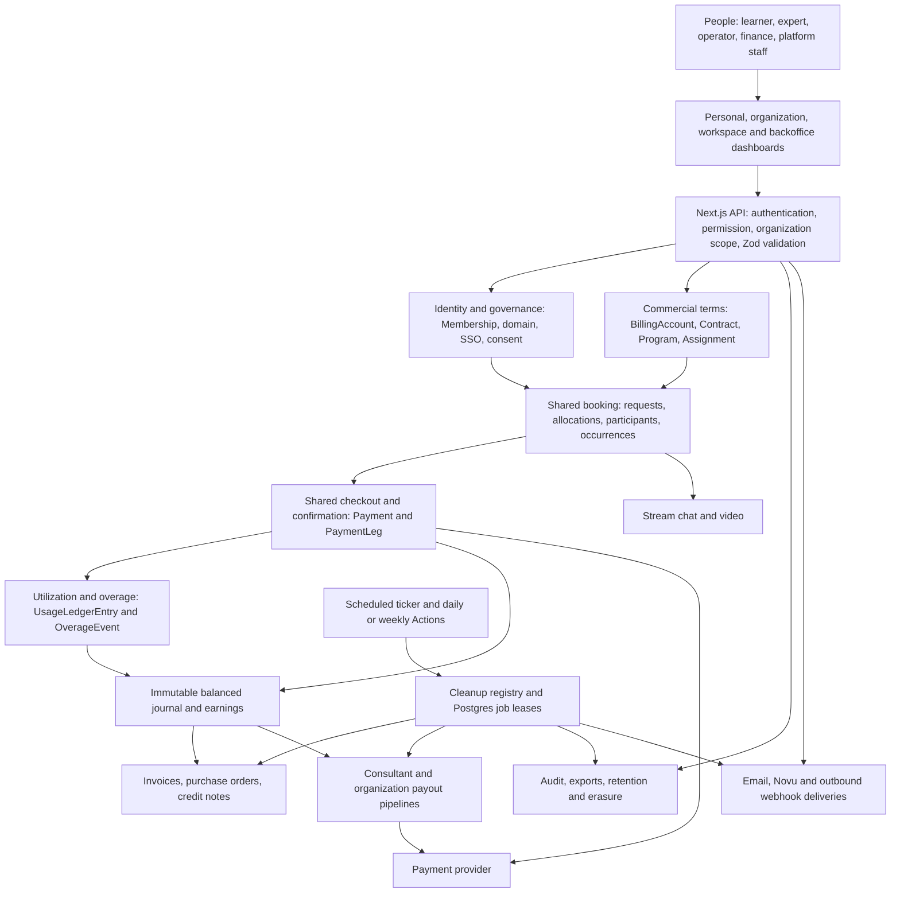

The boxes are responsibilities in one application, not a claim that Familiarise runs a fleet of microservices. PostgreSQL supplies transactions and durable state. Redis supplies specific edge and interactive coordination functions. External systems supply payment transport, communications, and object storage. [Operations and integrations](#8-operations-and-integrations) explains their failure boundaries.

### 1.3. The system has four planes

#### 1.3.1. Identity and control

`Organization` identifies the tenant. `Membership` relates a global `User` to that tenant with a role and a status. `OrgDomainClaim`, `OrganizationSSOSettings`, and `SsoProvider` establish organizational authentication policy. `Contract` and `Program` establish what the tenant has purchased and what members may use.

The control plane answers whether a request is allowed before it changes operational state. Organization activation is a set of signals and actions, rather than one Boolean that proves every commercial and security prerequisite has been satisfied. `lib/enterprise/org-activation.ts`, `lib/enterprise/org-activation-signals.ts`, and `lib/enterprise/governance.ts` implement those distinctions.

#### 1.3.2. Booking and delivery

The shared booking plane models the request, the people participating in it, its scheduled occurrences, and its eventual outcome. Enterprise adds organization attribution and program utilization. It also adds payer and operator workflows, so the person buying a service need not be the person receiving it.

This plane must continue to enforce availability, attendee capacity, and ownership. Enterprise entitlement is an additional check. A valid program allowance cannot make an occupied expert available, and an available expert does not imply that the buyer has a funded entitlement.

#### 1.3.3. Money and obligations

`Payment` records the economic intent and outcome. `PaymentLeg` records its funding composition. `BookingUtilization` and `UsageLedgerEntry` record entitlement consumption. `OverageEvent` records a chargeable excess. The journal records financial consequences, and earnings rows record who may eventually be paid.

These are separate models because they answer separate questions. A learner may consume one engagement without causing an immediate card charge. A payment can succeed while its earnings are still held. An invoice may exist before cash arrives. A refund can return money while also restoring part of an allowance.

#### 1.3.4. Evidence and recovery

`OrgAuditLog` records organization-visible actions. `SystemEvent` records platform operational evidence. `SystemJobExecution` records scheduled execution and coordinates leases. Export jobs, erasure requests, notification outboxes, and webhook delivery rows make selected asynchronous work durable.

Durability is component-specific. A database row makes intent survive a process restart; a registered worker and scheduler make that intent progress. The operational design must identify all three: producer, durable state, and consumer. A model name alone proves only that a place to store state exists.

### 1.4. The data model in connected groups

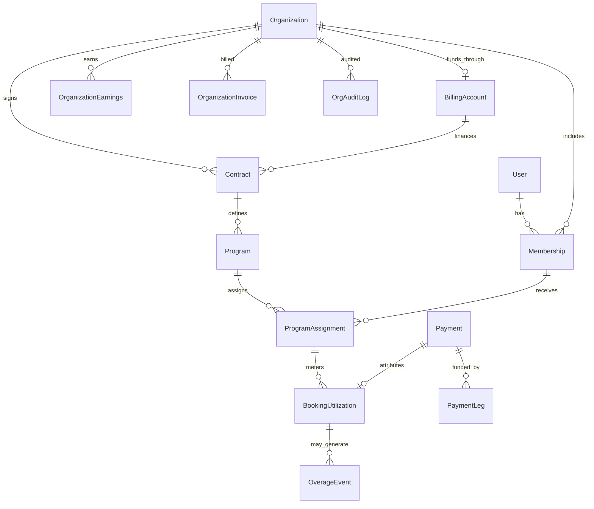

The diagram omits optional satellites and operational relations for readability. It does not replace the exact relation definitions in `prisma/schema.prisma`.

| Model group                                                         | What the data means                                                           | Why it has its own boundary                                                                  |
| ------------------------------------------------------------------- | ----------------------------------------------------------------------------- | -------------------------------------------------------------------------------------------- |
| `User`, personal profiles, `Membership`                             | A person and their independent relationships with organizations.              | Removing an employee from one organization must not erase their unrelated personal activity. |
| `Organization`, tax, MSME, KYB and branding satellites              | Tenant identity, capabilities, procurement identity, and public presentation. | Branding edits and sensitive tax records have different access and lifecycle needs.          |
| `OrgWorkspaceProfile`                                               | The user's organization-workspace preferences.                                | A workspace spanning memberships is not itself a company or a company billing account.       |
| `BillingAccount`, `WalletTopUp`                                     | The organization's funding rail and prepaid funding lifecycle.                | Funding policy is independent of whether a program meters rupees or engagement counts.       |
| `Contract`, `BillingSubscription`                                   | Negotiated terms and recurring commercial billing.                            | Contract renewal and a learner's booking subscription are different lifecycles.              |
| `Program`, its configuration, `ProgramAssignment`                   | What a member may consume during an assigned period.                          | A new cycle can have a successor assignment while retaining prior-cycle evidence.            |
| `BookingUtilization`, `UsageLedgerEntry`, `OverageEvent`            | Consumption, incremental usage, and excess-charge evidence.                   | A booking, a batch of allocated sessions, and a financial charge need different identities.  |
| `Appointment`, participants and occurrences                         | Who attends or delivers, when, and with what outcome.                         | Buying a service, attending it, and allocating its time are independent operations.          |
| `Payment`, `PaymentLeg`, `Refund`, `Dispute`                        | Intent, funding sources, returned money, and contested money.                 | Settlement retries and reversals must preserve the original economic facts.                  |
| Journal, earnings, payouts and TDS                                  | Accounting, payable eligibility, bank transfer, and withholding evidence.     | A balanced journal does not by itself prove that a vendor actually moved money.              |
| Organization invoices, line items, purchase orders and credit notes | Procurement and tax documents and their application to usage.                 | Consuming a budget and issuing an invoice are not the same event.                            |
| Audit, system events, exports, erasure and delivery outboxes        | Traceability, data rights and asynchronous effects.                           | Organization-visible evidence needs a narrower privacy surface than platform diagnostics.    |

### 1.5. Capability, taxonomy, funding, and role are independent

`canSponsor` permits the buying side. `canHost` permits the supply side. Both true is a hybrid. `Organization.kind` is an optional market taxonomy such as `AGENCY`, `ENTERPRISE`, or `SOLO_PRACTICE`; it is not the source of billing capability. `OrgBrandingProfile.directoryType` is a separate public-directory taxonomy.

`FundingSource` selects `PERSONAL`, `WALLET`, `INVOICE`, or `LICENSE`. `ProgramType` selects `LICENSED_SEAT` or `CREDIT_POOL`. `Membership.role` determines the actor's authority within this particular organization. None can safely substitute for another.

For example, an enterprise can host experts and pay for its own learners. A billing administrator may operate finance pages without permission to modify SSO or remove people. A learner can have a valid program assignment while the host expert is paid through a different organization.

`lib/enterprise/reachable-paths.ts` enumerates the supported capability/funding/program shapes and supplies UI guidance. It is not a complete proof that every surcharge, allocation, reversal, and postpaid branch is wired identically. [Commercial axes and programs](#3-commercial-axes-and-programs) separates the three-axis reachability table, five-axis settlement view, and seven-axis commercial explanation.

### 1.6. Three organizational identifiers that must never collapse

| Context                       | Meaning                                                        | Consequence                                                                                                               |
| ----------------------------- | -------------------------------------------------------------- | ------------------------------------------------------------------------------------------------------------------------- |
| Actor membership organization | The organization authorizing a person to perform this request. | Routes must verify the actor and permission in that organization.                                                         |
| `Payment.organizationId`      | Buyer or sponsor attribution.                                  | Buyer reporting and procurement follow this organization; a tag alone does not prove the organization funded the payment. |
| `Payment.hostOrganizationId`  | Supply-side organization associated with delivery.             | Host earnings and commercial splits follow the delivery context.                                                          |

A fourth boundary is personal scope. A personal record must not become visible to an organization merely because its owner has a membership there. Dashboard filters and organization API predicates must preserve the attribution stored with the activity. [Dashboards and user journeys](#6-dashboards-and-user-journeys) explains payer, attendee, deliverer, and operator views.

### 1.7. A concrete cross-organization request

Assume a Wipro learner books a consultation delivered by a LearnPro expert for Monday, 26 October 2026, 10:00–11:00 IST. For illustration, the service price is ₹1,000, or 100,000 paise, and applicable example GST is ₹180, or 18,000 paise. The displayed gross is ₹1,180, or 118,000 paise. These assumptions illustrate architecture; the actual checkout derives its own tax and attribution.

1. Authentication identifies the user. The organization route checks the active Wipro membership and the requested permission.
2. The commercial check resolves the chosen assignment, its contract, program scope, period, caps, and funding source.
3. The booking engine checks the proposed time, the expert and participant constraints, and the requested service.
4. The checkout transaction records the payment and the applicable organizational utilization. Sponsored funding writes the appropriate funding leg; over-cap sponsored bookings enter the overage settlement branch.
5. The confirmation pipeline establishes payment success and creates the financial consequences through the common money path. An organization dashboard cannot independently mark money captured.
6. Buyer context remains Wipro. Host context remains LearnPro. The split is derived from the resolved rate-card and payout-recipient context, rather than from the buyer organization.
7. Delivery outcome and the applicable holds determine earnings eligibility. Invoice collection, refunds, disputes, and member co-pay can impose additional obligations.
8. Notifications and external delivery use their own post-commit or durable recovery paths. Their success does not replace payment or booking truth.

This sequence intentionally does not supply an assumed universal journal posting. WALLET, INVOICE, LICENSE and personal funding produce different accounting. [Ledger, billing and settlement](#5-ledger-billing-and-settlement) gives the numeric postings and identifies their enforcers.

### 1.8. Where a transaction begins and ends

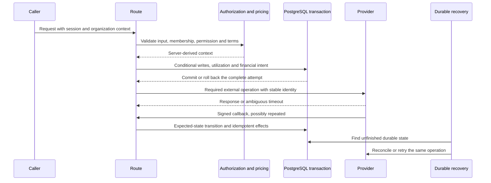

This is a boundary diagram, not the exact order of every provider operation. Some checkout paths mint an external order before a later database phase. The invariant is that a remote service cannot participate atomically in the PostgreSQL commit. Each component therefore needs an explicit reconciliation or retry strategy around the gap.

Inside `prisma.$transaction(async (tx) => ...)`, helpers must query through `tx`. `lib/prisma.ts` configures the pool; a global Prisma read from a helper invoked inside a transaction can wait for the only connection the transaction already owns on a single-connection runtime. Passing the transaction client preserves both the connection budget and the consistent snapshot.

Serializable retries can execute a transaction callback again. A callback must not send a new email, create a fresh payout, or otherwise repeat an external effect on each attempt. Checkout's utilization code returns notification intent for post-commit delivery in `lib/payments/checkout/commit/org-utilization.ts`.

### 1.9. Invariants and their actual enforcers

| Rule in plain English                                                    | Enforcer in the reviewed source                                                                                                                                                                                                    | Boundary of the guarantee                                                                           |
| ------------------------------------------------------------------------ | ---------------------------------------------------------------------------------------------------------------------------------------------------------------------------------------------------------------------------------- | --------------------------------------------------------------------------------------------------- |
| One person has one membership row per organization.                      | Prisma composite uniqueness on `Membership.userId` and `organizationId`.                                                                                                                                                           | The same person can belong to multiple organizations.                                               |
| Money values persist as integer paise.                                   | `BigInt` money fields plus the Prisma money extension in `lib/prisma-extensions.ts`.                                                                                                                                               | Display currency is not an FX settlement engine.                                                    |
| A journal transaction must balance.                                      | `postLedgerTxn()` and the deferred `ledger_txn_balanced` trigger in `prisma/sql/ledger-triggers.sql`.                                                                                                                              | This proves journal arithmetic, not bank settlement or correct tax classification.                  |
| Journal entries and journal transactions cannot be edited or deleted.    | `ledger_entry_immutable` and `ledger_transaction_immutable` in the same sidecar.                                                                                                                                                   | Corrections require compensating transactions.                                                      |
| Funding legs obey their defined sum and reversal rules.                  | `payment_legs_sum_to_amount`, `payment_amount_vs_legs`, and `assert_payment_legs_ok()` in `prisma/sql/payment-legs-triggers.sql`.                                                                                                  | Referral-credit and pure zero-value LICENSE shapes have explicit semantics; do not use a naive sum. |
| A wallet debit cannot overdraw the cached balance.                       | `walletDebit()` uses conditional `updateMany`; `billing_account_wallet_nonnegative` backs it in `prisma/sql/check-constraints.sql`.                                                                                                | A nullable, unseeded cache must first be initialized; the journal remains financial evidence.       |
| Two eligible confirmed host occurrences cannot overlap.                  | `occurrence_no_confirmed_overlap` in `prisma/sql/check-constraints.sql`.                                                                                                                                                           | It does not cover every co-host, attendee, tentative, client-side or rescheduled occupancy rule.    |
| Money terms in use cannot be silently rewritten.                         | Program lock stamping and contract/program lock checks in `lib/enterprise/config-lock.ts`.                                                                                                                                         | A permitted new commercial version needs a deliberate supersession or replacement flow.             |
| Duplicate scheduled runs coordinate through PostgreSQL.                  | `withCronLock()` and `SystemJobExecution_running_jobName_key`.                                                                                                                                                                     | A lease does not authorize two active scheduler fleets or make external operations exactly once.    |
| Provider-captured payments use the shared capture-confirmation pipeline. | `lib/payments/webhooks/handlers.ts` owns external capture confirmation; internal synchronous rails create their successful intent through `lib/payments/checkout/commit/payment-row.ts` and commit their financial effects inline. | UI events and gateway redirect screens are not confirmation authority.                              |

The SQL guarantees above describe installed-sidecar behavior. The earnings-hold checks and indexes (`earnings_hold_one_earning`, `earnings_hold_active_consultant_key`, `earnings_hold_active_org_key`), the `consultant_earnings_batched_has_payout` and `org_earnings_batched_has_payout` checks, and the `payment_refunds_within_amount` trigger are defined in `prisma/sql/*.sql`. The owner's record of 2026-10-20 says they were applied to the shared database; this review did not verify that (confirm with `npx prisma migrate diff --from-config-datasource --to-schema prisma/schema.prisma --script`). Adding an application sweep to re-prove a commit-time invariant is not the recommended response to that distinction. Deployment verification should establish that the existing sidecars are installed.

### 1.10. State is distributed across several lifecycles

The organization can be ACTIVE while its contract is DRAFT. A contract can be active while a particular assignment has exhausted its allowance. A payment can be successful while its member overage is outstanding. A payout can be in progress while a later refund creates a clawback obligation.

No single “enterprise status” can faithfully summarize all of these. The dashboard should translate each durable state into the action its current actor can take, while preserving the separate underlying models. `lib/enterprise/transitions.ts` centralizes several expected-state transitions; payment and booking transitions have their own domain helpers.

| Lifecycle                                   | Question it answers                                           | Further explanation                                                                            |
| ------------------------------------------- | ------------------------------------------------------------- | ---------------------------------------------------------------------------------------------- |
| Organization and membership                 | May this organization and this person act here?               | [Identity and governance](#2-identity-governance-and-lifecycle).                               |
| Contract, program and assignment            | Which commercial version and allowance apply now?             | [Commercial design](#3-commercial-axes-and-programs).                                          |
| Booking request, participant and occurrence | What was purchased, who participates, and what was delivered? | [Booking HLD](./01-booking-system-hld.md) and [dashboards](#6-dashboards-and-user-journeys).   |
| Payment, overage, invoice and refund        | Who owes what, and what is settled?                           | [Checkout](#4-checkout-and-overage) and [settlement](#5-ledger-billing-and-settlement).        |
| Earnings and payout                         | What may be paid, and what has reached the bank?              | [Settlement](#5-ledger-billing-and-settlement).                                                |
| Export, erasure and delivery                | Which data or external effects remain unfinished?             | [Compliance](#7-compliance-privacy-and-data) and [operations](#8-operations-and-integrations). |

### 1.11. How failure changes the design

A useful failure analysis names the durable row and the operation that can resume it. “Retry later” is insufficient when an HTTP timeout might have occurred after the provider accepted money.

- A stale organization settings edit uses `Organization.version` as an optimistic lock. A losing editor must refresh instead of overwriting a newer value.
- A concurrent wallet spend competes on a conditional balance update. Only an attempt with sufficient remaining balance succeeds.
- A repeated booking allocation must not consume the same appointment identity twice. Utilization records and usage entries carry the idempotency context.
- A callback can repeat or arrive late. Expected-state writes and operation identities prevent duplicate financial effects.
- A member can leave with future commitments or unsettled obligations. Removal is an orchestration problem, not a hard delete of every related row.
- An external erasure can fail after local scrubbing. Durable vendor retry rows keep that failure observable and retryable.
- An invoice or payout worker can lose its process. Durable state and its registered scheduler must carry the remaining work.

The exact recovery procedures remain in domain runbooks. This document explains why each exists and where its state belongs; it does not introduce a new operations framework.

### 1.12. Availability and deployment are separate questions

Host capabilities have a real gate in `lib/enterprise/feature-flag.ts`: `ENABLE_HOST_ORGS` must evaluate to true. A schema containing host earnings and a dashboard containing payout components do not prove that self-service hosting is enabled in a deployment.

Similarly, residency and currency enums express stored intent. They do not by themselves establish regional isolation or a multi-currency ledger. The reviewed money layer settles in INR. An export worker with a storage upload path does not prove that a signed link is currently valid. An integration with configured credentials still depends on its vendor account and network.

Recommended documentation practice is to distinguish **implemented**, **gated**, **partially integrated**, and **proposed** whenever those categories matter. A misleading green “supported” label can cause a procurement promise that the deployed system cannot satisfy.

### 1.13. Recommended system boundary

Keep the enterprise control plane close to the shared booking and money code. Today, membership checks, entitlement metering, funding legs, and journal effects benefit from one database transaction. Splitting them into independent services would require explicit distributed reservation and compensation protocols without resolving a demonstrated current product need.

Separate components by their responsibilities and typed inputs, then scale execution independently only where evidence supports it. Outbound deliveries and export generation are natural asynchronous boundaries. Organization authorization and wallet debits are poor candidates for eventually consistent remote checks on the checkout path.

The cost is a large application with several domains in one codebase. Manage that cost through ownership, clear helpers, traceable state, and focused tests. [Design decisions and recommendations](#9-design-decisions-and-recommendations) gives the alternatives, reasons, and conditions that would justify revisiting them.

## 2. Identity, governance and lifecycle

This document explains how a person becomes an organization operator, learner or expert; how the application scopes authority to one
organization; and how org, member, contract, program and assignment state changes affect later actions. It reflects the code currently in this
checkout. It is an orientation and system design map; the route handlers, typed permission map, Prisma schema and focused domain references
remain the executable specification.

The key distinction is that an organization does not create a second platform identity for each employee. The person keeps one global `User` and
whichever personal profiles they have. An org relationship is a separate `Membership` row with one role and status for that org. An
`OrgWorkspaceProfile` is a third, user-scoped record for someone operating an org portfolio. Those three layers have different lifecycles and
different guards.

For the cross-org and per-org dashboard journeys, see [06 — Dashboards and user journeys](#6-dashboards-and-user-journeys). The existing
enterprise band gives the deeper implementation references for
[organization lifecycle](../enterprise/00-foundations/05-organization-lifecycle.md),
[roles and permissions](../enterprise/00-foundations/04-roles-and-permissions.md),
[SSO](../enterprise/20-iam-and-security/01-sso-and-authentication.md),
[JIT and session refresh](../enterprise/20-iam-and-security/02-jit-and-session-refresh.md),
[contracts](../enterprise/30-programs-and-lifecycle/07-contract-lifecycle.md),
[programs](../enterprise/30-programs-and-lifecycle/02-programs.md), and
[cycle rollover](../enterprise/30-programs-and-lifecycle/08-cycle-engine-and-rollover.md). Other parts of the design are
[commercial axes and programs](#3-commercial-axes-and-programs), [checkout and overage](#4-checkout-and-overage),
[ledger, billing and settlement](#5-ledger-billing-and-settlement), [compliance, privacy and data](#7-compliance-privacy-and-data),
[operations and integrations](#8-operations-and-integrations), and
[design decisions and recommendations](#9-design-decisions-and-recommendations).

### 2.1. The identity model

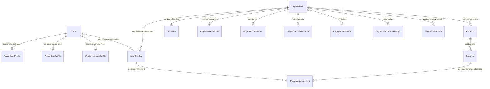

The models and exact relations in this diagram are defined in [`prisma/schema.prisma`](../../prisma/schema.prisma). Identity, membership, commercial, SSO/domain and profile satellites are separate model groups; follow their named relations rather than assuming that a dashboard facet owns a second user identity.

#### 2.1.1. Four labels that must remain separate

| Name                           | Meaning                                                                                                                                                        | Stored on                                                |
| ------------------------------ | -------------------------------------------------------------------------------------------------------------------------------------------------------------- | -------------------------------------------------------- |
| `UserRole`                     | Platform account/dashboard facet such as `CONSULTANT`, `CONSULTEE`, `ORG_WORKSPACE`, `STAFF`, or `ADMIN`.                                                      | `User.role`                                              |
| `MemberRole`                   | Authority and function inside one organization: `OWNER`, `MAINTAINER`, `BILLING_ADMIN`, `MANAGER`, `EXPERT`, `LEARNER`, or `SUPPORT`.                          | `Membership.role`                                        |
| `canSponsor` / `canHost`       | Commercial capabilities of the organization. Sponsoring funds members' sessions; hosting owns expert supply and org earnings.                                  | `Organization`                                           |
| `OrgKind` / `OrgDirectoryType` | Market taxonomy. `OrgKind` is host classification; `OrgDirectoryType` is visitor-facing directory classification. Neither grants authority or enables funding. | `Organization.kind` / `OrgBrandingProfile.directoryType` |

A person's platform role does not determine their org role. One account may have both personal profiles, be an EXPERT in one organization, a
LEARNER in another, and an OWNER in a third. `UserRole` helps choose a personal landing and backoffice reach; `Membership` plus permission keys
determines org access.

The `Membership` unique key `(userId, organizationId)` allows one role in one organization. The same user can still have a different role in
another. Because LEARNER and EXPERT are disjoint within one membership, changing between them requires removal and a fresh invitation. That keeps
`consulteeProfileId` and `consultantProfileId` consistent with the role and avoids self-dealing against an org's funded program.

`OrgWorkspaceProfile` is not a membership or a row per org. It is one optional profile per user (`userId @unique`) holding default landing
organization, locale and currency display (notification channels are the operator's personal switches). Its ID keys the cross-org portfolio route. `OrgBrandingProfile` is an optional
one-to-one child of an organization; it contains logos, banner, brand colors, description, website, industry, size bucket and directory type.
Operator preferences must not be written into organization branding and vice versa.

The data model no longer has the BetterAuth Organization plugin's `Member` record. The app's own typed `Membership` is the organization
relationship. It also no longer has an organization-parent/root hierarchy. `Organization` has capability booleans and optional tax/context
fields, but no parent organization foreign key. The `kind` field (`AGENCY`, `ENTERPRISE`, `SOLO_PRACTICE`) does not restore a hierarchy.

### 2.2. Organization capability and lifecycle

#### 2.2.1. Capability combinations

| `canSponsor` | `canHost` | Meaning in current flows                                                                  |
| -----------: | --------: | ----------------------------------------------------------------------------------------- |
|         true |     false | Sponsor organization. Can create a BillingAccount and run contracts/programs for members. |
|        false |      true | Host organization. Can host experts and receive the org share of earnings.                |
|         true |      true | Hybrid buyer and host. Funding and hosting remain separately scoped.                      |
|        false |     false | Inert shape. Organization create and capability PATCH reject this combination.            |

Creation defaults to sponsor-only, but it is not an immutable org type. Capability changes run through the org PATCH path and carry a version
check. Turning off sponsorship checks live billing state and wallet balance; turning off hosting checks open hosting obligations. The host path
is also subject to `ENABLE_HOST_ORGS`: the app refuses a new or newly enabled host capability until the host settlement path is live. This
deployment gate is different from the stored capability and from directory visibility.

When `canSponsor=true`, creation makes one BillingAccount with the selected `FundingSource` (`PERSONAL`, `WALLET`, `INVOICE`, `LICENSE`) and
connects it to the Organization. Sponsor-only and hybrid orgs therefore have a buyer account; host-only orgs need no sponsor BillingAccount. Host
money setup (payout account, rate card and org earnings) belongs to the payout subsystem.

#### 2.2.2. Creation is an atomic onboarding boundary

`POST /api/organizations` performs the initial setup in one Prisma transaction. The creation path validates the requested capabilities and
funding selection, validates domestic invoice tax requirements, creates the Organization in `PENDING_VERIFICATION`, creates tax and optional
branding satellites, creates a BillingAccount only when sponsoring, creates the creator's ACTIVE OWNER Membership, upserts the user's
OrgWorkspaceProfile, and writes the initial org audit record. The creator cannot end up with an org row but no owner membership if part of
provisioning fails.

The implementation is in `app/api/organizations/route.ts`. Email and in-app notifications are staged with the transaction and attempted after
commit. The org has an ID and an owner immediately; platform verification is a separate transition. Thus “pending verification” does not mean “no
dashboard” or “no membership.”

#### 2.2.3. Org status machine

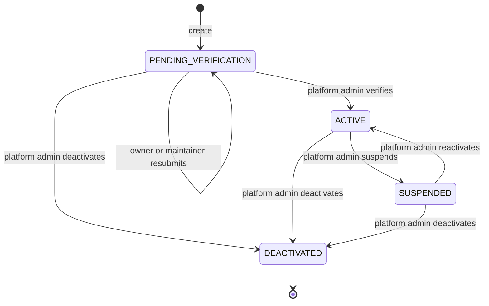

The state transition helper is `transitionOrganization` in `lib/enterprise/transitions.ts`; it uses conditional `updateMany` with an allowed-from
set so concurrent or terminal transitions fail with a conflict. Admin actions enter through
`app/api/admin/organizations/[orgId]/verify/route.ts`. `REJECT` is not a fifth status: it stores a reason and rejected timestamp while status
stays `PENDING_VERIFICATION`. The OWNER or MAINTAINER fixes eligible setup fields and calls the resubmit endpoint; it clears rejection fields and
refreshes submission time. A platform ADMIN's `VERIFY` clears the rejection substate and sets ACTIVE.

Suspension is recoverable; deactivation is terminal to customer flows. A suspended organization can still render a restricted/read-only dashboard
so an owner can see the state and contact support. New invitations and payments are paused. Already booked sessions are not automatically
canceled solely because a member or org became suspended; org operators must deliberately cancel/refund sessions that should stop. An org with
settled financial history is deactivated and soft-deleted rather than physically erased. Personal contact fields are scrubbed while legal and
financial records remain. A money-untouched shell can be hard-deleted after live obligations are cleared.

#### 2.2.4. What is available before verification

Pending verification is a governed onboarding phase, not a universal write lock. The current behavior is split by the purpose of a write:

| Action                                           | Pending organization behavior                                        |
| ------------------------------------------------ | -------------------------------------------------------------------- |
| Create owner and dashboard                       | Allowed at organization creation.                                    |
| Fix branding and tax/KYB information             | Allowed through permitted settings fields.                           |
| Claim and DNS-verify domains                     | Allowed; identity setup can progress before verification.            |
| Invite people                                    | Allowed up to the unverified seat cap.                               |
| SSO JIT membership                               | Allowed up to the same active-seat cap.                              |
| Change core capabilities/public/commercial terms | Restricted until the required activation state; route-specific.      |
| Start invoice-funded sponsored activity          | Subject to starter limits and other billing gates; see billing docs. |

This boundary is enforced by each route's `requireOrgAccess` options and explicit status checks. Do not infer from one route that all pending-org
writes are allowed. `app/api/organizations/[orgId]/invitations/route.ts` explicitly permits pending-org invites under the cap because the
creation wizard sends invitations immediately. `lib/sso/jit-membership.ts` counts active members in the Serializable transaction before adding a
JIT member. `lib/enterprise/org-status.ts` centralizes addressable, billable and onboarding-blocked status sets.

### 2.3. Invitation, acceptance and membership lifecycle

An `Invitation` is a time-limited offer with org, email, role, inviter and `PENDING`/`ACCEPTED`/`CANCELED`/`EXPIRED` status. It is not an active
seat by itself. The recipient accepts through `POST /api/organizations/invitations/accept`; that action creates a `Membership` and records
acceptance. Duplicate pending invitations for a normalized org and email are blocked in application code and by the partial unique index in
`prisma/sql/check-constraints.sql`.

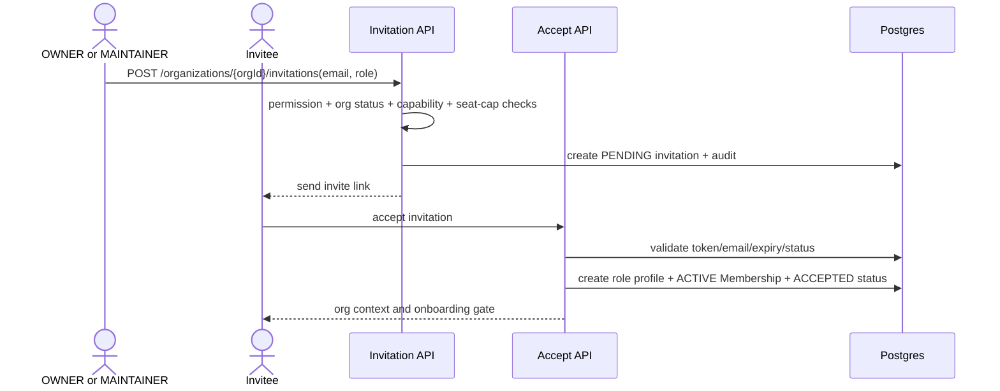

The dashboard's Add People and bulk import tools create invitations; the recipient must accept. The old `POST /api/organizations/[orgId]/members`
direct creation endpoint returns HTTP 405 `USE_INVITATIONS`. It must not be described as a current onboarding option. SSO JIT is the other
creation channel because the approved organization IdP is an explicit identity-provisioning authority.

A new LEARNER acceptance may ensure the user's lightweight ConsulteeProfile in the acceptance transaction. An EXPERT invitation requires the
user's existing ConsultantProfile: org invitation cannot create the person's global expert identity or complete its verification. SSO JIT has a
separate `provisionUser` path and may provision that profile with a placeholder domain while platform verification remains pending. The org
membership can be active while the ConsultantProfile is not yet public-marketplace verified.

`lib/api/organizations/membership-transitions.ts` centralizes role-side profile references and payout defaults. LEARNER links the
ConsulteeProfile and clears consultant reference; EXPERT links ConsultantProfile and clears learner reference; operator roles carry neither.
Payout recipient defaults to SELF. The Membership's `payoutRecipient` is per organization: a consultant can receive personal payout in one
organization and route earnings to the host org in another. Changing it affects future booking splits; prior booking rows retain their snapshots.

#### 2.3.1. Roles and role changes

`lib/enterprise/membership-guards.ts` is the shared guard for dashboard role PATCH/removal and bulk paths. It protects the last active OWNER,
prevents unauthorized governance-role grants, checks capability compatibility, blocks self changes where required, protects tombstones, and
checks participant history before changing a LEARNER/EXPERT role. If a learner/expert has org bookings, assignments, deliveries or earnings,
conversion is refused with `REMOVE_AND_REINVITE`; remove the old membership and invite the user with the new role.

Granting `OWNER`, `MAINTAINER`, or `BILLING_ADMIN` is OWNER-only. MAINTAINER can grant/remove operational roles (`MANAGER`, `SUPPORT`, `EXPERT`,
`LEARNER`) subject to the target and capability rules. `BILLING_ADMIN` has finance reach but cannot manage the member roster, invite people, edit
SSO, or change org status. It is intentionally “operator blind”: a numeric role rank does not express its distinct finance remit.

Removing a member first queries obligations. Active program assignments and upcoming sessions or unsettled money can block ordinary removal. An
OWNER may use the force path after the UI asks them to confirm the member email; live assignments are closed/canceled and the audit row records
the forced action and what obligations it overrode. Removal changes status to `REMOVED`; it preserves the row and the user's personal profile.
SUSPENDED members keep already booked sessions and can see their own allowed past/upcoming org context, but cannot start normal new work.
`ERASED` is a privacy tombstone state; erasure scrubs identifiers while maintaining the financial/audit trail.

The membership guard, role transition helper, invitation acceptance route, and membership PATCH route are the enforcement points. The UX copy and
role matrix are projections of those decisions; changing only a page control does not change backend authority.

### 2.4. Permission and tenant boundary

`lib/auth/org-permissions.ts` exports the canonical `ORG_PERMISSIONS` map keyed by `OrgSurface`. The helper functions `hasOrgPermission`,
`hasAnyOrgPermission`, and `rolesWithOrgPermission` are used by the sidebar, page-level access and APIs. A new permission belongs in this map and
its consumers. Avoid adding a second role matrix in a separate service.

Authorization combines two independent checks:

1. **Membership permission:** Does this MemberRole have the named action key?
2. **Organization shape/scope:** Is this capability, status and organization ID valid for the requested operation?

For example, OWNER may hold `catalog.manage`, yet a sponsor-only org has no host catalog to manage. `canSponsor`, `canHost`, `requiresPO`, and
funding source are not permission keys: they describe structure, so a consumer combines them with role permission.

A few examples show why each surface must use the named key rather than a rank:

| Action                         | Roles that can act (current matrix)       | Additional structural gate                                         |
| ------------------------------ | ----------------------------------------- | ------------------------------------------------------------------ |
| Manage roster and invitations  | OWNER, MAINTAINER                         | Invitation role must fit capability; pending seat cap applies.     |
| Read full member roster        | OWNER, MAINTAINER, MANAGER, SUPPORT       | Finance roles get names-only directory or finance-specific fields. |
| Manage contract terms          | OWNER                                     | Sponsor capability and valid BillingAccount.                       |
| Assign program seats           | OWNER, MAINTAINER, MANAGER                | `canSponsor`, active program/contract, active membership.          |
| Manage program money terms     | OWNER, MAINTAINER                         | Sponsor capability; terms lock after first assignment.             |
| Read billing                   | OWNER, MAINTAINER, BILLING_ADMIN, MANAGER | Sponsor capability.                                                |
| Write billing                  | OWNER, BILLING_ADMIN                      | Sponsor capability and route-level funding checks.                 |
| Read payouts                   | OWNER, MAINTAINER, BILLING_ADMIN          | Host capability.                                                   |
| Change SSO/domain settings     | OWNER                                     | Verified DNS/provider requirements for enforcement.                |
| Read organization operations   | OWNER, MAINTAINER, MANAGER, SUPPORT       | Membership and readable org status; content still redacted.        |
| Read own program / arrangement | LEARNER / EXPERT respectively             | Sponsor / host capability and linked profile.                      |

These are examples, not a replacement matrix. Check the current `ORG_PERMISSIONS` constants for the exact role set; it is the single source of
truth. `app/dashboard/organization/[orgId]/layout.tsx` seeds authorized org details before the shell renders. API routes use `requireOrgAccess`
in `lib/auth-helpers.ts`; it resolves the org, checks structural/status gates, loads membership, and evaluates explicit permission. A platform
ADMIN receives a synthetic read-only OWNER-shaped membership for selected reads only; write operations return `ADMIN_READ_ONLY`. Platform
lifecycle writes use admin doors.

Tenant scoping is not only “has a role.” Multi-tenant list endpoints call `resolveOrgScope` in `lib/api/scope/parse.ts`. The caller may request
personal, one organization, or staff-only all-platform scope. A user without `operations.read` requesting an org scope is narrowed to their own
rows within that org instead of receiving the full org feed. A nonmember cannot query the org feed. A role grant to view a roster also does not
grant access to private member session content: ADR 20 limits org-visible session data to metadata and purpose-specific aggregates; messages,
uploads and recordings remain gated by their own rules.

Mutating Membership, Organization, Contract, Program and assignment statuses uses guarded transitions or conditional `updateMany` in the row's
WHERE clause. The route may perform a friendly pre-check, but the update predicate is the race-safe state transition. Most role and lifecycle
changes also write `OrgAuditLog` in the same transaction.

### 2.5. Verified domains, SSO and JIT

#### 2.5.1. Establishing an SSO tenant

The current path has five gates. Each is a separate trust assertion; registering an issuer alone does not make it a trusted identity source.

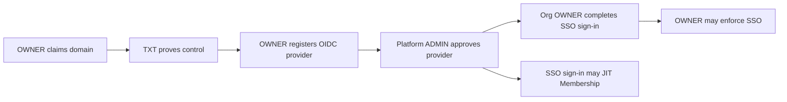

1. OWNER creates `OrgDomainClaim` through `POST /api/organizations/[orgId]/domain-claims`. The server returns a token and record name
   `_familiarise-verify.<domain>`.
2. OWNER adds a DNS TXT record and calls `POST /api/organizations/[orgId]/domain-claims/[domain]/verify`. The route resolves TXT, compares the
   stored token, stamps `verifiedAt`, writes audit, and removes competing unverified claims. A partial unique index permits staged unverified
   claims but prevents two verified owners of one domain.
3. OWNER registers an OIDC provider against verified domains under `/api/organizations/[orgId]/sso/providers`. The provider config is encrypted;
   PKCE and fixed `openid email profile` scopes are used. Provider starts with `domainVerified=false`.
4. Platform ADMIN approves or revokes the provider through `/api/admin/organizations/[orgId]/sso-providers/[providerId]/approval`. Approval
   rechecks every covered domain's verified claim. This admin door is the only writer of the approval bit.
5. OWNER completes a successful login through the approved provider to stamp `provenAt`. Only an approved, owner-proven provider covering a
   verified domain permits `enforceSSO=true`. Enabling enforcement revokes sessions on affected domains while keeping the acting owner session.

The runtime uses OIDC. Prisma keeps a nullable `samlConfig` field for schema compatibility/future evaluation, but it is not a supported login
flow today. There is no SCIM deprovisioning integration. The role for uninvited JIT joins is fixed at LEARNER; raising access requires an invite
role or a later permitted promotion.

#### 2.5.2. JIT join and session consequences

`lib/sso/jit-membership.ts` runs from BetterAuth's `provisionUser` hook on each successful SSO callback before the session cookie is issued. It
checks the provider's organization, org status, membership state, capability and any pending invitation. An existing ACTIVE membership returns as
already joined; SUSPENDED or REMOVED membership is not silently revived. A pending unexpired invitation for the normalized email supplies the
role and is marked accepted; otherwise JIT uses LEARNER.

The insert is Serializable. If the org is still pending verification, it counts active seats in the same transaction and refuses beyond
`UNVERIFIED_ORG_SEAT_CAP`. Role profile effects and membership/audit writes share that transaction. A uniqueness race is treated as another
request having joined; other provisioning failures reject the callback so the user is not left with a successful SSO login that promised org
access but failed to create it.

`OrganizationSSOSettings.defaultRoleForAutoJoin` exists in the schema as a MemberRole but the Zod boundary narrows writes to LEARNER. The field
remains useful for expressing tenant policy while preserving the least-privilege floor.

Enforced-domain sessions have a 24-hour absolute lifetime. Manual member suspension/removal for a verified-domain org revokes the user's
sessions; an IdP-side account removal without SCIM may take up to that lifetime to stop working. The session refresh path loads fresh Membership
data on every request, so role changes do not rely on stale cookie-cached permission claims. Session lookup failures are treated as
service-unavailable errors, not as a signed-out user.

### 2.6. Contracts, programs and cycle state

The commercial tree is `Organization → Contract → Program → ProgramAssignment → BookingUtilization`. Membership joins the assignment; program
configuration lives in a 1:1 LicensedSeatConfig or CreditPoolConfig. Billing and booking semantics are documented in the dedicated enterprise
money/program references.

#### 2.6.1. Contract state and renewal

A contract starts DRAFT, becomes ACTIVE when signed/activated, and ends EXPIRED or TERMINATED. `effectiveTo=null` is open-ended. The state
transition helper is `transitionContract` in `lib/enterprise/transitions.ts`. Term fields lock after activation/signature, any issued invoice, or
live assignment use. `autoRenew` is intentionally a forward-looking switch and can change independently.

Changing committed terms creates a successor. The old row points to the new contract with `supersededByContractId`, `supersededAt`, and
`supersessionReason`. AMENDMENT ends the old active term as TERMINATED; RENEWAL ends it as EXPIRED. Existing invoices retain the old contract ID
so the historical billing terms remain traceable. The `ContractSupersessionReason` enum also reserves `TERMINATION_REPLACEMENT`; this is not a
client-selectable manual supersede reason. There is no `Contract.kind` column—do not describe renewal/amendment as a contract kind.

The daily auto-renew job claims due active contracts through conditional `autoRenewedAt` write, creates a new successor, repoints programs, and
records the chain. The expiry job handles contracts that remain due. Relevant sources:
`app/api/organizations/[orgId]/contracts/[contractId]/supersede/route.ts`, `jobs/contracts/auto-renew-contracts.ts`, and
`lib/enterprise/config-lock.ts`.

#### 2.6.2. Program configuration and seat cycles

Program money configuration stays editable until the first assignment is created. The first assignment transaction stamps
`Program.configLockedAt`; the lock persists even if the assignment later ends. Money fields such as type, covered plan types, cap, price cap,
overage behavior and surcharge cannot be rewritten after that point. Archive the old program and create another one for new terms. Assignment
POST in `app/api/organizations/[orgId]/programs/[programId]/assignments/route.ts` stamps the lock; `lib/enterprise/config-lock.ts` lists the
locked fields and rechecks inside the caller transaction.

`ProgramAssignment` is a membership entitlement over a period. LICENSED_SEAT counts engagements; CREDIT_POOL counts money consumed in paise.
`ACTIVE` can advance to `ROLLED` when a fresh successor is minted, `CLOSED` when its contract or renewal conditions end, or `CANCELLED` on
member/assignment exit. `PAUSED` exists in the assignment enum and transition map, but a current assignment writer was not found in the route/job
code; contract close and supersede paths handle PAUSED rows defensively. The current cycle engine in `lib/enterprise/cycle-engine.ts` closes
rather than rolls if the contract is not ACTIVE, auto-renew is off, or the successor period would exceed contract `effectiveTo`; otherwise it
rolls. It clamps month ends and uses a transactional claim plus unique successor constraints for idempotency.

Do not describe PAUSED as an active organization-suspension cascade. Program pause is implemented, but organization suspension pauses new
invitations and payments and preserves existing booked sessions; it is not evidence that every assignment row is paused. Read the specific
transition writer before claiming that a status change cascades to every downstream row.

#### 2.6.3. Lock behavior and safe changes

| Object     | Editable before use                           | Locked after use                                                          | Safe change path                                                  |
| ---------- | --------------------------------------------- | ------------------------------------------------------------------------- | ----------------------------------------------------------------- |
| Contract   | Terms while DRAFT and unused.                 | Signed/ACTIVE, issued invoice, or live assignment locks commercial terms. | Supersede with an amendment or renewal.                           |
| Program    | Money configuration before first assignment.  | `configLockedAt` persists after first assignment.                         | Archive and create a program under suitable terms.                |
| Rate card  | New effective version for future bookings.    | A booking's split snapshot is immutable.                                  | Add a new effective card; old booking splits remain unchanged.    |
| Assignment | Period and lifecycle operations under guards. | Usage and rollover history remain linked.                                 | Roll/cancel/close through their transition paths; preserve audit. |

### 2.7. Current-vs-proposed design boundary

**Current implementation:** the typed membership model, permission matrix, capability checks, OIDC provider approval/proof chain, pending-org
seat cap, member transitions, contract supersession, persistent program lock, and cycle engine described above exist in current code.

**Activation/deployment conditions:** host-capable org creation depends on `ENABLE_HOST_ORGS`; live payout execution has its own gate. SSO
requires a configured provider and valid DNS/approval/proof before enforcement. Feature availability in a tenant's stored state does not mean
every deployment has turned on the corresponding settlement capability.

**Recommended documentation and product posture:** keep one permission matrix; keep identity creation explicit and consent-bearing; explain
pending org as a bounded state; show capability gates beside role gates; keep immutable money terms and successor records; and treat user-visible
navigation as a projection of the same backend permission keys. These recommendations describe how to preserve current design intent; they do not
claim new code is implemented.

### 2.8. Design choices and alternatives

- **One global identity with typed memberships.** A separate user per tenant would duplicate login, profile and payout identity and make a user's
  expert work in one org unrelated to their personal consulting history. BetterAuth's Organization plugin was considered, but its generic
  membership abstraction does not carry the role/profile/entitlement fields or exact policy used here. The app's own `Membership` is the current
  relationship source.
- **Capability booleans plus taxonomies.** A single org-type enum would make a hybrid buyer/host organization awkward and mix commercial ability
  with visitor-facing labels. `canSponsor` and `canHost` can vary independently; `OrgKind` and `OrgDirectoryType` express classification only.
- **Named action matrix instead of rank-only authorization.** One total ordering cannot express a finance user who sees invoices but not the
  roster or operational session feed. The permission matrix lets nav, page and API share a precise named rule. Capability and status remain
  separate structural gates.
- **Invitation acceptance instead of direct admin-created membership.** Direct add was retired because it could create a live relationship
  without the user's acceptance. Invitation acceptance is the user's own act; approved SSO JIT is a separate trusted provisioning channel.
  Reintroducing direct add would need an explicit identity/consent design rather than a route shortcut.
- **DNS verification plus staff provider approval.** Allowing an org owner to assert their own issuer/domain would let them capture identities
  for a domain they do not control. TXT proof validates domain control; platform approval validates provider configuration; owner proof reduces
  lockout risk before enforcement.
- **Superseding commercial records instead of mutating used terms.** Updating a contract or program in place could make prior usage appear to
  have different terms. A new successor keeps the history and gives invoices/assignments a stable governing record. A “pending changes apply next
  cycle” staging model was removed; current UI uses immutable locked terms and replacement records.

### 2.9. Implementation anchors

| Concern                        | Current enforcement/source                                                                                                                             |
| ------------------------------ | ------------------------------------------------------------------------------------------------------------------------------------------------------ |
| Org schema/capabilities/status | `prisma/schema.prisma` `Organization`; `app/api/organizations/route.ts`; `app/api/organizations/[orgId]/route.ts`                                      |
| Org status transition          | `lib/enterprise/transitions.ts` `transitionOrganization`; `app/api/admin/organizations/[orgId]/verify/route.ts`                                        |
| Membership/invitation state    | `prisma/schema.prisma` `Invitation`/`Membership`; invitation accept and member routes under `app/api/organizations/`                                   |
| Role permission                | `lib/auth/org-permissions.ts`; `lib/auth-helpers.ts` `requireOrgAccess`; `lib/dashboard/nav/organization.ts`                                           |
| Membership guard               | `lib/enterprise/membership-guards.ts`; `lib/api/organizations/membership-transitions.ts`                                                               |
| JIT                            | `lib/sso/jit-membership.ts`; auth plugin in `lib/auth.ts`                                                                                              |
| Domain/provider gates          | `app/api/organizations/[orgId]/domain-claims/`; `app/api/organizations/[orgId]/sso/`; `app/api/admin/organizations/[orgId]/sso-providers/`; `lib/sso/` |
| Contract/program lock          | `lib/enterprise/config-lock.ts`; contract/program routes under `app/api/organizations/[orgId]/`                                                        |
| Cycle transitions              | `lib/enterprise/cycle-engine.ts`; `jobs/billing/advance-program-cycles.ts`; `lib/enterprise/transitions.ts`                                            |
| Org dashboard read boundary    | `app/dashboard/organization/[orgId]/layout.tsx`; `lib/api/scope/parse.ts`; endpoint-specific `requireOrgAccess`                                        |

Focused tests to inspect while changing these boundaries include `__tests__/sso/jit-membership.test.ts`, SSO provider lifecycle/approval and
session-sweep tests, `__tests__/enterprise/fsm-terminal-invariants.test.ts`, `__tests__/enterprise/anti-lockout-gaps.test.ts`, and org-scoped
dashboard/nav tests. Test names and coverage change with code; inspect the current files rather than treating this list as exhaustive.

## 3. Commercial axes and programs

This section defines the commercial configuration that decides who funds a booking and what allowance governs it. It separates the supported-path matrix from overage settlement and later billing. The implementation lives mainly in `prisma/schema.prisma`, `lib/enterprise/reachable-paths.ts`, `lib/api/organizations/program-helpers.ts`, and the organization program routes.

Read [the subsystem architecture](#1-enterprise-architecture-and-data-boundaries) for the shared boundaries, [checkout and overage](#4-checkout-and-overage) for collection, and [settlement](#5-ledger-billing-and-settlement) for accounting. [Design recommendations](#9-design-decisions-and-recommendations) compares the choices below.

### 3.1. Read the dimensions precisely

The enterprise material uses “three”, “five”, and “seven” for different slices of the model. They are not three rival descriptions of one engine.

| Count | Meaning                       | Inputs                                                                                        |
| ----- | ----------------------------- | --------------------------------------------------------------------------------------------- |
| 3     | Runtime path reachability     | Capability × FundingSource × ProgramType                                                      |
| 5     | Scenario catalog lens         | Capability, FundingSource, ProgramType, OverageBehavior, payout recipient                     |
| 7     | Commercial configuration axes | Capability, FundingSource, ProgramType, OverageBehavior, surcharge bps, CoveredPlanType, Caps |
| 4     | Tier guidance input           | FundingSource, ProgramType, OverageBehavior, surcharge bps                                    |
| 3     | UI guidance tiers             | RECOMMENDED, ADVANCED, DISCOURAGED                                                            |

Capability is a single value derived from Organization.canSponsor and Organization.canHost. A “capability × funding × program” path therefore has three coordinates even though capability itself is computed from two booleans.

The five-axis view appears in `docs/enterprise/60-scenarios-and-verdicts/01-scenarios-and-examples.md`. It is useful for comparing end-to-end personas because payout recipient affects who receives the expert share. It does not include price limits or covered plan types.

The seven-axis phrasing appears in `docs/enterprise/00-foundations/03-funding-and-programs.md`. Its last “Caps” coordinate groups several independent limits: entitlement allowance, per-engagement price cap, and the cumulative overage breaker. Surcharge bps and caps are values, not enum members with a finite Cartesian product.

`lib/enterprise/reachable-paths.ts` implements the three-coordinate reachability matrix. Its guidance helper accepts the four values in the table and then adds a tier. Capability and covered plan types are checked elsewhere; caps are validated against the selected configuration.

Treat the three-tier model as UI motivation, not authorization. RECOMMENDED is the default path. ADVANCED explains operational consequences. DISCOURAGED requests explicit acknowledgement for choices with confusing or higher-friction billing. The tier itself does not block an otherwise meaningful program.

The program API still refuses meaningless or unsafe combinations. assertMergedOverageConfigValid() returns a 400 when a surcharge is set while OverageBehavior is BLOCK, when a charging behavior lacks a positive maxOveragePerCyclePaise, or when overage knobs are configured on an unlimited LICENSED_SEAT program. These guards reject dead settings, rather than the unusual but supported rail/program pairings.

### 3.2. Runtime reachability matrix

The matrix is explicitly enumerated in REACHABLE_ORG_FUNDING_PATHS. There are eight funding/program pairs for SPONSOR and the same eight for HYBRID. HOST and PERSONAL_TAG have no funded program; all four capability labels can have the null/null programless form.

| Capability   | PERSONAL                   | WALLET                     | INVOICE                    | LICENSE                    |
| ------------ | -------------------------- | -------------------------- | -------------------------- | -------------------------- |
| SPONSOR      | CREDIT_POOL, LICENSED_SEAT | CREDIT_POOL, LICENSED_SEAT | CREDIT_POOL, LICENSED_SEAT | CREDIT_POOL, LICENSED_SEAT |
| HYBRID       | CREDIT_POOL, LICENSED_SEAT | CREDIT_POOL, LICENSED_SEAT | CREDIT_POOL, LICENSED_SEAT | CREDIT_POOL, LICENSED_SEAT |
| HOST         | no buyer program           | no buyer program           | no buyer program           | no buyer program           |
| PERSONAL_TAG | tag only                   | n/a                        | n/a                        | n/a                        |

The 20-row test in `__tests__/enterprise/reachable-paths.test.ts` pins the two funded capability rows, four programless rows, and rejects half-null pairs. LICENSE × CREDIT_POOL is intentionally accepted by the matrix even though the UI calls it DISCOURAGED. It means a flat-fee contract pays at contract level while a per-member credit meter still limits usage by notional rupee budget.

This table does not imply that every overage behavior has the same settlement rail. A PERSONAL-funded program can enforce the member allowance, but the current checkout commit skips organization overage settlement for PERSONAL. See section 4 for the implementation gap.

#### 3.2.1. Funding source compared with meter type

| Funding source | Economic source                                                | Meter pairings                | Booking leg       | Timing                                        |
| -------------- | -------------------------------------------------------------- | ----------------------------- | ----------------- | --------------------------------------------- |
| PERSONAL       | Member's own card; organization provides tag/allowance context | Either program type           | CARD              | Gateway confirmation                          |
| WALLET         | Org's prepaid credit-normal liability                          | Either program type           | WALLET            | Immediate synchronous booking                 |
| INVOICE        | Org's postpaid receivable                                      | Either program type           | INVOICE_ACCRUAL   | Synchronous booking; monthly invoice          |
| LICENSE        | Flat-fee contract or subscription                              | Either program type in engine | LICENSE, amount 0 | Synchronous booking; flat fee outside booking |

PERSONAL is a reporting and allowance path. It is not an organization debit. An organization may meter a member's use through a ProgramAssignment while that member pays the regular checkout card amount. PERSONAL_TAG means no Program is being used.

WALLET is a cash-backed prepaid liability. The booking spends rupees from BillingAccount.walletBalance, and the same movement is reflected in the WALLET ledger account. A seat meter can limit counts while wallet balance still pays the actual covered amount.

INVOICE accrues booking value to an org receivable. A credit pool caps the amount accumulated per cycle; a licensed-seat program caps the number of engagements. The invoice and purchase-order controls are downstream payment controls and do not replace the per-member entitlement.

LICENSE represents a prepaid flat commercial agreement. LICENSED_SEAT is its usual pairing, including an unlimited seat program with coveredEngagementsPerCycle = null. The engine permits LICENSE × CREDIT_POOL for special allowance tracking, but that does not convert the flat-fee contract into a cash-funded pool.

### 3.3. Program and contract records

A Contract owns commercial terms and one or more Program rows. A Program selects the meter type, the eligible plan types/categories, and its status. The selected subtype has exactly one config row.

#### 3.3.1. LICENSED_SEAT config

| Field                      | Type and unit   | Meaning                                            |
| -------------------------- | --------------- | -------------------------------------------------- |
| ratePerSeatPaise           | BigInt paise    | Contracted per-seat price; cycle billing reads it  |
| cycle                      | BillingCycle    | MONTHLY, QUARTERLY, or ANNUAL                      |
| coveredEngagementsPerCycle | Int nullable    | Count allowance; null is unlimited                 |
| activeSeatCount            | Int             | Cached number of active assigned seats             |
| priceCapPerEngagementPaise | BigInt nullable | Per-engagement price cap                           |
| overageBehavior            | OverageBehavior | BLOCK, CHARGE_MEMBER, or CHARGE_ORG                |
| overageSurchargeBps        | Int nullable    | Markup on the pass-through over-cap portion        |
| maxOveragePerCyclePaise    | BigInt nullable | Tax-exclusive breaker across active overage events |

One engagement is one calendar occurrence, not one hour. Consultation and webinar checkout generally consume one. A class can consume N preallocated occurrence rows. A subscription is allocated lazily, so each consultant allocation is metered when appointments are created.

A null engagement cap is unlimited. Since no cap can be exceeded, surcharge and overage settings have no effect and the API refuses them. This arrangement is how an unmetered flat-fee license is represented; there is no separate PREPAID_UNLIMITED ProgramType.

#### 3.3.2. CREDIT_POOL config

| Field                      | Type and unit    | Meaning                                                          |
| -------------------------- | ---------------- | ---------------------------------------------------------------- |
| creditBudgetPerCycle       | Int whole rupees | Cycle money allowance; multiplied by 100 for paise               |
| cycle                      | BillingCycle     | Budget reset period                                              |
| priceCapPerEngagementPaise | BigInt nullable  | Maximum value an individual engagement can consume from the pool |
| overageBehavior            | OverageBehavior  | Route beyond budget or block                                     |
| overageSurchargeBps        | Int nullable     | Markup on the pass-through over-cap portion                      |
| maxOveragePerCyclePaise    | BigInt nullable  | Tax-exclusive maximum accepted overage                           |

The unit mapping is fixed: one credit equals ₹1 equals 100 paise. There is no premiumMultiplier or per-pool credit value. Program rate cards and payout RateCards are separate concepts; the credit pool does not hide pricing in JSON.

The use meter is ProgramAssignment.consumedPaise. A booking contributes its price in paise. The engagement count still advances as usage metadata and for reconciliation, but it does not define the credit pool budget.

### 3.4. Capability and ownership

Organization.canSponsor authorizes buyer-side funded programs. Organization.canHost enables an organization to receive supply-side earnings. An organization with both capabilities is HYBRID and can sponsor its own members while hosting experts.

A HOST-only org is not a buyer-side Program path. It can still receive hosting earnings from personal or sponsored bookings, depending on which expert or plan is the supply owner.

The buyer and host can be separate organizations. Payment.organizationId identifies the buyer/sponsor; Payment.hostOrganizationId identifies the supply host. Wipro-to-LearnPro seed bookings are an example: Wipro funding does not make Wipro the earnings recipient.

The plan owner is tried first when choosing the host organization, and the expert must have an active EXPERT membership at an active canHost organization. For a personal plan with no owning org, code falls back to the consultant's oldest active canHost membership. The host rate-card selection is evaluated at the booking time, so a later rate change does not rewrite old earnings.

Payout recipient is a different axis. Membership.payoutRecipient=SELF pays the expert share to ConsultantEarnings. ORGANIZATION folds that share into the host org's OrganizationEarnings. It does not change the buyer funding source.

### 3.5. Metering and atomic cap checks

recordBookingUtilization() is the entitlement writer. It runs inside the booking transaction and updates the assignment meter together with an append-only UsageLedgerEntry and BookingUtilization snapshot.

For a BLOCK program, the writer uses a conditional updateMany with the remaining cap in the WHERE predicate. If two requests race for the last engagement or last rupee, at most one matches. The losing update raises a modeled program-cap error and the transaction rolls back.

For CHARGE_MEMBER or CHARGE_ORG, the meter increments through the cap so the booking can proceed. Overage settlement then computes covered and marginal values and stores the event or side-payment. Those post-meter counters are still transactionally coupled with the booking.

Appointment IDs can be supplied as a set. The utilization writer subtracts already-tracked IDs before applying a delta, so a repeated allocation against the same appointment does not spend the meter twice. Subscription appointment creation passes only newly allocated session IDs.

The 80% warning is a separate notification threshold. It does not change whether the booking is covered. CREDIT_POOL compares consumed paise with budget paise; LICENSED_SEAT compares used engagement count with the engagement cap.

For the cycle-level breaker, the engine sums PENDING, ACCRUED and CHARGED OverageEvent base and surcharge amounts. A billed-but-unpaid CHARGE_ORG event continues to consume the ceiling; a reversed, blocked, or failed event does not. This allows a confirmed refund or failed member collection to return capacity.

### 3.6. Configuration validation and edit history

Program money fields become locked when the first ProgramAssignment is created. This preserves the terms used by existing bookings and earnings. A changed price/cap is applied by archiving the old Program and superseding it with a replacement; assignments move through the replacement workflow and history remains addressable.

Contract amendments likewise create a successor Contract. Existing invoices retain the contract that governed them. The UI may disclose unusual pairings, but server validation and the persisted config remain authoritative.

Surcharge bps is an integer. The SQL check bounds it from 0 to 10,000. The domain routes accept integer values; they also check that a charging program has a positive cycle breaker. The database config checks constrain positive budget and nonnegative price amounts, but do not encode every cross-field rule.

A recurring fee and a per-seat charge are contract-level BillingSubscription terms. BillingSubscription supports PER_SEAT with ratePerSeatPaise and FLAT_FEE with flatFeePaise. Program licensing and BillingSubscription cycle invoicing are related contract concepts, but a booking's LICENSE leg does not itself charge the subscription price.

### 3.7. UI motivation tiers

The dashboard program editor calls getPermutationGuidance() and presents the recommendation near the chosen funding/program/overage settings.

| Example                                            | Tier        | Reason shown                                             |
| -------------------------------------------------- | ----------- | -------------------------------------------------------- |
| WALLET × CREDIT_POOL × BLOCK                       | RECOMMENDED | Standard prepaid money pool                              |
| INVOICE × LICENSED_SEAT × CHARGE_ORG, no surcharge | RECOMMENDED | Postpaid seat allowance                                  |
| WALLET × LICENSED_SEAT                             | ADVANCED    | Count cap plus actual wallet draw                        |
| INVOICE × CREDIT_POOL                              | ADVANCED    | Postpaid pool needs credit/PO exposure control           |
| PERSONAL × program                                 | ADVANCED    | Out-of-pocket card with organization allowance           |
| CHARGE_MEMBER                                      | ADVANCED    | Separate member card step and earnings hold              |
| CHARGE_ORG with surcharge                          | ADVANCED    | Surcharge and GST increase overage value                 |
| WALLET × CHARGE_ORG with surcharge                 | DISCOURAGED | Surcharge and GST debit prepaid wallet immediately       |
| LICENSE × CHARGE_ORG                               | DISCOURAGED | In-cap flat-fee price; overflow creates postpaid accrual |
| PERSONAL × CHARGE_ORG                              | DISCOURAGED | Current runtime does not create org overage accrual      |
| LICENSE × CREDIT_POOL                              | DISCOURAGED | Flat fee absorbs value while pool meters notional spend  |

The tier controls explanatory friction, not whether the pairing appears in backend matrices. For the categories that the backend cannot settle meaningfully, the configuration validator explains which setting is dead. Do not describe tier labels as policy enforcement.

### 3.8. Seeded commercial examples

The seed code in `prisma/seedFiles/14a-create-organizations.ts` creates a Wipro buyer and IIT Madras hybrid buyer/host. These are source definitions; no live database was queried.

Wipro has INVOICE funding, a ₹1 crore credit limit, a ₹50 lakh PurchaseOrder, and a LICENSED_SEAT annual program. It is configured for 200 seats, ₹25,000 per seat/year, 12 engagements per cycle, CHARGE_ORG, and a ₹10,000 per-engagement price cap. The seed does not set surcharge or a cycle overage ceiling, which is why this seed is not directly ready for a charged-overage API config under current validation.

The seed also gives Wipro an unissued DRAFT OrganizationInvoice: ₹1,00,000 subtotal plus ₹18,000 IGST, for ₹1,18,000 total. Its ten line units are ₹10,000 each. This invoice is a static seed illustration, not evidence that a live database currently carries those records.

IIT Madras is HYBRID, WALLET funded, and has a CREDIT_POOL of 10,000 credits/month: a ₹10,000 budget because credits are rupees, not paise. The program has a ₹5,000 per-engagement price cap. Wallet history seeds three ₹5 lakh top-ups and five ₹5,000 debit postings, leaving ₹14,75,000. Its assignments start with no consumed pool. Internal faculty have payoutRecipient ORGANIZATION; external experts have SELF.

There is no seeded LICENSE funding organization. A LICENSE booking and its overage examples should therefore be explicitly presented as illustrative assumptions.

### 3.9. Billing cycle and assignment rollover

BillingCycle is MONTHLY, QUARTERLY, or ANNUAL. ProgramAssignment.periodStart and periodEnd scope the counter values. Cycle advancement resets engagementsUsed, consumedPaise, and overageCount by minting a fresh successor assignment; it does not erase the old usage ledger.

The cycle engine chooses ROLL when the contract remains active, auto-renew is enabled, and the next period fits within contract term. Otherwise it closes the assignment. A terminal contract does not create a funded successor just to preserve continuity.

A program's assignment cycle and an OrganizationInvoice's billing cycle are related but not identical concepts. The program determines when allowance resets. The invoice rollup groups unbilled accrual legs and stamps them to prevent duplicate billing. A booking can be metered within an annual assignment and still appear on a monthly invoice.

### 3.10. Seat and pool configuration examples

#### 3.10.1. Seat-count example

Assume a learner has used 11 of 12 annual engagements and books a 60-minute consultation for ₹4,000. There is one covered engagement remaining, so this booking is fully covered by the count allowance. If the assignment already used 12, all of the booking price is marginal before any per-engagement price cap.

A class with eight scheduled occurrences consumes eight engagements at enrollment. If three seats remain, the calculation treats five engagements as over the cap; the real gross price is divided over the booking's engagement count with integer paise floor, and any configured per-engagement cap bounds the marginal amount.

#### 3.10.2. Credit-pool example

Assume a monthly budget of 10,000 credits and current spend of ₹9,200. A ₹1,500 booking has ₹800 left under the pool. Without a per-engagement cap, ₹800 is covered and ₹700 is base overage. With 1,000 bps surcharge, the surcharge is ₹70; the tax-exclusive marginal is ₹770. If the cycle breaker has only ₹750 remaining, the mapper blocks because ₹770 exceeds the breaker.

These examples use a single assignment. If members each have a distinct ProgramAssignment, each has their own counter and breaker. Organization-level invoice creditLimit and PO values do not replace member assignment budgets.

### 3.11. Configuration validation matrix

| Setting                    | Accepted shape                                                       | Refusal or implication                          |
| -------------------------- | -------------------------------------------------------------------- | ----------------------------------------------- |
| ProgramType                | LICENSED_SEAT or CREDIT_POOL                                         | No PROJECT or RETAINER subtype in schema        |
| FundingSource              | PERSONAL, WALLET, INVOICE, LICENSE                                   | HOST capability cannot select a buyer program   |
| coveredEngagementsPerCycle | Null or nonnegative seat count                                       | Null makes LICENSED_SEAT unmetered              |
| creditBudgetPerCycle       | Positive whole-rupee Int                                             | Stored consumption is paise                     |
| priceCapPerEngagementPaise | Optional positive paise amount                                       | Caps eligible price slice                       |
| overageSurchargeBps        | Null or integer from 0 through 10000                                 | Surcharge under BLOCK is dead and refused       |
| maxOveragePerCyclePaise    | Optional BigInt; required positive for charge behavior               | Cycle-wide tax-exclusive circuit breaker        |
| CoveredPlanType            | One or more supported consultation/class/webinar/subscription values | Assignment path is checked against booking type |
| payoutRecipient            | SELF or ORGANIZATION on membership                                   | Changes expert payee, not buyer funding         |

The API validates a merged configuration on PATCH. It compares current fields with request fields so partial updates preserve unspecified settings, then checks the complete effective shape. Supersede routes similarly merge old config and replacement values before accepting a successor.

Some database checks are narrower than route validation. SQL bounds individual stored numbers; business code checks cross-field meaning such as “charge behavior must have a ceiling.” Docs should say which layer enforces a rule rather than calling every validation a database invariant.

#### 3.11.1. Assignment and cycle component design

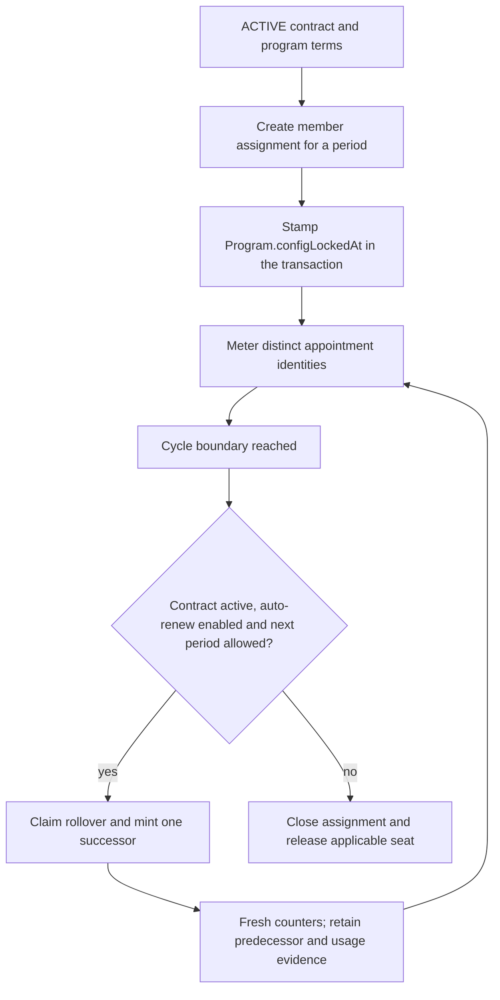

The cycle engine in `lib/enterprise/cycle-engine.ts` supplies the decision; the registered advance job performs the conditional claim and writes. The successor chain preserves prior-cycle evidence. The cycle boundary changes entitlement counters, whereas the invoice rollup settles unbilled money obligations; neither process should impersonate the other.

### 3.12. Engineering invariants

1. FundingSource selects the source of money; ProgramType selects the entitlement meter.
2. A ProgramAssignment is cycle-scoped and unique for program, membership, and period start.
3. The money values are BigInt paise in persistence; creditBudgetPerCycle is the special whole-rupee Int.
4. A valid charging configuration has a positive cycle ceiling.
5. The API rechecks organization status, membership, assignment, and funding source at checkout; the client preview is advisory.
6. Program fields lock after first assignment; new commercial terms go on a successor program.
7. A PERSONAL program is an allowance / reporting relationship while the member pays card; do not infer org-funded settlement from an org tag.
8. Cross-org buyer and host organizations remain separate through Payment and payout records.
9. RateCard snapshots freeze the split applied at booking.
10. Application counters are reconciled against append-only usage rows; money-leg and ledger invariants are enforced by sidecar SQL.

### 3.13. Failure and recovery

A missing active ProgramAssignment on an org-funded rail is a fail-closed checkout error. This prevents fallback billing to the member card when the org intended to sponsor.

An insufficient wallet balance aborts the booking transaction. The cache debit is guarded by available funds and a database nonnegative check. A payment capture is not part of the wallet/invoice/license booking transaction because those rails settle synchronously.

A cycle cap reached with BLOCK returns a business-coded refusal. For charging behavior, the per-cycle breaker can refuse an otherwise permitted booking with PROGRAM_CAP_EXHAUSTED. It is a deliberate 402 condition, not a transient gateway failure.

A retry of assignment creation must not overlap an existing ACTIVE period. The sidecar exclusion index protects program/membership time ranges. The rollover engine creates the next period and zeros current-cycle counters.

A Program config change after money history exists is rejected in place. The replacement Program and assignment chain provide an auditable transition rather than restating old usage under new terms.

### 3.14. Source map

- Schema models and enums: `prisma/schema.prisma` — Organization, BillingAccount, Contract, BillingSubscription, Program, LicensedSeatConfig, CreditPoolConfig, ProgramAssignment, BookingUtilization, UsageLedgerEntry, OverageEvent.
- Reachability and UI guidance: `lib/enterprise/reachable-paths.ts`; `app/dashboard/organization/[orgId]/programs/page.tsx`.
- Routes and lock rules: `app/api/organizations/[orgId]/programs/route.ts`, `app/api/organizations/[orgId]/programs/[programId]/route.ts`, `app/api/organizations/[orgId]/programs/[programId]/supersede/route.ts`; `lib/enterprise/config-lock.ts`.
- Metering: `lib/api/organizations/program-helpers.ts`; `lib/payments/checkout/commit/org-utilization.ts`.
- Tests: `__tests__/enterprise/reachable-paths.test.ts`, `__tests__/enterprise/credit-pool-meter.test.ts`, `__tests__/enterprise/cap-edge-cases.test.ts`, `__tests__/enterprise/multi-engagement-cap.test.ts`, `__tests__/enterprise/programs-overage-default.test.ts`, `__tests__/enterprise/config-lock.test.ts`.
- Database invariants: `prisma/sql/check-constraints.sql`; `prisma/sql/payment-legs-triggers.sql`.

## 4. Checkout and overage

This section follows a buyer from checkout revalidation through funding, entitlement metering, overage collection, and recovery. The main implementation is in lib/payments/checkout, `lib/api/organizations/program-helpers.ts`, and lib/payments/billing/overage*.ts.

The central distinction is timing. WALLET, INVOICE, and LICENSE are organization rails that complete booking synchronously in one transaction. PERSONAL creates a card payment and relies on the regular capture confirmation pipeline. An overage member charge is a distinct child payment and is settled later from the member-facing resume flow.

The [program design](#3-commercial-axes-and-programs) defines the allowance. [Settlement](#5-ledger-billing-and-settlement) explains the resulting journal and invoices; [recommendations](#9-design-decisions-and-recommendations) compares collection and exposure choices.

### 4.1. Transaction boundary and actors

A checkout has four actors that should remain separate in code and in diagrams:

1. The learner initiates a booking.
2. The buyer organization may sponsor and meter the booking.
3. The host organization may receive a share of the supplier-side revenue.
4. The payment gateway may capture only the PERSONAL tender or a later member overage payment.

The booking's buyer organization is stored in Payment.organizationId. Host organization attribution is stored in Payment.hostOrganizationId. BillingAccount is the source account when a sponsor pays. A payment carrying an org id is not sufficient proof that the org paid: PERSONAL can carry org reporting context while its CARD leg is paid by the learner.

Checkout is protected by the appointment and organization locks plus a Serializable database transaction. The funding source, assignment and consent are revalidated after entering the protected path. Status and money data are committed atomically with the appointment hold, so a failure in wallet debit, cap metering, overage write, earnings or journal creation rolls the booking transaction back.

#### 4.1.1. Sequence: regular org-funded booking

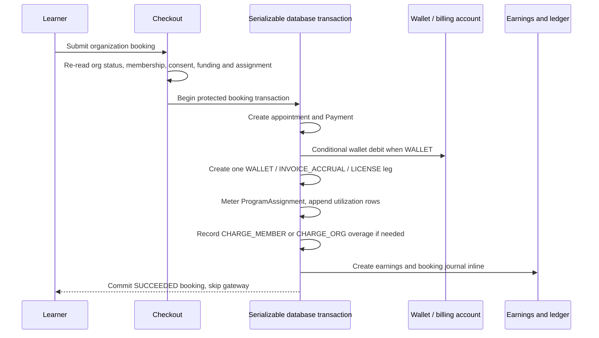

The actual funding leg is attached to the Payment inside the transaction. WALLET debits the available balance first. INVOICE creates an accrual. LICENSE adds a zero leg, which records that the prepaid license covered this booking. The org-funded Payment is born SUCCEEDED and has no gateway order to resume.

#### 4.1.2. Sequence: PERSONAL booking

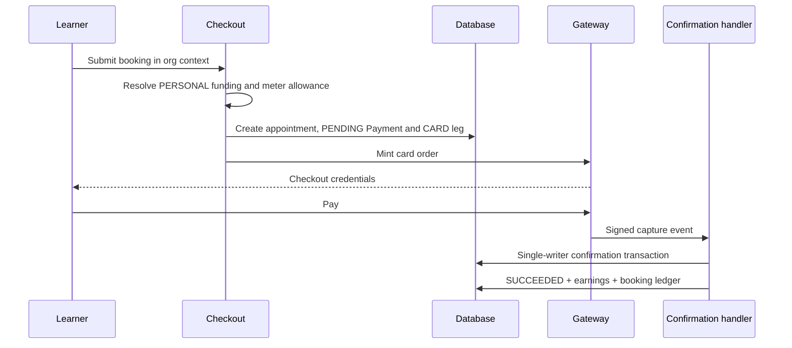

Gateway capture and payment confirmation are deliberately centralized. Webhook, return route and reconciliation callers route to the confirmation handler rather than writing SUCCEEDED independently. See `docs/finance/00-overview/01-money-map.md` and `lib/payments/webhooks/handlers.ts`.

### 4.2. Checkout revalidation and funding selection

resolveOrgFunding() in `lib/payments/checkout/org-funding.ts` resolves the requested org, checks the org can sponsor, confirms the caller has active membership and checks the live consent artifact. For org-funded rails, an active assignment whose Program covers the current plan type is required. Missing assignment fails closed; the route must not silently charge the member if the buyer expected the organization to pay.

Funding source is checked again while holding the checkout lock. A source change between page load and submit returns a refresh/refusal instead of using stale assumptions. The organization status gate normally requires ACTIVE; INVOICE has a limited PENDING_VERIFICATION trust path with credit controls, so docs should not assert that every sponsored invoice booking universally requires full verification.

The program assignment lookup and program preview are advisory on the client side. The protected checkout transaction rechecks the charge authority, meter and wallet balance. A previously rendered overage preview is not a reservation.

The invoice rail has a separate credit exposure check. Current outstanding invoice receivables plus the new amount must remain within BillingAccount.creditLimit when configured. The PurchaseOrder limit is checked later when an invoice is issued. These controls address different times and should be documented separately.

### 4.3. Payment creation and funding legs

writeCheckoutPayment() in `lib/payments/checkout/commit/payment-row.ts` sets the buyer org, host org, BillingAccount, amount, currency, tax snapshot, method and payment state. It resolves host organization from the plan owner where applicable, falling back to the expert's host membership. Funding method is based on the revalidated BillingAccount and assignment.

| Rail     | Payment method | Payment state at commit | Leg              | Collected when               |
| -------- | -------------- | ----------------------- | ---------------- | ---------------------------- |
| PERSONAL | CARD           | PENDING                 | CARD             | Gateway capture              |
| WALLET   | WALLET         | SUCCEEDED               | WALLET           | Atomic cache debit / journal |
| INVOICE  | INVOICE        | SUCCEEDED               | INVOICE_ACCRUAL  | Invoice accrual at booking   |
| LICENSE  | LICENSE        | SUCCEEDED               | LICENSE amount 0 | Flat contract is prepaid     |

The three org-funded choices skip Razorpay/Stripe order creation. Their Payment and appointment commit synchronously, then earnings and booking journal commit in the same transaction. The finance doctrine states that synchronous rails have no post-capture fallback: either all booking money facts commit, or checkout refuses.

A LICENSE booking does not mean Payment.amount is zero. The payment can retain the booking price and original price for earnings/tax attribution while its only funding leg has zero amount. The PaymentLeg database rule explicitly exempts an all-zero LICENSE-only leg set from the usual leg sum check because the contract absorbed the price elsewhere.

PERSONAL still means the member's card bears the standard booking price. An organization tag can support reporting and an allowance program without funding the booking.

### 4.4. Entitlement meter

recordBookingUtilization() is shared by checkout and lazy appointment allocation. For each effective new appointment ID, it writes a BookingUtilization aggregate and an append-only UsageLedgerEntry. A replay that presents an already metered appointment ID has zero delta and does not spend the entitlement again.

LICENSED_SEAT counts engagements. A consultation or webinar uses one occurrence; a class enrollment uses its actual number of preallocated sessions; subscriptions are metered as appointments are lazily allocated rather than all at checkout.

CREDIT_POOL meters the booking's price at booking, in paise. For a budget of 10,000 credits/month, the comparison limit is 1,000,000 paise or ₹10,000. It still records engagement count, but that is not its money budget.

BLOCK updates the meter with a conditional WHERE cap predicate. If the guarded update matches no row, the assignment cap error aborts the transaction. CHARGE_* permits the over-cap increment, marks wasOverage, and then calls the overage calculator for the org-sponsored checkout.

Refund reversal appends negative usage rows and CAS-decrements the counters. Reversal computes the sale's remaining unreturned count/value and clamps to that amount. A CREDIT_POOL refund may still reverse its monetary share even when every engagement has already been consumed. The count reversal is `min(remainingCount, max(1, ceil(saleCount × refundPaise / paymentPaise)))`; the value reversal is `min(remainingPaise, floor(salePaise × refundPaise / paymentPaise))` for a valid positive refund. The CREDIT_POOL path permits a value-only reversal after remaining count reaches zero, so several partial refunds can restore the exact sale value without inventing extra engagements.

### 4.5. Overage calculation

computeOverageForBooking() is the common pure mapper used by overage preview and checkout. It receives the pre-booking assignment usage, booking price, plan subtype, selected caps, behavior, prior cycle overage and surcharge bps.

For a CREDIT_POOL, let P be booking price, B be cycle budget, U be pre-booking consumed value, E be the current booking's `engagementsConsumed`, and C be price cap per engagement:

    remaining = max(0, B - U)
    covered = min(P, remaining, E × C when C is configured)
    basePaise = P - covered

Without a per-engagement cap, omit E × C from the min. One credit is one rupee; convert the configured whole-rupee budget to paise before applying this formula.

For a LICENSED_SEAT, let N be engagements in this booking, K be the number of remaining covered engagements, and q be the integer-floored price per engagement:

    overageEngagements = max(0, N - K)
    raw marginal = overageEngagements × floor(P / N)
    basePaise = min(P, raw marginal, overageEngagements × priceCap when configured)
    coveredPaise = P - basePaise

For example, if a price of ₹5,000 contains one over-cap engagement and its per-engagement cap is ₹2,000, the program covers ₹3,000 and the over-cap base is ₹2,000. For a multi-occurrence class, the configured count and price distribution affect the total. The mapper uses integer floor so persisted paise never depend on floating-point share calculations.

The surcharge is computed on the pass-through over-cap base:

    surchargePaise = floor(basePaise × overageSurchargeBps / 10000)
    tax-exclusive overage = basePaise + surchargePaise
    charged overage = basePaise + surchargePaise + GST on surcharge

Here, the “tax-exclusive overage” ceiling excludes the additional GST on the surcharge. The pass-through base itself is drawn from the parent booking's tax-inclusive amount; do not strip that original tax out a second time.

GST is calculated by the tax engine from payer place of supply. The pass-through base is already part of the main booking's tax-inclusive price, so taxing it again would duplicate output tax. The percentage surcharge is a new consideration and receives GST. For org charge, organization tax context is used; for member side charge, the member buyer country and consumer state snapshot are carried to the child Payment.

The preview endpoint returns an advisory result before payment. Distinguish mapper marginal (pre-GST, base+surcharge) from the actual tax-inclusive amount in the side Payment and persisted OverageEvent. Tests for preview parity are in `__tests__/enterprise/overage-preview.test.ts`.

### 4.6. Per-cycle breaker

The breaker counts the sum of prior PENDING, ACCRUED, and CHARGED event basePaise plus surchargePaise for the current ProgramAssignment cycle. Additional GST on the surcharge does not consume the ceiling. A mid-cycle invoice does not reset it. Reversed, failed and blocked events do not consume ceiling; rolled-cycle predecessor assignment is considered for the equal-period cancelled-predecessor edge case.

If existing cycle overage plus the new tax-exclusive marginal exceeds maxOveragePerCyclePaise, checkout throws PROGRAM_CAP_EXHAUSTED (HTTP 402) regardless of CHARGE_MEMBER or CHARGE_ORG. It is a modeled limit, not a gateway failure.

Current writer order matters: recordOverageAtCheckout() computes and throws on this breaker before an OverageEvent is inserted. The OverageChargeStatus enum contains BLOCKED, but grep of current writers found no code creating an event with chargeStatus BLOCKED. Older scenario text that says a BLOCKED event is recorded should not be carried forward as current behavior.

The persistence boundary and behavior are:

| Condition                                         | Outcome                                      | Meter update                         |
| ------------------------------------------------- | -------------------------------------------- | ------------------------------------ |
| Under cap                                         | PROCEED                                      | Meter increments                     |
| Cap exceeded with BLOCK                           | Refuse checkout                              | Guarded meter update does not commit |
| Cap exceeded with CHARGE_MEMBER and breaker clear | Commit booking plus member debt side payment | Meter increments                     |
| Cap exceeded with CHARGE_ORG and breaker clear    | Commit booking plus org collection/accrual   | Meter increments                     |
| Cycle breaker exceeded                            | Refuse checkout with 402                     | Transaction rolls back               |

### 4.7. CHARGE_MEMBER is a separate collection

A CHARGE_MEMBER booking does not split one booking Payment into organization and member tender. It creates a second Payment linked through parentPaymentId. This child has appointmentId null, its own CARD leg, and PENDING status. It is a payable obligation that can be resumed later.

recordMemberOverageCharge() first carves the base from the org-funded parent when the parent has not already been invoiced:

| Parent funding source   | Parent adjustment                                                     | Member side Payment                      |
| ----------------------- | --------------------------------------------------------------------- | ---------------------------------------- |
| INVOICE_ACCRUAL         | Decrement accrual leg and Payment.amount by carved base               | Carved base + surcharge + surcharge GST  |
| WALLET                  | Decrement WALLET leg and Payment.amount; walletCredit the carved base | Carved base + surcharge + surcharge GST  |
| LICENSE                 | Keep zero-valued LICENSE leg                                          | Full base + surcharge + surcharge GST    |
| PERSONAL CARD           | Base already paid on booking                                          | Surcharge + surcharge GST only in helper |
| Parent already invoiced | Preserve issued parent and its legs                                   | Do not charge already-billed base again  |

For the WALLET branch, walletCredit reverses the part of the initial full wallet debit that has become member responsibility. If the member pays, the side charge posts the cash and org payable relief through OVERAGE_MEMBER. If they do not pay, failure processing restores the carve where possible.

The side order is not minted inside the original booking transaction. A synthetic overage intent exists for idempotency; the member opens the resume checkout surface at /dashboard/overage, where the gateway order is minted. On capture, the webhook is the single writer for the child payment status and OverageEvent CHARGED transition.

While a pending side charge exists, pending ConsultantEarnings and OrganizationEarnings for the parent payment become HELD. This avoids paying the expert or host organization for a value that might never be collected. Multiple member overage batches can point at one parent; earnings remain held until no pending sibling obligation remains.

There are two abandonment windows. The 7-day sweep fails side charges that were never started. The hard 14-day timeout marks the member's obligation FAILED and notifies. Failure handling restores any carved parent value and releases earnings only when all sibling overage obligations permit release. A late gateway capture has a recovery path in the overage transition handler.

#### 4.7.1. Sequence: member overage pay-link

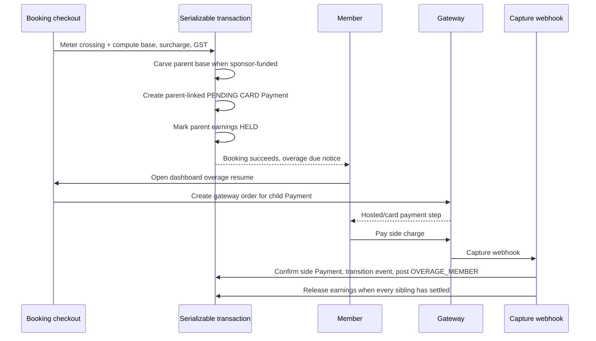

An abandoned side-payment does not automatically cancel the underlying booking. It does leave the earnings held until the timeout/failure flow resolves the obligation. User-facing documentation should call this a deferred member collection, not a synchronous copay.

### 4.8. CHARGE_ORG settlement by funding rail

#### 4.8.1. INVOICE parent

The base invoice accrual initially contains the full tax-inclusive booking price. For CHARGE_ORG, the writer carves basePaise from INVOICE_ACCRUAL and writes the overage as a distinct OVERAGE_INVOICE_ACCRUAL source. This retains the funding-leg sum identity while ensuring a monthly rollup still sees the two portions exactly once.

The new charge contains base plus surcharge plus surcharge GST. The booking journal recognizes the resulting org receivable and tax/fee allocation. Invoice rollup selects both accrual sources and nets reversal siblings. An overage event goes PENDING to ACCRUED when attached to an issued invoice and to CHARGED when the invoice is paid.

If a parent Payment has already been billed, do not edit its legs or amount. Base was already charged in the issued document. A separate accrual child is used only for a new surcharge that remains due; zero surcharge creates no incremental bill.

#### 4.8.2. WALLET parent

The initial wallet debit already collected the whole booking price, including the over-cap pass-through. With no surcharge, the event is recorded CHARGED immediately and has no invoice line. If a surcharge exists, the org receives a second wallet debit for surcharge plus GST, and the WALLET leg, Payment.amount and Payment.taxAmount increase by that amount.

When a wallet-funded booking is allocated lazily, the path also posts a separate BOOKING journal for the surcharge/GST because the original booking journal may already exist. `__tests__/payments/org-invoice-journal.test.ts` and `__tests__/enterprise/overage-settlement-legsum.test.ts` pin these details.

#### 4.8.3. LICENSE parent

The booking's LICENSE leg remains zero because the flat-fee contract absorbs covered usage. When a cap is crossed, the writer creates a separate SUCCEEDED ENTERPRISE_INVOICE_ACCRUAL Payment with an OVERAGE_INVOICE_ACCRUAL leg. It posts Dr ORG_RECEIVABLE and credits the overage platform amount and surcharge GST. The normal invoice rollup collects this child in a later OrganizationInvoice.

If the booking is fully reversed before that child is invoiced, `reverseBookingUtilization()` voids the child inside the same reversal transaction. The void is conditional on the child still being SUCCEEDED and unbilled; it appends an `OVERAGE_INVOICE_ACCRUAL_REVERSAL` leg equal to the negative full child leg, then posts `overage-accrual-voided:<childPaymentId>` as the exact mirror of `overage-accrual:<childPaymentId>`. The invoice rollup sees the original leg plus its reversal as zero and excludes the voided child from the amount due. The OverageEvent also moves to REVERSED.

For example, a ₹1,000 base + ₹100 surcharge + ₹18 GST child has an original leg of 111,800 paise and journal:

    Dr ORG_RECEIVABLE(org) 111800
       Cr PLATFORM_FEE     110000
       Cr GST_PAYABLE        1800

The void adds a -111,800 paise reversal leg and exact counter-journal:

    Dr PLATFORM_FEE     110000
    Dr GST_PAYABLE        1800
       Cr ORG_RECEIVABLE(org) 111800

These are two balanced journal transactions; net balance by account is zero. The void leaves the child Payment and its original leg unchanged. The append-only payment-leg reversal keeps the child out of a future invoice without rewriting the original payment.

If the invoice rollup wins the race and stamps `billableToOrgInvoiceId` first, the void CAS does not mutate the issued child. It records `OVERAGE_ACCRUAL_INVOICED` with the child and invoice IDs; finance must handle the already-issued amount through the invoice credit-note path. That event is an operational warning, not an automatically issued credit note. The rollup stamp and void CAS serialize on the child row so only one side wins.

#### 4.8.4. PERSONAL program

The dashboard can describe PERSONAL programs as card checkout with organization allowance metering. At the current commit site, only an org-sponsored booking calls recordOverageAtCheckout(); a PERSONAL card booking that passes the allowance meter does not create an OverageEvent or charge a second amount. Its regular card amount already includes the whole booking price. Therefore CHARGE_MEMBER is unnecessary economically for that path, while CHARGE_ORG is not currently routed to an org accrual. This is a code gap relative to the broad “all combinations settle” wording in older enterprise references.

### 4.9. Surcharge and refund examples

Assume an invoice-funded LICENSED_SEAT booking costs ₹5,000; the member has used all covered engagements. Configure a 10% surcharge and 18% domestic GST on that surcharge:

    basePaise = 500000
    surchargePaise = floor(500000 × 1000 / 10000) = 50000
    surcharge GST = floor(50000 × 18 / 100) = 9000
    overage charged = 500000 + 50000 + 9000 = 559000 paise = ₹5,590

If the parent accrual is not yet billed, it is reduced by ₹5,00,000 and a new overage accrual of ₹5,59,000 is added. The total invoice exposure becomes the original covered part plus the tax-inclusive overage, and the Payment legs still sum to Payment.amount.

For a partial cap example, booking value is ₹5,000 and remaining credit pool allowance is ₹3,000. The covered part is ₹3,000, base overage is ₹2,000, and at 10% surcharge the new surcharge is ₹200. Domestic GST on surcharge is ₹36. The member/org collection is ₹2,236. The base was already taxed on the booking; only the ₹200 surcharge has new GST.

For a WALLET member charge on the same booking, the original wallet debit first takes ₹5,000. The carve credits back ₹2,000, leaving ₹3,000 on the org wallet. The member side payment collects ₹2,236. On a successful capture, the member now funds the carved base and its surcharge/GST. On failure, the carve restoration re-debits or restores the proper parent-side amount under guarded updates.

Refunds follow the parent booking and child event relationships. Wallet-origin refunds credit the BillingAccount cache and post a WALLET journal entry. Invoice accrual refunds append negative reversal legs and can issue a credit note. When a full booking refund reverses an un-invoiced LICENSE-funded CHARGE_ORG child, the child accrual is voided with the exact counter-journal above; an already-invoiced child remains due until finance handles its credit note. A collected CHARGE_MEMBER overage is not refunded inline with the parent refund: the full-refund cascade stamps a durable refund-owed marker on each charged side Payment, then the retry worker refunds each child's remaining balance. Refund and dispute cascades must clamp cumulative amount so two independent refund causes never pay more than the remaining refundable value.

The side Payment's marker key is `overage-credit-back:<parentPaymentId>:<sidePaymentId>` and its amount is null, which means refund the child's full remaining balance. `retry-auto-refunds` waits for its grace period, skips a child with a pending refund or live dispute, and drives the normal refund front door with that stable key. A successful or already-settled refund clears the marker; a gateway failure leaves it for another bounded attempt. The normal child-refund cascade moves the matching OverageEvent to REVERSED after confirmation. After three failed drives the marker is surfaced for an operator to refund manually. This keeps the parent's confirmed refund independent from a later child-refund outage while retaining retry identity and preventing duplicate credit-back.

### 4.10. Failure handling and idempotency

- Funding source changes during checkout: revalidation fails; caller must refresh. No mixed-rail write occurs.
- Wallet lacks sufficient balance: atomic conditional debit matches zero and throws; entire Serializable booking transaction rolls back.
- Assignment is missing or inactive: org-funded checkout refuses; it does not quietly bill a member card.
- BLOCK cap race: conditional meter update loses; transaction aborts and a business error identifies the exhausted program.
- Cycle breaker: coded HTTP 402; it is a distinct condition from the per-assignment cap.
- Invoice accrual rollup race: Serializable read/create/stamp transaction plus retry ensures two runners do not bill the same Payment twice.
- Member side order retries: parent Payment plus synthetic child intent and client idempotency key support resume; webhook CAS ensures duplicate capture delivery is a no-op.
- Member charge timeout and recovery: failed/timed-out events restore base carve when safe; parent already invoiced prevents mutation of a statutory issued document.
- Full booking reversal: un-invoiced LICENSE overage children receive a full reversal leg plus mirrored journal; invoiced children are left intact and emit `OVERAGE_ACCRUAL_INVOICED` for credit-note handling.
- Member overage credit-back: a full parent refund stamps `refundOwedKey` on each charged side Payment; `scripts/payments/retry-auto-refunds.ts` drains the markers with stable dedupe keys and bounded retries.
- Deferred PaymentLeg trigger: leg sums are validated at COMMIT, after all parent/child writes in the transaction.
- Ledger entries and transactions are immutable; reversal posts a counter-entry rather than editing history.

### 4.11. Schema and database checks

The authoritative money values are BigInt paise. The credit pool's cycle budget is Int whole rupees, and its conversion boundary is ×100. Currency is captured on Payment and OverageEvent; currently all settlement rails are INR.

`prisma/sql/payment-legs-triggers.sql` has deferrable commit-time triggers for PaymentLeg writes and Payment.amount updates. Non-reversal funding legs, excluding REFERRAL_CREDIT and LICENSE, sum to Payment.amount. An all-zero LICENSE-only payment is exempt from that equality, but reversal pair validation still applies. A reversal must be negative and no larger than its source sibling.

`prisma/sql/check-constraints.sql` bounds OverageEvent base/surcharge to nonnegative and requires marginalPaise ≥ basePaise + surchargePaise. That allows marginal to include positive GST. Config constraints bound surcharge bps; wallet balance permits NULL or nonnegative; assignment time exclusion prevents overlapping active entitlements for the same program/member.

No application sweep should duplicate the payment-leg or ledger commit-time invariant. Reconciliation remains appropriate for cache drift (wallet balance vs journal) and derived assignment counters vs append-only UsageLedgerEntry rows because the database does not make those aggregates equal automatically.

### 4.12. Current limitations and proposals

#### 4.12.1. Current limitations

- PERSONAL program overage settlement is missing at the main checkout integration point. Configuration/guidance tests can make the pair appear supported while the settlement writer is skipped.
- BLOCKED event status is present in schema but no current writer records the breaker rejection. Current behavior is a pre-insert exception.
- CHARGE_MEMBER is a separate later card collection and can keep earnings HELD. It is not a one-step authorization or synchronous split tender.
- Surcharge under BLOCK and charging without a positive cycle breaker are refused as invalid configuration even though the pure calculation function can represent a nullable breaker.
- Preview values need a clear label for whether they include surcharge GST. The mapper is pre-tax; persisted member and org events include tax.

#### 4.12.2. Documentation recommendation

Describe what is implemented as current state and reserve unimplemented settlement semantics for a “gaps and options” subsection. If product decides PERSONAL × CHARGE_ORG should collect from the org, it needs an explicit funding allocation path because the member's full card price has already been captured. If product decides PERSONAL × CHARGE_MEMBER should be meaningful, avoid double charging: the base price was already paid by the same member. Alternatives include restricting these behavior choices to org-funded rails in the editor, treating PERSONAL as allowance-only, or defining a different late adjustment contract. Do not claim behavior just because it appears in the reachability matrix.

For breaker telemetry, the state machine could either explicitly document that refused attempts leave no event or add a durable denial record in a separate transaction. The latter must not be created inside the booking transaction that rolls back, and it needs a clear idempotency key. This is a proposal, not current behavior.

For member payment semantics, describe a parent-linked deferred side-payment and its timeout. Do not call it a synchronous co-pay. Same-Payment split tender would need a distinct product and ledger design, and the current route does not implement it.

### 4.13. Source map

- Checkout: `lib/payments/checkout/org-funding.ts`, `lib/payments/checkout/orchestrate.ts`, `lib/payments/checkout/revalidate.ts`, `lib/payments/checkout/commit/payment-row.ts`, `lib/payments/checkout/commit/org-utilization.ts`, `lib/payments/checkout/commit/ledger.ts`.
- Meter and reversal: `lib/api/organizations/program-helpers.ts`, `lib/booking/allocation/commit/subscription-cap.ts`.
- Overage math and settlement: `lib/payments/billing/overage.ts`, `lib/payments/billing/overage-preview.ts`, `lib/payments/billing/overage-settlement.ts`, `lib/payments/billing/overage-base-carve.ts`, `lib/payments/billing/overage-transitions.ts`, `lib/payments/billing/overage-accrual-void.ts`.
- Refund owed: `lib/payments/operations/refund-owed.ts`, `scripts/payments/retry-auto-refunds.ts`.
- Pay-link and webhook: app/dashboard/overage, `lib/payments/webhooks/overage-handlers.ts`.
- Invoice: `lib/payments/billing/invoice-rollup.ts`, `lib/payments/billing/purchase-order-draw.ts`, `lib/payments/billing/create-org-invoice.ts`.
- Ledger rules: `prisma/sql/payment-legs-triggers.sql`, `prisma/sql/check-constraints.sql`, `prisma/sql/ledger-triggers.sql`.
- Tests: `__tests__/enterprise/overage-calculator.test.ts`, `__tests__/enterprise/overage-preview.test.ts`, `__tests__/enterprise/overage-settlement-legsum.test.ts`, `__tests__/enterprise/overage-base-carve.test.ts`, `__tests__/enterprise/overage-member-webhook.test.ts`, `__tests__/enterprise/overage-accrual-void.test.ts`, `__tests__/enterprise/credit-pool-meter.test.ts`, `__tests__/enterprise/wallet-null-cached-balance.test.ts`; `__tests__/payments/checkout-pool-1-nesting.test.ts`, `__tests__/payments/org-invoice-journal.test.ts`, and `__tests__/payments/overage-credit-back-owed.test.ts`.

## 5. Ledger, billing and settlement

This section describes how an enterprise booking turns into a balanced journal, a buyer invoice or wallet movement, host and consultant earnings, and eventual payout. The same booking may have a buyer organization and a different host organization; those roles stay distinct all the way through settlement.

Related sections: [Commercial axes and programs](#3-commercial-axes-and-programs) defines funding and entitlement choices. [Checkout and overage settlement](#4-checkout-and-overage) describes checkout and overage writes.

### 5.1. Money truth and its copies

The enterprise money model has three related but distinct records:

1. Payment legs say which source funds a booking or accrues its buyer debt.
2. Ledger entries say which accounts were debited and credited for that event.
3. Cached operational rows such as BillingAccount.walletBalance and earnings amount columns make common reads cheaper.

The journal is money truth. Caches and snapshots must agree with the journal but do not replace it. Payment status describes checkout/capture lifecycle; it is not a ledger account. OrganizationInvoice describes a formal receivable document, not the original booking's revenue recognition.

Money is persisted as BigInt paise in the database and mapped to JavaScript numbers by `moneyResultExtensions` in `lib/prisma-extensions.ts`, installed through `base.$extends({ result: ... })` in `lib/prisma.ts`. Standard unextended Prisma results retain `bigint`; aggregate/groupBy results bypass these result extensions and require the explicit money conversion helpers. INR is the only settlement currency today. A displayed foreign currency may be captured for checkout, but it does not imply that the wallet, invoice, or payout settles in that currency.

Ledger accounts include CASH, PLATFORM_FEE, GST_PAYABLE, ORG_RECEIVABLE scoped by buyer org, ORG_PAYABLE scoped by host org, WALLET scoped by wallet owner, and CONSULTANT_PAYABLE scoped by expert. The exact account family and posting helpers are in `docs/finance/20-ledger/02-chart-of-accounts.md` and lib/payments/ledger.

### 5.2. Funding-leg identity

A Payment may have zero or more PaymentLeg rows. Current source types include CARD, WALLET, REFERRAL_CREDIT, INVOICE_ACCRUAL, OVERAGE_INVOICE_ACCRUAL, LICENSE, and accrual reversal sources.

When source legs exist, the commit-time identity is:

    sum(non-reversal legs except REFERRAL_CREDIT and LICENSE) = Payment.amount

REFERRAL_CREDIT is excluded because Payment.amount already represents the remaining amount after referral credits. LICENSE is excluded because a flat-fee contract covers booking price while the LICENSE leg is zero. The all-zero LICENSE-only leg set skips the usual sum comparison. Reversal legs are negative and limited to the original leg value.

The sidecar trigger applies this check both when PaymentLeg rows change and when Payment.amount changes. It is deferred until transaction commit so a multi-statement write can create Payment and its legs before validation. Do not add a second reconciliation sweep to repeat this database-enforced sum.

The unique key on paymentId and source means there is at most one leg from each source per payment. INVOICE_ACCRUAL and OVERAGE_INVOICE_ACCRUAL can coexist because they have different source names. PaymentLeg sourceRef is polymorphic by convention, so application writers and docs must explain what it points to for each source.

### 5.3. Booking journal by funding source

An earnings-bearing booking posts one balanced BOOKING transaction, generally keyed booking:<paymentId>. Funding debits and the supply split credits are included in the same transaction. The buyer funding account is selected from the Payment funding leg; the host organization and consultant payables come from the resolved supply split.

| Buyer source        | Booking debit                              | Timing                          |
| ------------------- | ------------------------------------------ | ------------------------------- |
| CARD                | CASH                                       | At gateway capture confirmation |
| WALLET              | WALLET(buyerOrg)                           | Inline with synchronous booking |
| INVOICE_ACCRUAL     | ORG_RECEIVABLE(buyerOrg)                   | Inline at booking accrual       |
| LICENSE, zero value | No booking debit for contract-paid service | No booking cash movement        |

For a regular booking, the journal allocates the funding debit among platform fee, consultant payable, organization payable where applicable, and GST payable. Platform GST is the full booking tax under the current principal-supplier model. A referral credit produces its own platform promo debit; the funding plug is computed from the sum of actual funding legs so the credit is not counted twice.

The license booking carries value in Payment and earnings records but has no per-booking collection. The flat fee exists at contract/subscription level. It is incorrect to infer that every Payment on LICENSE has amount zero. Its LICENSE leg is zero.

For a synchronous org rail, appointment, SUCCEEDED Payment, leg, wallet or receivable effect, utilization, earnings, and journal are committed together. For CARD, the Payment is created pending; capture confirmation owns SUCCEEDED and its booking earnings/journal. The capture route is the single writer even when a return page or reconciliation job discovers the capture first.

### 5.4. Wallet balance and top-ups

BillingAccount.walletBalance is a nullable derived cache of the organization-scoped WALLET ledger account. NULL marks an account that has not yet had a balance initialized. This matters because SQL arithmetic preserves NULL: incrementing a null cache without seeding would leave the cache null while the journal credited funds.

walletDebit() and walletCredit() in `lib/api/organizations/wallet.ts` seed NULL to zero inside the current transaction. Debit is an atomic conditional update where walletBalance >= amount. If no row matches, the wallet cannot cover the charge and the booking transaction fails. The sidecar CHECK permits NULL or nonnegative values, preventing an alternate writer from making the cache negative.

A confirmed top-up is represented by WalletTopUp and journal transaction Dr CASH / Cr WALLET(org). The gateway capture timestamp is preserved separately so a failed journal transaction can be recovered by the orphaned-capture reconciler. A booking debit posts Dr WALLET in the booking journal. A refund or member-overage carve credits the wallet cache and is mirrored by the appropriate WALLET ledger credit.

The ledger is the balance source; a resumable scheduled auditor compares the wallet cache with the journal. This is a legitimate derived-cache reconciliation because the database cannot express equality to an aggregate of ledger rows as a simple CHECK.

IIT Madras seeded values provide a concrete arithmetic check: three ₹5,00,000 top-ups add ₹15,00,000; five ₹5,000 debits consume ₹25,000; wallet balance is ₹14,75,000. Those seed transactions exist in `prisma/seedFiles/14a-create-organizations.ts`. They are seed definitions and do not prove the current database contains those rows.

The low-balance cron currently sends a notification and stamps a cooldown. “Auto-top-up” configuration is not a live mandate charge. Do not document a gateway top-up as happening automatically.

### 5.5. Invoice accrual and monthly rollup

INVOICE funding commits an INVOICE_ACCRUAL leg and books ORG_RECEIVABLE at booking time. It does not collect cash at checkout. An assignment can be CREDIT_POOL or LICENSED_SEAT; the program meter controls allowable usage while the invoice rail controls when the organization pays.

rollupOrgInvoiceAccruals() in `lib/payments/billing/invoice-rollup.ts` selects succeeded org-tagged Payment rows that have an unbilled INVOICE_ACCRUAL or OVERAGE_INVOICE_ACCRUAL leg. It also reads reversal siblings so amounts already refunded before invoice issue are netted. The Payment row is stamped with billableToOrgInvoiceId in the same Serializable transaction that creates the invoice. Concurrent rollups either serialize/retry or read no unstamped rows after the winner.

The booking journal has already recognized the organization receivable and output GST. The rollup does not rebook those booking amounts. It creates the invoice line items and document fields, taking tax from Payment.taxAmount and prorating when reversal legs reduced the net charge.

An issued organization invoice can also include subscription or manual program fees that had no booking journal. Those charges post at invoice issue. The org invoice journal and booking accrual journal are separate cases; do not apply the “invoice issue never posts” rule to an invoice with no booking-backed accrual.

When the buyer pays the invoice, the payment pipeline debits CASH and credits ORG_RECEIVABLE. Overage events on the invoice follow their own state path: PENDING becomes ACCRUED as attached to an invoice, then CHARGED when that invoice reaches paid status.

#### 5.5.1. Sequence: booking accrual and invoice close

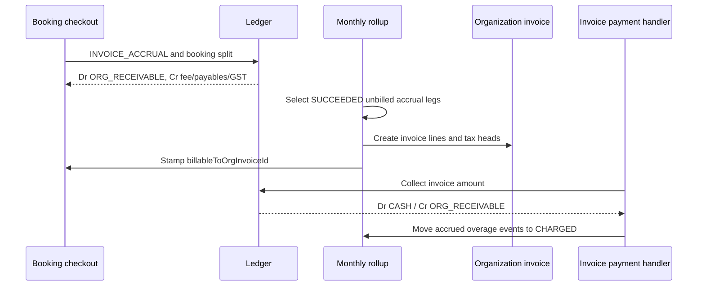

The invoicing module uses per-organization sequential invoice numbers, issue-time fiscal year and GST fields. Invoice rendering and tax calculation are statutory document concerns; they do not alter the original payment leg.

An un-invoiced LICENSE overage is a separate child `Payment`, even though its parent booking has a zero-value LICENSE leg. When the parent booking is fully reversed, `voidReversedOverageAccruals()` conditionally appends a full `OVERAGE_INVOICE_ACCRUAL_REVERSAL` funding leg and mirrors the child's original `overage-accrual:<childPaymentId>` journal using `overage-accrual-voided:<childPaymentId>`. For a child of ₹1,118 (₹1,000 base + ₹100 surcharge + ₹18 GST), original posting is Dr ORG_RECEIVABLE ₹1,118 / Cr PLATFORM_FEE ₹1,100 / Cr GST_PAYABLE ₹18; the void is Dr PLATFORM_FEE ₹1,100 / Dr GST_PAYABLE ₹18 / Cr ORG_RECEIVABLE ₹1,118. Thus both journals balance and their per-account net is zero. The void leaves the original child Payment and leg unchanged; the equal negative leg makes the future invoice rollup net to zero.

Invoice issue and child void race on `Payment.billableToOrgInvoiceId`: the void's conditional update requires null, and the rollup stamps the invoice in its serializable transaction. If issue wins, the void preserves the billed child and reports `OVERAGE_ACCRUAL_INVOICED` with invoice identity; it does not silently rewrite an issued invoice or mint a credit note. Finance must use the invoice credit-note procedure. `__tests__/enterprise/overage-accrual-void.test.ts` covers both outcomes, idempotent replay, balanced mirror postings, and the zero-bill rollup after a void.

### 5.6. Purchase orders and credit exposure

A PurchaseOrder is a spending authorization attached to an organization, not a fifth FundingSource. It has totalAmountPaise and remainingAmountPaise. drawPurchaseOrder() in `lib/payments/billing/purchase-order-draw.ts` decrements remaining value with a conditional updateMany only when the order is ACTIVE, not expired, currency-matched, and large enough for the invoice.

Monthly invoice rollup selects the oldest active unexpired PO that covers the complete invoice. A manual invoice accepts a selected PO and attempts the same CAS. Voiding or cancelling an invoice restores its PO draw in the invoice update transaction. The sidecar check constrains remainingAmountPaise to [0,totalAmountPaise].

Organization.requiresPO adds a required document relationship at contract signing and manual invoice creation. The rollup has a distinct unbacked PO result when no covering PO exists; do not flatten this to “all invoices always refuse without a PO” without checking that path.

BillingAccount.creditLimit is a different guard. It limits outstanding invoice exposure while new bookings accrue. A PO gates invoice issuance and procurement authorization; creditLimit gates the amount of receivable risk outstanding. An organization can have both.

Seeded Wipro combines both: ₹1 crore invoice credit limit and ₹50 lakh PO. The PO does not mean the org can necessarily accrue ₹1 crore without limit; it is a separate invoice issuance ceiling.

### 5.7. GST and invoice lifecycle

The current finance doctrine treats the platform as principal supplier for GST. The booking collects GST on the full consumer price and books GST_PAYABLE at the booking journal. The platform's own consumer tax invoice and credit note are issued. Enterprise invoice accruals use the same booking GST already posted; invoice issue must not duplicate it.

For program or subscription charges that are not in a booking journal, invoice issue creates the receivable/platform fee/GST journal. Voiding such a fee invoice reverses that journal. Refunds write credit notes and reverse the appropriate fee and tax according to the cumulative refund cap and statutory credit-note cutoff.

Overage is special only for the tax base: the base is an already-taxed slice of the parent's booking price, while the surcharge is new consideration. Hence output GST is charged once on base and once on surcharge, never twice on base. For invoices, the surcharge tax is carried in Payment.taxAmount and the tax-inclusive accrual leg.

For a LICENSE booking whose CHARGE_ORG overage was minted as a child accrual, a full booking reversal before invoice issue reverses that child with a negative `OVERAGE_INVOICE_ACCRUAL_REVERSAL` leg and the exact mirror journal, including GST_PAYABLE. The rollup nets the reversal before creating an invoice. If the child was already attached to an issued invoice, it remains intact for the credit-note path and the reversal records an operational warning with the affected invoice IDs; this code does not issue that credit note itself. See [checkout and overage](#4-checkout-and-overage) for the ₹1,118 example and race sequence.

The principal-supplier model is a product/accounting decision in ADR 26 and remains subject to CA review. The compliance reference calls the pairing of principal-supplier GST and 194-O withholding as an e-commerce operator deliberate and unusual. A documentation section should state implemented treatment and point to the open CA question rather than declaring a universal legal rule.

### 5.8. Invoice dunning and billing suspension

Invoice status includes DRAFT, ISSUED, PAID, OVERDUE, VOID, CANCELLED, and REFUNDED. Dunning marks an issued invoice OVERDUE after its due date and sends reminders with guarded stamps. The suspension stage is gated by ENABLE_DUNNING_SUSPEND, default off. When enabled and the overdue sequence reaches the configured terminal stage, new sponsored bookings are blocked until overdue status is cleared by payment.

The Wipro seed invoice is DRAFT and is not a live dunning example. Time-based lifecycle examples should say they require a past due date or an operator-adjusted fixture.

A statement like “unpaid invoice always suspends bookings” is false under the current default. The normal path is reminder-only; the config gate enables suspension.

### 5.9. Buyer and host are independent settlement scopes

For cross-org booking, Payment.organizationId is the sponsor or buyer and Payment.hostOrganizationId is the supply organization. The buyer side selects WALLET, INVOICE_ACCRUAL, or LICENSE. The host side resolves the supplier RateCard and any org payable. This lets an org sponsor a member to use an expert hosted by another organization.

The rate-card resolver tries plan/contract scope where that resolution is enabled, then membership override and organization defaults. The chosen card is effective at payment.createdAt. An earnings snapshot carries rateCardIdApplied and the bps actually used. Settlement does not read the live RateCard again.

The split uses integer paise calculations:

    platformFee = floor(gross × platformBps / 10000)
    consultantShare = floor(gross × consultantBps / 10000)
    orgShare = gross - platformFee - consultantShare

RateCard bps sum to 10,000. Giving the residual paise to the org makes the three output shares sum exactly to gross after independent floor operations. SQL enforces the bps sum and prevents an invalid card from reaching settlement.

If the expert membership has payoutRecipient=ORGANIZATION, the consultant slice is transferred into the host org share; the earning snapshot also records consultant bps as zero. If recipient is SELF, the consultant keeps a separate ConsultantEarnings row and the organization receives its configured share.

#### 5.9.1. Example: Wipro sponsor, LearnPro host

Assume a ₹10,000 taxable booking with a host split of platform 10%, host organization 10%, consultant 80%, ignoring referral credits and showing the GST liability separately. Wipro's INVOICE leg debits its org receivable for the buyer charge. LearnPro's RateCard, not Wipro's, determines host earnings:

| Component                |   Paise |  Rupees |
| ------------------------ | ------: | ------: |
| Platform fee at 10%      |  100000 |  ₹1,000 |
| Host organization at 10% |  100000 |  ₹1,000 |
| Consultant at 80%        |  800000 |  ₹8,000 |
| Base allocation total    | 1000000 | ₹10,000 |

For 18% GST, the journal has an additional ₹1,800 liability credit and the receivable side includes the tax-inclusive buyer charge. Actual tax head and price fields are determined by the checkout pricing path. Wipro's tag does not direct the consultant payout to Wipro.

### 5.10. Multi-collaborator and subscription earnings

A webinar or class can divide gross across a primary expert and collaborators. Each party resolves its own host membership and rate card. Same-host parties must remain separate because they can have different membership overrides, expert identities, roles, refund amounts, and payout recipients.

OrganizationEarnings is uniquely keyed by paymentId, organizationId, consultantProfileId, role, and cycleOrdinal. The five-field uniqueness is implemented in `prisma/sql/check-constraints.sql` with NULLS NOT DISTINCT, including legacy rows where optional keys are null. It allows two experts in the same organization to produce separate rows for one payment.

A subscription is paid up front but releases consultant earnings by delivered cycle. The payment is partitioned into ConsultantEarnings tranches with cycleOrdinal 0..n-1; per-tranche integer floors are reconciled by assigning residual paise to tranche zero. Tranches start with holdUntil null. Completion of the cycle's final delivered occurrence stamps the hold based on the last occurrence end plus the subscription hold window.

OrganizationEarnings can also carry cycleOrdinal and holdUntil. Organization slices are held until the appropriate subscription delivery milestone, preserving parity between host-org earnings and individual consultant earnings.

Refund clawback is not uniformly spread over already-paid and not-yet-delivered cycles. allocateCycleClawback() in `lib/payments/payouts/earnings-reversal.ts` consumes value from newest undelivered tranche first, then in-flight/released rows, then BATCHED, then PAID. Each row absorbs no more than consultant share minus already-refunded share. Refund service applies cumulative refund caps before allocation.

### 5.11. Earnings states, disputes, and refunds

Earnings status represents settlement eligibility, not ownership. A normal row moves from PENDING to READY after its delivery hold expires. Payout batch claims READY into BATCHED. Gateway completion moves it to PAID. A failed payout releases a still-batched row back to READY. Post-completion bank reversal moves payout earnings from PAID back to READY.

Open disputes can move earnings to HELD and store preDisputeStatus. A WON or CLOSED dispute restores the actual prior state; it must not accidentally mature a PENDING row directly to READY. A LOST or CHARGE_REFUNDED dispute goes through the refund and earnings clawback path.

CHARGE_MEMBER overage uses HELD for a separate purpose. It holds parent booking earnings until a distinct side-payment captures or fails. It is not the same release rule as a dispute. Documentation should identify the cause of hold and the process that returns the row to its prior eligible state.

Refunds are two-phase. A Refund record reserves an amount before a gateway call; ledger reversal and earnings clawback occur only when the gateway confirms the refund. The refund cascade clamps against already-returned refunds and lost/charge-refunded disputes. Invoice credits are cumulative and cannot reverse more than the original charged amount.

When a confirmed refund fully reverses a booking with collected CHARGE_MEMBER overage batches, the cascade does not make nested gateway calls inside that transaction or try to reverse the side charge as if it shared the parent's tender. Instead, it stamps `Payment.refundOwedKey` on each charged side Payment in the same transaction that completes the parent cascade. The stable key is `overage-credit-back:<parentPaymentId>:<sidePaymentId>`; null `refundOwedPaise` means the child's full remaining refundable balance. This state-as-outbox marker survives process failure and is later driven through the ordinary refund front door by `scripts/payments/retry-auto-refunds.ts`.

The owed-refund worker waits 15 minutes, skips a payment with an existing PENDING refund or a live dispute, and uses the marker key as the refund dedupe key. Success/replay clears the marker; a still-PENDING gateway refund remains owned by refund reconciliation; failures are counted on the payment and retried after 1 hour and then 4 hours (`refundOwedNextAt`) until the third failed drive, when an operator is asked to refund manually. A marker older than six hours is surfaced in an operations event. `__tests__/payments/overage-credit-back-owed.test.ts` checks multiple child payments, idempotent replay, and retry after a gateway failure. A partial parent refund does not trigger this full-booking overage credit-back; the new marker branch is guarded by full completion of the parent refund.

### 5.12. Organization payout batch

Organization payout uses OrganizationEarnings rows associated with the host organization. createOrgPayoutBatch() is shared by a manual route and scheduled batch creation. It requires a verified OrganizationPayoutAccount and the Razorpay payout rail. It claims READY earnings with no existing payout id inside a Serializable transaction and makes a PENDING payout row.

The batch refuses empty claims, mixed currencies, or a net amount at or below zero. Net payout is the host organization's share less refundedAmountPaise. It computes TDS from that pre-withholding amount and recovers eligible platform clawbacks from the cash portion. Rows are staged BATCHED at creation; they are not PAID before money leaves.

    netPayoutPaise = sum(orgSharePaise - refundedAmountPaise)
    amountPaise + tdsAmountPaise + recoveredClawbackPaise = netPayoutPaise

The amountPaise is the cash the organization receives. netPayoutPaise is the gross payee share before TDS and clawback recovery. A clawback remaining after minimum recoverable amount is carried to a future payout.

#### 5.12.1. Sequence: organization payout

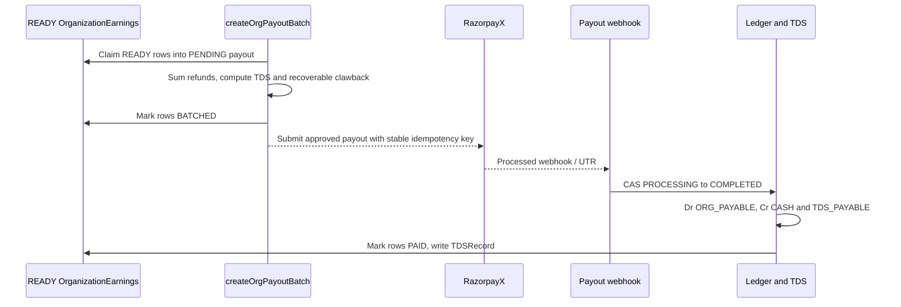

Organization payout status transitions are guarded through conditional updates. A batch that fails before the gateway movement returns claimed earnings to READY. An already completed bank payout that is later reversed has its own REVERSED status and inverse journal.

### 5.13. ORG_PAYOUT journal and reversal

markOrgPayoutCompleted() claims PROCESSING→COMPLETED and posts the payout journal in the same Serializable transaction. It debits ORG_PAYABLE for netPayout less any clawback already recovered, credits CASH for amountPaise and TDS_PAYABLE for withholding. The sum discharges the org obligation; taxes are retained for the tax authority and are not part of cash delivered to the org.

The journal idempotency key is orgpayout:<payoutId>. Status transition and journal are atomic, so a rolled-back transition cannot leave a completed payout without a posting. LedgerTransaction and LedgerEntry rows are immutable after post.

markOrgPayoutReversed() handles a bank reversal after COMPLETED. It claims COMPLETED→REVERSED, restores linked earnings from PAID to READY, posts the exact opposite account movements under a different idempotency key, records a TDS reversal and audit row, and releases linked clawback recovery. Using a distinct reversal key keeps the inverse from masking a missing original posting.

A failure before completion is different: it does not reverse an ORG_PAYOUT journal that was never posted. Status handling must preserve that distinction.

### 5.14. TDS on the organization rail

OrganizationPayout stores the withholding section, rate bps, financial year and amount used at batch construction. TDSRecord is written only when payout completes, because a planned deduction on a payout that never settled is not a deduction made.

Current enterprise reference describes organization TDS defaulting to 194-O, with overrides for 194J/194C and lower-rate certificate handling. The finance skill states that canonical `lib/compliance/tds.ts` is the organization-and-consultant path, with resident 194-O rate and no-PAN fallback, while an older consultant path remains CA-gated. Verify the active tax-engine configuration before changing this rule.

The organization payout tests pin valid encrypted PAN to the expected resident rate and missing or malformed PAN to the no-PAN rate. TDS applies to the pre-withholding net organization payout, not to net cash after the withholding was removed.

TDSRecord has real organization and consultant foreign keys. A sidecar CHECK requires exactly one deductee and another ensures the payout FK matches that deductee rail. Its reversal rows can carry negative withholding; the unique key includes the reversal flag where applicable.

The compliance reference says that statutory forms and section codes were renumbered under the Income-tax Act 2025 from 1 April 2026. Internal database section labels such as 194O are not necessarily the numeric code required by a return. Preserve this as a filing-boundary translation and CA signoff question rather than changing payout history rows.

### 5.15. Ledger and constraint ownership

| Invariant                                      | Enforcement                                                       | What code should do                                                    |
| ---------------------------------------------- | ----------------------------------------------------------------- | ---------------------------------------------------------------------- |
| Payment leg sum and refund reversal pair       | Deferred SQL constraint triggers on PaymentLeg and Payment.amount | Write the correct legs in one transaction; don't add a duplicate sweep |
| Ledger rows immutable                          | BEFORE UPDATE/DELETE triggers in `prisma/sql/ledger-triggers.sql` | Reverse with a balancing journal                                       |
| RateCard bps sum = 10000                       | SQL CHECK                                                         | Validate at configuration entry; never silently redistribute           |
| OrganizationEarnings split uniqueness          | NULLS NOT DISTINCT unique sidecar index                           | Include consultant, role and cycleOrdinal identity                     |
| TDS deductee XOR / payout rail                 | SQL CHECK                                                         | Create a row for exactly one payee rail                                |
| Wallet cache nonnegative                       | SQL CHECK plus conditional debit                                  | Seed NULL first and update cache in the same tx as journal             |
| PO remaining range                             | SQL CHECK plus CAS draw                                           | Use draw helper and restore only on valid invoice void                 |
| Wallet balance equals WALLET journal aggregate | Nightly reconcile                                                 | Treat journal as truth and repair/report cache drift                   |
| Assignment usage equals usage ledger aggregate | Nightly reconcile                                                 | Append reversal rows; don't rewrite history                            |
| Earnings amounts equal booking journal split   | Reconcile-ledger findings                                         | Create earnings and BOOKING journal atomically                         |

`prisma/sql/payment-legs-triggers.sql` checks the full payment after either leg or amount changes. `prisma/sql/ledger-triggers.sql` makes posted ledger transactions and entries immutable. `prisma/sql/check-constraints.sql` holds the field and cross-field checks. Do not treat all reconciliation as redundant: the database enforces row-level identities, but it cannot make a cache equal the aggregate of another table.

### 5.16. Cross-org example from the seed

Wipro is a seeded INVOICE buyer. LearnPro Academy is a seeded host organization with a 10/10/80 card. The Wipro→LearnPro appointments in `prisma/seedFiles/14c-seed-org-appointments-and-feedback.ts` demonstrate that buyer funding and host settlement are independent.

The Wipro seed also gives its annual seat program 12 covered engagements and a ₹10,000 per-engagement cap. An over-cap invoice booking accrues to Wipro. Its host organization is still resolved from LearnPro and the expert's active host membership, so organization earnings belong to LearnPro when the selected RateCard includes an org share.

IIT Madras provides the opposite shape: it is HYBRID and can both sponsor student bookings and receive payout on hosted faculty supply. Its internal faculty can route their consultant share to the organization; external panel experts route to themselves.

Do not infer that every seeded consultation has a payout row or a particular rate-card selection without checking the exact appointment and membership fixtures. Seed examples establish the intended shape, not a live DB observation.

### 5.17. Recovery paths

- **Invoice rollup retry:** transaction serialization retries; on a second pass, billableToOrgInvoiceId prevents duplicate issue.
- **Overage event orphan:** rollup records orphan findings after transaction commit rather than referencing an invoice rolled back with the tx.
- **Un-invoiced LICENSE overage reversed:** append a full reversal leg, mirror the child accrual journal under a distinct key, and let rollup net to zero; if invoice issue won the race, preserve the invoice and emit `OVERAGE_ACCRUAL_INVOICED` for finance's credit-note work.
- **CHARGE_MEMBER overage credit-back:** the full parent refund stamps a stable refund-owed marker on each successful side Payment; the retry-auto-refunds worker drives each later refund and leaves gateway failures durable for bounded retry or manual action.
- **Gateway payout callback replay:** payout status CAS makes completion a no-op after terminal state; journal key also provides idempotency.
- **Completed payout reversal:** separate REVERSED state, inverse journal key, TDS reversal and earnings reopen.
- **Refund fails:** no booking ledger reversal is posted until gateway confirms; failed refund has failure fields and a notification/reconcile route.
- **Captured-but-uncredited wallet top-up:** capturedAt remains durable and the orphan capture reconciler re-drives the wallet credit.
- **Clawback recovery:** a refund after payout records a receivable; later payout nets it from the amount while preserving the gross TDS base identity.
- **Dispute:** held earnings carry preDisputeStatus; resolve restores previous state or invokes refund cascade depending on outcome.

The operational sweeps only reconcile across external gateway or cache boundaries. DB-enforced ledger balance, immutability and payment-leg constraints should not be duplicated as application sweeps.

### 5.18. Code and test map

- Earnings split and booking journal: `lib/payments/payouts/earnings-service.ts`, `lib/payments/checkout/commit/ledger.ts`, `lib/payments/ledger/post.ts`.
- Wallet: `lib/api/organizations/wallet.ts`; `lib/payments/billing/overage-settlement.ts`; `jobs/billing/wallet-low-balance.ts`.
- Invoice rollup and PO: `lib/payments/billing/invoice-rollup.ts`, `lib/payments/billing/create-org-invoice.ts`, `lib/payments/billing/purchase-order-draw.ts`, app/api/organizations/[orgId]/billing-account/invoices.
- Subscriptions and refunds: `lib/booking/subscription-cycle.ts`, `lib/payments/payouts/earnings-reversal.ts`, `lib/payments/operations/refund.ts`, `lib/payments/operations/refund-owed.ts`, `lib/payments/billing/overage-accrual-void.ts`, `scripts/payments/retry-auto-refunds.ts`.
- Payout and TDS: `lib/payments/payouts/org-payout-service.ts`, `lib/compliance/tds.ts`, app/api/organizations/[orgId]/payouts.
- Webhooks: `lib/payments/webhooks/handlers.ts`, `lib/payments/webhooks/overage-handlers.ts`, app/api/webhooks/razorpay.
- Sidecars: `prisma/sql/check-constraints.sql`, `prisma/sql/ledger-triggers.sql`, `prisma/sql/payment-legs-triggers.sql`.
- Tests: `__tests__/enterprise/org-payout-service.test.ts`, `__tests__/enterprise/org-payout-withholding-postings.test.ts`, `__tests__/enterprise/tds-org-payout-input.test.ts`, `__tests__/enterprise/collaborator-org-earnings.test.ts`, `__tests__/enterprise/po-balance-enforcement.test.ts`, `__tests__/enterprise/wallet-null-cached-balance.test.ts`, `__tests__/enterprise/ledger-invariants.test.ts`, `__tests__/enterprise/overage-accrual-void.test.ts`; `__tests__/payments/org-invoice-journal.test.ts`, `__tests__/payments/earnings-per-cycle.test.ts`, `__tests__/payments/multi-party-booking-journal.test.ts`, `__tests__/payments/dispute-earnings-hardening.test.ts`, `__tests__/payments/dispute-refund-correctness.test.ts`, `__tests__/payments/overage-credit-back-owed.test.ts`.

## 6. Dashboards and user journeys

This document maps the live enterprise-facing dashboard surfaces to the identity that owns them, the data they read, the actions they issue, and
the permission and capability gates that protect them. It covers five distinct contexts: per-organization operations, the operator's
cross-organization portfolio, personal learner and expert dashboards, and platform admin/staff operations.

The dashboard is a read and action layer over organization data. It does not own membership authority, billing truth, booking truth, or payout
truth. The same permission keys and organization scoping used by the UI must be enforced at the server/API boundary. See
[02 — Identity, governance and lifecycle](#2-identity-governance-and-lifecycle) for identity creation, permission semantics, SSO and state
transitions. The business seams are explained in [03 — Commercial axes and programs](#3-commercial-axes-and-programs),
[04 — Checkout and overage](#4-checkout-and-overage), [05 — Ledger, billing and settlement](#5-ledger-billing-and-settlement),
[07 — Compliance, privacy and data](#7-compliance-privacy-and-data),
[08 — Operations and integrations](#8-operations-and-integrations), and
[09 — Design decisions and recommendations](#9-design-decisions-and-recommendations).

### 6.1. Route architecture

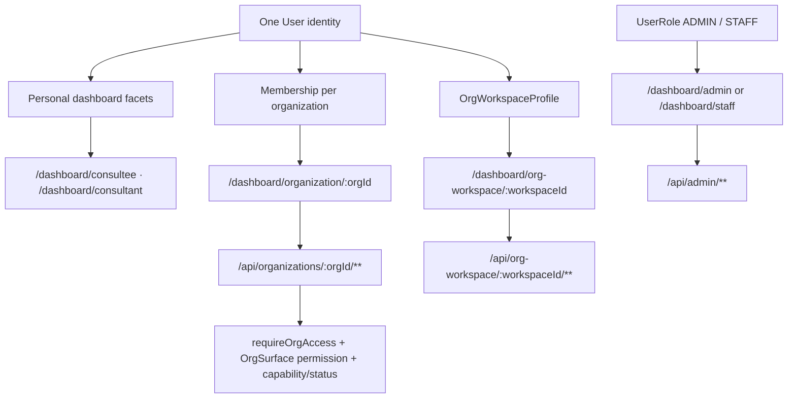

The route parameter identifies a tenant or user workspace; it is never the complete authorization check. Per-org layout preloads authorized
organization details before the dashboard shell appears. The shell derives role/capability navigation with `buildOrganizationNav` in
`lib/dashboard/nav/organization.ts`. API routes call `requireOrgAccess` in `lib/auth-helpers.ts` and apply a named key from
`lib/auth/org-permissions.ts` plus status/capability rules. Cross-org workspace layout checks that the requested workspace ID equals the
authenticated user's `orgWorkspaceProfileId`; a guessed workspace id returns the same 404 as a missing profile. Admin and staff routes use their
platform backoffice permission map.

The bare `/dashboard/organization/[orgId]` route is a role resolver:

| Viewer                              | Landing                                             | Reason                                                       |
| ----------------------------------- | --------------------------------------------------- | ------------------------------------------------------------ |
| OWNER, MAINTAINER, MANAGER, SUPPORT | `/home`                                             | Operator overview and next actions.                          |
| BILLING_ADMIN                       | `/home`                                             | Finance-specific view card; operational data remains hidden. |
| LEARNER                             | `/my-program` if `canSponsor`, else `/appointments` | Own org entitlement or own sessions.                         |
| EXPERT                              | `/compensation` if `canHost`, else `/appointments`  | Own host-org arrangement or own sessions.                    |
| SUSPENDED member                    | `/appointments`                                     | Existing bookings remain reachable; new org work is gated.   |
| No active/suspended Membership      | Personal dashboard resolver                         | This org is outside the caller's membership scope.           |
| Platform ADMIN                      | `/home` read-only                                   | Writes belong in the backoffice.                             |

`resolvePersonalDashboardHref` in `lib/labels/personal-dashboard.ts` prefers operator portfolio, then consultant facet, then consultee facet. The
top-level context switcher lets a person with multiple facets move between those trees. Personal lists pin their query to personal context; org
work appears in the org tree. A context parameter is not a license to mix tenant data into an unrelated personal page.

### 6.2. Per-organization dashboard

The organization shell is under `app/dashboard/organization/[orgId]/**`. The navigation builder is the best route inventory because some
destinations are tabs and some are capability-only. Every list and command below is still scoped to the `orgId` in the URL, and every API handler
must apply the corresponding permission key and resource ownership check.

#### 6.2.1. Common and member-facing surfaces

| Destination                                                         | Read model / query boundary                                                                                                              | Commands and permissions                                                                                                                                                                                          |
| ------------------------------------------------------------------- | ---------------------------------------------------------------------------------------------------------------------------------------- | ----------------------------------------------------------------------------------------------------------------------------------------------------------------------------------------------------------------- |
| **Overview** `/home`                                                | `GET /api/organizations/[orgId]/analytics` plus `/activity?limit=5`; one activation snapshot feeds checklist and action-center banners.  | Role-specific view. Operator actions link to Settings, Members, Contracts, Programs, Billing, Payouts, or Appointments.                                                                                           |
| **Appointments** `/appointments`                                    | `GET /api/organizations/[orgId]/appointments`; `?scope=mine` returns the caller's org sessions. `?scope=everyone` is an operations feed. | `operations.read` opens Everyone and operations. Without it, hand-edited Everyone scope narrows to own rows. Act-for-org reschedule/cancel and allocate use separate action permissions.                          |
| **Messages** `/messages`                                            | Org-tagged Stream channels for the signed-in user; org roster does not grant access to every private channel.                            | Channel membership and messaging rules remain server enforced.                                                                                                                                                    |
| **Session documents** `/documents` and **Recordings** `/recordings` | Org appointment artifact APIs, defaulting to the member's own sessions.                                                                  | Every ACTIVE or SUSPENDED member can see their own authorized files; `operations.read` allows the org-level metadata view where implemented. A role does not imply permission to delete another person's content. |
| **Requests** `/requests`                                            | Pending consultation and subscription requests for experts delivering into this org.                                                     | Requires a consultant profile plus host capability; allocation/response writes use host-actor checks and scoped booking routes.                                                                                   |
| **Collaborations** `/collaborations`                                | Collaborators on this org's hosted webinars/classes. One route, two views chosen on the server.                                          | Operators (`catalog.manage`) see every hosted plan from Host; an EXPERT or any member who delivers sees their own from My work. `canHost` required. B2C-owned offerings stay on personal consultant surfaces.     |
| **My Program** `/my-program`                                        | LEARNER's assignments, cycle/coverage progress, usage history and org-only plan panel.                                                   | Read-only member view, `myProgram.read`, `canSponsor`; member can leave the org through the dedicated leave route, but cannot assign self to a program.                                                           |
| **Compensation** `/compensation`                                    | EXPERT's own org-tagged earnings, payout recipient and effective split only.                                                             | `myArrangement.read` and host capability. It does not expose the org's other members' payout routing.                                                                                                             |

The appointments page merges own and everyone views in one page. The `operations.read` permission controls the wider view; an org member without
that permission sees only their own rows. This rule matters for BILLING_ADMIN, which can inspect finance records but is intentionally absent from
the org-wide operations feed. Public/session content boundaries are described in
[ADR 20](../enterprise/70-design-decisions/20-org-visibility-into-member-sessions.md).

#### 6.2.2. Operator pages and tabs

| Destination                | Main query/API                                                                                                                   | Important controls and gates                                                                                                                                                                                                                                            |
| -------------------------- | -------------------------------------------------------------------------------------------------------------------------------- | ----------------------------------------------------------------------------------------------------------------------------------------------------------------------------------------------------------------------------------------------------------------------- |
| **Members** `/members`     | `GET /members` supports role/status/search/department/sort/page; `/members/directory` is names-only for broad member visibility. | `members.read` opens the full roster; `members.directory` opens the directory. Tabs: Roster and Invitations. Invites via `/invitations`; accept is user-side. PATCH/DELETE use shared membership guard. Bulk import creates invitations.                                |
| **Programs** `/programs`   | Programs list, active contract list, active member list, assignments, assignment usage.                                          | `programs.read`, `programs.assign`, `programs.manage`, plus canSponsor. Assign/unassign/period extension have distinct keys. Config editing respects `configLockedAt`; archive/replace retains history.                                                                 |
| **Contracts** `/contracts` | `GET /contracts` and BillingAccount read.                                                                                        | `contracts.read` for view; OWNER `contracts.manage` for create/activate/edit/supersede. Contract lock data disables committed fields; renewal/amendment makes successor records.                                                                                        |
| **Catalog** `/catalog`     | Org-owned offerings (includeArchived filter) and materials.                                                                      | `catalog.manage` and canHost. Tabs: Webinars, Classes, Materials; withdrawn plans show under an Archived status chip. New offering is an org-owned Webinar/Class with expert selector; archive/restore rather than delete. Materials are restricted to org-owned plans. |
| **Billing** `/billing`     | `GET /billing`, `/billing-account/invoices`, invoice details and downloadable PDFs.                                              | `billing.read` for finance readers; `billing.manage` for owner/finance mutations. Tabs: Invoices & usage, Wallet & licence, Purchase orders, then Payment disputes and Member spend, with tabs past the third under More. Tab grants are separate.                      |
| **Payouts** `/payouts`     | Org earnings, payout batches, rate cards and payout account.                                                                     | `payouts.read` for finance readers; `payouts.manage`, `payouts.approve`, `payouts.account.manage`, `members.payoutRecipient.change` split approval, bank, batch and routing authority. Requires canHost. Tabs: Runs & earnings, Payout account, Rate cards & routing.   |
| **Analytics** `/analytics` | Analytics rollups plus feedback summary; derived from org-scoped bookings, spend, earnings and utilization.                      | `operations.read`; privacy-safe quality aggregates have their own `quality.read` gate. CSV export uses explicit export grants.                                                                                                                                          |
| **Audit** `/audit`         | Org audit rows with category/action filters; CSV is a separate export endpoint.                                                  | `audit.read` shows union of event categories; row filters use `audit.read.ops` and `audit.read.money`. Export permissions are distinct from viewing.                                                                                                                    |
| **Consent** `/consent`     | Org consent records and withdrawal-request queue.                                                                                | `consent.read`; member withdrawal is the member's own act. The list of people is not a general roster export.                                                                                                                                                           |
| **Support** `/support`     | Org-attributed request list and metadata-only triage; case detail stays scoped.                                                  | `supportRequests.org` or support/operations-specific grant; conversation and private session content is redacted by its own policy.                                                                                                                                     |

The permission keys and allowed roles live in `lib/auth/org-permissions.ts`; capability conditions are encoded alongside routes and in
`buildOrganizationNav`. Sidebar visibility is a usability layer, not a security boundary. A hand-entered route or crafted request still has to
pass the server gate.

#### 6.2.3. Settings sections

Settings opens from the avatar menu, not the main rail. Its current sections include:

- **General:** organization identity, logo/branding, support and billing contacts, policies, public listing, capability/tax fields where allowed.
  `PATCH /api/organizations/[orgId]` has field-level role gates and an `expectedVersion` CAS for capability edits.
- **Domains and SSO:** domain claims and DNS proof, provider configuration, approval/proof state, enforcement. `identity.read` permits
  OWNER/MAINTAINER to inspect; `identity.manage` permits OWNER to mutate. Secrets are redacted from read models.
- **Webhooks:** endpoints, event subscriptions, delivery inspection, retry, secret rotation and delete. Member-event subscriptions and secret
  actions are OWNER-gated even where general integration management is broader.
- **Data exports:** people and financial export bundles have different permission keys and downloadable job resources.
- **Billing settings / cancellation policy:** settings and policy writes have their own keys; OWNER-only pricing policy changes do not follow the
  broad settings-read permission.

Implementation: settings section map in `lib/dashboard/org-settings-sections.ts`; controls in `app/dashboard/organization/[orgId]/settings/**`;
APIs under `app/api/organizations/[orgId]/`. Do not infer write access from the fact that a user can render the Settings shell.

#### 6.2.4. Tabs and legacy destinations

Tabs keep one page per object. Current members tabs are Roster and Invitations; settings sections are general, SSO,
webhooks and data exports; Billing and Payouts show at most three tabs plus a More menu, and an unknown `?tab=` opens the first tab (see [the dashboard IA page](../dashboard/information-architecture.md#organization-page-tabs)). `/purchase-orders`,
`/reimbursements`, and `/disputes` no longer exist; those panels are Billing tabs. `/credits` is not an active page; the wallet is in Billing's
Wallet & licence tab.
Appointment `mine/everyone` is a scope switch on the same appointment object, not two destinations.

#### 6.2.5. Exact role matrix in practice

The matrix has intentional non-hierarchical grants. This table gives the roles for several central surfaces; consult `ORG_PERMISSIONS` for the
complete exact matrix before changing a gate.

| Permission key                                 | Current grant set                         |
| ---------------------------------------------- | ----------------------------------------- |
| `members.directory`                            | All current member roles                  |
| `members.read`                                 | OWNER, MAINTAINER, MANAGER, SUPPORT       |
| `members.manage` / `invitations.manage`        | OWNER, MAINTAINER                         |
| `members.role.grant.governance` / `org.delete` | OWNER                                     |
| `billing.read`                                 | OWNER, MAINTAINER, BILLING_ADMIN, MANAGER |
| `billing.manage` / `payouts.manage`            | OWNER, BILLING_ADMIN                      |
| `contracts.read`                               | OWNER, MAINTAINER, BILLING_ADMIN          |
| `contracts.manage`                             | OWNER                                     |
| `programs.assign`                              | OWNER, MAINTAINER, MANAGER                |
| `programs.manage`                              | OWNER, MAINTAINER                         |
| `identity.read`                                | OWNER, MAINTAINER                         |
| `identity.manage`                              | OWNER                                     |
| `operations.read` / `quality.read`             | OWNER, MAINTAINER, MANAGER, SUPPORT       |

The rows are permission grants, not blanket dashboard access. Sponsorship and hosting capability, membership status, org lifecycle, specific data
ownership, and sometimes separate action-level keys narrow them. For example, MANAGER may read billing but cannot write it; SUPPORT may read
operations but not money; BILLING_ADMIN may read finance but cannot read the full member roster or operations feed.

### 6.3. Cross-organization operator workspace

`/dashboard/org-workspace/[orgWorkspaceId]/**` is keyed by the current user's `OrgWorkspaceProfile`, not by one organization ID. The server
layout requires an onboarded user and checks the route ID against the profile ID; a mismatch is 404. It supports portfolio-level actions and
summaries, while every drill-down into a tenant returns to `/dashboard/organization/[orgId]/**`.

| Page                        | Data boundary                                                                                                                                                  | Action boundary                                                                                                                                              |
| --------------------------- | -------------------------------------------------------------------------------------------------------------------------------------------------------------- | ------------------------------------------------------------------------------------------------------------------------------------------------------------ |
| **Overview** `/home`        | `getOperatorOrganizations(userId)` for orgs the user owns, plus `getWorkspaceBillingRollup(userId)`. Includes status/verification, wallet and dunning signals. | Open a specific org or create one. A single-org owner is routed to the org; multi-org users get chooser/portfolio.                                           |
| **Activity** `/activity`    | `/api/org-workspace/[id]/activity` aggregates OrgAuditLog across owned orgs with organization/category filters and cursor pagination.                          | Read-only; switch to a tenant for a mutation.                                                                                                                |
| **Spend** `/billing`        | `/api/org-workspace/[id]/billing` reads outstanding invoices and wallet totals across owned orgs.                                                              | Read-only. It is labelled Spend to distinguish it from a single-org Billing page.                                                                            |
| **Settings** `/settings/**` | `/api/org-workspace/[id]/settings` reads preferences.                                                                                                          | Default landing organization and the personal notification panel. Account security/privacy settings are personal account settings under `/settings/account`. |
| **Create** `/create`        | Same organization creation wizard as the per-org entry point.                                                                                                  | Creates a new Organization, owner Membership, BillingAccount when sponsor-enabled, and workspace profile if missing.                                         |
| **Support** `/support`      | Workspace support requests and case pages.                                                                                                                     | Scoped to the authenticated operator and authorized support request.                                                                                         |

The cross-org billing and activity views do not let a portfolio ID substitute for tenant authorization. Their query helper starts from
authenticated user ownership and each detailed action moves to a route with its own org guard.

The route tree and data reads live in `app/dashboard/org-workspace/[orgWorkspaceId]/**`, `lib/data/org-workspace.ts`, and
`app/api/org-workspace/[orgWorkspaceId]/**`. The layout also computes owner count to decide whether portfolio pages provide value when the user
only owns one organization.

### 6.4. Personal learner and expert dashboards

Personal dashboards represent B2C identity and activity. They pin reads to personal organization-null scope. An expert who also belongs to a host
org has separate personal earnings and org compensation, because each booking's org context determines its owner and settlement view. A learner
who receives sponsored sessions sees those in the org's My Program and org appointment surface; their personal dashboard remains their personal
context.

The context switcher lists the facets the user has: personal expert, personal learner, cross-org workspace, and active org memberships.
`resolvePersonalDashboardHref` chooses the preferred fallback. `UserRole` helps pick a default, but does not remove other profile facets. A deep
link to an organization still checks active or suspended membership before rendering.

#### 6.4.1. Worked personas

The following names and situations are illustrative, not claims about seeded accounts.

**Riya, Wipro learner.** Riya has a global `User` and ConsulteeProfile plus an ACTIVE LEARNER Membership at a sponsor org. The org route lands
her on My Program; `/my-program` reads assignments and utilization through org-scoped membership. She can see own appointments and messages, not
the Everyone feed or other members' session content. Wipro's operations manager sees a broader appointments feed only with `operations.read`.

**Aarav, host expert.** Aarav owns a global ConsultantProfile and an EXPERT Membership at a canHost org. `/compensation` shows his own effective
split, payout recipient and org-tagged earnings. His personal consultant dashboard continues to show only personal bookings/earnings. The payout
recipient and rate-card override are membership-scoped, so another org can choose a different arrangement without rewriting his global identity.

**Nina, finance lead.** Nina has BILLING_ADMIN. The sidebar shows the finance surfaces she is allowed to read and mutate, including
billing/payout controls specified by the matrix. She is not a member roster operator and does not see the org-wide operational appointments feed.
A hidden menu item is not the security mechanism; direct API requests receive 403 from the permission guard.

**Same person, several roles.** Sam can be consultant in personal context, an OWNER in one org and a LEARNER in another. The top-level context
switcher moves between these pages. Each query fixes its data scope; no page merges all of Sam's work into one ambiguous statement.

### 6.5. Platform organization console

Platform staff and admins use `/dashboard/[admin|staff]/organizations` (the actual tree is under
`app/dashboard/(backoffice)/[tree]/organizations/**`). This is not the org owner's Settings page. It serves verification queues, organization
details, and SSO provider approval. Admin controls include verify/reject, suspend/reactivate/deactivate and provider approval/revocation.

The admin verify route is `app/api/admin/organizations/[orgId]/verify/route.ts`; SSO approval is
`app/api/admin/organizations/[orgId]/sso-providers/[providerId]/approval/route.ts`. Both are platform-permission-gated and write their own
ops/audit evidence. In ordinary org APIs, a platform ADMIN may receive a read-only stub for inspection, but cannot mutate as if they were the
organization's OWNER. This preserves the separation between platform governance and tenant administration.

The admin/staff dashboard split is intentional: same platform subsystem, distinct audiences and authority. Staff can support and read allowed
operational/money views; platform lifecycle changes and sensitive actions are admin-gated. The relevant platform policy lives in
`lib/auth/backoffice-permissions.ts` and `lib/dashboard/backoffice-nav.ts`.

### 6.6. Query and command boundaries

A dashboard page typically has three layers: server page/layout for route ownership and hydration, client component for tab/query state and
command UX, and API/service for access checks, query scoping, mutation transaction and audit. Shared query helpers should own filters that
multiple screens rely on.

| Domain object            | Read path                                                      | Command path                                                  | Core guard                                                                                                    |
| ------------------------ | -------------------------------------------------------------- | ------------------------------------------------------------- | ------------------------------------------------------------------------------------------------------------- |
| Org/member details       | `lib/data/org-details-server.ts`, `/api/organizations/[orgId]` | `PATCH/DELETE /api/organizations/[orgId]`                     | Membership + field RBAC + expectedVersion + org lifecycle + Serializable wind-down.                           |
| Member list/invite       | `/members`, `/members/directory`, `/invitations`               | `/invitations`, `/members/[memberId]`, `/members/bulk-import` | Permission key + target role/capability + invitation acceptance + obligations. Direct POST `/members` is 405. |
| Programs and assignments | `/programs`, `/programs/[programId]/assignments`               | Program, assignment and supersede routes                      | Sponsor capability, program permission, active member/contract, lock stamp, seat count and transition guards. |
| Contracts                | `/contracts`, `/contracts/[contractId]`                        | create, activate, update, supersede                           | OWNER + sponsor capability + contract lock + state transition.                                                |
| Billing and PO           | `/billing`, billing-account/invoices, PO routes                | wallet top-up, invoice pay, PO CRUD                           | Finance key + sponsor capability + expected payment state and idempotency.                                    |
| Payout                   | earnings, payout batch and rate-card routes                    | batch create/approve, bank account and recipient changes      | Host capability plus distinct read/manage/approve/account grants.                                             |
| SSO/domain               | domain claims, SSO settings/providers                          | claim/verify, provider create/update/delete, enforce          | OWNER identity.manage, DNS, admin approval and owner proof gates.                                             |
| Org workspace            | `lib/data/org-workspace.ts`, workspace APIs                    | preferences, create organization                              | Session profile ownership; create org transaction revalidates payload and capability.                         |
| Public directory         | `lib/data/explore-organisations.ts`, public slug route         | OWNER sets public/branding fields                             | `isPublic && status=ACTIVE && deletedAt=null`; no canHost requirement.                                        |

The endpoint list is representative for the page tree, not a permission bypass. Each nested route still checks the exact resource's
`organizationId`; UUID or CUID possession is not a grant. Commands that touch money or status use their own expected-state checks, and successful
mutation is audited within the same transaction where required.

### 6.7. Public enterprise entry and the sales pipeline

The public entry pages are `app/enterprise/page.tsx`, `app/enterprise/team-training/page.tsx`, and `app/enterprise/corporate-mentorship/page.tsx`. They present sponsor use cases and send the primary “Talk to sales” action to `/contactus`. They do not create a contract, assign seats, collect an enterprise subscription, or enable hosting. Team training emphasizes licensed seats; mentorship emphasizes credits and choice of experts. Those are product recipes over the same funding/program model, not additional program enums.

The pages supply metadata, FAQ data and typed content to `app/enterprise/_components/EnterprisePageLayout.tsx` and `app/enterprise/_components/EnterpriseSections.tsx`. The server-page boundary owns route metadata and content; the client sections own presentation and motion. Their calls to action separate the sponsor sales conversation from the public organization directory. No public marketing claim should be treated as evidence that a gated settlement path is enabled.

#### 6.7.1. Contact intake component

`POST /api/contact`, implemented in `app/api/contact/route.ts`, is intentionally public because a prospect may not have an account. It applies a per-IP spam limit, validates lengths and email/category fields with Zod, and checks a hidden honeypot. A filled honeypot receives the normal 202 shape while creating no lead and sending no inquiry email.

Only category `enterprise` or `team-training` creates a `Lead`. The source hashes the UTC day plus the submitted persisted fields, with normalized email, into `submissionKey`; the unique schema field deduplicates an identical retry within that day. A changed inquiry or later-day inquiry can create a new lead. This is contact deduplication, not a permanent one-lead-per-company rule. The stored fields include contact name/email, phone, category, subject and message; `companyName` starts null in this intake.

The route records the lead before sending the sales inquiry through guarded email delivery. An email staged for retry can still produce an accepted response. A lead row is therefore durable intake evidence independent of immediate mail delivery. It does not establish an organization membership, an accepted commercial offer, or a customer entitlement. The same generic contact route has a grievance category with a separate support-ticket path; that is not an enterprise sales lead or the authenticated `DpdpGrievance` endpoint.

#### 6.7.2. Backoffice lead component

The page at `app/dashboard/(backoffice)/[tree]/leads/page.tsx` calls `requireBackofficePage("leads.manage", tree)` and renders `components/admin/LeadsManagement.tsx`. The list API, `app/api/admin/leads/route.ts`, checks privileged authentication, validates an optional status, and returns a newest-first cursor page of up to fifty leads. The mutation API, `app/api/admin/leads/[leadId]/route.ts`, validates the requested status, rate-limits the privileged operator, and conditionally changes only an allowed prior state.

| Current state             | Permitted next state      | Meaning                                                                |
| ------------------------- | ------------------------- | ---------------------------------------------------------------------- |
| NEW                       | CONTACTED or CLOSED_LOST  | Intake awaits contact, or the inquiry is closed without advancing.     |
| CONTACTED                 | QUALIFIED or CLOSED_LOST  | Sales has made contact and can qualify the opportunity.                |
| QUALIFIED                 | CLOSED_WON or CLOSED_LOST | The commercial outcome is recorded.                                    |
| CLOSED_WON or CLOSED_LOST | None                      | Terminal; the API refuses a replay or further advance with a conflict. |

A lead cannot skip qualification on the path to CLOSED_WON. The `updateMany` allowed-from predicate is the enforcer; a stale concurrent operator receives 409 and must refresh. Recording CLOSED_WON changes the sales row only. Organization creation, verification, contracts and assignments remain explicit workflows described in [identity and lifecycle](#2-identity-governance-and-lifecycle).

For example, a procurement contact submits the same team-training inquiry twice on 26 October 2026 UTC. The lead uniqueness prevents duplicate intake rows for that identical daily submission; email retry behavior is a separate concern. Sales advances NEW to CONTACTED, then QUALIFIED, then CLOSED_WON. The organization still requires onboarding and approved commercial setup before a learner can book with sponsored funding.

**Recommended boundary.** Keep public intake, sales progress and tenant provisioning separate until a current automation requirement justifies connecting them. Any future “convert lead” command should explicitly identify its resulting organization and idempotency behavior; a sales status alone should not mint a funded account. Also distinguish a shared organization wallet from per-assignment credit allowances in marketing: the current program meter is not a single shared company-wide counter.

### 6.8. Public directory and branding boundary

The public org directory is `/explore/enterprise/organisations`, backed by `GET /api/organizations/public` and
`lib/data/explore-organisations.ts`. An org appears when it has opted into `isPublic`, is ACTIVE, and is not soft-deleted. Capability is not the
base gate. Optional filters can request sponsor, host or hybrid capability; listing a sponsor-only org is still useful to a buyer, and the host
capability deployment gate must not make the directory empty.

Public output uses a safe projection from `OrgBrandingProfile`: display name, slug, logo/banner, description, industry, website, size, directory
type and verified expert count. It does not expose a full membership roster or internal contacts. `OrgKind` and `OrgDirectoryType` are
descriptions, while `canSponsor`/`canHost` are capabilities. Each public page validates safe external website URLs and displays host offerings
only where a host offering exists.

Organization visibility and plan visibility are separate AND gates. Plans use `OrgPlanVisibility` (`PUBLIC`, `ORG_ONLY`, `ORG_AND_PUBLIC`) and
public plan queries use shared `MARKETPLACE_VISIBILITY`/`isPlanViewable()` logic. An `ORG_ONLY` plan stays private even on a public org page; org
members may see it in their internal catalog surface. Archived plans leave discovery/booking but remain stored because booked records depend on
their history.

### 6.9. Scenario checks for a dashboard change

Before adding a new page or widening a role, trace these users through page, nav and API:

1. **OWNER in pending sponsor org:** can see activation checklist, fix eligible tax/branding details, claim domains, and invite within the
   pending cap; must not be described as fully activated or assumed to have unrestricted billing.
2. **MAINTAINER in active hybrid org:** can manage operational membership and program surfaces where the matrix permits; cannot change OWNER-only
   identity settings or org capability fields.
3. **BILLING_ADMIN in active sponsor/host org:** can reach finance surfaces but sees no full member roster and no org-wide appointments. Keep
   support and finance row-level read scopes distinct.
4. **LEARNER in suspended org:** is routed to appointments to reach existing paid sessions. Do not expose a new program assignment action or
   imply old sessions were canceled automatically.
5. **Removed member with stale tab:** API membership lookup blocks writes even if old UI is still open. On SSO-enforced verified domain, removal
   also revokes managed sessions.
6. **Org with `isPublic=true`, sponsor-only:** it can appear on public directory; offering sections still only contain eligible org-owned plans.
7. **Platform ADMIN inspecting a tenant:** read-only org projection is possible; use backoffice door for verification or suspension.

### 6.10. Design choices, alternatives and recommendations

- **Use distinct dashboard trees for distinct ownership contexts.** An alternative is one large personal dashboard with an org filter. That
  creates ambiguity about which org paid, hosted or earned from a booking and makes organization role gating harder to audit. Current design
  splits data by org-ness and uses the context switcher to move between views.
- **Use tabs for filters on one object; keep separate destinations for different objects.** Learners/experts/invitations are member-list filters;
  wallet and PO views belong to billing; mine/everyone is one appointment list with two scopes. My Program and Programs remain separate because
  one is the learner's own allocation and the other is an operator's program catalog.
- **Derive navigation from permission keys, then enforce again server-side.** Alternative: treat a hidden link as sufficient authorization. It is
  not: URL entry and crafted requests bypass it. The current `ORG_PERMISSIONS` map plus page and API guards keep the same named grant visible at
  each layer.
- **Keep user workspace separate from organization settings.** Putting default landing on every org would duplicate a
  preference for an operator with several orgs. `OrgWorkspaceProfile` stores operator-wide preferences; each Organization stores its own branding
  and commercial setup.
- **Keep per-org compensation distinct from personal earnings.** Combining them into a single screen would need a derived cross-context read and
  explicit ownership/currency/date semantics. Current pages keep each statement on the dashboard that owns that activity. Any future combined
  view should link out and preserve those row-level boundaries.
- **Let public org opt-in be independent from hosting.** A stricter `isPublic && canHost` gate would hide sponsor-only orgs and, while host orgs
  are deployment-gated, can make directory discovery structurally empty. Optional capability filters can still narrow directory results.

These recommendations preserve current architecture. New UI elements, tabs, permission keys or backend behavior proposed for a later release must
be marked as proposed rather than described as current.

### 6.11. Implementation and test anchors

- Nav policy: `lib/dashboard/nav/organization.ts` and `lib/auth/org-permissions.ts`.
- Per-org shell and role landing: `app/dashboard/organization/[orgId]/layout.tsx`, `app/dashboard/organization/[orgId]/OrgDashboardShell.tsx`, and `app/dashboard/organization/[orgId]/page.tsx`.
- Workspace identity guard: `app/dashboard/org-workspace/[orgWorkspaceId]/layout.tsx`.
- Member and invitation flows: `app/dashboard/organization/[orgId]/members/**` and matching `app/api/organizations/[orgId]/members/**` and
  invitations routes.
- Portfolio reads: `lib/data/org-workspace.ts` and `app/api/org-workspace/[orgWorkspaceId]/**`.
- Public directory: `lib/data/explore-organisations.ts`, `app/api/organizations/public/route.ts`, and `app/explore/enterprise/organisations/**`.
- Tests to inspect: `__tests__/dashboard/nav-targets-resolve.test.ts`,
  `__tests__/security/scope-org-gate.test.ts`, `__tests__/booking-algorithm/org-scope-fallthrough.test.ts`, and SSO/member tests.

## 7. Compliance, privacy and data

This explainer maps the implemented privacy, compliance, export, audit, and statutory rails that cross the enterprise platform. It names the schema and runtime paths that enforce each control, describes failure and recovery, and separates implementation from legal interpretation and proposed work. The rules for each tax or privacy question remain in [`docs/compliance/`](../compliance/00-overview.md); the enterprise wiring map remains in [`docs/enterprise/40-compliance-and-data/`](../enterprise/40-compliance-and-data/01-compliance-dpdp-gst-tds-msme.md).

The operational rule is simple: distinguish the obligation from the control that records or performs it. A local timestamp or alert can help an operator meet a duty; it does not itself complete an external filing or notification.

### 7.1. System boundary

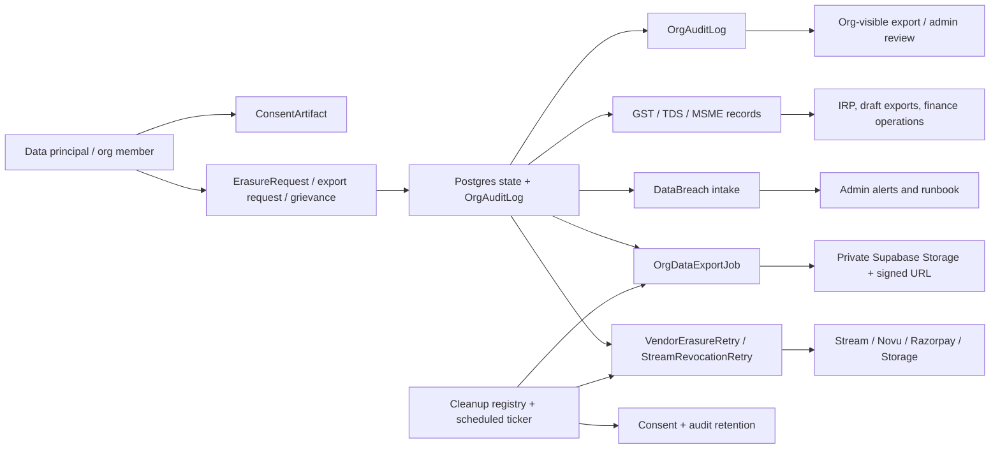

#### 7.1.1. Current and intended data separation

| Plane                      | Durable record                                | Main writer                      | Main reader or worker          | What the record proves                                          |
| -------------------------- | --------------------------------------------- | -------------------------------- | ------------------------------ | --------------------------------------------------------------- |
| Consent                    | `ConsentArtifact`                             | signup and consent routes        | `checkConsent` and exports     | A purpose-scoped grant or withdrawal was recorded               |
| Erasure                    | `ErasureRequest`                              | user intake and admin processing | admin queue and retry sweep    | A request was filed and local/vendor steps are tracked          |
| Processor work             | `VendorErasureRetry`, `StreamRevocationRetry` | `scrubUser` transaction          | `retry-moderation-enforcement` | A remote delete/revocation is owed, retried, or completed       |
| Organization access export | `OrgDataExportJob`                            | org export route                 | `processDataExports` worker    | An authorized bundle request and generated artifact lifecycle   |
| Breach                     | `DataBreach`                                  | admin intake                     | hourly deadline alert          | An incident was registered and its internal deadline is visible |
| Grievance                  | `DpdpGrievance`                               | authenticated intake route       | SystemEvent and manual ops     | A grievance was durably received                                |
| Tenant audit               | `OrgAuditLog`                                 | business mutation paths          | org role-gated UI/export       | Tenant-facing evidence of business/admin changes                |
| Engineering operations     | `SystemEvent`, `SystemJobExecution`           | runtime helpers and jobs         | admin/observability surfaces   | Technical failures and job-run outcomes                         |
| Tax identity               | tax satellites and payout/invoice rows        | payout/invoice flows             | finance jobs and operators     | Tax facts captured for downstream filing or reconciliation      |

These records have different readers and retention needs. A user-visible audit trail must not contain raw stack traces; an operational alert must not be presented as a statutory notice; and a processor retry must remain identifiable long enough to prove whether the vendor copy was removed.

### 7.2. Legal source and commencement boundary

The DPDP Act and Rules are the legal source; implementation dates must be read from the Gazette notification, not inferred from a code comment. The official 2025 Rules notification, G.S.R. 846(E) dated 13 November 2025, phases commencement: Rule 4 starts after one year, while Rules 3, 5–16, 22 and 23 start after eighteen months. The corresponding eighteen-month date is 13 May 2027. See the [MeitY Gazette notification](https://www.meity.gov.in/static/uploads/2025/11/53450e6e5dc0bfa85ebd78686cadad39.pdf). This design treats those dates as a delivery runway, not a claim that every obligation is already enforceable. Counsel owns determinations about role, lawful processing, retention basis, and required notice content.

The architecture records controls ahead of dates where practical. A record being present in Prisma is not evidence that its workflow is complete, and a future commencement date does not make a missing control irrelevant to the design.

### 7.3. Consent model

#### 7.3.1. Schema and writes

`ConsentArtifact` in `prisma/schema.prisma` records a subject, data fiduciary, one or more purpose codes, granted and withdrawn instants, notice version, language, optional consent-manager reference, a SHA-256 hash, and an audit-retention deadline. Its optional `userId` relation uses `SetNull`; `subjectPseudonymousId` supports retaining proof after the user row is scrubbed.

`lib/compliance/dpdp.ts:buildConsentArtifact` sorts purpose codes into a stable hash payload, includes user/fiduciary/version/time, and derives a seven-calendar-year deadline. Signup artifacts are built through `buildSignupConsentArtifacts`. The organization consent API records grants for the caller only. The organization route scopes records by the fiduciary identifier and membership, so one org cannot inspect another org's consent ledger.

#### 7.3.2. Processing gate

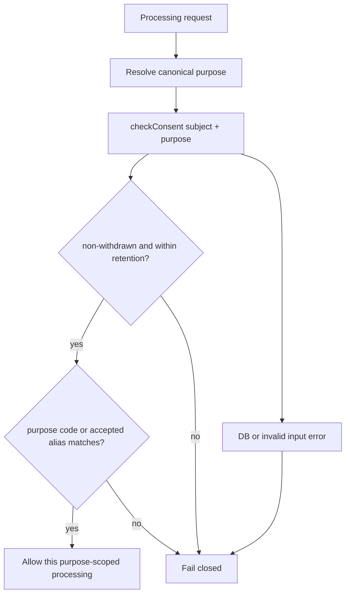

`checkConsent` and `checkConsentBatch` reject absent, withdrawn, expired, or unrelated purpose artifacts. Call sites include checkout validation, invitation acceptance, Stream initial tokens, and org export. `checkConsent()` accepts the caller's transaction client so it can use the occupied single connection safely. `checkConsentBatch()` currently uses the global Prisma client and must not be called from inside an interactive transaction that already holds that connection.

**Current limitation:** the gate does not compare artifact `version` with a current notice version, and `language` is stored without being checked against the presented notice. A write-only version field does not invalidate an old grant. The skill's known-gotcha record explicitly flags this. Before a notice-copy change is treated as a new grant, design a current-notice registry, version-specific prompt, and re-consent path; then gate on that registry. An isolated version-number bump would deny old users without providing the required active user flow.

`ConsentArtifact` also cannot distinguish “never asked”, “asked and declined”, “stale wording”, and “withdrawn” as separate states. The gate should continue to collapse them to denial, while the interface should retain enough state to explain the next user action. This is a modeling and UX gap, not a reason to weaken the gate.

#### 7.3.3. Withdrawal and retention

Withdrawal is an irreversible event on an artifact. Re-granting creates a new artifact; it does not rewrite the prior evidence. `withdrawConsent` can target a single purpose and accepted legacy aliases, moves `auditRetainedUntil` to at least seven calendar years after withdrawal, and clears Stream's local sync cache where relevant. Withdrawal does not erase already collected data by itself.

The `consent-retention-sweeper` registry job runs weekly on the Netlify ticker (Sunday 00:25 UTC) and counts expired rows; the ticker never sends the delete flag. Adding `?delete=1` to its cleanup route deletes them in bounded batches once the consent-proof archive exists; the admin system-jobs Run button passes no argument, so it only counts. The distinct `scripts/cleanup/prune-audit-logs.ts` policy prunes org audit rows at category-specific age thresholds: seven years for financial/compliance categories and two years for other categories. Neither worker is a general data-retention engine for every model.

| Transition       | Durable write                                     | Follow-up                                   | Failure behavior                                 |
| ---------------- | ------------------------------------------------- | ------------------------------------------- | ------------------------------------------------ |
| Grant            | New `ConsentArtifact` with purpose/version/hash   | Processing gate may use it                  | No row means denial                              |
| Withdrawal       | Set `withdrawnAt`; preserve/extend audit deadline | Stream cache forget; selected warning event | Gate observes withdrawal on next read            |
| New notice       | **Designed:** new version and fresh user artifact | Prompt all in-scope existing users          | Current code has no current-version invalidation |
| Expired evidence | Sweeper counts by deadline                        | Optional controlled deletion mode           | Count-only is default                            |

#### 7.3.4. Consent recommendations

Keep terms acceptance, privacy notice, and purpose consent as separate instruments. Use a purpose catalog as the only source of purpose names. Add notice-version enforcement together with the re-prompt journey and tests that cover an artifact for an older version. Model decline or “not yet asked” only where the UI or re-ask behavior needs that distinction. Preserve withdrawal proof through its own retention window. Read consent at the point of processing rather than trusting a value copied into an event or job payload.

#### 7.3.5. Consent change decision table

| Event                      | Record to create or update                           | Gate result                                                | Work still required                                                         |
| -------------------------- | ---------------------------------------------------- | ---------------------------------------------------------- | --------------------------------------------------------------------------- |
| Purpose introduced         | New notice artifact per subject and purpose          | Deny until new purpose grant exists                        | Notice, processor inventory, consent prompt, re-ask of existing members     |
| Member withdraws marketing | Set withdrawal on matching artifact                  | Marketing use denied; booking remains independent          | Stop future marketing fan-out and honor any queued email already staged     |
| Member withdraws booking   | Withdraw booking purpose and invalidate Stream cache | Future booking gate denies                                 | Preserve financial work already in flight and show a clear re-consent path  |
| Notice text changes        | New version and new grant                            | Current gate still accepts any matching live version today | Implement version-aware gate before treating this as effective invalidation |
| Member asks to erase       | Separate `ErasureRequest`                            | Consent is withdrawn as part of scrub                      | Remove or retain each non-financial copy under its own decision             |

The same user can hold more than one fiduciary relationship. An org-specific consent row is stamped with `org:<orgId>`; platform signup rows use `Familiarise`. Keep those scopes distinct in reads, exports, and revocation. A global user boolean would collapse who asked for which purpose. The stored fiduciary scopes are distinct, but the shared `checkConsent()` and `checkConsentBatch()` predicates currently filter user, purpose, withdrawal and retention without filtering `dataFiduciaryId`. An organization-scoped consent API does not make that shared processing gate fiduciary-specific. Define whether a purpose accepts the platform grant or requires an organization grant before adding a fiduciary predicate together with the corresponding consent prompt.

### 7.4. Erasure and processor off-boarding

#### 7.4.1. Intake, money gate, and scrub

A user files `POST /api/users/me/erasure-requests`; the route validates an optional reason, returns an existing open request when present, and otherwise writes `ErasureRequest(PENDING)`. The partial unique index in `prisma/sql` is the authoritative one-open-request guard. Admin queue routes allow a human to review, process, or reject the request with a reason.

Before the scrub, `app/api/admin/erasure-requests/[id]/process/route.ts` calls `moneyInFlightForUser`. It counts open consultant payouts, unsettled earnings, live disputes, and issued/overdue invoices on sole-owner orgs. The route also blocks a remaining sole active owner. These are correctness gates: losing the identity needed to settle an obligation can strand funds or leave a tenant without governance.

`lib/compliance/erasure/scrub-user.ts:scrubUser` uses one transaction for local changes and durable side-effect staging. It pseudonymizes name/email, clears contact and profile free text, removes sessions/accounts, erases active membership/collaborator posture, releases seats, and keeps financial/tax rows needed for statutory records. It records pseudonymous tenant audit rows and sends `member.removed` payloads with the pseudonymous identifier. `ERASURE_SALT` is mandatory in production. Repeating a scrub for an already-erased user preserves the local tombstone and retries external vendor cleanup.

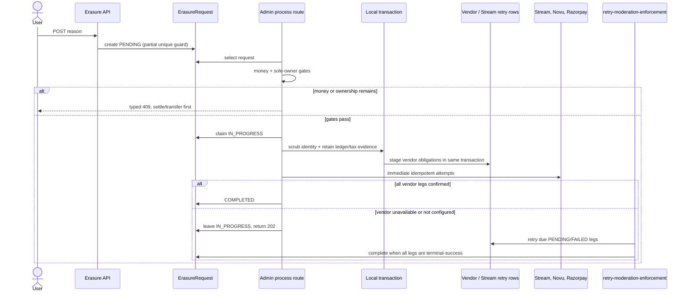

#### 7.4.2. External legs and recovery

`VendorErasureRetry` records NOVU, STREAM, or RAZORPAY work; `StreamRevocationRetry` records the Stream principal and collaborator-plan revocations. The transaction inserts these rows before external calls. Immediate attempts run after local commit. Failed rows carry attempts, next retry time, last error, and completion time.

The retry implementation is `scripts/cleanup/retry-moderation-enforcement.ts`. Although its job name is shared with moderation enforcement, it drains the erasure retry tables as well. `netlify/functions/cron-tick.mts` schedules `retry-moderation-enforcement` every thirty minutes; `lib/cron/cleanup-registry.ts` maps its HTTP twin to the same core function. When all open retry rows for an erasure request have succeeded, the sweep advances the request from `IN_PROGRESS` to `COMPLETED`. Errors and capped/old retries must remain visible to operators rather than silently changing the request to complete.

| Local state                 | Vendor state                    | Erasure request             | Recovery                                                           |
| --------------------------- | ------------------------------- | --------------------------- | ------------------------------------------------------------------ |
| Not scrubbed                | N/A                             | PENDING                     | Retry admin action after gates are cleared                         |
| Scrub transaction committed | Immediate call succeeds         | COMPLETED                   | No further action                                                  |
| Scrub transaction committed | Vendor fails or is unconfigured | IN_PROGRESS                 | Retry sweep after backoff; investigate missing credentials         |
| User already pseudonymized  | Prior vendor state uncertain    | IN_PROGRESS/open obligation | Idempotent re-run retries processor operations                     |
| Retry limit/age reached     | Vendor still uncertain          | Needs operator attention    | Review vendor logs and reconcile by reference; never infer success |

#### 7.4.3. Retained and erased data classes

The scrub preserves immutable payment, ledger, invoice, payout, refund, and tax rows; it clears user-facing identity and bank fields, but keeps processor IDs required to revoke or deactivate remote objects. It also withdraws live consent artifacts and stores a pseudonymous subject reference. A privacy response should explain what remains and the retention basis in plain language.

A complete data inventory must cover more than `User` and `ConsentArtifact`. `FailedEmail` stores recipient and rendered body for retry; `NotificationOutbox` stores recipients and payload; `EmailEvent`, `EmailSuppression`, `DpdpGrievance`, `DataBreach`, export jobs/objects, audit logs, and error telemetry may also contain personal data. `scrubUser` does not directly remove every such row. The separate privacy posture in `docs/compliance/02-dpdp-and-privacy.md` identifies Sentry as a live processor with an unresolved inventory/transfer/erasure assessment; this design does not treat its event store as erased when a local account is scrubbed. Each class needs a purpose, recipient, retention period, and erase/retain action; some should be cancelled or redacted during erasure, while others may need a documented legal or security basis to survive.

**Concurrency recommendation:** the admin process route reads a request and later changes its status to `IN_PROGRESS` with a normal update. A conditional `updateMany` claim on `status=PENDING`, checking that exactly one row changed, would prevent two admins from simultaneously processing one request. Evaluate the ordering of the money gate and claim so a concurrent retry cannot bypass either check. Keep the data gate and claim in one appropriately scoped transaction if the final design requires it.

### 7.5. Data access and exports

#### 7.5.1. Org export lifecycle

`OrgDataExportJob` stores the requested kind, status, size, expiry and attempt timestamps. New jobs are `PEOPLE` or `FINANCE`; legacy `FULL` requires both grants. PEOPLE permits OWNER/MAINTAINER and FINANCE permits OWNER/BILLING_ADMIN, as derived by `lib/enterprise/data-export-kinds.ts`. The POST route limits requests per organization and transactionally creates the job with its audit. Customer-visible failure text is fixed safe prose; system events hold engineering diagnostics.

The ten-minute ticker and cleanup registry call the same implementation in `scripts/cleanup/process-data-exports.ts`. A fail-closed Postgres lease bounds normal overlap. A conditional claim admits PENDING or stale PROCESSING work and assigns a distinct `startedAt` attempt token. Terminal writes require the matching status and token. An independent `OrgDataExportArtifact` owner is retained before upload; its exact immutable path prevents a late attempt overwriting its successor. The requester must still hold the required grant before generation.

READY, its audit and existing email/bell outbox obligations commit together on the transaction client. Delivery runs after commit through existing relays. A notice failure cannot write FAILED over READY. The JSON bundle is held in memory; one job per invocation bounds rows, not bundle size or memory use. Consent filtering and the field-level export inventory remain privacy verification requirements.

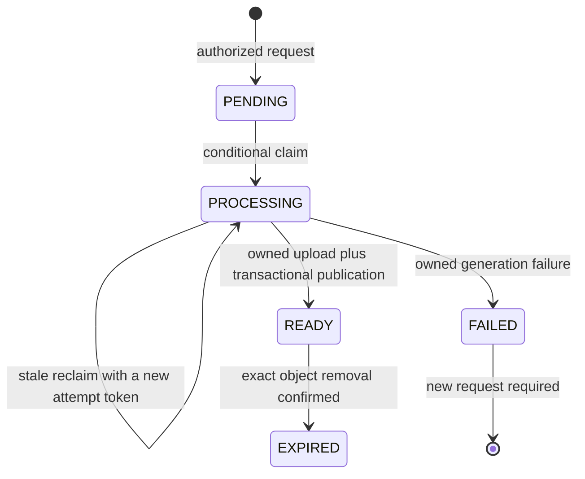

#### 7.5.2. Download authorization and object ownership

Notices open the authenticated export panel. The download route checks current org access, role, kind, READY, expiry and the matching artifact owner before requesting a signed URL. It never serves the legacy stored `fileUrl`. The requested lifetime uses a fresh clock after the owner lookup, a sixty-second cap and the remaining artifact lifetime. Expiry during signing or audit latency returns 410 without returning the URL. Responses are private, no-store and vary by Cookie.

`DATA_EXPORT_DOWNLOAD_REQUESTED` records the authorized signing attempt; it does not prove that the URL was returned or the recipient read any bytes. Already issued links remain subject to the provider's token and caching contract. Revoking an org role prevents a new authorization but does not revoke an existing bearer token. Historical `DATA_EXPORT_DOWNLOADED` rows are not rewritten or treated as proof of recipient delivery.

Every attempt retains its exact bucket/path owner for seven days, including failed publication and superseded attempts. The owner deliberately survives parent deletion. The same worker rotates at most ten eligible deletion attempts, skips the exact currently PROCESSING attempt and retains failed obligations. After removal reports success, `info()` must return key-specific `NoSuchKey`; a generic 404, missing bucket or ambiguous HEAD result cannot retire the owner. Only confirmed absence permits transactional owner removal and EXPIRED on the matching published job.

#### 7.5.3. Operations and remaining limits

| Boundary                     | Implemented behavior                                                  | Operating requirement                                                                                                                  |
| ---------------------------- | --------------------------------------------------------------------- | -------------------------------------------------------------------------------------------------------------------------------------- |
| Worker interruption          | Reclaim a stale PROCESSING attempt with a new fenced token            | Confirm automatic completion; a recent no-op is not backlog proof                                                                      |
| Publication/delivery failure | Preserve atomic READY and durable notice obligations                  | Inspect the existing relays and actual recipient delivery                                                                              |
| Artifact expiry              | Rotate exact owners and retain failed deletion work                   | Inspect remote absence and oldest outstanding deletion age                                                                             |
| Download expiry/revocation   | Current grants and short new URL; refuse issuance after deadline      | An issued bearer URL follows provider validity/caching                                                                                 |
| Deployment/rollback          | Additive owner table before the new reader; no retrospective adoption | Owner applies only reviewed additive SQL and reads back the catalog; reset mock data before cutover and preserve ownership on rollback |
| Large organizations          | One selected bundle is built in memory                                | Measure representative size, runtime, transport and outage catch-up                                                                    |

The exact rollout and failure contracts live in [data exports](../enterprise/40-compliance-and-data/03-data-export.md), [worker recovery](../maintenance/12-worker-recovery.md) and [operating gates](../maintenance/13-readiness-and-operating-gates.md). Code and mocked tests establish implementation behavior; they do not establish the applied schema, deployed throughput, storage permissions or recipient receipt.

#### 7.5.4. Privacy-safe audit surfaces

`OrgAuditLog` is tenant-facing and append-oriented during its retention period; old category records can be pruned. `lib/enterprise/audit-sanitize.ts` scrubs read projections so engineering exceptions and stack traces do not leak to customer operators. `SystemEvent` is admin-facing technical telemetry. The split is important: tenant activity records answer “who changed this org state”; system events answer “which job or service failed.” Keep raw provider errors in the engineering channel, redact contact/payment secrets, and do not capture per-row telemetry from loops.

Audit pruning in `scripts/cleanup/prune-audit-logs.ts` writes a per-org `AUDIT_PRUNED` summary and removes rows by category window. This is not a substitute for retaining immutable ledger rows or for a per-data-class erasure decision.

### 7.6. Breach and grievance workflows

#### 7.6.1. Data breach

`DataBreach` records detection time, affected user IDs, root cause, a Board reference, Board-report time, and principal-notification evidence. `POST /api/admin/data-breaches` requires the compliance permission and creates a record with `detectedAt=now`; `GET` exposes the count of affected people rather than their IDs.

The `databreach-deadline-alerts` registry job runs hourly on the Netlify ticker (at :15 UTC). At twelve hours or less before the configured seventy-two-hour interval, it alerts admins through Novu, guarded email delivery, and ops chat. It sorts oldest incident first and links the compliance dashboard. It is an internal alert path. Source review found no Board filing connector or route that writes `reportedAt`, no route that writes `principalsNotifiedAt`, and no affected-person notification path. Therefore the implemented control starts the clock and reminds staff; it does not itself prove Board or principal notice was sent.

The Rules Gazette contains the applicable commencement schedule. Use the [official notification](https://www.meity.gov.in/static/uploads/2025/11/53450e6e5dc0bfa85ebd78686cadad39.pdf) to plan delivery, and get counsel to confirm required notice content and the operational meaning of detection. Do not label an internal email as a completed statutory report.

#### 7.6.2. Grievance

`POST /api/compliance/grievances` requires a signed-in user, applies a spam limiter, validates subject/description through Zod, writes `DpdpGrievance`, and emits a `SystemEvent`. This is durable intake, not a complete case-management workflow. The model and route lack assignment, response/closure timestamps, published due date, a user-facing status view, and deadline escalation. Current code comments explicitly defer the redressal SLA workflow.

Rule 14, scheduled to commence on 13 May 2027, includes a grievance redressal period described as reasonable and capped at ninety days. The intake row does not by itself assign a handler, stop that clock, or record a response. Confirm the current notification and published service promise with counsel before turning the ninety-day ceiling into a product SLA.

Recommended smallest operational design: assign an accountable role, retain received/response/closure timestamps and a state, surface the user's reference and status, alert before the published deadline, and write auditable response/closure evidence. Keep the legal timeline and published customer promise in one reviewed source. Do not add a larger state machine until the complaint-handling flow needs it.

### 7.7. GST, IRP, TDS, MSME, and RBI posture

#### 7.7.1. GST and e-invoice

`OrganizationTaxInfo` holds legal name, GSTIN, state, registration status, HSN/SAC default, PAN ciphertext, and last four. `lib/compliance/gst.ts` computes place of supply and output-tax split. `OrganizationInvoice` stores CGST/SGST/IGST and e-invoice state; `CreditNote` ties a refund to an idempotent credit note. The worker `jobs/compliance/irp-uploader.ts` calls the ClearTax connector only when `ENABLE_IRP_UPLOADER` and the credentials are present; the missing-credential path is a failed/retry result.

Official IRP materials describe the ₹5 crore turnover cohort for e-invoicing from August 2023, subject to the applicable financial-year lookback, exemptions and document scope, and a 30-day reporting window for AATO ₹10 crore and above from April 2025. Verify current details against [IRP notifications](https://einvoice6.gst.gov.in/content/notifications/) and the [30-day advisory](https://einvoice6.gst.gov.in/content/revised-time-limit-for-e-invoice-reporting-for-businesses-with-aato-of-%E2%82%B910-crores-above/) when changing the pipeline. Current gap: the uploader scans organization invoices, while the payload mapper emits invoice type `INV`; credit/debit note IRNs are not implemented. The Sec. 34 cutoff is partly enforced: `lib/compliance/gst-credit-note-cutoff.ts` and credit-note callers implement the 30 November IST deadline and commercial/no-tax treatment after it. The earlier annual-return-date alternative is explicitly not tracked; it must not be described as a fully resolved eligibility test. These are explicit scope gaps, not assumptions that the connector is a filing system.

#### 7.7.2. TDS

Payout flows snapshot withheld amount/rate and write `TDSRecord`; refund/chargeback reversals have a signed negative record and a written `TdsAdjustment` artifact. The current draft exporter consumes `TDSRecord`, not `TdsAdjustment`; creating that adjustment row does not itself apply it to a filed return. `TdsRate` stores law code (`IT1961` or `IT2025`), internal section label, effective dates, basis-point rate, and optional payment code. `lib/compliance/tds.ts` resolves rates by law/effective date. The draft job produces a masked draft and a private PAN CSV; it does not submit a validated return or complete the filing stamp.

The CBDT's [official FAQ](https://www.incometax.gov.in/iec/foportal/help/all-topics/e-filing-services/%20tds%20compliance-faq) is the current source for the Income-tax Act 2025 filing boundary and code mapping. Keep internal section identifiers separate from filing payment codes. The return exporter documentation explicitly leaves final FVU/portal submission and some section mapping for CA sign-off. Do not infer a payment code from third-party examples or call a generated draft a filed return.

#### 7.7.3. MSME

`OrganizationMsmeInfo` and consultant tax fields classify the supplier and written-agreement state; `mustPayByDate` is stored on payout rows. `lib/compliance/msme.ts` computes the system deadline, and `jobs/compliance/msme-payment-alerts.ts` alerts on payouts within five days. The alert is a warning, not settlement. Current implementation does not accrue statutory interest and uses stored classification/evidence rather than live registry verification. The [MSME Samadhaan portal](https://ramp.msme.gov.in/ramp/RAMP-initiative/msme-samadhaan/msme-samadhaan) is the official reference for operational guidance.

Before relying on a calculated date, preserve evidence for supplier category, written agreement, and the underlying acceptance/service date used by the legally approved rule. The implementation uses invoice/payout dates; legal/finance owners should confirm that this start event is correct for each supplier workflow. Surface at-risk items early enough to clear them before settlement deadlines.

#### 7.7.4. RBI payment-aggregator classification

The current documented product posture is principal: buyers pay Familiarise through a gateway; platform receipts become platform liabilities; consultants and host orgs are paid later from the platform's payout account. The design states there are no Razorpay Route linked accounts or pass-through transfers in the active payment code. This is a classification tied to contracts, accounting, and live behavior, not a permanent label.

Use the current [RBI PA/PG directions](https://www.rbi.org.in/Scripts/BS_ViewMasDirections.aspx?id=12896). Reassess before introducing direct settlement, split settlement, collection on behalf of a supplier, or language that makes the platform an intermediary. Keep legal analysis with counsel and ensure product copy, ledger treatment, and processor configuration tell the same story.

### 7.8. Recommendations by decision owner

| Decision                  | Current evidence                             | Smallest sound next step                                                    | Why                                                                       |
| ------------------------- | -------------------------------------------- | --------------------------------------------------------------------------- | ------------------------------------------------------------------------- |
| Consent notice versioning | version stored, gate ignores version         | Implement notice registry and re-consent UX together                        | Avoid silent old-copy grants and avoid locking users out without a prompt |
| Erasure concurrency       | money gate plus non-CAS status update        | Atomic request claim, then re-evaluate gates as needed                      | Prevent two admins running one scrub concurrently                         |
| Local data inventory      | core User scrub and processor outboxes exist | Classify each email, notification, grievance, breach, export, and audit row | Avoid blanket claims while preserving records with a clear basis          |
| Export coverage           | people consent filter, TODO on fields        | Publish versioned field manifest and complete field-level scope             | Make the bundle useful and privacy-correct                                |
| Breach workflow           | internal deadline reminders only             | Add operator attestation for Board and principal notifications              | Timestamp/reference evidence is missing today                             |
| Grievance workflow        | authenticated durable intake only            | Add assignment, due/response/close evidence and user reference/status       | Intake alone does not complete redressal                                  |
| GST/IRP                   | B2B invoice upload, no credit note IRN       | Confirm threshold cohort and add note type only when in scope               | Avoid filing the wrong document class                                     |
| TDS                       | draft export and payment-code lookup         | CA-reviewed code table plus validated filing process                        | A local draft is not a tax return filing                                  |
| MSME                      | computed dates and alerts                    | Verify classification/agreement and start-date evidence                     | A reminder cannot prove payment by deadline                               |
| PA posture                | principal flow documented                    | Treat every settlement/product change as a reclassification trigger         | The conclusion depends on deployed contracts and money movement           |

## 8. Operations and integrations

This guide explains the operational machinery around the enterprise platform: scheduled work, leases, monitoring, vendor boundaries, and host portability. It follows the runtime that exists in source and calls out mismatches with older runbooks. It does not replace a job's domain design; follow [`docs/enterprise/50-operations/`](../enterprise/50-operations/01-api-reference.md) and the relevant subsystem docs before changing a worker.

The central operational design is a durable database state plus a bounded worker. The scheduler asks the app to process a slice; the app authenticates, checks maintenance, acquires a Postgres lease, runs the shared core, and records a result. External calls occur after the business state is durable or through an outbox whenever loss between commit and delivery would be material.

### 8.1. Operational architecture

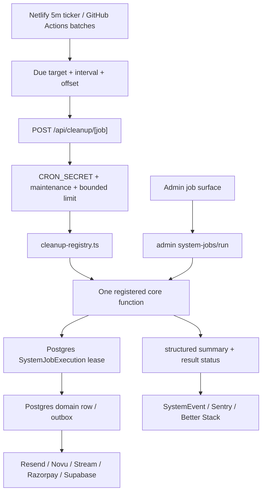

#### 8.1.1. Component responsibilities

| Component                         | Responsibility                                                         | Does not own                                       |
| --------------------------------- | ---------------------------------------------------------------------- | -------------------------------------------------- |
| Platform scheduler                | Chooses when to invoke a worker                                        | Business mutation rules                            |
| `netlify/functions/cron-tick.mts` | Runs due fast/recovery targets with limits, offsets, and timeouts      | Domain state transitions or retries within one job |
| GitHub Actions                    | Runs daily/weekly and selected hourly jobs                             | The shared job's business logic                    |
| `/api/cleanup/[job]`              | CRON bearer auth, maintenance refusal, standardized status and logging | A parallel copy of the worker                      |
| `lib/cron/cleanup-registry.ts`    | Maps a stable job slug to its core function and summary mapping        | A standalone second implementation                 |
| `withCronLock`                    | Excludes overlapping runs and records lease/outcome                    | Request-level rate limiting                        |
| Domain core                       | Claims rows and performs idempotent steps                              | Fleet scheduling policy                            |
| `SystemEvent` / observability     | Exposes operational failures and summaries                             | Tenant-facing business audit                       |

The root `AGENTS.md` is the canonical architecture authority: one implementation function is registered in `lib/cron/cleanup-registry.ts`; the cleanup route and admin runner are dispatch surfaces. Do not add new three-layer job wrappers. Preserve existing GitHub Actions/standalone entrypoints where they are already part of deployed scheduling, but they must call the same core and lease.

### 8.2. Scheduled work and bounded execution

#### 8.2.1. Fast ticker

`netlify/functions/cron-tick.mts` runs every five minutes. Its target list includes payment recovery/reconciliation, outbound webhook dispatch, email and Novu outboxes, booking sweeps, export generation, erasure/moderation retry, and other time-sensitive work. A target can run every tick or at a configured cadence with a minute offset. The code bounds per-target batch size and request duration and fans targets out concurrently. Ticker output distinguishes successful, lock-held/maintenance, and failed targets; lock contention is an expected skipped run.

The ticker always responds successfully after target execution and reports failures through structured output and bounded alerting. This avoids a scheduler retrying every target three times after one target returns a 5xx. Each target itself must expose its failure status and summary; the ticker's 200 is not a signal that all targets succeeded.

#### 8.2.2. Batch schedules

The active platform ticker owns every registered job, including audit pruning, consent retention and breach deadline alerts, money reconciliation, payouts and statutory exports, in bounded slices. GitHub Actions keeps CI/CD, the cron heartbeat, the live-database drift check and the security audit. A configured workflow does not prove a recent successful run. Read the executable schedules and the [job inventory](../maintenance/04-cron-jobs-reference.md) before changing ownership; a lease does not prevent sequential duplicate executions.

| Work category            | Examples                                                        | Current scheduling shape                              | Recovery signal                                  |
| ------------------------ | --------------------------------------------------------------- | ----------------------------------------------------- | ------------------------------------------------ |
| Latency-sensitive repair | payment confirmation, refund/status reconcile, earnings release | Netlify 5m tick, selected 10–30m cadence              | target status, row backlog, system event         |
| Delivery outbox          | outbound webhooks, Resend, Novu                                 | Netlify ticker with target limits                     | pending/retry/dead-letter counts                 |
| User lifecycle sweeps    | booking reminders/expiry, Stream erasure                        | Netlify ticker at configured interval                 | summary counts and retry rows                    |
| Data export              | `process-data-exports`                                          | 10m ticker target                                     | `OrgDataExportJob` state and summary             |
| Statutory monitoring     | breach deadline, MSME risk                                      | breach alerts and MSME risk: ticker                   | structured alert + admin queue                   |
| Money batch              | ledger, payout, tax/accounting exports                          | bounded ticker slices or authenticated manual batches | completed report, execution evidence and backlog |
| Retention                | audit and consent records                                       | ticker target at its configured interval              | deleted/count summary and retention backlog      |

#### 8.2.3. Cron lease and job execution

`lib/cron/with-cron-lock.ts` uses `SystemJobExecution` as the lease record. A unique partial index in `prisma/sql/check-constraints.sql` admits one recent `RUNNING` row per job name. A run first marks expired leases failed, then checks for an active row and inserts a new `RUNNING` record. A successful callback result marks the row completed. A resolved result with `success === false` or `overallSuccess === false` also marks it FAILED; thrown errors mark it failed and truncate stored error details. A heartbeat is written to Redis on success, but Postgres remains the authoritative lease and execution trail.

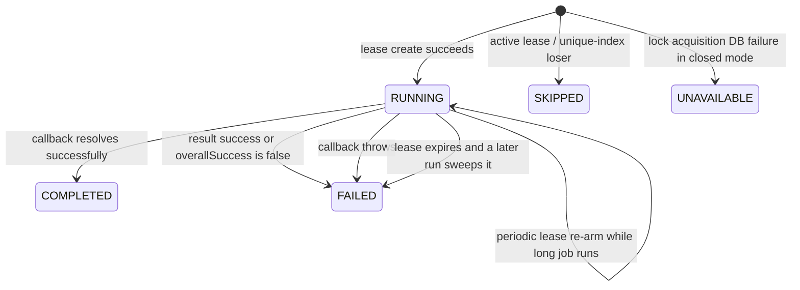

Jobs choose `failMode` based on the cost of duplicate or missed execution. Repeat-safe cleanup and reporting often fail open for a non-connection lock error; money jobs or retry budgets fail closed if executing without a lease could create duplicate money or burn attempts. Pool exhaustion and database connectivity failures do not become an unlocked run. The distinction is job-specific and should be reviewed whenever a side effect changes.

A lock prevents overlapping workers; it does not by itself make each row transition correct. Row claim logic still uses conditional updates/unique keys and idempotency. Use Postgres for the fleet lease; Redis is for request limits, maintenance/fleet edge state, and short-lived interactive mutexes, not for adding a second cron lock.

Job owners should choose a lease longer than the expected execution ceiling, including cold start and slow external calls. For jobs that may exceed the lease, the helper periodically re-arms its timestamp; the workflow timeout and lease TTL must still agree. A database outage in lock acquisition is not the same as “no overlapping job”: closed-mode jobs refuse to execute, and open-mode jobs only continue for non-connection errors where duplicate work is acceptable. Do not turn a pool timeout into an unlocked payment or retry run.

`SystemJobExecution.result`, `itemsProcessed`, and `errorCount` are optional summaries, while many workers also log their own counters. Prefer a stable summary object with counts and identifiers rather than storing a large result payload or raw provider response. Store bounded diagnostics in `errorLog`; put sensitive incident detail in the restricted engineering event channel. If a row-level sweep encounters many failures, collect them and emit a single run-level report.

Use correlation IDs to join a job execution to the domain row and, where available, the vendor request. A correlation ID should be opaque and stable; it should not encode an email address, PAN, or endpoint secret. The admin surface should show enough status for triage without copying provider payloads into a tenant-visible row.

### 8.3. Cleanup API and admin execution

`app/api/cleanup/[job]/route.ts` resolves a slug through `getCleanupJobHandlers`. The shared `cleanupRoute` factory validates `CRON_SECRET` (or supported Vercel cron secret), checks maintenance, parses and clamps `limit`, emits run logs, and maps results to HTTP status. A lock loser is 409; maintenance is a deliberate refusal; real callback failure is 500; a successful run with an operator-attention condition can be 207.

`/api/admin/system-jobs/run` provides a staff-controlled execution path for registered jobs; `/api/staff/system-jobs/executions` exposes job history. Both routes should dispatch the same core used by the scheduled endpoint. Permission checks and the job's lock remain in force for manual runs, and off production the run refuses with 409 `JOB_RUN_PRODUCTION_ONLY`. Do not add a separate admin-only implementation or bypass the lease for convenience.

For cleanups that use `?limit=`, the shared parser rejects malformed present values, clamps to a maximum, and lets jobs set a bounded default. Bounded work is especially important on a serverless host: a large database cohort or slow vendor could otherwise outlive the function timeout. Ensure oldest-first work can drain over successive runs and that retry rows keep their own due time.

#### 8.3.1. Cleanup invocation decision

| Trigger                        | Authentication                          | Expected lock behavior                   | Result to caller                      |
| ------------------------------ | --------------------------------------- | ---------------------------------------- | ------------------------------------- |
| Scheduled ticker               | `CRON_SECRET` bearer token              | Existing lease returns a held/409 target | Tick records target in lock-held list |
| Cleanup HTTP twin              | Same bearer check and maintenance guard | Shared core acquires the same lease      | 200/207 success or 5xx on failure     |
| Staff job runner               | Staff permission plus registered job    | Same core lease; one execution record    | Admin sees execution summary/state    |
| Standalone workflow entrypoint | GitHub environment secrets              | Same core-level lock where wired         | Workflow summary and exit status      |

Avoid an undocumented “run this script directly” recovery step where the core already has a registered route. Direct invocation may skip HTTP authorization, route maintenance handling, or an operator-facing execution record. If a standalone job is required for a workflow, verify it imports the registered core function and retains its lease and `$disconnect()` behavior.

#### 8.3.2. What to do when the run stalls

1. Check `SystemJobExecution` for a recent RUNNING row and its `startedAt` before rerunning.
2. Check the job's domain table for rows claimed by that execution; a completed lease does not mean each external call completed.
3. If the lease is fresh, wait or inspect logs; do not manually flip it while the worker may still be running.
4. After the configured TTL expires, a subsequent lease attempt marks the old run failed and can proceed.
5. Compare the row's provider reference with provider-side state before replaying an ambiguous call.
6. Confirm the new execution and domain rows reach expected terminal or retry state.

### 8.4. External delivery boundaries

#### 8.4.1. Transactional email and Resend

All transactional sends flow through `lib/email/deliver.ts`, honoring the pre-launch delivery guard, suppressions, sender policy, and failure persistence. `FailedEmail` stores the already-rendered subject/body and recipient so retry is a verbatim resend; single-use credentials are stored redacted and are not replayed. `FailedEmailBatch` stores a serialized batch with an idempotency key. `EmailEvent.svixId` is unique for Resend event replay, while `EmailSuppression` records hard bounce, complaint, or manual suppressions.

The email retry worker is invoked by the shared ticker. It moves rows through pending/retry/sent/dead-letter behavior and emits counts for operations. Dead letters require operator review/replay rather than endless retries. The root email invariant requires every recipient to pass through `deliver()` or the explicit newsletter batch guard.

Privacy consequence: retry rows contain contact and message content. Include them in the data inventory and define how erase requests cancel, redact, or retain already queued notices. Retain enough to deliver necessary service/erasure notices, but prevent a stale row from sending marketing after consent withdrawal or erasure.

#### 8.4.2. Novu notifications

Novu is a hosted notification service, backed locally by `NotificationOutbox`. `lib/novu/outbox.ts:stageTrigger` creates an outbox record in the business transaction where possible, derives a stable transaction ID, and attempts delivery inline after the commit. A ticker relay retries due rows through the same trigger path. The unique transaction ID plus vendor idempotency avoids duplicate notification effects after an ambiguous timeout. `notBefore` is set only by a producer that schedules a notification (there are no in-app quiet hours); terminal errors dead-letter. `jobs/notifications/drain-notification-outbox.ts` tracks pending, retried, dead-lettered, and lag metrics.

Notification targets and payloads are allowlisted by workflow/template code. The row itself contains recipient IDs and payload, so keep it private and within a declared retention window. A Novu trigger failing must not roll back a completed invoice, membership, or payout transition; the outbox retains the notification obligation for later recovery.

The integration map currently says “No Prisma — Novu is external (queued via NotificationOutbox).” That sentence is internally inconsistent: `NotificationOutbox` is a Prisma model and is the durable local queue. The accurate interpretation is that the provider is external and the trigger outbox is local. Preserve the distinction between Novu workflow IDs used in code and workflow-family names/templates managed in the console; the console families carry no step conditions, because preferences are enforced server-side (`lib/novu/policy.ts`); see `docs/notifications/01-architecture.md` for the design.

#### 8.4.3. Stream

Stream provides chat, calls, and recording/video service boundaries. Local entitlement and consent gates are applied before access/token creation. The erasure scrub persists principal and collaborator revocation work in retry tables before reaching Stream. Recording storage/removal has separate object-storage operations and status machines; a Stream API success does not prove every R2/Supabase artifact is gone. Keep each external deletion result explicit and retry the local durable task.

Stream webhooks are inbound; validate signature and retain the event receipt/idempotency before side effects. They differ from enterprise outbound webhooks. Stream outages should produce retryable status or a reported system event, not a successful local state that silently leaves access active.

#### 8.4.4. Enterprise outbound webhooks

The `OutboundWebhookDelivery` row is the durable queue. `lib/enterprise/outbound-webhooks/dispatch.ts` writes pending deliveries in the same transaction as the org mutation; `lib/enterprise/outbound-webhooks/worker.ts` claims due rows atomically and sends a signed POST. Current events include membership, invoice, payout, contract, and program lifecycle changes. A delivery ID remains stable across attempts so receivers can deduplicate.

```mermaid
sequenceDiagram
  participant Route as Business route
  participant DB as Postgres + delivery row
  participant Worker as dispatch-outbound-webhooks
  participant Receiver as Customer endpoint
  Route->>DB: business mutation + PENDING delivery in same transaction
  Worker->>DB: read due row, CAS claim IN_FLIGHT
  Worker->>Worker: resolve public HTTPS address + sign exact body
  Worker->>Receiver: POST, no redirects, bounded timeout
  alt 2xx
    Worker->>DB: SUCCESS + deliveredAt, reset endpoint failure count
  else permanent 4xx
    Worker->>DB: FAILED, audit delivery failure
  else timeout / network / 5xx / 408 / 429
    Worker->>DB: RETRY with backoff, or DEAD_LETTER at cap
  end
  Note over Worker,DB: stale IN_FLIGHT rows are re-queued after the stale window
```

Security controls are layered. Endpoint creation and each delivery validate the destination. `lib/enterprise/outbound-webhooks/ssrf-guard.ts` requires HTTPS and port 443, blocks special/private IPv4 and IPv6 ranges, resolves DNS and pins a public address for the connection, and redirects are manual/disabled. This prevents redirect-based SSRF and DNS changes between validation and dial. Retain every layer when changing fetch/runtime code.

`lib/enterprise/outbound-webhooks/signing.ts` uses HMAC-SHA256 over the timestamp and exact JSON body. Each attempt is signed with a fresh timestamp and the receiver's replay window is five minutes. Secret rotation dual-signs with old and new values for 24 hours. Transient retry backoff is jittered; permanent 4xx is terminal FAILED; exhausted transient attempts are DEAD_LETTER. A worker recovers stale `IN_FLIGHT` rows and uses a guarded claim so overlapping ticks do not double-send.

**Documentation drift:** `docs/enterprise/40-compliance-and-data/04-outbound-webhooks.md` still says 9-hour replay tolerance, 10-second timeout, and describes exhausted retries as FAILED. Code uses five minutes, 4.5 seconds, and DEAD_LETTER for exhausted transient attempts. Reconcile the contract and operational tables to source. Endpoint and prior rotation secrets are stored in schema string fields; evaluate field-level protection and ensure event/audit logs do not expose the stored secret. Current worker events include endpoint URLs in some diagnostics, so ensure query strings cannot carry bearer data before logging them.

The signed body includes an event type, creation time, delivery identifier, and event-specific data. Secret rotation is an operator action gated to OWNER and returns the new secret once. Receivers must accept either signature during the grace interval and deduplicate the delivery identifier. Redelivery should retain the original logical event identity or clearly create a new attempt identity according to the receiver contract. Pausing or disabling the endpoint stops queued work; document that the row fails and requires explicit re-delivery after reactivation.

`lib/enterprise/outbound-webhooks/ssrf-guard.ts` returns one resolved public address and the worker supplies it to the HTTP connection lookup. This matters because DNS resolution is repeated at send time: validating only at endpoint creation would allow the target to change later. Redirects remain disabled because a public endpoint could otherwise redirect to a private host after validation. Tests should retain cases for DNS rebinding, IPv4-mapped IPv6, IPv6 special blocks, malformed literals, redirects, and custom fetch behavior.

### 8.5. Event channels and observability

#### 8.5.1. Tenant audit versus engineering event

`OrgAuditLog` is scoped to an organization and is visible to authorized tenant members. It captures business and administrative actions, with a sanitized read projection. `SystemEvent` is an engineering/admin record for technical errors and job failures. Keep these channels separate: a customer-facing audit should not reveal Prisma error text, stack frames, vendor credentials, or internal infrastructure details.

`lib/enterprise/system-events.ts` writes the database record as the source of truth; Better Stack is an optional external sink when enabled and configured. Sentry captures bounded operational exceptions. Sweeps should aggregate failures and report once per run rather than consuming quota per row. The ticker itself records target-level failures at a bounded cadence and excludes the Sentry canary from self-reporting through the failing sink.

#### 8.5.2. Job summaries and signals

A job's summary should answer how much work it examined, completed, retried, failed, and left for operators. Monitor backlog age and terminal failures, not only process exit. An empty or absent progress signal can be a failure even when the worker did not throw.

| Work              | Primary signal                                       | Escalate when                                                         |
| ----------------- | ---------------------------------------------------- | --------------------------------------------------------------------- |
| Cleanup lease     | `SystemJobExecution` status/time/duration            | stale RUNNING row, repeated failure, or job stops advancing           |
| Outbound webhooks | due count, RETRY/DEAD_LETTER, endpoint failure count | backlog age rises or endpoint auto-disables                           |
| Email             | PENDING/RETRY/DEAD_LETTER counts and provider event  | legal/transactional email remains unsent or bounce/complaint rises    |
| Novu              | outbox lag/pending/dead-letter metrics               | notifications queue past the business SLA                             |
| Erasure           | open requests and retry-row age                      | IN_PROGRESS request has no completed vendor legs or retry reaches cap |
| Export            | PENDING/PROCESSING/FAILED counts and job age         | request remains PROCESSING or failed upload cannot be retried         |
| Breach            | unreported incidents and elapsed time                | internal alert window reached or statutory notice evidence absent     |
| MSME              | at-risk payouts and must-pay date                    | due date is near and payout is incomplete                             |
| IRP/TDS           | pending invoice upload or draft-export result        | upload retry stalls, or filing owner has no validated artifact        |

`docs/enterprise/50-operations/03-monitoring.md` lists many useful signals, but align each metric and schedule with the currently deployed ticker/workflow rather than treating old prose as runtime configuration.

### 8.6. Storage and signed URLs

Use private buckets for finance artifacts, recordings, and exports. The service role belongs only in server runtime code; never expose it to the browser. For large binary uploads/downloads above 4 MB, use Supabase direct signed upload/download URLs as required by `AGENTS.md`, so application functions do not proxy the bytes. The export worker writes its JSON object to Supabase Storage and creates a seven-day signed URL; the API checks caller permission and audits the download before returning it.

Signed URLs are bearer capabilities: keep their lifetime short, avoid logging the full URL, and do not store them in a public response cache. Decide whether expired export objects are deleted and how long job metadata remains. A record marked EXPIRED without deleting an object leaves data in storage; deleting the database row without deleting the object also leaves data behind. Treat row and object lifecycle together.

Keep the service-role API in server-side workers only. Large objects should travel directly between the browser and storage using scoped signed URLs; an application proxy adds memory, timeout, and serverless egress pressure. For each upload path, the row must bind the storage object to its authenticated user or organization, and a later read must re-check current access instead of trusting a signed URL or stale client state. Do not expose a storage path as a public URL when a signed URL is required.

### 8.7. Platform portability and fleet scheduling

#### 8.7.1. Runtime contract

The root `AGENTS.md` defines the portability contract: preserve Netlify standby files alongside container/platform configuration; use `PG_POOL_MAX=1` on single-invocation serverless and a bounded 5–10 pool on multi-request hosts; trust client-IP headers by runtime; include `Vary: Cookie` with `Netlify-Vary` for public cookie-aware routes; apply sharp exclusions only on the supported serverless hosts; and send large binary traffic through direct signed storage URLs.

`lib/prisma.ts` checks that `PG_POOL_MAX` is configured on Netlify and builds the bounded client. Any helper called inside an interactive transaction must use the supplied `tx` client. A global Prisma read while the single pool connection is held can wait on itself and time out. This rule applies to consent checks, event writes, authorization lookups, and utility helpers, not just code that visibly calls `$queryRaw`.

#### 8.7.2. Fleet scheduler switch gap

Deployment docs and the root agent contract describe an Upstash REST key named `ops:active_cron_platform` to make only the active platform run the scheduled ticker. In the inspected source, `netlify/functions/cron-tick.mts` checks `CRON_SECRET`, computes due targets, and invokes them; no read of that fleet key appears in the function, its source dependencies, or another scheduler route. No `/api/cron/tick` implementation was found in the assigned worktree. Treat the sub-millisecond fleet switch as a **design requirement that is not demonstrated by the inspected runtime**, and verify the exact deploy SHA and hosting setup before failover. Running both active and standby schedulers can duplicate work; leases reduce overlap but are not a substitute for ownership if multiple platforms use separate databases or different job names.

**Recommendation:** implement or verify a single shared ownership check at every scheduler entrypoint, with a short bounded timeout and explicit outage policy, and test active-host, standby-host, missing key, Redis timeout, and transition states. Keep Postgres job leases as the second line. If current failover intentionally relies on a manual scheduler pause, document that RTO and operator step instead of claiming an automatic switch. Do not add a new scheduler wrapper without updating the canonical registry and portability tests.

#### 8.7.3. Request IP and cache variation

Edge middleware resolves the client IP once with `edgeClientIp` in `lib/request-ip.ts`: `x-vercel-forwarded-for` on Vercel, `fly-client-ip` on Fly, and otherwise the rightmost `x-forwarded-for` hop, which is the visitor on Netlify's edge and behind a standard proxy. It overwrites `x-familiarise-client-ip` with that address on every request it forwards. `lib/rate-limit.ts:getClientIp`, Better Auth's `ipAddressHeaders` in `lib/auth.ts` and the sign-in throttle read only that header, because inside the Node function every forwarded header names the edge function's egress address. `__tests__/security/client-ip-runtime.test.ts` pins the per-host resolution, the forged-prefix case and the overwrite of a forged stamp.

Public consultant list responses vary by query through `Netlify-Vary`; the public cookie-aware detail branch uses a cookie key in `Netlify-Vary` but does not add standard `Vary: Cookie`. Follow `AGENTS.md` and pair the CDN-specific header with the standard cache variation header wherever the response changes by cookie. Private identity responses should remain `private, no-store`.

Test cache behavior with two distinct authenticated sessions as well as an anonymous request. A response that varies by role or user must never be reused across cookies by an intermediary. For query-driven public lists, every query parameter that changes the result must be represented in the CDN cache key and validated to avoid unbounded cache pollution. The standard `Vary` response header and Netlify-specific key serve different cache layers; include both when the route depends on cookies.

The `next.config.mjs` sharp/@img exclusion is environment-gated for Netlify; keep that host-specific behavior. Confirm container startup, standalone output, runtime flags, and `netlify.toml` remain compatible before a hosting change. No `vercel.json` was present in the inspected worktree, so do not describe a Vercel scheduler as deployed based on documentation alone.

### 8.8. Failure and recovery playbook shape

Every operational runbook entry should say what signal fires, how to identify affected rows, which state transitions are safe, and how the retry path proceeds. Apply the following order:

1. Find the durable row and inspect status, timestamps, attempt count, and correlation ID.
2. Confirm whether the provider accepted the request despite a local timeout; use its idempotency/reference key before replaying.
3. Check whether a Postgres lease is active. Wait for the owner or stale-lease recovery rather than forcing a concurrent run.
4. Fix the underlying cause (credentials, provider outage, endpoint URL, permission, or configuration) before retry.
5. Re-run through the registered job/API or its supported operator path.
6. Confirm the durable terminal state and an audit/system event, not only a green command exit.
7. Record unresolved external ambiguity for an operator; never mark success because a request was attempted.

Avoid building reconciliation jobs for database invariants already enforced by CHECK constraints, partial unique indexes, exclusion indexes, or constraint triggers. Cross-vendor state is different: reconcile Razorpay, Stream, Resend, and Supabase when a local commit cannot prove the remote side effect.

When an operator can safely replay, expose the durable row identifier and provider idempotency/reference identifier in the authorized admin surface. Do not paste full bearer URLs, webhook secrets, PANs, or bank coordinates into an incident ticket. Capture only the minimum useful outcome and use the restricted data surface for remaining details. A manual recovery should follow the same idempotency and status-guard path as a scheduled retry.

### 8.9. Recommended documentation and design work

| Topic               | Current implementation                                                                          | Recommended change                                                           | Alternative and trade-off                                                          |
| ------------------- | ----------------------------------------------------------------------------------------------- | ---------------------------------------------------------------------------- | ---------------------------------------------------------------------------------- |
| Scheduler ownership | Netlify ticker + Actions jobs + DB lease; active-platform key not found in runtime              | Verify/fill shared active-host gate and failure-mode test                    | Manual pause is simpler but has a human step and weaker failback time              |
| IP trust            | Header list/fallback differs from runtime policy                                                | Central runtime-specific helper                                              | Keep per-route parsing only if each route carries and tests identical policy       |
| Cache variation     | Netlify-specific variation exists; standard cookie variation incomplete on public cookie branch | Pair `Vary: Cookie` with `Netlify-Vary`                                      | Mark response private/no-store if shared caching offers no material value          |
| Webhook contract    | Strong SSRF/signature/retry code                                                                | Reconcile published timeout, replay window, terminal status, secret handling | Keep backward compatibility only if a published receiver contract requires it      |
| Notification data   | Email and Novu outboxes persist content and recipient                                           | Classify retention and erasure behavior by message type                      | Retain all retry rows longer for operability only with a clear retention basis     |
| Object expiry       | Signed links expire; object cleanup not established                                             | Specify and implement object deletion/metadata lifecycle                     | Keep objects longer only with access controls and documented retention             |
| Breach reporting    | Intake + internal reminders                                                                     | Track actual Board/principal notice outcome and operator reference           | Manual portal filing is acceptable if evidence capture and escalation are explicit |
| Metrics             | Several job-level counters and provider events                                                  | Alert on lag, stale rows, failed/capped work                                 | Per-row alerts create noise and consume telemetry budget                           |

### 8.10. Verification anchors

Use these source surfaces when updating this design. The purpose of this table is to help a reviewer locate the enforcing boundary without duplicating every implementation detail.

| Concern                                  | Source                                                                  | Existing test or check                                                                                    |
| ---------------------------------------- | ----------------------------------------------------------------------- | --------------------------------------------------------------------------------------------------------- |
| Registry/slugs and scheduled entrypoints | `lib/cron/cleanup-registry.ts`, `netlify/functions/cron-tick.mts`       | `__tests__/maintenance/cron-lock-registry.test.ts`, `__tests__/maintenance/cron-tick-targets.test.ts`     |
| Lease and timeout behavior               | `lib/cron/with-cron-lock.ts`, `prisma/sql/check-constraints.sql`        | `__tests__/maintenance/with-cron-lock.test.ts`                                                            |
| Webhook SSRF/signing/delivery            | `lib/enterprise/outbound-webhooks/`                                     | `__tests__/enterprise/webhooks/`                                                                          |
| Email staging and delivery guard         | `lib/email/deliver.ts`, `lib/email/delivery-guard.ts`                   | `__tests__/email/deliver.test.ts`, `__tests__/email/delivery-guard.test.ts`                               |
| Novu outbox                              | `lib/novu/outbox.ts`, `jobs/notifications/drain-notification-outbox.ts` | `__tests__/security/novu-payload-allowlist.test.ts` and notification tests                                |
| Erasure retry                            | `scripts/cleanup/retry-moderation-enforcement.ts`                       | `__tests__/moderation/retry-enforcement-sweep.test.ts`                                                    |
| Data export                              | `scripts/cleanup/process-data-exports.ts`, export routes                | `__tests__/enterprise/org-role-matrix.test.ts`, `__tests__/enterprise/org-cross-tenant-child-ids.test.ts` |
| System event projection                  | `lib/enterprise/system-events.ts`, `lib/enterprise/audit-sanitize.ts`   | `__tests__/enterprise/audit-sanitize.test.ts`                                                             |
| Host configuration                       | `lib/prisma.ts`, `next.config.mjs`, `netlify.toml`, `Dockerfile`        | inspect environment-specific build/deploy checks; do not run production DB mutation commands              |

These tests identify focused invariants; the full catalog was not run for this documentation change. Targeted overage accrual-void and member credit-back regressions were run to verify the newly merged refund paths. Run targeted tests and repository checks when the code changes; a documentation-only PR should still confirm formatting and that links/paths resolve.

The most important review boundary is the durable state. A scheduler, alert, email, or provider response is only one observation; operators should close an incident after confirming the local row, external reference, and customer-facing record agree.

## 9. Design decisions and recommendations

This section turns the system design into explicit engineering and product choices. It describes what the reviewed implementation establishes, recommends an option, explains the alternatives, and identifies evidence that would justify a different decision. **Every proposed change below is a recommendation, not a behavior implemented by this documentation PR.**

The baseline is `dev` commit `29fbe05bc`, reviewed on 19 October 2026. The supporting sections cite the schema, routes, helpers, workers and tests. No production configuration, live database, regulator approval, or vendor account was audited. Questions of commercial intent remain product decisions even when the underlying arithmetic is unambiguous.

### 9.1. How to evaluate a choice

The default criteria are financial correctness, tenant isolation, recoverability, an understandable user experience, and the smallest implementation that satisfies a present workflow. A more configurable system is not automatically better. Each additional dimension must have understandable pricing, authorization, reversals, reporting and support behavior.

A recommendation becomes ready to implement when the triggering user flow, precise expected outcome, source of authority, retry behavior and acceptance evidence are written down. The design should avoid new flags, reconcilers, wrappers and state machines where existing mechanisms already enforce the required rule.

| Question                                    | Recommended direction                                                                                           | Main reason                                                                                    |
| ------------------------------------------- | --------------------------------------------------------------------------------------------------------------- | ---------------------------------------------------------------------------------------------- |
| Should enterprise become separate services? | Keep transaction-sensitive enterprise behavior in the shared application.                                       | Membership, utilization and funding currently benefit from a common transactional boundary.    |
| How many configuration axes exist?          | Name the explanatory projection every time.                                                                     | Three, five and seven describe different views; none is a standalone end-to-end support proof. |
| What should an ordinary sponsor choose?     | Start with a small explicit commercial recipe.                                                                  | Support teams and buyers need predictable obligations before unusual permutations.             |
| What should PERSONAL overage mean?          | Describe the implemented full-card, program-metered path honestly before adding any incremental charge promise. | Its checkout call site bypasses sponsored overage settlement.                                  |
| How should money terms change?              | Use explicit replacement or supersession after locking.                                                         | Rewriting prior economics undermines invoices and earnings evidence.                           |
| Where should authorization live?            | Server permission and tenant checks, with UI using the same policy.                                             | Navigation visibility cannot protect an API.                                                   |
| How should asynchronous work persist?       | Retain existing state/outbox workers and repair their specific boundary.                                        | An additional generic queue does not automatically improve a durable, bounded job.             |
| What counts as compliance complete?         | Evidence of the whole operational workflow.                                                                     | A model or alert does not prove a statutory filing or successful vendor deletion.              |
| How should compute failover schedule jobs?  | Implement and verify the required active-platform switch before dual-fleet operation.                           | Job leases prevent concurrent overlap, but not every delayed duplicate run.                    |

### 9.2. Decision 1: Keep one money spine and one database transaction where needed

**Current design.** Enterprise funding, utilization, accounting and payouts are integrated with shared booking and payment code. The database enforces several structural invariants. `lib/payments/webhooks/handlers.ts` supplies the payment confirmation pipeline; `postLedgerTxn()` supplies the shared journal posting boundary.

**Recommended option.** Preserve those shared semantics. Keep component boundaries in types, domain helpers and explicit transaction inputs. Move an operation to an independent service only when a measured capacity, ownership or isolation problem outweighs the cost of a distributed consistency protocol.

**Why.** A wallet debit plus entitlement consumption must either belong to the accepted booking attempt or roll back. A separate remote wallet service would need reservations, expiry, compensation and reconciliation for failures between it and the booking database. That is additional machinery with financial consequences.

**Alternative and revisit condition.** Separate export generation, outbound delivery or provider polling workers can be justified by runtime limits without separating accounting truth. A separate money service becomes reasonable if there is a demonstrated isolation requirement and a complete contract for reservations, retries and compensations. [Architecture boundaries](#1-enterprise-architecture-and-data-boundaries) and [operations](#8-operations-and-integrations) explain the present design.

### 9.3. Decision 2: Treat the axes as projections with explicit names

**Current design.** The reachability table in `lib/enterprise/reachable-paths.ts` is capability × funding source × program type. A five-axis settlement explanation also considers overage behavior and payout recipient. A seven-axis commercial view includes additional configuration such as surcharge, covered offering type and caps. The guidance classifier itself reads funding, program, overage behavior and surcharge.

**Recommended option.** Give every matrix its exact dimensions and purpose. Keep reachability, configuration validity, UI guidance, actual settlement and deployment availability as separate claims. Use the current code as evidence for each claim.

**Why.** A row in a three-axis table proves that a commercial shape is represented; it cannot establish how all partial refunds, lazy subscription allocations and postpaid overage paths behave. A seventh dimension that contains numeric ceilings also cannot be reduced to a finite number of uniform combinations without stating the sampled values.

**Alternative.** A single “all combinations work” matrix is concise but too strong. A giant exhaustive table is also hard to maintain and hides the actual algorithms. Prefer the smaller projections plus boundary examples and targeted tests. [Commercial axes](#3-commercial-axes-and-programs) is the detailed explanation.

### 9.4. Decision 3: Provide commercial recipes without backend refusal walls for unusual pairings

**Current design.** Funding and program metering are independent. `getPermutationGuidance()` classifies configurations as RECOMMENDED, ADVANCED or DISCOURAGED. `assertMergedOverageConfigValid()` still rejects nonsensical or unsafe configurations, such as charging overage with no positive required ceiling or attaching surcharge to BLOCK.

**Recommended option.** Present a small set of understandable recipes: prepaid rupee budgets, postpaid organization billing, and flat-fee engagement allowances. Keep supported unusual combinations accessible through the current progressive-disclosure design, with accurate obligations and examples. A “discouraged” label must explain the cost it warns about.

**Why.** WALLET plus LICENSED_SEAT can be valid: the program counts engagements while real prices debit cash. It still requires a per-engagement price limit and an intelligible wallet forecast. Hard-coding “seat means license” would remove a valid present configuration and confuse accounting units.

**Alternative.** Allowing every field with no guidance produces valid database rows that buyers do not understand. Banning all uncommon pairings contradicts the current product design. Keep validity checks for actual invalid terms; use explanation and confirmation for commercial complexity.

### 9.5. Decision 4: Resolve the PERSONAL overage promise before extending its collection behavior

**Current design.** `recordCheckoutUtilization()` meters a selected program for PERSONAL funding, but calls `recordOverageAtCheckout()` only when `wasOverage && isOrgSponsoredPayment`. The PERSONAL booking already charges the member through its normal card path. A branch implemented inside a reusable settlement helper does not prove that this checkout invokes it.

**Recommended option.** Describe PERSONAL as personally paid access with program restrictions and metering. Make UI guidance match the actual call-site behavior. Before promising an additional surcharge or an organization-paid marginal on this rail, define the intended payer, amount, tax document, earnings treatment and refund mapping in a separate implementation change.

**Why.** If the learner has already paid the full service price, a second pass-through charge can charge the same base twice. Conversely, a UI that promises an organization-paid excess while the code simply charges the member can mislead procurement and support teams. Existing BLOCK metering and full-card payment do not by themselves implement incremental collection.

**Alternatives.** A genuine split payment could divide a single service price between member and organization, or PERSONAL could remain a reporting and curated-access rail with no extra collection semantics. The latter is the smaller default unless a current buyer flow requires the former. This is a documented design choice; this PR changes no configuration validation or money behavior. See [checkout and overage](#4-checkout-and-overage).

### 9.6. Decision 5: Keep metering units independent from prices

**Current design.** LICENSED_SEAT counts engagements; CREDIT_POOL tracks rupee-denominated consumption. A credit equals ₹1, or 100 paise. A price cap limits eligible price exposure and an overage ceiling limits cycle excess; they are different controls.

**Recommended option.** Name the unit next to every displayed allowance and every example. Explain count-based caps separately from price caps, wallet balance, credit limits and purchase-order ceilings. Keep these existing responsibilities distinct.

**Why.** A four-hour consultation can be one engagement while costing more than a shorter consultation. A wallet with ample cash can still fail program eligibility. A member with unused engagement count can still select an offering outside its covered plan types or allowed panel.

Marketing can describe an organization-funded pool, but the current allowance counter is per assignment; the wallet or invoice credit limit is a separate organization-level financial control. For example, two assignments with 10,000 credits each represent ₹20,000 of nominal allowances, not one ₹10,000 shared counter. Label those units and scopes explicitly before promising a shared company budget.

**Alternative.** A universal “credits remaining” number is convenient but makes count and money appear interchangeable. That produces support errors and misleading forecasts. A future normalized display can summarize several measures only if it preserves their underlying unit and explains which constraint will actually block a booking.

### 9.7. Decision 6: Preserve per-allocation subscription evidence

**Current design.** Subscription service is allocated incrementally. The utilization model and usage ledger associate consumption with concrete appointment identities, while overage can be associated with a metered batch. Those identities also matter to reversals.

**Recommended option.** Retain CREDIT_POOL per-session value metering, LICENSED_SEAT engagement-count metering, batch overage identity, and exact reversal matching. The seat path records the parent payment value once for sale/reversal evidence; it does not re-debit that full value for every later allocated appointment. Examples and future tests should include allocation crossing a cap, retrying the same allocation, cancelling one session, and allocating another after a partial reversal.

**Why.** Charging the whole subscription budget at signup can consume allowance before service times exist. Keying every overage to the parent payment alone cannot represent more than one later batch crossing a boundary. Reversing a guessed proportion after a partial cancellation can restore the wrong credit balance.

**Alternative.** Coarser per-subscription metering is easier to describe, but changes the current semantics and loses the information needed for partial outcomes. Revisit only for a deliberately different product with clearly defined upfront entitlement consumption. [Programs](#3-commercial-axes-and-programs) and [overage](#4-checkout-and-overage) explain the implementation.

### 9.8. Decision 7: Make overage ceilings explicit in both units and scope

**Current design.** The charging configuration requires a positive ceiling where the validator applies. `recordOverageAtCheckout()` sums active excess obligations for the cycle context and checks the prospective charge before creating its event. The ceiling uses tax-exclusive base plus surcharge; selected failed or reversed outcomes release exposure. Program configuration and per-assignment usage are distinct scopes.

**Recommended option.** Explain precisely which assignment or carried cycle the ceiling covers. Display the ceiling unit as rupees with tax treatment explained. Do not label it “whole-company maximum spend” unless a separate organization-wide control actually enforces that promise.

**Why.** If an example has 100 assignments, an assignment-scoped ceiling of ₹2,000 does not imply a ₹2,000 total organization exposure. The organizational forecast must combine the relevant assignments and other funding obligations. Tax-inclusive cash needs can also exceed a tax-exclusive circuit-breaker value.

**Alternatives.** A true shared organization overage budget could be useful for an active procurement requirement, but would require a shared reservation and concurrency design. Do not add it merely to make the wording of a dashboard total easier.

### 9.9. Decision 8: Choose member co-pay according to collection risk and booking experience

**Current design.** CHARGE_MEMBER uses a parent-funding carve and a separate deferred child pay-link, with earnings holds and collection outcomes. This path is not a single booking payment split synchronously across organization and member tender. The exact route depends on the booking/allocation path and funding rail. A learner seeing a successful underlying booking does not prove that every additional obligation has been collected.

**Recommended option.** For a future co-pay redesign, prefer collecting a known required amount synchronously when the learner can decide before committing. That would require a deliberately implemented path; the reviewed CHARGE_MEMBER path uses deferred collection. Keep post-hoc collection for workflows that genuinely discover the marginal later, such as later allocation. Always show the member what remains payable and show finance whether collection is pending, failed or settled.

**Why.** Synchronous collection reduces unsecured debt and support follow-up. Post-hoc collection supports lazy allocation but needs a durable debt identity, timeout behavior, payout eligibility checks and a refund story if only part of service is cancelled.

**Alternative.** Paying the expert immediately and hoping the member later pays transfers collection risk to the platform. A deliberate platform-funded guarantee could be a product choice, but it must be priced and accounted for; it should not emerge from a missing hold check.

### 9.10. Decision 9: Keep the journal authoritative and caches purposeful

**Current design.** The immutable journal is financial evidence. The wallet keeps a cached balance for the atomic sufficient-funds check. `walletDebit()` initializes a NULL cache to zero before arithmetic and conditionally decrements only a sufficient balance.

**Recommended option.** Preserve the cache's narrow operational purpose. Explain journal versus cache in finance views, use the existing controlled repair paths for a discrepancy, and avoid introducing another balance log or a general JavaScript invariant sweep.

**Why.** Recomputing the entire journal for every interactive debit would make a simple concurrency guard expensive. Treating the cache as an independent accounting truth creates a second authority. The design needs the journal for evidence and the conditional cache update for safe spending.

**Alternative.** Removing the cache could be viable with a different, proven database debit design. Adding a second wallet ledger recreates a superseded architecture and multiplies reconciliation work. Read [settlement](#5-ledger-billing-and-settlement) for the actual posting paths.

### 9.11. Decision 10: Use database guarantees for structural invariants

**Current design.** Checked-in SQL sidecars enforce journal balance, journal immutability, funding-leg coherence, nonnegative money and selected overlap rules. They have exact predicates and exemptions.

**Recommended option.** Verify installation through existing deployment checks and test the applicable sidecar behavior. Reconcile across provider boundaries or repair unfinished work; do not add application sweeps to re-verify every row for a state PostgreSQL already refuses at commit.

**Why.** A sweep detects corruption after it exists, consumes operational budget, and can teach maintainers that invalid rows are expected. The commit-time guarantee blocks the invalid state at the source. Conversely, it cannot prove a Razorpay transfer happened or that a tax category is legally correct.

**Alternative.** App-only assertions are useful for readable errors but weaker as the sole enforcement. A database constraint is also insufficient for business rules involving tentative holds, co-hosts or attendee capacity that its predicate does not cover. Use the narrowest correct enforcer and state its boundary.

### 9.12. Decision 11: Change commercial terms by version, replacement or supersession

**Current design.** A program persistently locks money fields when assignment usage begins. Contract terms lock after leaving DRAFT or acquiring relevant obligations. Rate cards and earnings carry their own historical context.

**Recommended option.** Keep the current immutable-history approach. Give operators a clear preview of the replacement terms, effective period and which members move. Preserve existing bookings, invoices and earnings against the version that created them.

**Why.** A mid-cycle edit from BLOCK to a marked-up charging policy is a commercial change, not a harmless label correction. Recomputing prior bookings under it would rewrite obligations that members and finance already accepted.

**Alternative.** A generic “pending config applies later” state machine could support richer scheduling, but the current archive/replacement and contract supersession mechanisms already satisfy the documented lifecycle. Add deferred configuration only for a concrete flow that those mechanisms cannot express.

### 9.13. Decision 12: Keep authentication, membership and authorization distinct

**Current design.** Global identity, per-organization membership, SSO policy, role permissions and tenant predicates are separate. `lib/auth/org-permissions.ts` defines the organization permission policy. `Membership` has one role per user per organization.

**Recommended option.** Treat SSO as identity assurance and organizational entry policy, then authorize the requested action against current membership and scope. Keep finance powers separate from people administration. Read the permission by its action name rather than assuming every higher-looking role inherits it.

**Why.** A billing administrator needs invoices and payouts without needing access to SSO secrets or employee removal. An EXPERT may deliver work while lacking procurement rights. A platform consultant role cannot authorize organization administration.

**Alternatives.** Switching wholesale to a generic organization plugin or inventing a new permission service would create migration and consistency work. A richer multi-role model could become justified by an actual same-organization learner/expert/operator requirement, but requires explicit conflict rules and migration from the current single-role membership.

### 9.14. Decision 13: Keep dashboards aligned with actor and data scope

**Current design.** Personal dashboards, the cross-organization workspace, per-organization dashboards and platform backoffice serve different actors. The organization appointment surface also separates operator, payer, attendee and deliverer perspectives.

**Recommended option.** Preserve the distinct scopes while sharing presentational components and query conventions where useful. Route every visible action to an API that independently checks permission and organization ownership. Make the active company and actor perspective visible when one person can use several contexts.

**Why.** An organization owner who also buys personal consultations should not accidentally expose those sessions to finance. A workspace total across several companies is a personal navigation convenience, not authority to act in each company.

**Alternative.** A single universal dashboard can reduce navigation count but increases ambiguous ownership, privacy risk and conditional UI complexity. Consolidate only where users actually need the combined view and each row retains its origin. [Dashboard design](#6-dashboards-and-user-journeys) covers individual pages and APIs.

### 9.15. Decision 14: Describe organization visibility and service visibility separately

**Current design.** The public organization directory can list opted-in ACTIVE organizations, including sponsor-only organizations. Plan visibility has its own PUBLIC, ORG_ONLY and ORG_AND_PUBLIC semantics. Host activation also has a feature gate.

**Recommended option.** Keep these policies separate in product language and query predicates. An organization can publish its brand without promising a public expert catalog. An internal plan must remain protected even when its organization is public.

**Why.** Requiring `canHost` for all directory entries makes sponsor discovery disappear while hosting is gated. Treating an organization listing as permission to expose every related plan or recording expands the public surface far beyond its owner's choice.

**Alternative.** A future “organization storefront” setting may bundle specific choices for convenience, but it should apply existing policies explicitly instead of replacing their individual authorization checks.

### 9.16. Decision 15: Make removal an obligations-aware orchestration

**Current design.** Membership removal, suspension, erasure and organization deletion are distinct actions. Financial relationships can require retention. Existing removal helpers inspect and act on obligations; the erasure pipeline scrubs identity and stages external work.

**Recommended option.** Continue to distinguish stopping access, cancelling future commitments, settling money and removing personal identifiers. Give the operator a truthful preview of blocked or outstanding obligations. Keep financial history attached to its preserved identifiers.

**Why.** A direct cascade deletion can destroy evidence needed for refunds, withholding returns, invoices and disputes. Leaving future sessions untouched can strand an expert or learner. A successful local scrub alone does not prove a vendor deleted its copy.

**Alternative.** A one-click “delete everything” operation has a simple UI but requires many inconsistent meanings behind it. A single orchestration endpoint can still be useful if its visible outcome and durable progress reflect the actual separate obligations.

### 9.17. Decision 16: Preserve and observe the existing erasure retry machinery

**Current design.** `scripts/cleanup/retry-moderation-enforcement.ts` drains `StreamRevocationRetry` and `VendorErasureRetry`, then finalizes eligible requests. The registry exposes the job and the Netlify ticker includes its 30-minute schedule. The scrub pipeline creates durable vendor work alongside local changes.

**Recommended option.** Retain that worker and make oldest pending age, failed attempts and completion blockers visible in existing operational views. Follow the current worker from producer through registry to scheduler before claiming a missing component.

**Why.** The worker's file name refers to moderation, so a search limited to `lib/compliance` can miss a functioning consumer. Adding another drainer would create duplicate orchestration and an unnecessary ownership problem.

**Alternative.** A rename or small organizational cleanup may improve discoverability if maintainers repeatedly miss the worker. It is a documentation and ownership choice, not evidence that the retry pipeline must be rebuilt. [Compliance](#7-compliance-privacy-and-data) and [operations](#8-operations-and-integrations) trace the actual path.

### 9.18. Decision 17: Treat statutory reporting as a complete workflow

**Current design.** The application contains tax models, calculation helpers, invoice generation, IRP-related code, breach intake, grievance tracking and reminders. Some fields or integration edges remain partial. Readiness differs by component.

**Recommended option.** For each statutory obligation, identify an accountable owner, trigger date, required evidence, external recipient or portal, delivery mechanism and completion record. Use the existing admin and durable job architecture where it fits; require evidence before calling an automated filing active.

**Why.** A `DataBreach` row plus reminders does not establish that the Board or affected people were notified. An IRN payload mapper does not establish that every eligible invoice was accepted by an IRP. A calculated TDS amount does not establish that a return was filed under the correct law code.

**Alternative.** Manual completion can be a valid current operating model when ownership and evidence are explicit. Calling an incomplete connector “automated compliance” obscures the missing human step. External legal facts and the implemented boundaries are documented in [compliance](#7-compliance-privacy-and-data).

### 9.19. Decision 18: Keep tax classification and dates in durable evidence

**Current design.** The schema includes TDS law-code metadata and rates, and the code has date-sensitive tax behavior. Organizations also store tax, MSME and invoice identifiers. A company display name is not necessarily its legal deductee identity.

**Recommended option.** Preserve the law code, applicable date, rate and identity snapshot with financial evidence. Examples should state their tax assumptions. A future legal change should affect new applicable events and correction rules, rather than silently rewriting old payouts.

**Why.** For TDS provisions triggered by the earlier of credit or payment, the Income Tax Department's transition guidance uses that event to select the governing Act around 1 April 2026. Payment date alone can select the wrong regime for those provisions. Salary TDS follows the payment date and must be treated separately. See the official [TDS transition FAQs](https://www.incometax.gov.in/iec/foportal/help/all-topics/e-filing-services/%20tds%20compliance-faq).

**Alternative.** A single globally configured percentage cannot represent residency, legal category, thresholds, exceptions and historical corrections. A fully configurable tax engine would also be excessive without present needs; use the implemented typed tax components and explicit review for classifications that remain uncertain.

### 9.20. Decision 19: Separate INR settlement from reporting or residency labels

**Current design.** Currency and data-region fields exist, while the reviewed journal and settlement model remain INR-based. `AccountRef.currency` in `lib/payments/ledger/post.ts` explains the settlement boundary.

**Recommended option.** Describe reporting currency and regional intent as stored attributes until the corresponding execution guarantees are demonstrated. Offer a cosmetic foreign-currency display only with clear conversion assumptions. Promise regional isolation only when application, database, storage, logs, backups and vendors all satisfy the stated boundary.

**Why.** Labeling INR paise as USD does not convert it. Selecting EU in a tenant field does not move its records or stop an integration from transmitting data elsewhere. Both promises have architecture and contractual consequences.

**Alternative.** Full FX settlement or regional deployment can be designed for an active international contract, but requires its own ledger, tax, pricing, storage and operational design. Do not infer either capability from an enum.

### 9.21. Decision 20: Keep existing durable jobs before adding a general queue

**Current design.** Database state and specific outboxes drive payment recovery, notifications, exports and vendor retries. The cleanup registry supplies common HTTP/admin dispatch, and `withCronLock()` supplies Postgres leases. Latency-sensitive and batch work have different schedules.

**Recommended option.** First measure backlog age, worker runtime, provider latency and completion rate. Tune an existing bounded job only within its actual constraints. Introduce a separate queue when demonstrated latency or throughput needs cannot be satisfied by the current consumer model.

**Why.** A queue supplies delivery and execution facilities; it does not decide tax, prevent a duplicate payout, or repair a missing business transition. Moving unfinished state to a new transport can multiply retries without making its handler idempotent.

**Alternative.** A queue becomes useful for sustained work, shorter latency requirements or independent worker capacity. Its design must retain stable operation identities, backpressure, retries and visibility. Avoid creating another implementation plus cron wrapper plus script wrapper for the same business function.

### 9.22. Decision 21: Implement scheduler fleet ownership before active/standby dual scheduling

**Current design.** Repository instructions require an Upstash `ops:active_cron_platform` switch. The reviewed `netlify/functions/cron-tick.mts` does not read that key before dispatch. The Postgres lease does coordinate overlapping runs of a job, but is not a complete active/standby ownership protocol.

**Recommended option.** Implement and verify the required switch in a separate code PR before running schedulers from both fleets. Keep the switch check at the scheduler boundary and keep job locks in PostgreSQL. Demonstrate that standby dispatch stops while manual authorized recovery remains possible.

**Why.** Fleet A can finish a job and release its lease before fleet B dispatches the same scheduled run. Both can then run sequentially. Idempotency may protect money, but notifications or other effects can still repeat and provider load increases.

**Alternative.** Operating only one scheduler manually can be a temporary deployment posture, but it must be explicit. Adding Redis locks to every cron duplicates the existing lease mechanism and does not solve ownership cleanly. [Operations](#8-operations-and-integrations) records the implementation boundary.

### 9.23. Decision 22: Make host portability include identity and cache boundaries

**Current design.** Netlify deployment remains part of the repository. The reviewed IP selection in `lib/rate-limit.ts` accepts the Netlify header without the required runtime predicate, and the auth IP header list includes multiple platform headers. Cookie-aware public caching also requires scrutiny per route.

**Recommended option.** Enforce the runtime-specific trusted header order in a separate code change, verify equivalent rate-limit behavior on each host, and use standard `Vary: Cookie` alongside platform-specific cache signals where the route depends on cookies. Preserve the current Netlify configuration while adding another active platform.

**Why.** A header trusted because a platform sets it may be client-controlled on a different platform. A cache-key instruction understood only by one host cannot be assumed to protect another host's responses. Portability includes security and privacy behavior, not just a successful build.

**Alternative.** A universal forwarded-header policy could be correct behind a verified shared proxy, but would need that proxy trust contract and tests. Do not silently assume it from current hosting names. These are reviewed source gaps, not claims that a production exploit occurred.

### 9.24. Decision 23: Make integration recovery visible without creating a new dashboard product

**Current design.** The application has organization audit, platform system events, job execution history and existing finance and support backoffice surfaces. They carry different evidence and access policies.

**Recommended option.** Expose a few operationally meaningful measures in the relevant existing surface: oldest unfinished obligation, last successful execution, failed attempts, and an authorized next action. Keep organization members' evidence sanitized and platform diagnostics restricted.

**Why.** An organization finance user needs to know why an invoice or payout is waiting, while platform staff may need provider identifiers and error context. Showing the same raw operational payload to both creates avoidable privacy and security exposure.

**Alternative.** A universal enterprise operations console could be justified by a demonstrated support workflow. Adding it before identifying its actors and commands would duplicate several dashboards and expand authorization complexity.

### 9.25. Decision 24: Use measurable capacity examples, not invented throughput guarantees

**Current design.** The ticker has target-specific batch limits, cadences and request deadlines. Runtime pools and provider budgets constrain each worker. This documentation does not benchmark a production deployment.

**Recommended option.** State proposed service objectives as targets, then validate them with mock-backed load tests and observed job metrics before treating them as a capacity promise. Model both a backlog spike and steady incoming work.

For illustration, a worker that can complete 20 rows every 10 minutes has a theoretical upper bound of 120 rows/hour if every run succeeds and every row fits its budget. A backlog of 240 rows requires at least two hours with no new arrivals. This arithmetic is an illustrative planning model, not a measured rate for Familiarise's export or notification workers.

**Why.** Increasing a limit can cause deadline overruns and lower completed throughput. An eight-second provider request multiplied by a large batch can exceed a serverless budget even when the database is fast. Queue age reveals customer impact more clearly than run count alone.

**Alternative.** Scaling worker concurrency is sensible when provider limits and database contention allow it. Increasing every pool and batch setting at once hides the bottleneck and can make recovery less reliable.

### 9.26. Decision 25: Keep external operation identity stable through ambiguous failures

**Current design.** Payments, webhook events, ledger transactions, top-ups and payouts each have operation-specific identities. The payout implementation derives a provider-compatible key from the payout identity. The journal also has its own unique idempotency key.

**Recommended option.** Preserve the same identity for retries of an uncertain provider operation. Investigate or fetch its current state before creating a new economic operation. Document when a terminal failure allows a genuinely new attempt and how the local model represents it.

**Why.** An HTTP timeout does not prove the provider rejected a transfer. Razorpay's current documentation explicitly warns that a fresh key while the original payout is processing can create a duplicate transfer. See [Razorpay payout idempotency](https://razorpay.com/docs/api/x/payout-idempotency/).

**Alternative.** A new key for every retry improves apparent request success while risking duplicate money movement. A single universal idempotency key across unrelated components is also insufficient: capture, utilization, invoice issuance and payout have different economic meanings and lifetimes.

### 9.27. Decision 26: Treat export links, errors and recovery as a privacy component

**Current design.** The worker generates an export, stores a signed URL, and can send that direct URL through email and Novu. The download API rechecks current organization authorization, but an already distributed storage URL is a bearer capability outside that later check. A failed job exposes its stored `error` through the authorized organization list API; the worker currently copies the caught exception message into that field. FAILED is terminal in the worker, and a crashed PROCESSING claim has no demonstrated automatic reclamation.

**Recommended option.** Notify with an authenticated dashboard link and issue a short-lived storage URL after the current role/kind check. Store a customer-safe error code and message on the job, with raw detail confined to `SystemEvent`. Define bounded stale-claim recovery, authorized regeneration, and separate object-deletion and job-evidence retention policies through the existing job machinery.

**Why.** Removing a member can block the dashboard without revoking a seven-day URL they already copied. A sanitized audit log also cannot protect a different API field containing a provider or Prisma error. Expiring a URL does not delete its storage object, and marking a job PROCESSING does not supply a crash-recovery consumer.

**Alternatives and evidence.** A longer direct URL can be an accepted convenience tradeoff if its residual exposure is explicitly approved for the exported data. It should not be described as revocable through current membership. A versioned field manifest and tests for PEOPLE/FINANCE permissions, provider-shaped errors, stale claims, link expiry and field-level consent provide reviewable acceptance evidence. The tenant administrative bundle remains distinct from an individual's data-access response. [Compliance](#7-compliance-privacy-and-data) traces the current worker and API.

### 9.28. Decision 27: Add consent specificity only with the required user journey

**Current design.** Consent artifacts store purpose, fiduciary and notice version. The shared processing predicates currently check user, purpose aliases, withdrawal and retention; they do not enforce the current notice version or a particular fiduciary. Organization consent APIs have their own scoped reads and writes. The single-user helper accepts a transaction client; the batch helper currently uses the global client.

**Recommended option.** Define which purpose requires a platform or organization grant, then implement any tighter predicate together with the appropriate prompt, notice registry and re-consent flow. Retain transaction-client discipline if the batch helper ever needs an interactive transaction caller.

**Why.** Stored metadata alone does not enforce a policy. Adding a predicate without a way for existing users to grant the new required artifact can deny legitimate bookings or exports. Treating an organization-scoped grant screen as proof of a fiduciary-specific shared gate would overstate the current behavior.

**Alternative.** Purpose-only platform grants may be the deliberate policy for some processing. Preserve that where reviewed and appropriate; do not create a generic consent state machine merely to fill every possible field. The active processing purpose and fiduciary relationship should drive the smallest required change.

### 9.29. An example decision walkthrough

Suppose a procurement buyer asks for “one shared budget, unlimited sessions, employee overages, public experts, and an EU tenant.” The correct design exercise separates those words into existing dimensions and unanswered promises.

First, decide whether “shared budget” means a prepaid wallet, a postpaid credit limit, a purchase-order ceiling, or per-member program allocations. Those are existing but different controls. Second, decide whether unlimited means no engagement-count cap, no per-engagement price limit, or no financial exposure ceiling. The latter is a much larger commercial promise.

Third, define when the employee owes a marginal and how it is collected. Unlimited engagement count makes count-based excess settings ineffective, while a rupee budget can still have a financial boundary. Fourth, publish only the desired public brand and offering visibility, keeping internal recordings and membership private. Finally, treat EU residency as a contractual deployment requirement requiring proof across vendors, rather than setting `DataRegion.EU` and declaring completion.

The recommended outcome is a clear supported recipe with explicit constraints and a separately scoped proposal for any missing requirement. This produces a reviewable commercial design without adding speculative configuration to the runtime.

### 9.30. Questions that need an owner decision before a future behavior change

These questions do not block the docs PR because the current implementation is documented. They do block silently changing the corresponding product or financial semantics.

| Choice                                    | Recommended default                                                                | What the decision must specify                                                                              |
| ----------------------------------------- | ---------------------------------------------------------------------------------- | ----------------------------------------------------------------------------------------------------------- |
| PERSONAL incremental overage              | Personally paid access and metering without an unimplemented extra charge promise. | Whether excess is an access boundary, member surcharge, or a genuine sponsor split; tax and reversal rules. |
| Shared organization ceiling               | Retain existing scoped controls until a buyer requires a shared cap.               | Reservation scope, concurrency, invoice/wallet interaction, and what cancellations restore.                 |
| Post-hoc member collection loss           | Keep earnings held according to current collection rules.                          | Who bears an unpaid debt, timeout consequences and whether service remains usable.                          |
| Regional data promise                     | Promise only demonstrated deployment behavior.                                     | Included systems, allowed transfers, backup locations and vendor commitments.                               |
| Automated statutory reporting             | Explicit current human owner where delivery is not automated.                      | Filing recipient, deadline clock, evidence, escalation and completion authority.                            |
| Same-person multiple roles in one company | Preserve the current one-role membership model.                                    | A concrete workflow and resolution of conflicting permissions or payout identities.                         |
| New queue or service                      | Measure the existing consumer first.                                               | Required latency, sustained rate, operational ownership and idempotent handler contract.                    |

### 9.31. Evidence that would change these recommendations

A paying customer with a concrete multi-subsidiary approval workflow could justify hierarchy and scoped delegation. A measured recovery backlog that misses agreed service objectives could justify independently scaled workers or a queue. A signed cross-border contract could justify a full FX and regional design. A current same-organization dual-role use case could justify changes to the membership model.

Each would be new evidence for a new design. None should be implemented from a schema reserve, an old document, a theoretical possibility, or a desire to make the subsystem appear more “enterprise.”

## Glossary

### Enterprise architecture and data boundaries terms

- **Sponsor:** An organization that can fund members' services.
- **Host:** An organization that supplies experts or offerings and may receive earnings.
- **Hybrid:** An organization with both capabilities.
- **Assignment:** A member's allowance and period under a program.
- **Engagement:** The enterprise unit used to meter allocated service occurrences; it is distinct from an authentication session and a video meeting.
- **Funding leg:** One source contribution to a payment, including defined reversal sources.
- **CAS:** Compare-and-set: a write succeeds only while the row still matches the expected prior state.
- **Outbox:** Durable intent for an external effect that a worker can retry.
- **Sidecar:** A checked-in SQL constraint, index, or trigger installed outside the Prisma model definition.
- **Reconciliation:** Comparing local obligations with an external system or repairing an unfinished cross-system operation.

### Identity, governance and lifecycle terms

- **Capability:** an organization-level commercial ability, primarily sponsor or host, checked separately from member permissions.
- **JIT:** just-in-time provisioning of a Membership on a successful SSO login.
- **Membership:** the app-owned row linking a user, org, role, status, and role-specific profile/entitlements.
- **Org workspace:** the user-level cross-org operator portfolio keyed by `OrgWorkspaceProfile.id`.
- **Owner proof:** a successful OWNER sign-in through an approved SSO provider, recorded on the provider before enforcement can be switched on.
- **Supersession:** creating a new contract/program configuration and linking the prior record forward, keeping old money history attached to its
  terms.

### Commercial axes and programs terms

- **Funding source:** the rail responsible for collecting or accruing the booking value.
- **Program:** contract child that determines which plans a member can use and what meter applies.
- **Engagement:** one scheduled occurrence, regardless of duration.
- **Credit:** one whole rupee of CREDIT_POOL budget, represented as 100 paise.
- **Covered amount:** booking value the program allowance absorbs.
- **Overage:** marginal booking value beyond the program allowance.
- **Buyer org:** sponsor that tags the payment and supplies the BillingAccount.
- **Host org:** organization associated with the expert or org-owned plan and eligible for a supply-side split.
- **Tier:** UI guidance classification; it is not a persisted funding or program status.

### Checkout and overage terms

- **Base overage:** pass-through part of booking price beyond the program's covered amount.
- **Surcharge:** additional bps markup calculated on the base overage.
- **Breaker:** maximum tax-exclusive overage accepted in one assignment cycle.
- **Carve:** remove base overage from the buyer's original accrual or wallet funding to avoid charging the buyer twice.
- **Side-payment:** separate parent-linked Payment for a member's overage obligation.
- **Pay-link:** member resume surface that creates the gateway order for that side-payment.
- **Accrual:** recognition of an amount due from the organization before invoice payment.
- **Captured:** gateway reports that funds have moved; the confirmation handler still owns application status.

### Ledger, billing and settlement terms

- **Receivable:** amount owed by an organization to the platform.
- **Payable:** amount the platform owes to an expert or host organization.
- **Journal:** immutable balanced debit/credit records for a money event.
- **Accrual:** booking amount recognized as org debt before cash is received.
- **Rollup:** process that groups unbilled booking accruals into an organization invoice.
- **RateCard snapshot:** historical basis-point values applied to a booking.
- **Net payout:** organization earnings before TDS and clawback cash recovery.
- **Cash payout:** the amount sent to the org after withholding and recoveries.
- **TDS:** amount withheld from the payee and credited to the tax payable account.
- **Clawback:** recovered share of an earlier payout after a refund or reversal.

### Dashboards and user journeys terms

- **Context switcher:** top-level navigation among personal, workspace and org dashboard facets available to one User.
- **Mine / Everyone:** appointment scopes for member-owned rows versus permission-gated organization operations rows.
- **Org workspace:** cross-org portfolio keyed by `OrgWorkspaceProfile.id`.
- **Per-org dashboard:** tenant view keyed by `organizationId` and an active or allowed suspended membership.
- **Structural gate:** organization state/capability requirement composed with a MemberRole permission grant.
- **Safe projection:** public or role-specific select that excludes secret or unauthorized fields even when the caller can query the owning
  organization.

### Compliance, privacy and data terms

- **Data principal:** person whose personal data is processed.
- **Data fiduciary:** entity determining purpose and means of processing.
- **Consent artifact:** versioned, purpose-scoped evidence row; not a login or ToS record.
- **Erasure scrub:** pseudonymization and removal of direct identifiers while approved records remain.
- **Outbox:** database row written with the local transaction, then delivered to an external system with retries.
- **IRN:** Invoice Reference Number issued through an e-invoice reporting path.
- **TDS:** tax withheld at source; an exported draft still requires filing steps.
- **AATO:** aggregate annual turnover used by GST e-invoice thresholds.

### Operations and integrations terms

- **Lease:** time-bounded Postgres record excluding another run of a job.
- **Outbox:** durable local record of work intended for an external system.
- **Dead letter:** terminal retry state requiring operator review or replay.
- **SSRF:** using a server-side request to reach a private/internal destination.
- **Signed URL:** bearer link with a bounded lifetime to a private object.
- **RPO/RTO:** tolerated data loss / recovery time objectives for a failover design.

### Design decisions and recommendations terms

- **Projection:** A deliberately limited view of a larger configuration space.
- **Acceptance evidence:** Observable results that establish a proposed design works, including negative and retry cases.
- **Economic operation:** One intended movement or recognition of money, with a stable identity.
- **Ambiguous failure:** An error where the caller does not know whether the remote side accepted the operation.
- **Exposure:** Money already owed or potentially committed under the selected scope and terms.
- **Service objective:** A proposed or agreed operational target, rather than an observed guarantee.

## Deprecated & Superseded Approaches

This appendix collects removed models and outdated descriptions that an engineer may still encounter in older enterprise documents, comments or diagrams. It explains the replacement and the mistake that would result from reviving the old interpretation. An outdated description is not evidence that the described behavior ever shipped. Where implementation is incomplete, the current sections identify that limitation; this appendix does not turn a recommendation into an implemented feature.

Use these notes to recognize residual artifacts when changing a component. The current source baseline and component sections remain the authority for runtime behavior. Correct an obsolete reference as part of the relevant change rather than adding another compatibility model merely because an old document mentions one. The examples below illustrate the consequence of an interpretation; they do not introduce a new migration, policy or historical production incident.

### Enterprise architecture and data boundaries — superseded approaches

#### Exclusive organization kind as the commercial engine

Earlier enterprise explanations used one organization kind to imply both purchasing and hosting behavior. That representation obscures an organization that sponsors its employees and also supplies experts. The current model uses `canSponsor` and `canHost`; nullable market taxonomies describe the organization without deciding its financial permissions.

For example, adding a sponsor capability must not erase an existing host relationship or move its earnings to a buyer account. A document that switches on one exclusive kind to decide every route is using the superseded interpretation. Read the capability checks and buyer/host attribution separately, as explained in [data boundaries](#1-enterprise-architecture-and-data-boundaries).

#### Parent/root fields as an implemented organization tree

Older material refers to parent or root organization relationships. Those fields are absent from the current `Organization` model. `Membership.departmentLabel` is a label within one membership; it does not grant a parent company access to another organization's members, invoices or experts.

The replacement is explicit per-organization membership and scoped records. Two organizations sharing a brand still require separate authorization decisions. Reintroducing a hierarchy would change ownership, visibility and delegation, so it needs a deliberate design rather than a helper that assumes an old field still exists. The existing workspace aggregates access the operator already holds; it does not supply inherited tenant authority.

#### A workspace, tenant and person as interchangeable identities

A cross-organization workspace was easy to mistake for a tenant in earlier prose because both present organization information. They have different keys and responsibilities. `OrgWorkspaceProfile.id` groups an operator's portfolio; `organizationId` identifies one tenant; a `User` and its personal profiles represent the person using those surfaces.

A workspace selection therefore cannot become an invoice owner or replace the organization in a permission predicate. Similarly, a consultant's personal dashboard identity does not make that consultant an organizational finance operator. The replacement is to keep actor identity, current tenant and navigation context explicit throughout the request. See [dashboards](#6-dashboards-and-user-journeys) for the resulting page boundaries.

#### A locally balanced journal as proof of external completion

Older integration pictures sometimes compressed local posting and provider completion into one successful money operation. A balanced journal establishes the local accounting record. It cannot prove that a payment provider accepted a transfer, that a webhook arrived, or that a processor deleted personal data.

The current architecture keeps durable local state and external reconciliation or retry responsibilities separate. For example, an ambiguous provider response requires recovery using the external operation identity; creating a second local posting does not establish what happened remotely. Keep PostgreSQL invariants as local guarantees and inspect the relevant provider lifecycle before describing the whole operation as complete. [Operations](#8-operations-and-integrations) explains that boundary.

### Identity, governance and lifecycle — superseded approaches

#### Authentication-provider membership as application authorization

BetterAuth establishes authentication and supports the SSO boundary, but its Organization plugin membership is not the application's authorization source. Familiarise uses typed `Membership` records and its own invitation and permission flows. Copying provider membership into an authorization assumption would bypass application lifecycle and tenant rules.

A successful login answers who the caller is. It does not by itself answer which organization the caller may operate, whether membership is active, or whether a finance action is granted. The replacement is to resolve the application membership and required action in the selected organization. This distinction also matters when a session outlives a membership change; the protected request still needs the application guard.

#### Direct administrator creation of a live member

The former direct-add interpretation is no longer the member-entry path. `POST /api/organizations/[orgId]/members` returns 405. Joining proceeds through invitation acceptance or the approved SSO JIT path, with the appropriate identity and organizational checks.

For example, entering a colleague's email in an administrator form must not be documented as immediately creating a fully active relationship. The invitation and acceptance boundary determines when that relationship is established; an approved SSO join has its own prerequisites. Retaining the old endpoint in an integration guide would encourage clients to depend on a rejected operation. See [membership lifecycle](#2-identity-governance-and-lifecycle) for the active transitions.

#### Generic role rank as the organization policy

A single role ordering is an outdated explanation of organization permissions. The current action matrix contains non-linear grants: finance delegation, operational maintenance and ordinary member actions are different responsibilities. A global user role is also distinct from `Membership.role` inside one organization.

An operator who may inspect invoices should not automatically acquire every member-management action merely because a diagram puts finance above another role. The replacement is an action-specific permission check composed with membership, tenant and structural gates. Keep UI affordances aligned with those grants, then enforce the same boundary at the server. A convenient role sort order is presentation data, not a complete authorization policy.

#### `Contract.kind` as the renewal or amendment record

Older descriptions refer to a contract kind as if renewal and amendment were values on that column. There is no `Contract.kind` in the current schema. The current model represents committed-term changes through successor records and `ContractSupersessionReason`, with links and timestamps preserving the relationship.

Overwriting the original terms would make an earlier booking appear to have used the replacement agreement. A successor instead keeps both the old commercial basis and the new agreement addressable. When updating a contract screen or document, describe activation, locking and supersession using the actual lifecycle rather than adding a synthetic kind to restore an obsolete diagram. [Identity and lifecycle](#2-identity-governance-and-lifecycle) describes the current model.

#### A lock inferred only from currently active assignments

A derived-only program lock is superseded by persistent `Program.configLockedAt`. The first assignment stamps the lock, and ending that assignment does not make the historical money terms editable again. Earlier staged pending-configuration descriptions should not be read as an active mechanism for silently changing used program economics.

For example, removing the final member cannot make the old price cap safe to overwrite: past usage still needs its original interpretation. The replacement is archive/replacement or the relevant contract supersession workflow. Preserve the durable lock and history, and distinguish harmless descriptive edits from committed money fields. A count of today's assignments is insufficient evidence that no past obligation exists.

### Commercial axes and programs — superseded approaches

#### `OrgBillingMode` as a bundle of independent decisions

The former names TAG_ONLY, SEAT_PACK, INVOICED_MONTHLY and PREPAID_UNLIMITED bundled several business choices together. Current configuration separates `FundingSource` from `Program` and its meter. Funding determines the rail; the program determines the allowance and eligibility rules.

A wallet-funded program can therefore still have a member allowance. It does not have to become an unlimited product merely because money was prepaid. When an older table equates a billing name with both the payer and entitlement, translate it into the present dimensions rather than reviving that enum. The [commercial axes](#3-commercial-axes-and-programs) section gives the reachable combinations and explains which checks establish actual validity.

#### One axis diagram as the entire runtime specification

Three-, five- and seven-axis explanations describe different projections. Treating any one as the complete settlement contract hides dimensions that the other view intentionally omits. The replacement is to name the projection and then inspect reachability, validation, UI guidance and the concrete settlement call site.

For example, appearing in a funding/program matrix does not prove that every overage behavior has an implemented collection path. Conversely, an ADVANCED guidance tier does not automatically mean a valid configuration is forbidden. Keep those claims separate in diagrams and product copy. A projection is useful because it simplifies one question; extending its answer to every runtime question creates the misleading promise.

#### PROJECT and RETAINER as available program types

PROJECT and RETAINER appear in earlier discussions, but they are absent from the current `ProgramType` enum. The implemented types are `LICENSED_SEAT` and `CREDIT_POOL`. A document or UI proposal must distinguish a possible future commercial offering from a selectable current program.

For instance, a contract described informally as a retainer still needs to be explained using its actual funding, allowance and billing records. The label alone does not create a new meter, rollover policy or settlement rail. Introducing a new program type would require those semantics and their callers to be designed explicitly. Do not add compatibility branches for names that are only present in old planning material.

#### Arbitrary program JSON and a configurable credit multiplier

Program JSON pricing escape hatches and a configurable credit multiplier were removed. Current program budgets are rupee values represented in paise for accounting, while other meter units retain their stated meanings. Reintroducing an untyped multiplier would blur the boundary between usage units, price and money.

For example, a budget of ₹5,000 is 500,000 paise; it should not acquire a different financial value because an obsolete credit conversion setting survives in a form. Use the current validated configuration and explicit meter calculations. If a future offering genuinely needs a separate unit, it needs a stated conversion and accounting design rather than an undocumented JSON field interpreted differently by checkout and reporting.

#### Fixed funding/meter pairs as the only valid products

Older scenario explanations sometimes treated a funding rail and a program meter as one inseparable product. The current design permits independent choices where the validity rules allow them, with RECOMMENDED, ADVANCED and DISCOURAGED guidance expressing product advice separately.

A broad backend refusal wall would incorrectly reject some valid negotiated configurations, including combinations whose meter is independent of how cash arrives. The replacement is precise validation plus explained recipes in the editor. Guidance should identify unusual economics or incomplete integration honestly; it should not silently redefine the reachability table. This preserves flexibility while requiring an actual implementation trace before promising a particular collection outcome.

### Checkout and overage — superseded approaches

#### A cap refusal as the whole overage policy

The initial cap-only interpretation stops at allowance exhaustion. Current configuration distinguishes BLOCK, CHARGE_MEMBER and CHARGE_ORG, with surcharge and cycle-ceiling behavior. A description that says every exceeded allowance is rejected misses both the chosen payer policy and the collection obligation.

The replacement is to calculate the allowance and marginal first, then apply the configured behavior and the implemented funding path. A booking can therefore have consumed usage, an overage event and a separately pending collection outcome; those are not one status. Read [checkout and overage](#4-checkout-and-overage) for the numerical examples, failure handling and explicit limitations before changing a cap check or explaining its result.

#### Member co-pay as synchronous split tender

Earlier scenario language described member co-pay as if the original checkout atomically collected both parties' payments. The current CHARGE_MEMBER path creates a separate child payment and a later member-facing resume flow. The original booking transaction does not mint and capture that side order synchronously.

This distinction changes both experience and risk: confirmation of the booking does not establish that the later child payment has been collected. A diagram that merges the two hides the pending collection state and its retry behavior. Preserve separate payment identity, capture handling and reversal mapping. A future true split-tender design is an alternative requiring its own implementation; it is not a more convenient name for the existing path.

#### WALLET as an unsupported member-carve rail

Older descriptions treated the wallet case as an unsupported carve. The current helper and tests implement wallet credit-back for the relevant member-charge flow. The design must account for the fact that the sponsor wallet initially paid the booking price before assigning the member's marginal obligation.

Simply charging the member again without the corresponding sponsor treatment would misstate who ultimately bore the amount. The replacement is the implemented credit-back and separately identified child payment behavior, with its refund handling. This does not imply that every personal-card configuration reaches the same helper; the funding-specific branches and their callers still need separate evidence. Preserve that distinction when reading the worked examples.

#### Helper coverage as proof of PERSONAL checkout integration

A reusable overage helper can contain a PERSONAL branch even when the main checkout does not call it for that case. Current PERSONAL bookings can meter an organization program while charging the full regular booking price to the member's card. The reviewed checkout bypasses organization-sponsored overage settlement on that path.

Therefore the broad statement that all configured combinations settle end to end is outdated. An additional member base charge would also need to account for the price already paid. The replacement is to document personally paid, metered access as current and leave any extra sponsor marginal or surcharge contract as an explicit design choice. Unit coverage of the helper alone cannot close the call-site gap.

#### Invoice issuance as a reset of the cycle breaker

A description that counts only unbilled overage understates the implemented ceiling. The cycle breaker includes PENDING, ACCRUED and CHARGED base plus surcharge amounts in the relevant assignment period. Moving an event onto an invoice or paying that invoice does not create a new allowance cycle.

For example, issuing a mid-cycle invoice cannot make the same member's previously charged overage disappear from the ceiling. Reversed, failed and blocked events have different treatment, as described in the current calculation. Keep the ceiling's units and scope explicit: surcharge GST is separate from the counted base and surcharge. The replacement is the status-specific sum, rather than the ambiguous phrase “outstanding overage.”

### Ledger, billing and settlement — superseded approaches

#### Parallel single-entry funding, wallet and settlement logs

`FundingLedgerEntry`, `WalletEntry` and `SettlementLedgerEntry` are superseded financial models. Current money evidence is the balanced journal, alongside purposeful lifecycle rows and caches. An old comment naming a removed log does not establish a second source of financial truth that new code should write.

The replacement matters especially on a retry: two independently maintained histories invite disagreement about whether a debit already happened. Use the current operation identity, journal posting and associated state transition instead. A correction preserves immutable evidence through the appropriate compensating operation rather than editing the original entry. [Ledger and settlement](#5-ledger-billing-and-settlement) explains which records are authority, lifecycle evidence or a performance copy.

#### Wallet balance as an independent historical ledger

Replacing the old wallet log does not remove the need for a wallet cache or `WalletTopUp` lifecycle record. These serve different purposes. The cache supports the guarded sufficient-funds debit, while the top-up row tracks the external payment lifecycle. Neither should become an alternative mutable accounting history.

For example, directly changing a displayed balance cannot prove that a top-up was captured or explain a refund. The replacement is to preserve the journal, state transition and cache responsibilities together. A cache discrepancy calls for the designed reconciliation path, not a second wallet event table that reproduces all postings. Keep NULL-cache handling explicit rather than treating an unavailable cache as permission to spend an invented balance.

#### Mutable rate cards as the explanation of past earnings

Mutable RateCards were replaced by effective-dated rows and earnings snapshots. Recomputing an old earning from today's rate would rewrite the commercial explanation of a completed booking, even if the payment amount itself had not changed.

The current design preserves the basis-point values applied to the booking. For example, a later negotiated platform share should affect the appropriate future transactions without changing why an earlier host earned its recorded share. A historical earnings view must therefore read its snapshot rather than substitute the latest card. Replacement and effective dating preserve both current pricing and the evidence needed to investigate earlier payouts, refunds and clawbacks.

#### Clawback as an informational balance only

Earlier payout descriptions left clawbacks as amounts to observe. Current organization payout creation can recover an amount against future payouts. The economic effect must therefore be distinguished from an informational note: the cash ultimately transferred can differ from earnings before withholding and recovery.

A refund after an earlier payout does not erase the original earning or make its already sent cash disappear. The replacement records the reversal and subsequent recovery through their actual lifecycles. When explaining a batch, show the earnings basis, TDS and recovery separately. A single “payout amount” label that merges them makes the current recovery behavior difficult to understand and obscures the remaining obligation.

#### Parent-level subscription refunds as sufficient allocation evidence

Old lifecycle explanations sometimes treated held subscription earnings as one flat partial refund. The current design needs per-cycle tranches and newest-undelivered-first allocation. Later allocation batches and partial outcomes retain their own identity; the original parent payment is not enough to reconstruct every affected usage or earning.

For example, refunding an undelivered portion must not imply that an already delivered tranche was restored too. The replacement follows the current allocation and reversal identities rather than applying a coarse parent-level percentage everywhere. Keep usage restoration, overage reversal, earnings adjustment and cash refund conceptually separate even when one cancellation initiates them. Their evidence explains what was actually undone.

#### Application sweeps as substitutes for database invariants

A JavaScript reconciliation loop is not the replacement for a commit-time CHECK constraint or constraint trigger already enforcing a local structural invariant. The current architecture gives PostgreSQL ownership of those guarantees and retains application checks for the boundaries the database does not cover.

For instance, repeatedly searching for locally unbalanced committed journals cannot strengthen the installed balance trigger. It can add cost and imply that invalid committed states are an accepted operating condition. The replacement is to install and verify the sidecars and use the proper transaction paths. External provider reconciliation remains necessary because the database cannot constrain the vendor's records; that is a different responsibility from re-proving local arithmetic.

### Dashboards and user journeys — superseded approaches

#### Personal dashboard context as the organization workspace

The former personal-dashboard context-filter interpretation mixes personal ownership with tenant operations. Current personal pages use personal scope, and organization-owned work is read in its organization. The cross-organization workspace provides a separate portfolio view for operators who have the necessary access.

A person may legitimately use all of these surfaces, but the page context still determines which relationship and records are being queried. For example, attending a sponsored booking does not grant the attendee a view of every appointment funded by the sponsor. Keep the selected organization and required action in server queries rather than widening a personal endpoint because a navigation control selected an organization.

#### A navigation destination for every list filter

Earlier layouts exposed separate destinations for related list filters. Current member roles and invitations, and the relevant billing subtables, are tabs. Appointment scope is a control on one list. These presentation choices keep related work together without creating a different authorization model for each visual arrangement.

A tab can still require its own permitted data, and changing a filter must preserve the tenant predicate. The replacement is a coherent page with scoped queries and action checks, rather than duplicate routes whose behavior gradually diverges. When updating an old screenshot or link, point to the active page and control; do not recreate a retired destination merely to preserve an obsolete layout description.

#### Hidden sidebar items as access control

A sidebar that omits a page is a navigation aid, not evidence that the underlying action is protected. The current architecture independently enforces the required membership, tenant scope and action permission in server pages and APIs. A caller can address a route without using the sidebar.

For example, hiding a finance item for an ordinary member does not justify an invoice query that filters only by a request-supplied organization identifier. The replacement is the real server guard and scoped select, with navigation reflecting its outcome. Keep negative-access examples in mind when changing dashboard composition: a correct screenshot can coexist with an incorrect data boundary if the query is not checked.

#### `canHost` as the public organization directory gate

Older discovery descriptions restricted public organization inclusion to hosts. The current directory uses opted-in ACTIVE organizations; public plan visibility is a separate decision. An organization can be publicly discoverable without that fact creating a host capability or making every plan public.

The replacement separates organizational discovery, capability and service visibility. For example, a sponsor's public profile does not mean it owns a bookable catalog, and a listed host can still have restricted plans. Reusing one boolean for all three would change both product behavior and exposure. Follow the [dashboard and public-entry design](#6-dashboards-and-user-journeys) before updating public queries or explaining directory eligibility.

### Compliance, privacy and data — superseded approaches

#### Consent retention as a generic daily destructive purge

Older compliance notes describe a generic daily purge. The current consent-retention worker runs weekly and counts expired evidence by default; `?delete=1` deletes it in bounded batches. This is distinct from category-specific organization audit pruning and from a general policy for every data model.

The replacement is to state the actual worker, schedule, default and data class. A row being past its retention timestamp does not prove it was deleted by the default run. Similarly, consent withdrawal records the change in processing permission; it is not itself an erasure of all historical records. Treating these operations as one generic cleanup obscures both retained evidence and uncompleted deletion work.

#### One unrestricted FULL JSON+CSV organization export

Older export descriptions present a single full bundle with JSON and CSV output. Current new jobs use PEOPLE or FINANCE kinds and produce JSON; FULL remains a legacy value. Permission grants determine which export kind a caller may request, rather than treating every organizational operator as entitled to all exported data.

For example, a finance delegate's need for billing evidence does not automatically establish access to every people export. The replacement is the kind-specific request and download boundary described in [privacy and data](#7-compliance-privacy-and-data). Preserve the generated artifact's authorization, expiry and failure handling as well as its data selection. A successful worker upload alone is not a complete export-access design.

#### Local scrub completion as vendor erasure completion

Equating local erasure with complete processor off-boarding overlooks the durable retry machinery already present. The local scrub removes or pseudonymizes the designated identifiers while approved records remain. External legs use their own durable state, retries and finalization conditions.

For example, a locally scrubbed profile cannot prove that Stream has accepted the corresponding vendor operation. The replacement preserves the local result and the external obligation separately, with recovery visible to operators. Building a second erasure queue under a new name would duplicate the existing boundary rather than complete it. Investigate the current outbox and retry worker before proposing new machinery or reporting an erasure as fully finished.

#### Stored compliance fields as proof of regulatory delivery

A stored GST identifier, TDS deduction, grievance record or breach intake row proves only the behavior implemented around that record. It does not by itself establish completed filing, regulator notification, recipient delivery or operational compliance. Earlier “wired” maps are insufficient evidence for those end-to-end claims.

The replacement is the workflow-level explanation in the current compliance section: distinguish collection, calculation, document generation, submission and acknowledgment, and identify any missing integration. An exported draft still needs its applicable filing steps. This guide also separates legal source and commencement questions from what the source code implements. Preserve that distinction rather than turning a model field into a compliance certification.

#### Reporting currency and regional attributes as settlement or hosting guarantees

Stored currency or residency-related attributes must not be promoted into a promise of international settlement or regional hosting. The reviewed settlement rail is INR-only, and a label cannot establish where processors, storage, backups or operational access actually reside.

For example, choosing a reporting label does not create the bank, tax and reconciliation paths required to settle another currency. The replacement is to describe the implemented money rail and separately verify any infrastructure or contractual claim. Future regional or international support needs operational evidence across the participating systems. Reusing existing metadata as if it enabled that support would overstate both the implementation and the assurance it provides.

### Operations and integrations — superseded approaches

#### Three implementations for one scheduled job

Older runbooks sometimes describe an independent script, job and cleanup-route chain as if every layer owned the job logic. The current architecture uses the central cleanup registry with shared execution, dispatched through the cleanup and admin surfaces. A legacy invocation is not a reason to create another implementation.

The replacement keeps the business function in one place and gives schedulers a bounded way to invoke it. For example, manual recovery and scheduled recovery should operate the same state transitions rather than gradually acquire different retry semantics. Existing standalone invocation paths need to be understood as callers of the shared core where applicable, not templates for a new wrapper hierarchy.

#### Redis locks as cron mutual exclusion

Redis remains important for request rate limits, edge state and short interactive mutexes, but cron mutual exclusion uses a Postgres `SystemJobExecution` lease. Older descriptions that select a Redis cron lock are superseded for this responsibility.

The replacement makes the lease and job execution record part of the same operational model, including bounded ownership and the recorded outcome. Adding a second lock provider would create two authorities for whether the same job may run. This does not remove the separate need to coordinate active and standby schedulers: preventing overlapping executions and choosing which fleet is entitled to dispatch are different guarantees.

#### Fleet ownership inferred from a successful cron lock

A job lease does not prove that the correct hosting fleet dispatched the work. Active and standby schedulers could fire sequentially and each acquire a free lease. The current guide identifies the required `ops:active_cron_platform` switch and the reviewed implementation gap rather than describing fleet ownership as already complete.

The replacement design retains the Postgres lease while adding and verifying the distinct scheduler-ownership boundary. A diagram showing a lock between two schedulers should not imply that sequential duplicate dispatch is impossible. Keep the implementation status explicit in runbooks and capacity claims, especially when describing hot-standby failback. This remains a documented requirement and recommendation where the source does not yet satisfy it.

#### Nine-hour outbound webhook signature validity

Older outbound webhook descriptions use a nine-hour replay period. The current implementation uses a five-minute signature window per delivery attempt. Retry duration and acceptance of a particular signed attempt are different time concepts; a retry is not permission to accept an arbitrarily old signature.

The replacement documentation should state the attempt boundary and the current verification window while separately explaining the durable retry lifecycle. A receiver that implements the obsolete window would expose a broader replay interval than the reviewed sender contract describes. Keep signing, SSRF protection, delivery identity and retry evidence in the same component design, without collapsing their separate checks into a generic “secure webhook” assertion.

#### A resolved callback as an automatically successful job

A worker can return normally while reporting failure in its result. `withCronLock` recognizes the relevant `success === false` or `overallSuccess === false` outcome as FAILED, in addition to handling thrown errors. Describing every resolved promise as a successful run loses that operational meaning.

The replacement is to inspect the wrapper's recorded outcome and the worker's summary, not merely whether the invocation returned HTTP data or avoided an exception. For example, a bounded sweep can complete its attempt and still report failed external work. Keep that distinction in alerts and dashboards so the successful execution of the wrapper does not conceal the unsuccessful business operation it attempted.

#### Another general queue before examining existing durable work

The existence of retries does not establish that enterprise needs a second general-purpose queue today. Current jobs and outboxes already provide durable rows, bounded execution and recovery for specific workflows. Recreating those paths under another transport would create migration and ownership questions without automatically improving the user outcome.

The replacement is to identify the measured missing guarantee first: latency, throughput, isolation, ordering or visibility. Keep current durable identities and database transitions if a later measured requirement justifies a different transport. This appendix records why rediscovering the existing machinery matters; the recommendation is not a claim that a general queue can never become appropriate. See [design recommendations](#9-design-decisions-and-recommendations) for the evidence that would change the choice.
