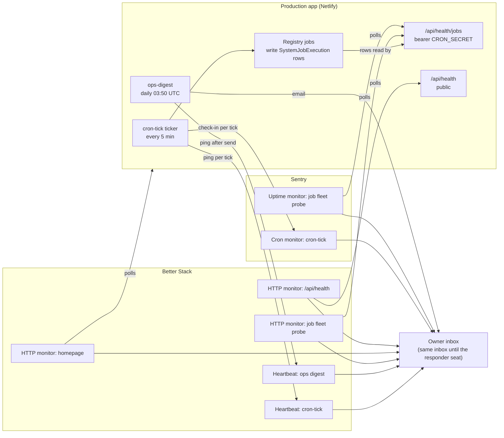

# How we know a job did not run

> **Status (pre-launch).** The scheduled job fleet is paused: the Upstash key `ops:active_cron_platform` is set to `paused-prelaunch`, so every tick of `netlify/functions/cron-tick.mts` returns before running a job, and the monitors that watch the fleet are paused or disabled with it (see [the pause decision](../decisions/2026-11-06-pause-scheduled-jobs-prelaunch.md)). Read the live-monitor descriptions below as the design that applies once the fleet is resumed; the resume step is the first item of the [go-live skill](../../.claude/skills/go-live/SKILL.md). Jobs can still be run by hand from the System Jobs page.

This page is for an engineer who has never seen the system. It explains how the platform notices that scheduled work stopped, which tool watches which question, which decisions were taken and which alternatives lost. It states what the monitors looked like on 2026-11-05 as dated evidence, and it ends with the exact read-only steps to re-check all of it yourself. The canonical decision record, with the full alternatives tables, is [2026-11-05-detector-rollout-and-redundancy.md](../decisions/2026-11-05-detector-rollout-and-redundancy.md). The runbooks are in the [Better Stack setup guide](../maintenance/00-betterstack-setup.md). The wider design is in [Observability system design](../observability/00-system-design.md) and [Infrastructure and maintenance orientation](./09-infra-and-maintenance-sre-orientation.md).

## 1. The incident in two paragraphs

In October 2026, fourteen scheduled housekeeping, compliance and money jobs stopped for two to six weeks and nothing alerted. They ran only on GitHub Actions. When the Actions budget ran out around 17 October, GitHub refused to start the jobs and billed nothing, so no job failed and no failure notice was sent. The watchdog workflow that was supposed to notice stopped schedules was refused for the same reason. Every alert the platform had fired when something ran and failed. None fired when something did not run at all.

The fix had two halves. The code half moved the jobs to the five-minute Netlify ticker and added three absence detectors: a probe that derives how fresh every job must be from the schedule, a daily digest email, and a build-time coverage check ([the freshness decision](../decisions/2026-11-02-job-freshness-from-schedule.md) and [the digest decision](../decisions/2026-11-02-reliable-jobs-digest-and-release-lag.md)). The operations half, recorded here, was making the vendor monitors real and checking them. That half found its own failures: a heartbeat created paused that detected nothing for four days, a second-vendor monitor that watched the wrong URL, and a secret nobody could read.

## 2. Failure classes

Different failures need different detectors, and no single tool sees all of them.

| Class                                | Example                                            | Who sees it                                                               |
| ------------------------------------ | -------------------------------------------------- | ------------------------------------------------------------------------- |
| The app or its dependencies are down | Homepage times out, database unreachable           | Better Stack HTTP monitors on the homepage and `/api/health`.             |
| The ticker is dead                   | The Netlify scheduled function stops firing        | The Better Stack tick heartbeat and the Sentry `cron-tick` cron monitor.  |
| A job did not run in its budget      | The October incident                               | The `/api/health/jobs` probe, watched by Better Stack and by Sentry.      |
| A job ran and failed                 | A thrown error, a partial run                      | Sentry (repeated failures only), run rows, and the tick summary.          |
| A job ran but was parked on purpose  | `PLATFORM_GSTIN` unset, mail held before launch    | The daily digest, which lists standing skips with their age.              |
| The signal pipeline itself is down   | Sentry quota spent, Better Stack ingest refused    | The ingest canary (daily), the digest, and the telemetry-stale SQL alert. |
| Merged but not live                  | A fix sits on `dev` while production runs old code | Release lag, computed in the digest and surfaced by the probe.            |

## 3. Who watches whom



Read the diagram this way: the app pushes pings to the vendors (the ticker and the digest), and the vendors pull from the app (the HTTP monitors). A push can only be missed, which is what a heartbeat detects. A pull can only fail, which is what an HTTP monitor detects. The probe is the one place where the database facts (the run rows) are turned into an HTTP status that a vendor can alert on.

## 4. The detector matrix

This table is the as-built state on 2026-11-05. The "Not covered" column is as important as the others.

| Question                                      | Endpoint or signal                                                    | Vendor that watches it                                                              | Not covered                                                                                                                                                  |
| --------------------------------------------- | --------------------------------------------------------------------- | ----------------------------------------------------------------------------------- | ------------------------------------------------------------------------------------------------------------------------------------------------------------ |
| Is the site up?                               | Homepage, and `/api/health`. The probe also fails if the app is down. | Better Stack (monitors 4093821 and 4093822).                                        | A correct response says nothing about whether any job ran.                                                                                                   |
| Are the database, Redis and Stream reachable? | `/api/health`, public and cheap.                                      | Better Stack only.                                                                  | Its `cron.stale` field never changes the status by design (the status depends on the database, Redis and maintenance only), so it cannot catch a dead fleet. |
| Is the ticker alive?                          | Heartbeat ping and cron check-in, each tick.                          | Two vendors: Better Stack heartbeat 521597 and the Sentry cron monitor `cron-tick`. | It proves the ticker fired, not that any job ran.                                                                                                            |
| Did every scheduled job run in time?          | `/api/health/jobs`, bearer-authenticated.                             | Two vendors: Better Stack monitor 5189236 and Sentry uptime monitor 7689936.        | Only `paging`-tier jobs turn it red. Housekeeping jobs in `WATCHED_TARGETS` show in the console and the digest. It does not prove vendor effects are right.  |
| Did the daily digest arrive?                  | Digest heartbeat, pinged only after a successful send.                | One vendor, by design: Better Stack heartbeat 523773.                               | A digest that arrives but is wrong. The email is itself the human-facing signal, so a second watcher adds little.                                            |
| Is Sentry blind?                              | The ingest canary, daily.                                             | The canary's own email and Better Stack log line.                                   | **Known open gap:** `SENTRY_STATS_TOKEN` is unset, so the canary is currently skipped every day. Nothing says that Sentry might be blind.                    |

### Why `/api/health` and `/api/health/jobs` are not redundant

They answer different questions. `/api/health` asks "can the app reach its dependencies right now", is public, is cached for 30 seconds when healthy, and reads nothing from the run history. `/api/health/jobs` asks "did every scheduled job produce evidence of a run inside its freshness budget", requires the bearer secret, is never cached, and reads the run history. The probe can answer 503 for five distinct reasons, which is why a monitor on the status code alone is enough but an operator must read the body: `JOB_OVERDUE` (a paging job has no evidence in its budget), `STANDING_CONFIG_SKIP` (after live Razorpay keys, a paging job has skipped for a missing setting for more than 7 days), `RELEASE_LAG_OVERDUE` (a held release), `JOB_ENVIRONMENT_UNCONFIGURED` (the deployment has no environment label) and `JOB_HISTORY_UNAVAILABLE` (the run history could not be read). A wrong bearer is a 401 before any query.

### Which overlap is deliberate

The same probe on two vendors and the ticker on two vendors are deliberate: those two questions are the ones whose silence caused the incident. The digest on one vendor is deliberate. The old Sentry uptime monitor on the homepage was accidental, because Better Stack already watches the homepage. It was repurposed on 2026-11-05 rather than deleted, since the free plan includes exactly one Sentry uptime monitor.

The honest limit is that both vendors' emails land in the same inbox until the responder seat (phone and SMS) is bought at launch. The vendor redundancy protects against a vendor failure or a misconfigured monitor. It does not protect against the single human.

## 5. Dated evidence, 2026-11-05

All of this was checked live on 2026-11-05. Treat it as a snapshot, not a promise.

- **Monitors.** Better Stack HTTP monitors `familiarisenow.com` (4093821), `familiarisenow.com/api/health` (4093822) and the new `familiarise job fleet probe (prod)` (5189236: status type, GET, bearer header, every 5 minutes, 60 s timeout, 1 minute confirmation, e-mail only). Better Stack heartbeats `familiarise cron-tick (prod)` (521597, period 300 s, grace 600 s) and `familiarise ops digest (prod)` (523773, period 86400 s, grace 10800 s). Sentry cron monitor `cron-tick` (`*/5 * * * *`, margin 3 minutes, production, healthy) and Sentry uptime monitor 7689936, now named `familiarise job fleet probe (second watcher)` (GET, 300 s, 60 s timeout, bearer header, response capture off).
- **The created-paused lesson.** The tick heartbeat was created paused on 2026-10-30 and unpaused on 2026-11-03. For about four days a dead ticker would have alerted nobody. A created-paused monitor looks configured and detects nothing, so verify status `up`, not existence.
- **Jobs ran.** The daily jobs ran on the ticker on 11-03, 11-04 and 11-05. For example `cleanup-auth-tokens` cleared 164 rows on 11-03, then 6 and then 2. The first `ops-digest` ran at 2026-11-05 03:50 UTC (09:20 IST): headline "0 new, 13 standing", heartbeat pinged.
- **The first-slot lesson.** Before two manual runs the probe answered 503 `JOB_OVERDUE` for exactly two jobs, `consent-retention-sweeper` and `tds-return-draft` (run-row name `tds-26q-draft-export`). They are a weekly and a quarterly window that had never run since runs were tagged with an environment. Both were run once at 2026-11-05 08:24 UTC and answered HTTP 200 (0 expired consent rows; an empty FY 2026-27 Q2 TDS draft with the expected "no TDSRecord rows" warning), and the probe then answered 200 with `healthy: true`. The general rule: a windowed job's first-ever slot can hold the probe red, and the runbook is to run it once.

## 6. Decisions and alternatives at a glance

Each row names what was taken. The reasons and the full alternatives tables are in the [decision record](../decisions/2026-11-05-detector-rollout-and-redundancy.md).

| Decision                         | Taken                                                                    | Main alternatives that lost                                                                  | Why                                                                                                                    |
| -------------------------------- | ------------------------------------------------------------------------ | -------------------------------------------------------------------------------------------- | ---------------------------------------------------------------------------------------------------------------------- |
| Where vendors overlap            | Probe and ticker on two vendors, digest on one                           | One vendor for all; two vendors for all                                                      | Silence about "did anything run" caused the incident; the free plans cap monitors; the digest email is its own signal. |
| What counts as a working monitor | Read back and require status `up`                                        | Trust that creation is enough; a code check of every monitor                                 | A paused heartbeat looked configured for four days.                                                                    |
| Running a job by hand            | Terminal `curl -X POST` with the bearer to `/api/cleanup/<registry-key>` | System Jobs "Run now"; waiting for the ticker                                                | Full JSON result; weekly and quarterly windows would keep the probe red for days or months.                            |
| `CRON_SECRET`                    | Rotate at the release; one copy in the owner's password manager          | Re-enter the old value (impossible); a separate read-only probe secret (declined 2026-11-02) | The secret is write-only everywhere; one secret is simpler to rotate and jobs are idempotent.                          |
| Creating monitors                | Vendor API or CLI, secret on stdin                                       | Dashboards; Terraform                                                                        | Reproducible and reviewable; five monitors do not justify a new tool (AGENTS.md §1.2).                                 |
| Release-lag token                | Deferred; the digest says "release lag unknown"                          | A fine-grained token now; a personal access token; polling GitHub from the probe             | Only valuable when a release is held for days; production was within 3 commits of `dev`.                               |
| Upstash management settings      | Skipped; the digest says "Upstash usage unknown"                         | Provision four more settings                                                                 | Pay-as-you-go at about $0.75 a month.                                                                                  |
| Digest recipient                 | `OBSERVABILITY_ALERT_EMAIL` unset, falling back to `supportEmail()`      | An own-domain address                                                                        | The support address is on the production `EMAIL_ALLOWLIST`, so the delivery guard does not hold it. Revisit at launch. |

## 7. How to reproduce the verification yourself

Everything here is read-only except step 6, which runs one job. Never paste the secret anywhere. Read it from your password manager into a shell variable for the session only.

1. **Run history in the database.** Use a read-only SQL session. Rows are per environment, so always filter on it.

   ```sql
   SELECT "jobName", status, "startedAt", "endedAt",
          result->>'outcome' AS outcome
   FROM "SystemJobExecution"
   WHERE result->>'environment' = 'production'
     AND "jobName" IN ('cleanup-auth-tokens', 'ops-digest',
                       'consent-retention-sweeper', 'tds-26q-draft-export')
   ORDER BY "startedAt" DESC
   LIMIT 20;
   ```

   Use the run-row name (`tds-26q-draft-export`), not the registry key. `jobNameFor` in `lib/cron/schedule.ts` maps one to the other.

2. **The probe.** Expect HTTP 200 and `"healthy":true`. On 503 read `error` first: `JOB_ENVIRONMENT_UNCONFIGURED` and `JOB_HISTORY_UNAVAILABLE` answer with no `reasons` or `overdue`. Otherwise read `reasons`, then the `overdue` list.

   ```bash
   curl -sS -o /dev/null -w "%{http_code}\n" \
     -H "Authorization: Bearer $CRON_SECRET" \
     https://familiarisenow.com/api/health/jobs
   ```

   Drop `-o /dev/null` to see the body.

3. **Better Stack monitors and heartbeats.** Using `BETTERSTACK_API_KEY`, list both and check that `paused` is false and the status is `up`. Always filter the output: a monitor's `request_headers` holds the bearer `CRON_SECRET`, and a heartbeat's `url` is its ping secret.

   ```bash
   curl -sS -H "Authorization: Bearer $BETTERSTACK_API_KEY" https://uptime.betterstack.com/api/v2/monitors \
     | jq '[.data[] | {id, name: .attributes.pronounceable_name, url: .attributes.url, status: .attributes.status, paused: .attributes.paused}]'
   curl -sS -H "Authorization: Bearer $BETTERSTACK_API_KEY" https://uptime.betterstack.com/api/v2/heartbeats \
     | jq '[.data[] | {id, name: .attributes.name, status: .attributes.status, paused: .attributes.paused}]'
   ```

4. **The Sentry uptime detector.** A read with the Sentry CLI; substitute your organisation slug.

   ```bash
   sentry api /organizations/<org>/detectors/7689936/ \
     | jq '{id, name, enabled, url: .dataSources[0].queryObj.url, intervalSeconds: .dataSources[0].queryObj.intervalSeconds, timeoutMs: .dataSources[0].queryObj.timeoutMs}'
   ```

   The unfiltered response includes the stored bearer header, so never print it without the `jq` filter.

5. **The Sentry cron monitor.** Open the Monitors page in Sentry and confirm `cron-tick` is healthy, or read it through the Sentry CLI or MCP.

6. **Run a job once (only when the probe names it overdue and its slot is far away).**

   ```bash
   curl -X POST -H "Authorization: Bearer $CRON_SECRET" \
     https://familiarisenow.com/api/cleanup/consent-retention-sweeper
   ```

   The URL takes the registry key. The response is the job's JSON result. Poll step 2 afterwards.

## 8. Open items

These are known gaps, not decisions.

- **`SENTRY_STATS_TOKEN` is unset.** The Sentry ingest canary skips every day, a standing paging-tier configuration skip. Before launch it needs a Sentry internal integration with Organization: Read, set with `netlify env:set ... --secret`.
- **`PLATFORM_GSTIN` is unset.** Three jobs skip. At launch, set it before the Razorpay live keys, or the probe pages `STANDING_CONFIG_SKIP`.
- **Better Stack Telemetry SQL alerts were created muted.** The digest cannot read their mute state.
- **Responder seat and phone paging** arrive at launch. Until then every alert is an e-mail.
- **The digest recipient** must be revisited when `EMAIL_DELIVERY_MODE=live`.

## Glossary

- **Heartbeat.** A monitor that expects a ping on a schedule and alerts when the ping is late. It detects absence.
- **Paging tier.** A job whose lateness turns `/api/health/jobs` red. The other tier, `watched`, is shown in the console and the digest only.
- **Run row.** One `SystemJobExecution` row per attempt. The probe reads these; it never runs a job.
- **Windowed job.** A job that runs only in a weekly, monthly or quarterly window, so its freshness budget is long.
- **Registry key.** The job's name in `lib/cron/cleanup-registry.ts` and in the `/api/cleanup/<key>` URL. It can differ from the run-row name.

## Deprecated & Superseded Approaches

- **A hand-kept list of job completion SLOs.** It missed over half of the ticker targets and drifted on renames. The budgets are now derived from `lib/cron/schedule.ts`, and `checkJobCoverage` (`lib/cron/job-coverage.ts`) enforces coverage inside `npm run build`.
- **The Actions workflow `cron-heartbeat.yml` as the fleet watchdog.** It shared the failure domain of what it watched. It now watches only the Actions-scheduled workflows.
- **A Sentry uptime monitor on the homepage.** Duplicated Better Stack; repointed to the job fleet probe.
- **Treating `/api/health`'s `cron.stale` as a fleet alarm.** It never changes the status code by design; use the probe.
