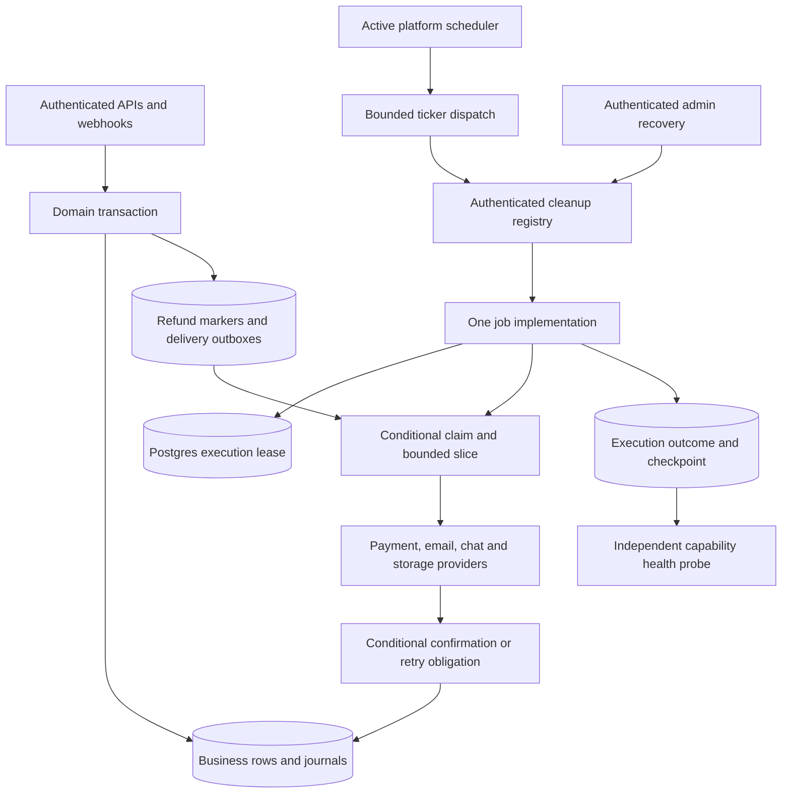

# Infrastructure and maintenance: architecture and operating model

> **Status (pre-launch).** The scheduled job fleet is paused: the Upstash key `ops:active_cron_platform` is set to `paused-prelaunch`, so every tick of `netlify/functions/cron-tick.mts` returns before running a job, and the monitors that watch the fleet are paused or disabled with it (see [the pause decision](../decisions/2026-11-06-pause-scheduled-jobs-prelaunch.md)). Read the live-monitor descriptions below as the design that applies once the fleet is resumed; the resume step is the first item of the [go-live skill](../../.claude/skills/go-live/SKILL.md). Jobs can still be run by hand from the System Jobs page.

This guide explains the implemented infrastructure, why its boundaries exist, and how to adapt the design to another product. Read it before changing a cron, a reconciliation query, maintenance admission, or hosting. The source files linked below own behavior; the [generated job inventory](../maintenance/04-cron-jobs-reference.md) owns the configured roster. Configuration, reviewed code, deployment, accepted execution and completed business obligations are separate evidence.

This guide describes current source contracts. Deployment and business-effect evidence remain separate: verify the required database schema and maintenance edge state before new readers, and verify actual worker effects after deployment. The Stream lifecycle catalog now dispatches through the ticker; its Netlify-only background destinations are a portability constraint.

For how a job that did not run is detected, and which monitors watch which question, read [How we know a job did not run](./08-how-we-know-a-job-did-not-run.md).

## 1. The system in one picture

The clock requests work. It does not own the business obligation. A refund owed, an unsent notification or an unfinished recording copy remains discoverable after a missed tick, a deployment or a worker crash. This is why the application uses persisted state and bounded recovery rather than assuming a successful cron HTTP request means the business operation completed.

| Component          | Responsibility                                                                                 | Main source                                                      |
| ------------------ | ---------------------------------------------------------------------------------------------- | ---------------------------------------------------------------- |
| Domain operation   | Validate access, claim the transition, commit business state and required obligations together | Domain services; [money system guide](./02-money-system-hld.md)  |
| Scheduler catalog  | Slugs, cadence, offsets, windows, request limits and HTTP waiting bounds                       | `lib/cron/schedule.ts`                                           |
| Netlify adapter    | Read fleet preference once, choose due targets, dispatch and report transport outcomes         | `netlify/functions/cron-tick.mts`                                |
| Cleanup registry   | One authenticated HTTP/admin mapping to each implementation                                    | `lib/cron/cleanup-registry.ts`, `cleanup-route.ts`               |
| Core worker        | Bound actual reads and effects, claim current work, persist progress and expose failures       | Inventory links to each core                                     |
| Execution lease    | Same-job admission, owned completion and resumable checkpoints                                 | `lib/cron/with-cron-lock.ts`, `SystemJobExecution`               |
| Operational health | Detect missing successful capabilities in the intended environment                             | `lib/cron/operational-health.ts`, `app/api/health/jobs/route.ts` |
| Database sidecars  | Enforce invariants Prisma cannot fully describe                                                | `prisma/sql/*.sql`                                               |

Do not create a new script, job wrapper and API route for the same implementation. Register its existing core. A platform background adapter is justified when the execution envelope differs; it still calls the same core and lease.

## 2. Which scheduler owns what

The active application platform owns latency-sensitive recovery and money operations: payment/refund reconciliation, payout and billing slices, statutory exports, delivery retries and booking recovery. Netlify currently provides the five-minute tick. Some targets run every 15 minutes or in bounded daily/calendar windows; consult the executable catalog rather than inferring their cadence from the tick.

GitHub Actions owns source verification, security checks, configuration/schema drift checks and explicitly requested engineering drills. Its scheduled workflows are the cron heartbeat, the live-database drift check and the security audit. The heartbeat watches only the other two, never a runtime job. No workflow schedules a registry job, because the ticker owns every registered job (see the generated inventory [`docs/maintenance/04-cron-jobs-reference.md`](../maintenance/04-cron-jobs-reference.md)). An enabled workflow is not evidence of execution. GitHub documents that scheduled jobs can also be delayed or dropped under load ([official troubleshooting guide](https://docs.github.com/en/enterprise-cloud%40latest/actions/how-tos/troubleshoot-workflows)). It is unsuitable as the only recovery clock for a short business deadline.

Keep one automatic owner per operational job. Removing an old Actions step is part of the same reviewed handoff that establishes the replacement. A lease does not justify deliberately running both schedulers: a second invocation after the first finishes can repeat effects unless the domain itself is idempotent.

The required hot-standby Netlify deployment is a separate concern from scheduler ownership. Each tick reads `ops:active_cron_platform` once. A different host preference suppresses Netlify dispatch; absent or unreadable preference fails open. This is an operational preference, not an atomic leader election. During failover an old worker may still be running. See the [deployment and failback guide](../deployment/README.md).

## 3. Admission and execution are different lifetimes

There are four independent bounds:

1. The ticker's own wall-clock budget.
2. Its per-target HTTP wait/abort timeout.
3. The core's row, vendor-call and start-admission budgets.
4. The lease TTL and renewal interval.

An HTTP abort does not cancel already-started work. Lease expiry does not stop a process. A core must stop admitting work in time, propagate cancellation to supported provider operations, and fence late results independently. Raising an HTTP timeout or lowering a row limit alone cannot repair an unbounded related query.

Netlify's scheduled runtime has a 30-second ceiling. Background functions run separately for up to 15 minutes and immediately acknowledge invocation with HTTP 202; Netlify documents retries after invocation errors, which our background functions avoid by never throwing (`runBackgroundWorker`). These are distinct contracts ([scheduled functions](https://docs.netlify.com/build/functions/scheduled-functions/), [background functions](https://docs.netlify.com/build/functions/background-functions/)). A 202 is not authenticated core admission, a successful lease or a completed copy.

The recording adapter deliberately imports a narrow dependency graph: the shared cleanup boundary and recording core. Importing the entire registry can expand the standalone bundle through literal dynamic imports. Local import success does not establish deployable package contents, React renderer compatibility, cold-start cost or deployed execution. Keep this boundary until a measured deployment or an active correctness requirement justifies changing it. Never run the 12-minute recording transfer through a short synchronous Next.js request.

## 4. Concurrency: what each protection actually guarantees

| Protection                                        | Prevents                                                            | Does not establish                                                                             |
| ------------------------------------------------- | ------------------------------------------------------------------- | ---------------------------------------------------------------------------------------------- |
| Postgres partial unique on a RUNNING job name     | Two current owned leases for the same job                           | Cross-job exclusion, cancellation of an expired owner, exactly-once effects                    |
| Conditional `updateMany` with expected state      | A stale writer winning that state transition                        | Delivery to an external provider                                                               |
| Serializable transaction                          | A committed decision inconsistent with concurrent database changes  | Vendor rollback or immunity from retryable serialization failures                              |
| Outbox/refund marker staged through the same `tx` | A committed state transition losing its required local obligation   | Provider acceptance or eventual delivery without a running relay                               |
| Stable provider idempotency identity              | Replayed requests duplicating the same supported external operation | Atomicity between Postgres and a vendor, or indefinite deduplication beyond provider retention |
| Claim identity in final publication               | A previous attempt publishing over a newer owner                    | Cleanup of every completed unpublished storage object                                          |
| SQL constraints/triggers                          | Their declared database invariants at commit                        | External truth or application conflicts outside their predicates                               |

`withCronLock` records attempts in `SystemJobExecution`. Acquisition expires stale owned rows and creates a new RUNNING row; the partial unique resolves racing acquisitions. Closed jobs refuse unavailable acquisition, including Prisma import failures. Open jobs may run unlocked only under their documented repeat-safe policy; connection/pool exhaustion is treated as closed. Completion updates the same execution only while it remains RUNNING. A stale owner cannot rewrite a newer execution's history or refresh success through an unowned finish.

The effective lease is capped at 90 seconds on every host and renewed every third of its TTL, so hosts sharing the database agree on when a lease is stale. Renewal errors or lost ownership do not cancel the core. A database outage or stalled process can therefore outlive its lease while another invocation starts. Conditional domain claims and attempt-specific external identities remain necessary; the short lease is not proof that all earlier effects have stopped.

Different jobs can still touch the same payment, appointment, support case or recording. Their safety depends on shared domain transitions and row-level claims. For example, recording transfer and erasure must agree on the recording row and exact asset identity; separate cron leases alone cannot protect that race.

Inside a Prisma transaction every helper uses the supplied `tx`. On Netlify, `PG_POOL_MAX=1` makes a global Prisma query inside that transaction wait for the connection it already holds. Multi-request runtimes use a bounded larger pool, but that does not make global reads transactionally correct. Provider requests stay outside database transactions. Awaiting queries sequentially inside one transaction preserves dependency order; `Promise.all` does not create additional transaction connections ([Prisma transaction behavior](https://www.prisma.io/docs/orm/v7/prisma-client/queries/transactions)).

Serializable operations can fail and need bounded retry of the complete transaction; do not publish provisional effects from a transaction that later aborts ([PostgreSQL isolation](https://www.postgresql.org/docs/15/transaction-iso.html)). The maintenance worker rechecks a selected booking's current overlap inside its cancellation transaction, so a reschedule between confirmation and execution cannot cancel an unaffected booking.

## 5. Bounded progress and fair recovery

A destructive cleanup repeats age/status eligibility in its final conditional write. An expired idempotency record may have been renewed after selection; a pending attachment may have become live. Selecting an ID is not permanent deletion authority.

A recurring poll needs more than `take: N`. If the oldest pending/error rows never leave the cohort, each invocation can select the same prefix forever. Payment/refund/top-up reconciliation uses separate last-attempt cursors; those cursors do not change business age or retry liability. Recovery must stamp attempted work, leave unstarted work unstamped and make failed pages visible. Cursor failure is not permission to claim the backlog drained.

Count examined candidates and related work, not only successful mutations. One booking can contain many occurrences, participants, payments and notices; one organisation can contain many calls, channels and recordings. The automatic maintenance cancellation envelope currently rejects more than eight live participants, twelve occurrences, ten payments or ten notice recipients. It cancels the explicitly selected whole booking, not just the overlapping occurrence. These are execution guards, not offering limits or measured throughput promises.

Jobs using calendar windows need a missed-window recovery procedure. A daily window with three bounded slices cannot be called sufficient until backlog volume, oldest age and completion rate have been measured. Failure samples must be bounded, reported once per run and retain enough phase/context for repair.

## 6. Journals, obligations and reconciliations

The money system records amounts in BigInt paise and enforces its journal/leg invariants in Postgres. The ledger audit compares separately maintained projections and external/business facts, stores per-payment findings and persists report checkpoints. Same-day completed reuse is distinct from a fresh operator recheck; reuse must not repeat drift effects. A recent-history-only scan cannot prove old liabilities disappeared. See the [money architecture](./02-money-system-hld.md) and [reconciliation reference](../maintenance/10-cron-and-reconciliation-reference.md).

A wallet drift report freezes spend on the affected account and pages once per account with a weekly reminder. A later audit releases only its own drift-tagged freeze when the cache again equals the journal; an operator-created freeze remains operator-owned. The [job machinery catalog](../maintenance/11-job-machinery-catalog.md) covers current job signals and the dashboard design.

Do not write JavaScript sweeps to re-prove balanced journals, immutable posted ledger entries or payment-leg sums already prevented by constraint triggers. Reconcile Razorpay, Stream, Resend and storage boundaries where the database cannot enforce external truth. The host occurrence exclusion protects only its SQL predicate; tentative holds, co-host/client conflicts, attendee seats and the documented RESCHEDULED occupancy case remain application concerns.

A failed refund attempt is not a separate refund liability. Durable owed markers drive the canonical retry flow; exhausted attempts require classification and an explicit recovery decision. Compare current refundable balance and provider truth before reissue. Likewise, an unsent outbox record is not accepted email or an acknowledged notification. Every email recipient still passes the delivery guard.

## 7. Read outcomes without confusing them with health

| Observation                                    | Meaning                                                                                             |
| ---------------------------------------------- | --------------------------------------------------------------------------------------------------- |
| HTTP 200                                       | Read the typed core result and job-specific contract                                                |
| HTTP 207                                       | Job-specific attention or partial failure; the ticker allowlist determines transport classification |
| HTTP 409                                       | Lease admission refused; not evidence that the current owner is healthy                             |
| HTTP 503                                       | Planned maintenance hold or failed admission, distinguished by the response code/body               |
| Background HTTP 202                            | Invocation acknowledgement only                                                                     |
| Environment-scoped COMPLETED execution         | Successful owned slice; not necessarily an empty backlog                                            |
| Shared heartbeat                               | Fleet liveness hint; one job can hide another job's absence                                         |
| Fresh capability probe plus overdue obligation | Workers are alive but the business deadline can still be at risk                                    |

`jobOutcome` prioritizes an explicit `success`/`overallSuccess` verdict, distinguishes intentional holds, then infers from counters only when no verdict exists. Execution history stores failure/partial failure as FAILED, holds as CANCELLED and success as COMPLETED. An explicit registry status callback owns its HTTP mapping. Do not assume a transport callback and inferred core outcome are interchangeable.

The authenticated, no-store `/api/health/jobs` probe checks that every ticker job ran within a budget derived from its schedule, in the intended Sentry deployment environment, and answers 503 when a `paging` job is overdue. Every target writes a run row, and `checkJobCoverage` (`lib/cron/job-coverage.ts`) fails `npm run build` when a target has no budget, so the guard holds even when Actions is refused. The probe also answers 503 from the daily `ops-digest` row when release lag is overdue or, once Razorpay keys are live, a paging job has skipped for a missing setting for more than 7 days. The digest is one email a day that is always sent; a Better Stack heartbeat makes a missing email an incident. The probe is implemented; the external Better Stack monitor that polls it, and Sentry's free uptime monitor as the second watcher, are owner steps ([runbook](../maintenance/00-betterstack-setup.md#runbook-create-the-better-stack-monitor-owner-step-done-2026-11-05)), and accepted responses and actual alert delivery are deployment evidence. Keep calendar-only work and backlog deadlines separately visible. Sentry check-in acceptance and monitor enablement must be checked; a disabled monitor, a dropped capture or an always-200 ticker cannot be an independent alarm.

The ticker missed-check-in email path has a [recorded end-to-end verification](../maintenance/00-betterstack-setup.md#recorded-end-to-end-verification). Recheck monitor enablement, notification routing and ordinary recovery when operating it; that receipt does not prove every capability or survive a Sentry outage. The same runbook records digest timing and the bounded restoration drill so another operator can repeat it safely.

The ticker distinguishes a one-off target warning from a repeated failure using the authenticated `/api/health/jobs/streaks` history read and the catalog's target-to-execution-name mapping. Unavailable history remains a one-off; this route does not establish independent absence detection. When configured, one Better Stack summary per tick provides a separate best-effort sink. Neither replaces an external missed-run alarm or a business backlog deadline.

Use bounded once-per-run Sentry reports. Native workers use the generic Core SDK APIs with the shared privacy/configuration policy. Capture tests alias a mocked `@sentry/core` to the mocked `@sentry/nextjs`; partial mocks use actual Core to avoid circular framework imports.

## 8. Maintenance is an operator-controlled workflow

| Phase                         | Application and job policy                                                                             |
| ----------------------------- | ------------------------------------------------------------------------------------------------------ |
| OFF                           | Normal admission                                                                                       |
| DEGRADED                      | Reads remain available; classified money mutations and financial jobs are held                         |
| OFFLINE                       | Non-exempt traffic and cleanup work are held; webhook/health/admin recovery exemptions remain explicit |
| Missing/unreadable edge state | Mutations fail closed; it is never silently interpreted as OFF                                         |

Activation requires an explicit phase and reason. OFFLINE setup drains calls and freezes channels in bounded passes, preserves acknowledgements and discount snapshots, and exposes retryable errors/backlog. It does not implicitly cancel bookings. Booking remediation is a separate preview, confirmation and durable request, processed after maintenance admission permits it. Every PATCH, including ETA-only changes, retains an operator reason. ETA expiry never reopens traffic.

Recovery verifies dependencies and reverses the relevant freezes before explicitly returning to OFF. Partial recovery is retried; it must not claim that previously failed vendor work succeeded. Already-running requests and workers must settle because maintenance admission cannot retroactively stop them. Use the [pre-maintenance checklist](../maintenance/06-pre-maintenance-checklist.md) and [recovery runbook](../maintenance/07-post-maintenance-recovery.md).

Before the first deployment, apply the reviewed additive schema before readers. Under coordinated operator control, verify durable platform state and bootstrap a missing `maintenance:phase` without a TTL; use OFF only when no platform window is active. Preserve an existing active phase. This is a rollout operation, not a missing-key fallback or an automatic repair cron.

## 9. Database rollout and rollback boundaries

One shared Postgres project serves environments and worktrees. Never infer that a branch's schema is safe to push. Generate a read-only live diff, separate the intended additive delta from existing drift, and inspect SQL-owned constraints/indexes/triggers separately. Never execute the whole diagnostic drift plan.

The maintenance schema and persistent edge-state bootstrap have already been applied to the shared project under operator control. For a fresh environment, the checked-in [operator SQL](../maintenance/maintenance-remediation-schema.sql) adds five nullable columns, two tables, six indexes and three foreign keys, with no backfill; verify its exact required delta and live catalog before deploying readers. Do not replay already-applied Stream schema changes or an unrelated diagnostic drift plan. Record the exact schema SHA and catalog confirmation.

Sidecar replacement runs dependent statements in order inside one transaction per file with a short lock timeout. A failed ADD must not leave its preceding DROP committed. A lock timeout limits waiting, not statement execution or total runtime. Existing-table ordinary index builds block writes; concurrent builds need a distinct outside-transaction operator plan with validity checks. Do not translate a small reviewed rollout into a universal migration recipe. See the [schema cutover guide](../prisma/02-schema-freeze-and-migration-cutover.md).

Rollback of application code cannot erase business effects already committed. Prefer a compatible forward repair, keep durable obligations and exact source identities, and use the verified operator recovery procedure. Schema application and real worker execution require their own authorization.

## 10. Active Stream ticker ownership and execution limits

The ticker now dispatches the Stream recording and lifecycle jobs. Their moved Actions steps are removed. Automatic workers currently depend on Netlify as the active cron host: the catalog points to Netlify function URLs. A host migration needs a compatible long-worker destination before switching the active scheduler; preserving Netlify as standby alone does not make these targets portable.

| Capability                                                                                                                 | Current configured cadence / destination                 |
| -------------------------------------------------------------------------------------------------------------------------- | -------------------------------------------------------- |
| `transfer-recordings`                                                                                                      | Every 15 minutes; `recording-transfer-background`        |
| `reconcile-sessions` HTTP slug / `reconcile-orphaned-sessions` execution                                                   | Every 30 minutes; bounded registered core                |
| `expire-recordings`, `reconcile-orphaned-recordings`, `wind-down-deactivated-orgs`, `stream-sync`, `expire-event-channels` | Staggered daily windows; `stream-maintenance-background` |
| `stream-control-plane-drift`, `reconcile-stream-memberships`                                                               | Hourly slices in their configured daily windows          |

The [catalog](../../lib/cron/schedule.ts) owns exact offsets, windows, limits and destinations. The schedule has a tested ceiling of twelve targets per tick (`MAX_TARGETS_PER_TICK=12`; the cadence test pins the busiest tick at 11, one free slot). Capacity is 288 × 12 = 3,456 target starts a day against about 2,897 used. When a wave would exceed it, `dueTargets` yields the checkpointed `reconcile-ledgers` target; it does not generally truncate arbitrary jobs. Cadence tests examine every tick of a week, and calendar-boundary scenarios remain relevant when changing windows. A wave is not a worker concurrency queue or proof of capacity.

Stream-managed recording files have a [two-week source lifetime](https://getstream.io/video/docs/api/recording/storage/). An application's later retention date cannot extend that source lifetime. Copy completion must therefore be measured against each recording's source expiry, even when recent job executions succeeded.

Transfer claims consume an attempt before work. A stale crashed claim keeps its consumed attempt, and a fresh claim uses its next attempt identity. Conditional publication prevents the old attempt from overwriting a newer owner. The core requests a fail-closed 15-minute lease and admits at most one recording per invocation; Netlify applies the renewable 90-second cap described above. Its separate 15-minute stale-recording claim threshold exceeds the 12-minute copy deadline. Do not infer fleet-wide one-copy concurrency after lease renewal fails. The theoretical 96 scheduled admissions/day is not measured successful throughput. The bounded 72-hour/attempt-risk alarm conditionally stamps each recording at most once every six hours, preserves retry timing and excludes already-expired sources.

HTTP 202 acknowledges dispatch only. Verify eventual owned execution, AVAILABLE/PLATFORM state and matching R2 bytes separately; the domain's production verification owns that evidence. Failed cleanup of unpublished attempt objects still needs the documented operator recovery procedure: incomplete-multipart lifecycle rules do not remove all completed orphan objects. The [recording worker runbook](../stream/recording-background-worker.md) documents packaging, active-host, copy, alarm, capacity and cleanup checks. Do not invoke shared-data workers from a deploy preview to test these contracts.

## 11. Reusing this design in another company

Preserve the contracts, then substitute the providers. The minimum transferable design is one durable business database, obligations committed with their state transition, one automatic scheduler owner per job, authenticated dispatch, bounded core implementations, conditional claims, provider idempotency and independent deadline-aware health. These guarantees do not depend on Netlify, GitHub Actions, Razorpay or Stream names.

| Decision to make again                           | Evidence to collect in the new product                                                                |
| ------------------------------------------------ | ----------------------------------------------------------------------------------------------------- |
| Synchronous slice or background/container worker | Actual object sizes, provider latency, cancellation support and measured execution envelope           |
| Row cap, window and concurrency                  | Arrival rate, backlog age, successful throughput, provider quotas and database pool capacity          |
| Lease policy and TTL                             | Which operations tolerate unlocked replay, renewal behavior and longest admitted work                 |
| Retry identity and retention                     | Provider idempotency contract, duplicate delivery behavior and source expiry                          |
| Database-owned invariant                         | Exact CHECK/unique/exclusion/trigger predicate; application conflicts it does not cover               |
| Maintenance exemptions                           | Which ingress must keep recording external truth while normal traffic is held                         |
| Health expectations                              | Required capabilities, calendar windows, oldest obligation deadline and independent alert delivery    |
| Host failback                                    | Tested traffic switch, runtime pool sizing, binary-upload path, secrets and in-flight worker behavior |

Changing to Vercel or a container changes the scheduler and long-running execution adapter, trusted IP headers, pool limits, payload/upload behavior, packaging and deployment procedures. It does not remove outboxes, conditional transitions or external reconciliation. Keep the required Netlify standby intact and prove the new adapter before retiring the old clock. Do not carry over another company's quotas, retention rules, money semantics or production data as defaults.

A new engineer should trace one real family end to end: producer transaction → durable obligation → catalog entry → authenticated dispatch → lease/claim → provider call → conditional confirmation → execution result → capability and backlog alarm. Then reproduce a duplicate call, an unavailable lease, a provider timeout, a crash after commit and a stale-owner race using mocks or a disposable database. Shared production data is not a test fixture.

## Deprecated & Superseded Approaches

- A scheduler's successful request or one shared heartbeat was treated as fleet completion. Use owned execution outcomes, capability freshness and business backlog deadlines.
- Fail-closed lease acquisition could bypass a failed import, and completion could overwrite expired ownership. Current acquisition and completion retain those boundaries.
- Maintenance selected an implicit cancellation interval and treated ETA as automatic recovery. Explicit admission, separate confirmed remediation and operator recovery supersede that behavior.
- An oldest-first cap was treated as a resumable poll, and redundant Actions schedules were called a recovery guarantee. Persist fair progress and keep a single automatic owner.
- Plain schema pushes and independently committed sidecar statements were treated as safe rollout. Read-only preflight, reader-first compatibility analysis and atomic dependent replacement are required.
- A registry-wide recording adapter was treated as a harmless wiring deduplication. The narrow adapter remains deliberate until deployed bundle/runtime evidence supports a change.
