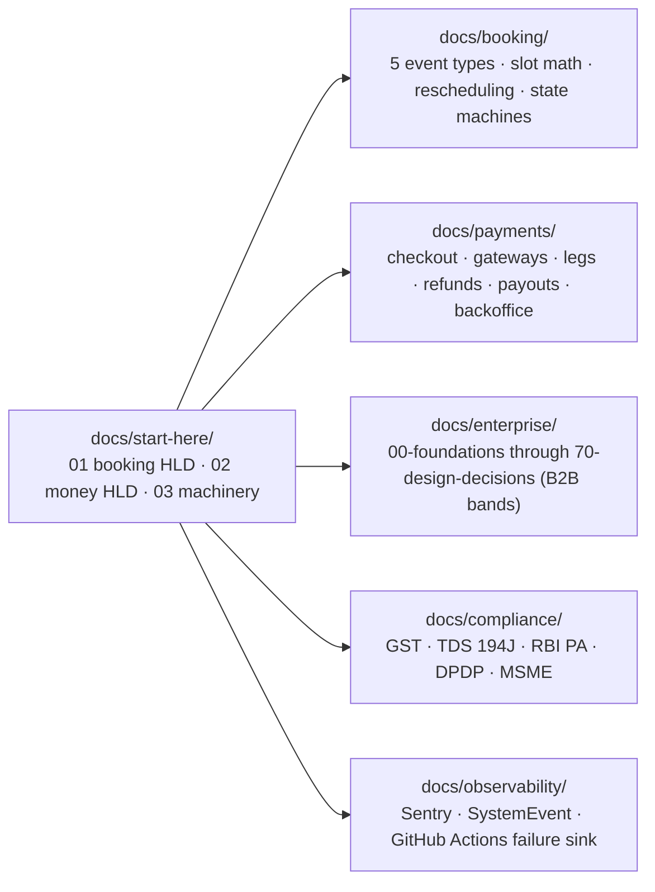

# Start Here — Platform Architecture & End-to-End Explainers

This folder is the **entry point for engineers onboarding onto Familiarise** or working across subsystem boundaries. While each domain directory (`docs/booking/`, `docs/payments/`, `docs/enterprise/`, `docs/compliance/`, `docs/observability/`) documents its own vertical in depth, the documents in `docs/start-here/` trace how the whole platform fits together on one spine.

---

## Canonical Explainers

| #   | Document                                                                                 | Scope & What You Will Learn                                                                                                                                                                                                                                                                                                                               |
| --- | ---------------------------------------------------------------------------------------- | --------------------------------------------------------------------------------------------------------------------------------------------------------------------------------------------------------------------------------------------------------------------------------------------------------------------------------------------------------- |
| 01  | [Booking System HLD](./01-booking-system-hld.md)                                         | **The booking system design.** The end-to-end pipeline, the 30-minute atom, allocation modes and who may allocate, the four concurrency layers and the serializable retry engine, state machines, session outcomes, the cron architecture, and the target state of Waves 0–3.                                                                             |
| 02  | [Money System HLD](./02-money-system-hld.md)                                             | **The finance design.** Price derivation, order mint, the booking capture writer, payment legs and the funding-sum trigger, the double-entry ledger and chart of accounts, earnings holds, payouts and TDS, the three refund front doors, credit notes, the refund policy decisions with the India note, and the reconcilers.                             |
| 03  | [Booking & Money Machinery](./03-booking-and-money-machinery.md)                         | **The scenarios.** The seeded cast, the entity model, the numeric permutation walk-throughs, and nine end-to-end worked examples marked current or after Wave N. The scoping matrices and the 20 ledger permutations it points to live in the enterprise and authorization docs.                                                                          |
| 04  | [Platform Architecture](./04-platform-architecture.md)                                   | **The load-bearing ideas.** Why the database is the last line of defence rather than the first, what state-as-outbox means here without a message broker, the three-layer enforcement model, how the 5-minute ticker and the Actions fleet divide the work, and what a reconciler is allowed to do.                                                       |
| 07  | [Enterprise System Design](./07-enterprise-system-design.md)                             | Enterprise data boundaries, identity and SSO, commercial axes, programs, overage, financial settlement, every dashboard, compliance, operational machinery, worked examples, and reasoned design recommendations.                                                                                                                                         |
| 10  | [Infra and Maintenance — SRE Orientation](./10-infra-and-maintenance-sre-orientation.md) | **For DevOps/SRE.** The estate map, the `PG_POOL_MAX=1` single-connection trap, the two schedulers and how they split work, which database invariants must never be repaired by hand, how to read a job's status codes, maintenance mode, the watchdog gap, the `db:push` trap, and the vendor quotas that degrade the system silently. Prioritised 1–10. |
| —   | [Distributed Systems Explained](../architecture/distributed-systems-explained.md)        | Upstash Redis distributed locking (`Redlock`), caching layers, and failure-mode posture across serverless functions.                                                                                                                                                                                                                                      |
| —   | [Prisma Schema Map](../prisma/00-schema-map.md)                                          | Domain-by-domain entity-relationship diagrams of [`prisma/schema.prisma`](../../prisma/schema.prisma).                                                                                                                                                                                                                                                    |

---

## Where to Go Next by Subsystem

| Domain            | Entry Point                                                      | When to Read                                                                                                                |
| ----------------- | ---------------------------------------------------------------- | --------------------------------------------------------------------------------------------------------------------------- |
| **Booking**       | [`docs/booking/README.md`](../booking/README.md)                 | Modifying slot validation, the allocator (`lib/booking/allocation`), rescheduling, cancellations, or recurring series math. |
| **Payments**      | [`docs/payments/README.md`](../payments/README.md)               | Working on Razorpay/Stripe checkout, `PaymentLeg`, refunds, disputes, payouts, or the Money backoffice console.             |
| **Enterprise**    | [`docs/enterprise/README.md`](../enterprise/README.md)           | Working on organizations, SSO/JIT, contracts, programs, sponsor wallets, B2B invoicing, or the ledger.                      |
| **Compliance**    | [`docs/compliance/00-overview.md`](../compliance/00-overview.md) | Touching GST (SAC `9983`/`9992`), TDS (`194J`), RBI Payment Aggregator rules, DPDP erasure, or MSME ageing.                 |
| **Observability** | [`docs/observability/`](../observability/)                       | Adding Sentry instrumentation, triaging production issues, or inspecting `SystemEvent` / cron failure sinks.                |
