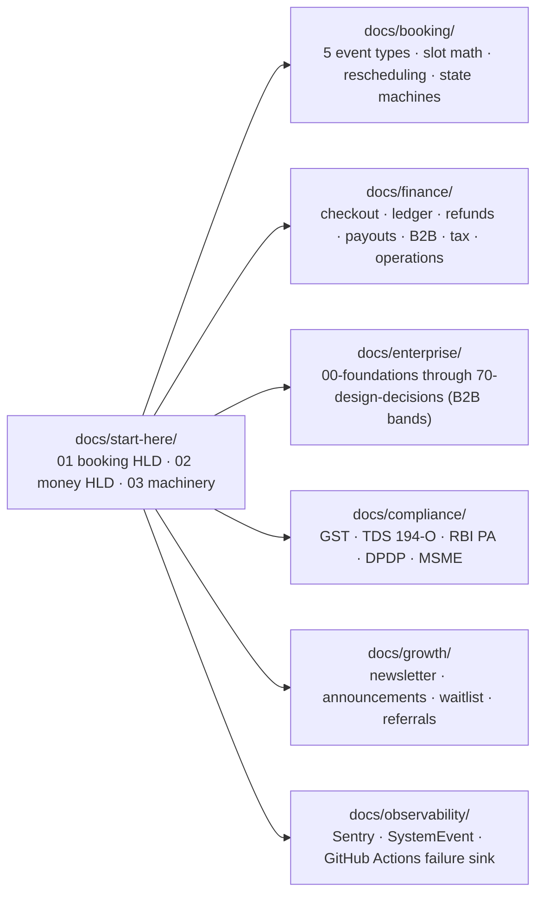

# Start Here — Platform Architecture & End-to-End Explainers

This folder is the **entry point for engineers onboarding onto Familiarise** or working across subsystem boundaries. While each domain directory (`docs/booking/`, `docs/finance/`, `docs/enterprise/`, `docs/compliance/`, `docs/observability/`) documents its own vertical in depth, the documents in `docs/start-here/` trace how the whole platform fits together on one spine.

---

## Canonical Explainers

| #   | Document                                                                                 | Scope & What You Will Learn                                                                                                                                                                                                                                                                                                                                                                                                                                  |
| --- | ---------------------------------------------------------------------------------------- | ------------------------------------------------------------------------------------------------------------------------------------------------------------------------------------------------------------------------------------------------------------------------------------------------------------------------------------------------------------------------------------------------------------------------------------------------------------ |
| 01  | [Booking System HLD](./01-booking-system-hld.md)                                         | **The booking system design.** The end-to-end pipeline, the 30-minute atom, allocation modes and who may allocate, the four concurrency layers and the serializable retry engine, state machines, session outcomes, the cron architecture, and the target state of Waves 0–3.                                                                                                                                                                                |
| 02  | [Money System HLD](./02-money-system-hld.md)                                             | **The finance design.** Price derivation, order mint, the booking capture writer, payment legs and the funding-sum trigger, the double-entry ledger, earnings holds, payouts and TDS, the three refund front doors, the refund policy decisions, and the reconcilers. Each section points to its reference page in `docs/finance/`.                                                                                                                          |
| 03  | [Booking & Money Machinery](./03-booking-and-money-machinery.md)                         | **The scenarios.** The seeded cast, the entity model, the numeric permutation walk-throughs, and nine end-to-end worked examples marked current or after Wave N. The scoping matrices and the 20 ledger permutations it points to live in the enterprise and authorization docs.                                                                                                                                                                             |
| 04  | [Platform Architecture](./04-platform-architecture.md)                                   | **The load-bearing ideas.** Why the database is the last line of defence rather than the first, what state-as-outbox means here without a message broker, the three-layer enforcement model, how the 5-minute ticker and the Actions fleet divide the work, and what a reconciler is allowed to do.                                                                                                                                                          |
| 05  | [Support System Design](./05-support-system-design.md)                                   | **The support design.** The one rule (the case deliberates, the owning domain executes), intake and deflection, the case status table, immutable decisions with appeal and supersede, evidence requests, refunds under staff caps and second-admin approval, payout holds, audited chat access and Familiarise Support intervention, org visibility, the bounded sweep, the 180-day purge with legal hold, worked examples, and what is live versus planned. |
| 06  | [Chat and Video System HLD](./06-chat-and-video-system-hld.md)                           | **The real-time design.** What Postgres owns versus what Stream owns, the component map, the meeting, recording and revocation state machines, sequence diagrams for join, end, extension, recording copy, revocation and the unread digest, the failure promises, which Stream jobs really run on the ticker, and a worked example.                                                                                                                         |
| 07  | [Enterprise System Design](./07-enterprise-system-design.md)                             | Enterprise data boundaries, identity and SSO, commercial axes, programs, overage, financial settlement, every dashboard, compliance, operational machinery, worked examples, and reasoned design recommendations.                                                                                                                                                                                                                                            |
| 08  | [How We Know a Job Did Not Run](./08-how-we-know-a-job-did-not-run.md)                   | **The detectors.** The October 2026 incident, the failure classes, who watches whom across Better Stack and Sentry, the detector matrix with what each one does not cover, the decisions taken with their alternatives, and read-only steps to re-verify it all.                                                                                                                                                                                             |
| 09  | [Infra and Maintenance — SRE Orientation](./09-infra-and-maintenance-sre-orientation.md) | **For developers and operators.** Scheduler ownership, durable obligations, leases and cross-job races, fair bounded recovery, ledgers, maintenance, health, schema/deployment order, current Stream cadences and host limits and adapting the design to another company.                                                                                                                                                                                    |
| 10  | [Environment Split](./10-environment-split.md)                                           | **For interns and anyone testing on a preview.** What local, deploy previews, the branch deploy and production share and do not share (database, Redis, 2FA, Turnstile, Stream, Razorpay, email, Sentry, jobs), why real operators keep 2FA on previews, which QA account to use and how to read its TOTP code, the owner steps, and what the database split unblocks.                                                                                       |
| —   | [Distributed Systems Explained](../architecture/distributed-systems-explained.md)        | Upstash Redis distributed locking (`Redlock`), caching layers, and failure-mode posture across serverless functions.                                                                                                                                                                                                                                                                                                                                         |
| —   | [Prisma Schema Map](../prisma/00-schema-map.md)                                          | Domain-by-domain entity-relationship diagrams of [`prisma/schema.prisma`](../../prisma/schema.prisma).                                                                                                                                                                                                                                                                                                                                                       |

---

## Where to Go Next by Subsystem

| Domain            | Entry Point                                                      | When to Read                                                                                                                                                              |
| ----------------- | ---------------------------------------------------------------- | ------------------------------------------------------------------------------------------------------------------------------------------------------------------------- |
| **Booking**       | [`docs/booking/README.md`](../booking/README.md)                 | Modifying slot validation, the allocator (`lib/booking/allocation`), rescheduling, cancellations, or recurring series math.                                               |
| **Finance**       | [`docs/finance/README.md`](../finance/README.md)                 | Working on Razorpay checkout, `PaymentLeg`, the ledger, refunds, disputes, payouts, organisation funding, or the Money console.                                           |
| **Enterprise**    | [`docs/enterprise/README.md`](../enterprise/README.md)           | Working on organizations, SSO/JIT, contracts, programs, sponsor wallets, or B2B invoicing.                                                                                |
| **Support**       | [`docs/support/README.md`](../support/README.md)                 | Working on support cases, guided help flows, refunds and holds from a case, chat access, or the support sweep.                                                            |
| **Compliance**    | [`docs/compliance/00-overview.md`](../compliance/00-overview.md) | Touching GST, TDS (section 194-O, section 393(1) Table Sl. 8(v) from 1 April 2026), RBI Payment Aggregator rules, DPDP erasure, or MSME ageing.                           |
| **Chat & video**  | [`docs/stream/README.md`](../stream/README.md)                   | Working on Stream chat channels, video rooms, tokens, webhooks, recordings or their cron jobs; start with the [HLD](./06-chat-and-video-system-hld.md).                   |
| **Growth**        | [`docs/growth/README.md`](../growth/README.md)                   | Working on the newsletter, announcements, the appointment waitlist, slot backup interest or referral fraud controls; start with the [overview](../growth/00-overview.md). |
| **Observability** | [`docs/observability/`](../observability/)                       | Adding Sentry instrumentation, triaging production issues, or inspecting `SystemEvent` / cron failure sinks.                                                              |
