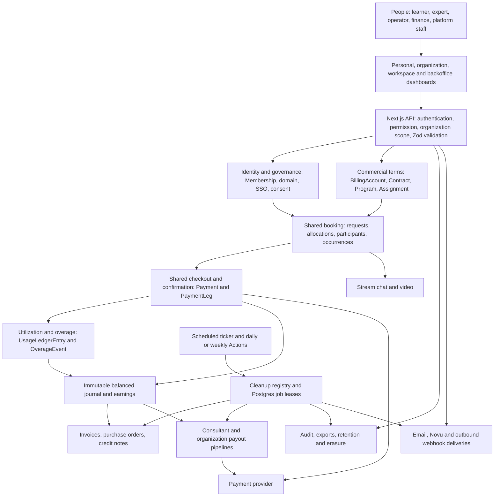
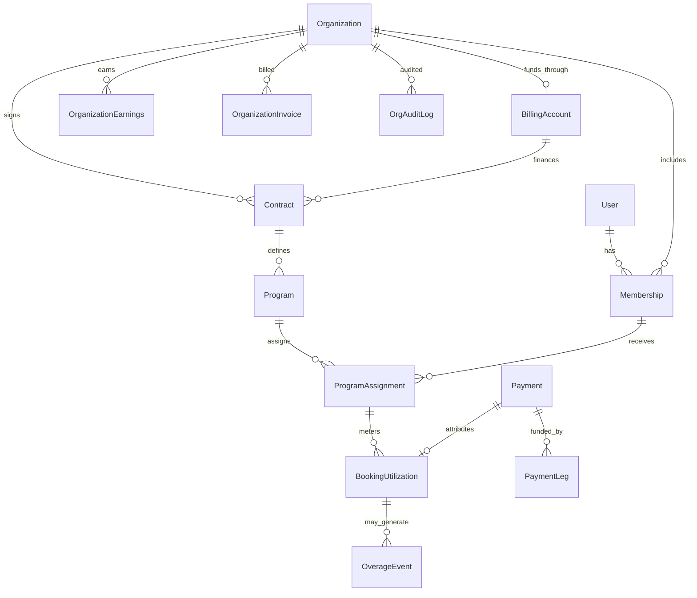
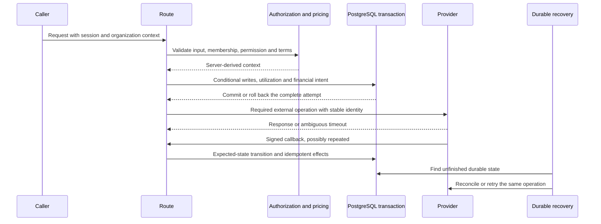

# Enterprise system design — boundaries, data, and end-to-end architecture

Familiarise's enterprise subsystem lets an organization buy services for its people, host experts who deliver services, or do both. It adds organizational identity, negotiated commercial terms, entitlement limits, billing, operational visibility, and governance to the platform's existing booking and money machinery. An enterprise booking remains a booking; it does not acquire an independent payment engine or a separate accounting database.

This chapter explains the whole system before the later chapters examine its parts. The design is derived from `prisma/schema.prisma`, the existing enterprise documentation, and the application and test code at the review baseline. Existing prose is background material; when it disagrees with the schema or a reachable call site, the implemented call site wins.

**Evidence boundary.** “Current” means present in the reviewed source, based on `dev` commit `dd0f8a3a0`. It does not mean that a feature flag is enabled in production, a SQL sidecar is installed in the shared database, a vendor contract is signed, or a scheduled job has recently succeeded. This documentation does not inspect production data or change the database. “Recommended” and “planned” identify design proposals; the docs PR implements none of them.

## The business questions that define the architecture

Every enterprise request has several separate answers. Who is acting? Which organization authorizes the action? Who pays? Which program meters the booking? Who delivers it? Who receives the earnings? Who is allowed to see the result?

Keeping these answers separate is the central design decision. A learner can belong to Wipro, book an expert affiliated with LearnPro Academy, and pay personally. Wipro's membership, LearnPro's delivery context, and the learner's card payment are different facts. Inferring all three from the organization currently selected in a browser would corrupt both privacy and settlement.

The source seed defines Wipro Limited as a sponsor, LearnPro Academy as a host, and the Indian Institute of Technology Madras as a hybrid organization in `prisma/seedFiles/14a-create-organizations.ts`. The scenarios below reuse those organization names. People, prices, dates, and commercial terms in this collection are illustrative unless a chapter explicitly identifies a seeded value.

## One picture of the subsystem

The boxes are responsibilities in one application, not a claim that Familiarise runs a fleet of microservices. PostgreSQL supplies transactions and durable state. Redis supplies specific edge and interactive coordination functions. External systems supply payment transport, communications, and object storage. [Operations and integrations](08-operations-and-integrations.md) explains their failure boundaries.

## The system has four planes

### Identity and control

`Organization` identifies the tenant. `Membership` relates a global `User` to that tenant with a role and a status. `OrgDomainClaim`, `OrganizationSSOSettings`, and `SsoProvider` establish organizational authentication policy. `Contract` and `Program` establish what the tenant has purchased and what members may use.

The control plane answers whether a request is allowed before it changes operational state. Organization activation is a set of signals and actions, rather than one Boolean that proves every commercial and security prerequisite has been satisfied. `lib/enterprise/org-activation.ts`, `lib/enterprise/org-activation-signals.ts`, and `lib/enterprise/governance.ts` implement those distinctions.

### Booking and delivery

The shared booking plane models the request, the people participating in it, its scheduled occurrences, and its eventual outcome. Enterprise adds organization attribution and program utilization. It also adds payer and operator workflows, so the person buying a service need not be the person receiving it.

This plane must continue to enforce availability, attendee capacity, and ownership. Enterprise entitlement is an additional check. A valid program allowance cannot make an occupied expert available, and an available expert does not imply that the buyer has a funded entitlement.

### Money and obligations

`Payment` records the economic intent and outcome. `PaymentLeg` records its funding composition. `BookingUtilization` and `UsageLedgerEntry` record entitlement consumption. `OverageEvent` records a chargeable excess. The journal records financial consequences, and earnings rows record who may eventually be paid.

These are separate models because they answer separate questions. A learner may consume one engagement without causing an immediate card charge. A payment can succeed while its earnings are still held. An invoice may exist before cash arrives. A refund can return money while also restoring part of an allowance.

### Evidence and recovery

`OrgAuditLog` records organization-visible actions. `SystemEvent` records platform operational evidence. `SystemJobExecution` records scheduled execution and coordinates leases. Export jobs, erasure requests, notification outboxes, and webhook delivery rows make selected asynchronous work durable.

Durability is component-specific. A database row makes intent survive a process restart; a registered worker and scheduler make that intent progress. The operational design must identify all three: producer, durable state, and consumer. A model name alone proves only that a place to store state exists.

## The data model in connected groups

The diagram omits optional satellites and operational relations for readability. It does not replace the exact relation definitions in `prisma/schema.prisma`.

| Model group                                                         | What the data means                                                           | Why it has its own boundary                                                                  |
| ------------------------------------------------------------------- | ----------------------------------------------------------------------------- | -------------------------------------------------------------------------------------------- |
| `User`, personal profiles, `Membership`                             | A person and their independent relationships with organizations.              | Removing an employee from one organization must not erase their unrelated personal activity. |
| `Organization`, tax, MSME, KYB and branding satellites              | Tenant identity, capabilities, procurement identity, and public presentation. | Branding edits and sensitive tax records have different access and lifecycle needs.          |
| `OrgWorkspaceProfile`                                               | The user's organization-workspace preferences.                                | A workspace spanning memberships is not itself a company or a company billing account.       |
| `BillingAccount`, `WalletTopUp`                                     | The organization's funding rail and prepaid funding lifecycle.                | Funding policy is independent of whether a program meters rupees or engagement counts.       |
| `Contract`, `BillingSubscription`                                   | Negotiated terms and recurring commercial billing.                            | Contract renewal and a learner's booking subscription are different lifecycles.              |
| `Program`, its configuration, `ProgramAssignment`                   | What a member may consume during an assigned period.                          | A new cycle can have a successor assignment while retaining prior-cycle evidence.            |
| `BookingUtilization`, `UsageLedgerEntry`, `OverageEvent`            | Consumption, incremental usage, and excess-charge evidence.                   | A booking, a batch of allocated sessions, and a financial charge need different identities.  |
| `Appointment`, participants and occurrences                         | Who attends or delivers, when, and with what outcome.                         | Buying a service, attending it, and allocating its time are independent operations.          |
| `Payment`, `PaymentLeg`, `Refund`, `Dispute`                        | Intent, funding sources, returned money, and contested money.                 | Settlement retries and reversals must preserve the original economic facts.                  |
| Journal, earnings, payouts and TDS                                  | Accounting, payable eligibility, bank transfer, and withholding evidence.     | A balanced journal does not by itself prove that a vendor actually moved money.              |
| Organization invoices, line items, purchase orders and credit notes | Procurement and tax documents and their application to usage.                 | Consuming a budget and issuing an invoice are not the same event.                            |
| Audit, system events, exports, erasure and delivery outboxes        | Traceability, data rights and asynchronous effects.                           | Organization-visible evidence needs a narrower privacy surface than platform diagnostics.    |

## Capability, taxonomy, funding, and role are independent

`canSponsor` permits the buying side. `canHost` permits the supply side. Both true is a hybrid. `Organization.kind` is an optional market taxonomy such as `AGENCY`, `ENTERPRISE`, or `SOLO_PRACTICE`; it is not the source of billing capability. `OrgBrandingProfile.directoryType` is a separate public-directory taxonomy.

`FundingSource` selects `PERSONAL`, `WALLET`, `INVOICE`, or `LICENSE`. `ProgramType` selects `LICENSED_SEAT` or `CREDIT_POOL`. `Membership.role` determines the actor's authority within this particular organization. None can safely substitute for another.

For example, an enterprise can host experts and pay for its own learners. A billing administrator may operate finance pages without permission to modify SSO or remove people. A learner can have a valid program assignment while the host expert is paid through a different organization.

`lib/enterprise/reachable-paths.ts` enumerates the supported capability/funding/program shapes and supplies UI guidance. It is not a complete proof that every surcharge, allocation, reversal, and postpaid branch is wired identically. [Commercial axes and programs](03-commercial-axes-and-programs.md) separates the three-axis reachability table, five-axis settlement view, and seven-axis commercial explanation.

## Three organizational identifiers that must never collapse

| Context                       | Meaning                                                        | Consequence                                                                                                               |
| ----------------------------- | -------------------------------------------------------------- | ------------------------------------------------------------------------------------------------------------------------- |
| Actor membership organization | The organization authorizing a person to perform this request. | Routes must verify the actor and permission in that organization.                                                         |
| `Payment.organizationId`      | Buyer or sponsor attribution.                                  | Buyer reporting and procurement follow this organization; a tag alone does not prove the organization funded the payment. |
| `Payment.hostOrganizationId`  | Supply-side organization associated with delivery.             | Host earnings and commercial splits follow the delivery context.                                                          |

A fourth boundary is personal scope. A personal record must not become visible to an organization merely because its owner has a membership there. Dashboard filters and organization API predicates must preserve the attribution stored with the activity. [Dashboards and user journeys](06-dashboards-and-user-journeys.md) explains payer, attendee, deliverer, and operator views.

## A concrete cross-organization request

Assume a Wipro learner books a consultation delivered by a LearnPro expert for Monday, 26 October 2026, 10:00–11:00 IST. For illustration, the service price is ₹1,000, or 100,000 paise, and applicable example GST is ₹180, or 18,000 paise. The displayed gross is ₹1,180, or 118,000 paise. These assumptions illustrate architecture; the actual checkout derives its own tax and attribution.

1. Authentication identifies the user. The organization route checks the active Wipro membership and the requested permission.
2. The commercial check resolves the chosen assignment, its contract, program scope, period, caps, and funding source.
3. The booking engine checks the proposed time, the expert and participant constraints, and the requested service.
4. The checkout transaction records the payment and the applicable organizational utilization. Sponsored funding writes the appropriate funding leg; over-cap sponsored bookings enter the overage settlement branch.
5. The confirmation pipeline establishes payment success and creates the financial consequences through the common money path. An organization dashboard cannot independently mark money captured.
6. Buyer context remains Wipro. Host context remains LearnPro. The split is derived from the resolved rate-card and payout-recipient context, rather than from the buyer organization.
7. Delivery outcome and the applicable holds determine earnings eligibility. Invoice collection, refunds, disputes, and member co-pay can impose additional obligations.
8. Notifications and external delivery use their own post-commit or durable recovery paths. Their success does not replace payment or booking truth.

This sequence intentionally does not supply an assumed universal journal posting. WALLET, INVOICE, LICENSE and personal funding produce different accounting. [Ledger, billing and settlement](05-ledger-billing-and-settlement.md) gives the numeric postings and identifies their enforcers.

## Where a transaction begins and ends

This is a boundary diagram, not the exact order of every provider operation. Some checkout paths mint an external order before a later database phase. The invariant is that a remote service cannot participate atomically in the PostgreSQL commit. Each component therefore needs an explicit reconciliation or retry strategy around the gap.

Inside `prisma.$transaction(async (tx) => ...)`, helpers must query through `tx`. `lib/prisma.ts` configures the pool; a global Prisma read from a helper invoked inside a transaction can wait for the only connection the transaction already owns on a single-connection runtime. Passing the transaction client preserves both the connection budget and the consistent snapshot.

Serializable retries can execute a transaction callback again. A callback must not send a new email, create a fresh payout, or otherwise repeat an external effect on each attempt. Checkout's utilization code returns notification intent for post-commit delivery in `lib/payments/checkout/commit/org-utilization.ts`.

## Invariants and their actual enforcers

| Rule in plain English                                                    | Enforcer in the reviewed source                                                                                                                                                                                                    | Boundary of the guarantee                                                                           |
| ------------------------------------------------------------------------ | ---------------------------------------------------------------------------------------------------------------------------------------------------------------------------------------------------------------------------------- | --------------------------------------------------------------------------------------------------- |
| One person has one membership row per organization.                      | Prisma composite uniqueness on `Membership.userId` and `organizationId`.                                                                                                                                                           | The same person can belong to multiple organizations.                                               |
| Money values persist as integer paise.                                   | `BigInt` money fields plus the Prisma money extension in `lib/prisma-extensions.ts`.                                                                                                                                               | Display currency is not an FX settlement engine.                                                    |
| A journal transaction must balance.                                      | `postLedgerTxn()` and the deferred `ledger_txn_balanced` trigger in `prisma/sql/ledger-triggers.sql`.                                                                                                                              | This proves journal arithmetic, not bank settlement or correct tax classification.                  |
| Journal entries and journal transactions cannot be edited or deleted.    | `ledger_entry_immutable` and `ledger_transaction_immutable` in the same sidecar.                                                                                                                                                   | Corrections require compensating transactions.                                                      |
| Funding legs obey their defined sum and reversal rules.                  | `payment_legs_sum_to_amount`, `payment_amount_vs_legs`, and `assert_payment_legs_ok()` in `prisma/sql/payment-legs-triggers.sql`.                                                                                                  | Referral-credit and pure zero-value LICENSE shapes have explicit semantics; do not use a naive sum. |
| A wallet debit cannot overdraw the cached balance.                       | `walletDebit()` uses conditional `updateMany`; `billing_account_wallet_nonnegative` backs it in `prisma/sql/check-constraints.sql`.                                                                                                | A nullable, unseeded cache must first be initialized; the journal remains financial evidence.       |
| Two eligible confirmed host occurrences cannot overlap.                  | `occurrence_no_confirmed_overlap` in `prisma/sql/check-constraints.sql`.                                                                                                                                                           | It does not cover every co-host, attendee, tentative, client-side or rescheduled occupancy rule.    |
| Money terms in use cannot be silently rewritten.                         | Program lock stamping and contract/program lock checks in `lib/enterprise/config-lock.ts`.                                                                                                                                         | A permitted new commercial version needs a deliberate supersession or replacement flow.             |
| Duplicate scheduled runs coordinate through PostgreSQL.                  | `withCronLock()` and `SystemJobExecution_running_jobName_key`.                                                                                                                                                                     | A lease does not authorize two active scheduler fleets or make external operations exactly once.    |
| Provider-captured payments use the shared capture-confirmation pipeline. | `lib/payments/webhooks/handlers.ts` owns external capture confirmation; internal synchronous rails create their successful intent through `lib/payments/checkout/commit/payment-row.ts` and commit their financial effects inline. | UI events and gateway redirect screens are not confirmation authority.                              |

The SQL guarantees above describe installed-sidecar behavior. This PR checked the checked-in definitions, not live installation. Adding an application sweep to re-prove a commit-time invariant is not the recommended response to that distinction. Deployment verification should establish that the existing sidecars are installed.

## State is distributed across several lifecycles

The organization can be ACTIVE while its contract is DRAFT. A contract can be active while a particular assignment has exhausted its allowance. A payment can be successful while its member overage is outstanding. A payout can be in progress while a later refund creates a clawback obligation.

No single “enterprise status” can faithfully summarize all of these. The dashboard should translate each durable state into the action its current actor can take, while preserving the separate underlying models. `lib/enterprise/transitions.ts` centralizes several expected-state transitions; payment and booking transitions have their own domain helpers.

| Lifecycle                                   | Question it answers                                           | Further explanation                                                                                  |
| ------------------------------------------- | ------------------------------------------------------------- | ---------------------------------------------------------------------------------------------------- |
| Organization and membership                 | May this organization and this person act here?               | [Identity and governance](02-identity-governance-and-lifecycle.md).                                  |
| Contract, program and assignment            | Which commercial version and allowance apply now?             | [Commercial design](03-commercial-axes-and-programs.md).                                             |
| Booking request, participant and occurrence | What was purchased, who participates, and what was delivered? | [Booking HLD](../01-booking-system-hld.md) and [dashboards](06-dashboards-and-user-journeys.md).     |
| Payment, overage, invoice and refund        | Who owes what, and what is settled?                           | [Checkout](04-checkout-and-overage.md) and [settlement](05-ledger-billing-and-settlement.md).        |
| Earnings and payout                         | What may be paid, and what has reached the bank?              | [Settlement](05-ledger-billing-and-settlement.md).                                                   |
| Export, erasure and delivery                | Which data or external effects remain unfinished?             | [Compliance](07-compliance-privacy-and-data.md) and [operations](08-operations-and-integrations.md). |

## How failure changes the design

A useful failure analysis names the durable row and the operation that can resume it. “Retry later” is insufficient when an HTTP timeout might have occurred after the provider accepted money.

- A stale organization settings edit uses `Organization.version` as an optimistic lock. A losing editor must refresh instead of overwriting a newer value.
- A concurrent wallet spend competes on a conditional balance update. Only an attempt with sufficient remaining balance succeeds.
- A repeated booking allocation must not consume the same appointment identity twice. Utilization records and usage entries carry the idempotency context.
- A callback can repeat or arrive late. Expected-state writes and operation identities prevent duplicate financial effects.
- A member can leave with future commitments or unsettled obligations. Removal is an orchestration problem, not a hard delete of every related row.
- An external erasure can fail after local scrubbing. Durable vendor retry rows keep that failure observable and retryable.
- An invoice or payout worker can lose its process. Durable state and its registered scheduler must carry the remaining work.

The exact recovery procedures remain in domain runbooks. This collection explains why each exists and where its state belongs; it does not introduce a new operations framework.

## Availability and deployment are separate questions

Host capabilities have a real gate in `lib/enterprise/feature-flag.ts`: `ENABLE_HOST_ORGS` must evaluate to true. A schema containing host earnings and a dashboard containing payout components do not prove that self-service hosting is enabled in a deployment.

Similarly, residency and currency enums express stored intent. They do not by themselves establish regional isolation or a multi-currency ledger. The reviewed money layer settles in INR. An export worker with a storage upload path does not prove that a signed link is currently valid. An integration with configured credentials still depends on its vendor account and network.

Recommended documentation practice is to distinguish **implemented**, **gated**, **partially integrated**, and **proposed** whenever those categories matter. A misleading green “supported” label can cause a procurement promise that the deployed system cannot satisfy.

## Recommended system boundary

Keep the enterprise control plane close to the shared booking and money code. Today, membership checks, entitlement metering, funding legs, and journal effects benefit from one database transaction. Splitting them into independent services would require explicit distributed reservation and compensation protocols without resolving a demonstrated current product need.

Separate components by their responsibilities and typed inputs, then scale execution independently only where evidence supports it. Outbound deliveries and export generation are natural asynchronous boundaries. Organization authorization and wallet debits are poor candidates for eventually consistent remote checks on the checkout path.

The cost is a large application with several domains in one codebase. Manage that cost through ownership, clear helpers, traceable state, and focused tests. [Design decisions and recommendations](09-design-decisions-and-recommendations.md) gives the alternatives, reasons, and conditions that would justify revisiting them.

## Glossary

- **Sponsor:** An organization that can fund members' services.
- **Host:** An organization that supplies experts or offerings and may receive earnings.
- **Hybrid:** An organization with both capabilities.
- **Assignment:** A member's allowance and period under a program.
- **Engagement:** The enterprise unit used to meter allocated service occurrences; it is distinct from an authentication session and a video meeting.
- **Funding leg:** One source contribution to a payment, including defined reversal sources.
- **CAS:** Compare-and-set: a write succeeds only while the row still matches the expected prior state.
- **Outbox:** Durable intent for an external effect that a worker can retry.
- **Sidecar:** A checked-in SQL constraint, index, or trigger installed outside the Prisma model definition.
- **Reconciliation:** Comparing local obligations with an external system or repairing an unfinished cross-system operation.

## Where to go next

Read [identity](02-identity-governance-and-lifecycle.md) for who may act, [commercial design](03-commercial-axes-and-programs.md) for what is allowed, and [checkout](04-checkout-and-overage.md) for how it becomes a booking and obligation. Continue through [settlement](05-ledger-billing-and-settlement.md), [dashboards](06-dashboards-and-user-journeys.md), [compliance](07-compliance-privacy-and-data.md), [operations](08-operations-and-integrations.md), and [recommendations](09-design-decisions-and-recommendations.md). The [collection index](README.md) maps individual component designs to chapters.

## Deprecated & Superseded Approaches

Earlier enterprise descriptions used a single organization kind to imply buying and hosting behavior. The current model uses `canSponsor` and `canHost`, with separate optional taxonomies for market identity. Do not recreate an exclusive kind switch to determine funding or settlement behavior.

Earlier descriptions also presented parent/root organization hierarchy fields as active structure. Those fields are absent from the current `Organization` model. `departmentLabel` is a simple membership label, not a subsidiary authorization tree. A future hierarchy would require an explicit data and authorization design.

The old `FundingLedgerEntry`, `WalletEntry`, and `SettlementLedgerEntry` money logs have been replaced by the balanced journal. A legacy comment naming one of those logs does not establish a current table or an independent source of financial truth.

Three-, five-, and seven-axis diagrams appeared at different explanatory levels. Treating one of them as the complete runtime settlement specification produced overbroad claims. The current reachable-triples table, guidance classifier, configuration validation, and actual settlement call sites must be read together.

A workspace, an organization, and a person's global role used to be easy to conflate in prose. The current data model separates them. Keep future dashboards aligned with those boundaries instead of deriving organizational power from a personal dashboard identity.

A balanced journal and a successful external transfer were sometimes described as one outcome. They remain distinct. Immutable posting protects local evidence; provider reconciliation protects the boundary outside PostgreSQL. One cannot replace the other.

Finally, older “wired” integration maps and stale source comments are discovery aids, not proof of active end-to-end behavior. This collection retains the current component design and records unresolved integration choices explicitly, so a future implementation does not repeat an already superseded architecture.
