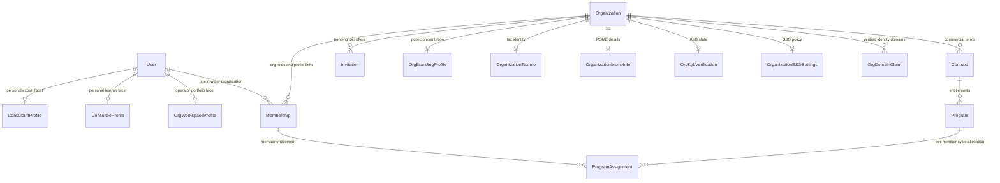
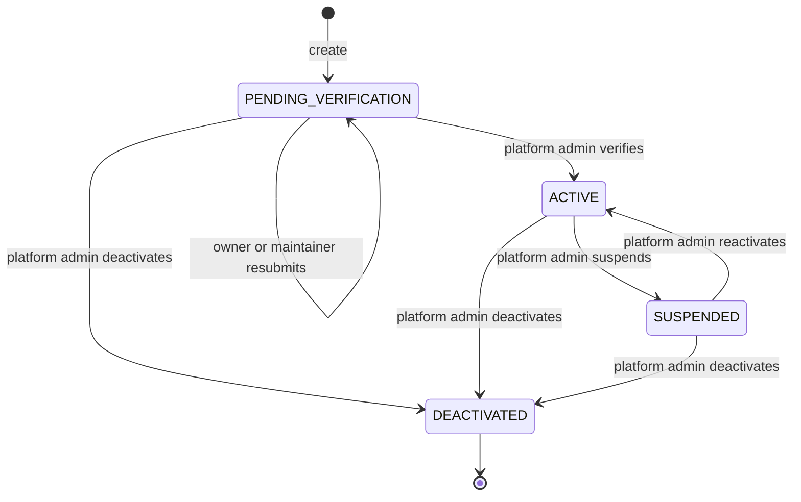
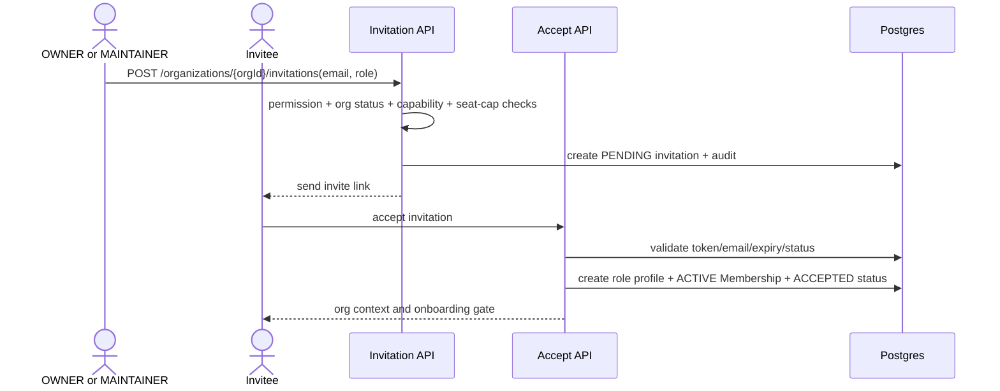
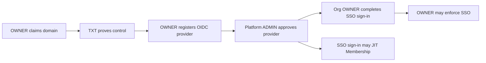

# Enterprise identity, governance and lifecycle

This document explains how a person becomes an organization operator, learner or expert; how the application scopes authority to one
organization; and how org, member, contract, program and assignment state changes affect later actions. It reflects the code currently in this
checkout. It is an orientation and system design map; the route handlers, typed permission map, Prisma schema and focused domain references
remain the executable specification.

The key distinction is that an organization does not create a second platform identity for each employee. The person keeps one global `User` and
whichever personal profiles they have. An org relationship is a separate `Membership` row with one role and status for that org. An
`OrgWorkspaceProfile` is a third, user-scoped record for someone operating an org portfolio. Those three layers have different lifecycles and
different guards.

For the cross-org and per-org dashboard journeys, see [06 — Dashboards and user journeys](./06-dashboards-and-user-journeys.md). The existing
enterprise band gives the deeper implementation references for
[organization lifecycle](../../enterprise/00-foundations/05-organization-lifecycle.md),
[roles and permissions](../../enterprise/00-foundations/04-roles-and-permissions.md),
[SSO](../../enterprise/20-iam-and-security/01-sso-and-authentication.md),
[JIT and session refresh](../../enterprise/20-iam-and-security/02-jit-and-session-refresh.md),
[contracts](../../enterprise/30-programs-and-lifecycle/07-contract-lifecycle.md),
[programs](../../enterprise/30-programs-and-lifecycle/02-programs.md), and
[cycle rollover](../../enterprise/30-programs-and-lifecycle/08-cycle-engine-and-rollover.md). The broader architecture chapters are
[commercial axes and programs](./03-commercial-axes-and-programs.md), [checkout and overage](./04-checkout-and-overage.md),
[ledger, billing and settlement](./05-ledger-billing-and-settlement.md), [compliance, privacy and data](./07-compliance-privacy-and-data.md),
[operations and integrations](./08-operations-and-integrations.md), and
[design decisions and recommendations](./09-design-decisions-and-recommendations.md).

## 1. The identity model

The schema for the center of this diagram is in [`prisma/schema.prisma`](../../../prisma/schema.prisma): `Organization` starts at line 1143,
`Invitation` at 1384, `Membership` at 1430, `Contract` at 1655, `Program` at 1826, `ProgramAssignment` at 1927, SSO/domain models at 2773 and
2788, `OrgWorkspaceProfile` at 3582, and `OrgBrandingProfile` at 7885.

### Four labels that must remain separate

| Name                           | Meaning                                                                                                                                                        | Stored on                                                |
| ------------------------------ | -------------------------------------------------------------------------------------------------------------------------------------------------------------- | -------------------------------------------------------- |
| `UserRole`                     | Platform account/dashboard facet such as `CONSULTANT`, `CONSULTEE`, `ORG_WORKSPACE`, `STAFF`, or `ADMIN`.                                                      | `User.role`                                              |
| `MemberRole`                   | Authority and function inside one organization: `OWNER`, `MAINTAINER`, `BILLING_ADMIN`, `MANAGER`, `EXPERT`, `LEARNER`, or `SUPPORT`.                          | `Membership.role`                                        |
| `canSponsor` / `canHost`       | Commercial capabilities of the organization. Sponsoring funds members' sessions; hosting owns expert supply and org earnings.                                  | `Organization`                                           |
| `OrgKind` / `OrgDirectoryType` | Market taxonomy. `OrgKind` is host classification; `OrgDirectoryType` is visitor-facing directory classification. Neither grants authority or enables funding. | `Organization.kind` / `OrgBrandingProfile.directoryType` |

A person's platform role does not determine their org role. One account may have both personal profiles, be an EXPERT in one organization, a
LEARNER in another, and an OWNER in a third. `UserRole` helps choose a personal landing and backoffice reach; `Membership` plus permission keys
determines org access.

The `Membership` unique key `(userId, organizationId)` allows one role in one organization. The same user can still have a different role in
another. Because LEARNER and EXPERT are disjoint within one membership, changing between them requires removal and a fresh invitation. That keeps
`consulteeProfileId` and `consultantProfileId` consistent with the role and avoids self-dealing against an org's funded program.

`OrgWorkspaceProfile` is not a membership or a row per org. It is one optional profile per user (`userId @unique`) holding default landing
organization, notification routing, locale and currency display. Its ID keys the cross-org portfolio route. `OrgBrandingProfile` is an optional
one-to-one child of an organization; it contains logos, banner, brand colors, description, website, industry, size bucket and directory type.
Operator preferences must not be written into organization branding and vice versa.

The data model no longer has the BetterAuth Organization plugin's `Member` record. The app's own typed `Membership` is the organization
relationship. It also no longer has an organization-parent/root hierarchy. `Organization` has capability booleans and optional tax/context
fields, but no parent organization foreign key. The `kind` field (`AGENCY`, `ENTERPRISE`, `SOLO_PRACTICE`) does not restore a hierarchy.

## 2. Organization capability and lifecycle

### Capability combinations

| `canSponsor` | `canHost` | Meaning in current flows                                                                  |
| -----------: | --------: | ----------------------------------------------------------------------------------------- |
|         true |     false | Sponsor organization. Can create a BillingAccount and run contracts/programs for members. |
|        false |      true | Host organization. Can host experts and receive the org share of earnings.                |
|         true |      true | Hybrid buyer and host. Funding and hosting remain separately scoped.                      |
|        false |     false | Inert shape. Organization create and capability PATCH reject this combination.            |

Creation defaults to sponsor-only, but it is not an immutable org type. Capability changes run through the org PATCH path and carry a version
check. Turning off sponsorship checks live billing state and wallet balance; turning off hosting checks open hosting obligations. The host path
is also subject to `ENABLE_HOST_ORGS`: the app refuses a new or newly enabled host capability until the host settlement path is live. This
deployment gate is different from the stored capability and from directory visibility.

When `canSponsor=true`, creation makes one BillingAccount with the selected `FundingSource` (`PERSONAL`, `WALLET`, `INVOICE`, `LICENSE`) and
connects it to the Organization. Sponsor-only and hybrid orgs therefore have a buyer account; host-only orgs need no sponsor BillingAccount. Host
money setup (payout account, rate card and org earnings) belongs to the payout subsystem.

### Creation is an atomic onboarding boundary

`POST /api/organizations` performs the initial setup in one Prisma transaction. The creation path validates the requested capabilities and
funding selection, validates domestic invoice tax requirements, creates the Organization in `PENDING_VERIFICATION`, creates tax and optional
branding satellites, creates a BillingAccount only when sponsoring, creates the creator's ACTIVE OWNER Membership, upserts the user's
OrgWorkspaceProfile, and writes the initial org audit record. The creator cannot end up with an org row but no owner membership if part of
provisioning fails.

The implementation is in `app/api/organizations/route.ts`. Email and in-app notifications are staged with the transaction and attempted after
commit. The org has an ID and an owner immediately; platform verification is a separate transition. Thus “pending verification” does not mean “no
dashboard” or “no membership.”

### Org status machine

The state transition helper is `transitionOrganization` in `lib/enterprise/transitions.ts`; it uses conditional `updateMany` with an allowed-from
set so concurrent or terminal transitions fail with a conflict. Admin actions enter through
`app/api/admin/organizations/[orgId]/verify/route.ts`. `REJECT` is not a fifth status: it stores a reason and rejected timestamp while status
stays `PENDING_VERIFICATION`. The OWNER or MAINTAINER fixes eligible setup fields and calls the resubmit endpoint; it clears rejection fields and
refreshes submission time. A platform ADMIN's `VERIFY` clears the rejection substate and sets ACTIVE.

Suspension is recoverable; deactivation is terminal to customer flows. A suspended organization can still render a restricted/read-only dashboard
so an owner can see the state and contact support. New invitations and payments are paused. Already booked sessions are not automatically
canceled solely because a member or org became suspended; org operators must deliberately cancel/refund sessions that should stop. An org with
settled financial history is deactivated and soft-deleted rather than physically erased. Personal contact fields are scrubbed while legal and
financial records remain. A money-untouched shell can be hard-deleted after live obligations are cleared.

### What is available before verification

Pending verification is a governed onboarding phase, not a universal write lock. The current behavior is split by the purpose of a write:

| Action                                           | Pending organization behavior                                        |
| ------------------------------------------------ | -------------------------------------------------------------------- |
| Create owner and dashboard                       | Allowed at organization creation.                                    |
| Fix branding and tax/KYB information             | Allowed through permitted settings fields.                           |
| Claim and DNS-verify domains                     | Allowed; identity setup can progress before verification.            |
| Invite people                                    | Allowed up to the unverified seat cap.                               |
| SSO JIT membership                               | Allowed up to the same active-seat cap.                              |
| Change core capabilities/public/commercial terms | Restricted until the required activation state; route-specific.      |
| Start invoice-funded sponsored activity          | Subject to starter limits and other billing gates; see billing docs. |

This boundary is enforced by each route's `requireOrgAccess` options and explicit status checks. Do not infer from one route that all pending-org
writes are allowed. `app/api/organizations/[orgId]/invitations/route.ts` explicitly permits pending-org invites under the cap because the
creation wizard sends invitations immediately. `lib/sso/jit-membership.ts` counts active members in the Serializable transaction before adding a
JIT member. `lib/enterprise/org-status.ts` centralizes addressable, billable and onboarding-blocked status sets.

## 3. Invitation, acceptance and membership lifecycle

An `Invitation` is a time-limited offer with org, email, role, inviter and `PENDING`/`ACCEPTED`/`CANCELED`/`EXPIRED` status. It is not an active
seat by itself. The recipient accepts through `POST /api/organizations/invitations/accept`; that action creates a `Membership` and records
acceptance. Duplicate pending invitations for a normalized org and email are blocked in application code and by the partial unique index in
`prisma/sql/check-constraints.sql`.

The dashboard's Add People and bulk import tools create invitations; the recipient must accept. The old `POST /api/organizations/[orgId]/members`
direct creation endpoint returns HTTP 405 `USE_INVITATIONS`. It must not be described as a current onboarding option. SSO JIT is the other
creation channel because the approved organization IdP is an explicit identity-provisioning authority.

A new LEARNER acceptance may ensure the user's lightweight ConsulteeProfile in the acceptance transaction. An EXPERT invitation requires the
user's existing ConsultantProfile: org invitation cannot create the person's global expert identity or complete its verification. SSO JIT has a
separate `provisionUser` path and may provision that profile with a placeholder domain while platform verification remains pending. The org
membership can be active while the ConsultantProfile is not yet public-marketplace verified.

`lib/api/organizations/membership-transitions.ts` centralizes role-side profile references and payout defaults. LEARNER links the
ConsulteeProfile and clears consultant reference; EXPERT links ConsultantProfile and clears learner reference; operator roles carry neither.
Payout recipient defaults to SELF. The Membership's `payoutRecipient` is per organization: a consultant can receive personal payout in one
organization and route earnings to the host org in another. Changing it affects future booking splits; prior booking rows retain their snapshots.

### Roles and role changes

`lib/enterprise/membership-guards.ts` is the shared guard for dashboard role PATCH/removal and bulk paths. It protects the last active OWNER,
prevents unauthorized governance-role grants, checks capability compatibility, blocks self changes where required, protects tombstones, and
checks participant history before changing a LEARNER/EXPERT role. If a learner/expert has org bookings, assignments, deliveries or earnings,
conversion is refused with `REMOVE_AND_REINVITE`; remove the old membership and invite the user with the new role.

Granting `OWNER`, `MAINTAINER`, or `BILLING_ADMIN` is OWNER-only. MAINTAINER can grant/remove operational roles (`MANAGER`, `SUPPORT`, `EXPERT`,
`LEARNER`) subject to the target and capability rules. `BILLING_ADMIN` has finance reach but cannot manage the member roster, invite people, edit
SSO, or change org status. It is intentionally “operator blind”: a numeric role rank does not express its distinct finance remit.

Removing a member first queries obligations. Active program assignments and upcoming sessions or unsettled money can block ordinary removal. An
OWNER may use the force path after the UI asks them to confirm the member email; live assignments are closed/canceled and the audit row records
the forced action and what obligations it overrode. Removal changes status to `REMOVED`; it preserves the row and the user's personal profile.
SUSPENDED members keep already booked sessions and can see their own allowed past/upcoming org context, but cannot start normal new work.
`ERASED` is a privacy tombstone state; erasure scrubs identifiers while maintaining the financial/audit trail.

The membership guard, role transition helper, invitation acceptance route, and membership PATCH route are the enforcement points. The UX copy and
role matrix are projections of those decisions; changing only a page control does not change backend authority.

## 4. Permission and tenant boundary

`lib/auth/org-permissions.ts` exports the canonical `ORG_PERMISSIONS` map keyed by `OrgSurface`. The helper functions `hasOrgPermission`,
`hasAnyOrgPermission`, and `rolesWithOrgPermission` are used by the sidebar, page-level access and APIs. A new permission belongs in this map and
its consumers. Avoid adding a second role matrix in a separate service.

Authorization combines two independent checks:

1. **Membership permission:** Does this MemberRole have the named action key?
2. **Organization shape/scope:** Is this capability, status and organization ID valid for the requested operation?

For example, OWNER may hold `catalog.manage`, yet a sponsor-only org has no host catalog to manage. `canSponsor`, `canHost`, `requiresPO`, and
funding source are not permission keys: they describe structure, so a consumer combines them with role permission.

A few examples show why each surface must use the named key rather than a rank:

| Action                         | Roles that can act (current matrix)       | Additional structural gate                                         |
| ------------------------------ | ----------------------------------------- | ------------------------------------------------------------------ |
| Manage roster and invitations  | OWNER, MAINTAINER                         | Invitation role must fit capability; pending seat cap applies.     |
| Read full member roster        | OWNER, MAINTAINER, MANAGER, SUPPORT       | Finance roles get names-only directory or finance-specific fields. |
| Manage contract terms          | OWNER                                     | Sponsor capability and valid BillingAccount.                       |
| Assign program seats           | OWNER, MAINTAINER, MANAGER                | `canSponsor`, active program/contract, active membership.          |
| Manage program money terms     | OWNER, MAINTAINER                         | Sponsor capability; terms lock after first assignment.             |
| Read billing                   | OWNER, MAINTAINER, BILLING_ADMIN, MANAGER | Sponsor capability.                                                |
| Write billing                  | OWNER, BILLING_ADMIN                      | Sponsor capability and route-level funding checks.                 |
| Read payouts                   | OWNER, MAINTAINER, BILLING_ADMIN          | Host capability.                                                   |
| Change SSO/domain settings     | OWNER                                     | Verified DNS/provider requirements for enforcement.                |
| Read organization operations   | OWNER, MAINTAINER, MANAGER, SUPPORT       | Membership and readable org status; content still redacted.        |
| Read own program / arrangement | LEARNER / EXPERT respectively             | Sponsor / host capability and linked profile.                      |

These are examples, not a replacement matrix. Check the current `ORG_PERMISSIONS` constants for the exact role set; it is the single source of
truth. `app/dashboard/organization/[orgId]/layout.tsx` seeds authorized org details before the shell renders. API routes use `requireOrgAccess`
in `lib/auth-helpers.ts`; it resolves the org, checks structural/status gates, loads membership, and evaluates explicit permission. A platform
ADMIN receives a synthetic read-only OWNER-shaped membership for selected reads only; write operations return `ADMIN_READ_ONLY`. Platform
lifecycle writes use admin doors.

Tenant scoping is not only “has a role.” Multi-tenant list endpoints call `resolveOrgScope` in `lib/api/scope/parse.ts`. The caller may request
personal, one organization, or staff-only all-platform scope. A user without `operations.read` requesting an org scope is narrowed to their own
rows within that org instead of receiving the full org feed. A nonmember cannot query the org feed. A role grant to view a roster also does not
grant access to private member session content: ADR 20 limits org-visible session data to metadata and purpose-specific aggregates; messages,
uploads and recordings remain gated by their own rules.

Mutating Membership, Organization, Contract, Program and assignment statuses uses guarded transitions or conditional `updateMany` in the row's
WHERE clause. The route may perform a friendly pre-check, but the update predicate is the race-safe state transition. Most role and lifecycle
changes also write `OrgAuditLog` in the same transaction.

## 5. Verified domains, SSO and JIT

### Establishing an SSO tenant

The current path has five gates. Each is a separate trust assertion; registering an issuer alone does not make it a trusted identity source.

1. OWNER creates `OrgDomainClaim` through `POST /api/organizations/[orgId]/domain-claims`. The server returns a token and record name
   `_familiarise-verify.<domain>`.
2. OWNER adds a DNS TXT record and calls `POST /api/organizations/[orgId]/domain-claims/[domain]/verify`. The route resolves TXT, compares the
   stored token, stamps `verifiedAt`, writes audit, and removes competing unverified claims. A partial unique index permits staged unverified
   claims but prevents two verified owners of one domain.
3. OWNER registers an OIDC provider against verified domains under `/api/organizations/[orgId]/sso/providers`. The provider config is encrypted;
   PKCE and fixed `openid email profile` scopes are used. Provider starts with `domainVerified=false`.
4. Platform ADMIN approves or revokes the provider through `/api/admin/organizations/[orgId]/sso-providers/[providerId]/approval`. Approval
   rechecks every covered domain's verified claim. This admin door is the only writer of the approval bit.
5. OWNER completes a successful login through the approved provider to stamp `provenAt`. Only an approved, owner-proven provider covering a
   verified domain permits `enforceSSO=true`. Enabling enforcement revokes sessions on affected domains while keeping the acting owner session.

The runtime uses OIDC. Prisma keeps a nullable `samlConfig` field for schema compatibility/future evaluation, but it is not a supported login
flow today. There is no SCIM deprovisioning integration. The role for uninvited JIT joins is fixed at LEARNER; raising access requires an invite
role or a later permitted promotion.

### JIT join and session consequences

`lib/sso/jit-membership.ts` runs from BetterAuth's `provisionUser` hook on each successful SSO callback before the session cookie is issued. It
checks the provider's organization, org status, membership state, capability and any pending invitation. An existing ACTIVE membership returns as
already joined; SUSPENDED or REMOVED membership is not silently revived. A pending unexpired invitation for the normalized email supplies the
role and is marked accepted; otherwise JIT uses LEARNER.

The insert is Serializable. If the org is still pending verification, it counts active seats in the same transaction and refuses beyond
`UNVERIFIED_ORG_SEAT_CAP`. Role profile effects and membership/audit writes share that transaction. A uniqueness race is treated as another
request having joined; other provisioning failures reject the callback so the user is not left with a successful SSO login that promised org
access but failed to create it.

`OrganizationSSOSettings.defaultRoleForAutoJoin` exists in the schema as a MemberRole but the Zod boundary narrows writes to LEARNER. The field
remains useful for expressing tenant policy while preserving the least-privilege floor.

Enforced-domain sessions have a 24-hour absolute lifetime. Manual member suspension/removal for a verified-domain org revokes the user's
sessions; an IdP-side account removal without SCIM may take up to that lifetime to stop working. The session refresh path loads fresh Membership
data on every request, so role changes do not rely on stale cookie-cached permission claims. Session lookup failures are treated as
service-unavailable errors, not as a signed-out user.

## 6. Contracts, programs and cycle state

The commercial tree is `Organization → Contract → Program → ProgramAssignment → BookingUtilization`. Membership joins the assignment; program
configuration lives in a 1:1 LicensedSeatConfig or CreditPoolConfig. Billing and booking semantics are documented in the dedicated enterprise
money/program references.

### Contract state and renewal

A contract starts DRAFT, becomes ACTIVE when signed/activated, and ends EXPIRED or TERMINATED. `effectiveTo=null` is open-ended. The state
transition helper is `transitionContract` in `lib/enterprise/transitions.ts`. Term fields lock after activation/signature, any issued invoice, or
live assignment use. `autoRenew` is intentionally a forward-looking switch and can change independently.

Changing committed terms creates a successor. The old row points to the new contract with `supersededByContractId`, `supersededAt`, and
`supersessionReason`. AMENDMENT ends the old active term as TERMINATED; RENEWAL ends it as EXPIRED. Existing invoices retain the old contract ID
so the historical billing terms remain traceable. The `ContractSupersessionReason` enum also reserves `TERMINATION_REPLACEMENT`; this is not a
client-selectable manual supersede reason. There is no `Contract.kind` column—do not describe renewal/amendment as a contract kind.

The daily auto-renew job claims due active contracts through conditional `autoRenewedAt` write, creates a new successor, repoints programs, and
records the chain. The expiry job handles contracts that remain due. Relevant sources:
`app/api/organizations/[orgId]/contracts/[contractId]/supersede/route.ts`, `jobs/contracts/auto-renew-contracts.ts`, and
`lib/enterprise/config-lock.ts`.

### Program configuration and seat cycles

Program money configuration stays editable until the first assignment is created. The first assignment transaction stamps
`Program.configLockedAt`; the lock persists even if the assignment later ends. Money fields such as type, covered plan types, cap, price cap,
overage behavior and surcharge cannot be rewritten after that point. Archive the old program and create another one for new terms. Assignment
POST in `app/api/organizations/[orgId]/programs/[programId]/assignments/route.ts` stamps the lock; `lib/enterprise/config-lock.ts` lists the
locked fields and rechecks inside the caller transaction.

`ProgramAssignment` is a membership entitlement over a period. LICENSED_SEAT counts engagements; CREDIT_POOL counts money consumed in paise.
`ACTIVE` can advance to `ROLLED` when a fresh successor is minted, `CLOSED` when its contract or renewal conditions end, or `CANCELLED` on
member/assignment exit. `PAUSED` exists in the assignment enum and transition map, but a current assignment writer was not found in the route/job
code; contract close and supersede paths handle PAUSED rows defensively. The current cycle engine in `lib/enterprise/cycle-engine.ts` closes
rather than rolls if the contract is not ACTIVE, auto-renew is off, or the successor period would exceed contract `effectiveTo`; otherwise it
rolls. It clamps month ends and uses a transactional claim plus unique successor constraints for idempotency.

Do not describe PAUSED as an active organization-suspension cascade. Program pause is implemented, but organization suspension pauses new
invitations and payments and preserves existing booked sessions; it is not evidence that every assignment row is paused. Read the specific
transition writer before claiming that a status change cascades to every downstream row.

### Lock behavior and safe changes

| Object     | Editable before use                           | Locked after use                                                          | Safe change path                                                  |
| ---------- | --------------------------------------------- | ------------------------------------------------------------------------- | ----------------------------------------------------------------- |
| Contract   | Terms while DRAFT and unused.                 | Signed/ACTIVE, issued invoice, or live assignment locks commercial terms. | Supersede with an amendment or renewal.                           |
| Program    | Money configuration before first assignment.  | `configLockedAt` persists after first assignment.                         | Archive and create a program under suitable terms.                |
| Rate card  | New effective version for future bookings.    | A booking's split snapshot is immutable.                                  | Add a new effective card; old booking splits remain unchanged.    |
| Assignment | Period and lifecycle operations under guards. | Usage and rollover history remain linked.                                 | Roll/cancel/close through their transition paths; preserve audit. |

## 7. Current-vs-proposed design boundary

**Current implementation:** the typed membership model, permission matrix, capability checks, OIDC provider approval/proof chain, pending-org
seat cap, member transitions, contract supersession, persistent program lock, and cycle engine described above exist in current code.

**Activation/deployment conditions:** host-capable org creation depends on `ENABLE_HOST_ORGS`; live payout execution has its own gate. SSO
requires a configured provider and valid DNS/approval/proof before enforcement. Feature availability in a tenant's stored state does not mean
every deployment has turned on the corresponding settlement capability.

**Recommended documentation and product posture:** keep one permission matrix; keep identity creation explicit and consent-bearing; explain
pending org as a bounded state; show capability gates beside role gates; keep immutable money terms and successor records; and treat user-visible
navigation as a projection of the same backend permission keys. These recommendations describe how to preserve current design intent; they do not
claim new code is implemented.

## 8. Design choices and alternatives

- **One global identity with typed memberships.** A separate user per tenant would duplicate login, profile and payout identity and make a user's
  expert work in one org unrelated to their personal consulting history. BetterAuth's Organization plugin was considered, but its generic
  membership abstraction does not carry the role/profile/entitlement fields or exact policy used here. The app's own `Membership` is the current
  relationship source.
- **Capability booleans plus taxonomies.** A single org-type enum would make a hybrid buyer/host organization awkward and mix commercial ability
  with visitor-facing labels. `canSponsor` and `canHost` can vary independently; `OrgKind` and `OrgDirectoryType` express classification only.
- **Named action matrix instead of rank-only authorization.** One total ordering cannot express a finance user who sees invoices but not the
  roster or operational session feed. The permission matrix lets nav, page and API share a precise named rule. Capability and status remain
  separate structural gates.
- **Invitation acceptance instead of direct admin-created membership.** Direct add was retired because it could create a live relationship
  without the user's acceptance. Invitation acceptance is the user's own act; approved SSO JIT is a separate trusted provisioning channel.
  Reintroducing direct add would need an explicit identity/consent design rather than a route shortcut.
- **DNS verification plus staff provider approval.** Allowing an org owner to assert their own issuer/domain would let them capture identities
  for a domain they do not control. TXT proof validates domain control; platform approval validates provider configuration; owner proof reduces
  lockout risk before enforcement.
- **Superseding commercial records instead of mutating used terms.** Updating a contract or program in place could make prior usage appear to
  have different terms. A new successor keeps the history and gives invoices/assignments a stable governing record. A “pending changes apply next
  cycle” staging model was removed; current UI uses immutable locked terms and replacement records.

## 9. Implementation anchors

| Concern                        | Current enforcement/source                                                                                                                             |
| ------------------------------ | ------------------------------------------------------------------------------------------------------------------------------------------------------ |
| Org schema/capabilities/status | `prisma/schema.prisma` `Organization`; `app/api/organizations/route.ts`; `app/api/organizations/[orgId]/route.ts`                                      |
| Org status transition          | `lib/enterprise/transitions.ts` `transitionOrganization`; `app/api/admin/organizations/[orgId]/verify/route.ts`                                        |
| Membership/invitation state    | `prisma/schema.prisma` `Invitation`/`Membership`; invitation accept and member routes under `app/api/organizations/`                                   |
| Role permission                | `lib/auth/org-permissions.ts`; `lib/auth-helpers.ts` `requireOrgAccess`; `lib/dashboard/nav/organization.ts`                                           |
| Membership guard               | `lib/enterprise/membership-guards.ts`; `lib/api/organizations/membership-transitions.ts`                                                               |
| JIT                            | `lib/sso/jit-membership.ts`; auth plugin in `lib/auth.ts`                                                                                              |
| Domain/provider gates          | `app/api/organizations/[orgId]/domain-claims/`; `app/api/organizations/[orgId]/sso/`; `app/api/admin/organizations/[orgId]/sso-providers/`; `lib/sso/` |
| Contract/program lock          | `lib/enterprise/config-lock.ts`; contract/program routes under `app/api/organizations/[orgId]/`                                                        |
| Cycle transitions              | `lib/enterprise/cycle-engine.ts`; `jobs/billing/advance-program-cycles.ts`; `lib/enterprise/transitions.ts`                                            |
| Org dashboard read boundary    | `app/dashboard/organization/[orgId]/layout.tsx`; `lib/api/scope/parse.ts`; endpoint-specific `requireOrgAccess`                                        |

Focused tests to inspect while changing these boundaries include `__tests__/sso/jit-membership.test.ts`, SSO provider lifecycle/approval and
session-sweep tests, `__tests__/enterprise/fsm-terminal-invariants.test.ts`, `__tests__/enterprise/anti-lockout-gaps.test.ts`, and org-scoped
dashboard/nav tests. Test names and coverage change with code; inspect the current files rather than treating this list as exhaustive.

## Glossary

- **Capability:** an organization-level commercial ability, primarily sponsor or host, checked separately from member permissions.
- **JIT:** just-in-time provisioning of a Membership on a successful SSO login.
- **Membership:** the app-owned row linking a user, org, role, status, and role-specific profile/entitlements.
- **Org workspace:** the user-level cross-org operator portfolio keyed by `OrgWorkspaceProfile.id`.
- **Owner proof:** a successful OWNER sign-in through an approved SSO provider, recorded on the provider before enforcement can be switched on.
- **Supersession:** creating a new contract/program configuration and linking the prior record forward, keeping old money history attached to its
  terms.

## Deprecated & Superseded Approaches

- **BetterAuth Organization plugin membership as the app authorization source.** The app uses typed `Membership` rows and its own `Invitation`
  flow.
- **Direct admin add of members.** `POST /api/organizations/[orgId]/members` now returns 405; joining is invitation acceptance or approved SSO
  JIT.
- **One enum as the org type and authority model.** Capabilities are separate booleans; market taxonomies are separate nullable values.
- **`Contract.kind` and live parent/root organization hierarchy.** Neither is in current Prisma schema; use `ContractSupersessionReason` and the
  actual per-org records. Hierarchy is a future structural change, not an active tree.
- **Derived-only program money lock and staged pending config.** The first assignment stamps persistent `configLockedAt`; used terms require
  archive or contract supersession rather than silent next-cycle mutation.
