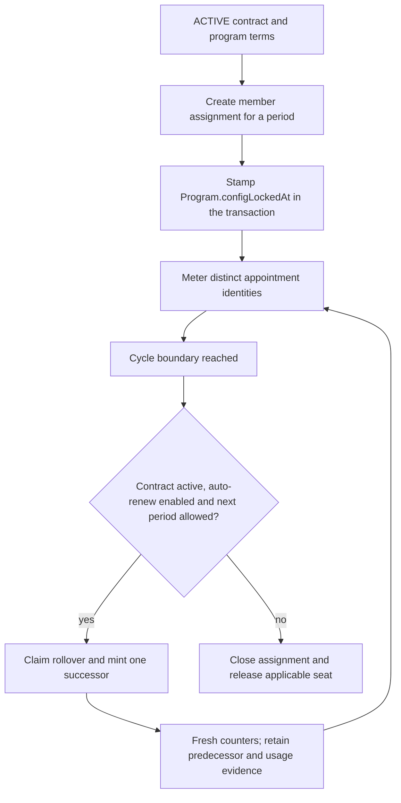

# Commercial axes and enterprise programs

This chapter defines the commercial configuration that decides who funds a booking and what allowance governs it. It separates the supported-path matrix from overage settlement and later billing. The implementation lives mainly in `prisma/schema.prisma`, `lib/enterprise/reachable-paths.ts`, `lib/api/organizations/program-helpers.ts`, and the organization program routes.

Read [the subsystem architecture](01-enterprise-system-design.md) for the shared boundaries, [checkout and overage](04-checkout-and-overage.md) for collection, and [settlement](05-ledger-billing-and-settlement.md) for accounting. [Design recommendations](09-design-decisions-and-recommendations.md) compares the choices below.

## 1. Read the dimensions precisely

The enterprise material uses “three”, “five”, and “seven” for different slices of the model. They are not three rival descriptions of one engine.

| Count | Meaning                       | Inputs                                                                                        |
| ----- | ----------------------------- | --------------------------------------------------------------------------------------------- |
| 3     | Runtime path reachability     | Capability × FundingSource × ProgramType                                                      |
| 5     | Scenario catalog lens         | Capability, FundingSource, ProgramType, OverageBehavior, payout recipient                     |
| 7     | Commercial configuration axes | Capability, FundingSource, ProgramType, OverageBehavior, surcharge bps, CoveredPlanType, Caps |
| 4     | Tier guidance input           | FundingSource, ProgramType, OverageBehavior, surcharge bps                                    |
| 3     | UI guidance tiers             | RECOMMENDED, ADVANCED, DISCOURAGED                                                            |

Capability is a single value derived from Organization.canSponsor and Organization.canHost. A “capability × funding × program” path therefore has three coordinates even though capability itself is computed from two booleans.

The five-axis view appears in `docs/enterprise/60-scenarios-and-verdicts/01-scenarios-and-examples.md`. It is useful for comparing end-to-end personas because payout recipient affects who receives the expert share. It does not include price limits or covered plan types.

The seven-axis phrasing appears in `docs/enterprise/00-foundations/03-funding-and-programs.md`. Its last “Caps” coordinate groups several independent limits: entitlement allowance, per-engagement price cap, and the cumulative overage breaker. Surcharge bps and caps are values, not enum members with a finite Cartesian product.

`lib/enterprise/reachable-paths.ts` implements the three-coordinate reachability matrix. Its guidance helper accepts the four values in the table and then adds a tier. Capability and covered plan types are checked elsewhere; caps are validated against the selected configuration.

Treat the three-tier model as UI motivation, not authorization. RECOMMENDED is the default path. ADVANCED explains operational consequences. DISCOURAGED requests explicit acknowledgement for choices with confusing or higher-friction billing. The tier itself does not block an otherwise meaningful program.

The program API still refuses meaningless or unsafe combinations. assertMergedOverageConfigValid() returns a 400 when a surcharge is set while OverageBehavior is BLOCK, when a charging behavior lacks a positive maxOveragePerCyclePaise, or when overage knobs are configured on an unlimited LICENSED_SEAT program. These guards reject dead settings, rather than the unusual but supported rail/program pairings.

## 2. Runtime reachability matrix

The matrix is explicitly enumerated in REACHABLE_ORG_FUNDING_PATHS. There are eight funding/program pairs for SPONSOR and the same eight for HYBRID. HOST and PERSONAL_TAG have no funded program; all four capability labels can have the null/null programless form.

| Capability   | PERSONAL                   | WALLET                     | INVOICE                    | LICENSE                    |
| ------------ | -------------------------- | -------------------------- | -------------------------- | -------------------------- |
| SPONSOR      | CREDIT_POOL, LICENSED_SEAT | CREDIT_POOL, LICENSED_SEAT | CREDIT_POOL, LICENSED_SEAT | CREDIT_POOL, LICENSED_SEAT |
| HYBRID       | CREDIT_POOL, LICENSED_SEAT | CREDIT_POOL, LICENSED_SEAT | CREDIT_POOL, LICENSED_SEAT | CREDIT_POOL, LICENSED_SEAT |
| HOST         | no buyer program           | no buyer program           | no buyer program           | no buyer program           |
| PERSONAL_TAG | tag only                   | n/a                        | n/a                        | n/a                        |

The 20-row test in `__tests__/enterprise/reachable-paths.test.ts` pins the two funded capability rows, four programless rows, and rejects half-null pairs. LICENSE × CREDIT_POOL is intentionally accepted by the matrix even though the UI calls it DISCOURAGED. It means a flat-fee contract pays at contract level while a per-member credit meter still limits usage by notional rupee budget.

This table does not imply that every overage behavior has the same settlement rail. A PERSONAL-funded program can enforce the member allowance, but the current checkout commit skips organization overage settlement for PERSONAL. See chapter 04 for the implementation gap.

### Funding source compared with meter type

| Funding source | Economic source                                                | Meter pairings                | Booking leg       | Timing                                        |
| -------------- | -------------------------------------------------------------- | ----------------------------- | ----------------- | --------------------------------------------- |
| PERSONAL       | Member's own card; organization provides tag/allowance context | Either program type           | CARD              | Gateway confirmation                          |
| WALLET         | Org's prepaid credit-normal liability                          | Either program type           | WALLET            | Immediate synchronous booking                 |
| INVOICE        | Org's postpaid receivable                                      | Either program type           | INVOICE_ACCRUAL   | Synchronous booking; monthly invoice          |
| LICENSE        | Flat-fee contract or subscription                              | Either program type in engine | LICENSE, amount 0 | Synchronous booking; flat fee outside booking |

PERSONAL is a reporting and allowance path. It is not an organization debit. An organization may meter a member's use through a ProgramAssignment while that member pays the regular checkout card amount. PERSONAL_TAG means no Program is being used.

WALLET is a cash-backed prepaid liability. The booking spends rupees from BillingAccount.walletBalance, and the same movement is reflected in the WALLET ledger account. A seat meter can limit counts while wallet balance still pays the actual covered amount.

INVOICE accrues booking value to an org receivable. A credit pool caps the amount accumulated per cycle; a licensed-seat program caps the number of engagements. The invoice and purchase-order controls are downstream payment controls and do not replace the per-member entitlement.

LICENSE represents a prepaid flat commercial agreement. LICENSED_SEAT is its usual pairing, including an unlimited seat program with coveredEngagementsPerCycle = null. The engine permits LICENSE × CREDIT_POOL for special allowance tracking, but that does not convert the flat-fee contract into a cash-funded pool.

## 3. Program and contract records

A Contract owns commercial terms and one or more Program rows. A Program selects the meter type, the eligible plan types/categories, and its status. The selected subtype has exactly one config row.

### LICENSED_SEAT config

| Field                      | Type and unit   | Meaning                                            |
| -------------------------- | --------------- | -------------------------------------------------- |
| ratePerSeatPaise           | BigInt paise    | Contracted per-seat price; cycle billing reads it  |
| cycle                      | BillingCycle    | MONTHLY, QUARTERLY, or ANNUAL                      |
| coveredEngagementsPerCycle | Int nullable    | Count allowance; null is unlimited                 |
| activeSeatCount            | Int             | Cached number of active assigned seats             |
| priceCapPerEngagementPaise | BigInt nullable | Per-engagement price cap                           |
| overageBehavior            | OverageBehavior | BLOCK, CHARGE_MEMBER, or CHARGE_ORG                |
| overageSurchargeBps        | Int nullable    | Markup on the pass-through over-cap portion        |
| maxOveragePerCyclePaise    | BigInt nullable | Tax-exclusive breaker across active overage events |

One engagement is one calendar occurrence, not one hour. Consultation and webinar checkout generally consume one. A class can consume N preallocated occurrence rows. A subscription is allocated lazily, so each consultant allocation is metered when appointments are created.

A null engagement cap is unlimited. Since no cap can be exceeded, surcharge and overage settings have no effect and the API refuses them. This arrangement is how an unmetered flat-fee license is represented; there is no separate PREPAID_UNLIMITED ProgramType.

### CREDIT_POOL config

| Field                      | Type and unit    | Meaning                                                          |
| -------------------------- | ---------------- | ---------------------------------------------------------------- |
| creditBudgetPerCycle       | Int whole rupees | Cycle money allowance; multiplied by 100 for paise               |
| cycle                      | BillingCycle     | Budget reset period                                              |
| priceCapPerEngagementPaise | BigInt nullable  | Maximum value an individual engagement can consume from the pool |
| overageBehavior            | OverageBehavior  | Route beyond budget or block                                     |
| overageSurchargeBps        | Int nullable     | Markup on the pass-through over-cap portion                      |
| maxOveragePerCyclePaise    | BigInt nullable  | Tax-exclusive maximum accepted overage                           |

The unit mapping is fixed: one credit equals ₹1 equals 100 paise. There is no premiumMultiplier or per-pool credit value. Program rate cards and payout RateCards are separate concepts; the credit pool does not hide pricing in JSON.

The use meter is ProgramAssignment.consumedPaise. A booking contributes its price in paise. The engagement count still advances as usage metadata and for reconciliation, but it does not define the credit pool budget.

## 4. Capability and ownership

Organization.canSponsor authorizes buyer-side funded programs. Organization.canHost enables an organization to receive supply-side earnings. An organization with both capabilities is HYBRID and can sponsor its own members while hosting experts.

A HOST-only org is not a buyer-side Program path. It can still receive hosting earnings from personal or sponsored bookings, depending on which expert or plan is the supply owner.

The buyer and host can be separate organizations. Payment.organizationId identifies the buyer/sponsor; Payment.hostOrganizationId identifies the supply host. Wipro-to-LearnPro seed bookings are an example: Wipro funding does not make Wipro the earnings recipient.

The plan owner is tried first when choosing the host organization, and the expert must have an active EXPERT membership at an active canHost organization. For a personal plan with no owning org, code falls back to the consultant's oldest active canHost membership. The host rate-card selection is evaluated at the booking time, so a later rate change does not rewrite old earnings.

Payout recipient is a different axis. Membership.payoutRecipient=SELF pays the expert share to ConsultantEarnings. ORGANIZATION folds that share into the host org's OrganizationEarnings. It does not change the buyer funding source.

## 5. Metering and atomic cap checks

recordBookingUtilization() is the entitlement writer. It runs inside the booking transaction and updates the assignment meter together with an append-only UsageLedgerEntry and BookingUtilization snapshot.

For a BLOCK program, the writer uses a conditional updateMany with the remaining cap in the WHERE predicate. If two requests race for the last engagement or last rupee, at most one matches. The losing update raises a modeled program-cap error and the transaction rolls back.

For CHARGE_MEMBER or CHARGE_ORG, the meter increments through the cap so the booking can proceed. Overage settlement then computes covered and marginal values and stores the event or side-payment. Those post-meter counters are still transactionally coupled with the booking.

Appointment IDs can be supplied as a set. The utilization writer subtracts already-tracked IDs before applying a delta, so a repeated allocation against the same appointment does not spend the meter twice. Subscription appointment creation passes only newly allocated session IDs.

The 80% warning is a separate notification threshold. It does not change whether the booking is covered. CREDIT_POOL compares consumed paise with budget paise; LICENSED_SEAT compares used engagement count with the engagement cap.

For the cycle-level breaker, the engine sums nonterminal OverageEvent base and surcharge amounts. A billed-but-unpaid CHARGE_ORG event continues to consume the ceiling; a reversed, blocked, or failed event does not. This allows a confirmed refund or failed member collection to return capacity.

## 6. Configuration validation and edit history

Program money fields become locked when the first ProgramAssignment is created. This preserves the terms used by existing bookings and earnings. A changed price/cap is applied by archiving the old Program and superseding it with a replacement; assignments move through the replacement workflow and history remains addressable.

Contract amendments likewise create a successor Contract. Existing invoices retain the contract that governed them. The UI may disclose unusual pairings, but server validation and the persisted config remain authoritative.

Surcharge bps is an integer. The SQL check bounds it from 0 to 10,000. The domain routes accept integer values; they also check that a charging program has a positive cycle breaker. The database config checks constrain positive budget and nonnegative price amounts, but do not encode every cross-field rule.

A recurring fee and a per-seat charge are contract-level BillingSubscription terms. BillingSubscription supports PER_SEAT with ratePerSeatPaise and FLAT_FEE with flatFeePaise. Program licensing and BillingSubscription cycle invoicing are related contract concepts, but a booking's LICENSE leg does not itself charge the subscription price.

## 7. UI motivation tiers

The dashboard program editor calls getPermutationGuidance() and presents the recommendation near the chosen funding/program/overage settings.

| Example                                            | Tier        | Reason shown                                             |
| -------------------------------------------------- | ----------- | -------------------------------------------------------- |
| WALLET × CREDIT_POOL × BLOCK                       | RECOMMENDED | Standard prepaid money pool                              |
| INVOICE × LICENSED_SEAT × CHARGE_ORG, no surcharge | RECOMMENDED | Postpaid seat allowance                                  |
| WALLET × LICENSED_SEAT                             | ADVANCED    | Count cap plus actual wallet draw                        |
| INVOICE × CREDIT_POOL                              | ADVANCED    | Postpaid pool needs credit/PO exposure control           |
| PERSONAL × program                                 | ADVANCED    | Out-of-pocket card with organization allowance           |
| CHARGE_MEMBER                                      | ADVANCED    | Separate member card step and earnings hold              |
| CHARGE_ORG with surcharge                          | ADVANCED    | Surcharge and GST increase overage value                 |
| WALLET × CHARGE_ORG with surcharge                 | DISCOURAGED | Surcharge and GST debit prepaid wallet immediately       |
| LICENSE × CHARGE_ORG                               | DISCOURAGED | In-cap flat-fee price; overflow creates postpaid accrual |
| PERSONAL × CHARGE_ORG                              | DISCOURAGED | Current runtime does not create org overage accrual      |
| LICENSE × CREDIT_POOL                              | DISCOURAGED | Flat fee absorbs value while pool meters notional spend  |

The tier controls explanatory friction, not whether the pairing appears in backend matrices. For the categories that the backend cannot settle meaningfully, the configuration validator explains which setting is dead. Do not describe tier labels as policy enforcement.

## 8. Seeded commercial examples

The seed code in `prisma/seedFiles/14a-create-organizations.ts` creates a Wipro buyer and IIT Madras hybrid buyer/host. These are source definitions; no live database was queried.

Wipro has INVOICE funding, a ₹1 crore credit limit, a ₹50 lakh PurchaseOrder, and a LICENSED_SEAT annual program. It is configured for 200 seats, ₹25,000 per seat/year, 12 engagements per cycle, CHARGE_ORG, and a ₹10,000 per-engagement price cap. The seed does not set surcharge or a cycle overage ceiling, which is why this seed is not directly ready for a charged-overage API config under current validation.

The seed also gives Wipro an unissued DRAFT OrganizationInvoice: ₹1,00,000 subtotal plus ₹18,000 IGST, for ₹1,18,000 total. Its ten line units are ₹10,000 each. This invoice is a static seed illustration, not evidence that a live database currently carries those records.

IIT Madras is HYBRID, WALLET funded, and has a CREDIT_POOL of 10,000 credits/month: a ₹10,000 budget because credits are rupees, not paise. The program has a ₹5,000 per-engagement price cap. Wallet history seeds three ₹5 lakh top-ups and five ₹5,000 debit postings, leaving ₹14,75,000. Its assignments start with no consumed pool. Internal faculty have payoutRecipient ORGANIZATION; external experts have SELF.

There is no seeded LICENSE funding organization. A LICENSE booking and its overage examples should therefore be explicitly presented as illustrative assumptions.

## 9. Billing cycle and assignment rollover

BillingCycle is MONTHLY, QUARTERLY, or ANNUAL. ProgramAssignment.periodStart and periodEnd scope the counter values. Cycle advancement resets engagementsUsed, consumedPaise, and overageCount by minting a fresh successor assignment; it does not erase the old usage ledger.

The cycle engine chooses ROLL when the contract remains active, auto-renew is enabled, and the next period fits within contract term. Otherwise it closes the assignment. A terminal contract does not create a funded successor just to preserve continuity.

A program's assignment cycle and an OrganizationInvoice's billing cycle are related but not identical concepts. The program determines when allowance resets. The invoice rollup groups unbilled accrual legs and stamps them to prevent duplicate billing. A booking can be metered within an annual assignment and still appear on a monthly invoice.

## 10. Seat and pool configuration examples

### Seat-count example

Assume a learner has used 11 of 12 annual engagements and books a 60-minute consultation for ₹4,000. There is one covered engagement remaining, so this booking is fully covered by the count allowance. If the assignment already used 12, all of the booking price is marginal before any per-engagement price cap.

A class with eight scheduled occurrences consumes eight engagements at enrollment. If three seats remain, the calculation treats five engagements as over the cap; the real gross price is divided over the booking's engagement count with integer paise floor, and any configured per-engagement cap bounds the marginal amount.

### Credit-pool example

Assume a monthly budget of 10,000 credits and current spend of ₹9,200. A ₹1,500 booking has ₹800 left under the pool. Without a per-engagement cap, ₹800 is covered and ₹700 is base overage. With 1,000 bps surcharge, the surcharge is ₹70; the tax-exclusive marginal is ₹770. If the cycle breaker has only ₹750 remaining, the mapper blocks because ₹770 exceeds the breaker.

These examples use a single assignment. If members each have a distinct ProgramAssignment, each has their own counter and breaker. Organization-level invoice creditLimit and PO values do not replace member assignment budgets.

## 11. Configuration validation matrix

| Setting                    | Accepted shape                                                       | Refusal or implication                          |
| -------------------------- | -------------------------------------------------------------------- | ----------------------------------------------- |
| ProgramType                | LICENSED_SEAT or CREDIT_POOL                                         | No PROJECT or RETAINER subtype in schema        |
| FundingSource              | PERSONAL, WALLET, INVOICE, LICENSE                                   | HOST capability cannot select a buyer program   |
| coveredEngagementsPerCycle | Null or nonnegative seat count                                       | Null makes LICENSED_SEAT unmetered              |
| creditBudgetPerCycle       | Positive whole-rupee Int                                             | Stored consumption is paise                     |
| priceCapPerEngagementPaise | Optional positive paise amount                                       | Caps eligible price slice                       |
| overageSurchargeBps        | Null or integer from 0 through 10000                                 | Surcharge under BLOCK is dead and refused       |
| maxOveragePerCyclePaise    | Optional BigInt; required positive for charge behavior               | Cycle-wide tax-exclusive circuit breaker        |
| CoveredPlanType            | One or more supported consultation/class/webinar/subscription values | Assignment path is checked against booking type |
| payoutRecipient            | SELF or ORGANIZATION on membership                                   | Changes expert payee, not buyer funding         |

The API validates a merged configuration on PATCH. It compares current fields with request fields so partial updates preserve unspecified settings, then checks the complete effective shape. Supersede routes similarly merge old config and replacement values before accepting a successor.

Some database checks are narrower than route validation. SQL bounds individual stored numbers; business code checks cross-field meaning such as “charge behavior must have a ceiling.” Docs should say which layer enforces a rule rather than calling every validation a database invariant.

### Assignment and cycle component design

The cycle engine in `lib/enterprise/cycle-engine.ts` supplies the decision; the registered advance job performs the conditional claim and writes. The successor chain preserves prior-cycle evidence. The cycle boundary changes entitlement counters, whereas the invoice rollup settles unbilled money obligations; neither process should impersonate the other.

## 12. Engineering invariants

1. FundingSource selects the source of money; ProgramType selects the entitlement meter.
2. A ProgramAssignment is cycle-scoped and unique for program, membership, and period start.
3. The money values are BigInt paise in persistence; creditBudgetPerCycle is the special whole-rupee Int.
4. A valid charging configuration has a positive cycle ceiling.
5. The API rechecks organization status, membership, assignment, and funding source at checkout; the client preview is advisory.
6. Program fields lock after first assignment; new commercial terms go on a successor program.
7. A PERSONAL program is an allowance / reporting relationship while the member pays card; do not infer org-funded settlement from an org tag.
8. Cross-org buyer and host organizations remain separate through Payment and payout records.
9. RateCard snapshots freeze the split applied at booking.
10. Application counters are reconciled against append-only usage rows; money-leg and ledger invariants are enforced by sidecar SQL.

## 13. Failure and recovery

A missing active ProgramAssignment on an org-funded rail is a fail-closed checkout error. This prevents fallback billing to the member card when the org intended to sponsor.

An insufficient wallet balance aborts the booking transaction. The cache debit is guarded by available funds and a database nonnegative check. A payment capture is not part of the wallet/invoice/license booking transaction because those rails settle synchronously.

A cycle cap reached with BLOCK returns a business-coded refusal. For charging behavior, the per-cycle breaker can refuse an otherwise permitted booking with PROGRAM_CAP_EXHAUSTED. It is a deliberate 402 condition, not a transient gateway failure.

A retry of assignment creation must not overlap an existing ACTIVE period. The sidecar exclusion index protects program/membership time ranges. The rollover engine creates the next period and zeros current-cycle counters.

A Program config change after money history exists is rejected in place. The replacement Program and assignment chain provide an auditable transition rather than restating old usage under new terms.

## 14. Source map

- Schema models and enums: `prisma/schema.prisma` — Organization, BillingAccount, Contract, BillingSubscription, Program, LicensedSeatConfig, CreditPoolConfig, ProgramAssignment, BookingUtilization, UsageLedgerEntry, OverageEvent.
- Reachability and UI guidance: `lib/enterprise/reachable-paths.ts`; `app/dashboard/organization/[orgId]/programs/page.tsx`.
- Routes and lock rules: `app/api/organizations/[orgId]/programs/route.ts`, `app/api/organizations/[orgId]/programs/[programId]/route.ts`, `app/api/organizations/[orgId]/programs/[programId]/supersede/route.ts`; `lib/enterprise/config-lock.ts`.
- Metering: `lib/api/organizations/program-helpers.ts`; `lib/payments/checkout/commit/org-utilization.ts`.
- Tests: `__tests__/enterprise/reachable-paths.test.ts`, `__tests__/enterprise/credit-pool-meter.test.ts`, `__tests__/enterprise/cap-edge-cases.test.ts`, `__tests__/enterprise/multi-engagement-cap.test.ts`, `__tests__/enterprise/programs-overage-default.test.ts`, `__tests__/enterprise/config-lock.test.ts`.
- Database invariants: `prisma/sql/check-constraints.sql`; `prisma/sql/payment-legs-triggers.sql`.

## Glossary

- **Funding source:** the rail responsible for collecting or accruing the booking value.
- **Program:** contract child that determines which plans a member can use and what meter applies.
- **Engagement:** one scheduled occurrence, regardless of duration.
- **Credit:** one whole rupee of CREDIT_POOL budget, represented as 100 paise.
- **Covered amount:** booking value the program allowance absorbs.
- **Overage:** marginal booking value beyond the program allowance.
- **Buyer org:** sponsor that tags the payment and supplies the BillingAccount.
- **Host org:** organization associated with the expert or org-owned plan and eligible for a supply-side split.
- **Tier:** UI guidance classification; it is not a persisted funding or program status.

## Deprecated & Superseded Approaches

The former OrgBillingMode names TAG_ONLY, SEAT_PACK, INVOICED_MONTHLY, and PREPAID_UNLIMITED were replaced by FundingSource plus Program. PROJECT and RETAINER were discussed as possible program types but are absent from the enum. Program JSON pricing escape hatches and a configurable credit multiplier were removed; current budgets are rupee values with paise accounting.
