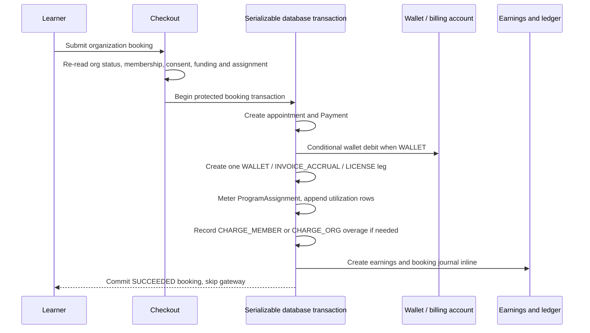
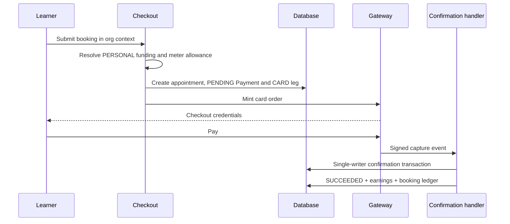
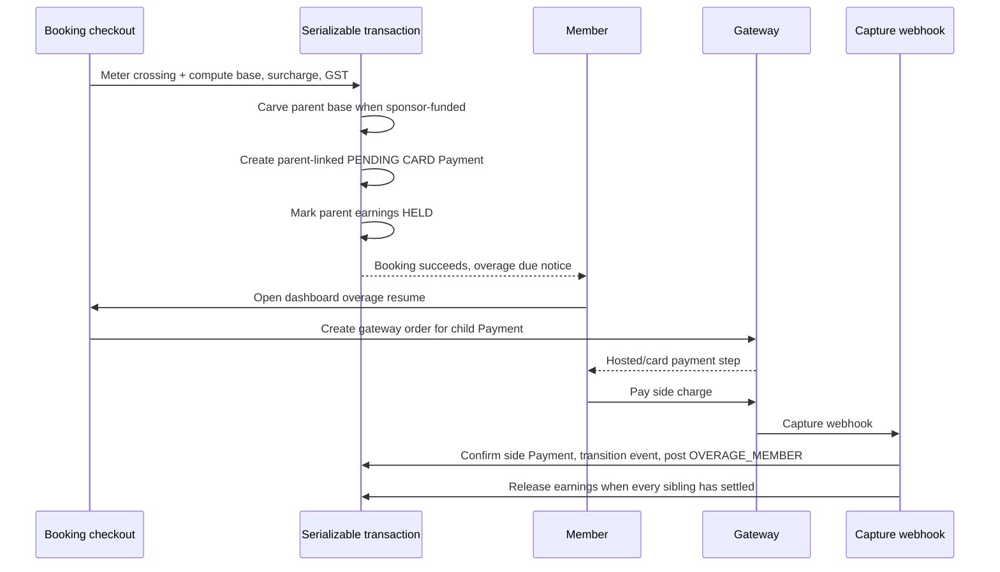

# Enterprise checkout and overage settlement

This chapter follows a buyer from checkout revalidation through funding, entitlement metering, overage collection, and recovery. The main implementation is in lib/payments/checkout, `lib/api/organizations/program-helpers.ts`, and lib/payments/billing/overage*.ts.

The central distinction is timing. WALLET, INVOICE, and LICENSE are organization rails that complete booking synchronously in one transaction. PERSONAL creates a card payment and relies on the regular capture confirmation pipeline. An overage member charge is a distinct child payment and is settled later from the member-facing resume flow.

The [program design](03-commercial-axes-and-programs.md) defines the allowance. [Settlement](05-ledger-billing-and-settlement.md) explains the resulting journal and invoices; [recommendations](09-design-decisions-and-recommendations.md) compares collection and exposure choices.

## 1. Transaction boundary and actors

A checkout has four actors that should remain separate in code and in diagrams:

1. The learner initiates a booking.
2. The buyer organization may sponsor and meter the booking.
3. The host organization may receive a share of the supplier-side revenue.
4. The payment gateway may capture only the PERSONAL tender or a later member overage payment.

The booking's buyer organization is stored in Payment.organizationId. Host organization attribution is stored in Payment.hostOrganizationId. BillingAccount is the source account when a sponsor pays. A payment carrying an org id is not sufficient proof that the org paid: PERSONAL can carry org reporting context while its CARD leg is paid by the learner.

Checkout is protected by the appointment and organization locks plus a Serializable database transaction. The funding source, assignment and consent are revalidated after entering the protected path. Status and money data are committed atomically with the appointment hold, so a failure in wallet debit, cap metering, overage write, earnings or journal creation rolls the booking transaction back.

### Sequence: regular org-funded booking

The actual funding leg is attached to the Payment inside the transaction. WALLET debits the available balance first. INVOICE creates an accrual. LICENSE adds a zero leg, which records that the prepaid license covered this booking. The org-funded Payment is born SUCCEEDED and has no gateway order to resume.

### Sequence: PERSONAL booking

Gateway capture and payment confirmation are deliberately centralized. Webhook, return route and reconciliation callers route to the confirmation handler rather than writing SUCCEEDED independently. See `docs/payments/05-high-level-design.md` and `lib/payments/webhooks/handlers.ts`.

## 2. Checkout revalidation and funding selection

resolveOrgFunding() in `lib/payments/checkout/org-funding.ts` resolves the requested org, checks the org can sponsor, confirms the caller has active membership and checks the live consent artifact. For org-funded rails, an active assignment whose Program covers the current plan type is required. Missing assignment fails closed; the route must not silently charge the member if the buyer expected the organization to pay.

Funding source is checked again while holding the checkout lock. A source change between page load and submit returns a refresh/refusal instead of using stale assumptions. The organization status gate normally requires ACTIVE; INVOICE has a limited PENDING_VERIFICATION trust path with credit controls, so docs should not assert that every sponsored invoice booking universally requires full verification.

The program assignment lookup and program preview are advisory on the client side. The protected checkout transaction rechecks the charge authority, meter and wallet balance. A previously rendered overage preview is not a reservation.

The invoice rail has a separate credit exposure check. Current outstanding invoice receivables plus the new amount must remain within BillingAccount.creditLimit when configured. The PurchaseOrder limit is checked later when an invoice is issued. These controls address different times and should be documented separately.

## 3. Payment creation and funding legs

writeCheckoutPayment() in `lib/payments/checkout/commit/payment-row.ts` sets the buyer org, host org, BillingAccount, amount, currency, tax snapshot, method and payment state. It resolves host organization from the plan owner where applicable, falling back to the expert's host membership. Funding method is based on the revalidated BillingAccount and assignment.

| Rail     | Payment method | Payment state at commit | Leg              | Collected when               |
| -------- | -------------- | ----------------------- | ---------------- | ---------------------------- |
| PERSONAL | CARD           | PENDING                 | CARD             | Gateway capture              |
| WALLET   | WALLET         | SUCCEEDED               | WALLET           | Atomic cache debit / journal |
| INVOICE  | INVOICE        | SUCCEEDED               | INVOICE_ACCRUAL  | Invoice accrual at booking   |
| LICENSE  | LICENSE        | SUCCEEDED               | LICENSE amount 0 | Flat contract is prepaid     |

The three org-funded choices skip Razorpay/Stripe order creation. Their Payment and appointment commit synchronously, then earnings and booking journal commit in the same transaction. The finance doctrine states that synchronous rails have no post-capture fallback: either all booking money facts commit, or checkout refuses.

A LICENSE booking does not mean Payment.amount is zero. The payment can retain the booking price and original price for earnings/tax attribution while its only funding leg has zero amount. The PaymentLeg database rule explicitly exempts an all-zero LICENSE-only leg set from the usual leg sum check because the contract absorbed the price elsewhere.

PERSONAL still means the member's card bears the standard booking price. An organization tag can support reporting and an allowance program without funding the booking.

## 4. Entitlement meter

recordBookingUtilization() is shared by checkout and lazy appointment allocation. For each effective new appointment ID, it writes a BookingUtilization aggregate and an append-only UsageLedgerEntry. A replay that presents an already metered appointment ID has zero delta and does not spend the entitlement again.

LICENSED_SEAT counts engagements. A consultation or webinar uses one occurrence; a class enrollment uses its actual number of preallocated sessions; subscriptions are metered as appointments are lazily allocated rather than all at checkout.

CREDIT_POOL meters the booking's price at booking, in paise. For a budget of 10,000 credits/month, the comparison limit is 1,000,000 paise or ₹10,000. It still records engagement count, but that is not its money budget.

BLOCK updates the meter with a conditional WHERE cap predicate. If the guarded update matches no row, the assignment cap error aborts the transaction. CHARGE_* permits the over-cap increment, marks wasOverage, and then calls the overage calculator for the org-sponsored checkout.

Refund reversal appends negative usage rows and CAS-decrements the counters. Reversal computes the sale's remaining unreturned count/value and clamps to that amount. A CREDIT_POOL refund may still reverse its monetary share even when every engagement has already been consumed. The count reversal is `min(remainingCount, max(1, ceil(saleCount × refundPaise / paymentPaise)))`; the value reversal is `min(remainingPaise, floor(salePaise × refundPaise / paymentPaise))` for a valid positive refund. The CREDIT_POOL path permits a value-only reversal after remaining count reaches zero, so several partial refunds can restore the exact sale value without inventing extra engagements.

## 5. Overage calculation

computeOverageForBooking() is the common pure mapper used by overage preview and checkout. It receives the pre-booking assignment usage, booking price, plan subtype, selected caps, behavior, prior cycle overage and surcharge bps.

For a CREDIT_POOL, let P be booking price, B be cycle budget, U be consumed value, E be engagement count and C be price cap per engagement:

    remaining = max(0, B - U)
    covered = min(P, remaining, E × C when C is configured)
    basePaise = P - covered

Without a per-engagement cap, omit E × C from the min. One credit is one rupee; convert the configured whole-rupee budget to paise before applying this formula.

For a LICENSED_SEAT, let N be engagements in this booking, K be the number of remaining covered engagements, and q be the integer-floored price per engagement:

    overageEngagements = max(0, N - K)
    raw marginal = overageEngagements × floor(P / N)
    basePaise = min(P, raw marginal, overageEngagements × priceCap when configured)
    coveredPaise = P - basePaise

For example, if a price of ₹5,000 contains one over-cap engagement and its per-engagement cap is ₹2,000, the program covers ₹3,000 and the over-cap base is ₹2,000. For a multi-occurrence class, the configured count and price distribution affect the total. The mapper uses integer floor so persisted paise never depend on floating-point share calculations.

The surcharge is computed on the pass-through over-cap base:

    surchargePaise = floor(basePaise × overageSurchargeBps / 10000)
    tax-exclusive overage = basePaise + surchargePaise
    charged overage = basePaise + surchargePaise + GST on surcharge

GST is calculated by the tax engine from payer place of supply. The pass-through base is already part of the main booking's tax-inclusive price, so taxing it again would duplicate output tax. The percentage surcharge is a new consideration and receives GST. For org charge, organization tax context is used; for member side charge, the member buyer country and consumer state snapshot are carried to the child Payment.

The preview endpoint returns an advisory result before payment. Distinguish mapper marginal (pre-GST, base+surcharge) from the actual tax-inclusive amount in the side Payment and persisted OverageEvent. Tests for preview parity are in `__tests__/enterprise/overage-preview.test.ts`.

## 6. Per-cycle breaker

The breaker counts the sum of prior nonterminal event basePaise plus surchargePaise for the current ProgramAssignment cycle. GST does not consume the ceiling. A mid-cycle invoice does not reset it. Reversed, failed and blocked events do not consume ceiling; rolled-cycle predecessor assignment is considered for the equal-period cancelled-predecessor edge case.

If existing cycle overage plus the new tax-exclusive marginal exceeds maxOveragePerCyclePaise, checkout throws PROGRAM_CAP_EXHAUSTED (HTTP 402) regardless of CHARGE_MEMBER or CHARGE_ORG. It is a modeled limit, not a gateway failure.

Current writer order matters: recordOverageAtCheckout() computes and throws on this breaker before an OverageEvent is inserted. The OverageChargeStatus enum contains BLOCKED, but grep of current writers found no code creating an event with chargeStatus BLOCKED. Older scenario text that says a BLOCKED event is recorded should not be carried forward as current behavior.

The persistence boundary and behavior are:

| Condition                                         | Outcome                                      | Meter update                         |
| ------------------------------------------------- | -------------------------------------------- | ------------------------------------ |
| Under cap                                         | PROCEED                                      | Meter increments                     |
| Cap exceeded with BLOCK                           | Refuse checkout                              | Guarded meter update does not commit |
| Cap exceeded with CHARGE_MEMBER and breaker clear | Commit booking plus member debt side payment | Meter increments                     |
| Cap exceeded with CHARGE_ORG and breaker clear    | Commit booking plus org collection/accrual   | Meter increments                     |
| Cycle breaker exceeded                            | Refuse checkout with 402                     | Transaction rolls back               |

## 7. CHARGE_MEMBER is a separate collection

A CHARGE_MEMBER booking does not split one booking Payment into organization and member tender. It creates a second Payment linked through parentPaymentId. This child has appointmentId null, its own CARD leg, and PENDING status. It is a payable obligation that can be resumed later.

recordMemberOverageCharge() first carves the base from the org-funded parent when the parent has not already been invoiced:

| Parent funding source   | Parent adjustment                                                     | Member side Payment                      |
| ----------------------- | --------------------------------------------------------------------- | ---------------------------------------- |
| INVOICE_ACCRUAL         | Decrement accrual leg and Payment.amount by carved base               | Carved base + surcharge + surcharge GST  |
| WALLET                  | Decrement WALLET leg and Payment.amount; walletCredit the carved base | Carved base + surcharge + surcharge GST  |
| LICENSE                 | Keep zero-valued LICENSE leg                                          | Full base + surcharge + surcharge GST    |
| PERSONAL CARD           | Base already paid on booking                                          | Surcharge + surcharge GST only in helper |
| Parent already invoiced | Preserve issued parent and its legs                                   | Do not charge already-billed base again  |

For the WALLET branch, walletCredit reverses the part of the initial full wallet debit that has become member responsibility. If the member pays, the side charge posts the cash and org payable relief through OVERAGE_MEMBER. If they do not pay, failure processing restores the carve where possible.

The side order is not minted inside the original booking transaction. A synthetic overage intent exists for idempotency; the member opens the resume checkout surface at /dashboard/overage, where the gateway order is minted. On capture, the webhook is the single writer for the child payment status and OverageEvent CHARGED transition.

While a pending side charge exists, pending ConsultantEarnings and OrganizationEarnings for the parent payment become HELD. This avoids paying the expert or host organization for a value that might never be collected. Multiple member overage batches can point at one parent; earnings remain held until no pending sibling obligation remains.

There are two abandonment windows. The 7-day sweep fails side charges that were never started. The hard 14-day timeout marks the member's obligation FAILED and notifies. Failure handling restores any carved parent value and releases earnings only when all sibling overage obligations permit release. A late gateway capture has a recovery path in the overage transition handler.

### Sequence: member overage pay-link

An abandoned side-payment does not automatically cancel the underlying booking. It does leave the earnings held until the timeout/failure flow resolves the obligation. User-facing documentation should call this a deferred member collection, not a synchronous copay.

## 8. CHARGE_ORG settlement by funding rail

### INVOICE parent

The base invoice accrual initially contains the full tax-inclusive booking price. For CHARGE_ORG, the writer carves basePaise from INVOICE_ACCRUAL and writes the overage as a distinct OVERAGE_INVOICE_ACCRUAL source. This retains the funding-leg sum identity while ensuring a monthly rollup still sees the two portions exactly once.

The new charge contains base plus surcharge plus surcharge GST. The booking journal recognizes the resulting org receivable and tax/fee allocation. Invoice rollup selects both accrual sources and nets reversal siblings. An overage event goes PENDING to ACCRUED when attached to an issued invoice and to CHARGED when the invoice is paid.

If a parent Payment has already been billed, do not edit its legs or amount. Base was already charged in the issued document. A separate accrual child is used only for a new surcharge that remains due; zero surcharge creates no incremental bill.

### WALLET parent

The initial wallet debit already collected the whole booking price, including the over-cap pass-through. With no surcharge, the event is recorded CHARGED immediately and has no invoice line. If a surcharge exists, the org receives a second wallet debit for surcharge plus GST, and the WALLET leg, Payment.amount and Payment.taxAmount increase by that amount.

When a wallet-funded booking is allocated lazily, the path also posts a separate BOOKING journal for the surcharge/GST because the original booking journal may already exist. `__tests__/payments/org-invoice-journal.test.ts` and `__tests__/enterprise/overage-settlement-legsum.test.ts` pin these details.

### LICENSE parent

The booking's LICENSE leg remains zero because the flat-fee contract absorbs covered usage. When a cap is crossed, the writer creates a separate SUCCEEDED ENTERPRISE_INVOICE_ACCRUAL Payment with an OVERAGE_INVOICE_ACCRUAL leg. It posts Dr ORG_RECEIVABLE and credits the overage platform amount and surcharge GST. The normal invoice rollup collects this child in a later OrganizationInvoice.

### PERSONAL program

The dashboard can describe PERSONAL programs as card checkout with organization allowance metering. At the current commit site, only an org-sponsored booking calls recordOverageAtCheckout(); a PERSONAL card booking that passes the allowance meter does not create an OverageEvent or charge a second amount. Its regular card amount already includes the whole booking price. Therefore CHARGE_MEMBER is unnecessary economically for that path, while CHARGE_ORG is not currently routed to an org accrual. This is a code gap relative to the broad “all combinations settle” wording in older enterprise references.

## 9. Surcharge and refund examples

Assume an invoice-funded LICENSED_SEAT booking costs ₹5,000; the member has used all covered engagements. Configure a 10% surcharge and 18% domestic GST on that surcharge:

    basePaise = 500000
    surchargePaise = floor(500000 × 1000 / 10000) = 50000
    surcharge GST = floor(50000 × 18 / 100) = 9000
    overage charged = 500000 + 50000 + 9000 = 559000 paise = ₹5,590

If the parent accrual is not yet billed, it is reduced by ₹5,00,000 and a new overage accrual of ₹5,59,000 is added. The total invoice exposure becomes the original covered part plus the tax-inclusive overage, and the Payment legs still sum to Payment.amount.

For a partial cap example, booking value is ₹5,000 and remaining credit pool allowance is ₹3,000. The covered part is ₹3,000, base overage is ₹2,000, and at 10% surcharge the new surcharge is ₹200. Domestic GST on surcharge is ₹36. The member/org collection is ₹2,236. The base was already taxed on the booking; only the ₹200 surcharge has new GST.

For a WALLET member charge on the same booking, the original wallet debit first takes ₹5,000. The carve credits back ₹2,000, leaving ₹3,000 on the org wallet. The member side payment collects ₹2,236. On a successful capture, the member now funds the carved base and its surcharge/GST. On failure, the carve restoration re-debits or restores the proper parent-side amount under guarded updates.

Refunds follow the parent booking and child event relationships. Wallet-origin refunds credit the BillingAccount cache and post a WALLET journal entry. Invoice accrual refunds append negative reversal legs and can issue a credit note. A collected member overage can be reversed when the booking is fully refunded; refund and dispute cascades must clamp cumulative amount so two independent refund causes never pay more than the remaining refundable value.

## 10. Failure handling and idempotency

- Funding source changes during checkout: revalidation fails; caller must refresh. No mixed-rail write occurs.
- Wallet lacks sufficient balance: atomic conditional debit matches zero and throws; entire Serializable booking transaction rolls back.
- Assignment is missing or inactive: org-funded checkout refuses; it does not quietly bill a member card.
- BLOCK cap race: conditional meter update loses; transaction aborts and a business error identifies the exhausted program.
- Cycle breaker: coded HTTP 402; it is a distinct condition from the per-assignment cap.
- Invoice accrual rollup race: Serializable read/create/stamp transaction plus retry ensures two runners do not bill the same Payment twice.
- Member side order retries: parent Payment plus synthetic child intent and client idempotency key support resume; webhook CAS ensures duplicate capture delivery is a no-op.
- Member charge timeout and recovery: failed/timed-out events restore base carve when safe; parent already invoiced prevents mutation of a statutory issued document.
- Deferred PaymentLeg trigger: leg sums are validated at COMMIT, after all parent/child writes in the transaction.
- Ledger entries and transactions are immutable; reversal posts a counter-entry rather than editing history.

## 11. Schema and database checks

The authoritative money values are BigInt paise. The credit pool's cycle budget is Int whole rupees, and its conversion boundary is ×100. Currency is captured on Payment and OverageEvent; currently all settlement rails are INR.

`prisma/sql/payment-legs-triggers.sql` has deferrable commit-time triggers for PaymentLeg writes and Payment.amount updates. Non-reversal funding legs, excluding REFERRAL_CREDIT and LICENSE, sum to Payment.amount. An all-zero LICENSE-only payment is exempt from that equality, but reversal pair validation still applies. A reversal must be negative and no larger than its source sibling.

`prisma/sql/check-constraints.sql` bounds OverageEvent base/surcharge to nonnegative and requires marginalPaise ≥ basePaise + surchargePaise. That allows marginal to include positive GST. Config constraints bound surcharge bps; wallet balance permits NULL or nonnegative; assignment time exclusion prevents overlapping active entitlements for the same program/member.

No application sweep should duplicate the payment-leg or ledger commit-time invariant. Reconciliation remains appropriate for cache drift (wallet balance vs journal) and derived assignment counters vs append-only UsageLedgerEntry rows because the database does not make those aggregates equal automatically.

## 12. Current limitations and proposals

### Current limitations

- PERSONAL program overage settlement is missing at the main checkout integration point. Configuration/guidance tests can make the pair appear supported while the settlement writer is skipped.
- BLOCKED event status is present in schema but no current writer records the breaker rejection. Current behavior is a pre-insert exception.
- CHARGE_MEMBER is a separate later card collection and can keep earnings HELD. It is not a one-step authorization or synchronous split tender.
- Surcharge under BLOCK and charging without a positive cycle breaker are refused as invalid configuration even though the pure calculation function can represent a nullable breaker.
- Preview values need a clear label for whether they include surcharge GST. The mapper is pre-tax; persisted member and org events include tax.

### Documentation recommendation

Describe what is implemented as current state and reserve unimplemented settlement semantics for a “gaps and options” subsection. If product decides PERSONAL × CHARGE_ORG should collect from the org, it needs an explicit funding allocation path because the member's full card price has already been captured. If product decides PERSONAL × CHARGE_MEMBER should be meaningful, avoid double charging: the base price was already paid by the same member. Alternatives include restricting these behavior choices to org-funded rails in the editor, treating PERSONAL as allowance-only, or defining a different late adjustment contract. Do not claim behavior just because it appears in the reachability matrix.

For breaker telemetry, the state machine could either explicitly document that refused attempts leave no event or add a durable denial record in a separate transaction. The latter must not be created inside the booking transaction that rolls back, and it needs a clear idempotency key. This is a proposal, not current behavior.

For member payment semantics, describe a parent-linked deferred side-payment and its timeout. Do not call it a synchronous co-pay. Same-Payment split tender would need a distinct product and ledger design, and the current route does not implement it.

## 13. Source map

- Checkout: `lib/payments/checkout/org-funding.ts`, `lib/payments/checkout/orchestrate.ts`, `lib/payments/checkout/revalidate.ts`, `commit/payment-row.ts`, `commit/org-utilization.ts`, `commit/ledger.ts`.
- Meter and reversal: `lib/api/organizations/program-helpers.ts`, `lib/booking/allocation/commit/subscription-cap.ts`.
- Overage math and settlement: `lib/payments/billing/overage.ts`, `lib/payments/billing/overage-preview.ts`, `lib/payments/billing/overage-settlement.ts`, `lib/payments/billing/overage-base-carve.ts`, `lib/payments/billing/overage-transitions.ts`.
- Pay-link and webhook: app/dashboard/overage, `lib/payments/webhooks/overage-handlers.ts`.
- Invoice: `lib/payments/billing/invoice-rollup.ts`, `lib/payments/billing/purchase-order-draw.ts`, `lib/payments/billing/create-org-invoice.ts`.
- Ledger rules: `prisma/sql/payment-legs-triggers.sql`, `prisma/sql/check-constraints.sql`, `prisma/sql/ledger-triggers.sql`.
- Tests: `__tests__/enterprise/overage-calculator.test.ts`, `__tests__/enterprise/overage-preview.test.ts`, `__tests__/enterprise/overage-settlement-legsum.test.ts`, `__tests__/enterprise/overage-base-carve.test.ts`, `__tests__/enterprise/overage-member-webhook.test.ts`, `__tests__/enterprise/credit-pool-meter.test.ts`, `__tests__/enterprise/wallet-null-cached-balance.test.ts`; `__tests__/payments/checkout-pool-1-nesting.test.ts` and `__tests__/payments/org-invoice-journal.test.ts`.

## Glossary

- **Base overage:** pass-through part of booking price beyond the program's covered amount.
- **Surcharge:** additional bps markup calculated on the base overage.
- **Breaker:** maximum tax-exclusive overage accepted in one assignment cycle.
- **Carve:** remove base overage from the buyer's original accrual or wallet funding to avoid charging the buyer twice.
- **Side-payment:** separate parent-linked Payment for a member's overage obligation.
- **Pay-link:** member resume surface that creates the gateway order for that side-payment.
- **Accrual:** recognition of an amount due from the organization before invoice payment.
- **Captured:** gateway reports that funds have moved; the confirmation handler still owns application status.

## Deprecated & Superseded Approaches

The initial overage behavior depended on a single cap refusal. Current configs support BLOCK, CHARGE_MEMBER, and CHARGE_ORG, a surcharge and a cycle breaker. Earlier scenario language treated member co-pay as synchronous split tender and treated WALLET/PERSONAL as unsupported carve rails; the current helper and tests implement wallet credit-back and separate child payments, while the personal main checkout integration remains incomplete.
