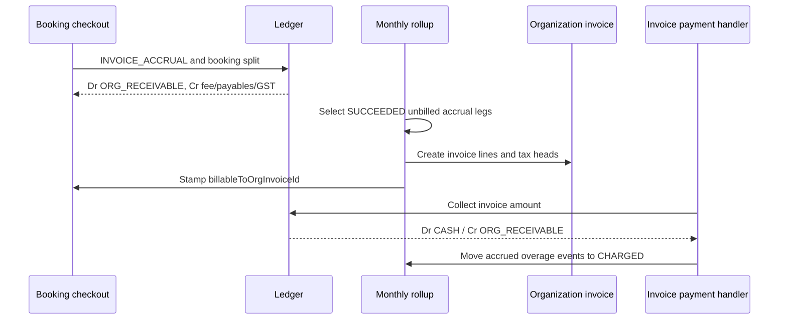
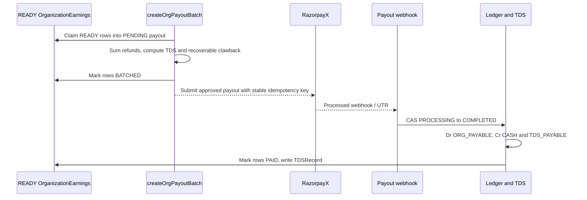

# Enterprise ledger, billing, earnings, and settlement

This chapter describes how an enterprise booking turns into a balanced journal, a buyer invoice or wallet movement, host and consultant earnings, and eventual payout. The same booking may have a buyer organization and a different host organization; those roles stay distinct all the way through settlement.

Related chapters: [Commercial axes and programs](03-commercial-axes-and-programs.md) defines funding and entitlement choices. [Checkout and overage settlement](04-checkout-and-overage.md) describes checkout and overage writes.

## 1. Money truth and its copies

The enterprise money model has three related but distinct records:

1. Payment legs say which source funds a booking or accrues its buyer debt.
2. Ledger entries say which accounts were debited and credited for that event.
3. Cached operational rows such as BillingAccount.walletBalance and earnings amount columns make common reads cheaper.

The journal is money truth. Caches and snapshots must agree with the journal but do not replace it. Payment status describes checkout/capture lifecycle; it is not a ledger account. OrganizationInvoice describes a formal receivable document, not the original booking's revenue recognition.

Money is persisted as BigInt paise in the database and mapped to JavaScript numbers at the Prisma client boundary. INR is the only settlement currency today. A displayed foreign currency may be captured for checkout, but it does not imply that the wallet, invoice, or payout settles in that currency.

Ledger accounts include CASH, PLATFORM_FEE, GST_PAYABLE, ORG_RECEIVABLE scoped by buyer org, ORG_PAYABLE scoped by host org, WALLET scoped by wallet owner, and CONSULTANT_PAYABLE scoped by expert. The exact account family and posting helpers are in `docs/enterprise/10-money-and-ledger/02-chart-of-accounts.md` and lib/payments/ledger.

## 2. Funding-leg identity

A Payment may have zero or more PaymentLeg rows. Current source types include CARD, WALLET, REFERRAL_CREDIT, INVOICE_ACCRUAL, OVERAGE_INVOICE_ACCRUAL, LICENSE, and accrual reversal sources.

When source legs exist, the commit-time identity is:

    sum(non-reversal legs except REFERRAL_CREDIT and LICENSE) = Payment.amount

REFERRAL_CREDIT is excluded because Payment.amount already represents the remaining amount after referral credits. LICENSE is excluded because a flat-fee contract covers booking price while the LICENSE leg is zero. The all-zero LICENSE-only leg set skips the usual sum comparison. Reversal legs are negative and limited to the original leg value.

The sidecar trigger applies this check both when PaymentLeg rows change and when Payment.amount changes. It is deferred until transaction commit so a multi-statement write can create Payment and its legs before validation. Do not add a second reconciliation sweep to repeat this database-enforced sum.

The unique key on paymentId and source means there is at most one leg from each source per payment. INVOICE_ACCRUAL and OVERAGE_INVOICE_ACCRUAL can coexist because they have different source names. PaymentLeg sourceRef is polymorphic by convention, so application writers and docs must explain what it points to for each source.

## 3. Booking journal by funding source

An earnings-bearing booking posts one balanced BOOKING transaction, generally keyed booking:<paymentId>. Funding debits and the supply split credits are included in the same transaction. The buyer funding account is selected from the Payment funding leg; the host organization and consultant payables come from the resolved supply split.

| Buyer source        | Booking debit                              | Timing                          |
| ------------------- | ------------------------------------------ | ------------------------------- |
| CARD                | CASH                                       | At gateway capture confirmation |
| WALLET              | WALLET(buyerOrg)                           | Inline with synchronous booking |
| INVOICE_ACCRUAL     | ORG_RECEIVABLE(buyerOrg)                   | Inline at booking accrual       |
| LICENSE, zero value | No booking debit for contract-paid service | No booking cash movement        |

For a regular booking, the journal allocates the funding debit among platform fee, consultant payable, organization payable where applicable, and GST payable. Platform GST is the full booking tax under the current principal-supplier model. A referral credit produces its own platform promo debit; the funding plug is computed from the sum of actual funding legs so the credit is not counted twice.

The license booking carries value in Payment and earnings records but has no per-booking collection. The flat fee exists at contract/subscription level. It is incorrect to infer that every Payment on LICENSE has amount zero. Its LICENSE leg is zero.

For a synchronous org rail, appointment, SUCCEEDED Payment, leg, wallet or receivable effect, utilization, earnings, and journal are committed together. For CARD, the Payment is created pending; capture confirmation owns SUCCEEDED and its booking earnings/journal. The capture route is the single writer even when a return page or reconciliation job discovers the capture first.

## 4. Wallet balance and top-ups

BillingAccount.walletBalance is a nullable derived cache of the organization-scoped WALLET ledger account. NULL marks an account that has not yet had a balance initialized. This matters because SQL arithmetic preserves NULL: incrementing a null cache without seeding would leave the cache null while the journal credited funds.

walletDebit() and walletCredit() in `lib/api/organizations/wallet.ts` seed NULL to zero inside the current transaction. Debit is an atomic conditional update where walletBalance >= amount. If no row matches, the wallet cannot cover the charge and the booking transaction fails. The sidecar CHECK permits NULL or nonnegative values, preventing an alternate writer from making the cache negative.

A confirmed top-up is represented by WalletTopUp and journal transaction Dr CASH / Cr WALLET(org). The gateway capture timestamp is preserved separately so a failed journal transaction can be recovered by the orphaned-capture reconciler. A booking debit posts Dr WALLET in the booking journal. A refund or member-overage carve credits the wallet cache and is mirrored by the appropriate WALLET ledger credit.

The ledger is the balance source; a nightly reconciler compares the wallet cache with the journal. This is a legitimate derived-cache reconciliation because the database cannot express equality to an aggregate of ledger rows as a simple CHECK.

IIT Madras seeded values provide a concrete arithmetic check: three ₹5,00,000 top-ups add ₹15,00,000; five ₹5,000 debits consume ₹25,000; wallet balance is ₹14,75,000. Those seed transactions exist in `prisma/seedFiles/14a-create-organizations.ts`. They are seed definitions and do not prove the current database contains those rows.

The low-balance cron currently sends a notification and stamps a cooldown. “Auto-top-up” configuration is not a live mandate charge. Do not document a gateway top-up as happening automatically.

## 5. Invoice accrual and monthly rollup

INVOICE funding commits an INVOICE_ACCRUAL leg and books ORG_RECEIVABLE at booking time. It does not collect cash at checkout. An assignment can be CREDIT_POOL or LICENSED_SEAT; the program meter controls allowable usage while the invoice rail controls when the organization pays.

rollupOrgInvoiceAccruals() in `lib/payments/billing/invoice-rollup.ts` selects succeeded org-tagged Payment rows that have an unbilled INVOICE_ACCRUAL or OVERAGE_INVOICE_ACCRUAL leg. It also reads reversal siblings so amounts already refunded before invoice issue are netted. The Payment row is stamped with billableToOrgInvoiceId in the same Serializable transaction that creates the invoice. Concurrent rollups either serialize/retry or read no unstamped rows after the winner.

The booking journal has already recognized the organization receivable and output GST. The rollup does not rebook those booking amounts. It creates the invoice line items and document fields, taking tax from Payment.taxAmount and prorating when reversal legs reduced the net charge.

An issued organization invoice can also include subscription or manual program fees that had no booking journal. Those charges post at invoice issue. The org invoice journal and booking accrual journal are separate cases; do not apply the “invoice issue never posts” rule to an invoice with no booking-backed accrual.

When the buyer pays the invoice, the payment pipeline debits CASH and credits ORG_RECEIVABLE. Overage events on the invoice follow their own state path: PENDING becomes ACCRUED as attached to an invoice, then CHARGED when that invoice reaches paid status.

### Sequence: booking accrual and invoice close

The invoicing module uses per-organization sequential invoice numbers, issue-time fiscal year and GST fields. Invoice rendering and tax calculation are statutory document concerns; they do not alter the original payment leg.

An un-invoiced LICENSE overage is a separate child `Payment`, even though its parent booking has a zero-value LICENSE leg. When the parent booking is fully reversed, `voidReversedOverageAccruals()` conditionally appends a full `OVERAGE_INVOICE_ACCRUAL_REVERSAL` funding leg and mirrors the child's original `overage-accrual:<childPaymentId>` journal using `overage-accrual-voided:<childPaymentId>`. For a child of ₹1,118 (₹1,000 base + ₹100 surcharge + ₹18 GST), original posting is Dr ORG_RECEIVABLE ₹1,118 / Cr PLATFORM_FEE ₹1,100 / Cr GST_PAYABLE ₹18; the void is Dr PLATFORM_FEE ₹1,100 / Dr GST_PAYABLE ₹18 / Cr ORG_RECEIVABLE ₹1,118. Thus both journals balance and their per-account net is zero. The void leaves the original child Payment and leg unchanged; the equal negative leg makes the future invoice rollup net to zero.

Invoice issue and child void race on `Payment.billableToOrgInvoiceId`: the void's conditional update requires null, and the rollup stamps the invoice in its serializable transaction. If issue wins, the void preserves the billed child and reports `OVERAGE_ACCRUAL_INVOICED` with invoice identity; it does not silently rewrite an issued invoice or mint a credit note. Finance must use the invoice credit-note procedure. `__tests__/enterprise/overage-accrual-void.test.ts` covers both outcomes, idempotent replay, balanced mirror postings, and the zero-bill rollup after a void.

## 6. Purchase orders and credit exposure

A PurchaseOrder is a spending authorization attached to an organization, not a fifth FundingSource. It has totalAmountPaise and remainingAmountPaise. drawPurchaseOrder() in `lib/payments/billing/purchase-order-draw.ts` decrements remaining value with a conditional updateMany only when the order is ACTIVE, not expired, currency-matched, and large enough for the invoice.

Monthly invoice rollup selects the oldest active unexpired PO that covers the complete invoice. A manual invoice accepts a selected PO and attempts the same CAS. Voiding or cancelling an invoice restores its PO draw in the invoice update transaction. The sidecar check constrains remainingAmountPaise to [0,totalAmountPaise].

Organization.requiresPO adds a required document relationship at contract signing and manual invoice creation. The rollup has a distinct unbacked PO result when no covering PO exists; do not flatten this to “all invoices always refuse without a PO” without checking that path.

BillingAccount.creditLimit is a different guard. It limits outstanding invoice exposure while new bookings accrue. A PO gates invoice issuance and procurement authorization; creditLimit gates the amount of receivable risk outstanding. An organization can have both.

Seeded Wipro combines both: ₹1 crore invoice credit limit and ₹50 lakh PO. The PO does not mean the org can necessarily accrue ₹1 crore without limit; it is a separate invoice issuance ceiling.

## 7. GST and invoice lifecycle

The current finance doctrine treats the platform as principal supplier for GST. The booking collects GST on the full consumer price and books GST_PAYABLE at the booking journal. The platform's own consumer tax invoice and credit note are issued. Enterprise invoice accruals use the same booking GST already posted; invoice issue must not duplicate it.

For program or subscription charges that are not in a booking journal, invoice issue creates the receivable/platform fee/GST journal. Voiding such a fee invoice reverses that journal. Refunds write credit notes and reverse the appropriate fee and tax according to the cumulative refund cap and statutory credit-note cutoff.

Overage is special only for the tax base: the base is an already-taxed slice of the parent's booking price, while the surcharge is new consideration. Hence output GST is charged once on base and once on surcharge, never twice on base. For invoices, the surcharge tax is carried in Payment.taxAmount and the tax-inclusive accrual leg.

For a LICENSE booking whose CHARGE_ORG overage was minted as a child accrual, a full booking reversal before invoice issue reverses that child with a negative `OVERAGE_INVOICE_ACCRUAL_REVERSAL` leg and the exact mirror journal, including GST_PAYABLE. The rollup nets the reversal before creating an invoice. If the child was already attached to an issued invoice, it remains intact for the credit-note path and the reversal records an operational warning with the affected invoice IDs; this code does not issue that credit note itself. See [checkout and overage](04-checkout-and-overage.md) for the ₹1,118 example and race sequence.

The principal-supplier model is a product/accounting decision in ADR 26 and remains subject to CA review. The compliance reference calls the pairing of principal-supplier GST and 194-O withholding as an e-commerce operator deliberate and unusual. A documentation chapter should state implemented treatment and point to the open CA question rather than declaring a universal legal rule.

## 8. Invoice dunning and billing suspension

Invoice status includes DRAFT, ISSUED, PAID, OVERDUE, VOID, CANCELLED, and REFUNDED. Dunning marks an issued invoice OVERDUE after its due date and sends reminders with guarded stamps. The suspension stage is gated by ENABLE_DUNNING_SUSPEND, default off. When enabled and the overdue sequence reaches the configured terminal stage, new sponsored bookings are blocked until overdue status is cleared by payment.

The Wipro seed invoice is DRAFT and is not a live dunning example. Time-based lifecycle examples should say they require a past due date or an operator-adjusted fixture.

A statement like “unpaid invoice always suspends bookings” is false under the current default. The normal path is reminder-only; the config gate enables suspension.

## 9. Buyer and host are independent settlement scopes

For cross-org booking, Payment.organizationId is the sponsor or buyer and Payment.hostOrganizationId is the supply organization. The buyer side selects WALLET, INVOICE_ACCRUAL, or LICENSE. The host side resolves the supplier RateCard and any org payable. This lets an org sponsor a member to use an expert hosted by another organization.

The rate-card resolver tries plan/contract scope where that resolution is enabled, then membership override and organization defaults. The chosen card is effective at payment.createdAt. An earnings snapshot carries rateCardIdApplied and the bps actually used. Settlement does not read the live RateCard again.

The split uses integer paise calculations:

    platformFee = floor(gross × platformBps / 10000)
    consultantShare = floor(gross × consultantBps / 10000)
    orgShare = gross - platformFee - consultantShare

RateCard bps sum to 10,000. Giving the residual paise to the org makes the three output shares sum exactly to gross after independent floor operations. SQL enforces the bps sum and prevents an invalid card from reaching settlement.

If the expert membership has payoutRecipient=ORGANIZATION, the consultant slice is transferred into the host org share; the earning snapshot also records consultant bps as zero. If recipient is SELF, the consultant keeps a separate ConsultantEarnings row and the organization receives its configured share.

### Example: Wipro sponsor, LearnPro host

Assume a ₹10,000 taxable booking with a host split of platform 10%, host organization 10%, consultant 80%, ignoring referral credits and showing the GST liability separately. Wipro's INVOICE leg debits its org receivable for the buyer charge. LearnPro's RateCard, not Wipro's, determines host earnings:

| Component                |   Paise |  Rupees |
| ------------------------ | ------: | ------: |
| Platform fee at 10%      |  100000 |  ₹1,000 |
| Host organization at 10% |  100000 |  ₹1,000 |
| Consultant at 80%        |  800000 |  ₹8,000 |
| Base allocation total    | 1000000 | ₹10,000 |

For 18% GST, the journal has an additional ₹1,800 liability credit and the receivable side includes the tax-inclusive buyer charge. Actual tax head and price fields are determined by the checkout pricing path. Wipro's tag does not direct the consultant payout to Wipro.

## 10. Multi-collaborator and subscription earnings

A webinar or class can divide gross across a primary expert and collaborators. Each party resolves its own host membership and rate card. Same-host parties must remain separate because they can have different membership overrides, expert identities, roles, refund amounts, and payout recipients.

OrganizationEarnings is uniquely keyed by paymentId, organizationId, consultantProfileId, role, and cycleOrdinal. The five-field uniqueness is implemented in `prisma/sql/check-constraints.sql` with NULLS NOT DISTINCT, including legacy rows where optional keys are null. It allows two experts in the same organization to produce separate rows for one payment.

A subscription is paid up front but releases consultant earnings by delivered cycle. The payment is partitioned into ConsultantEarnings tranches with cycleOrdinal 0..n-1; per-tranche integer floors are reconciled by assigning residual paise to tranche zero. Tranches start with holdUntil null. Completion of the cycle's final delivered occurrence stamps the hold based on the last occurrence end plus the subscription hold window.

OrganizationEarnings can also carry cycleOrdinal and holdUntil. Organization slices are held until the appropriate subscription delivery milestone, preserving parity between host-org earnings and individual consultant earnings.

Refund clawback is not uniformly spread over already-paid and not-yet-delivered cycles. allocateCycleClawback() in `lib/payments/payouts/earnings-reversal.ts` consumes value from newest undelivered tranche first, then in-flight/released rows, then BATCHED, then PAID. Each row absorbs no more than consultant share minus already-refunded share. Refund service applies cumulative refund caps before allocation.

## 11. Earnings states, disputes, and refunds

Earnings status represents settlement eligibility, not ownership. A normal row moves from PENDING to READY after its delivery hold expires. Payout batch claims READY into BATCHED. Gateway completion moves it to PAID. A failed payout releases a still-batched row back to READY. Post-completion bank reversal moves payout earnings from PAID back to READY.

Open disputes can move earnings to HELD and store preDisputeStatus. A WON or CLOSED dispute restores the actual prior state; it must not accidentally mature a PENDING row directly to READY. A LOST or CHARGE_REFUNDED dispute goes through the refund and earnings clawback path.

CHARGE_MEMBER overage uses HELD for a separate purpose. It holds parent booking earnings until a distinct side-payment captures or fails. It is not the same release rule as a dispute. Documentation should identify the cause of hold and the process that returns the row to its prior eligible state.

Refunds are two-phase. A Refund record reserves an amount before a gateway call; ledger reversal and earnings clawback occur only when the gateway confirms the refund. The refund cascade clamps against already-returned refunds and lost/charge-refunded disputes. Invoice credits are cumulative and cannot reverse more than the original charged amount.

When a confirmed refund fully reverses a booking with collected CHARGE_MEMBER overage batches, the cascade does not make nested gateway calls inside that transaction or try to reverse the side charge as if it shared the parent's tender. Instead, it stamps `Payment.refundOwedKey` on each charged side Payment in the same transaction that completes the parent cascade. The stable key is `overage-credit-back:<parentPaymentId>:<sidePaymentId>`; null `refundOwedPaise` means the child's full remaining refundable balance. This state-as-outbox marker survives process failure and is later driven through the ordinary refund front door by `scripts/payments/retry-auto-refunds.ts`.

The owed-refund worker waits 15 minutes, skips a payment with an existing PENDING refund or a live dispute, and uses the marker key as the refund dedupe key. Success/replay clears the marker; a still-PENDING gateway refund remains owned by refund reconciliation; failures are counted on the payment and retried until the third failed drive, when an operator is asked to refund manually. A marker older than two hours is surfaced in an operations event. `__tests__/payments/overage-credit-back-owed.test.ts` checks multiple child payments, idempotent replay, and retry after a gateway failure. A partial parent refund does not trigger this full-booking overage credit-back; the new marker branch is guarded by full completion of the parent refund.

## 12. Organization payout batch

Organization payout uses OrganizationEarnings rows associated with the host organization. createOrgPayoutBatch() is shared by a manual route and scheduled batch creation. It requires a verified OrganizationPayoutAccount and the Razorpay payout rail. It claims READY earnings with no existing payout id inside a Serializable transaction and makes a PENDING payout row.

The batch refuses empty claims, mixed currencies, or a net amount at or below zero. Net payout is the host organization's share less refundedAmountPaise. It computes TDS from that pre-withholding amount and recovers eligible platform clawbacks from the cash portion. Rows are staged BATCHED at creation; they are not PAID before money leaves.

    netPayoutPaise = sum(orgSharePaise - refundedAmountPaise)
    amountPaise + tdsAmountPaise + recoveredClawbackPaise = netPayoutPaise

The amountPaise is the cash the organization receives. netPayoutPaise is the gross payee share before TDS and clawback recovery. A clawback remaining after minimum recoverable amount is carried to a future payout.

### Sequence: organization payout

Organization payout status transitions are guarded through conditional updates. A batch that fails before the gateway movement returns claimed earnings to READY. An already completed bank payout that is later reversed has its own REVERSED status and inverse journal.

## 13. ORG_PAYOUT journal and reversal

markOrgPayoutCompleted() claims PROCESSING→COMPLETED and posts the payout journal in the same Serializable transaction. It debits ORG_PAYABLE for netPayout less any clawback already recovered, credits CASH for amountPaise and TDS_PAYABLE for withholding. The sum discharges the org obligation; taxes are retained for the tax authority and are not part of cash delivered to the org.

The journal idempotency key is orgpayout:<payoutId>. Status transition and journal are atomic, so a rolled-back transition cannot leave a completed payout without a posting. LedgerTransaction and LedgerEntry rows are immutable after post.

markOrgPayoutReversed() handles a bank reversal after COMPLETED. It claims COMPLETED→REVERSED, restores linked earnings from PAID to READY, posts the exact opposite account movements under a different idempotency key, records a TDS reversal and audit row, and releases linked clawback recovery. Using a distinct reversal key keeps the inverse from masking a missing original posting.

A failure before completion is different: it does not reverse an ORG_PAYOUT journal that was never posted. Status handling must preserve that distinction.

## 14. TDS on the organization rail

OrganizationPayout stores the withholding section, rate bps, financial year and amount used at batch construction. TDSRecord is written only when payout completes, because a planned deduction on a payout that never settled is not a deduction made.

Current enterprise reference describes organization TDS defaulting to 194-O, with overrides for 194J/194C and lower-rate certificate handling. The finance skill states that canonical `lib/compliance/tds.ts` is the organization-and-consultant path, with resident 194-O rate and no-PAN fallback, while an older consultant path remains CA-gated. Verify the active tax-engine configuration before changing this rule.

The organization payout tests pin valid encrypted PAN to the expected resident rate and missing or malformed PAN to the no-PAN rate. TDS applies to the pre-withholding net organization payout, not to net cash after the withholding was removed.

TDSRecord has real organization and consultant foreign keys. A sidecar CHECK requires exactly one deductee and another ensures the payout FK matches that deductee rail. Its reversal rows can carry negative withholding; the unique key includes the reversal flag where applicable.

The compliance reference says that statutory forms and section codes were renumbered under the Income-tax Act 2025 from 1 April 2026. Internal database section labels such as 194O are not necessarily the numeric code required by a return. Preserve this as a filing-boundary translation and CA signoff question rather than changing payout history rows.

## 15. Ledger and constraint ownership

| Invariant                                      | Enforcement                                                       | What code should do                                                    |
| ---------------------------------------------- | ----------------------------------------------------------------- | ---------------------------------------------------------------------- |
| Payment leg sum and refund reversal pair       | Deferred SQL constraint triggers on PaymentLeg and Payment.amount | Write the correct legs in one transaction; don't add a duplicate sweep |
| Ledger rows immutable                          | BEFORE UPDATE/DELETE triggers in `prisma/sql/ledger-triggers.sql` | Reverse with a balancing journal                                       |
| RateCard bps sum = 10000                       | SQL CHECK                                                         | Validate at configuration entry; never silently redistribute           |
| OrganizationEarnings split uniqueness          | NULLS NOT DISTINCT unique sidecar index                           | Include consultant, role and cycleOrdinal identity                     |
| TDS deductee XOR / payout rail                 | SQL CHECK                                                         | Create a row for exactly one payee rail                                |
| Wallet cache nonnegative                       | SQL CHECK plus conditional debit                                  | Seed NULL first and update cache in the same tx as journal             |
| PO remaining range                             | SQL CHECK plus CAS draw                                           | Use draw helper and restore only on valid invoice void                 |
| Wallet balance equals WALLET journal aggregate | Nightly reconcile                                                 | Treat journal as truth and repair/report cache drift                   |
| Assignment usage equals usage ledger aggregate | Nightly reconcile                                                 | Append reversal rows; don't rewrite history                            |
| Earnings amounts equal booking journal split   | Reconcile-ledger findings                                         | Create earnings and BOOKING journal atomically                         |

`prisma/sql/payment-legs-triggers.sql` checks the full payment after either leg or amount changes. `prisma/sql/ledger-triggers.sql` makes posted ledger transactions and entries immutable. `prisma/sql/check-constraints.sql` holds the field and cross-field checks. Do not treat all reconciliation as redundant: the database enforces row-level identities, but it cannot make a cache equal the aggregate of another table.

## 16. Cross-org example from the seed

Wipro is a seeded INVOICE buyer. LearnPro Academy is a seeded host organization with a 10/10/80 card. The Wipro→LearnPro appointments in `prisma/seedFiles/14c-seed-org-appointments-and-feedback.ts` demonstrate that buyer funding and host settlement are independent.

The Wipro seed also gives its annual seat program 12 covered engagements and a ₹10,000 per-engagement cap. An over-cap invoice booking accrues to Wipro. Its host organization is still resolved from LearnPro and the expert's active host membership, so organization earnings belong to LearnPro when the selected RateCard includes an org share.

IIT Madras provides the opposite shape: it is HYBRID and can both sponsor student bookings and receive payout on hosted faculty supply. Its internal faculty can route their consultant share to the organization; external panel experts route to themselves.

Do not infer that every seeded consultation has a payout row or a particular rate-card selection without checking the exact appointment and membership fixtures. Seed examples establish the intended shape, not a live DB observation.

## 17. Recovery paths

- **Invoice rollup retry:** transaction serialization retries; on a second pass, billableToOrgInvoiceId prevents duplicate issue.
- **Overage event orphan:** rollup records orphan findings after transaction commit rather than referencing an invoice rolled back with the tx.
- **Un-invoiced LICENSE overage reversed:** append a full reversal leg, mirror the child accrual journal under a distinct key, and let rollup net to zero; if invoice issue won the race, preserve the invoice and emit `OVERAGE_ACCRUAL_INVOICED` for finance's credit-note work.
- **CHARGE_MEMBER overage credit-back:** the full parent refund stamps a stable refund-owed marker on each successful side Payment; the retry-auto-refunds worker drives each later refund and leaves gateway failures durable for bounded retry or manual action.
- **Gateway payout callback replay:** payout status CAS makes completion a no-op after terminal state; journal key also provides idempotency.
- **Completed payout reversal:** separate REVERSED state, inverse journal key, TDS reversal and earnings reopen.
- **Refund fails:** no booking ledger reversal is posted until gateway confirms; failed refund has failure fields and a notification/reconcile route.
- **Captured-but-uncredited wallet top-up:** capturedAt remains durable and the orphan capture reconciler re-drives the wallet credit.
- **Clawback recovery:** a refund after payout records a receivable; later payout nets it from the amount while preserving the gross TDS base identity.
- **Dispute:** held earnings carry preDisputeStatus; resolve restores previous state or invokes refund cascade depending on outcome.

The operational sweeps only reconcile across external gateway or cache boundaries. DB-enforced ledger balance, immutability and payment-leg constraints should not be duplicated as application sweeps.

## 18. Code and test map

- Earnings split and booking journal: `lib/payments/payouts/earnings-service.ts`, `lib/payments/checkout/commit/ledger.ts`, `lib/payments/ledger/post.ts`.
- Wallet: `lib/api/organizations/wallet.ts`; `lib/payments/billing/overage-settlement.ts`; `jobs/billing/wallet-low-balance.ts`.
- Invoice rollup and PO: `lib/payments/billing/invoice-rollup.ts`, `lib/payments/billing/create-org-invoice.ts`, `lib/payments/billing/purchase-order-draw.ts`, app/api/organizations/[orgId]/billing-account/invoices.
- Subscriptions and refunds: `lib/booking/subscription-cycle.ts`, `lib/payments/payouts/earnings-reversal.ts`, `lib/payments/operations/refund.ts`, `lib/payments/operations/refund-owed.ts`, `lib/payments/billing/overage-accrual-void.ts`, `scripts/payments/retry-auto-refunds.ts`.
- Payout and TDS: `lib/payments/payouts/org-payout-service.ts`, `lib/compliance/tds.ts`, app/api/organizations/[orgId]/payouts.
- Webhooks: `lib/payments/webhooks/handlers.ts`, `lib/payments/webhooks/overage-handlers.ts`, app/api/webhooks/razorpay.
- Sidecars: `prisma/sql/check-constraints.sql`, `prisma/sql/ledger-triggers.sql`, `prisma/sql/payment-legs-triggers.sql`.
- Tests: `__tests__/enterprise/org-payout-service.test.ts`, `__tests__/enterprise/org-payout-withholding-postings.test.ts`, `__tests__/enterprise/tds-org-payout-input.test.ts`, `__tests__/enterprise/collaborator-org-earnings.test.ts`, `__tests__/enterprise/po-balance-enforcement.test.ts`, `__tests__/enterprise/wallet-null-cached-balance.test.ts`, `__tests__/enterprise/ledger-invariants.test.ts`, `__tests__/enterprise/overage-accrual-void.test.ts`; `__tests__/payments/org-invoice-journal.test.ts`, `__tests__/payments/earnings-per-cycle.test.ts`, `__tests__/payments/multi-party-booking-journal.test.ts`, `__tests__/payments/dispute-earnings-hardening.test.ts`, `__tests__/payments/dispute-refund-correctness.test.ts`, `__tests__/payments/overage-credit-back-owed.test.ts`.

## Glossary

- **Receivable:** amount owed by an organization to the platform.
- **Payable:** amount the platform owes to an expert or host organization.
- **Journal:** immutable balanced debit/credit records for a money event.
- **Accrual:** booking amount recognized as org debt before cash is received.
- **Rollup:** process that groups unbilled booking accruals into an organization invoice.
- **RateCard snapshot:** historical basis-point values applied to a booking.
- **Net payout:** organization earnings before TDS and clawback cash recovery.
- **Cash payout:** the amount sent to the org after withholding and recoveries.
- **TDS:** amount withheld from the payee and credited to the tax payable account.
- **Clawback:** recovered share of an earlier payout after a refund or reversal.

## Deprecated & Superseded Approaches

WalletEntry and separate single-entry funding/settlement logs were replaced by the double-entry ledger, WalletTopUp lifecycle row, and reconciled wallet cache. Mutable RateCards were replaced with effective-dated rows and earnings snapshots. Payout clawbacks once remained informational; current batch creation can recover an amount against future payouts. Old lifecycle docs that treat held subscription earnings as a flat partial refund should use per-cycle tranches and newest-undelivered-first allocation.
