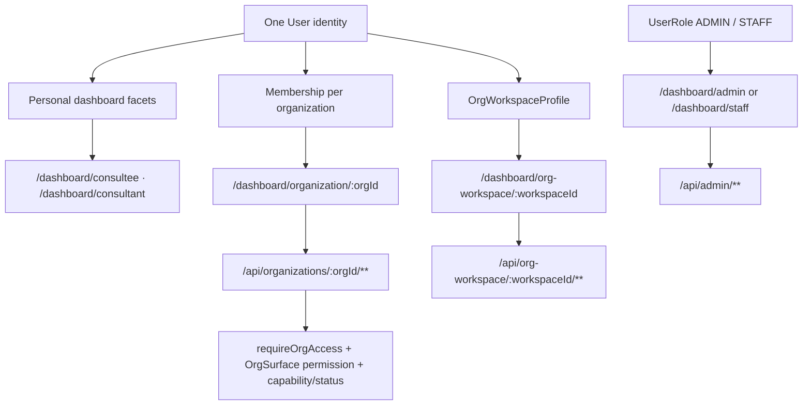

# Enterprise dashboards and user journeys

This document maps the live enterprise-facing dashboard surfaces to the identity that owns them, the data they read, the actions they issue, and
the permission and capability gates that protect them. It covers five distinct contexts: per-organization operations, the operator's
cross-organization portfolio, personal learner and expert dashboards, and platform admin/staff operations.

The dashboard is a read and action layer over organization data. It does not own membership authority, billing truth, booking truth, or payout
truth. The same permission keys and organization scoping used by the UI must be enforced at the server/API boundary. See
[02 — Identity, governance and lifecycle](./02-identity-governance-and-lifecycle.md) for identity creation, permission semantics, SSO and state
transitions. The business seams are explained in [03 — Commercial axes and programs](./03-commercial-axes-and-programs.md),
[04 — Checkout and overage](./04-checkout-and-overage.md), [05 — Ledger, billing and settlement](./05-ledger-billing-and-settlement.md),
[07 — Compliance, privacy and data](./07-compliance-privacy-and-data.md),
[08 — Operations and integrations](./08-operations-and-integrations.md), and
[09 — Design decisions and recommendations](./09-design-decisions-and-recommendations.md).

## 1. Route architecture

The route parameter identifies a tenant or user workspace; it is never the complete authorization check. Per-org layout preloads authorized
organization details before the dashboard shell appears. The shell derives role/capability navigation with `buildOrganizationNav` in
`lib/dashboard/nav/organization.ts`. API routes call `requireOrgAccess` in `lib/auth-helpers.ts` and apply a named key from
`lib/auth/org-permissions.ts` plus status/capability rules. Cross-org workspace layout checks that the requested workspace ID equals the
authenticated user's `orgWorkspaceProfileId`; a guessed workspace id returns the same 404 as a missing profile. Admin and staff routes use their
platform backoffice permission map.

The bare `/dashboard/organization/[orgId]` route is a role resolver:

| Viewer                              | Landing                                             | Reason                                                       |
| ----------------------------------- | --------------------------------------------------- | ------------------------------------------------------------ |
| OWNER, MAINTAINER, MANAGER, SUPPORT | `/home`                                             | Operator overview and next actions.                          |
| BILLING_ADMIN                       | `/home`                                             | Finance-specific view card; operational data remains hidden. |
| LEARNER                             | `/my-program` if `canSponsor`, else `/appointments` | Own org entitlement or own sessions.                         |
| EXPERT                              | `/compensation` if `canHost`, else `/appointments`  | Own host-org arrangement or own sessions.                    |
| SUSPENDED member                    | `/appointments`                                     | Existing bookings remain reachable; new org work is gated.   |
| No active/suspended Membership      | Personal dashboard resolver                         | This org is outside the caller's membership scope.           |
| Platform ADMIN                      | `/home` read-only                                   | Writes belong in the backoffice.                             |

`resolvePersonalDashboardHref` in `lib/labels/personal-dashboard.ts` prefers operator portfolio, then consultant facet, then consultee facet. The
top-level context switcher lets a person with multiple facets move between those trees. Personal lists pin their query to personal context; org
work appears in the org tree. A context parameter is not a license to mix tenant data into an unrelated personal page.

## 2. Per-organization dashboard

The organization shell is under `app/dashboard/organization/[orgId]/**`. The navigation builder is the best route inventory because some
destinations are tabs and some are capability-only. Every list and command below is still scoped to the `orgId` in the URL, and every API handler
must apply the corresponding permission key and resource ownership check.

### Common and member-facing surfaces

| Destination                                                         | Read model / query boundary                                                                                                              | Commands and permissions                                                                                                                                                                                          |
| ------------------------------------------------------------------- | ---------------------------------------------------------------------------------------------------------------------------------------- | ----------------------------------------------------------------------------------------------------------------------------------------------------------------------------------------------------------------- |
| **Overview** `/home`                                                | `GET /api/organizations/[orgId]/analytics` plus `/activity?limit=5`; one activation snapshot feeds checklist and action-center banners.  | Role-specific view. Operator actions link to Settings, Members, Contracts, Programs, Billing, Payouts, or Appointments.                                                                                           |
| **Appointments** `/appointments`                                    | `GET /api/organizations/[orgId]/appointments`; `?scope=mine` returns the caller's org sessions. `?scope=everyone` is an operations feed. | `operations.read` opens Everyone and operations. Without it, hand-edited Everyone scope narrows to own rows. Act-for-org reschedule/cancel and allocate use separate action permissions.                          |
| **Messages** `/messages`                                            | Org-tagged Stream channels for the signed-in user; org roster does not grant access to every private channel.                            | Channel membership and messaging rules remain server enforced.                                                                                                                                                    |
| **Session documents** `/documents` and **Recordings** `/recordings` | Org appointment artifact APIs, defaulting to the member's own sessions.                                                                  | Every ACTIVE or SUSPENDED member can see their own authorized files; `operations.read` allows the org-level metadata view where implemented. A role does not imply permission to delete another person's content. |
| **Requests** `/requests`                                            | Pending consultation and subscription requests for experts delivering into this org.                                                     | Requires a consultant profile plus host capability; allocation/response writes use host-actor checks and scoped booking routes.                                                                                   |
| **Plan collaborators** `/collaborations`                            | Collaborators on org-owned webinars/classes.                                                                                             | EXPERT host nav, or operator catalog page for operator management. B2C-owned offerings stay on personal consultant surfaces.                                                                                      |
| **My Program** `/my-program`                                        | LEARNER's assignments, cycle/coverage progress, usage history and org-only plan panel.                                                   | Read-only member view, `myProgram.read`, `canSponsor`; member can leave the org through the dedicated leave route, but cannot assign self to a program.                                                           |
| **Compensation** `/compensation`                                    | EXPERT's own org-tagged earnings, payout recipient and effective split only.                                                             | `myArrangement.read` and host capability. It does not expose the org's other members' payout routing.                                                                                                             |

The appointments page merges own and everyone views in one page. The `operations.read` permission controls the wider view; an org member without
that permission sees only their own rows. This rule matters for BILLING_ADMIN, which can inspect finance records but is intentionally absent from
the org-wide operations feed. Public/session content boundaries are described in
[ADR 20](../../enterprise/70-design-decisions/20-org-visibility-into-member-sessions.md).

### Operator pages and tabs

| Destination                | Main query/API                                                                                                                   | Important controls and gates                                                                                                                                                                                                                          |
| -------------------------- | -------------------------------------------------------------------------------------------------------------------------------- | ----------------------------------------------------------------------------------------------------------------------------------------------------------------------------------------------------------------------------------------------------- |
| **Members** `/members`     | `GET /members` supports role/status/search/department/sort/page; `/members/directory` is names-only for broad member visibility. | `members.read` opens the full roster; `members.directory` opens the directory. Tabs: all, learners, experts, invitations. Invites via `/invitations`; accept is user-side. PATCH/DELETE use shared membership guard. Bulk import creates invitations. |
| **Programs** `/programs`   | Programs list, active contract list, active member list, assignments, assignment usage.                                          | `programs.read`, `programs.assign`, `programs.manage`, plus canSponsor. Assign/unassign/period extension have distinct keys. Config editing respects `configLockedAt`; archive/replace retains history.                                               |
| **Contracts** `/contracts` | `GET /contracts` and BillingAccount read.                                                                                        | `contracts.read` for view; OWNER `contracts.manage` for create/activate/edit/supersede. Contract lock data disables committed fields; renewal/amendment makes successor records.                                                                      |
| **Catalog** `/catalog`     | Org-owned offerings (includeArchived filter) and materials.                                                                      | `catalog.manage` and canHost. New offering is an org-owned Webinar/Class with expert selector; archive/restore rather than delete. Materials are restricted to org-owned plans.                                                                       |
| **Billing** `/billing`     | `GET /billing`, `/billing-account/invoices`, invoice details and downloadable PDFs.                                              | `billing.read` for finance readers; `billing.manage` for owner/finance mutations. Tabs: Invoices, Wallet, Purchase Orders, Member Spend, Reimbursements, Disputes. Tab grants are separate.                                                           |
| **Payouts** `/payouts`     | Org earnings, payout batches, rate cards and payout account.                                                                     | `payouts.read` for finance readers; `payouts.manage`, `payouts.approve`, `payouts.account.manage`, `members.payoutRecipient.change` split approval, bank, batch and routing authority. Requires canHost.                                              |
| **Analytics** `/analytics` | Analytics rollups plus feedback summary; derived from org-scoped bookings, spend, earnings and utilization.                      | `operations.read`; privacy-safe quality aggregates have their own `quality.read` gate. CSV export uses explicit export grants.                                                                                                                        |
| **Audit** `/audit`         | Org audit rows with category/action filters; CSV is a separate export endpoint.                                                  | `audit.read` shows union of event categories; row filters use `audit.read.ops` and `audit.read.money`. Export permissions are distinct from viewing.                                                                                                  |
| **Consent** `/consent`     | Org consent records and withdrawal-request queue.                                                                                | `consent.read`; member withdrawal is the member's own act. The list of people is not a general roster export.                                                                                                                                         |
| **Support** `/support`     | Org-attributed request list and metadata-only triage; case detail stays scoped.                                                  | `supportRequests.org` or support/operations-specific grant; conversation and private session content is redacted by its own policy.                                                                                                                   |

The permission keys and allowed roles live in `lib/auth/org-permissions.ts`; capability conditions are encoded alongside routes and in
`buildOrganizationNav`. Sidebar visibility is a usability layer, not a security boundary. A hand-entered route or crafted request still has to
pass the server gate.

### Settings sections

Settings opens from the avatar menu, not the main rail. Its current sections include:

- **General:** organization identity, logo/branding, support and billing contacts, policies, public listing, capability/tax fields where allowed.
  `PATCH /api/organizations/[orgId]` has field-level role gates and an `expectedVersion` CAS for capability edits.
- **Domains and SSO:** domain claims and DNS proof, provider configuration, approval/proof state, enforcement. `identity.read` permits
  OWNER/MAINTAINER to inspect; `identity.manage` permits OWNER to mutate. Secrets are redacted from read models.
- **Webhooks:** endpoints, event subscriptions, delivery inspection, retry, secret rotation and delete. Member-event subscriptions and secret
  actions are OWNER-gated even where general integration management is broader.
- **Data exports:** people and financial export bundles have different permission keys and downloadable job resources.
- **Billing settings / cancellation policy:** settings and policy writes have their own keys; OWNER-only pricing policy changes do not follow the
  broad settings-read permission.

Implementation: settings section map in `lib/dashboard/org-settings-sections.ts`; controls in `app/dashboard/organization/[orgId]/settings/**`;
APIs under `app/api/organizations/[orgId]/`. Do not infer write access from the fact that a user can render the Settings shell.

### Tabs and legacy destinations

Tabs keep one page per object. Current members tabs are `all`, `learners`, `experts`, and `invitations`; settings sections are general, SSO,
webhooks and data exports; billing tabs consolidate wallet, purchase orders, member spend, reimbursements and disputes. `/purchase-orders`,
`/reimbursements`, and `/disputes` may still exist as redirect-only route stubs. `/credits` is not an active page; wallet is a Billing tab.
Appointment `mine/everyone` is a scope switch on the same appointment object, not two destinations.

### Exact role matrix in practice

The matrix has intentional non-hierarchical grants. This table gives the roles for several central surfaces; consult `ORG_PERMISSIONS` for the
complete exact matrix before changing a gate.

| Permission key                                 | Current grant set                         |
| ---------------------------------------------- | ----------------------------------------- |
| `members.directory`                            | All current member roles                  |
| `members.read`                                 | OWNER, MAINTAINER, MANAGER, SUPPORT       |
| `members.manage` / `invitations.manage`        | OWNER, MAINTAINER                         |
| `members.role.grant.governance` / `org.delete` | OWNER                                     |
| `billing.read`                                 | OWNER, MAINTAINER, BILLING_ADMIN, MANAGER |
| `billing.manage` / `payouts.manage`            | OWNER, BILLING_ADMIN                      |
| `contracts.read`                               | OWNER, MAINTAINER, BILLING_ADMIN          |
| `contracts.manage`                             | OWNER                                     |
| `programs.assign`                              | OWNER, MAINTAINER, MANAGER                |
| `programs.manage`                              | OWNER, MAINTAINER                         |
| `identity.read`                                | OWNER, MAINTAINER                         |
| `identity.manage`                              | OWNER                                     |
| `operations.read` / `quality.read`             | OWNER, MAINTAINER, MANAGER, SUPPORT       |

The rows are permission grants, not blanket dashboard access. Sponsorship and hosting capability, membership status, org lifecycle, specific data
ownership, and sometimes separate action-level keys narrow them. For example, MANAGER may read billing but cannot write it; SUPPORT may read
operations but not money; BILLING_ADMIN may read finance but cannot read the full member roster or operations feed.

## 3. Cross-organization operator workspace

`/dashboard/org-workspace/[orgWorkspaceId]/**` is keyed by the current user's `OrgWorkspaceProfile`, not by one organization ID. The server
layout requires an onboarded user and checks the route ID against the profile ID; a mismatch is 404. It supports portfolio-level actions and
summaries, while every drill-down into a tenant returns to `/dashboard/organization/[orgId]/**`.

| Page                        | Data boundary                                                                                                                                                  | Action boundary                                                                                                                                                    |
| --------------------------- | -------------------------------------------------------------------------------------------------------------------------------------------------------------- | ------------------------------------------------------------------------------------------------------------------------------------------------------------------ |
| **Overview** `/home`        | `getOperatorOrganizations(userId)` for orgs the user owns, plus `getWorkspaceBillingRollup(userId)`. Includes status/verification, wallet and dunning signals. | Open a specific org or create one. A single-org owner is routed to the org; multi-org users get chooser/portfolio.                                                 |
| **Activity** `/activity`    | `/api/org-workspace/[id]/activity` aggregates OrgAuditLog across owned orgs with organization/category filters and cursor pagination.                          | Read-only; switch to a tenant for a mutation.                                                                                                                      |
| **Spend** `/billing`        | `/api/org-workspace/[id]/billing` reads outstanding invoices and wallet totals across owned orgs.                                                              | Read-only. It is labelled Spend to distinguish it from a single-org Billing page.                                                                                  |
| **Settings** `/settings/**` | `/api/org-workspace/[id]/settings` reads preferences.                                                                                                          | Default landing organization, locale/currency and notification routing. Account security/privacy settings are personal account settings under `/settings/account`. |
| **Create** `/create`        | Same organization creation wizard as the per-org entry point.                                                                                                  | Creates a new Organization, owner Membership, BillingAccount when sponsor-enabled, and workspace profile if missing.                                               |
| **Support** `/support`      | Workspace support requests and case pages.                                                                                                                     | Scoped to the authenticated operator and authorized support request.                                                                                               |

The cross-org billing and activity views do not let a portfolio ID substitute for tenant authorization. Their query helper starts from
authenticated user ownership and each detailed action moves to a route with its own org guard.

The route tree and data reads live in `app/dashboard/org-workspace/[orgWorkspaceId]/**`, `lib/data/org-workspace.ts`, and
`app/api/org-workspace/[orgWorkspaceId]/**`. The layout also computes owner count to decide whether portfolio pages provide value when the user
only owns one organization.

## 4. Personal learner and expert dashboards

Personal dashboards represent B2C identity and activity. They pin reads to personal organization-null scope. An expert who also belongs to a host
org has separate personal earnings and org compensation, because each booking's org context determines its owner and settlement view. A learner
who receives sponsored sessions sees those in the org's My Program and org appointment surface; their personal dashboard remains their personal
context.

The context switcher lists the facets the user has: personal expert, personal learner, cross-org workspace, and active org memberships.
`resolvePersonalDashboardHref` chooses the preferred fallback. `UserRole` helps pick a default, but does not remove other profile facets. A deep
link to an organization still checks active or suspended membership before rendering.

### Worked personas

The following names and situations are illustrative, not claims about seeded accounts.

**Riya, Wipro learner.** Riya has a global `User` and ConsulteeProfile plus an ACTIVE LEARNER Membership at a sponsor org. The org route lands
her on My Program; `/my-program` reads assignments and utilization through org-scoped membership. She can see own appointments and messages, not
the Everyone feed or other members' session content. Wipro's operations manager sees a broader appointments feed only with `operations.read`.

**Aarav, host expert.** Aarav owns a global ConsultantProfile and an EXPERT Membership at a canHost org. `/compensation` shows his own effective
split, payout recipient and org-tagged earnings. His personal consultant dashboard continues to show only personal bookings/earnings. The payout
recipient and rate-card override are membership-scoped, so another org can choose a different arrangement without rewriting his global identity.

**Nina, finance lead.** Nina has BILLING_ADMIN. The sidebar shows the finance surfaces she is allowed to read and mutate, including
billing/payout controls specified by the matrix. She is not a member roster operator and does not see the org-wide operational appointments feed.
A hidden menu item is not the security mechanism; direct API requests receive 403 from the permission guard.

**Same person, several roles.** Sam can be consultant in personal context, an OWNER in one org and a LEARNER in another. The top-level context
switcher moves between these pages. Each query fixes its data scope; no page merges all of Sam's work into one ambiguous statement.

## 5. Platform organization console

Platform staff and admins use `/dashboard/[admin|staff]/organizations` (the actual tree is under
`app/dashboard/(backoffice)/[tree]/organizations/**`). This is not the org owner's Settings page. It serves verification queues, organization
details, and SSO provider approval. Admin controls include verify/reject, suspend/reactivate/deactivate and provider approval/revocation.

The admin verify route is `app/api/admin/organizations/[orgId]/verify/route.ts`; SSO approval is
`app/api/admin/organizations/[orgId]/sso-providers/[providerId]/approval/route.ts`. Both are platform-permission-gated and write their own
ops/audit evidence. In ordinary org APIs, a platform ADMIN may receive a read-only stub for inspection, but cannot mutate as if they were the
organization's OWNER. This preserves the separation between platform governance and tenant administration.

The admin/staff dashboard split is intentional: same platform subsystem, distinct audiences and authority. Staff can support and read allowed
operational/money views; platform lifecycle changes and sensitive actions are admin-gated. The relevant platform policy lives in
`lib/auth/backoffice-permissions.ts` and `lib/dashboard/backoffice-nav.ts`.

## 6. Query and command boundaries

A dashboard page typically has three layers: server page/layout for route ownership and hydration, client component for tab/query state and
command UX, and API/service for access checks, query scoping, mutation transaction and audit. Shared query helpers should own filters that
multiple screens rely on.

| Domain object            | Read path                                                      | Command path                                                  | Core guard                                                                                                    |
| ------------------------ | -------------------------------------------------------------- | ------------------------------------------------------------- | ------------------------------------------------------------------------------------------------------------- |
| Org/member details       | `lib/data/org-details-server.ts`, `/api/organizations/[orgId]` | `PATCH/DELETE /api/organizations/[orgId]`                     | Membership + field RBAC + expectedVersion + org lifecycle + Serializable wind-down.                           |
| Member list/invite       | `/members`, `/members/directory`, `/invitations`               | `/invitations`, `/members/[memberId]`, `/members/bulk-import` | Permission key + target role/capability + invitation acceptance + obligations. Direct POST `/members` is 405. |
| Programs and assignments | `/programs`, `/programs/[programId]/assignments`               | Program, assignment, supersede and auto-enroll routes         | Sponsor capability, program permission, active member/contract, lock stamp, seat count and transition guards. |
| Contracts                | `/contracts`, `/contracts/[contractId]`                        | create, activate, update, supersede                           | OWNER + sponsor capability + contract lock + state transition.                                                |
| Billing and PO           | `/billing`, billing-account/invoices, PO routes                | wallet top-up, invoice pay, PO CRUD                           | Finance key + sponsor capability + expected payment state and idempotency.                                    |
| Payout                   | earnings, payout batch and rate-card routes                    | batch create/approve, bank account and recipient changes      | Host capability plus distinct read/manage/approve/account grants.                                             |
| SSO/domain               | domain claims, SSO settings/providers                          | claim/verify, provider create/update/delete, enforce          | OWNER identity.manage, DNS, admin approval and owner proof gates.                                             |
| Org workspace            | `lib/data/org-workspace.ts`, workspace APIs                    | preferences, create organization                              | Session profile ownership; create org transaction revalidates payload and capability.                         |
| Public directory         | `lib/data/explore-organisations.ts`, public slug route         | OWNER sets public/branding fields                             | `isPublic && status=ACTIVE && deletedAt=null`; no canHost requirement.                                        |

The endpoint list is representative for the page tree, not a permission bypass. Each nested route still checks the exact resource's
`organizationId`; UUID or CUID possession is not a grant. Commands that touch money or status use their own expected-state checks, and successful
mutation is audited within the same transaction where required.

## 7. Public directory and branding boundary

The public org directory is `/explore/enterprise/organisations`, backed by `GET /api/organizations/public` and
`lib/data/explore-organisations.ts`. An org appears when it has opted into `isPublic`, is ACTIVE, and is not soft-deleted. Capability is not the
base gate. Optional filters can request sponsor, host or hybrid capability; listing a sponsor-only org is still useful to a buyer, and the host
capability deployment gate must not make the directory empty.

Public output uses a safe projection from `OrgBrandingProfile`: display name, slug, logo/banner, description, industry, website, size, directory
type and verified expert count. It does not expose a full membership roster or internal contacts. `OrgKind` and `OrgDirectoryType` are
descriptions, while `canSponsor`/`canHost` are capabilities. Each public page validates safe external website URLs and displays host offerings
only where a host offering exists.

Organization visibility and plan visibility are separate AND gates. Plans use `OrgPlanVisibility` (`PUBLIC`, `ORG_ONLY`, `ORG_AND_PUBLIC`) and
public plan queries use shared `MARKETPLACE_VISIBILITY`/`isPlanViewable()` logic. An `ORG_ONLY` plan stays private even on a public org page; org
members may see it in their internal catalog surface. Archived plans leave discovery/booking but remain stored because booked records depend on
their history.

## 8. Scenario checks for a dashboard change

Before adding a new page or widening a role, trace these users through page, nav and API:

1. **OWNER in pending sponsor org:** can see activation checklist, fix eligible tax/branding details, claim domains, and invite within the
   pending cap; must not be described as fully activated or assumed to have unrestricted billing.
2. **MAINTAINER in active hybrid org:** can manage operational membership and program surfaces where the matrix permits; cannot change OWNER-only
   identity settings or org capability fields.
3. **BILLING_ADMIN in active sponsor/host org:** can reach finance surfaces but sees no full member roster and no org-wide appointments. Keep
   support and finance row-level read scopes distinct.
4. **LEARNER in suspended org:** is routed to appointments to reach existing paid sessions. Do not expose a new program assignment action or
   imply old sessions were canceled automatically.
5. **Removed member with stale tab:** API membership lookup blocks writes even if old UI is still open. On SSO-enforced verified domain, removal
   also revokes managed sessions.
6. **Org with `isPublic=true`, sponsor-only:** it can appear on public directory; offering sections still only contain eligible org-owned plans.
7. **Platform ADMIN inspecting a tenant:** read-only org projection is possible; use backoffice door for verification or suspension.

## 9. Design choices, alternatives and recommendations

- **Use distinct dashboard trees for distinct ownership contexts.** An alternative is one large personal dashboard with an org filter. That
  creates ambiguity about which org paid, hosted or earned from a booking and makes organization role gating harder to audit. Current design
  splits data by org-ness and uses the context switcher to move between views.
- **Use tabs for filters on one object; keep separate destinations for different objects.** Learners/experts/invitations are member-list filters;
  wallet and PO views belong to billing; mine/everyone is one appointment list with two scopes. My Program and Programs remain separate because
  one is the learner's own allocation and the other is an operator's program catalog.
- **Derive navigation from permission keys, then enforce again server-side.** Alternative: treat a hidden link as sufficient authorization. It is
  not: URL entry and crafted requests bypass it. The current `ORG_PERMISSIONS` map plus page and API guards keep the same named grant visible at
  each layer.
- **Keep user workspace separate from organization settings.** Putting notification routing and default landing on every org would duplicate a
  preference for an operator with several orgs. `OrgWorkspaceProfile` stores operator-wide preferences; each Organization stores its own branding
  and commercial setup.
- **Keep per-org compensation distinct from personal earnings.** Combining them into a single screen would need a derived cross-context read and
  explicit ownership/currency/date semantics. Current pages keep each statement on the dashboard that owns that activity. Any future combined
  view should link out and preserve those row-level boundaries.
- **Let public org opt-in be independent from hosting.** A stricter `isPublic && canHost` gate would hide sponsor-only orgs and, while host orgs
  are deployment-gated, can make directory discovery structurally empty. Optional capability filters can still narrow directory results.

These recommendations preserve current architecture. New UI elements, tabs, permission keys or backend behavior proposed for a later release must
be marked as proposed rather than described as current.

## 10. Implementation and test anchors

- Nav policy: `lib/dashboard/nav/organization.ts` and `lib/auth/org-permissions.ts`.
- Per-org shell and role landing: `app/dashboard/organization/[orgId]/layout.tsx`, `OrgDashboardShell.tsx`, and `[orgId]/page.tsx`.
- Workspace identity guard: `app/dashboard/org-workspace/[orgWorkspaceId]/layout.tsx`.
- Member and invitation flows: `app/dashboard/organization/[orgId]/members/**` and matching `app/api/organizations/[orgId]/members/**` and
  invitations routes.
- Portfolio reads: `lib/data/org-workspace.ts` and `app/api/org-workspace/[orgWorkspaceId]/**`.
- Public directory: `lib/data/explore-organisations.ts`, `app/api/organizations/public/route.ts`, and `app/explore/enterprise/organisations/**`.
- Tests to inspect: `__tests__/dashboard/nav-targets-resolve.test.ts`, `__tests__/dashboard/org-tab-redirects.test.ts`,
  `__tests__/security/scope-org-gate.test.ts`, `__tests__/booking-algorithm/org-scope-fallthrough.test.ts`, and SSO/member tests.

## Glossary

- **Context switcher:** top-level navigation among personal, workspace and org dashboard facets available to one User.
- **Mine / Everyone:** appointment scopes for member-owned rows versus permission-gated organization operations rows.
- **Org workspace:** cross-org portfolio keyed by `OrgWorkspaceProfile.id`.
- **Per-org dashboard:** tenant view keyed by `organizationId` and an active or allowed suspended membership.
- **Structural gate:** organization state/capability requirement composed with a MemberRole permission grant.
- **Safe projection:** public or role-specific select that excludes secret or unauthorized fields even when the caller can query the owning
  organization.

## Deprecated & Superseded Approaches

- **Personal dashboard context filter for organization work.** Personal pages now use personal scope; organization-owned work is read in its
  organization.
- **Separate nav destinations for list filters.** Member roles/invites and billing subtables are tabs; appointment scope is a control on one
  list.
- **One generic role rank as the org permissions policy.** The action matrix carries non-linear finance, operations and member-role grants.
- **Treating sidebar hiding as access control.** API and server page guards enforce the permission and tenant scope independently.
- **Public organization discovery gated on `canHost`.** The live org directory is opted-in ACTIVE organizations; plan visibility is a separate
  gate.
