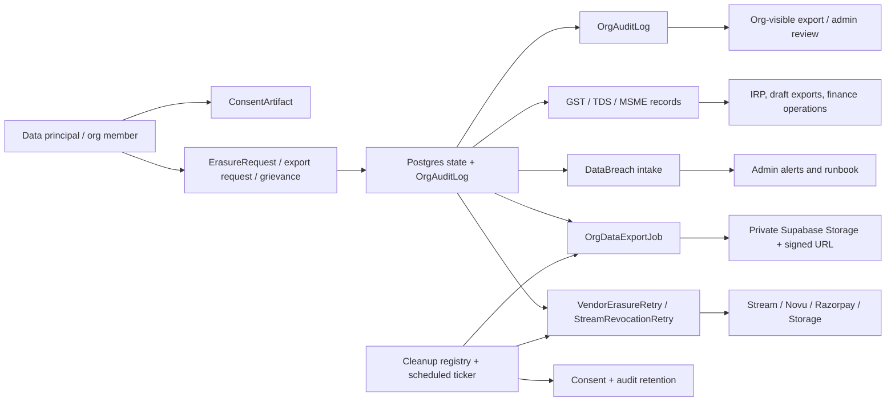
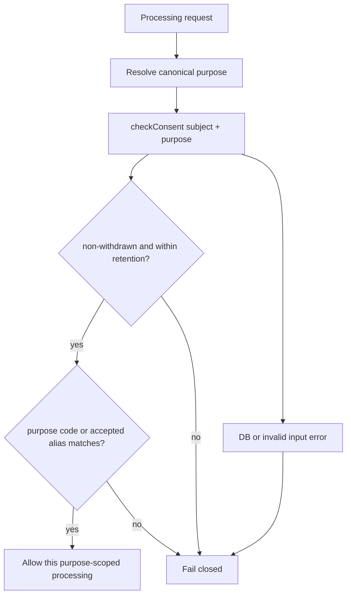
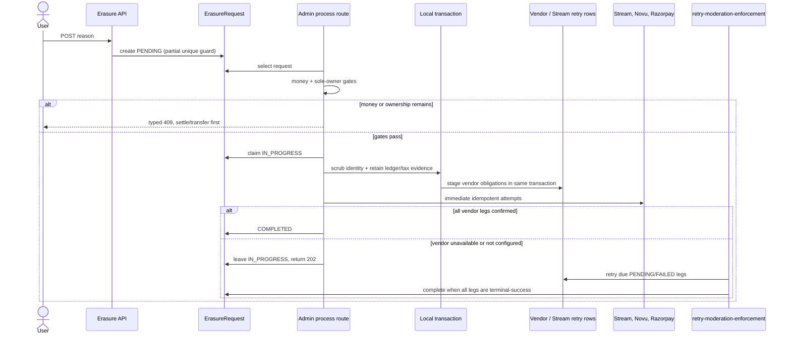

# Enterprise Compliance, Privacy & Data System Design

This explainer maps the implemented privacy, compliance, export, audit, and statutory rails that cross the enterprise platform. It names the schema and runtime paths that enforce each control, describes failure and recovery, and separates implementation from legal interpretation and proposed work. The rules for each tax or privacy question remain in [`docs/compliance/`](../../compliance/00-overview.md); the enterprise wiring map remains in [`docs/enterprise/40-compliance-and-data/`](../../enterprise/40-compliance-and-data/01-compliance-dpdp-gst-tds-msme.md).

The operational rule is simple: distinguish the obligation from the control that records or performs it. A local timestamp or alert can help an operator meet a duty; it does not itself complete an external filing or notification.

## System boundary

### Current and intended data separation

| Plane                      | Durable record                                | Main writer                      | Main reader or worker          | What the record proves                                          |
| -------------------------- | --------------------------------------------- | -------------------------------- | ------------------------------ | --------------------------------------------------------------- |
| Consent                    | `ConsentArtifact`                             | signup and consent routes        | `checkConsent` and exports     | A purpose-scoped grant or withdrawal was recorded               |
| Erasure                    | `ErasureRequest`                              | user intake and admin processing | admin queue and retry sweep    | A request was filed and local/vendor steps are tracked          |
| Processor work             | `VendorErasureRetry`, `StreamRevocationRetry` | `scrubUser` transaction          | `retry-moderation-enforcement` | A remote delete/revocation is owed, retried, or completed       |
| Organization access export | `OrgDataExportJob`                            | org export route                 | `processDataExports` worker    | An authorized bundle request and generated artifact lifecycle   |
| Breach                     | `DataBreach`                                  | admin intake                     | hourly deadline alert          | An incident was registered and its internal deadline is visible |
| Grievance                  | `DpdpGrievance`                               | authenticated intake route       | SystemEvent and manual ops     | A grievance was durably received                                |
| Tenant audit               | `OrgAuditLog`                                 | business mutation paths          | org role-gated UI/export       | Tenant-facing evidence of business/admin changes                |
| Engineering operations     | `SystemEvent`, `SystemJobExecution`           | runtime helpers and jobs         | admin/observability surfaces   | Technical failures and job-run outcomes                         |
| Tax identity               | tax satellites and payout/invoice rows        | payout/invoice flows             | finance jobs and operators     | Tax facts captured for downstream filing or reconciliation      |

These records have different readers and retention needs. A user-visible audit trail must not contain raw stack traces; an operational alert must not be presented as a statutory notice; and a processor retry must remain identifiable long enough to prove whether the vendor copy was removed.

## Legal source and commencement boundary

The DPDP Act and Rules are the legal source; implementation dates must be read from the Gazette notification, not inferred from a code comment. The official 2025 Rules notification, G.S.R. 846(E) dated 13 November 2025, phases commencement: Rule 4 starts after one year, while Rules 3, 5–16, 22 and 23 start after eighteen months. The corresponding eighteen-month date is 13 May 2027. See the [MeitY Gazette notification](https://www.meity.gov.in/static/uploads/2025/11/53450e6e5dc0bfa85ebd78686cadad39.pdf). This design treats those dates as a delivery runway, not a claim that every obligation is already enforceable. Counsel owns determinations about role, lawful processing, retention basis, and required notice content.

The architecture records controls ahead of dates where practical. A record being present in Prisma is not evidence that its workflow is complete, and a future commencement date does not make a missing control irrelevant to the design.

## Consent model

### Schema and writes

`ConsentArtifact` in `prisma/schema.prisma` records a subject, data fiduciary, one or more purpose codes, granted and withdrawn instants, notice version, language, optional consent-manager reference, a SHA-256 hash, and an audit-retention deadline. Its optional `userId` relation uses `SetNull`; `subjectPseudonymousId` supports retaining proof after the user row is scrubbed.

`lib/compliance/dpdp.ts:buildConsentArtifact` sorts purpose codes into a stable hash payload, includes user/fiduciary/version/time, and derives a seven-calendar-year deadline. Signup artifacts are built through `buildSignupConsentArtifacts`. The organization consent API records grants for the caller only. The organization route scopes records by the fiduciary identifier and membership, so one org cannot inspect another org's consent ledger.

### Processing gate

`checkConsent` and `checkConsentBatch` reject absent, withdrawn, expired, or unrelated purpose artifacts. Call sites include checkout validation, invitation acceptance, Stream initial tokens, and org export. `checkConsent()` accepts the caller's transaction client so it can use the occupied single connection safely. `checkConsentBatch()` currently uses the global Prisma client and must not be called from inside an interactive transaction that already holds that connection.

**Current limitation:** the gate does not compare artifact `version` with a current notice version, and `language` is stored without being checked against the presented notice. A write-only version field does not invalidate an old grant. The skill's known-gotcha record explicitly flags this. Before a notice-copy change is treated as a new grant, design a current-notice registry, version-specific prompt, and re-consent path; then gate on that registry. An isolated version-number bump would deny old users without providing the required active user flow.

`ConsentArtifact` also cannot distinguish “never asked”, “asked and declined”, “stale wording”, and “withdrawn” as separate states. The gate should continue to collapse them to denial, while the interface should retain enough state to explain the next user action. This is a modeling and UX gap, not a reason to weaken the gate.

### Withdrawal and retention

Withdrawal is an irreversible event on an artifact. Re-granting creates a new artifact; it does not rewrite the prior evidence. `withdrawConsent` can target a single purpose and accepted legacy aliases, moves `auditRetainedUntil` to at least seven calendar years after withdrawal, and clears Stream's local sync cache where relevant. Withdrawal does not erase already collected data by itself.

`jobs/compliance/consent-retention-sweeper.ts` counts expired rows weekly. Deletion is disabled unless `DPDP_SWEEPER_DELETE=true`; enabled runs delete in bounded batches. The default therefore reports expired evidence and deletes none. The distinct `scripts/cleanup/prune-audit-logs.ts` policy prunes org audit rows at category-specific age thresholds: seven years for financial/compliance categories and two years for other categories. Neither worker is a general data-retention engine for every model.

| Transition       | Durable write                                     | Follow-up                                   | Failure behavior                                 |
| ---------------- | ------------------------------------------------- | ------------------------------------------- | ------------------------------------------------ |
| Grant            | New `ConsentArtifact` with purpose/version/hash   | Processing gate may use it                  | No row means denial                              |
| Withdrawal       | Set `withdrawnAt`; preserve/extend audit deadline | Stream cache forget; selected warning event | Gate observes withdrawal on next read            |
| New notice       | **Designed:** new version and fresh user artifact | Prompt all in-scope existing users          | Current code has no current-version invalidation |
| Expired evidence | Sweeper counts by deadline                        | Optional controlled deletion mode           | Count-only is default                            |

### Consent recommendations

Keep terms acceptance, privacy notice, and purpose consent as separate instruments. Use a purpose catalog as the only source of purpose names. Add notice-version enforcement together with the re-prompt journey and tests that cover an artifact for an older version. Model decline or “not yet asked” only where the UI or re-ask behavior needs that distinction. Preserve withdrawal proof through its own retention window. Read consent at the point of processing rather than trusting a value copied into an event or job payload.

### Consent change decision table

| Event                      | Record to create or update                           | Gate result                                                | Work still required                                                         |
| -------------------------- | ---------------------------------------------------- | ---------------------------------------------------------- | --------------------------------------------------------------------------- |
| Purpose introduced         | New notice artifact per subject and purpose          | Deny until new purpose grant exists                        | Notice, processor inventory, consent prompt, re-ask of existing members     |
| Member withdraws marketing | Set withdrawal on matching artifact                  | Marketing use denied; booking remains independent          | Stop future marketing fan-out and honor any queued email already staged     |
| Member withdraws booking   | Withdraw booking purpose and invalidate Stream cache | Future booking gate denies                                 | Preserve financial work already in flight and show a clear re-consent path  |
| Notice text changes        | New version and new grant                            | Current gate still accepts any matching live version today | Implement version-aware gate before treating this as effective invalidation |
| Member asks to erase       | Separate `ErasureRequest`                            | Consent is withdrawn as part of scrub                      | Remove or retain each non-financial copy under its own decision             |

The same user can hold more than one fiduciary relationship. An org-specific consent row is stamped with `org:<orgId>`; platform signup rows use `Familiarise`. Keep those scopes distinct in reads, exports, and revocation. A global user boolean would collapse who asked for which purpose. The stored fiduciary scopes are distinct, but the shared `checkConsent()` and `checkConsentBatch()` predicates currently filter user, purpose, withdrawal and retention without filtering `dataFiduciaryId`. An organization-scoped consent API does not make that shared processing gate fiduciary-specific. Define whether a purpose accepts the platform grant or requires an organization grant before adding a fiduciary predicate together with the corresponding consent prompt.

## Erasure and processor off-boarding

### Intake, money gate, and scrub

A user files `POST /api/users/me/erasure-requests`; the route validates an optional reason, returns an existing open request when present, and otherwise writes `ErasureRequest(PENDING)`. The partial unique index in `prisma/sql` is the authoritative one-open-request guard. Admin queue routes allow a human to review, process, or reject the request with a reason.

Before the scrub, `app/api/admin/erasure-requests/[id]/process/route.ts` calls `moneyInFlightForUser`. It counts open consultant payouts, unsettled earnings, live disputes, and issued/overdue invoices on sole-owner orgs. The route also blocks a remaining sole active owner. These are correctness gates: losing the identity needed to settle an obligation can strand funds or leave a tenant without governance.

`lib/compliance/erasure/scrub-user.ts:scrubUser` uses one transaction for local changes and durable side-effect staging. It pseudonymizes name/email, clears contact and profile free text, removes sessions/accounts, erases active membership/collaborator posture, releases seats, and keeps financial/tax rows needed for statutory records. It records pseudonymous tenant audit rows and sends `member.removed` payloads with the pseudonymous identifier. `ERASURE_SALT` is mandatory in production. Repeating a scrub for an already-erased user preserves the local tombstone and retries external vendor cleanup.

### External legs and recovery

`VendorErasureRetry` records NOVU, STREAM, or RAZORPAY work; `StreamRevocationRetry` records the Stream principal and collaborator-plan revocations. The transaction inserts these rows before external calls. Immediate attempts run after local commit. Failed rows carry attempts, next retry time, last error, and completion time.

The retry implementation is `scripts/cleanup/retry-moderation-enforcement.ts`. Although its job name is shared with moderation enforcement, it drains the erasure retry tables as well. `netlify/functions/cron-tick.mts` schedules `retry-moderation-enforcement` every thirty minutes; `lib/cron/cleanup-registry.ts` maps its HTTP twin to the same core function. When all open retry rows for an erasure request have succeeded, the sweep advances the request from `IN_PROGRESS` to `COMPLETED`. Errors and capped/old retries must remain visible to operators rather than silently changing the request to complete.

| Local state                 | Vendor state                    | Erasure request             | Recovery                                                           |
| --------------------------- | ------------------------------- | --------------------------- | ------------------------------------------------------------------ |
| Not scrubbed                | N/A                             | PENDING                     | Retry admin action after gates are cleared                         |
| Scrub transaction committed | Immediate call succeeds         | COMPLETED                   | No further action                                                  |
| Scrub transaction committed | Vendor fails or is unconfigured | IN_PROGRESS                 | Retry sweep after backoff; investigate missing credentials         |
| User already pseudonymized  | Prior vendor state uncertain    | IN_PROGRESS/open obligation | Idempotent re-run retries processor operations                     |
| Retry limit/age reached     | Vendor still uncertain          | Needs operator attention    | Review vendor logs and reconcile by reference; never infer success |

### Retained and erased data classes

The scrub preserves immutable payment, ledger, invoice, payout, refund, and tax rows; it clears user-facing identity and bank fields, but keeps processor IDs required to revoke or deactivate remote objects. It also withdraws live consent artifacts and stores a pseudonymous subject reference. A privacy response should explain what remains and the retention basis in plain language.

A complete data inventory must cover more than `User` and `ConsentArtifact`. `FailedEmail` stores recipient and rendered body for retry; `NotificationOutbox` stores recipients and payload; `EmailEvent`, `EmailSuppression`, `DpdpGrievance`, `DataBreach`, export jobs/objects, audit logs, and error telemetry may also contain personal data. `scrubUser` does not directly remove every such row. The separate privacy posture in `docs/compliance/09-dpdp-and-privacy.md` identifies Sentry as a live processor with an unresolved inventory/transfer/erasure assessment; this design does not treat its event store as erased when a local account is scrubbed. Each class needs a purpose, recipient, retention period, and erase/retain action; some should be cancelled or redacted during erasure, while others may need a documented legal or security basis to survive.

**Concurrency recommendation:** the admin process route reads a request and later changes its status to `IN_PROGRESS` with a normal update. A conditional `updateMany` claim on `status=PENDING`, checking that exactly one row changed, would prevent two admins from simultaneously processing one request. Evaluate the ordering of the money gate and claim so a concurrent retry cannot bypass either check. Keep the data gate and claim in one appropriately scoped transaction if the final design requires it.

## Data access and exports

### Org export lifecycle

`OrgDataExportJob` stores `kind`, status, URL, size, expiry, and lifecycle timestamps. New jobs are `PEOPLE` or `FINANCE`; `FULL` is a legacy value and includes both. `lib/enterprise/data-export-kinds.ts` derives access from permission grants: PEOPLE is for OWNER/MAINTAINER, FINANCE is for OWNER/BILLING_ADMIN. The POST route validates kind and role, rate-limits one export per org/kind per 24 hours, and transactionally creates the job plus an audit row.

The worker `scripts/cleanup/process-data-exports.ts` checks that the requester is still an active member with the necessary grant, builds a JSON bundle, uploads it to Supabase Storage, creates a seven-day signed URL, and records READY or FAILED. A 10-minute ticker target and the cleanup registry call the same locked worker. Bundle members whose `PRIMARY_PROCESSING` consent is absent are withheld from the `members` list and redacted in memberships; the worker comments that field-level scoping across the rest of the bundle is still TODO. The bundle contains membership, contract, program, invoice, earnings, payout, and audit data depending on kind.

```mermaid
stateDiagram-v2
  [*] --> PENDING: authorized POST
  PENDING --> PROCESSING: worker claims
  PROCESSING --> READY: build + upload + sign succeed
  PROCESSING --> FAILED: build/upload/sign error
  READY --> READY: link deadline passes; download answers 410
  FAILED --> [*]: terminal in current worker
```

Download requires a matching org, role, kind, READY status, and a non-expired row. The route writes `DATA_EXPORT_DOWNLOADED` before returning the stored URL. Current code does not change a READY row to EXPIRED when time passes; it answers 410 based on `expiresAt`. The enum includes EXPIRED but no transition writer was found. The worker handles one PENDING job per tick, changes it to PROCESSING, then to READY or FAILED. FAILED is terminal in the inspected worker, and a crashed PROCESSING row is not reclaimed. These are recovery and state-model gaps, not implied behavior.

### Export design gaps and recommendations

Current documentation in `docs/enterprise/40-compliance-and-data/03-data-export.md` still describes a single OWNER/BILLING_ADMIN export, JSON+CSV, and a requester-email flow. The implementation has split kinds, JSON-only output, and implementation-specific notification behavior; docs should follow the current code. The schema model comment has the same JSON+CSV drift.

The download handler returns the stored `fileUrl` without an explicit `https:` check. Local worker mode stores a `file://` URL; the documentation says the route rejects non-HTTP URLs. Add an explicit allowlist check or ensure local jobs cannot reach the download route, then align the claim and test. The bundle URL expires, but database and storage-object cleanup after expiry are not established by the route; specify object deletion and row retention.

Use a versioned export schema and an explicit field inventory so customer processors can parse bundles and reviewers can understand what was included. Decide whether the current consent filter covers each PII field in each bundle section. The org export is a tenant-scoped administrative access bundle; it does not replace an individual data principal's access response. Preserve role rechecks at build and download time, private storage, short-lived links, and download audit events.

### Export failure and recovery

| Failure point                            | Durable evidence                                         | Retry or operator action                                                                                               |
| ---------------------------------------- | -------------------------------------------------------- | ---------------------------------------------------------------------------------------------------------------------- |
| Request authorization or body validation | No job row                                               | Correct role or request kind and submit again                                                                          |
| Rate limit                               | No new job                                               | Retry after per-org/per-kind window                                                                                    |
| Worker claim/build failure               | Job becomes FAILED; raw cause also goes to `SystemEvent` | Inspect error/correlation, fix cause, then request a fresh job or use an audited operator procedure                    |
| Storage upload failure                   | Job not READY                                            | Retry upload with same org/job object path; idempotent upsert avoids duplicate names                                   |
| Signed URL creation failure              | Object may exist; job not READY                          | Recreate URL or overwrite same object, then stamp job                                                                  |
| Link expired                             | Job remains READY; download evaluates `expiresAt`        | Return 410 and require a fresh authorized export                                                                       |
| Worker crash after PROCESSING            | Job remains PROCESSING                                   | No stale-claim recovery found; operator must resolve the row or reissue under an audited procedure                     |
| Worker records FAILED                    | Job remains FAILED                                       | Current worker does not select FAILED rows; user requests a new export after the limiter window or support resolves it |

Export lifecycle documentation should specify how stale PROCESSING rows are reclaimed, whether the requester receives a retry or must file a fresh request, and whether an expired file is deleted immediately or after a short grace interval. The current FAILED branch records a clean `OrgAuditLog` message and raw `SystemEvent`; it does not retry that job. The current worker can send the signed link by email/Novu after setting READY, so retrying a whole generation must account for duplicate notifications. These are operationally relevant privacy behaviors, not merely UI details.

The worker also writes the caught exception message into `OrgDataExportJob.error`, and the list route selects that field for org members with export grants. Although the audit row uses clean prose, the job field can expose storage/provider or Prisma internals. Return a stable customer-safe error code/message in the job row and keep raw detail in `SystemEvent`; test the API projection against provider-error-shaped strings.

### Privacy-safe audit surfaces

`OrgAuditLog` is tenant-facing and append-oriented during its retention period; old category records can be pruned. `lib/enterprise/audit-sanitize.ts` scrubs read projections so engineering exceptions and stack traces do not leak to customer operators. `SystemEvent` is admin-facing technical telemetry. The split is important: tenant activity records answer “who changed this org state”; system events answer “which job or service failed.” Keep raw provider errors in the engineering channel, redact contact/payment secrets, and do not capture per-row telemetry from loops.

Audit pruning in `scripts/cleanup/prune-audit-logs.ts` writes a per-org `AUDIT_PRUNED` summary and removes rows by category window. This is not a substitute for retaining immutable ledger rows or for a per-data-class erasure decision.

## Breach and grievance workflows

### Data breach

`DataBreach` records detection time, affected user IDs, root cause, a Board reference, Board-report time, and principal-notification evidence. `POST /api/admin/data-breaches` requires the compliance permission and creates a record with `detectedAt=now`; `GET` exposes the count of affected people rather than their IDs.

`jobs/compliance/databreach-deadline-alerts.ts` runs hourly from GitHub Actions. At twelve hours or less before the configured seventy-two-hour interval, it alerts admins through Novu, guarded email delivery, and ops chat. It sorts oldest incident first and links the compliance dashboard. It is an internal alert path. Source review found no Board filing connector or route that writes `reportedAt`, no route that writes `principalsNotifiedAt`, and no affected-person notification path. Therefore the implemented control starts the clock and reminds staff; it does not itself prove Board or principal notice was sent.

The Rules Gazette contains the applicable commencement schedule. Use the [official notification](https://www.meity.gov.in/static/uploads/2025/11/53450e6e5dc0bfa85ebd78686cadad39.pdf) to plan delivery, and get counsel to confirm required notice content and the operational meaning of detection. Do not label an internal email as a completed statutory report.

### Grievance

`POST /api/compliance/grievances` requires a signed-in user, applies a spam limiter, validates subject/description through Zod, writes `DpdpGrievance`, and emits a `SystemEvent`. This is durable intake, not a complete case-management workflow. The model and route lack assignment, response/closure timestamps, published due date, a user-facing status view, and deadline escalation. Current code comments explicitly defer the redressal SLA workflow.

Rule 14, scheduled to commence on 13 May 2027, includes a grievance redressal period described as reasonable and capped at ninety days. The intake row does not by itself assign a handler, stop that clock, or record a response. Confirm the current notification and published service promise with counsel before turning the ninety-day ceiling into a product SLA.

Recommended smallest operational design: assign an accountable role, retain received/response/closure timestamps and a state, surface the user's reference and status, alert before the published deadline, and write auditable response/closure evidence. Keep the legal timeline and published customer promise in one reviewed source. Do not add a larger state machine until the complaint-handling flow needs it.

## GST, IRP, TDS, MSME, and RBI posture

### GST and e-invoice

`OrganizationTaxInfo` holds legal name, GSTIN, state, registration status, HSN/SAC default, PAN ciphertext, and last four. `lib/compliance/gst.ts` computes place of supply and output-tax split. `OrganizationInvoice` stores CGST/SGST/IGST and e-invoice state; `CreditNote` ties a refund to an idempotent credit note. The worker `jobs/compliance/irp-uploader.ts` calls the ClearTax connector only when `ENABLE_IRP_UPLOADER` and the credentials are present; the missing-credential path is a failed/retry result.

Official IRP materials describe the ₹5 crore turnover cohort for e-invoicing from August 2023, subject to the applicable financial-year lookback, exemptions and document scope, and a 30-day reporting window for AATO ₹10 crore and above from April 2025. Verify current details against [IRP notifications](https://einvoice6.gst.gov.in/content/notifications/) and the [30-day advisory](https://einvoice6.gst.gov.in/content/revised-time-limit-for-e-invoice-reporting-for-businesses-with-aato-of-%E2%82%B910-crores-above/) when changing the pipeline. Current gap: the uploader scans organization invoices, while the payload mapper emits invoice type `INV`; credit/debit note IRNs are not implemented. The Sec. 34 cutoff is partly enforced: `lib/compliance/gst-credit-note-cutoff.ts` and credit-note callers implement the 30 November IST deadline and commercial/no-tax treatment after it. The earlier annual-return-date alternative is explicitly not tracked; it must not be described as a fully resolved eligibility test. These are explicit scope gaps, not assumptions that the connector is a filing system.

### TDS

Payout flows snapshot withheld amount/rate and write `TDSRecord`; refund/chargeback reversals have a signed negative record and a written `TdsAdjustment` artifact. The current draft exporter consumes `TDSRecord`, not `TdsAdjustment`; creating that adjustment row does not itself apply it to a filed return. `TdsRate` stores law code (`IT1961` or `IT2025`), internal section label, effective dates, basis-point rate, and optional payment code. `lib/compliance/tds.ts` resolves rates by law/effective date. The draft job produces a masked draft and a private PAN CSV; it does not submit a validated return or complete the filing stamp.

The CBDT's [official FAQ](https://www.incometax.gov.in/iec/foportal/help/all-topics/e-filing-services/%20tds%20compliance-faq) is the current source for the Income-tax Act 2025 filing boundary and code mapping. Keep internal section identifiers separate from filing payment codes. The return exporter documentation explicitly leaves final FVU/portal submission and some section mapping for CA sign-off. Do not infer a payment code from third-party examples or call a generated draft a filed return.

### MSME

`OrganizationMsmeInfo` and consultant tax fields classify the supplier and written-agreement state; `mustPayByDate` is stored on payout rows. `lib/compliance/msme.ts` computes the system deadline, and `jobs/compliance/msme-payment-alerts.ts` alerts on payouts within five days. The alert is a warning, not settlement. Current implementation does not accrue statutory interest and uses stored classification/evidence rather than live registry verification. The [MSME Samadhaan portal](https://ramp.msme.gov.in/ramp/RAMP-initiative/msme-samadhaan/msme-samadhaan) is the official reference for operational guidance.

Before relying on a calculated date, preserve evidence for supplier category, written agreement, and the underlying acceptance/service date used by the legally approved rule. The implementation uses invoice/payout dates; legal/finance owners should confirm that this start event is correct for each supplier workflow. Surface at-risk items early enough to clear them before settlement deadlines.

### RBI payment-aggregator classification

The current documented product posture is principal: buyers pay Familiarise through a gateway; platform receipts become platform liabilities; consultants and host orgs are paid later from the platform's payout account. The design states there are no Razorpay Route linked accounts or pass-through transfers in the active payment code. This is a classification tied to contracts, accounting, and live behavior, not a permanent label.

Use the current [RBI PA/PG directions](https://www.rbi.org.in/Scripts/BS_ViewMasDirections.aspx?id=12896). Reassess before introducing direct settlement, split settlement, collection on behalf of a supplier, or language that makes the platform an intermediary. Keep legal analysis with counsel and ensure product copy, ledger treatment, and processor configuration tell the same story.

## Recommendations by decision owner

| Decision                  | Current evidence                             | Smallest sound next step                                                    | Why                                                                       |
| ------------------------- | -------------------------------------------- | --------------------------------------------------------------------------- | ------------------------------------------------------------------------- |
| Consent notice versioning | version stored, gate ignores version         | Implement notice registry and re-consent UX together                        | Avoid silent old-copy grants and avoid locking users out without a prompt |
| Erasure concurrency       | money gate plus non-CAS status update        | Atomic request claim, then re-evaluate gates as needed                      | Prevent two admins running one scrub concurrently                         |
| Local data inventory      | core User scrub and processor outboxes exist | Classify each email, notification, grievance, breach, export, and audit row | Avoid blanket claims while preserving records with a clear basis          |
| Export coverage           | people consent filter, TODO on fields        | Publish versioned field manifest and complete field-level scope             | Make the bundle useful and privacy-correct                                |
| Breach workflow           | internal deadline reminders only             | Add operator attestation for Board and principal notifications              | Timestamp/reference evidence is missing today                             |
| Grievance workflow        | authenticated durable intake only            | Add assignment, due/response/close evidence and user reference/status       | Intake alone does not complete redressal                                  |
| GST/IRP                   | B2B invoice upload, no credit note IRN       | Confirm threshold cohort and add note type only when in scope               | Avoid filing the wrong document class                                     |
| TDS                       | draft export and payment-code lookup         | CA-reviewed code table plus validated filing process                        | A local draft is not a tax return filing                                  |
| MSME                      | computed dates and alerts                    | Verify classification/agreement and start-date evidence                     | A reminder cannot prove payment by deadline                               |
| PA posture                | principal flow documented                    | Treat every settlement/product change as a reclassification trigger         | The conclusion depends on deployed contracts and money movement           |

## Glossary

- **Data principal:** person whose personal data is processed.
- **Data fiduciary:** entity determining purpose and means of processing.
- **Consent artifact:** versioned, purpose-scoped evidence row; not a login or ToS record.
- **Erasure scrub:** pseudonymization and removal of direct identifiers while approved records remain.
- **Outbox:** database row written with the local transaction, then delivered to an external system with retries.
- **IRN:** Invoice Reference Number issued through an e-invoice reporting path.
- **TDS:** tax withheld at source; an exported draft still requires filing steps.
- **AATO:** aggregate annual turnover used by GST e-invoice thresholds.

## Deprecated & Superseded Approaches

Older compliance notes describe consent retention as a generic daily purge, the org export as one full JSON+CSV bundle, and a 9-hour webhook signature replay period. The current code has weekly count-only-by-default consent cleanup, PEOPLE/FINANCE export kinds with JSON output, and a five-minute per-attempt signature window. Those older band descriptions need a separate refresh; use the current paths and values described here for new implementation decisions.
