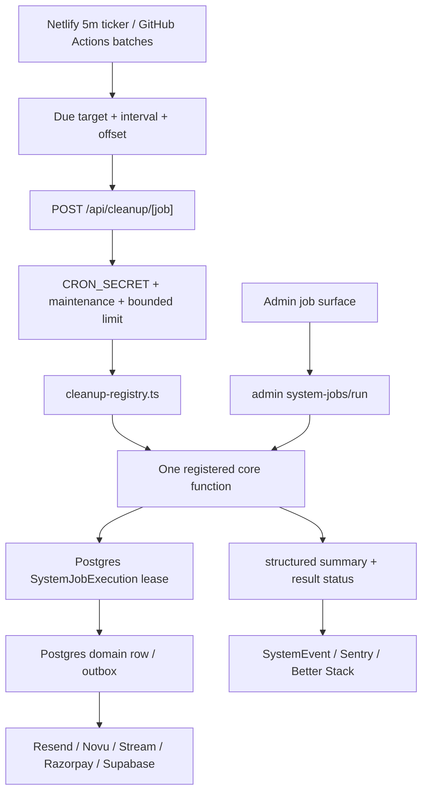
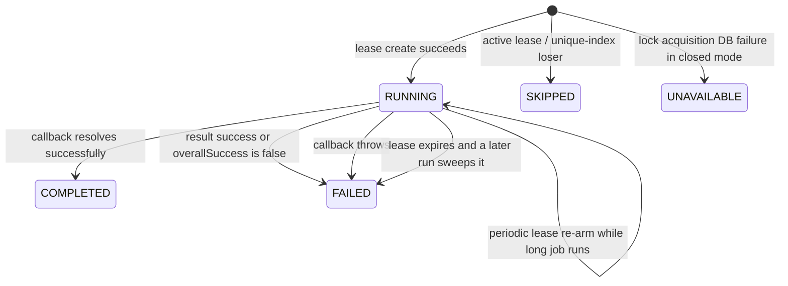
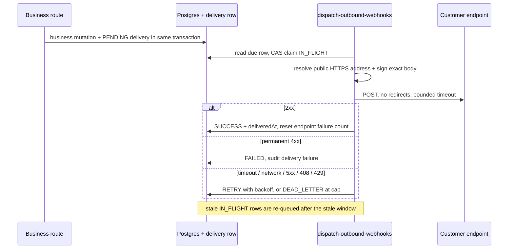

# Enterprise Operations & External Integrations System Design

This guide explains the operational machinery around the enterprise platform: scheduled work, leases, monitoring, vendor boundaries, and host portability. It follows the runtime that exists in source and calls out mismatches with older runbooks. It does not replace a job's domain design; follow [`docs/enterprise/50-operations/`](../../enterprise/50-operations/01-api-reference.md) and the relevant subsystem docs before changing a worker.

The central operational design is a durable database state plus a bounded worker. The scheduler asks the app to process a slice; the app authenticates, checks maintenance, acquires a Postgres lease, runs the shared core, and records a result. External calls occur after the business state is durable or through an outbox whenever loss between commit and delivery would be material.

## Operational architecture

### Component responsibilities

| Component                         | Responsibility                                                         | Does not own                                       |
| --------------------------------- | ---------------------------------------------------------------------- | -------------------------------------------------- |
| Platform scheduler                | Chooses when to invoke a worker                                        | Business mutation rules                            |
| `netlify/functions/cron-tick.mts` | Runs due fast/recovery targets with limits, offsets, and timeouts      | Domain state transitions or retries within one job |
| GitHub Actions                    | Runs daily/weekly and selected hourly jobs                             | The shared job's business logic                    |
| `/api/cleanup/[job]`              | CRON bearer auth, maintenance refusal, standardized status and logging | A parallel copy of the worker                      |
| `lib/cron/cleanup-registry.ts`    | Maps a stable job slug to its core function and summary mapping        | A standalone second implementation                 |
| `withCronLock`                    | Excludes overlapping runs and records lease/outcome                    | Request-level rate limiting                        |
| Domain core                       | Claims rows and performs idempotent steps                              | Fleet scheduling policy                            |
| `SystemEvent` / observability     | Exposes operational failures and summaries                             | Tenant-facing business audit                       |

The root `AGENTS.md` is the canonical architecture authority: one implementation function is registered in `lib/cron/cleanup-registry.ts`; the cleanup route and admin runner are dispatch surfaces. Do not add new three-layer job wrappers. Preserve existing GitHub Actions/standalone entrypoints where they are already part of deployed scheduling, but they must call the same core and lease.

## Scheduled work and bounded execution

### Fast ticker

`netlify/functions/cron-tick.mts` runs every five minutes. Its target list includes payment recovery/reconciliation, outbound webhook dispatch, email and Novu outboxes, booking sweeps, export generation, erasure/moderation retry, and other time-sensitive work. A target can run every tick or at a configured cadence with a minute offset. The code bounds per-target batch size and request duration and fans targets out concurrently. Ticker output distinguishes successful, lock-held/maintenance, and failed targets; lock contention is an expected skipped run.

The ticker always responds successfully after target execution and reports failures through structured output and bounded alerting. This avoids a scheduler retrying every target three times after one target returns a 5xx. Each target itself must expose its failure status and summary; the ticker's 200 is not a signal that all targets succeeded.

### Batch schedules

GitHub Actions run daily and weekly operations such as audit pruning, consent retention, tax drafts, payouts, and compliance deadline reminders. Some additional jobs run hourly. Read the current `.github/workflows/*.yml`, not only `docs/enterprise/50-operations/02-runbooks.md`: the runbook catalog contains old wrappers/cadences and need a separate refresh against the current registry and schedules.

| Work category            | Examples                                                        | Current scheduling shape                   | Recovery signal                             |
| ------------------------ | --------------------------------------------------------------- | ------------------------------------------ | ------------------------------------------- |
| Latency-sensitive repair | payment confirmation, refund/status reconcile, earnings release | Netlify 5m tick, selected 10–30m cadence   | target status, row backlog, system event    |
| Delivery outbox          | outbound webhooks, Resend, Novu                                 | Netlify ticker with target limits          | pending/retry/dead-letter counts            |
| User lifecycle sweeps    | booking reminders/expiry, Stream erasure                        | Netlify ticker at configured interval      | summary counts and retry rows               |
| Data export              | `process-data-exports`                                          | 10m ticker target                          | `OrgDataExportJob` state and summary        |
| Statutory monitoring     | breach deadline, MSME risk                                      | hourly/daily GitHub Actions                | structured alert + admin queue              |
| Long-running batch       | ledger, payout, tax/accounting exports                          | GitHub Actions or controlled admin trigger | `SystemJobExecution`, job summary, runbook  |
| Retention                | audit and consent records                                       | daily or weekly Actions schedule           | deleted/count summary and retention backlog |

### Cron lease and job execution

`lib/cron/with-cron-lock.ts` uses `SystemJobExecution` as the lease record. A unique partial index in `prisma/sql/check-constraints.sql` admits one recent `RUNNING` row per job name. A run first marks expired leases failed, then checks for an active row and inserts a new `RUNNING` record. A successful callback result marks the row completed. A resolved result with `success === false` or `overallSuccess === false` also marks it FAILED; thrown errors mark it failed and truncate stored error details. A heartbeat is written to Redis on success, but Postgres remains the authoritative lease and execution trail.

Jobs choose `failMode` based on the cost of duplicate or missed execution. Repeat-safe cleanup and reporting often fail open for a non-connection lock error; money jobs or retry budgets fail closed if executing without a lease could create duplicate money or burn attempts. Pool exhaustion and database connectivity failures do not become an unlocked run. The distinction is job-specific and should be reviewed whenever a side effect changes.

A lock prevents overlapping workers; it does not by itself make each row transition correct. Row claim logic still uses conditional updates/unique keys and idempotency. Use Postgres for the fleet lease; Redis is for request limits, maintenance/fleet edge state, and short-lived interactive mutexes, not for adding a second cron lock.

Job owners should choose a lease longer than the expected execution ceiling, including cold start and slow external calls. For jobs that may exceed the lease, the helper periodically re-arms its timestamp; the workflow timeout and lease TTL must still agree. A database outage in lock acquisition is not the same as “no overlapping job”: closed-mode jobs refuse to execute, and open-mode jobs only continue for non-connection errors where duplicate work is acceptable. Do not turn a pool timeout into an unlocked payment or retry run.

`SystemJobExecution.result`, `itemsProcessed`, and `errorCount` are optional summaries, while many workers also log their own counters. Prefer a stable summary object with counts and identifiers rather than storing a large result payload or raw provider response. Store bounded diagnostics in `errorLog`; put sensitive incident detail in the restricted engineering event channel. If a row-level sweep encounters many failures, collect them and emit a single run-level report.

Use correlation IDs to join a job execution to the domain row and, where available, the vendor request. A correlation ID should be opaque and stable; it should not encode an email address, PAN, or endpoint secret. The admin surface should show enough status for triage without copying provider payloads into a tenant-visible row.

## Cleanup API and admin execution

`app/api/cleanup/[job]/route.ts` resolves a slug through `getCleanupJobHandlers`. The shared `cleanupRoute` factory validates `CRON_SECRET` (or supported Vercel cron secret), checks maintenance, parses and clamps `limit`, emits run logs, and maps results to HTTP status. A lock loser is 409; maintenance is a deliberate refusal; real callback failure is 500; a successful run with an operator-attention condition can be 207.

`/api/admin/system-jobs/run` provides a staff-controlled execution path for registered jobs; `/api/staff/system-jobs/executions` exposes job history. Both routes should dispatch the same core used by the scheduled endpoint. Permission checks and the job's lock remain in force for manual runs. Do not add a separate admin-only implementation or bypass the lease for convenience.

For cleanups that use `?limit=`, the shared parser rejects malformed present values, clamps to a maximum, and lets jobs set a bounded default. Bounded work is especially important on a serverless host: a large database cohort or slow vendor could otherwise outlive the function timeout. Ensure oldest-first work can drain over successive runs and that retry rows keep their own due time.

### Cleanup invocation decision

| Trigger                        | Authentication                          | Expected lock behavior                   | Result to caller                      |
| ------------------------------ | --------------------------------------- | ---------------------------------------- | ------------------------------------- |
| Scheduled ticker               | `CRON_SECRET` bearer token              | Existing lease returns a held/409 target | Tick records target in lock-held list |
| Cleanup HTTP twin              | Same bearer check and maintenance guard | Shared core acquires the same lease      | 200/207 success or 5xx on failure     |
| Staff job runner               | Staff permission plus registered job    | Same core lease; one execution record    | Admin sees execution summary/state    |
| Standalone workflow entrypoint | GitHub environment secrets              | Same core-level lock where wired         | Workflow summary and exit status      |

Avoid an undocumented “run this script directly” recovery step where the core already has a registered route. Direct invocation may skip HTTP authorization, route maintenance handling, or an operator-facing execution record. If a standalone job is required for a workflow, verify it imports the registered core function and retains its lease and `$disconnect()` behavior.

### What to do when the run stalls

1. Check `SystemJobExecution` for a recent RUNNING row and its `startedAt` before rerunning.
2. Check the job's domain table for rows claimed by that execution; a completed lease does not mean each external call completed.
3. If the lease is fresh, wait or inspect logs; do not manually flip it while the worker may still be running.
4. After the configured TTL expires, a subsequent lease attempt marks the old run failed and can proceed.
5. Compare the row's provider reference with provider-side state before replaying an ambiguous call.
6. Confirm the new execution and domain rows reach expected terminal or retry state.

## External delivery boundaries

### Transactional email and Resend

All transactional sends flow through `lib/email/deliver.ts`, honoring the pre-launch delivery guard, suppressions, sender policy, and failure persistence. `FailedEmail` stores the already-rendered subject/body and recipient so retry is a verbatim resend; single-use credentials are stored redacted and are not replayed. `FailedEmailBatch` stores a serialized batch with an idempotency key. `EmailEvent.svixId` is unique for Resend event replay, while `EmailSuppression` records hard bounce, complaint, or manual suppressions.

The email retry worker is invoked by the shared ticker. It moves rows through pending/retry/sent/dead-letter behavior and emits counts for operations. Dead letters require operator review/replay rather than endless retries. The root email invariant requires every recipient to pass through `deliver()` or the explicit waitlist batch guard.

Privacy consequence: retry rows contain contact and message content. Include them in the data inventory and define how erase requests cancel, redact, or retain already queued notices. Retain enough to deliver necessary service/erasure notices, but prevent a stale row from sending marketing after consent withdrawal or erasure.

### Novu notifications

Novu is a hosted notification service, backed locally by `NotificationOutbox`. `lib/novu/outbox.ts:stageTrigger` creates an outbox record in the business transaction where possible, derives a stable transaction ID, and attempts delivery inline after the commit. A ticker relay retries due rows through the same trigger path. The unique transaction ID plus vendor idempotency avoids duplicate notification effects after an ambiguous timeout. Quiet-hours use `notBefore`; terminal errors dead-letter. `jobs/notifications/drain-notification-outbox.ts` tracks pending, retried, dead-lettered, and lag metrics.

Notification targets and payloads are allowlisted by workflow/template code. The row itself contains recipient IDs and payload, so keep it private and within a declared retention window. A Novu trigger failing must not roll back a completed invoice, membership, or payout transition; the outbox retains the notification obligation for later recovery.

The integration map currently says “No Prisma — Novu is external (queued via NotificationOutbox).” That sentence is internally inconsistent: `NotificationOutbox` is a Prisma model and is the durable local queue. The accurate interpretation is that the provider is external and the trigger outbox is local. Preserve the distinction between Novu workflow IDs used in code and workflow-family names/templates managed in the console; use `docs/enterprise/50-operations/10-novu-console-conditions.md` for the current condition fields.

### Stream

Stream provides chat, calls, and recording/video service boundaries. Local entitlement and consent gates are applied before access/token creation. The erasure scrub persists principal and collaborator revocation work in retry tables before reaching Stream. Recording storage/removal has separate object-storage operations and status machines; a Stream API success does not prove every R2/Supabase artifact is gone. Keep each external deletion result explicit and retry the local durable task.

Stream webhooks are inbound; validate signature and retain the event receipt/idempotency before side effects. They differ from enterprise outbound webhooks. Stream outages should produce retryable status or a reported system event, not a successful local state that silently leaves access active.

### Enterprise outbound webhooks

The `OutboundWebhookDelivery` row is the durable queue. `lib/enterprise/outbound-webhooks/dispatch.ts` writes pending deliveries in the same transaction as the org mutation; `lib/enterprise/outbound-webhooks/worker.ts` claims due rows atomically and sends a signed POST. Current events include membership, invoice, payout, contract, and program lifecycle changes. A delivery ID remains stable across attempts so receivers can deduplicate.

Security controls are layered. Endpoint creation and each delivery validate the destination. `lib/enterprise/outbound-webhooks/ssrf-guard.ts` requires HTTPS and port 443, blocks special/private IPv4 and IPv6 ranges, resolves DNS and pins a public address for the connection, and redirects are manual/disabled. This prevents redirect-based SSRF and DNS changes between validation and dial. Retain every layer when changing fetch/runtime code.

`lib/enterprise/outbound-webhooks/signing.ts` uses HMAC-SHA256 over the timestamp and exact JSON body. Each attempt is signed with a fresh timestamp and the receiver's replay window is five minutes. Secret rotation dual-signs with old and new values for 24 hours. Transient retry backoff is jittered; permanent 4xx is terminal FAILED; exhausted transient attempts are DEAD_LETTER. A worker recovers stale `IN_FLIGHT` rows and uses a guarded claim so overlapping ticks do not double-send.

**Documentation drift:** `docs/enterprise/40-compliance-and-data/04-outbound-webhooks.md` still says 9-hour replay tolerance, 10-second timeout, and describes exhausted retries as FAILED. Code uses five minutes, 4.5 seconds, and DEAD_LETTER for exhausted transient attempts. Reconcile the contract and operational tables to source. Endpoint and prior rotation secrets are stored in schema string fields; evaluate field-level protection and ensure event/audit logs do not expose the stored secret. Current worker events include endpoint URLs in some diagnostics, so ensure query strings cannot carry bearer data before logging them.

The signed body includes an event type, creation time, delivery identifier, and event-specific data. Secret rotation is an operator action gated to OWNER and returns the new secret once. Receivers must accept either signature during the grace interval and deduplicate the delivery identifier. Redelivery should retain the original logical event identity or clearly create a new attempt identity according to the receiver contract. Pausing or disabling the endpoint stops queued work; document that the row fails and requires explicit re-delivery after reactivation.

`lib/enterprise/outbound-webhooks/ssrf-guard.ts` returns one resolved public address and the worker supplies it to the HTTP connection lookup. This matters because DNS resolution is repeated at send time: validating only at endpoint creation would allow the target to change later. Redirects remain disabled because a public endpoint could otherwise redirect to a private host after validation. Tests should retain cases for DNS rebinding, IPv4-mapped IPv6, IPv6 special blocks, malformed literals, redirects, and custom fetch behavior.

## Event channels and observability

### Tenant audit versus engineering event

`OrgAuditLog` is scoped to an organization and is visible to authorized tenant members. It captures business and administrative actions, with a sanitized read projection. `SystemEvent` is an engineering/admin record for technical errors and job failures. Keep these channels separate: a customer-facing audit should not reveal Prisma error text, stack frames, vendor credentials, or internal infrastructure details.

`lib/enterprise/system-events.ts` writes the database record as the source of truth; Better Stack is an optional external sink when enabled and configured. Sentry captures bounded operational exceptions. Sweeps should aggregate failures and report once per run rather than consuming quota per row. The ticker itself records target-level failures at a bounded cadence and excludes the Sentry canary from self-reporting through the failing sink.

### Job summaries and signals

A job's summary should answer how much work it examined, completed, retried, failed, and left for operators. Monitor backlog age and terminal failures, not only process exit. An empty or absent progress signal can be a failure even when the worker did not throw.

| Work              | Primary signal                                       | Escalate when                                                         |
| ----------------- | ---------------------------------------------------- | --------------------------------------------------------------------- |
| Cleanup lease     | `SystemJobExecution` status/time/duration            | stale RUNNING row, repeated failure, or job stops advancing           |
| Outbound webhooks | due count, RETRY/DEAD_LETTER, endpoint failure count | backlog age rises or endpoint auto-disables                           |
| Email             | PENDING/RETRY/DEAD_LETTER counts and provider event  | legal/transactional email remains unsent or bounce/complaint rises    |
| Novu              | outbox lag/pending/dead-letter metrics               | notifications queue past the business SLA                             |
| Erasure           | open requests and retry-row age                      | IN_PROGRESS request has no completed vendor legs or retry reaches cap |
| Export            | PENDING/PROCESSING/FAILED counts and job age         | request remains PROCESSING or failed upload cannot be retried         |
| Breach            | unreported incidents and elapsed time                | internal alert window reached or statutory notice evidence absent     |
| MSME              | at-risk payouts and must-pay date                    | due date is near and payout is incomplete                             |
| IRP/TDS           | pending invoice upload or draft-export result        | upload retry stalls, or filing owner has no validated artifact        |

`docs/enterprise/50-operations/03-monitoring.md` lists many useful signals, but align each metric and schedule with the currently deployed ticker/workflow rather than treating old prose as runtime configuration.

## Storage and signed URLs

Use private buckets for finance artifacts, recordings, and exports. The service role belongs only in server runtime code; never expose it to the browser. For large binary uploads/downloads above 4 MB, use Supabase direct signed upload/download URLs as required by `AGENTS.md`, so application functions do not proxy the bytes. The export worker writes its JSON object to Supabase Storage and creates a seven-day signed URL; the API checks caller permission and audits the download before returning it.

Signed URLs are bearer capabilities: keep their lifetime short, avoid logging the full URL, and do not store them in a public response cache. Decide whether expired export objects are deleted and how long job metadata remains. A record marked EXPIRED without deleting an object leaves data in storage; deleting the database row without deleting the object also leaves data behind. Treat row and object lifecycle together.

Keep the service-role API in server-side workers only. Large objects should travel directly between the browser and storage using scoped signed URLs; an application proxy adds memory, timeout, and serverless egress pressure. For each upload path, the row must bind the storage object to its authenticated user or organization, and a later read must re-check current access instead of trusting a signed URL or stale client state. Do not expose a storage path as a public URL when a signed URL is required.

## Platform portability and fleet scheduling

### Runtime contract

The root `AGENTS.md` defines the portability contract: preserve Netlify standby files alongside container/platform configuration; use `PG_POOL_MAX=1` on single-invocation serverless and a bounded 5–10 pool on multi-request hosts; trust client-IP headers by runtime; include `Vary: Cookie` with `Netlify-Vary` for public cookie-aware routes; apply sharp exclusions only on the supported serverless hosts; and send large binary traffic through direct signed storage URLs.

`lib/prisma.ts` checks that `PG_POOL_MAX` is configured on Netlify and builds the bounded client. Any helper called inside an interactive transaction must use the supplied `tx` client. A global Prisma read while the single pool connection is held can wait on itself and time out. This rule applies to consent checks, event writes, authorization lookups, and utility helpers, not just code that visibly calls `$queryRaw`.

### Fleet scheduler switch gap

Deployment docs and the root agent contract describe an Upstash REST key named `ops:active_cron_platform` to make only the active platform run the scheduled ticker. In the inspected source, `netlify/functions/cron-tick.mts` checks `CRON_SECRET`, computes due targets, and invokes them; no read of that fleet key appears in the function, its source dependencies, or another scheduler route. No `/api/cron/tick` implementation was found in the assigned worktree. Treat the sub-millisecond fleet switch as a **design requirement that is not demonstrated by the inspected runtime**, and verify the exact deploy SHA and hosting setup before failover. Running both active and standby schedulers can duplicate work; leases reduce overlap but are not a substitute for ownership if multiple platforms use separate databases or different job names.

**Recommendation:** implement or verify a single shared ownership check at every scheduler entrypoint, with a short bounded timeout and explicit outage policy, and test active-host, standby-host, missing key, Redis timeout, and transition states. Keep Postgres job leases as the second line. If current failover intentionally relies on a manual scheduler pause, document that RTO and operator step instead of claiming an automatic switch. Do not add a new scheduler wrapper without updating the canonical registry and portability tests.

### Request IP and cache variation

`lib/rate-limit.ts:getClientIp` currently prefers `req.ip`, then `x-nf-client-connection-ip`, then the first `x-forwarded-for` value; it does not gate the Netlify header by runtime and does not use `x-vercel-forwarded-for`. `lib/auth.ts` supplies an ordered list of Netlify, Vercel, and generic forwarded headers without selecting a header based on the host. This differs from the explicit runtime trust rules in `AGENTS.md`.

**Recommendation:** use one server-only request-IP helper that selects the trusted host header only when its runtime flag is true, with a carefully defined standard-proxy fallback for local and container hosts. Add coverage for spoofed cross-platform headers and multi-hop `X-Forwarded-For`. Do not accept caller-supplied host headers as equivalent to a platform-injected value.

Public consultant list responses vary by query through `Netlify-Vary`; the public cookie-aware detail branch uses a cookie key in `Netlify-Vary` but does not add standard `Vary: Cookie`. Follow `AGENTS.md` and pair the CDN-specific header with the standard cache variation header wherever the response changes by cookie. Private identity responses should remain `private, no-store`.

Test cache behavior with two distinct authenticated sessions as well as an anonymous request. A response that varies by role or user must never be reused across cookies by an intermediary. For query-driven public lists, every query parameter that changes the result must be represented in the CDN cache key and validated to avoid unbounded cache pollution. The standard `Vary` response header and Netlify-specific key serve different cache layers; include both when the route depends on cookies.

The `next.config.mjs` sharp/@img exclusion is environment-gated for Netlify; keep that host-specific behavior. Confirm container startup, standalone output, runtime flags, and `netlify.toml` remain compatible before a hosting change. No `vercel.json` was present in the inspected worktree, so do not describe a Vercel scheduler as deployed based on documentation alone.

## Failure and recovery playbook shape

Every operational runbook entry should say what signal fires, how to identify affected rows, which state transitions are safe, and how the retry path proceeds. Apply the following order:

1. Find the durable row and inspect status, timestamps, attempt count, and correlation ID.
2. Confirm whether the provider accepted the request despite a local timeout; use its idempotency/reference key before replaying.
3. Check whether a Postgres lease is active. Wait for the owner or stale-lease recovery rather than forcing a concurrent run.
4. Fix the underlying cause (credentials, provider outage, endpoint URL, permission, or configuration) before retry.
5. Re-run through the registered job/API or its supported operator path.
6. Confirm the durable terminal state and an audit/system event, not only a green command exit.
7. Record unresolved external ambiguity for an operator; never mark success because a request was attempted.

Avoid building reconciliation jobs for database invariants already enforced by CHECK constraints, partial unique indexes, exclusion indexes, or constraint triggers. Cross-vendor state is different: reconcile Razorpay, Stream, Resend, and Supabase when a local commit cannot prove the remote side effect.

When an operator can safely replay, expose the durable row identifier and provider idempotency/reference identifier in the authorized admin surface. Do not paste full bearer URLs, webhook secrets, PANs, or bank coordinates into an incident ticket. Capture only the minimum useful outcome and use the restricted data surface for remaining details. A manual recovery should follow the same idempotency and status-guard path as a scheduled retry.

## Recommended documentation and design work

| Topic               | Current implementation                                                                          | Recommended change                                                           | Alternative and trade-off                                                          |
| ------------------- | ----------------------------------------------------------------------------------------------- | ---------------------------------------------------------------------------- | ---------------------------------------------------------------------------------- |
| Scheduler ownership | Netlify ticker + Actions jobs + DB lease; active-platform key not found in runtime              | Verify/fill shared active-host gate and failure-mode test                    | Manual pause is simpler but has a human step and weaker failback time              |
| IP trust            | Header list/fallback differs from runtime policy                                                | Central runtime-specific helper                                              | Keep per-route parsing only if each route carries and tests identical policy       |
| Cache variation     | Netlify-specific variation exists; standard cookie variation incomplete on public cookie branch | Pair `Vary: Cookie` with `Netlify-Vary`                                      | Mark response private/no-store if shared caching offers no material value          |
| Webhook contract    | Strong SSRF/signature/retry code                                                                | Reconcile published timeout, replay window, terminal status, secret handling | Keep backward compatibility only if a published receiver contract requires it      |
| Notification data   | Email and Novu outboxes persist content and recipient                                           | Classify retention and erasure behavior by message type                      | Retain all retry rows longer for operability only with a clear retention basis     |
| Object expiry       | Signed links expire; object cleanup not established                                             | Specify and implement object deletion/metadata lifecycle                     | Keep objects longer only with access controls and documented retention             |
| Breach reporting    | Intake + internal reminders                                                                     | Track actual Board/principal notice outcome and operator reference           | Manual portal filing is acceptable if evidence capture and escalation are explicit |
| Metrics             | Several job-level counters and provider events                                                  | Alert on lag, stale rows, failed/capped work                                 | Per-row alerts create noise and consume telemetry budget                           |

## Verification anchors

Use these source surfaces when updating this design. The purpose of this table is to help a reviewer locate the enforcing boundary without duplicating every implementation detail.

| Concern                                  | Source                                                                  | Existing test or check                                                                                    |
| ---------------------------------------- | ----------------------------------------------------------------------- | --------------------------------------------------------------------------------------------------------- |
| Registry/slugs and scheduled entrypoints | `lib/cron/cleanup-registry.ts`, `netlify/functions/cron-tick.mts`       | `__tests__/maintenance/cron-lock-registry.test.ts`, `__tests__/maintenance/cron-tick-targets.test.ts`     |
| Lease and timeout behavior               | `lib/cron/with-cron-lock.ts`, `prisma/sql/check-constraints.sql`        | `__tests__/maintenance/with-cron-lock.test.ts`                                                            |
| Webhook SSRF/signing/delivery            | `lib/enterprise/outbound-webhooks/`                                     | `__tests__/enterprise/webhooks/`                                                                          |
| Email staging and delivery guard         | `lib/email/deliver.ts`, `lib/email/delivery-guard.ts`                   | `__tests__/email/deliver.test.ts`, `__tests__/email/delivery-guard.test.ts`                               |
| Novu outbox                              | `lib/novu/outbox.ts`, `jobs/notifications/drain-notification-outbox.ts` | `__tests__/security/novu-payload-allowlist.test.ts` and notification tests                                |
| Erasure retry                            | `scripts/cleanup/retry-moderation-enforcement.ts`                       | `__tests__/moderation/retry-enforcement-sweep.test.ts`                                                    |
| Data export                              | `scripts/cleanup/process-data-exports.ts`, export routes                | `__tests__/enterprise/org-role-matrix.test.ts`, `__tests__/enterprise/org-cross-tenant-child-ids.test.ts` |
| System event projection                  | `lib/enterprise/system-events.ts`, `lib/enterprise/audit-sanitize.ts`   | `__tests__/enterprise/audit-sanitize.test.ts`                                                             |
| Host configuration                       | `lib/prisma.ts`, `next.config.mjs`, `netlify.toml`, `Dockerfile`        | inspect environment-specific build/deploy checks; do not run production DB mutation commands              |

These tests identify focused invariants; the full catalog was not run for this documentation change. Targeted overage accrual-void and member credit-back regressions were run to verify the newly merged refund paths. Run targeted tests and repository checks when the code changes; a documentation-only PR should still confirm formatting and that links/paths resolve.

The most important review boundary is the durable state. A scheduler, alert, email, or provider response is only one observation; operators should close an incident after confirming the local row, external reference, and customer-facing record agree.

## Glossary

- **Lease:** time-bounded Postgres record excluding another run of a job.
- **Outbox:** durable local record of work intended for an external system.
- **Dead letter:** terminal retry state requiring operator review or replay.
- **SSRF:** using a server-side request to reach a private/internal destination.
- **Signed URL:** bearer link with a bounded lifetime to a private object.
- **RPO/RTO:** tolerated data loss / recovery time objectives for a failover design.

## Deprecated & Superseded Approaches

Older runbook sections describe each cron as an independent script/route chain, use a Redis cron lock, or list the old nine-hour outbound signature replay period. Current scheduled execution uses the central cleanup registry, Postgres `SystemJobExecution` lease, and a five-minute per-attempt signature replay window. Keep any legacy standalone workflow only as an invocation of the shared core; do not make it a second source of job logic.
