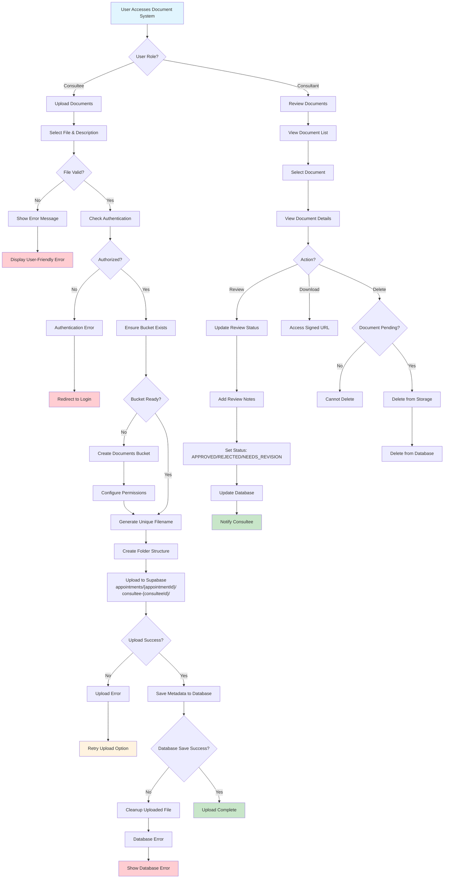
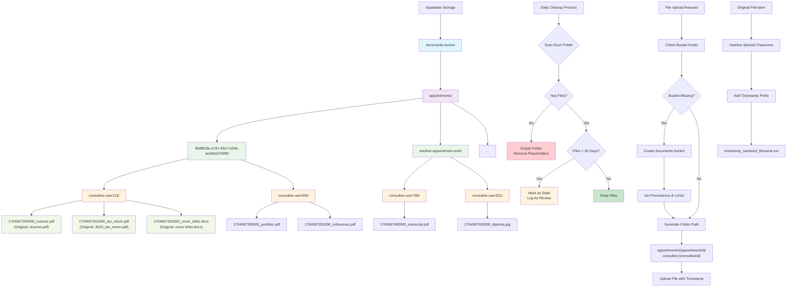
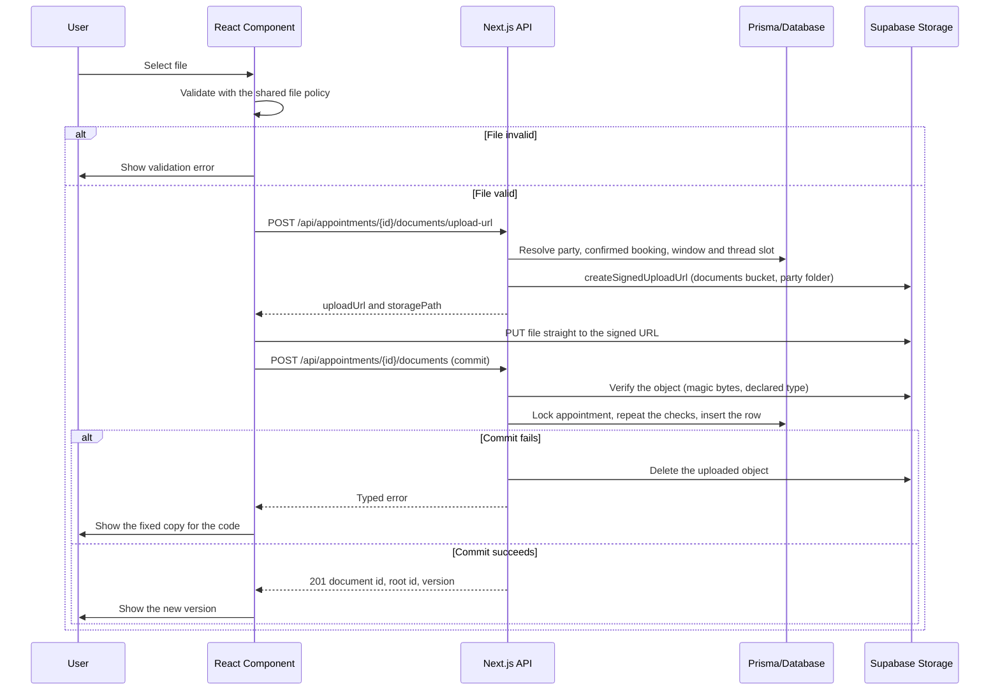
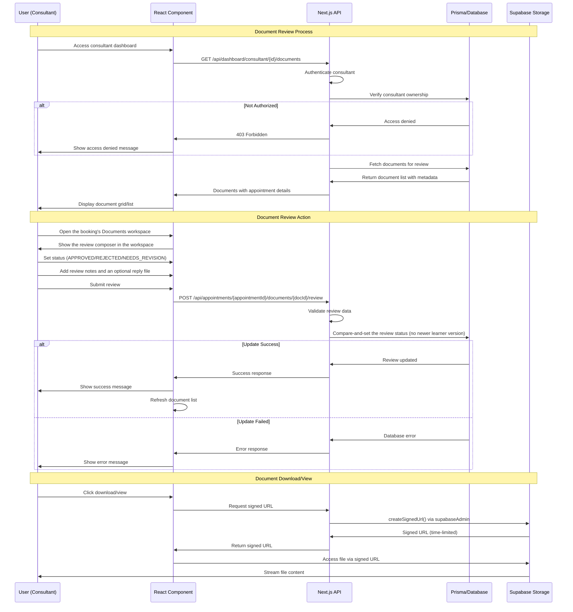
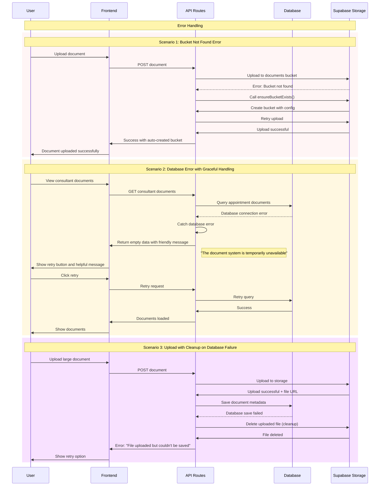

# Storage Management & Cleanup Strategy

## Overview

This document explains our comprehensive approach to managing document storage, including automatic hierarchy creation, stale data cleanup, and maintenance strategies.

## Visual Documentation Index

This document includes comprehensive visual diagrams to illustrate the document system architecture:

### 📊 **Architecture & Flow Diagrams**

1. **[Complete Document Lifecycle Flow](#complete-document-lifecycle-flow)** - Overview of entire system from upload to review
2. **[Visual Storage Organization](#visual-storage-organization)** - Storage hierarchy and folder structure
3. **[Document Upload Sequence Flow](#document-upload-sequence-flow)** - Detailed upload process interactions
4. **[Document Review Sequence Flow](#document-review-sequence-flow)** - Consultant review workflow
5. **[Automated Cleanup Process Flow](#cleanup-strategy)** - Maintenance and cleanup procedures
6. **[Error Handling Scenarios](#error-handling-scenarios)** - Error handling scenarios

### 🎯 **Quick Navigation**

- **For Developers**: See upload/review sequence diagrams for API integration
- **For DevOps**: See cleanup process flow for maintenance understanding
- **For Testing**: See the error handling scenarios for failure and cleanup behaviour
- **For Architecture**: See storage organization for infrastructure planning

## System Architecture Overview

### Complete Document Lifecycle Flow



## Storage Hierarchy

### Visual Storage Organization



### Folder Structure

```
documents/                                              # Private bucket (signed URL access only)
├── appointments/
│   └── {appointmentId}/
│       ├── consultee-{consulteeId}/
│       │   └── {timestamp}_{sanitized_filename}        # Learner deliverables & revisions (v1..v10)
│       └── consultant-{consultantProfileId}/
│           └── {timestamp}_{sanitized_filename}        # Consultant feedback files & standalone handouts
├── plans/
│   └── {consultation|subscription|webinar|class}-plans/
│       └── {planId}/
│           └── {timestamp}_{sanitized_filename}        # Plan materials (max 25 per plan)
└── verification/
    └── {consultantProfileId}/
        └── {timestamp}_{sanitized_filename}            # Consultant profile verification documents
```

### Naming Conventions

- **Appointment Folders**: UUID of the owning `Appointment` row (`appointments/{appointmentId}`).
- **Role Subfolders**: `consultee-{consulteeProfileId}` for learner deliverables and revisions; `consultant-{consultantProfileId}` for expert replies and handouts.
- **Plan Material Folders**: `plans/{planType}-plans/{planId}` enforced on direct presigned upload verification.
- **Files**: `{timestamp}_{sanitized_filename}` verified via 4 KB magic-byte header inspection (`lib/documents/storage-verify.ts`).

## On-the-Fly Creation Strategy

### 1. Bucket Management

Every bucket the app provisions has one explicit policy in `lib/storage/bucket-policies.ts`: visibility, object-size limit and MIME allowlist. `ensureBucketExists(bucket, overrides?)` merges the caller's size and MIME overrides over that policy, creates the bucket if missing (a lost concurrent create counts as success once the bucket exists) and reconciles the settings of an existing one. Visibility is never a caller override; it comes only from the registry. A bucket with no policy entry is **refused**, never created with a fallback.

| Bucket                | Visibility | Limit | MIME source                                                     |
| --------------------- | ---------- | ----- | --------------------------------------------------------------- |
| `documents`           | private    | 10 MB | `lib/documents/file-policy.ts` (PDF, Office, images, text, CSV) |
| `plan-images`         | public     | 5 MB  | JPEG (`image/jpeg`, `image/jpg`), PNG, WebP                     |
| `profile-images`      | public     | 2 MB  | JPEG (`image/jpeg`, `image/jpg`), PNG, WebP                     |
| `organization-images` | public     | 5 MB  | JPEG, PNG, WebP, SVG                                            |
| `recordings-previews` | public     | 50 MB | MP4, WebM, JPEG, PNG, WebP                                      |
| `support-attachments` | private    | 20 MB | `lib/support/attachment-policy.ts`                              |

```typescript
// One registry; an unlisted bucket is refused rather than made public.
const policy = bucketPolicyFor(bucketName, overrides);
if (!policy) return false;
await storage.createBucket(bucketName, {
  public: policy.public,
  fileSizeLimit: policy.fileSizeLimit,
  allowedMimeTypes: policy.allowedMimeTypes,
});
```

**Features:**

- **Auto-Detection**: Checks bucket existence before operations
- **Explicit policy**: Visibility, size and MIME come from the registry; there is no public-by-default
- **MIME reconciliation**: An existing bucket is updated when its allowlist drifts, so a video preview is not rejected by a document-only list
- **Signed URL generation**: Uses `supabaseAdmin.storage.from(bucket).createSignedUrl()` with service role
- **Service role required**: Every storage call (upload, list, signed URL, delete, bucket create and reconcile) runs on the server's service-role client through `adminStorage()` in `lib/supabase-storage-core.ts`. There is no anon storage client. If `SUPABASE_SERVICE_ROLE_KEY` is missing, storage operations fail with an explicit error.
- **Verified deletes**: `removeObjects()` confirms every requested path through a deletion receipt or explicit missing-key metadata. Storage's batch delete returns only the objects it removed, so a path missing from that answer is checked with `info()`. Only an explicit `NoSuchKey` error confirms absence; a remaining object or ambiguous response leaves the deletion unconfirmed. Profile-image deletion returns `502` and preserves the stored image pointer when confirmation fails; appointment-document purge retains its tombstoned row for retry. Plan-material deletion commits removal of its database row first, then attempts storage cleanup, reporting failures to Sentry while returning success. That path does not restore the row; vendor cleanup can remain outstanding.

### 2. Folder Creation

```typescript
// Ensures folder structure exists
const ensureFolderExists = async (
  bucketName: string,
  folderPath: string,
): Promise<boolean> => {
  // Supabase creates folders automatically when files are uploaded
  // This function provides explicit checking for validation
};
```

**How it works:**

- **Implicit Creation**: Supabase creates folder structure when first file is uploaded
- **Path Validation**: Ensures the path structure is valid before upload
- **Error Prevention**: Prevents upload failures due to missing folder structure

### 3. Upload Process

#### Document Upload Sequence Flow



#### Upload Implementation

```typescript
// lib/documents/direct-upload.ts and lib/documents/upload-pipeline.ts
const uploadBookingDocument = async (params) => {
  1. validateUploadFile (shared file policy)
  2. POST upload-url        -> { uploadUrl, storagePath }
  3. PUT the file to uploadUrl, reporting progress
  4. POST commit            -> verified object, row written under the booking lock
}
```

## Document Review Process

### Document Review Sequence Flow



## Server-client operations and private buckets

Every storage write, delete and signing call runs on the server-side client, never the public one, and private buckets are served only through access-checked signed URLs. The rules are these.

- **Shared delete confirmation.** `removeObjects` in `lib/supabase-storage-core.ts` requires a deletion receipt or an explicit `NoSuchKey` metadata response for every requested key. The installed SDK's `exists()` turns HTTP 400/404 into `data: false` while hiding the underlying error code in a HEAD response. This deployment returns HTTP 400 with `NoSuchKey` for an absent object's metadata, so status alone cannot distinguish absence from an invalid request. Ambiguous responses, missing buckets and transport failures return `false`; callers retain their retry/error handling. Confirmation describes the vendor observation, while the caller still owns retention, authorisation and concurrent-writer fencing. [Supabase storage error codes](https://supabase.com/docs/guides/storage/debugging/error-codes).

- **Rollbacks use the same path.** When a database insert fails after an upload, removal of the new object is attempted through the same helper. Failed removal remains an orphan-cleanup obligation.
- **Private buckets hand out short-lived signed URLs only.** Support attachments, appointment documents, plan materials and the finance PDFs are never linked by a stored URL. The app route checks the caller's access, signs a URL (60 seconds for support attachments) and redirects with `Cache-Control: private, no-store`. Rows written before a bucket became private may still hold an old stored URL, so readers map the row to the app route rather than rendering the stored value.
- **Public buckets stay public deliberately.** Avatars, organisation logos and landing assets are served from their public endpoint; they hold nothing that needs an access check.
- **Orphans are swept by reconciliation.** `scripts/cleanup/reconcile-document-storage.ts` treats every path referenced by a database row as live and removes unreferenced objects after a grace period, and it aborts on a listing error rather than deleting on partial information.

See [support attachments](../support/04-evidence-and-attachments.md#attachments) for the support bucket, its checks and its signed downloads.

## Supabase for documents, R2 for recordings

Session documents and plan materials live in the private Supabase `documents` bucket: small files (up to 10 MB), opened rarely, uploaded straight from the browser and signed on demand. Recordings live in the private Cloudflare R2 recordings bucket: hundreds of MB to several GB, streamed repeatedly, pulled in server-side by `transfer-recordings`. The split follows object size and read pattern. R2 charges no egress and has no per-plan upload cap, while Supabase Storage caps a single upload by plan. Each store has one signing helper. Public preview clips stay in the Supabase `recordings-previews` bucket. See [session documents](../documents/README.md#storage-supabase-for-documents-r2-for-recordings) and [recordings](../stream/19-recordings-lifecycle-and-access.md).

Session documents are tombstoned 90 days after the booking ends (or is cancelled) and purged 7 days later by the registered `purge-deleted-documents` job (`lib/documents/document-purge.ts`), which runs hourly on the Netlify ticker with `limit=100` (the route still accepts up to 200 for a manual drain). A tombstoned row keeps its object until the purge, and `reconcile-document-storage` imports the same `DOCUMENT_DELETE_GRACE_DAYS` constant so it never sweeps an object the purge still owns. The 10 MB limit and the allowed types come from one policy, `lib/documents/file-policy.ts`. See [session documents](../documents/README.md#retention-and-the-purge).

## R2 for digital product files

Files an expert sells as a digital product live in their own private R2 bucket, named by `R2_DIGITAL_PRODUCTS_BUCKET` and reached with the recordings bucket's credentials. They can be up to 250 MB each and are downloaded repeatedly, which is the R2 read pattern; Supabase Storage holds only the product's public cover image (`plan-images/digital-products/<productId>/`). The browser PUTs each file to a 15-minute presigned URL that signs its type, its length and `If-None-Match: *`, so each key is written once; the commit route verifies it by ranged reads fenced to the object's ETag, and a buyer downloads through a 300-second presigned GET that the app hands out only after an entitlement check. Keys are `products/<productId>/<lineageId>/<assetId>.<ext>`, fresh for every upload; a replacement shares its file's lineage folder with the next version number.

`reconcile-digital-product-storage` (every 6 hours) keeps the bucket equal to its rows. It deletes the object of a version superseded more than 30 days ago, or of one with two newer versions in its lineage (each file keeps only its current and previous version's objects; the replacing commit purges older ones itself and the sweep retries what it could not), and stamps `purgedAt` on the row, which stays as download evidence; it deletes rejected and abandoned uploads older than a day; and it pages through the bucket from a checkpoint deleting objects older than a day that no row names. An erased creator's objects are deleted after the erasure commit. See [digital products](../digital-products/01-architecture.md).

## Cleanup Strategy

### 1. Orphan Sweep (`reconcile-document-storage`, daily)

The sweep lists each private bucket and compares the object paths with the rows that reference them. An object that no row references is deleted once it is older than the 7-day grace period.

| Bucket                | Referencing rows                                                     |
| --------------------- | -------------------------------------------------------------------- |
| `documents`           | `AppointmentDocument`, `PlanMaterial`, `ProfileVerificationDocument` |
| `support-attachments` | `SupportTicketAttachment`                                            |

The run counts only the objects that Storage confirms it removed. Any shortfall becomes one error per bucket, which marks the run failed so it is reported once.

### 2. Empty Folders

Supabase Storage folders are virtual prefixes, so an empty folder costs nothing and is not swept. The former daily `cleanup-empty-folders` job was removed as cosmetic.

### 3. Stale Data Management

**Definition of Stale Data:**

- **Empty Folders**: Folders with no files for 7+ days
- **Orphaned Files**: Files without corresponding database records
- **Temporary Files**: Failed uploads or incomplete transfers
- **Old Placeholder Files**: `.keep`, `.gitkeep`, `placeholder` files

**Cleanup Criteria:**

```typescript
const STALE_FILE_DAYS = 30; // Files older than 30 days
const MAX_EMPTY_FOLDER_AGE_DAYS = 7; // Empty folders older than 7 days
```

### 4. Cleanup Script Features

```typescript
// Enhanced cleanup with stale file detection
interface CleanupStats {
  foldersChecked: number;
  emptyFoldersFound: number;
  foldersDeleted: number;
  staleFilesFound: number;
  staleFilesDeleted: number;
  errors: string[];
}
```

**Capabilities:**

- **Comprehensive Scanning**: Checks all appointment and consultee folders
- **Smart Detection**: Identifies truly empty vs. temporarily empty folders
- **Safe Deletion**: Only removes placeholder files, not actual documents
- **Error Handling**: Graceful handling of permission or network issues
- **Detailed Reporting**: Comprehensive logs and statistics

### 5. Data Integrity Safeguards

**Database Synchronization:**

- Files are only deleted if no corresponding database record exists
- Database records are checked before any file deletion
- Orphaned database records trigger cleanup of storage files

**Backup Strategy:**

- **Soft Deletion**: Database records marked as deleted before file removal
- **Grace Period**: 7-day grace period before permanent deletion
- **Recovery Options**: Ability to restore recently deleted files

**Safety Checks:**

```typescript
// Never delete files that:
- Are referenced in active appointments
- Have been accessed recently (< 30 days)
- Are in pending review status
- Have successful upload status
```

## Error Handling Scenarios



## Monitoring & Maintenance

### 1. Storage Metrics

- **Folder Count**: Track growth of appointment folders
- **File Count**: Monitor total documents uploaded
- **Storage Size**: Track total storage usage
- **Cleanup Efficiency**: Monitor empty folder cleanup success rate

### 3. Error Monitoring

- **Failed Uploads**: Track and investigate upload failures
- **Cleanup Errors**: Monitor cleanup script failures
- **Permission Issues**: Track access control problems
- **Storage Quotas**: Monitor approaching storage limits

## Performance Optimizations

### 1. Upload Optimizations

- **File Validation**: Client-side validation before upload
- **Unique Naming**: Prevents conflicts and overwrites
- **Concurrent Uploads**: Support for multiple file uploads
- **Progress Tracking**: Real-time upload progress feedback

### 2. Cleanup Optimizations

- **Batch Operations**: Process multiple items efficiently
- **Rate Limiting**: Prevent API throttling during cleanup
- **Selective Scanning**: Only scan recently modified folders
- **Parallel Processing**: Handle multiple folders concurrently

### 3. Storage Optimizations

- **CDN Caching**: Cache public URLs for faster access
- **Compression**: Automatic compression for supported file types
- **Deduplication**: Prevent duplicate file storage
- **Archive Strategy**: Move old files to cheaper storage tiers

## Security Considerations

### 1. Access Control

- **Role-Based Access**: Consultees can only upload, consultants can review
- **Appointment Isolation**: Users only access their appointment documents
- **File Type Restrictions**: Only allow safe file types
- **Size Limits**: Prevent storage abuse with file size limits
- **Verification document limits**: Server-side limit of 10 documents per verification. Document submission validates ownership before connecting document IDs to a verification record.

### 2. Data Protection

- **Private Buckets**: The `documents`, `support-attachments`, `recordings` and `org-invoices` buckets are private (`public: false`) and are served only through signed URLs. `support-attachments` is set private on the first upload by `reconcileBucketOptions`. Its API rows expose `/api/support-tickets/{ticketId}/attachments/{id}`, which checks the caller and redirects to a 60-second signed URL. The image and preview buckets (`plan-images`, `profile-images`, `organization-images`, `recordings-previews`) stay public, so their public URLs resolve directly.
- **Signed URLs**: All document access uses time-limited signed URLs generated via `supabaseAdmin.storage.from('documents').createSignedUrl()`. The service role key (`SUPABASE_SERVICE_ROLE_KEY`) is required.
- **Download Proxy**: The download API endpoint uses `supabaseAdmin` to generate signed URLs. If the service role key is not configured, the endpoint returns an explicit error rather than silently failing.
- **File Scanning**: Virus scanning for uploaded files (future)
- **Audit Logging**: Track all file operations
- **Encryption**: At-rest encryption through Supabase

### 3. Cleanup Safety

- **Verification Steps**: Multiple checks before deletion
- **Rollback Capability**: Ability to restore accidentally deleted files
- **Audit Trail**: Complete log of all cleanup operations
- **Manual Override**: Ability to exclude specific files/folders from cleanup

## Future Enhancements

### 1. Advanced Cleanup

- **AI-Powered Detection**: Machine learning to identify truly stale data
- **Usage Analytics**: Track file access patterns for better cleanup decisions
- **Predictive Cleanup**: Predict which files will become stale
- **Smart Archival**: Automatically move old files to cheaper storage

### 2. Enhanced Monitoring

- **Real-Time Dashboards**: Visual monitoring of storage health
- **Alerting System**: Notifications for cleanup failures or storage issues
- **Performance Metrics**: Detailed performance tracking and optimization
- **Cost Optimization**: Monitor and optimize storage costs

### 3. Extended Features

- **Version Control**: Track file versions and changes
- **Collaborative Editing**: Support for document collaboration
- **Advanced Search**: Full-text search within documents
- **Integration**: Deeper integration with appointment scheduling system

## Troubleshooting Guide

### Common Issues

**1. "Bucket not found" Error**

```bash
Solution: The system will automatically create the bucket on first upload
Status: Fixed with ensureBucketExists() function
```

**3. Permission Denied**

```bash
Check: SUPABASE_SERVICE_ROLE_KEY environment variable
Verify: Bucket permissions and user roles
Debug: Enable development mode for testing
```

**4. Upload Failures**

```bash
Check: File size (max 10MB), file type (PDF, DOC, images)
Verify: Network connectivity and Supabase service status
Debug: Check browser console for detailed error messages
```

### Recovery Procedures

**1. Restore Deleted Files**

- Check Supabase dashboard for recently deleted files
- Review cleanup script logs for deletion details
- Contact support if files were accidentally deleted

**2. Fix Broken Hierarchy**

- Run cleanup script to reset folder structure
- Re-upload documents if necessary
- Verify database consistency

**3. Handle Cleanup Script Failures**

- Check GitHub Actions logs for detailed error information
- Manually run cleanup script with debug output
- Report issues to development team

This comprehensive strategy ensures reliable, efficient, and secure document storage management while providing robust cleanup and maintenance capabilities.

## Deprecated & Superseded Approaches

> [!WARNING]
> **Do NOT re-introduce these superseded storage patterns.**

1. **Public Storage Buckets & Stored Public URLs for User-Uploaded Files**:
   - Earlier versions stored world-readable Supabase storage URLs directly in `AppointmentDocument.fileUrl` and `PlanMaterial.fileUrl`.
   - All user documents, plan materials, verification submissions, and support attachments are now stored in private buckets (`public: false`) and served exclusively via authenticated 60-second signed URLs (`Cache-Control: private, no-store`). Only marketing/profile avatars (`plan-images`, `profile-images`, `organization-images`, `recordings-previews`) use public buckets.
2. **Unverified Client-Side or Public-Key Deletes**:
   - Calling `.remove()` through an anon client or ignoring partial batch deletion arrays silently left unreferenced blobs in storage while reporting `200 OK` to callers.
   - All storage mutations run exclusively through `adminStorage()` (`lib/supabase-storage-core.ts`), and `removeObjects()` re-verifies a key missing from batch responses with metadata and accepts only an explicit `NoSuchKey` response. A boolean existence result or HTTP status alone does not confirm deletion.
3. **Serverless Memory Buffering (`arrayBuffer()`) on Document Downloads**:
   - Buffering full PDF/DOCX byte arrays through Next.js API routes exhausted serverless function memory and added double-hop latency.
   - Download endpoints now validate permissions and session state, generate a 60-second signed Supabase URL (`createSignedStorageUrl`), and either return JSON metadata (`?format=json`) for inline preview frames or issue an HTTP `302` redirect.
4. **Trusting Client `Content-Type` Headers Without Magic-Byte Verification**:
   - Direct browser-to-storage presigned uploads allow callers to declare arbitrary `Content-Type` headers.
   - Every commit handler now inspects the first 4,096 bytes of the uploaded object (`verifyDirectUploadedObject` in `lib/documents/storage-verify.ts`), immediately rejecting PE (`MZ`), ELF (`\x7FELF`), Mach-O executables, null-byte binary files disguised as `text/plain`, and header/MIME mismatches.
5. **Unprobed Orphan Sweeps During Storage Outages**:
   - Running `reconcile-document-storage` without first probing bucket connectivity risked interpreting empty list responses during transient storage outages as zero storage objects or failing partway through.
   - `reconcileDocumentStorage` probes bucket readability up front, aborts on any directory listing error (`throw error`), and honors a 30-day soft-delete retention window alongside the 7-day orphan grace period.
6. **A public bucket created from an implicit default**:
   - `ensureBucketExists` used to create any unlisted bucket with `public: true` and a document allowlist no caller had chosen, so one forgotten option could expose a new bucket and reject a valid video upload.
   - Visibility, size and MIME now come from `lib/storage/bucket-policies.ts`; provisioning refuses a bucket with no policy entry and reconciles an existing bucket's drifting allowlist.
