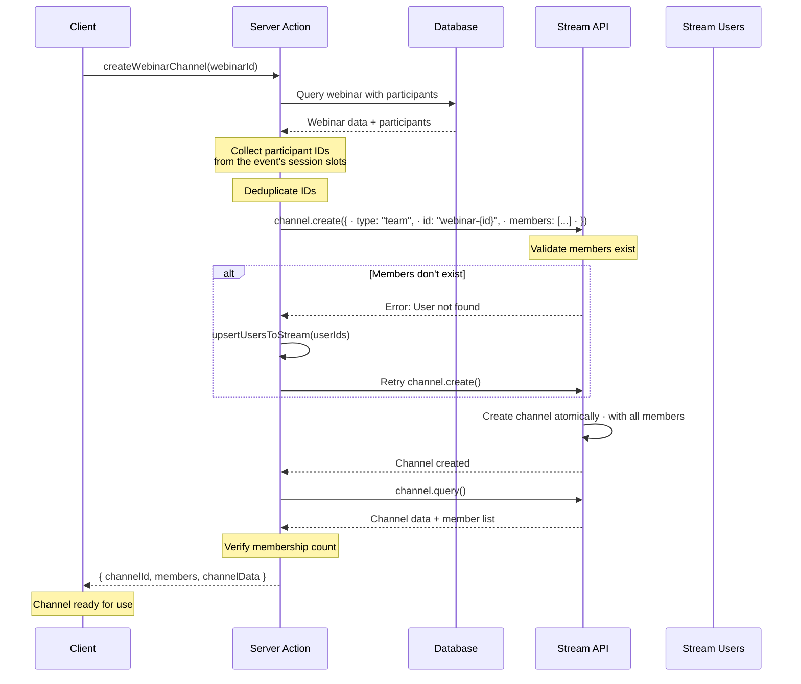

# 04. Chat Implementation

> Complete guide to implementing Stream Chat channels with best practices

## Table of Contents

- [Channel Types](#channel-types)
- [Channel ID Conventions](#channel-id-conventions)
- [Creating Channels](#creating-channels)
- [Member Management](#member-management)
- [Channel Creation Flow](#channel-creation-flow)
- [Code Examples](#code-examples)
- [Appointment Chat Sheet and Booking Tag](#appointment-chat-sheet-and-booking-tag)
- [Best Practices](#best-practices)
- [Unread Message Digest](#unread-message-digest)

---

## Channel Types

Stream Chat supports multiple channel types, each optimized for different use cases:

### Messaging Channels

**Purpose**: One-on-one private conversations

**Use Cases**:

- Direct messages between users
- Consultations (consultant-consultee)
- Subscriptions (consultant-consultee)

**Characteristics**:

- Private by default
- Only accessible to members
- Optimized for 1:1 communication
- Support for typing indicators
- Read receipts enabled

### Team Channels

**Purpose**: Group conversations with multiple participants

**Use Cases**:

- Webinars (host + multiple participants)
- Classes (instructor + students)
- Group events

**Characteristics**:

- Support for many members
- Role-based permissions
- Participant list management
- Suitable for broadcasts and discussions

---

## Channel ID Conventions

Consistent channel ID naming ensures predictable behavior and prevents duplicates.

### Direct Messages

Direct-message ids are derived, never stored. The pair of user ids is put into a
fixed order and the channel id is built from it, so both participants compute the
same id independently and the conversation is found rather than recreated.

**Format**: `dm-{idA}-{idB}` for a personal conversation, where `idA` and `idB`
are the two user ids in **code-unit** order. An organization-scoped conversation
uses `dmo-{orgDigest}-{pairDigest}` instead, and a personal pair whose ids are
too long for Stream's 64-character ceiling falls back to a hashed `dmh-` form.

**Implementation**: always call the helper. Do not re-derive the id inline.

```typescript
import { getDmChannelId } from "@/lib/stream-utils";

const channelId = getDmChannelId(currentUserId, targetUserId, organizationId);
```

> **Never sort these ids with `localeCompare`.** It orders by ICU collation,
> which is case-insensitive at the primary level and depends on the runtime's
> ICU build and default locale, so the same pair of ids produces different
> channel ids in different environments. This is not hypothetical: commit
> `01162093` changed a plain `.sort()` to `.sort((a, b) => a.localeCompare(b))`
> and silently re-keyed most mixed-case pairs, orphaning their history behind a
> new empty channel. Better Auth ids are mixed-case and cuids are lowercase, so
> the two orderings genuinely disagree here. Both variants were still live in
> production months later. The helper uses `a < b ? [a, b] : [b, a]`, which is
> code-unit ordering and is stable everywhere.

**Example**:

- User A: `user_abc123`
- User B: `user_xyz789`
- Channel ID: `dm-user_abc123-user_xyz789` — the `dm-` prefix is part of the id.
  It was missing from this example, which matters because `isDMChannel`,
  `getChannelTypeFromId` and `MANAGED_CHANNEL_PREFIXES` all key off it.

**Why order the ids at all?**

- The same pair yields the same id regardless of who initiates, so the
  conversation is found rather than recreated.
- Neither participant needs to store or look up the id; both derive it.

Ordering is **code-unit**, per the warning above — not "alphabetical", which is
what this section used to say and is exactly the loose reading that led someone
to reach for `localeCompare`.

**A self-pair is refused, not ordered.** `getDmChannelId` throws when the two
ids are equal. `createChannel` de-duplicates its member array through a `Set`,
so `dm-<a>-<a>` would otherwise become a one-member channel: no counterparty for
`channelUtils` to name, so the header renders the raw id, and nobody to reply.

**Never open a DM by asking Stream for a computed id.** `channel.watch()` posts
to the same query endpoint `channel.create()` does, so watching an id that does
not exist _creates_ it — as `created_by`, with no members, invisible to the
sidebar's `{ members: { $in: [me] } }` filter on the next reload. Go through
`POST /api/stream/channels/open`, which checks eligibility and creates the
channel with both members.

### Consultations and subscriptions — no channel of their own

**There is no `consultation-<id>` or `subscription-<id>` channel.** Both reuse
the pair's DM above.

This section used to document two separate formats with their own member lists.
They never worked. `createConsultationChannel` minted a DM and always had; the
`consultation-` id existed only in this document and in a reconciler blocklist.
Worse, `syncUserEventChannels` built its expected set from webinars, classes and
DMs while treating both prefixes as MANAGED — so any channel that _did_ carry
one was classified stale and the buyer was removed from it on their very next
dashboard load. The current architecture eliminated the separate channel type outright: the
pair already has a thread, and removing the second one removed a contradiction
rather than a feature.

`CONSULTATION_PREFIX` and `SUBSCRIPTION_PREFIX` remain exported from
`lib/stream-channel-ids.ts` so `getChannelTypeFromId` can still resolve rows
created before the change. They are deliberately absent from
`MANAGED_CHANNEL_PREFIXES`, so surviving channels are left alone rather than
swept.

**What a pair actually gets**: one `messaging` channel per funding context.

```typescript
{
  channelType: "messaging",
  channelId: getDmChannelId(consultantId, consulteeId, organizationId),
  members: [consultantId, consulteeId],
  createdById: consultantId,
  additionalData: {
    dm_consultant_user_id: consultantId,
    dm_consultee_user_id: consulteeId,
  },
  organizationId,
}
```

Ten consultations and three subscriptions between the same two people in the
same context are one conversation. A personal booking and an org-funded one are
two, because ADR 19 splits dashboards by org-ness and a single thread cannot
live in both.

`dm_consultant_user_id` is what decides moderation: `createChannel` grants
`channel_moderator` to that user. A DM created without it — the peer path — gets
no moderator at all, deliberately, so a consultee cannot mute or remove the
consultant.

### Who may open one

A DM requires that the two people have transacted. `canDirectMessage`
(`lib/stream/dm-eligibility.ts`) is the only implementation of that rule:

- a `Consultation` or `Subscription` in `APPROVED`,
  `APPROVED_PENDING_PAYMENT`, `SCHEDULED` or `COMPLETED`, in either direction;
- or a shared, non-deleted `AppointmentOccurrence`.

Permanent once established — a lapsed subscription still leaves the thread
open. `DM_ELIGIBLE_STATUSES` is shared by the gate, the two search routes, and
`getDmPairsForUser`. **Those must move together**: the reconciler removes users
from any managed DM channel absent from the expected set it builds from that
constant, so narrowing it evicts people from live conversations.

### Webinars

**Format**: `webinar-{webinarId}` · **Stream type**: `team`

```typescript
{
  channelType: "team",
  channelId: `webinar-${webinarId}`,
  channelName: webinar.webinarPlan.title,
  members: [consultantUserId, ...participantIds],
  createdById: consultantUserId,
  additionalData: { webinar_id: webinarId }
}
```

Members come from `appointment.appointmentOccurrences[].user`, deduplicated — a
webinar's registrants are connected to every one of its slots, so the same id
appears once per slot. The host is added separately and is always a member.

### Classes

**Format**: `class-{classId}` · **Stream type**: `team`

Identical in shape; the roster walks `class.appointments[].appointmentOccurrences[].user`.

### Collaborators

**Format**: `collab-{webinar|class}-{planId}` · **Stream type**: `messaging`

Host plus `ACCEPTED` collaborators, reconciled two-way against the collaborator
list on every accept.

### Event channel lifecycle

`jobs/stream/expire-event-channels.ts` freezes a webinar or class channel 7 days
after its last session ends (readable, not writable) and hard-deletes it at the
org's `streamRecordingRetentionDays`, default 90. DM channels are deliberately
excluded: the pair's thread outlives any single booking.

## Creating Channels

### Server-Side Pattern (Recommended)

All channel creation operations are performed server-side using Stream's Node SDK.

**Why Server-Side?**

- Secure API secret management
- Atomic member addition during creation
- Centralized error handling
- Consistent validation
- Database transaction support

### Generic Channel Creation

**File**: `actions/stream/chat/channel.action.ts`

```typescript
export async function createChannel({
  channelType,
  channelId,
  channelName,
  members,
  createdById,
  additionalData = {},
}: {
  channelType: "messaging" | "team";
  channelId: string;
  channelName?: string;
  members: string[];
  createdById: string;
  additionalData?: Record<string, any>;
}) {
  if (!apiKey || !apiSecret) {
    throw new Error("Stream API keys not configured");
  }

  const serverClient = StreamChat.getInstance(apiKey, apiSecret);

  // Ensure creator is always included in members list
  const allMembers = Array.from(new Set([createdById, ...members]));
  console.log(
    `Creating ${channelType} channel ${channelId} with ${allMembers.length} members`,
  );

  // Create the channel with members atomically
  const channel = serverClient.channel(channelType, channelId, {
    name: channelName,
    created_by_id: createdById,
    members: allMembers,
    ...additionalData,
  });

  await channel.create();
  console.log(`Channel ${channelId} created successfully`);

  // Verify membership was established
  const channelData = await channel.query();
  const actualMembers = Object.keys(channelData.members || {});
  console.log(`Channel ${channelId} actual members:`, actualMembers);

  return { channelId, members: actualMembers, channelData };
}
```

**Key Features**:

- Deduplicates members (creator + specified members)
- Atomic creation with members
- Post-creation verification
- Comprehensive logging

### Specialized Channel Creators

#### Direct Message Channel

```typescript
export async function createDirectMessageChannel(
  currentUserId: string,
  targetUserId: string,
  // Context this conversation belongs to. Omitted or null means personal, and
  // the channel then carries no org tag. Every caller must pass the same value
  // the reconciler will later derive, or the two compute different ids.
  organizationId?: string | null,
) {
  const channelId = getDmChannelId(currentUserId, targetUserId, organizationId);

  return createChannel({
    channelType: "messaging",
    channelId,
    members: [currentUserId, targetUserId],
    createdById: currentUserId,
  });
}
```

#### Webinar Channel

```typescript
export async function createWebinarChannel(webinarId: string) {
  const webinar = await prisma.webinar.findUnique({
    where: { id: webinarId },
    include: {
      webinarPlan: {
        include: {
          consultantProfile: { include: { user: true } },
        },
      },
      appointment: {
        include: {
          appointmentOccurrences: { include: { user: true } },
        },
      },
    },
  });

  if (!webinar) {
    throw new Error("Webinar not found");
  }

  const consultantUserId = webinar.webinarPlan.consultantProfile?.user?.id;
  if (!consultantUserId) {
    throw new Error("Consultant not found for webinar");
  }

  // Members are everyone connected to the webinar's session slots.
  const appointmentParticipantIds =
    webinar.appointment?.appointmentOccurrences?.flatMap((slot) =>
      slot.user.map((user) => user.id),
    ) || [];

  const allParticipantIds = Array.from(new Set(appointmentParticipantIds));

  console.log(
    `Webinar ${webinarId} participants: ${allParticipantIds.length} unique`,
  );

  return createChannel({
    channelType: "team",
    channelId: `webinar-${webinarId}`,
    channelName: webinar.webinarPlan.title,
    members: [consultantUserId, ...allParticipantIds],
    createdById: consultantUserId,
    additionalData: { webinar_id: webinarId },
  });
}
```

---

## Member Management

### Adding Members

**Server-Side**: `actions/stream/chat/channel.action.ts`

```typescript
export async function addMemberToChannel(channelId: string, userId: string) {
  if (!apiKey || !apiSecret) {
    throw new Error("Stream API keys not configured");
  }
  if (!channelId || !userId) {
    throw new Error("Channel ID and User ID are required");
  }

  const serverClient = StreamChat.getInstance(apiKey, apiSecret);

  // Infer channel type from ID pattern
  const channelType =
    channelId.startsWith("consultation-") ||
    channelId.startsWith("subscription-")
      ? "messaging"
      : "team";

  console.log(`Adding member ${userId} to ${channelType} channel ${channelId}`);

  try {
    const channel = serverClient.channel(channelType, channelId);

    // Ensure channel exists before adding members
    await channel.create(); // No-op if exists

    const response = await channel.addMembers([userId]);
    console.log(`Successfully added member ${userId} to channel ${channelId}`);

    return { success: true, response };
  } catch (error) {
    console.error(
      `Error adding member ${userId} to channel ${channelId}:`,
      error,
    );
    throw error;
  }
}
```

### Removing Members

```typescript
const channel = serverClient.channel(channelType, channelId);
await channel.removeMembers([userId]);
```

### Permission Management

Stream Chat uses role-based permissions:

**Default Roles**:

- `owner` - Full control over channel
- `moderator` - Can moderate content and members
- `member` - Can send and receive messages
- `guest` - Limited read-only access

**Assigning Roles**:

```typescript
await channel.addMembers([{ user_id: userId, role: "moderator" }]);
```

---

## Channel Creation Flow



**Flow Steps**:

1. **Client Request**: Client calls server action with entity ID
2. **Database Query**: Fetch entity data with all participants
3. **Member Collection**: Gather IDs from the event's session slots
4. **Deduplication**: Remove duplicate participant IDs
5. **Channel Creation**: Atomically create channel with members
6. **Error Handling**: If users don't exist, upsert and retry
7. **Verification**: Query channel to verify member count
8. **Response**: Return channel details to client

---

## Code Examples

### Complete Consultation Channel Setup

```typescript
// Server action
export async function createConsultationChannel(consultationId: string) {
  const consultation = await prisma.consultation.findUnique({
    where: { id: consultationId },
    include: {
      consultationPlan: {
        include: {
          consultantProfile: { include: { user: true } },
        },
      },
      requestedBy: { include: { user: true } },
    },
  });

  if (!consultation) {
    throw new Error("Consultation not found");
  }

  const consultantId = consultation.consultationPlan.consultantProfile.user.id;
  const consulteeId = consultation.requestedBy.user.id;

  if (!consultantId || !consulteeId) {
    throw new Error("Consultant or consultee not found");
  }

  return createChannel({
    channelType: "messaging",
    channelId: `consultation-${consultationId}`,
    members: [consultantId, consulteeId],
    createdById: consultantId,
    additionalData: { consultation_id: consultationId },
  });
}
```

### Client-Side Channel Access

```typescript
"use client";

import { useChatContext } from "stream-chat-react";
import { useEffect, useState } from "react";

export function useConsultationChannel(consultationId: string) {
  const { client } = useChatContext();
  const [channel, setChannel] = useState(null);

  useEffect(() => {
    if (!client) return;

    const channelId = `consultation-${consultationId}`;
    const channel = client.channel("messaging", channelId);

    // Watch the channel for updates
    channel.watch();
    setChannel(channel);

    return () => {
      channel.stopWatching();
    };
  }, [client, consultationId]);

  return channel;
}
```

### Querying User Channels

```typescript
"use client";

import { useChatContext } from "stream-chat-react";

export function useUserChannels(userId: string) {
  const { client } = useChatContext();

  const filters = {
    type: "messaging",
    members: { $in: [userId] },
  };

  const sort = { last_message_at: -1 };

  const options = {
    watch: true,
    state: true,
    limit: 30,
  };

  return client.queryChannels(filters, sort, options);
}
```

### Client behaviour the sidebar, badge and messages rely on

The channel list does not assume the first page is everything. When a `message.new` or `notification.message_new` event names a channel the sidebar does not hold, and the first page has already loaded, `ChatSidebar` watches that channel and inserts it at the top, provided it matches the current org scope (and, for a direct message, `isUsableDmChannel`). Inserts are deduplicated by cid, so a burst of events costs one `watch`. Pages appended by "Load more" go through `appendUniqueChannels` (`components/chat/utils/channelList.ts`) so a channel that moved between pages is never shown twice.

The personal navigation badge (`hooks/useChatUnreadCount.ts`) starts from Stream's own `total_unread_count`, read from `client.user` and refreshed by every `message.new` and `notification.*` event that carries it, so it counts channels the sidebar has not loaded. That total is global and includes org-tagged channels, which belong to the org dashboard's own entry, so their unread is subtracted. The subtraction is local while loaded channels explain the whole total. When unread exists beyond them, one `getUnreadCount` call (at most every 30 seconds) lists unread per channel, and one `queryChannels` per 30 newly seen cids classifies them as personal or org; classifications are cached for the life of the mount.

### The Messages inbox

**Order.** `ChatSidebar` lists Conversations (1:1 chats) above Channels (events), so a client's message never sits below a run of empty event channels. Both queries sort `[{ pinned_at: -1 }, { last_message_at: -1 }]`, which keeps pinned chats on page one and paging correct. `pinnedFirst` (`components/chat/utils/channelUtils.ts`) shows a pin changed in this session at once, before the rebase described under "Paging after a pin, unpin or hide" re-reads the server's order. Once a re-read returns that row and no pin request for it is still in flight (`pendingPinsRef`), the local value is dropped and the row's own `pinned_at` from Stream decides its place. Stream stamps `pinned_at` when it handles each request, so three pins clicked 150 ms apart can be stored in a different order from the clicks, and the list then settles on the stored order, the same one a reload shows. Rows show a messenger-style time from `formatRowTime`: the clock time today, "Yesterday", the weekday within a week, then the date.

**Pin and remove.** Each row has an options menu (`components/chat/ChannelItem.tsx`). Pin, unpin and "Remove from list" go through `POST /api/stream/channels/preference`. It finds the channel with the caller in `members` and acts only on their own membership (`pin`, `unpin`, `hide(userId, false)`), so Stream's narrow grants for the `user` role do not matter and nobody can touch a conversation they are not in. Both apply at once in the browser and undo themselves, with a toast, if the server refuses. Hiding keeps the history. A hidden channel returns on its next message (the sidebar lists it from `message.new` or `notification.message_new`) or when it is reopened, because `/open` calls `show` for the caller. There is no per-user history clear and no leaving a 1:1: a thread is one shared record that support, moderation and retention rely on.

**Paging after a pin, unpin or hide.** "Load more" asks Stream for the next page by offset, and the offset counts the raw rows Stream has returned (`fetchedCountRef`). A pin, unpin or hide moves rows across that offset. With 21 conversations, the first pinned, page one holds the pinned one and the 19 newest; unpinning it moves it to 21st place, so the conversation that was 21st becomes 20th and a next page at offset 20 would return only the row already on screen. Once the server accepts the change, `rebaseList` re-reads as many rows as are loaded (one 20-row page per page loaded, in parallel), replaces that list and resets its offset to match. The open and deep-linked conversations stay listed even when the new order puts them past the loaded rows. Each list has a generation counter (`listGenerationRef`) that a rebase or a full refresh bumps, so a "Load more" page requested before the list was replaced is dropped rather than appended. A full refresh (`fetchChannels`, which is also the silent refresh after a refused hide) bumps both counters when it starts, as a rebase does, so whichever started last wins for each list: a refresh that started before an unpin and lands after the unpin's rebase is dropped for that list, and a refresh that started after a rebase is kept even when the rebase lands first. A dropped read is not harmless: `client.queryChannels` writes each response's `membership` (including `pinned_at`) into the shared stream-chat `Channel` objects the rows render from before the sidebar sees it, so a dropped older read would bring back a pin the server no longer has. When a refresh, rebase or "Load more" page is dropped and the newest read of that list has already landed (`appliedGenerationRef` equals `listGenerationRef`), `rebaseList` reads the list once more; when a newer read is still in flight, its own response overwrites the membership and nothing more is needed. The scope check (`isScopeSuperseded`) is a separate condition, so a page cut for another organisation never lands either way. The server has already saved the change by the time a rebase runs, so a failed re-read must not leave the old offset in use. `rebaseList` reads once more straight away; if that read fails too, the list stays marked stale (`staleListRef`, set when a rebase starts and cleared when a rebase or refresh lands), and the next "Load more" re-reads the loaded rows plus one more page instead of paging from the old offset. Reopening a hidden conversation needs no rebase: an added row only pushes later rows down, so the next page repeats a row that `appendUniqueChannels` drops and nothing is skipped. `__tests__/chat/sidebar-pagination-rebase.test.tsx` runs these cases against a Stream mock that orders and slices pages.

**Reopening.** The DM arm of `POST /api/stream/channels/open` re-adds both people to the pair's channel with an idempotent `addMembers`, since `create()` only seeds a channel that is new. Someone who left or lost membership keeps their eligibility, so searching for them and clicking restores the same thread with its history. Search and the picker offer only people the viewer shares a consultation or subscription with, so a DM that exists only through a webinar or class link (a host or presenter and a seat holder) is not offered after "Remove from list": it returns with its next message or through a deep link. A DM the caller only hid still holds both people, so `/open` shows it on that path too. A failed re-add fails the open rather than returning a channel the caller is not in.

**Search and New message.** The search box narrows the loaded list instantly (`filterChannelsByTerm`) and asks the server only for what the list cannot hold (`GET /api/stream/channels/search-appointments`: people, plan titles, an event host, a consultee's email for their consultant, and a session date in the viewer's zone). The `+` beside Conversations opens `NewMessageDialog`, which calls the same route with `mode=people`: with no text it lists the viewer's most recent connections (bookings only, never events), and with text it searches them. Search and the picker open a conversation through `useOpenConversation`, so the server's booking check is the only gate, and report the channel back so the sidebar lists it.

**Frozen conversations.** When `channel.data.frozen` is set, `ChatContainer` replaces the composer with `FrozenChannelNotice`. Stream grants `use-frozen-channel` to no role, so a send would otherwise fail without saying why. A DM freezes after a long quiet spell and reopens with the pair's next booking; an event channel closes after its session (see [17. Channel Lifecycle](./17-channel-lifecycle.md)).

`components/chat/CustomMessage.tsx` shows the delivery state of the viewer's own messages. A message the SDK holds with `status === "failed"` renders "Not sent" with a Retry button that calls the message context's `handleRetry` (stream-chat-react's `retrySendMessage`, which resends the same message id), and one with `status === "sending"` renders "Sending…". Without this a failed send looked identical to a delivered one.

---

## Appointment Chat Sheet and Booking Tag

### The side sheet

On an appointment's detail page (consultee, consultant and the organisation views, which all render `AppointmentDetailClient`) and in the appointments list's quick-view drawer (`AppointmentSheet`, mounted by `AppointmentsShell`), the chat actions open a right-side sheet instead of leaving the page. The sheet is full screen on a phone.

- `chatAffordancesForVm` (`components/appointments/consultee/ConsulteeAppointmentsAdapter.tsx`) gives each chat action a `chat` target (`AppointmentChatTarget` in `lib/appointments/adapter.ts`) as well as its Messages `href`. The detail page and the quick view open the target through `LazyAppointmentChatSheet`; the quick view closes first, so only one sheet is open at a time. The row ⋯ menus still navigate to Messages.
- The DM label names the other person ("Message Liam Anderson"), using the name carried on the same user record as the DM's counterparty id (`messageLabel`); it falls back to **Message Consultant** / **Message Consultee** only when no name exists. The group channel is **Class chat** / **Webinar chat**. For a class or webinar the DM is offered in `OPENABLE_EVENT_STATUSES` (`SCHEDULED` and `COMPLETED`), the same states the server's DM gate accepts for events; consultations and subscriptions use `DM_ELIGIBLE_STATUSES`.
- `AppointmentChatSheet` (`components/appointments/detail/AppointmentChatSheet.tsx`) is loaded with `next/dynamic` (`components/appointments/LazyAppointmentChatSheet.tsx`) on first open, so the chat SDK stays off the detail page bundle. It renders `ChatSurface` with the sheet's own children, so the app's one Stream client, `ChatUnavailable` and the "Reconnecting…" banner behave as they do on the Messages page.
- Inside the surface the sheet calls `POST /api/stream/channels/open` with the same body the Messages deep link sends (including the org scope from `useOrgScope`), watches the returned channel (skipped when the client already watches it), sets it active, and mounts `ChatContainer`. As soon as the route answers, the booking-tag lookup is prefetched into react-query in parallel with `watch`, so the chip is ready with the composer. A refusal from the route is shown in the sheet.
- The sheet keeps each resolved channel (per user and request body) for the page session, so reopening skips the route and, when the client already watches the channel, the network entirely. A failed watch drops the cached entry.
- The route answers DM eligibility from one `pairBookingContexts` lookup, which is the same question `canDirectMessage` answers. Alongside it, one Stream `queryChannels` (no messages) reads the requested scope's DM. When eligibility passes and that DM already holds both people under the expected `organization_id`, the route returns it without user upserts or a create call; otherwise it falls through to `createDirectMessageChannel`. Skipping the upsert loses nothing: each user's own profile is synced when their client connects, the sync cache already skipped it for five minutes, and an existing DM is reachable from the sidebar without this route.
- The sheet provides `ChatPaneContext` without `backToList`, so the channel header shows no back arrow and the sheet's own close button (40 × 40 px on a phone) and Escape are the ways out.
- The sheet header links **Open in Messages** to the full deep link. That link, and the deep links in notifications and emails, keep working unchanged.

### The booking tag

Opening a DM with an appointment context posts nothing. Instead the composer offers a removable chip above the message box:

> About: Career coaching · next session Tue, 3 Nov, 4:00 PM

- `ChatContainer` takes `contextAppointmentId`. The Messages page passes the `contextAppointmentId` URL parameter (through `ChatLayout`); the sheet passes the appointment it was opened from.
- `BookingTagComposer` (`components/chat/BookingTag.tsx`) asks the server for the tag. The chip shows only when the server answers. If every session is over it reads "last session" instead of "next session".
- The chip text wraps on narrow screens rather than truncating. While the lookup is in flight a skeleton chip holds the row's height, and it collapses if the server answers 404.
- The chip uses `MessageComposer`'s `overrideSubmitHandler` to add `booking_appointment_id` to the **next** message the user sends, on both the optimistic copy and the request, so a retried send keeps it. The chip then disappears. Removing it, or sending nothing, writes nothing.

### Why a rendered tag cannot be forged

Message custom fields are written by the sender's browser, so a member could put any title or date on a message. The tag therefore never reads them.

- `GET /api/stream/booking-tag?appointmentId=…&cid=messaging:…` (`app/api/stream/booking-tag/route.ts`) parses its query with `bookingTagQuerySchema` and returns `{ title, kind, nextSessionAt, lastSessionAt }` or 404.
- The appointment (one joined query) and the DM's members (one Stream `queryChannels`) are read in parallel.
- It answers only when the DM's two human members (Familiarise Support and the retired booking-card user are ignored) are the caller and one other person, `resolveVerifiedBookingContextTitle` confirms both are parties to the appointment (consultee, consultant, or an accepted presenter collaborator on a webinar or class), and `isDmChannelIdEligible` confirms the DM is one the pair may open under the open route's org-scope rules.
- The next session is the earliest live, non-tentative occurrence that has not ended (`pickSessionAnchor` in `lib/stream/booking-tag.ts`); with none left it is the latest one.
- `MessageBookingTag` renders a message's tag only from that response, through react-query keyed on `(appointmentId, cid)`. It reads nothing else from the message and has no Get help link. Old server-posted cards are left out of the message list (`withoutLegacyBookingCards` in `lib/stream/system-users.ts`), so a DM holding only those shows the normal empty state.

### Message actions, dates and previews

- With a mouse, a bubble's react, reply and more actions float above it on hover, as before. On touch (`(hover: hover) and (pointer: fine)` does not match), they appear beside the bubble only after a tap on it and hide on a tap elsewhere (`CustomMessage`).
- Below 640 px the SDK's floating date pill is not rendered (`ChatDateSeparator` in `ChatContainer`), because it covered the top bubble; the in-list date separators remain.
- A channel row in the Messages sidebar previews the latest message that is not a retired booking card (`lastVisibleMessage` in `components/chat/utils/channelUtils.ts`), or "No messages yet".

### Group channel header and empty state

For a `webinar-` or `class-` channel, `CustomChannelHeader` shows the title and then `eventChannelSubtitle` (`components/chat/utils/channelUtils.ts`), for example "group chat · Asha (host) + 4 classmates · Everyone in this class can read this". The host is the channel's `created_by`, and the count is the channel's `member_count` minus the host. An empty class channel says "Say hello to your class"; an empty webinar channel says "Say hello to everyone in this webinar". DMs keep the SDK's empty state.

---

## Best Practices

### 1. Always Use Server-Side Creation

**Good**:

```typescript
// Server action
export async function createChannel(...) {
  const serverClient = StreamChat.getInstance(apiKey, apiSecret);
  // Create channel
}
```

**Bad**:

```typescript
// Client component - NEVER do this!
const channel = client.channel("messaging", channelId);
await channel.create(); // API secret exposed!
```

### 2. Atomic Member Addition

**Good**:

```typescript
// Add members during creation
const channel = serverClient.channel(channelType, channelId, {
  members: allMembers, // Atomic
});
await channel.create();
```

**Bad**:

```typescript
// Create then add members separately - race condition!
await channel.create();
await channel.addMembers(members); // Separate operation
```

### 3. Consistent ID Formatting

**Good** — one helper owns the derivation, so every call site agrees:

```typescript
import { getDmChannelId } from "@/lib/stream-utils";

const channelId = getDmChannelId(userId1, userId2, organizationId);
```

**Bad** — unsorted, so the two participants compute different ids:

```typescript
const channelId = `${userId1}-${userId2}`;
```

**Also bad, and harder to spot** — sorted, but by a locale-dependent
comparator, so the same pair yields different ids on different machines:

```typescript
const channelId = [userId1, userId2]
  .sort((a, b) => a.localeCompare(b))
  .join("-");
```

This second form looks correct and has already shipped once. See the note under
[Direct Messages](#direct-messages) for what it cost.

### 4. Proper Error Handling

**Good**:

```typescript
try {
  await createChannel({ ... });
  console.log("Channel created successfully");
} catch (error) {
  console.error("Channel creation failed:", error);
  // Handle specific error types
  if (error.code === 16) {
    // Channel already exists
  }
}
```

### 5. Verify Membership

**Good**:

```typescript
await channel.create();
const channelData = await channel.query();
const actualMembers = Object.keys(channelData.members || {});
console.log(`Expected: ${members.length}, Actual: ${actualMembers.length}`);
```

### 6. Deduplicate Members

**Good**:

```typescript
const allMembers = Array.from(new Set([createdById, ...members]));
```

**Bad**:

```typescript
const allMembers = [createdById, ...members]; // Possible duplicates
```

### 7. Use Meaningful Custom Data

**Good**:

```typescript
additionalData: {
  webinar_id: webinarId,
  event_type: "live_session",
  starts_at: webinar.startTime.toISOString(),
}
```

---

## Unread Message Digest

Chat is pull-only: Stream push providers are disabled, so nobody learns of a new message until they open the dashboard. The one push the app sends is a durable unread digest, delivered as an email and an in-app bell, and built on Stream's [unread reminders](https://getstream.io/chat/docs/node/unread-reminders/) ([ADR-09](./18-architecture-decision-records.md#adr-09-unread-digest-via-stream-unread-reminders)).

### How a digest is produced

1. The `messaging` channel type has `reminders: true` and `read_events: true`, and the app's `reminders_interval` is 1800 seconds. Both live in `TARGET_CHAT_REMINDERS` in `lib/stream/control-plane-contract.ts`.
2. When a member of a channel with ten or fewer members has left a regular or system message unread for longer than the interval, Stream sends `user.unread_message_reminder` to the `chat` webhook hook at `/api/stream/webhooks`. The event names the user and carries up to ten channels, each with its member list and its last five messages.
3. The route verifies the signature, writes the `WebhookEvent` receipt, acknowledges, and dispatches to `handleUnreadMessageReminder` in `lib/stream/chat/unread-digest.ts`.
4. The handler stages one bell (`CHAT_UNREAD_DIGEST`, in the `appointment` Novu family) and one email (`CHAT_UNREAD_DIGEST`) inside a single transaction, then flushes them after the response. The outbox relays deliver anything the inline attempt misses.

### Who receives it

- Stream user ids are our user ids. The handler skips `familiarise-support`, any id with no user row (which covers every synthetic user), and any user who is banned or erased.
- Only `messaging` channels count, and the support user is never listed as a counterpart. A counterpart who has been erased is dropped, and a channel left with no live counterpart, or whose new messages are all system messages, produces no line.
- The digest honours the `appointments` preference category, because chat is booking-scoped. The bell also honours `inAppEnabled` (`stageBell`). The email honours `emailEnabled`, `allNotifications`, suppressions and the pre-launch delivery guard, because it is staged through `deliver()`'s outbox.

### What it says

Each line reads, for example, "You have 2 new messages from Asha about your session on 12 Nov 2026." and links to `/dashboard/go/auto/messages?channelId=<id>`, or to the organisation's messages page when the pair's session is org-hosted. The count is the number of regular messages from others that are newer than the recipient's own latest message among Stream's last five; when all five qualify the line says "5+". The session date is the pair's next live occurrence, or their latest past one.

The digest never quotes message content. `streamUnreadMessageReminderSchema` (`schemas/webhooks/stream.ts`) does not declare a message's `text`, so the text is neither parsed nor stored in `WebhookEvent.payload`.

### Exactly one digest per user per window

The window is the 30-minute slot that contains the event's `created_at`, so a retry or a sweeper re-drive computes the same window. The transaction first inserts an `IdempotencyRecord` with scope `stream.chat-digest`, key `<windowStart>` and the user's id; its `(scope, key, userId)` unique turns a second delivery into a rolled-back no-op. The bell's `NotificationOutbox.transactionId` derives from the dedupe key `chat-digest:<userId>:<windowStart>`, and the email's `entityRef` is the same key. The claim expires after 24 hours and is pruned by `cleanup-auth-tokens`.

## Deprecated & Superseded Approaches

- **Separate `consultation-{id}` and `subscription-{id}` Channels**: Superseded by one canonical `messaging` DM per human pair (`dm-<a>-<b>` for personal scope, `dmo-<orgHash>-<pairHash>` for enterprise scope) and a verified booking tag on the message that refers to a booking.
- **Locale-Dependent `localeCompare` ID Sorting**: Superseded by UTF-16 code-unit sorting (`a < b ? [a, b] : [b, a]`) capped at 64 characters (`lib/stream-channel-ids.ts`).
- **Server-Posted Booking Cards (`booking-ctx-`, `system-booking-context`)**: Opening a DM from an appointment used to post a receipt card as a server user named "Familiarise". People read it as a support message, it showed a Get help link and a duplicate title line, its date was the first session rather than the next, and it was written for both people even when nobody replied. Replaced by the booking tag on the sender's next message. Old cards in Stream are hidden by `CustomMessage`, and `LEGACY_BOOKING_CONTEXT_USER_ID` survives only for that and to keep the user out of DM member counts.
- **Channels Listed Above Conversations**: The sidebar used to show event channels first, so the only DM could sit below several empty ones. Conversations now lead and pinned chats lead within each list.
- **Leaving a 1:1 to Tidy the List, and Relying on `create()` to Re-Add**: There is no leave or delete for a 1:1; "Remove from list" hides it per user. `create()` does not add members to an existing channel, so a person who had left was sent to a channel they were not in. `/open` now re-adds both people.
- **A Pin Change Kept Only in the Browser's Order**: The sidebar used to reorder a pinned or unpinned row locally and leave the paging offset alone, so an unpin or hide shifted a row behind the offset and "Load more" never showed it. Superseded by `rebaseList`.
- **Unmoderated Consultant-Consultee Threads**: Superseded by explicit `channel_moderator` assignment to `dm_consultant_user_id` at channel creation.

---

## Navigation

- [Previous: 03. Provider Authentication](./03-provider-authentication.md)
- [Next: 05. Video Implementation](./05-video-implementation.md)
- [Back to Index](./README.md)
