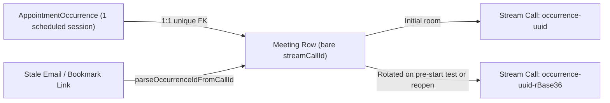
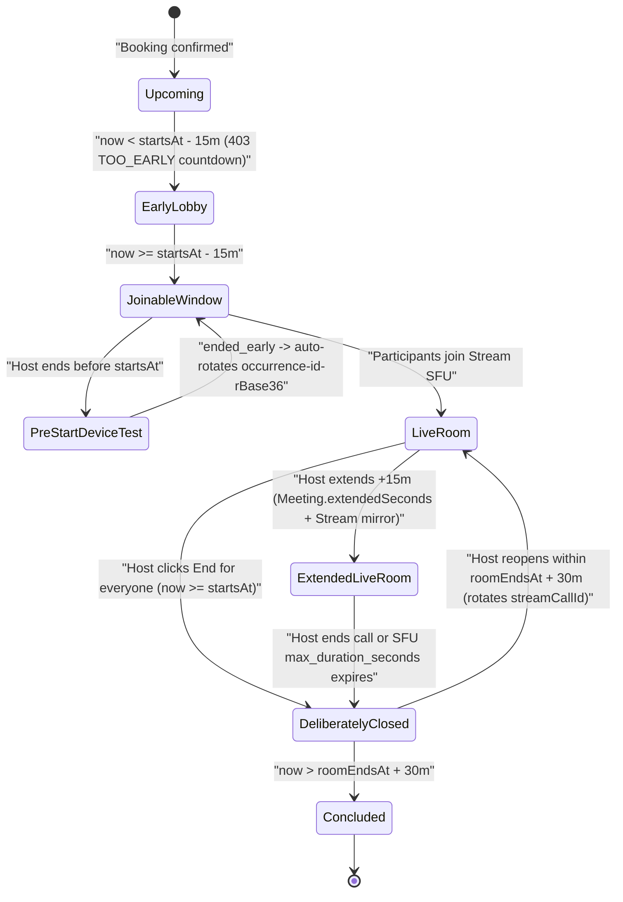
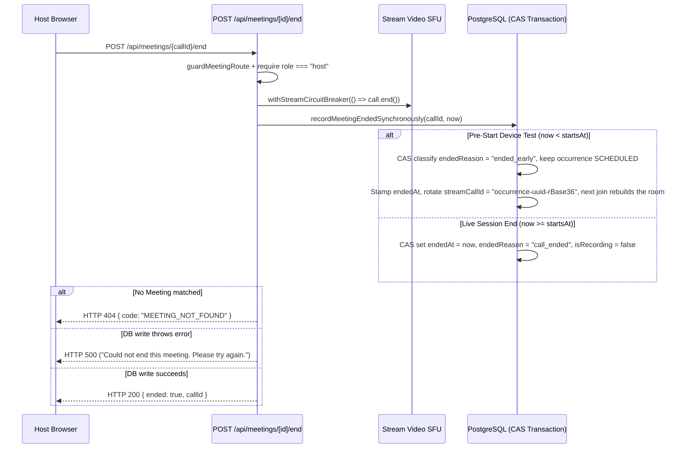

# 05. Video Implementation & Session Lifecycle Algorithms

> Authoritative specification of Stream Video room provisioning, the unified `[startsAt - 15m, roomEndsAt + 30m]` envelope, timezone-safe civil day arithmetic, synchronous CAS termination & pre-start rotation, host room reopen with asymmetric webhook routing, the immutable booked end with `+15m` extension state on `Meeting`, the end-reason decision table, exit UX, lobby gate retries, the join-failure and lobby-ended faces, room client robustness (mobile layout, screen share, host mute-all, recording control), and hybrid Q&A / emoji reactions.

## Table of Contents

- [Meeting Room Architecture & Call Ownership](#meeting-room-architecture--call-ownership)
- [Algorithm 1: Unified Session Window Envelope & Timezone Normalization](#algorithm-1-unified-session-window-envelope--timezone-normalization)
- [Algorithm 2: Synchronous Termination & Pre-Start Device-Check Rotation](#algorithm-2-synchronous-termination--pre-start-device-check-rotation)
- [Algorithm 3: Host Room Reopen & Asymmetric Webhook Lookup](#algorithm-3-host-room-reopen--asymmetric-webhook-lookup)
- [Algorithm 4: `+15m` Room Extension on `Meeting` & Derived Cap Math](#algorithm-4-15m-room-extension-on-meeting--derived-cap-math)
- [Algorithm 5: Unified Call Exit UX (`CallExitButton`) & Lobby Gate Backoff (`MeetingLobbyGateCard`)](#algorithm-5-unified-call-exit-ux-callexitbutton--lobby-gate-backoff-meetinglobbygatecard)
- [Algorithm 6: Hybrid In-Room Chat, Persistent Q&A, Stage Spotlight & Reactions](#algorithm-6-hybrid-in-room-chat-persistent-qa-stage-spotlight--reactions)
- [Algorithm 7: Join Failures, Lobby Ended State & Room Client Robustness](#algorithm-7-join-failures-lobby-ended-state--room-client-robustness)
- [Video, Screen-Share & Recording Quality](#video-screen-share--recording-quality)
- [End Reasons: The Decision Table](#end-reasons-the-decision-table)
- [Deprecated & Superseded Approaches](#deprecated--superseded-approaches)

---

## Meeting Room Architecture & Call Ownership

Every video call executes on Stream Video's hardened `default` call type (`STREAM_CALL_TYPE = "default"`) and obeys strict `1 AppointmentOccurrence = 1 active Stream Call ID` isolation ([ADR-01](./18-architecture-decision-records.md#adr-01-strict-per-occurrence-stream-call-isolation-1-occurrence--1-active-call-id-vs-permanent-link-reuse)):

- **Server-Only Provisioning (`actions/stream/meetings/meeting.action.ts`)**: `provisionAppointmentMeeting` verifies caller entitlement (`readSlotForCaller`), evaluates booking/occurrence health, and calls `call.getOrCreate(...)` using `STREAM_API_SECRET` with:
  - `created_by_id`: plan owner / assigned consultant (granting creator `-owner` permission variants).
  - `members`: every DPDP-consented participant mapped to `call_member`, and `ACCEPTED` presenter collaborators (`CO_HOST`, `CO_INSTRUCTOR`) mapped to `co_presenter`.
  - `settings_override`: `buildCallSettingsOverride(appointmentType, maxDurationSeconds, participantLimits)` (`session.inactivity_timeout_seconds = 300`, `limits.max_duration_seconds = clamp(bookedDuration + 45m, 45m, 12h)` counted from the room end, the participant limits below, and Backstage + muted defaults on `WEBINAR` / `CLASS`).
  - Participant limits (`resolveCallParticipantLimits`): a `WEBINAR` or `CLASS` room gets `limits.max_participants = effective capacity + 5`, `max_participants_exclude_owner = true` and `max_participants_exclude_roles = ["co_presenter", "admin"]`, where the effective capacity is the instance override or else the plan value and can never exceed 200 ([ADR-07](./18-architecture-decision-records.md#adr-07-interactive-webrtc-with-a-200-participant-cap-not-hls-at-launch)). A 1:1 room gets `limits.max_participants = 6`: a host, a reassigned host and one client, each allowed a second device, because Stream counts every session. Stream does not document how the exclusions are counted, so the headroom absorbs any difference and the Postgres seat count remains the sell-out authority.
  - `custom`: the organisation and host fields plus the room-time fields (`roomTimeCustom`: `sessionEndsAt`, `sessionBaseEndsAt`, `extendedSeconds`, `extensionsUsed`) that the in-room clock and overrun banner read.
  - The payload is built once by `buildRoomCallPlan` (`lib/meetings/call-provisioning.ts`), and the host reopen route uses the same function, so a reopened room is identical to a freshly provisioned one. The provisioner refuses to create a room for an ended meeting whose end reason is not rejoinable (`endBlocksRejoin`).
- **Bare Call Identifier Storage (`lib/stream/call-cid.ts`)**: `Meeting.streamCallId` always persists the bare call ID (`occurrence-<uuid>` initially, or `occurrence-<uuid>-r<base36>` after rotation). `toCallId(cidOrId)` strips any `"default:"` prefix idempotently, while `parseOccurrenceIdFromCallId(cidOrId)` extracts `<uuid>` across both initial and rotated call aliases.

- **Seat Admission (`resolveMeetingAccess`, `lib/meetings/access.ts`)**: A host, an `ACCEPTED` co-host or collaborator is admitted by role. Anyone else needs an attendee seat. A 1:1 seat only has to be live, because the booking's own status is checked too. A `WEBINAR` or `CLASS` seat must hold a fulfilled entitlement (`paidParticipant`, `lib/booking/participants.ts`), checked in the same single query. A `CONFIRMED` or `ATTENDED` seat qualifies when it has no payment or a `SUCCEEDED` one. A `HELD` seat qualifies only when its payment is `SUCCEEDED`, owes no refund, has no pending or settled refund and carries no settle-elsewhere marker (`notSettledElsewhereWhere`: `Auto-refund pending:`, `Auto-refunded:`, `Auto-refund stuck:`, `REQUIRES_MANUAL_RECOVERY:`, `Replay sale:`). For example, a ₹100 seat captured at ₹99.99 reads `SUCCEEDED` with `Auto-refund pending:` and stays out of the room ([decision record](../decisions/2026-11-02-group-room-fulfilled-entitlement.md)).

- **Admission Writes (`POST /api/meetings/[meetingId]/join`)**: The route upserts the caller, writes the call membership and, for `WEBINAR` / `CLASS`, sets or revokes the publish permissions. Because a membership write on a large room is broadcast to everyone in it, a 1-to-Many join first asks Stream for the caller's membership (`call.queryMembers` filtered to the caller) and skips the write when the caller already holds the right role. Any failure of that read falls back to the write, so a missing member is never admitted without a membership. Confirmed buyers are added to the already-provisioned calls of their appointment right after payment (`addSeatHoldersToOpenCalls`, called from `ensureChannelsForAppointment`), which is best effort and a no-op when no call exists yet. Stream's room-full signal (SFU error 301) surfaces only when the client joins the SFU, so the server has no `ROOM_FULL` refusal.



---

## Algorithm 1: Unified Session Window Envelope & Timezone Normalization

### 1. Symmetric Envelope Across All 5 Appointment Types

Every appointment type — **`CONSULTATION`**, **`TRIAL`**, **`SUBSCRIPTION`**, **`WEBINAR`**, and **`CLASS`** — enforces the exact same join, live, overrun, and reopen window bounds (`lib/appointments/occurrences.ts`, `lib/meetings/access.ts`, `lib/meetings/duration-cap.ts`):

$$\text{Active Session Envelope} = [\,\text{startsAt} - 15\text{m},\; \text{roomEndsAt} + 30\text{m}\,]$$

The room end is `AppointmentOccurrence.endsAt + Meeting.extendedSeconds` (`resolveRoomEndsAt` in `lib/meetings/duration-cap.ts`). The booked `endsAt` itself is never moved by an extension.

| Parameter                                  | Constant / Source                                        | Value                         | Behavioral Rule                                                                                                        |
| ------------------------------------------ | -------------------------------------------------------- | ----------------------------- | ---------------------------------------------------------------------------------------------------------------------- |
| **Early Join Window (`T - 15m`)**          | `CONSULTEE_JOIN_WINDOW_MS` / `CONSULTANT_JOIN_WINDOW_MS` | `900_000 ms` (15m)            | symmetric for both hosts and participants; prior requests receive HTTP `403` (`code: "TOO_EARLY"`).                    |
| **Room End (`roomEndsAt`)**                | `endsAt + Meeting.extendedSeconds`                       | Booked end or `+15m`          | `extendedSeconds` grows by 900 when a host triggers `POST /api/meetings/[meetingId]/extend`; `endsAt` does not move.   |
| **Rejoin & Overrun Grace (`T + 30m`)**     | `REJOIN_GRACE_MS` / `CALL_DURATION_GRACE_MS`             | `1_800_000 ms` (30m)          | Keeps dashboard `Join` buttons active, permits WebRTC reconnection after Wi-Fi drops, and bounds host room reopens.    |
| **SFU Hard Wall (`max_duration_seconds`)** | `resolveRoomCapSeconds`                                  | `clamp(room + 45m, 45m, 12h)` | Enforced server-side by Stream SFU (`75m` for a 30m `TRIAL`, `105m` for a 60m `CONSULTATION`, `+900s` on host extend). |

The same room end is used by the join gate and the `canReopen` window (`meetingPolicyRefusal`, `resolveMeetingAccess` in `lib/meetings/access.ts`), the reopen route, the outcome sweep's live-overrun deferral, and the orphan reconciler. The booked end remains the reference for the outcome classifier, reminders, money, and recording retention. The dashboard and calendar join buttons keep the booked end because their 30-minute grace already covers a 15-minute extension.



### 2. Viewer Timezone Normalization & DST-Safe Civil Day Arithmetic

Server processes execute in UTC while consultants and consultees span arbitrary IANA zones (`Asia/Kolkata`, `America/Los_Angeles`, `Europe/London`, etc.). Two strict date formatting invariants govern all dashboard badges (`getAppointmentStatus`, `deriveBookingPresentation`, `HomeTab`, `ConsultantAppointmentsAdapter`, `MeetingLobbyGateCard`):

1. **Viewer Zone Formatting (`formatInViewerZone`)**: Every rendered timestamp and relative day label formats against explicit `viewerZone` (`session.user.timezone ?? Intl.DateTimeFormat().resolvedOptions().timeZone`), never bare `new Date().toLocaleTimeString()` or server-local `getFullYear()` / `getDate()`.
2. **Civil Day-Number Subtraction Without `now + 86_400_000`**: Adding `86_400_000` milliseconds (`24h`) to `now` skips or duplicates calendar days across 23-hour spring-forward and 25-hour fall-back DST transitions. Relative day buckets compute exact integer day deltas from timezone-formatted `"yyyy-MM-dd"` civil keys:
   ```typescript
   const dayNumber = (key: string): number => {
     const [year, month, day] = key.split("-").map(Number);
     return Date.UTC(year, month - 1, day) / 86_400_000;
   };
   const targetDayKey = formatInViewerZone(effectiveTime, zone, "yyyy-MM-dd");
   const todayKey = formatInViewerZone(now, zone, "yyyy-MM-dd");
   const diffDays = dayNumber(targetDayKey) - dayNumber(todayKey);
   // diffDays === 0 -> "Today" | diffDays === 1 -> "Tomorrow" | diffDays < 7 -> "In N days"
   ```

---

## Algorithm 2: Synchronous Termination & Pre-Start Device-Check Rotation

When a host selects **End session for everyone**, `POST /api/meetings/[meetingId]/end` (`app/api/meetings/[meetingId]/end/route.ts`) terminates the live Stream SFU room and updates PostgreSQL **synchronously** so returning to `/dashboard` immediately reflects the post-call state without waiting for Stream's webhook queue:



### Critical Branch Rules

1. **Pre-Start Device Check (`endedAt < startsAt`)**:
   - A consultant testing audio/camera at `startsAt - 12m` and clicking **End session for everyone** has **not** delivered the scheduled session.
   - `recordMeetingEndedSynchronously` classifies the event as `"ended_early"`, keeps `AppointmentOccurrence.completionStatus = "SCHEDULED"`, and stamps `endedAt` with `endedReason = "ended_early"` and rotates `Meeting.streamCallId` to a fresh `occurrence-<uuid>-r<base36>` id, closing the old segment's open presence and attendance rows in the same transaction. Because `ended_early` is rejoinable, the access gate lets both sides in, and the provisioner (`provisionAppointmentMeeting`) creates a clean call on a new id and clears `endedAt` and `endedReason`. Both consultant and consultee still see an active `Join` button on their dashboards and enter an un-ended room at start time.
2. **Live Session Termination (`endedAt >= startsAt`)**:
   - Atomically stamps `Meeting.endedAt = now`, `Meeting.endedReason = "call_ended"`, `Meeting.isRecording = false` by compare-and-set on the call id and the end it read (`where: { id, streamCallId, endedAt, endedReason }`), re-deciding once against the row on a miss (`endSupersedes`). No end writes attendance: the outcome sweep reads Stream's settled record later (`settleOccurrenceAttendance`).
3. **Explicit HTTP `500` Error Propagation**:
   - If `recordMeetingEndedSynchronously` rejects after `call.end()`, the route captures the exception via `reportSentryError` and returns HTTP `500` rather than silently succeeding with HTTP `200`.
4. **Result Shape & Rate Limit**:
   - `recordMeetingEndedSynchronously` returns `{ kind: "not_found" | "already_ended" | "recorded" }`. The route answers `404 MEETING_NOT_FOUND` for `not_found`; for the other two it answers `200 { ended: true, callId }`, where `callId` is the id that now represents the room (the rotated id after a pre-start `ended_early`).
   - It refuses to overwrite a deliberate end already on the row (`recordedEndHolds`), so `already_ended` is returned when a drain or org wind-down got there first. The route runs behind `meetingControlLimiter` (10 per minute per user, shared with extend, reopen and live; stage has its own 60 per minute `meetingStageLimiter`).

---

## Algorithm 3: Host Room Reopen & Asymmetric Webhook Lookup

### 1. Why Reopening Rotates `Meeting.streamCallId`

Once `call.end()` executes on `default:occurrence-<uuid>`, Stream permanently marks that `cid` ended in SFU state. If a host accidentally ends a session at `T + 12m`, reopening cannot reuse `occurrence-<uuid>`. Instead, `POST /api/meetings/[meetingId]/reopen` (`app/api/meetings/[meetingId]/reopen/route.ts`) creates the new call first and rotates the database row second:

1. Applies `meetingControlLimiter` (10 per minute per user), then validates the caller session (`requireApiAuth`), DPDP consent (`hasStreamConsent`), host or co-presenter authorization (`isAuthorizedReopenHost`), non-cancelled booking and occurrence status (`!isDeadOccurrence`), and the window `now <= roomEndsAt + REJOIN_GRACE_MS`. A meeting that is not ended answers `{ reopened: false, streamCallId }` unchanged. An ended meeting must have a host-reopenable end reason (`endAllowsHostReopen`; see the decision table below), otherwise the route answers `409`.
2. Builds the call payload with `buildRoomCallPlan`, the same function the provisioner uses: `settings_override` including the Backstage defaults for webinars and classes, members, organisation and host custom fields, the room-time custom fields, and a cap derived from the room end. The extension budget survives the reopen because it lives on `Meeting`.
3. Mints `nextCallId = "occurrence-${occurrenceId}-r${Date.now().toString(36)}"` and creates that call on Stream with `getOrCreate`, inside `withStreamCircuitBreaker`.
4. Only then rotates the row with an optimistic CAS:
   ```typescript
   await prisma.meeting.updateMany({
     where: {
       id: meeting.id,
       streamCallId: meeting.streamCallId,
       endedAt: meeting.endedAt,
     },
     data: {
       streamCallId: nextCallId,
       endedAt: null,
       endedReason: null,
       isRecording: false,
     },
   });
   ```
5. Returns `{ reopened: true, streamCallId: nextCallId }` so `<MeetingLobbyGateCard />` navigates to `/meetings/${nextCallId}` (`router.replace`). If the CAS count is zero (another request won), the route returns `{ reopened: false, streamCallId }` with the current id and leaves the fresh Stream call unused. If Stream fails, nothing was rotated: an open circuit answers `503` and any other failure answers `500`. Meanwhile, any participant joining via the original email link `/meetings/occurrence-<uuid>` resolves transparently to the current id through `loadMeeting` (`parseOccurrenceIdFromCallId`).

### 2. Asymmetric Webhook Lookup Rule

Rotating `Meeting.streamCallId` from segment 1 (`occurrence-<uuid>`) to segment 2 (`occurrence-<uuid>-r<base36>`) requires **strictly asymmetric webhook resolution** across `lib/stream/session-handlers.ts` and `lib/stream/recording-handlers.ts`:

- **Artifact Events (`call.recording_ready`, `call.recording_failed`)**:
  - Query exact `where: { streamCallId }` first, **then fall back to `where: { appointmentOccurrenceId }`** extracted via `parseOccurrenceIdFromCallId(call_cid)`.
  - **Why**: Composite MP4 transcoding (`recording_ready`) from segment 1 arrives asynchronously **after** segment 2 is already live. Falling back to `appointmentOccurrenceId` guarantees zero orphaned recordings.
- **The join event (`call.session_participant_joined`)**: strict `where: { streamCallId }`; it only clears a non-deliberate end older than the join, because Stream resumed that call. Attendance for every segment comes from Stream's settled record, which lists every call id of the occurrence.
- **Termination Events (`call.ended`, `call.session_ended`)**:
  - Match **strictly and exclusively on `where: { streamCallId }`** with **zero fallback to `appointmentOccurrenceId`**.
  - **Why**: A delayed `call.ended` or 5-minute SFU inactivity `call.session_ended` webhook from closed segment 1 carries `call_cid = "default:occurrence-<uuid>"`. Because `Meeting.streamCallId` is now `"occurrence-<uuid>-r<base36>"`, strict equality misses cleanly (`null`) and drops the stale termination event without closing the live reopened room.

---

## Algorithm 4: `+15m` Room Extension on `Meeting` & Derived Cap Math

A host can extend a live room by **15 minutes (`900s`) for free**, once per `Meeting`, via `POST /api/meetings/[meetingId]/extend` (`app/api/meetings/[meetingId]/extend/route.ts`). The booked end `AppointmentOccurrence.endsAt` never moves; the extension is stored in `Meeting.extendedSeconds` and `Meeting.extensionsUsed`, and Stream is a derived mirror ([ADR-04](./18-architecture-decision-records.md#adr-04-immutable-booked-end-extension-state-on-meeting)).

1. **Guards.** The route runs behind `meetingControlLimiter` and answers `403` to anyone but the host. It answers `409 SESSION_NOT_EXTENDABLE` when the meeting has ended, the occurrence is deleted, is not `SCHEDULED`, or already has an outcome.
2. **Retry path.** If `extensionsUsed` already equals `MAX_MEETING_EXTENSIONS` (1), the route re-mirrors to Stream (idempotent). It answers `200` when Stream was behind and `409` with `alreadyExtended: true` when it was already in sync.
3. **Multi-party schedule conflict guard (`hasExtensionScheduleConflict`).** Otherwise it evaluates `[startsAt, max(roomEndsAt, now) + 15m]` against non-tentative, non-cancelled `AppointmentOccurrence` rows across the host profile and hosted or co-hosted plans (`buildOccupiedAppointmentFilter`, `buildCohostCommitmentFilter`), all `ACCEPTED` presenter collaborators (`assertConsultantAvailableForWindows`), and every active seat holder (`HELD`, `CONFIRMED`, `ATTENDED`). A conflict answers `409` with `hasConflictingNextBooking: true`.
4. **Single CAS claim.** One `prisma.meeting.updateMany` increments both columns. Its `WHERE` requires `endedAt: null`, `extensionsUsed` equal to the value just read and below the maximum, and the occurrence still `SCHEDULED`, with no outcome, and not deleted. A zero count answers `409 alreadyExtended` if the budget is now spent and otherwise `409 SESSION_NOT_EXTENDABLE`.
5. **Stream mirror (`mirrorExtensionToStream`), outside any transaction.** The route reads the call, then writes `max_duration_seconds = max(existing, derived room cap)`, re-sends the participant limits the call already holds (read from `call.settings.limits`) and `custom = { ...existing, sessionEndsAt: roomEnd, sessionBaseEndsAt: bookedEnd, extendedSeconds, extensionsUsed }`. Every value is derived from Postgres, never added to what Stream holds, so a retry converges instead of adding time twice. A Stream failure answers `503 EXTEND_SYNC_PENDING`: Postgres keeps the extension and the host retries.
6. **Banner math (`resolveCapEndsAtMs` in `OverrunBanner.tsx`).** The banner reads `sessionEndsAt` (room end) and `sessionBaseEndsAt` (booked end) from the call `custom`, offers the extension from five minutes before the booked end, and moves through `hidden`, `ending-soon`, `overrun-grace` and `cap-imminent`.

Worked example. Hannah hosts Priya's 10:00-11:00 IST consultation. At 10:56 IST she extends: `extendedSeconds = 900`, `extensionsUsed = 1`, the room end becomes 11:15 IST, and the Stream cap grows from 105 minutes to 120 minutes. The booked end stays 11:00 IST, so if both leave at 11:00 IST the classifier sees a full session. If Hannah ends the call and reopens the room at 11:05 IST, the new Stream call is created with the same 11:15 IST room end and `extensionsUsed = 1`, so she cannot extend a second time.

Residual risk: the database overlap guard `occurrence_no_confirmed_overlap` sees only booked ends. The extension is protected only by the conflict check in step 3 (see the ADR-04 lead-time finding).

---

## Algorithm 5: Unified Call Exit UX (`CallExitButton`) & Lobby Gate Backoff (`MeetingLobbyGateCard`)

### 1. Single Primary Red Exit Control (`CallExitButton` in `EndCallButton.tsx`)

To prevent hosts from accidentally ending a live cohort when stepping out (`ADR-05`), `MeetingRoom.tsx` mounts a single red exit button:

- **Attendees (`!isHost`)**: Clicking the button immediately triggers `onLeaveForSelf()` (`leaveCallAndReleaseMedia(call)` + redirect to role dashboard), keeping the room alive.
- **Hosts (`isHost`)**: Clicking the button opens a 2-action popover menu:
  - **Inline Caution Alert (`remainingMinutes > 10`)**: Whenever more than `10 minutes` (`EARLY_END_WARNING_THRESHOLD_MS`) remain in `info.endsAt`, displays an amber warning card: `"{N} min remaining in this booked slot. Ending for everyone disconnects all participants."`
  - **Action 1 — `Leave call`**: Disconnects only the host's local media session while keeping the room live for participants and co-presenters.
  - **Action 2 — `End session for everyone`**: Calls `POST /api/meetings/[meetingId]/end` (`AbortSignal.timeout(10_000)`), releases local camera/mic hardware tracks, and routes to the dashboard.

### 2. Lobby Gate Countdown & Clock-Skew Retry Backoff (`MeetingLobbyGateCard.tsx`)

When `POST /api/meetings/[meetingId]/join` denies entry with HTTP `403`, `MeetingLobbyGateCard` handles three structured modes:

- **`TOO_EARLY` Auto-Entry with Clock-Skew Protection**:
  - Displays scheduled start time formatted in the viewer's timezone (`formatScheduledAt(startsAt, session.user.timezone)`) and a live `MM:SS` countdown to `openAtMs = startsAt - 15m`.
  - Guards against client/server clock skew (e.g., browser clock ahead of server clock by 2–8s causing `now >= openAtMs` while server still returns `TOO_EARLY`) via a per-mount attempt counter held in component state and listed in the effect's dependencies, capped at **`MAX_AUTO_RETRIES = 3`** with linear backoff **`AUTO_RETRY_BACKOFF_MS = 5_000`**:
    ```typescript
    const retryAtMs = openAtMs + autoRetries * AUTO_RETRY_BACKOFF_MS;
    ```
    Each retry increments the counter, which changes the dependency list and re-arms the timer. Without that dependency the effect ran once, because a refusal that repeats the same `access.code` and `openAtMs` changes nothing the effect watches.
  - The card shows the countdown until the room is due to open, then "Checking again (n of 3)" while the retries run. After 3 attempts (`T+0s`, `T+5s`, `T+10s`), automatic polling halts and the card says "Still not open. Use Check Again", keeping the manual **Check Again** button.
- **`SESSION_ENDED` with Host Reopen Safety Valve**: Renders **Reopen Session Room** whenever `access.canReopen === true`.
- **`CONSENT_REQUIRED` / Default Denial**: Surfaces DPDP data-processing consent or security access guidance.

---

## Algorithm 6: Hybrid In-Room Chat, Persistent Q&A, Stage Spotlight & Reactions

Live interaction inside `MeetingRoom.tsx` combines ephemeral WebRTC media events with server-verified Q&A persistence (`app/api/meetings/[meetingId]/qa/route.ts`, `lib/meetings/stage-qa.ts`, `StageQaDrawer.tsx`, `StagePinnedBannerOverlay.tsx`):

1. **In-Call Chat & Q&A Modality Gate (`isInCallChatAllowed`)**:
   - Enabled for `CONSULTATION`, `SUBSCRIPTION`, `WEBINAR`, and `CLASS`.
   - Completely blocked for free `TRIAL` sessions (`403 trial_chat_disabled` on API + `data-in-call-chat-blocked="true"` on client) to block pre-purchase off-platform leakage.
2. **Server-Verified Questions, Upvoting & Host Answers / Stage Spotlight**:
   - Submitting a question (`POST /api/meetings/[meetingId]/qa`) authenticates caller session and role via `guardMeetingRoute`, stamps verified server author identity (`id: "qa_<uuid>"`, `authorName`, `authorRole`), persists question metadata (`stageQuestionRedisKey`, 6h TTL), supports attendee upvoting and host answer tracking, and broadcasts `familiarise.qa.question` over Stream WebSockets (`call.sendCallEvent`).
   - Clicking **Show on screen** (`action: "pin"`, restricted strictly to `access.role === "host"`) writes `custom.activeStageBanner` onto the Stream call document (preserving existing `custom.organizationId` / `custom.extendedSeconds`) **and** emits `familiarise.qa.pin` over WebSockets so both live and late-joining attendees see the lower-third `<StagePinnedBannerOverlay />`.
3. **Ephemeral Emoji Reactions (`ReactionsButton`)**:
   - Rendered natively via Stream Video SDK's `<ReactionsButton />` in the bottom control bar, backed by `create-call-reaction` role grants on `call_member` and `co_presenter`.

---

## Algorithm 7: Join Failures, Lobby Ended State & Room Client Robustness

### 1. Join Failure Faces (`join-failure.ts`, `JoinFailureCard.tsx`)

A typed server refusal (401, 403 or 404 from the join route) is a verdict and renders the gate card from Algorithm 5. Every other way a join can fail is a failure, and `useGetCallById` returns it as `failure` with a `kind` from `classifyJoinFailure`:

| Kind                   | Triggers                                                                                                                                                                                                                                                                                                                                         | Face                                                                                                                                                           | Retry                                                                                                                                                     |
| ---------------------- | ------------------------------------------------------------------------------------------------------------------------------------------------------------------------------------------------------------------------------------------------------------------------------------------------------------------------------------------------ | -------------------------------------------------------------------------------------------------------------------------------------------------------------- | --------------------------------------------------------------------------------------------------------------------------------------------------------- |
| `provider_unavailable` | Join route status 429, 502, 503 or 504 (the route answers 503 for an open circuit and for a Stream 5xx or 429); a browser network failure (`Failed to fetch`, `Load failed`, `NetworkError`), matched by message so a programming `TypeError` stays `unknown`; the 45 s client-wait timeout; an SFU join error that is not the participant limit | "Video provider unavailable": "Our video provider is having trouble. Your session is protected — if it can't start, you'll be offered a reschedule or refund." | Automatic, up to `MAX_PROVIDER_AUTO_RETRIES = 4`, delay `min(2 s * 2^n, 30 s)` scaled by 50–100% jitter, plus the Retry button, which restarts the budget |
| `room_full`            | SFU error code `CALL_PARTICIPANT_LIMIT_REACHED` (301) on a join error, or a message naming the participant limit                                                                                                                                                                                                                                 | "This session is full. If you're already in it on another device, close that tab and try again."                                                               | Retry button only                                                                                                                                         |
| `unknown`              | Anything else, including a server 500 and a 409 `ROOM_NOT_PROVISIONED`                                                                                                                                                                                                                                                                           | "Couldn't join the session" with the error text for support                                                                                                    | Retry button only                                                                                                                                         |

The failure card stays mounted while a retry runs, so a retry shows "Trying again…" instead of flashing the skeleton. A provider outage is logged as a warning rather than an error, so the automatic retries do not spend Sentry quota. Stream's coordinator path for a full call has no documented error shape; the message match in `classifyJoinFailure` is a defensive mapping, and the SFU code is the verified one.

The lobby (`MeetingSetup`) classifies a failed `call.join()` with the same function and shows the card inline in place of the Join button, with Retry joining again.

### 2. Lobby Ended State (`LobbyEndedPanel.tsx`)

`MeetingSetup` reads `useCallEndedAt()`. When the call ends while someone waits in the lobby, the Join button is replaced by the ended panel and the page runs the join flow once for that call id (`onCallEnded`, which is `retryJoin`). The join route is the policy oracle: for a room whose end blocks a rejoin (`endBlocksRejoin`) it answers `SESSION_ENDED`, and the gate card offers the host **Reopen Session Room** when `endAllowsHostReopen`. If the route still admits the same ended call, the panel stays and offers **Check again** (a manual repeat of the join flow) and, for the host, **Reopen Session Room** (`POST /api/meetings/[meetingId]/reopen`, shared with the gate card through `useReopenRoom`). The automatic check runs once per call id, so a room the server still admits cannot loop.

### 3. Mobile Layout & Screen Share

The room, lobby, gate and status screens use `dvh` units rather than `vh`, and the control bar and top overlays pad with `env(safe-area-inset-*)` because the root layout sets `viewportFit: "cover"`. `ScreenShareControl` renders the SDK's screen-share button only when `navigator.mediaDevices.getDisplayMedia` exists, which iOS Safari lacks. It is a feature check, never a user-agent check.

### 4. Host Mute-All (`MuteAllButton.tsx`)

Hosts holding the `mute-users` capability (`useHasPermissions(OwnCapability.MUTE_USERS)`) see **Mute everyone** in the control bar. It asks for confirmation, calls `call.muteAllUsers("audio")`, and reports the result in a toast. On the `default` call type the call creator (the plan owner, `created_by_id = hostUserIds[0]`) holds the `-owner` variant of `mute-users` through the `call_member` role, and the `co_presenter` role holds `mute-users`. The SDK participants list therefore renders Mute for the creator and an accepted presenter collaborator, and nothing for a second host who is neither; the button hides itself for that last case. There is no waiting room: backstage-until-live covers admission for webinars and classes.

### 5. Removing an Attendee for Conduct (`AttendeeModeration.tsx`)

The People tab of a webinar or class room lists the attendees to the call creator and a `co_presenter`, each with a **Remove** button that opens the shared reason dialog (`components/events/RemoveParticipantDialog.tsx`). It posts `{ targetUserId, reason, note }` to `POST /api/meetings/[meetingId]/remove`, which runs the same rule and transaction as the roster's and the event chat's door (`removeAttendeeForConduct`, see [the conduct removal record](../decisions/2026-11-15-conduct-removal.md)). The seat ends and a support case opens in one transaction that also writes two revocation intents: `SEAT_ACCESS_REVOKE` (channel, DMs, membership) and `CONDUCT_CALL_BLOCK`. `driveConductCallBlock` (`lib/stream/conduct-call-block.ts`) reads the removal from Postgres, then pages through every room of the appointment whose `Meeting.endedAt` is null, resuming from the intent's `resumeAfter`, and calls `kickUser({ user_id, block: true })` (or `blockUser({ user_id })` when the user is not in the call); once support overturns the removal the same kind is written again and the drive calls `unblockUser({ user_id })`. A drive whose direction went stale during its writes, or whose timed-out call lands late, writes a fresh intent for the sweep. The People tab also carries **Report a concern** for everyone in the room, which opens the booking's support request page in the caller's own dashboard (`GET /api/meetings/[meetingId]/support`: the expert tree for a host, the client tree for an attendee). The tab opens inside the click, so a slow lookup cannot lose the browser's permission to open it.

#### The kick and block grants (owner-run, not yet applied)

The live `default` call type, read on 2026-11-15, still grants `kick-user-owner` and `block-user-owner` to the `call_member` and `user` roles, so the creator's SDK participant list still shows Kick and Block, which bypass the support review and leave no record. `intendedDefaultCallTypeGrants` (`lib/stream/control-plane-contract.ts`) now strips `kick-user` and `block-user` in every scope from those two roles (`SERVER_ONLY_CALL_MODERATION`). `co_presenter` holds neither. Nothing in the app depends on those grants: the server's own `kickUser` calls (`revokeCollaboratorAccess` and the conduct drive) run as the server client. Until the steps below run, the control-plane drift check reports `call_type:default` as differing.

1. Deploy the release that carries the conduct removal routes, and confirm `POST /api/meetings/[meetingId]/remove` answers 401 to a signed-out request on production.
2. Dry run: `npx tsx scripts/stream/ensure-call-type-grants.ts`. The plan must remove exactly `kick-user-owner` and `block-user-owner` from `call_member` and `user` and change nothing else; it writes the pre-image to a temp file.
3. Apply: `npx tsx scripts/stream/ensure-call-type-grants.ts --apply --routes-are-deployed`.
4. Verify: a second dry run plans no change, and in a test room the creator's participant menu shows Mute only.
5. Rollback, only if a room breaks: re-grant the two permissions to `call_member` and `user` from the saved pre-image.

### 6. Recording Control Resilience

`useMeetingRecording` keeps the last known meeting and flag through a 5xx, a 429, a timeout or a network error and retries with `min(1 s * 2^n, 30 s)` backoff until it succeeds or the room unmounts. A 404 or an auth refusal is a verdict and clears the flag. In `RecordingControls`, a start or stop that succeeds leaves the button loading until Stream's recording event arrives; the `RECORDING_ACK_TIMEOUT_MS = 15 s` wait starts only once the POST is accepted, and after it the control re-reads the call state and releases the button. A failed re-read keeps the button pending and re-reads again, so the control never shows a cached state as confirmed.

---

## Video, Screen-Share & Recording Quality

Call, screen-share and recording quality is a platform setting that staff and admin edit on the back-office "Video quality" page (`/dashboard/{admin|staff}/video-config`). It is stored as one `PlatformVideoConfig` row (`id = "singleton"`) and read by `getPlatformVideoConfig` in `lib/stream/video-config.ts`. A missing row reads as the defaults: 720p calls, 720p recordings and 1080p screen share. The allowed keys, their Stream values and the cost hints live in one module, `lib/stream/video-quality.ts`, and the `platform_video_config_values` CHECK in `prisma/sql/check-constraints.sql` mirrors the same keys.

| Setting      | Allowed keys            | Stream field it sets                                                                                                        |
| ------------ | ----------------------- | --------------------------------------------------------------------------------------------------------------------------- |
| Call video   | `480p`, `720p`, `1080p` | `settings_override.video.target_resolution` (720p is 1280x720 at 1.5 Mbps, 1080p is 1920x1080 at 3 Mbps)                    |
| Screen share | `720p`, `1080p`         | `settings_override.screensharing.target_resolution`                                                                         |
| Recording    | `720p`, `1080p`         | `settings_override.recording.quality`, sent with `mode: "available"` because Stream requires `mode` in a recording override |

`buildCallSettingsOverride` in `lib/meetings/room-ready.ts` is the one builder, so provisioning, host reopen (both through `buildRoomCallPlan`), the `+15m` extension mirror and the presenter-role call sync all carry the same values. A 1:1 room now sends a complete `video` block (camera on by default, front camera, access requests on) because Stream rejects a partial video override; those values copy the `default` call type. A change applies to calls created or reopened afterwards; a call already running keeps its quality until it is extended, reopened or recreated. Stream documents that call settings can be overridden when a call is created or updated ([call type settings](https://getstream.io/video/docs/api/call-types/settings/)), and `RecordSettingsRequest.quality` accepts `360p` through `1440p` in the installed `@stream-io/node-sdk`; the page offers only the options above because 4K does not exist for recording and 1440p is not worth its price for a consultation. Every change writes one `OpsActionLog` row with the actor, the reason and the before and after values.

Receive-side cost also depends on what each participant subscribes to, which `lib/stream/incoming-video.ts` lets a participant lower; see `14-pricing-and-cost-model.md` for the dollar figures.

## End Reasons: The Decision Table

`Meeting.endedReason` stays a string column but holds only the values in `MEETING_END_REASONS` (`lib/meetings/end-reasons.ts`). A Zod enum (`meetingEndReasonSchema`) validates them in the application, and the sidecar CHECK `meeting_ended_reason_known` (`prisma/sql/check-constraints.sql`, added `NOT VALID` and then validated) admits only the same vocabulary in Postgres. The table `END_REASON_POLICY` answers four questions for each reason:

| Reason                  | deliberate | rejoinable | hostReopenable | money      | Written by                                                             |
| ----------------------- | ---------- | ---------- | -------------- | ---------- | ---------------------------------------------------------------------- |
| `call_ended`            | yes        | no         | yes            | `host_end` | the synchronous end route; `handleCallEnded` for a person or no reason |
| `maintenance`           | yes        | no         | yes            | `outage`   | the maintenance drain (`actions/maintenance/drain-sessions.ts`)        |
| `org_deactivated`       | yes        | no         | no             | `none`     | the org wind-down job (`jobs/stream/wind-down-deactivated-orgs.ts`)    |
| `org_deleted`           | yes        | no         | no             | `none`     | org hard delete (`app/api/organizations/[orgId]/route.ts`)             |
| `session_timeout`       | no         | yes        | no             | `none`     | `handleSessionEnded` (Stream inactivity timeout)                       |
| `ended_early`           | no         | yes        | no             | `none`     | a host's end before the booked start; the room is rotated and reusable |
| `stream_ended`          | no         | no         | yes            | `none`     | `handleCallEnded` for any other Stream reason                          |
| `reconciled`            | no         | no         | no             | `none`     | the orphan reconciler (`lib/meetings/reconcile-orphaned-sessions.ts`)  |
| `reconciled_no_end`     | no         | no         | no             | `none`     | the orphan reconciler                                                  |
| `stream_not_found`      | no         | no         | no             | `none`     | the orphan reconciler                                                  |
| `stream_not_configured` | no         | no         | no             | `none`     | the orphan reconciler                                                  |

How each column is enforced:

- **deliberate**: `isDeliberateEnd` (`lib/appointments/occurrences.ts`) reads this column. `recordMeetingEndedSynchronously`, `handleCallEnded` and `handleSessionEnded` all refuse to overwrite a deliberate end, so a late `call.ended` can no longer turn `maintenance` or `org_deactivated` into `call_ended`. The same writers also keep a sealed end (deliberate no, rejoinable no, such as `stream_ended`) unless the newcomer is deliberate, so a later `call.session_ended` cannot turn `stream_ended` into a rejoinable `session_timeout`; the check is `recordedEndHolds` in `lib/meetings/end-reasons.ts`.
- **rejoinable** (`endBlocksRejoin`): the access gate answers `SESSION_ENDED` to every role for an ended meeting whose reason is not rejoinable, and the provisioner will not create a room for it.
- **hostReopenable** (`endAllowsHostReopen`): the gate offers `canReopen` to a host only when the reason allows it, the occurrence is live, and now is within the room end plus 30 minutes. The reopen route applies the same test. Together with the previous rule, there is no state where participants may join but the room is neither live nor reopenable.
- **money**: the outcome classifier (`classifySessionOutcome` in `lib/booking/session-outcome.ts`) treats `host_end` as a deliberate host end and `outage` as a maintenance outage.

Two fallbacks cover legacy and unexpected rows. An ended row with a NULL reason is read as deliberate and host-reopenable with no money meaning. A stored value outside the vocabulary is read with the `stream_ended` policy.

`mapStreamCallEndedReason` converts a `call.ended` webhook into a reason. An end before the booked start becomes `ended_early`. An end by a user, or with no Stream reason, or with `call_ended` or `end_call`, becomes `call_ended`. Any other Stream reason becomes `stream_ended`, and the raw Stream value is only logged, never stored.

---

## Deprecated & Superseded Approaches

- **Asymmetric Join Windows or Per-Type Grace Divergences**: Superseded by the single unified `[startsAt - 15m, roomEndsAt + 30m]` envelope across all 5 appointment types (`CONSULTATION`, `TRIAL`, `SUBSCRIPTION`, `WEBINAR`, `CLASS`).
- **DST-Unsafe `now.getTime() + 86_400_000` Day Buckets**: Superseded by timezone-explicit `formatInViewerZone` `"yyyy-MM-dd"` civil day-key subtraction (`Date.UTC(year, month - 1, day) / 86_400_000`).
- **Pre-Start Host Hangup Permanently Closing Scheduled Slots**: Superseded by `"ended_early"` detection (`endedAt < startsAt`) + immediate `occurrence-<uuid>-r<base36>` rotation so pre-call device checks keep the session upcoming.
- **Unconditional `appointmentOccurrenceId` Fallback on End Webhooks**: Superseded by asymmetric webhook routing (`ADR-02`), preventing delayed `call.ended` webhooks from closed segments from killing reopened rooms.
- **Extending by Moving `AppointmentOccurrence.endsAt`**: Superseded by `Meeting.extendedSeconds` (ADR-04), because moving the booked end lost the 15 minutes at classification and a Stream-held counter was reset by reopen. Delete any extend-path write to `endsAt`.
- **Freeform `endedReason` Strings and Per-Site Deliberate Sets**: Superseded by `END_REASON_POLICY` and the `meeting_ended_reason_known` CHECK; raw Stream reasons are no longer persisted.
- **Reopen That Rotated the Row Before Creating the Call**: Superseded by Stream-first reopen, so a Stream failure leaves the ended row untouched.
- **Unbounded `TOO_EARLY` Retry Loops on Client Clock Skew**: Superseded by a bounded per-mount attempt counter (`MAX_AUTO_RETRIES = 3`, `5_000ms` linear backoff) in `MeetingLobbyGateCard.tsx`. The earlier module-level `autoRetryAttemptsByWindow` map was removed along with the single-fire effect.
- **One "Meeting Error" Screen for Every Join Failure**: Superseded by the classified `JoinFailureCard` faces, so a Stream outage no longer ends on a dead end with only Go Back.
- **Group-Room Admission on Seat Status Alone**: Superseded by the fulfilled-entitlement predicate (`paidParticipant`). A confirmed seat on a failed payment, and a held seat whose `SUCCEEDED` capture the pipeline rejected, no longer open the room.
- **Recording Flag Reset to False on Any Non-404 Failure**: Superseded by last-known-value retention with backoff in `useMeetingRecording`.

---

## Navigation

- [Previous: 04. Chat Implementation](./04-chat-implementation.md)
- [Next: 06. Channel Management](./06-channel-management.md)
- [Architecture Decision Records (ADR-01..ADR-11)](./18-architecture-decision-records.md)
- [Back to Index](./README.md)
