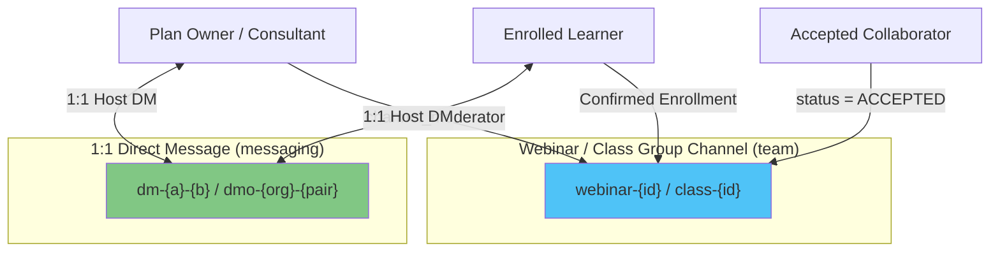
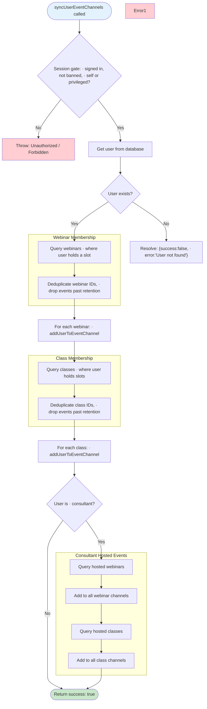

# 06. Channel Management

> Advanced channel management strategies including synchronization, access revocation and race condition prevention

## Table of Contents

- [Channel Creation Strategies](#channel-creation-strategies)
- [User Channel Synchronization](#user-channel-synchronization)
- [Channel Membership Rules](#channel-membership-rules)
  - [4-Part DM & Trial Policy](#4-part-dm--trial-policy)
  - [Booking Context in a Shared DM](#booking-context-in-a-shared-dm)
  - [Server-Side Authorization for Membership Changes](#server-side-authorization-for-membership-changes)
- [Revocation and Derived Membership](#revocation-and-derived-membership)
- [Race Condition Prevention](#race-condition-prevention)
- [User Channel Sync Flow](#user-channel-sync-flow)
- [Event Channel Management](#event-channel-management)
- [Code Examples](#code-examples)
- [Best Practices](#best-practices)
- [Deprecated & Superseded Approaches](#deprecated--superseded-approaches)

---

## Channel Creation Strategies

### Server-Provisioned Hybrid Strategy

Stream Chat channels are created and reconciled exclusively on the server across two complementary paths:

1. **Eager Provisioning on Confirmed Payment / Approval (`ensureChannelsForAppointment` in `lib/payments/webhooks/ensure-channels.ts`, called from `lib/payments/webhooks/handlers.ts`)**:
   - When a paid **Consultation** or **Subscription** transitions into `DM_ELIGIBLE_STATUSES` (`APPROVED`, `COMPLETED`), the server provisions or reuses the pair's canonical 1:1 DM channel (`createDirectMessageChannel(consultantUserId, consulteeUserId, organizationId)`).
   - When a **Webinar** or **Class** enrollment is confirmed, the server adds every seat that still holds access to the group `team` channel (`webinar-<id>` / `class-<id>`), provisions each one's 1:1 DM with the consultant, and passes the same list to `addSeatHoldersToOpenCalls`. The list is the appointment's `CONSULTEE` seats matching `paidParticipant()`, never its `SUCCEEDED` payments: a payment outlives a leave, a removal or a refund, so a payment-built list put departed learners back on the next registration.
   - **Free Trials (`TRIAL`)** are skipped: the function stamps `chatChannelEnsuredAt`, creates no channel and returns `skipped: "trial_chat_blocked"`. The DM gate also excludes trial-backed bookings (see the trial policy below).
   - If adopting an existing event channel fails to add the buyer, `addUserToEventChannel` returns `success: false` with `reason: "member_not_added"`, and `ensureChannelsForAppointment` returns `event_channel_member_not_added` without stamping `chatChannelEnsuredAt`, so the `reconcile-orphaned-confirmations` sweep retries. A Stream or consent refusal (`reason: "account_refused"`) is a deliberate skip and does not block the stamp.
2. **On-Demand Resolution (`POST /api/stream/channels/open`)**:
   - When a user clicks **"Message"** on an appointment card or selects a search result in the chat sidebar, the browser sends the target user or event identifier (`{ kind: "dm", counterpartyUserId, organizationId, contextAppointmentId }` or `{ kind: "event", eventType, eventId }`) to `POST /api/stream/channels/open`.
   - The server verifies `canDirectMessage` or `isEventParticipant`, derives the canonical channel ID server-side, creates/adopts the channel with chunked membership (`createMemberChunk` + `addRemainingMembers`), and optionally posts an idempotent booking context card.

```typescript
// Eager provisioning after payment confirmation (server-side)
await createDirectMessageChannel(
  consultantUserId,
  consulteeUserId,
  organizationId,
);

// On-demand open from client UI (never client-side channel.watch() on uncreated IDs)
const res = await fetch("/api/stream/channels/open", {
  method: "POST",
  headers: { "Content-Type": "application/json" },
  body: JSON.stringify({
    kind: "dm",
    counterpartyUserId,
    organizationId,
    contextAppointmentId: appointment.id,
  }),
});
```

---

## User Channel Synchronization

### syncUserEventChannels Function

**Purpose**: Reconcile a user's Stream channel memberships against Postgres entitlements and revoke stale memberships.

**When to Call**:

- Deferred initial provider connect (`providers/StreamProviderImpl.tsx`, `kickChannelSync`)
- Manual user refresh (`components/chat/InitializeUserChannelsButton.tsx`)
- Privileged maintenance run (the session gate rejects unauthenticated callers)

The sync tidies the viewer's own list; it is **not** the enforcement path. Revocation happens synchronously on the action that ends an entitlement (see [Revocation and Derived Membership](#revocation-and-derived-membership)), so nothing suppresses or gates the sync any more.

**File**: `actions/stream/chat/event-channel.action.ts` (thin `"use server"` wrapper delegating primitives to `lib/stream/event-channel-service.ts`)

```typescript
export async function syncUserEventChannels(userId: string): Promise<{
  success: boolean;
  skipped?: boolean;
  error?: string;
  channelsSynced?: number;
  failed?: number;
  staleChannelsRemoved?: number;
  durationMs?: number;
}>;
```

Five properties of this contract are load-bearing:

1. **It reports failure by resolving, not by rejecting.** A missing user or unauthenticated session returns `{ success: false, error: "..." }` rather than throwing. Callers must branch on `result.success`.
2. **It always does the work.** The server-side `initialSyncCompletedUsers` set, the browser `stream_sync_<id>` session flag and the `force` parameter no longer exist, so no earlier sync can suppress a later one. `providers/StreamProviderImpl.tsx` keeps only an in-memory "kicked in this page load" marker that stops duplicate calls in one load and is cleared when a sync fails or the chat reconnects.
3. **It revokes rather than adds, paging at Stream's 30-channel ceiling.** Channels are provisioned eagerly at booking confirmation and on-demand via `POST /api/stream/channels/open`. `syncUserEventChannels` walks every channel the user belongs to via `queryChannelsPaged` (`lib/stream/batch.ts`, 30 channels per page sorted by `created_at` ascending) and removes memberships with a managed prefix (`MANAGED_CHANNEL_PREFIXES`: `webinar-`, `class-`, `collab-`, `dm-`, `dmo-`, `dmh-`) that are absent from the Postgres expected-set.
4. **It is session-gated.** `actions/stream/chat/event-channel.action.ts` reads the session fresh from the database (`getSession()`), rejects banned accounts, and allows only self or privileged (`ADMIN`/`STAFF`) callers before touching the sync cache.
5. **Its expected-set includes `ACCEPTED` collaborators and excludes events past retention.** `getWebinarIdsForUser` and `getClassIdsForUser` include webinars and classes where the user is the host, a live `AppointmentParticipant`, or an `ACCEPTED` `Collaborator` (`consultantProfile.deletedAt: null`), so co-hosts are never evicted during reconciliation. Events whose latest slot `endsAt` has passed the owning organization's retention window (`isPastRetention` in `lib/stream/channel-lifecycle.ts`) are excluded so the sync never resurrects channels hard-deleted by the retention cron.

---

## Channel Membership Rules

### 4-Part DM & Trial Policy

Familiarise enforces a deterministic 4-part communication policy across all booking modalities (`lib/stream/dm-eligibility.ts`, `lib/stream/dm-eligibility-statuses.ts`, `lib/stream/event-channel-service.ts`):

1. **One Human Pair = One Canonical DM Channel (`dm-` / `dmo-`)**:
   - A consultant and a consultee who transact together share **one** 1:1 `messaging` channel per tenancy scope across all repeat consultations, subscriptions, webinars, and classes:
     - **B2C Personal Scope**: `dm-${userIdA}-${userIdB}` (with `userIdA` and `userIdB` ordered by UTF-16 code units `a < b ? [a, b] : [b, a]`, never `localeCompare`; hashed to `dmh-${sha256}` if the joined string exceeds Stream's 64-character ceiling).
     - **B2B Enterprise Organization Scope**: `dmo-${sha256(orgId).slice(0, 12)}-${sha256(`${orgId}:${a}:${b}`).slice(0, 36)}` with `custom.organization_id = orgId`.
   - Consultee-to-consultee peer DMs are prohibited (`canDirectMessage` requires at least one eligible consultant ↔ consultee link).
2. **Paid / Confirmed Eligibility Gate (`DM_ELIGIBLE_STATUSES`)**:
   - `DM_ELIGIBLE_STATUSES = ["APPROVED", "COMPLETED"]` (`lib/stream/dm-eligibility-statuses.ts`).
   - Unpaid or unconfirmed bookings (`PENDING`, `APPROVED_PENDING_PAYMENT`, `CANCELLED`, `REJECTED`, `EXPIRED`) are **excluded** — direct messaging opens only after payment settles or an appointment is confirmed without pending payment, and remains open through `COMPLETED` for post-session follow-up until the retention window expires.
3. **Webinars & Classes Provision Both Group Event Channels and 1:1 Host DMs**:
   - Enrolling in a confirmed `WEBINAR` or `CLASS` (`OPENABLE_EVENT_STATUSES = ["SCHEDULED", "COMPLETED"]`) provisions **both**:
     1. The shared `team` channel (`webinar-${webinarId}` or `class-${classId}`), whose roster includes the plan owner, all `ACCEPTED` `Collaborator` co-hosts, and all live `AppointmentParticipant` enrollees.
     2. The 1:1 personal DM (`dm-` or `dmo-`) between the hosting consultant and each confirmed enrollee (`hasWebinarLink` and `hasClassLink` in `lib/stream/dm-eligibility.ts`).
4. **A Free Trial (`TRIAL`) Never Grants Chat**:
   - **No provisioning:** `ensureChannelsForAppointment` (`lib/payments/webhooks/ensure-channels.ts`) creates nothing for a trial appointment and returns `skipped: "trial_chat_blocked"`.
   - **No DM eligibility:** `canDirectMessage` and `pairBookingContexts` exclude any consultation or subscription whose appointment is a `TRIAL` or whose client seat is `REFUNDED` (`excludeNonDmDirectBooking` in `lib/stream/dm-eligibility-statuses.ts`). A relationship made only of trials never opens a DM, and a refunded booking stops counting even while its row stays `SCHEDULED`. Asynchronous DM access opens when the learner holds a paid, eligible booking.
   - **No in-call chat:** `isInCallChatAllowed("TRIAL")` is false (`lib/meetings/room-ready.ts`); `app/meetings/[id]/components/MeetingRoom.tsx` hides the chat and Q&A tabs and the stage Q&A route answers 403 (`trial_chat_disabled`).

### Booking Context in a Shared DM

Repeat bookings between the same two people share one `dm-` or `dmo-` thread. `POST /api/stream/channels/open` posts nothing into it. When a DM is opened from an appointment, the composer offers a removable "About: <title> · next session …" chip that tags the sender's next message with `booking_appointment_id`, and the tag is rendered only from the server-verified `GET /api/stream/booking-tag` answer. See [04. Chat Implementation](./04-chat-implementation.md#appointment-chat-sheet-and-booking-tag).

### Server-Side Authorization for Membership Changes

Stream's server-side API bypasses its own permission system whenever a valid API secret is presented, so every membership mutation is authorized in the application layer before calling Stream:

- `actions/stream/chat/channel.action.ts` and `lib/stream/event-channel-service.ts` do **not** have `"use server"` directives and cannot be invoked as browser RPCs.
- `actions/stream/chat/event-channel.action.ts` (`"use server"`) gates `addUserToEventChannel`, `removeUserFromEventChannel`, and `syncUserEventChannels` via `getSession()` + participant/host/admin checks.
- `POST /api/stream/channels/open` enforces `requireApiAuth()`, `streamApiLimiter`, `canDirectMessage` / `isEventParticipant`, and `pairBookingContexts` (preventing cross-organization `organizationId` forgery). `isEventParticipant` requires the host profile's `deletedAt` to be null, so a deleted host keeps no host access.
- A channel owner (`created_by`: the consultant of a DM, the host of an event channel) holds no truncate, delete, recreate, update or member-update grant on the `messaging` channel type (`MESSAGING_USER_REVOKED_GRANTS` in `lib/stream/control-plane-contract.ts`, written by `scripts/stream/ensure-messaging-grants.ts`). A browser console cannot change a Postgres-derived channel's membership or wipe its history, so every such change goes through a server action. Leaving keeps working because `remove-own-channel-membership` stays.
- `addMemberToChannel` (`actions/stream/chat/member.action.ts`) refuses a non-staff add to any managed channel with the typed refusal `DERIVED_CHANNEL_MEMBERSHIP`, audits a staff add through `recordOpsAction`, and keeps DMs closed to everyone. `isManagedChannel` (`lib/stream-channel-ids.ts`) is the predicate. The info dialog hides **Add Members** and **Clear chat** on managed channels, because truncate wipes the thread for every member; previously the consultant in a DM could wipe both sides.

### Participant Sources

An event channel's members are the plan owner, the `ACCEPTED` collaborators whose profiles are not deleted, and the `CONSULTEE` seats that hold access. A seat holds access when it matches `paidParticipant()` (`lib/booking/participants.ts`), the same fulfilled entitlement the meeting gate admits. That means a `CONFIRMED` or `ATTENDED` seat whose payment is `SUCCEEDED` or which has no payment, or a `HELD` seat whose capture settled and is not being returned. A `CANCELLED` or `REFUNDED` seat is never a member.

Every writer that sets or extends the roster reads this definition:

- `ensureChannelsForAppointment` on each registration and in the `reconcile-orphaned-confirmations` sweep;
- `getEventData` when the first join creates the channel;
- `loadEventChannelData` behind `POST /api/stream/channels/create`;
- `isEventParticipant` on the open route.

Example: Charlotte leaves Hannah's free webinar and her seat becomes `CANCELLED`. When Daniel registers, the sync adds Daniel and every seat still `CONFIRMED`, and leaves Charlotte out, although her ₹0 payment is still `SUCCEEDED`. See [the decision record](../decisions/2026-11-14-event-membership-follows-seats.md).



### Deduplication Strategy

**Problem**: a webinar's registrants are connected to every one of its slots, so
the same user id appears once per slot.

**Solution**: Deduplicate before adding to the channel

```typescript
const appointmentIds =
  webinar.appointment?.appointmentOccurrences?.flatMap((slot) =>
    slot.user.map((user) => user.id),
  ) || [];

const allParticipantIds = Array.from(new Set(appointmentIds));

console.log(`Unique participants: ${allParticipantIds.length}`);
```

### Host Inclusion

**Rule**: Event host (consultant) is ALWAYS a member

```typescript
const allMembers = Array.from(new Set([consultantUserId, ...participantIds]));
```

---

## Revocation and Derived Membership

A **managed** channel is one whose roster Postgres derives (`MANAGED_CHANNEL_PREFIXES`: `webinar-`, `class-`, `collab-`, `dm-`, `dmo-`, `dmh-`). Only eligibility may add to or keep a member there. The legacy `consultation-` and `subscription-` prefixes are not managed. Three layers keep Stream aligned with Postgres, and none of them relies on the affected user's browser.

1. **Intent-first revocation on the mutating action** (`lib/stream/access-revocation.ts`). After the cancel route (`app/api/appointments/[appointmentId]/cancel/route.ts`) or `leaveEventSeat` (`lib/booking/seat-leave.ts`) commits, it calls `revokeEndedSeatAccess(appointmentId, userIds)`; a refund that ends a seat calls `revokeRefundedSeatAccess({ refundId, payerUserId })`, after persisting its intent keyed by the `Refund` row. Each persists a revocation intent first, then removes every user the join gate no longer admits from `webinar-` / `class-`, from each host and presenter DM that `isDmContextEligible` says the pair no longer shares in that DM's scope, and from every room the appointment provisioned, inside an 8-second budget. The drive never revokes staff (the plan owner, accepted collaborators, occurrence hosts), keeps per-room progress in `StreamRevocationRetry.resumeAfter`, and `/join` answers 503 `SEAT_UNVERIFIED` to a non-host when `fenceSeatGrants` cannot verify the seat (it persists the intents first). The full order is in [the channel lifecycle](17-channel-lifecycle.md#revoking-access-when-an-entitlement-ends).
2. **A durable retry.** A Stream failure enqueues a `StreamRevocationRetry` row (`enqueueStreamRevocationRetries`). Its `kind` is `ERASURE_REVOKE` (default), `COLLAB_REVOKE`, `EVENT_CHANNEL_REMOVE`, `DM_REMOVE`, `ORG_REVOKE`, `SEAT_ACCESS_REVOKE` (appointment) or `REFUND_ACCESS_REVOKE` (refund), and `planId` holds the kind's target. Postgres guards the shape (`stream_revocation_retry_owner` CHECK) and allows one open row per target (`stream_revocation_retry_open_key` partial unique index), both in `prisma/sql/check-constraints.sql`. The `retry-moderation-enforcement` sweep (every 30 minutes on the ticker) drains due rows through `redriveAccessRevocation` (seat, refund and erasure rows retry daily past the attempt cap instead of giving up; without Stream's keys nothing is attempted and the rows stay owed), stops starting rows after `SWEEP_START_DEADLINE_MS` (`lib/cron/run-deadline.ts`), and treats a target Postgres has re-granted (a re-accepted collaborator, a re-enrolled seat, a re-eligible DM, a rejoined organization) as settled.
3. **A daily audit.** `reconcile-stream-memberships` (`lib/stream/membership-reconciler.ts`) removes members the open path's own access predicate no longer admits from event and collaborator channels, in resumable slices, and never touches DMs. See [17. Channel Lifecycle](./17-channel-lifecycle.md#the-daily-membership-reconciler).

Every ending of an accepted collaborator writes its `COLLAB_REVOKE` row inside the ending transaction (`endCollaboration` in `lib/collaborators/ending.ts`) and drives it after the commit; see [the collaborators' Stream chat page](../collaborators/04-stream-chat-integration.md#revocation). Organization member removal (`revokeMemberStreamAccess`, `lib/enterprise/member-removal.ts`) revokes the member's Stream tokens issued before the removal, removes them from the organization's live and upcoming calls, and queues `ORG_REVOKE` when incomplete; the client re-mints through `sdkTokenProvider` in `providers/StreamProviderImpl.tsx`, which skips the token cache on every SDK re-request after the first.

**Collaborator channels never unfreeze on open.** `createCollaboratorChannel` is get-or-create only and returns `frozen`. `POST /api/stream/channels/open` refuses a frozen channel with `423 CHANNEL_FROZEN` and a `DEACTIVATED` organization with `403 ORG_DEACTIVATED` (checked before the host and collaborator checks; `ADMIN`/`STAFF` are exempt). Both answer `{ error, code }`, which the chat UI shows as a toast.

---

## Race Condition Prevention

### Atomic Channel Creation

**Problem**: Multiple users might try to create the same channel simultaneously

**Solution**: Atomic creation with member list

```typescript
// BAD: Race condition possible
await channel.create();
await channel.addMembers(members); // Separate operation

// GOOD: Atomic operation
const channel = serverClient.channel(channelType, channelId, {
  name: channelName,
  created_by_id: createdById,
  members: allMembers, // Added atomically
});
await channel.create();
```

### Check-Then-Create Pattern

**Problem**: Race between checking if channel exists and creating it

**Solution**: Use try-create pattern with error handling

```typescript
export const addUserToEventChannel = async (
  eventType: "webinar" | "class",
  eventId: string,
  userId: string,
) => {
  const channelId = `${eventType}-${eventId}`;
  const channel = client.channel("team", channelId);

  try {
    // Check if channel exists
    let channelExists = await checkEventChannelExists(eventType, eventId);

    if (!channelExists) {
      // Get event details and create channel
      const eventData = await getEventData(eventType, eventId);

      // Create with initial member
      const newChannel = client.channel("team", channelId, {
        name: eventData.name,
        created_by_id: eventData.creatorId,
        members: [userId], // Add during creation
      });

      await newChannel.create();
      console.log(`Created channel ${channelId} with initial member ${userId}`);
    } else {
      // Channel exists, just add member
      await channel.addMembers([userId]);
      console.log(`Added ${userId} to existing channel ${channelId}`);
    }
  } catch (error) {
    if (error.code === 16) {
      // Channel not found - might have been deleted
      console.log(`Channel ${channelId} not found, will retry creation`);
      throw error;
    }
    console.error(`Error adding user to channel:`, error);
    throw error;
  }
};
```

### Idempotent Operations

**Problem**: Retry logic might add user twice

**Solution**: Stream's `addMembers` is idempotent (safe to call multiple times)

```typescript
// Safe to call multiple times - won't duplicate members
await channel.addMembers([userId]);
await channel.addMembers([userId]); // No-op if already member
```

The shipped lazy paths go one step further than check-then-create: when a
lost create race is rejected by Stream, the existing channel is adopted via
`isChannelAlreadyExistsError` in `lib/stream-utils.ts` instead of failing the
caller. [17. Channel Lifecycle](./17-channel-lifecycle.md) documents the full
create-and-adopt story.

---

## User Channel Sync Flow



**Flow Steps**:

1. **Session Gate**: Require a signed-in, non-banned caller acting as self (or a privileged role); the gate precedes everything
2. **User Retrieval**: Fetch user with consultant/consultee profiles
3. **Webinar Collection**:
   - Query appointment slots
   - Deduplicate IDs
   - Drop events past their retention window (`isPastRetention`)
4. **Webinar Channel Addition**: Add user to all webinar channels
5. **Class Collection**:
   - Query appointment slots
   - Deduplicate IDs
   - Drop events past their retention window (`isPastRetention`)
6. **Class Channel Addition**: Add user to all class channels
7. **Consultant Check**: If user is consultant, add to hosted events
8. **Completion**: Return success

---

## Event Channel Management

### Checking Channel Existence

`checkEventChannelExists(eventType, eventId)` (`lib/stream/event-channel-service.ts`) answers from the existence cache when it can. On a miss it reads Stream by channel id and never opens a channel handle, so Stream is not asked to create anything: a chat that is not there is an empty result, not an error.

```typescript
const [found] = await withStreamCircuitBreaker(
  () =>
    client.queryChannels({ cid: { $eq: `${channelType}:${channelId}` } }, [], {
      limit: 1,
      state: false,
      watch: false,
      presence: false,
    }),
  () => {
    throw new StreamUnavailableError();
  },
);
if (!found) return false;
markChannelExists(channelType, channelId);
return true;
```

Only a found chat is cached. A read that fails is reported once by the circuit breaker and answers `false`, so the caller treats the chat as not there for this request.

### Adding User to Event Channel

```typescript
export const addUserToEventChannel = async (
  eventType: "webinar" | "class",
  eventId: string,
  userId: string,
) => {
  try {
    const channelId = `${eventType}-${eventId}`;
    let systemCreatedChannel = false;

    // Check if channel exists
    let channelExists = await checkEventChannelExists(eventType, eventId);
    let channel = client.channel("team", channelId);

    if (!channelExists) {
      console.log(`Channel ${channelId} does not exist. Creating...`);

      // Get event data
      let channelCreatorId = "system";
      let channelName = `${eventType} ${eventId}`;

      if (eventType === "webinar") {
        const webinar = await prisma.webinar.findUnique({
          where: { id: eventId },
          include: {
            webinarPlan: {
              include: { consultantProfile: { include: { user: true } } },
            },
          },
        });

        if (!webinar) throw new Error(`Webinar ${eventId} not found`);

        channelName = webinar.webinarPlan.title;

        if (webinar.webinarPlan.consultantProfile?.user?.id) {
          const consultantUserId =
            webinar.webinarPlan.consultantProfile.user.id;
          await upsertUserToStream(consultantUserId);
          channelCreatorId = consultantUserId;
        }
      } else {
        // Similar logic for classes...
      }

      // Create channel with user as initial member
      channel = client.channel("team", channelId, {
        name: channelName,
        created_by_id: channelCreatorId,
        members: [userId], // Add during creation
      });

      try {
        await channel.create();
        systemCreatedChannel = true;
        console.log(
          `Created channel ${channelId} with creator ${channelCreatorId} ` +
            `and initial member ${userId}`,
        );
      } catch (createError) {
        if (!isChannelAlreadyExistsError(createError)) throw createError;

        // Lost a concurrent-create race: ADOPT the winner's channel instead
        // of failing this user's join, and retry our own membership once —
        // the winner's roster snapshot may predate us.
        console.log(`Lost the create race for ${channelId}; adopting`);
        try {
          await channel.addMembers([userId]);
        } catch (adoptError) {
          // Best-effort: logged, never thrown; the next sync reconciles a miss.
          console.warn(
            `Post-adoption addMembers failed for ${userId}:`,
            adoptError,
          );
        }
      }
    } else {
      // Channel exists - update name if needed and add member
      const eventData = await getEventData(eventType, eventId);
      const existingChannelData = await channel.query();

      if (existingChannelData.channel?.name !== eventData.name) {
        console.log(
          `Updating channel ${channelId} name to "${eventData.name}"`,
        );
        await channel.update({ name: eventData.name });
      }

      await upsertUserToStream(userId);
      console.log(`Channel ${channelId} exists. Adding member ${userId}...`);
      await channel.addMembers([userId]);
    }

    return { success: true, systemCreatedChannel };
  } catch (error) {
    console.error(
      `Error in addUserToEventChannel for ${eventType} ${eventId}, user ${userId}:`,
      error,
    );
    throw error;
  }
};
```

---

## Code Examples

### Complete Sync on Login

```typescript
// In login callback
async function handleLogin(userId: string) {
  try {
    // 1. Upsert user to Stream
    await upsertUserToStream(userId);

    // 2. Sync all channel memberships
    await syncUserEventChannels(userId);

    console.log(`User ${userId} synced with all event channels`);
  } catch (error) {
    console.error("Error syncing user channels on login:", error);
    // Continue login even if sync fails
  }
}
```

### Periodic Background Sync

```typescript
// Background job (daily)
export async function syncAllUserChannels() {
  console.log("Starting daily user channel sync...");

  // Get all active users
  const users = await prisma.user.findMany({
    where: {
      OR: [
        { consulteeProfile: { isNot: null } },
        { consultantProfile: { isNot: null } },
      ],
    },
    select: { id: true },
  });

  console.log(`Syncing ${users.length} users...`);

  let successCount = 0;
  let errorCount = 0;

  for (const user of users) {
    try {
      // The session gate applies here too: this loop only passes when it runs
      // under a PRIVILEGED (ADMIN/STAFF) session, or when each call acts as
      // self. An unauthenticated script is rejected outright.
      const result = await syncUserEventChannels(user.id);
      // The sync reports per-user problems by RESOLVING with success:false,
      // not by rejecting — count them as failures, not successes.
      if (result.success) {
        successCount++;
      } else {
        console.warn(`Skipped ${user.id}: ${result.error}`);
        errorCount++;
      }
    } catch (error) {
      console.error(`Failed to sync user ${user.id}:`, error);
      errorCount++;
    }
  }

  console.log(`Sync complete: ${successCount} succeeded, ${errorCount} failed`);

  return { successCount, errorCount };
}
```

The session gate constrains loops like this: each call must act as self or run
under a privileged caller — an unauthenticated background job is rejected
outright.

### Add to Channel on Event Join

```typescript
// When a user registers for a webinar
async function handleJoinWebinar(userId: string, webinarId: string) {
  try {
    // 1. Record the registration
    await prisma.appointmentOccurrence.update({
      data: {
        userId,
        webinarId,
      },
    });

    // 2. Add to Stream channel
    await addUserToEventChannel("webinar", webinarId, userId);

    console.log(`User ${userId} added to webinar ${webinarId} channel`);
  } catch (error) {
    console.error("Error adding user to webinar channel:", error);
    throw error;
  }
}
```

---

## Best Practices

### 1. Always Deduplicate Members

**Good**:

```typescript
const allIds = Array.from(new Set(appointmentIds));
```

**Bad**:

```typescript
const allIds = appointmentIds; // Duplicates possible
```

### 2. Include Creator in Members

**Good**:

```typescript
const allMembers = Array.from(new Set([createdById, ...members]));
```

### 3. Sync on Critical Events

**When to Sync**:

- User login
- User joins event
- User profile changes
- Daily background job

### 4. Graceful Error Handling

**Good**:

```typescript
try {
  await syncUserEventChannels(userId);
  console.log("Sync successful");
} catch (error) {
  console.error("Sync failed:", error);
  // Log but don't block user flow
}
```

### 5. Use Idempotent Operations

**Good**:

```typescript
// Safe to call multiple times
await channel.addMembers([userId]);
```

### 6. Log Membership Details

**Good**:

```typescript
console.log(
  `Webinar ${webinarId} participants: ` +
    `${appointmentCount} from appointments, ` +
    `${uniqueCount} total unique`,
);
```

### 7. Verify Channel State

**Good**:

```typescript
await channel.create();
const channelData = await channel.query();
const actualMembers = Object.keys(channelData.members || {});
console.log(`Expected: ${members.length}, Actual: ${actualMembers.length}`);
```

### 8. Update Channel Metadata

**Good**:

```typescript
// Check if name changed
if (existingChannel.name !== expectedName) {
  await channel.update({ name: expectedName });
}
```

---

## Deprecated & Superseded Approaches

- **Per-Booking `consultation-{id}` and `subscription-{id}` Channels**: Retired in favor of one canonical 1:1 DM channel per `(consultant, consultee, orgScope)` tuple (`dm-<a>-<b>` / `dmo-<orgHash>-<pairHash>`). Per-booking channels fragmented conversation history across repeat sessions, caused sidebar clutter, and complicated post-session follow-up. Disambiguation across multiple bookings now uses the verified booking tag on the message that refers to a booking.
- **Direct Messages and In-Call Chat on Free Trials (`TRIAL`)**: Superseded by the trial rules above: no provisioning (`skipped: "trial_chat_blocked"` in `lib/payments/webhooks/ensure-channels.ts`), no DM eligibility (`excludeNonDmDirectBooking`) and no in-call chat (`isInCallChatAllowed`). Asynchronous messaging opens only on paid/confirmed bookings (`DM_ELIGIBLE_STATUSES = ["APPROVED", "SCHEDULED", "COMPLETED"]`).
- **Client-Cooperative Revocation via the Sync Gates**: Revocation once waited for the affected user's browser to run `syncUserEventChannels`, behind the server `initialSyncCompletedUsers` set, the `stream_sync_<id>` session flag and a `force` parameter. Replaced by synchronous revocation, the `StreamRevocationRetry` queue and the daily reconciler. Remove any residue.
- **Unfreeze-on-Open for Collaborator Channels**: `createCollaboratorChannel` used to clear `frozen` on every open, undoing wind-down and moderation freezes. It is now get-or-create only and the open route refuses a frozen channel.
- **Server-Posted Booking Cards (`booking-ctx-`, `system-booking-context`)**: Opening a DM from an appointment used to post a receipt card as a server user named "Familiarise". People read it as a support message, it showed a Get help link and a duplicate title line, its date was the first session rather than the next, and it was written for both people even when nobody replied. Replaced by the booking tag on the sender's next message. Old cards in Stream are hidden by `CustomMessage`, and `LEGACY_BOOKING_CONTEXT_USER_ID` survives only for that and to keep the user out of DM member counts.
- **DM "Clear chat" and Manual Adds on Managed Channels**: Truncate wiped a DM thread for both sides, and any creator could add members by hand. Both are refused or hidden on managed channels.
- **Event Rosters Built From Payments or Live Seats**: `ensureChannelsForAppointment` listed every `SUCCEEDED` payment's buyer, which re-added learners who had left, been removed or been refunded on the next registration; the create route's roster used `liveParticipant()`, which gave an unpaid hold chat. Both now read `paidParticipant()`.
- **Opening DMs on `APPROVED_PENDING_PAYMENT` Bookings**: Retired so unpaid booking requests cannot initiate chat before payment settles.
- **Unpaginated `queryChannels({ limit: 100 })` Reconciliation Loops**: Superseded by `queryChannelsPaged` (`lib/stream/batch.ts`), which pages at Stream's hard 30-channel per-request ceiling sorted by `created_at` ascending so memberships beyond the 30th channel are never silently skipped during revocation sweeps.
- **Client-Side `channel.watch()` on Uncreated Channel IDs**: Superseded by server-side resolution in `POST /api/stream/channels/open` (`createDirectMessageChannel` / `addUserToEventChannel`), preventing the browser from creating memberless phantom channels.

---

## Navigation

- [Previous: 05. Video Implementation](./05-video-implementation.md)
- [Next: 13. Recording & Webhooks](./13-recording-webhooks.md)
- [Troubleshooting](./troubleshooting.md)
