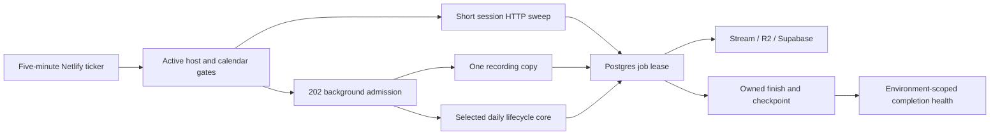

# Stream background recovery and lifecycle

The five-minute ticker in `netlify/functions/cron-tick.mts` selects work from the
pure `lib/cron/schedule.ts` catalog. PostgreSQL stores domain state, job leases and
continuation cursors. Stream supplies call, recording and channel facts; R2 owns
durable recording media. Each job has one domain implementation. Cleanup HTTP
and staff recovery either execute the short session slice or queue the same
background adapter used by the ticker.

## Execution and ownership

Background responses acknowledge admission before authentication and execution.
The ticker accepts only 202 for background targets, records `accepted` separately
from `ok`, and never treats that admission as completed work. The adapters run only on
the production deploy and validate the method and bearer before any work, then
the maintenance state before invoking a core. They never throw: a failed run is
logged and recorded, because a throw would buy Netlify's two automatic retries. The cleanup route
and staff dispatch use configured HTTPS origins, refuse embedded credentials and
redirects, and keep the bearer server-side.

The adapters have no independent schedules. All Stream jobs in this document
have one automatic owner; their former Actions steps, dispatch allowlists and
failure-summary entries are removed. No Actions workflow schedules a registry job. CI/CD build and review workflows are a separate responsibility.

Current background targets are `/.netlify/functions/recording-transfer-background`
and `/.netlify/functions/stream-maintenance-background?job=<slug>`. Automatic
background work currently requires Netlify as active cron host. Another host
needs equivalent worker adapters before taking ownership; leaving Netlify as
standby alone does not supply those adapters. Keep the standby configuration.

## Cadence and capacity

Daily windows are 00:00–03:00 UTC for retention/orphan recovery, 03:00–06:00
for wind-down, and 08:00–11:00 for principal/channel lifecycle. Each daily job runs
three bounded slices. These are dispatch cadences, not a guarantee that a backlog
has drained. The catalog is shared with documentation and tested over every tick
of a week and 400 days, including monthly/quarterly collisions; no tick exceeds
eleven targets (the cap is twelve). Existing Stream membership and control-plane checks remain scheduled.

| Core / entry                                      | UTC slots           | Work bound and continuation                                                                                                                                                                                                                                     |
| ------------------------------------------------- | ------------------- | --------------------------------------------------------------------------------------------------------------------------------------------------------------------------------------------------------------------------------------------------------------- |
| `lib/meetings/reconcile-orphaned-sessions.ts`     | :10/:40             | At most five rooms; stop starting work after six seconds; persist an ID bound across successes, active rooms and failures.                                                                                                                                      |
| `lib/stream/recording-transfer-service.ts`        | :00/:15/:30/:45     | One stale claim, one eligible copy, at most 100 risk candidates; 12-minute copy deadline.                                                                                                                                                                       |
| `lib/stream/recording-retention.ts`               | 00:05, 01:05, 02:05 | Default ten lapsed rows, ten due expiries, ten asset cleanups and ten transferred-source deletes; scan at most 25 retention candidates. Separate ID cursors for lapsed, due and source-copy stages. Explicit limits clamp to 1–25.                              |
| `scripts/stream/reconcile-orphaned-recordings.ts` | 00:25, 01:25, 02:25 | At most 25 meetings aged 2h–14d with a durable recording-start witness, including both zero-row and partial deliveries; five-minute start budget; ID continuation.                                                                                              |
| `jobs/stream/wind-down-deactivated-orgs.ts`       | 03:55, 04:55, 05:55 | At most two organizations and ten removed memberships with separate ID cursors; related database scans cap at 5,000 plus one sentinel; five-minute start budget through vendor loops; ten recording purges per organization; incomplete markers stay unwritten. |
| `scripts/stream/stream-sync.ts`                   | 08:50, 09:50, 10:50 | At most five pages of 100 principals; persist the last ID; wrap at the end; preserve the starting cursor on dry runs.                                                                                                                                           |
| `jobs/stream/expire-event-channels.ts`            | 08:55, 09:55, 10:55 | At most 25 event appointments plus shared collaborator channels and ten DM channels per slice; separate appointment-ID and DM-channel continuation.                                                                                                             |

ID bounds use `id > checkpoint`, so deleting the last processed row does not break
continuation. A finished failed slice can still save its progress. Retried rows
are revisited after wrap, while permanent failures cannot pin the same prefix.
Unstarted recording-recovery rows remain ahead of the next checkpoint. Renewal
resolution stops on its time/hop bound rather than treating an incomplete chain
as proof of expiry. A full retention scan exposes its checkpoint and warning;
monitor age and backlog independently of successful slice completion.

Channel expiry derives each collaborator channel's lifetime from the latest live
occurrence across its whole plan, including future-only event appointments. A
page-local maximum is insufficient. Event freeze stamps do not prove that a
shared collaborator channel was frozen: its bounded idempotent freeze is retried
independently, including after an earlier collaborator freeze failed. DM dormancy uses the latest booking across
its funding context. The DM discovery scans cap at 5,000 consultations and 5,000
subscriptions; deletion is withheld and the run fails if either input is
truncated, because incomplete aggregation can misclassify an active relationship.
This safety ceiling needs a separately reviewed discovery repair before higher
volumes; increasing vendor work is not a safe workaround. Freeze calls remain
paced and reversible. Bulk channel/user deletion acknowledges asynchronous tasks;
accepted requests are not proof of physical deletion.

## Failure and concurrency rules

Every migrated core acquires a fail-closed 15-minute PostgreSQL lease. A missing
lease delegate or database outage prevents work. Netlify's documented background
ceiling is 15 minutes, distinct from the ticker's 30-second ceiling. The worker's
cooperative start budgets reserve room for an in-flight operation and cleanup;
a deadline does not undo a request already accepted by a vendor. Leases exclude
concurrent executions of the same job, while row fences protect different jobs
that touch the same recording. They do not provide exactly-once delivery.

- Session end and presence closure share one transaction using its `tx` client.
  Conditional meeting writes protect a concurrently extended or ended room.
- Copy claims consume an attempt immediately. A stale reclaim keeps that attempt;
  publication and release require the exact claim timestamp and attempt. Attempt
  keys prevent a late loser from deleting another worker's published object.
- Retention skips TRANSFERRING rows and preserves published/purchased exemptions.
  A lapsed recent source expires only on confirmed absence; provider failure
  leaves it READY. Expired asset pointers remain durable retry obligations.
- Organization wind-down claims EXPIRED with status, asset identity and purchase
  guards before vendor deletion. A lost claim performs no deletion and withholds
  completion. Failed known-pointer cleanup stays retryable. Active copies and a
  full purge slice withhold the retention-complete marker. Organization/channel
  scan failures cannot be hidden by a later empty recording scan.
- Dormancy never unfreezes an already-deactivated organization's DM. If wind-down
  commits during an unfreeze, the post-write organization read re-freezes it and
  retains a frozen ledger. These compensations address overlapping effects;
  status reads do not atomically transact with Stream.
- Confirmed Stream 404/code 16 on an individual lazy channel is absence, without
  a false frozen stamp. Authentication, quota, transport and server failures stay
  failed and retain bounded diagnostics. One invocation reporter aggregates
  failures, including those caught by shared helpers.

Wind-down's vendor pager still has Stream's offset ceiling (up to 1,020 channels).
Frozen messaging prefixes leave its filter, permitting later progress; unchanged
non-messaging prefixes or persistent failures can still conceal the tail. Such
scans remain failed and cannot write completion markers. This is a documented
scale limitation, not proof of full tenant cleanup. See
[channel lifecycle](./17-channel-lifecycle.md#organisation-wind-down-completion).
Removed-member retries retain their removal cutoff and skip rejoined memberships.
The user-sync job exempts support/system principals, soft-deletes absent database
users and requests hard deletion for erased users; it has no additional 30-day
grace rule. Its result reports accepted deletion requests and task IDs, rather
than claiming asynchronous hard-delete completion. Dedicated erasure obligations
remain owned by the existing erasure/revocation retry flow.

## Completion, alarms and operations

`/api/health/jobs` requires successful owned COMPLETED executions scoped to the
server environment: 45 minutes for transfer, 90 minutes for orphaned sessions,
27 hours for each daily lifecycle capability. A 202 or another job's heartbeat
cannot satisfy one capability's requirement. A successful bounded slice is still
not evidence of complete vendor cleanup or acceptable backlog age.

The recording-risk sample selects only future-expiring READY/STREAM_S3 rows that
expire within 72 hours or have consumed at least three attempts. It selects at
most 100 rows and conditionally claims each alert for six hours using
`transferFailureAlertedAt`. The claim preserves `updatedAt` to avoid changing
copy retry timing. Only won claims enter the aggregate Sentry event. Expired rows
stop re-alerting. A crash after the stamp and before capture can defer a message
until the cooldown ends; a database stamp is not a telemetry delivery receipt.
Missing expiry metadata remains excluded and needs source classification, not
inferred fixture timestamps.

Before release, verify the published function manifests and native loading, active
host selection, authorized cohort execution, environment-scoped history, accepted
telemetry and real row/object progress. Temporary packaging with symlinked
`node_modules` is not deployed-artifact proof. The read-only investigation found
many absent lazy event channels, but retained October failure logs do not prove
that every historical failure had that cause. Keep the bounded error sample for
operator diagnosis. Do not run destructive expiry probes against shared fixtures.

Use the staff system-jobs door or the authenticated cleanup route for recovery.
Inspect history before retrying an ambiguous admission timeout. For recording
transfer gates and manual recovery of failed unpublished attempt-object cleanup,
follow [the worker runbook](./recording-background-worker.md). No SQL or Redis
state apply is part of this code migration.

Persisted lifecycle checkpoints are validated before vendor work. Malformed JSON
or invalid cursor fields fail the run and require inspection of the execution
trail. Restore a reviewed valid checkpoint or authorize a bounded restart through
the database recovery procedure; never reinterpret arbitrary JSON as an
organization ID. The deployed baseline did not write lifecycle cursors, so no
legacy cursor-format fallback is required by this migration.

## Deprecated & Superseded Approaches

The Stream jobs previously depended on Actions scheduling; exhausted Actions
budget stopped their automatic execution. The ticker now owns their cadences.
The migrated wrapper scripts and the old `scripts:stream-sync` command are
removed; use the registered recovery doors. The daily cores no longer belong in
short synchronous cleanup/admin requests. Recording transfer admission was
previously indistinguishable from completion, and its risk alarm repeated every
15 minutes for expired sources; queue/completion separation and conditional
six-hour alert claims replace that behavior. Page-local collaborator lifetimes
and delete-before-claim organization recording purges are superseded by the
whole-plan read and claim-first cleanup described above.
