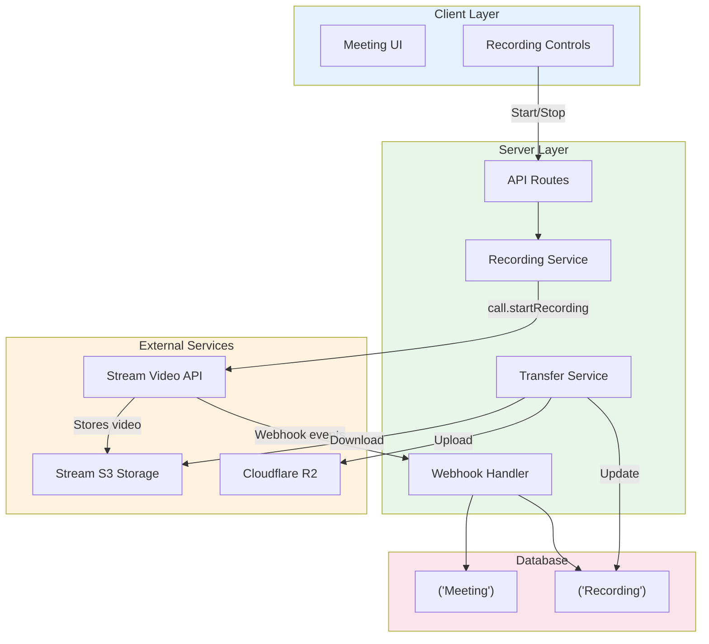
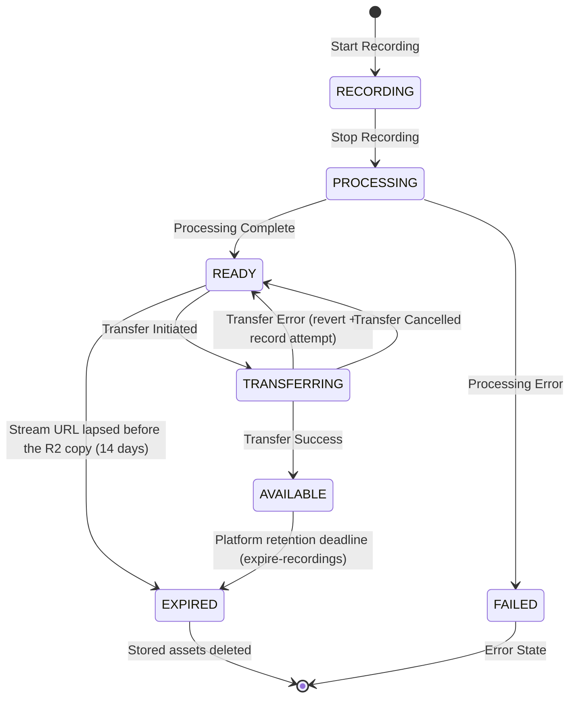
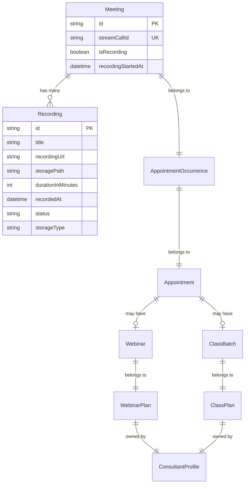
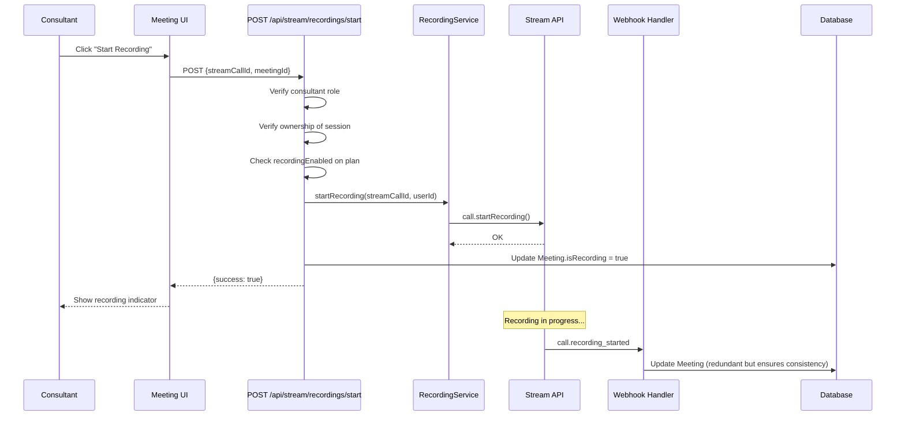
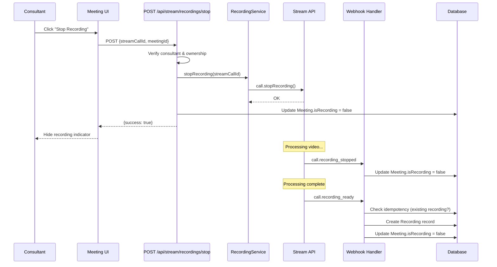
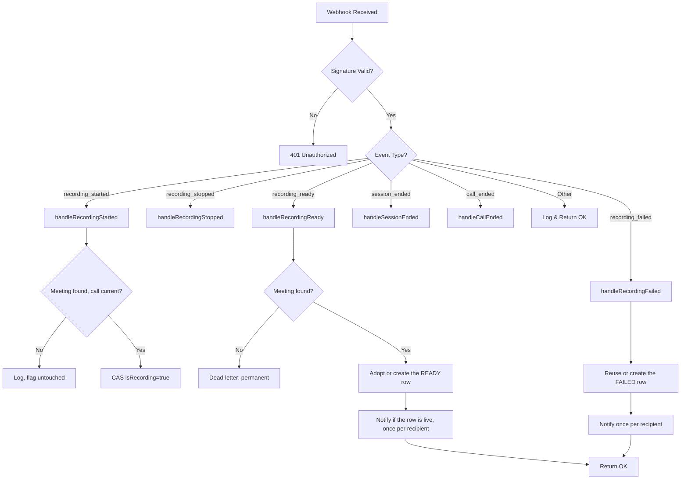
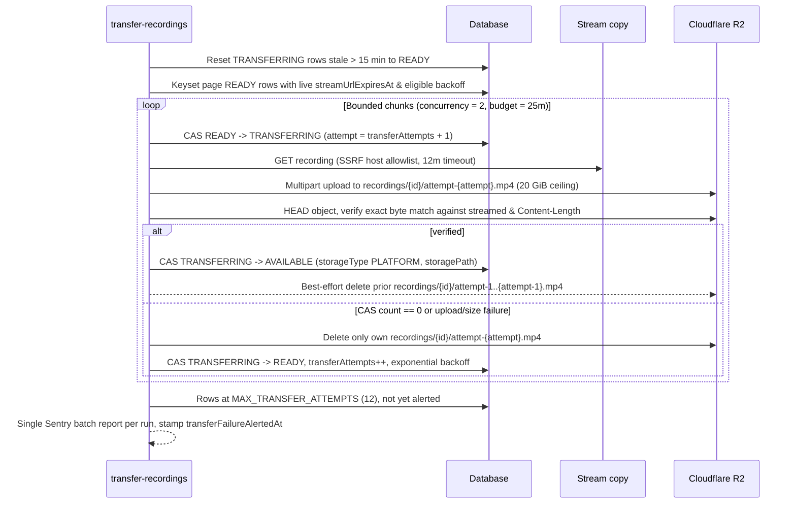

# Stream Recording & Webhooks

Comprehensive documentation for Stream video call recording and webhook handling in Familiarise.

## Navigation

- [Architecture](./01-architecture.md)
- [Setup & Configuration](./02-setup-configuration.md)
- [Provider & Authentication](./03-provider-authentication.md)
- [Video Implementation](./05-video-implementation.md)
- [Troubleshooting](./troubleshooting.md)

---

## Table of Contents

1. [Overview](#overview)
2. [Recording Architecture](#recording-architecture)
3. [Recording Lifecycle](#recording-lifecycle)
4. [Data Models](#data-models)
5. [Recording Flow](#recording-flow)
6. [Webhook Events](#webhook-events)
7. [Webhook Handler Flow](#webhook-handler-flow)
8. [Recording Transfer](#recording-transfer)
9. [API Routes Reference](#api-routes-reference)
10. [Access Control Matrix](#access-control-matrix)
11. [Key Implementation Files](#key-implementation-files)
12. [Configuration](#configuration)

---

## Overview

The recording system enables consultants to record webinars and classes for later viewing by enrolled participants. Recordings follow a two-stage storage architecture:

1. **Stream S3** - Initial storage provided by Stream (14-day expiration)
2. **Cloudflare R2** - Our copy, made by the `transfer-recordings` job and kept until retention

### Key Features

- **Consultant-only recording control** - Only the session host can start/stop
- **Automatic webhook processing** - Recording lifecycle managed via webhooks
- **Idempotent operations** - Safe to receive duplicate webhook events
- **Automatic copy** - The `recording_ready` webhook only records the READY row; the `transfer-recordings` job copies every READY recording into R2 while Stream's fourteen-day copy is live.
- **Capability-based access** - Consultants, consultees, collaborators and replay buyers each reach a recording through a distinct ownership or entitlement path, and platform operators reach it through the back-office permission matrix: staff see metadata, admin alone plays the session, and either one is audited.

---

## Recording Architecture

### High-Level Overview



### Storage Architecture

| Storage       | Duration        | Use Case           | URL Format                                        |
| ------------- | --------------- | ------------------ | ------------------------------------------------- |
| **Stream S3** | 14 days         | Initial processing | `https://stream-io-*.s3.amazonaws.com/...`        |
| **R2**        | Until retention | Our copy           | Presigned per request (`createR2PresignedGetUrl`) |

---

## Recording Lifecycle

### Recording Status Flow



### Status Definitions

| Status         | Description                                    | Storage Type       | URL Available |
| -------------- | ---------------------------------------------- | ------------------ | ------------- |
| `RECORDING`    | Recording in progress                          | N/A                | No            |
| `PROCESSING`   | Stream processing video                        | Stream S3          | No            |
| `READY`        | Available on Stream S3                         | STREAM_S3          | Yes (14 days) |
| `TRANSFERRING` | Being copied to R2                             | STREAM_S3          | Yes           |
| `AVAILABLE`    | Copied to R2                                   | PLATFORM           | Yes           |
| `EXPIRED`      | Past retention, or Stream copy lapsed uncopied | STREAM_S3/PLATFORM | No            |
| `FAILED`       | Recording capture failed                       | N/A                | No            |

A failed copy never lands in `FAILED`: every transfer failure returns the row to `READY` so the next `transfer-recordings` run retries it. `FAILED` is reached only through `call.recording_failed`.

### Storage Type Transitions

```
STREAM_S3 (initial) --> PLATFORM (after the R2 copy)
```

---

## Data Models

### Recording Model

```prisma
model Recording {
  id                  String          @id @default(cuid())
  title               String
  recordingUrl        String          // Stream S3 URL (temporary)
  storagePath         String?         // Object key in R2 once copied
  durationInMinutes   Int
  recordedAt          DateTime
  streamRecordingId   String?         // Stream filename identifier
  streamCallId        String?         // Associated Stream call ID
  storageType         RecordingStorageType @default(STREAM_S3)
  status              RecordingStatus @default(READY)
  streamUrlExpiresAt  DateTime?       // When Stream URL expires
  transferredAt       DateTime?       // When copied to R2
  fileSize            BigInt?         // File size in bytes

  // Transfer reliability tracking
  transferAttempts         Int       @default(0) // Failed-transfer counter; reset on success
  lastTransferError        String?   // Message from the most recent failed transfer
  transferFailureAlertedAt DateTime? // Set when engineering has been alerted (dedupe)

  meetingId    String
  meeting      Meeting  @relation(...)

  createdAt           DateTime        @default(now())
  updatedAt           DateTime        @updatedAt
}

enum RecordingStorageType {
  STREAM_S3
  PLATFORM
}

enum RecordingStatus {
  RECORDING
  PROCESSING
  READY
  TRANSFERRING
  AVAILABLE
  EXPIRED
  FAILED
}
```

### Meeting Recording Fields

```prisma
model Meeting {
  id                  String    @id @default(cuid())
  streamCallId        String    @unique

  // Recording state (real-time)
  isRecording         Boolean   @default(false)
  recordingStartedAt  DateTime?
  recordingStartedBy  String?   // User ID who started recording

  // Related recordings
  recordings          Recording[]

  // ... other fields
}
```

### Entity Relationships



---

## Recording Flow

### Start Recording Sequence



### Stop Recording Sequence



---

## Webhook Events

### Handled Event Types

| Event Type                        | Description                          | Handler                            |
| --------------------------------- | ------------------------------------ | ---------------------------------- |
| `call.recording_started`          | Recording has begun                  | `handleRecordingStarted()`         |
| `call.recording_stopped`          | Recording has stopped                | `handleRecordingStopped()`         |
| `call.recording_ready`            | Recording is processed and available | `handleRecordingReady()`           |
| `call.recording_failed`           | Recording failed                     | `handleRecordingFailed()`          |
| `call.session_ended`              | A participant's session ended        | `handleSessionEnded()`             |
| `call.ended`                      | The entire call has ended            | `handleCallEnded()`                |
| `call.session_participant_joined` | A participant joined the call        | `handleSessionParticipantJoined()` |
| `call.stats_report_ready`         | A session's stats report is ready    | `handleStatsReportReady()`         |
| `user.unread_message_reminder`    | A user has unread chat messages      | `handleUnreadMessageReminder()`    |

`DESIRED_EVENT_TYPES` (`lib/stream/webhook-events.ts`) contains exactly the nine handled events above. The eight `call.*` events ride the `video` hook and `user.unread_message_reminder` rides a separate `chat` hook, because Stream scopes each V2 event hook to one product; both hooks deliver to the same route, which verifies every delivery with the same `X-Signature` HMAC. The reminder builds the chat unread digest described in [04. Chat Implementation](./04-chat-implementation.md#unread-message-digest). `call.session_started` is excluded from webhook subscriptions (`scripts/stream/ensure-webhook-subscription.ts` prunes extra events, empty-array wildcards `[]`, `"*"` wildcards on V2 hooks, and active legacy V1 `webhook_url` wildcards as drift) and acknowledged with `ignored: true` without writing a database receipt if delivered.

### End Events, Asymmetric Webhook Lookup & `endedAt` Convergence

Synchronous route execution (`POST /api/meetings/[meetingId]/end`) and asynchronous Stream webhooks (`handleCallEnded`, `handleSessionEnded`, `handleSessionParticipantJoined`, `handleRecordingReady`, `handleRecordingFailed`) coordinate across rotated call segments (`occurrence-<uuid>` -> `occurrence-<uuid>-r<base36>`) under five invariants ([ADR-02](./18-architecture-decision-records.md#adr-02-call-id-rotation-occurrence-id-rbase36--asymmetric-webhook-lookup-for-reopened-rooms), [ADR-03](./18-architecture-decision-records.md#adr-03-synchronous-cas-termination-stamp-recordmeetingendedsynchronously--monotonic-webhook-convergence-supersedesrecordedend)):

1. **Asymmetric Lookup Between Artifact and Room-State Webhooks**:
   - **`handleRecordingStarted`, `handleRecordingReady`, `handleRecordingFailed`**: First look up `where: { streamCallId }` and **fall back to `where: { appointmentOccurrenceId }`** extracted via `parseSlotIdFromCallId(call_cid)`, so a segment 1 MP4 still transcoding after a reopen binds to the occurrence's `Meeting` row.
   - **`handleCallEnded`, `handleSessionEnded` and `handleSessionParticipantJoined`**: Match **strictly `where: { streamCallId }`**. A delayed end from closed segment 1 never stamps rotated segment 2, and a join to an earlier call never reopens the current room.
2. **Deliberate Ends First, Then the Latest End Wins**: `endSupersedes` decides every end. A recorded deliberate end (`call_ended`, `maintenance`, an org end) is never replaced. A deliberate end replaces a recorded non-deliberate one even when its timestamp is earlier, so a delayed host end at 10:15 replaces a timeout recorded at 10:20 and the room's `endedAt` becomes 10:15. Between two non-deliberate ends the later timestamp wins, and a sealed end such as `stream_ended` holds unless the incoming end is deliberate (`recordedEndHolds` in `lib/meetings/end-reasons.ts`). `handleCallEnded`, `handleSessionEnded` and `recordMeetingEndedSynchronously` all apply it, so a replayed or late end can never turn a `maintenance` or `org_deactivated` close into another reason. `handleCallEnded` maps the webhook with `mapStreamCallEndedReason`: before the booked start gives `ended_early`; a user end, no Stream reason, `call_ended` or `end_call` gives `call_ended`; any other Stream reason gives `stream_ended`. The raw Stream reason is only logged. `handleSessionEnded` writes `session_timeout`.
3. **Pre-Start Device Check vs Live Termination (`ended_early` vs `call_ended`)**: Ending before `startsAt` classifies the action as `"ended_early"` and rotates `streamCallId = "occurrence-<uuid>-r<base36>"` while leaving `completionStatus = "SCHEDULED"`; ending at or after `startsAt` stamps `endedReason = "call_ended"`, and the classifier attributes under-delivery as `CUT_SHORT` to the host only when a host ended it deliberately (`endedByUserId` null or in `hostUserIds`). Every end writer stamps by compare-and-set on `where: { id, streamCallId, endedAt, endedReason }` as read and re-decides once against the row on a miss.
4. **A join reopens a resumed room**: `handleSessionParticipantJoined` is one compare-and-set that clears a non-deliberate, rejoinable end older than the join on the current call id (Stream resumes a timed-out room on the same call). It writes no attendance.

### Attendance Is Not a Webhook

No webhook writes `MeetingPresence`. The outcome sweep, the consultant no-show detector and the rating gate call `settleOccurrenceAttendance` (`lib/meetings/settle-attendance.ts`), which reads Stream's settled participant record for every call id and session of the occurrence once the room can no longer be rejoined, and stores it with `Meeting.attendanceSettledAt` and `Meeting.attendanceCorroboratedSessionIds` in one compare-and-set transaction. See [ADR-06](./18-architecture-decision-records.md#adr-06-stream-participant-sessions-are-the-attendance-witness).

### Event Payload Structures

#### call.recording_started

```typescript
interface StreamRecordingStartedEvent {
  call_cid: string; // "default:callId"
  type: "call.recording_started";
  user?: {
    id: string;
    name?: string;
  };
  created_at: string; // ISO timestamp
}
```

Every start in this app goes through the server SDK (`POST /api/stream/recordings/start`). `handleRecordingStarted` resolves the meeting directly or through the occurrence fallback, and arms `isRecording` only when the event's call id is the meeting's current one: a late start for a superseded call is logged and leaves the flag alone. It advances `recordingStartedAt` to the event's `created_at` only when that is newer, and keeps a `recordingStartedBy` the route already wrote.

#### Which event may clear the REC flag

A call can carry several recording segments (a host stops and restarts), and a reopen rotates the call id. A delayed event for segment 1, or for the old call, must not clear the flag of a live segment 2. `clearRecordingFlag` in `lib/stream/recording-handlers.ts` therefore clears `isRecording` with one conditional `updateMany`: the row's `streamCallId` must equal the event's call id, and `recordingStartedAt` must be null or no later than the event's time (`created_at` for a stop or a failure, `call_recording.end_time` for a ready). For example, if segment 1 stops at 10:30 and segment 2 starts at 10:40, a stop for segment 1 that arrives at 10:45 matches no row, so the flag stays on and the `RECORDING` rows are not moved to `PROCESSING`.

#### call.recording_stopped

```typescript
interface StreamRecordingStoppedEvent {
  call_cid: string;
  type: "call.recording_stopped";
  created_at: string;
}
```

#### call.recording_ready

```typescript
interface StreamRecordingReadyEvent {
  call_cid: string;
  type: "call.recording_ready";
  call_recording: {
    filename: string; // Unique recording identifier
    url: string; // Stream S3 URL (expires in 14 days)
    start_time: string; // Recording start timestamp
    end_time: string; // Recording end timestamp
  };
  created_at: string;
}
```

#### call.recording_failed

```typescript
interface StreamRecordingFailedEvent {
  call_cid: string;
  type: "call.recording_failed";
  egress_id: string; // e.g. "call_recorder:unique"
  recording_type: string; // e.g. "composite"
  created_at: string;
}
```

Stream sends no error detail, so the log names the recording type and egress id and the host's notification carries no reason.

### Webhook Security

Webhooks are verified using HMAC SHA256 signature:

```typescript
// Signature verification
const signature = req.headers.get("x-signature");
const expectedSignature = crypto
  .createHmac("sha256", STREAM_WEBHOOK_SECRET)
  .update(body)
  .digest("hex");

// Constant-time comparison (prevents timing attacks)
return crypto.timingSafeEqual(
  Buffer.from(signature),
  Buffer.from(expectedSignature),
);
```

---

## Webhook Handler Flow

### Main Handler Flowchart



### Idempotency Handling

Stream retries a webhook, the stuck-event sweeper re-drives one for up to 168 hours, and the orphan reconciler re-lists calls daily, so every handler must be safe to run twice.

1. **Event receipts.** `recordStreamEventReceipt` (`lib/stream/webhook-receipt.ts`) writes the receipt with one `create` before any handler runs; the unique `WebhookEvent.eventId` index is the duplicate check, and only a duplicate tries to re-claim an abandoned receipt (`reclaimAbandonedWebhookReceipt`: unprocessed, no error, claim older than 5 minutes, fewer than 5 reclaims). `processStreamEvent` (`lib/stream/webhook-dispatch.ts`) takes the claim the caller holds, from the route or from the sweeper's fenced `reclaimStaleProcessingWebhookEvent`, and fences its completion write on it; it no longer claims for itself.
2. **One row per segment.** `handleRecordingReady` adopts an existing row for the same `(meetingId, streamRecordingId)` and promotes a placeholder only with a CAS on the pre-ready statuses; a concurrent create that loses the unique index adopts the winner.
3. **Notices only for a live row.** `stageAndSendRecordingReadyNotifications` re-reads the row and announces nothing unless it is `READY`, `TRANSFERRING` or `AVAILABLE` with no `removedAt`, so a late ready for an `EXPIRED` or removed recording stays silent.
4. **At-most-once notices.** The bell dedupes on the outbox `transactionId` (`recording.ready:<recordingId>`, and `recording.failed:<recordingId>` per recipient). The email dedupes on an `IdempotencyRecord` claim per recipient: scope `stream.recording-ready` with key `recording-ready:<recordingId>:<userId>`, and scope `stream.recording-failed` with key `recording-failed:<failedRowId>:<userId>`. `stageSpecOncePerRecipient` (`lib/email/senders/shared.ts`) renders outside the transaction, then inserts the claims with `skipDuplicates` and stages a `FailedEmail` row only for the claims it won, in the same transaction. A repeat delivery, or a concurrent one, therefore stages no second email. Claims live 30 days, past the sweeper's horizon. A staging failure leaves no claim, and the ready handler rethrows it so the retried event stages the notice.
5. **A ready for an unknown meeting dead-letters.** The handler throws `permanent: recording_ready for unknown meeting (<callId>)`, which the sweeper treats as terminal (`TERMINAL_ERROR_PREFIXES` in `lib/webhooks/event-log.ts`). If the meeting appears later, the orphan reconciler re-lists the call and creates the row.

---

## Recording Transfer

### Why the file is pulled instead of pushed

Stream can push recordings into a customer bucket directly, but pushing provides no application-controlled retry or verification semantics if egress transfer fails transiently. Pulling from Stream's 14-day CDN copy into Cloudflare R2 via `transfer-recordings` allows deterministic retries, size verification, and zero risk of silent loss; see the [storage, retention and visibility ADR](../decisions/2026-10-09-recording-storage-retention-visibility.md).

### Transfer Architecture

`call.recording_ready` only upserts the `READY` row; it never copies. The
`transfer-recordings` job (`lib/stream/recording-transfer-service.ts`, every
15 minutes on the Netlify ticker, through the background adapter) copies every READY recording into
Cloudflare R2 while Stream's fourteen-day copy is still live. R2 is the only
destination; Stream's copy is the retry source.



### Invariants

- **Out-of-order webhook CAS (`endedAt: null`):** `handleRecordingStarted` sets `isRecording = true` strictly via `updateMany({ where: { id, endedAt: null } })`. If `call.ended` arrived earlier (`count === 0`), only `{ recordingStartedAt, recordingStartedBy }` metadata is updated without re-arming `isRecording`.
- **Transfer resilience & exponential backoff (`[15m, 1h, 6h, 24h]`):** Failed copies return to `READY` and retry up to `MAX_TRANSFER_ATTEMPTS = 12` spaced by `15 min`, `1 hour`, `6 hours`, and `24 hours`. While `READY` or `TRANSFERRING`, playback serves Stream's URL seamlessly.
- **Attempt-isolated R2 object keys (`recordings/{recordingId}/attempt-{attempt}.mp4`):** Each upload writes to its own `attempt-{attempt}.mp4` key so a timed-out worker's failure cleanup (`deleteR2Object`) can only delete its own object and can never remove a newer winning worker's published MP4. Once `status = AVAILABLE` commits, prior `attempt-1..{attempt-1}.mp4` keys are deleted asynchronously best-effort.
- **Database CHECK invariant (`Recording_storage_and_publish_check`):** Enforced in `prisma/sql/check-constraints.sql` (`NOT VALID` + `VALIDATE CONSTRAINT`): active `PLATFORM` rows require `storagePath IS NOT NULL` (an `EXPIRED` platform row may have a null `storagePath`); `AVAILABLE` rows require `PLATFORM` storage; `PUBLISHED` rows require `PLATFORM`, `storagePath`, `listPricePaise > 0`, and consent attestation.
- **Playback continuity (`>= 4h` TTL & `savedTimeRef` resume):** Presigned R2 GET URLs expire after `max(4 hours, min(24 hours, 1 hour + 2 × duration))` (`playbackUrlTtlSeconds`). If a viewer's session outlives a presigned URL or the parent refreshes `recording.playbackUrl`, `RecordingPlayerModal` preserves `savedTimeRef.current` (`[open, recordingId]` reset boundary), fetches a fresh presigned URL in the background without unmounting `<video>`, and restores `video.currentTime` automatically on `loadedmetadata`.

### Storage Path Format

```
recordings/{recordingId}/attempt-{attempt}.mp4
```

### Mid-session decline

For a 1:1 meeting where a participant's `DECLINED` consent was decided at or
before the recording's end time, `recording_ready` and the sync path delete the
recording from Stream (`call.deleteRecording({ session, filename })`) and
CAS-expire any row instead of creating a playable one
(`lib/stream/recording-decline.ts`). Retries are no-ops.

### Retention & Pre-Expiry Stream URL Refresh

`lib/stream/recording-retention.ts` holds the retention schedule and daily `expire-recordings` sweep:

- **Pre-expiry Stream refresh (`expireLapsedCopies`):** `READY` `STREAM_S3` rows whose `streamUrlExpiresAt` has passed and that were recorded within 15 days are re-listed, 200 a run and 10 at a time. `getCallRecordingsFromStream` answers `listed`, `call-not-found` (a 404 or code 16) or `unavailable` (any other failure, including a 429 and an open breaker). A listing that holds the row's filename refreshes `recordingUrl` and `streamUrlExpiresAt`; `call-not-found` or a listing without the filename expires the row as `COPY_LAPSED`; `unavailable` leaves it `READY` and counts as a failure. Rows recorded more than 15 days ago, and rows with no call id, expire without a lookup.
- **Stream-copy deletion (`deleteTransferredStreamCopies`):** an `AVAILABLE` row whose size-verified R2 copy is at least a day old has Stream's copy deleted through `deleteStreamRecordingCopy`, which treats an unknown call as already gone. Success clears `recordingUrl`, which marks the row done. See [19](./19-recordings-lifecycle-and-access.md#deleting-streams-copy-after-the-r2-copy).
- **One Sentry report per run.** Lookups and vendor deletes return their failures instead of reporting them; the run sends one `expire-recordings` warning listing up to 100 failed rows.
- **Retention schedule:** 1:1 consultations retain for 90 days after session end, subscriptions/trials for 90 days after subscription end, webinars for 365 days, and classes for 365 days after the final occurrence. Published replays and recordings with `PENDING` or `SUCCEEDED` purchases are exempt. Organization caps (`streamRecordingRetentionDays`) shorten org-scoped retention only. Expiry deletes R2 + preview objects and records a `STREAM_RECORDING_DELETED` audit event.

---

## API Routes Reference

### Recording Control Routes

#### POST /api/stream/recordings/start

Start recording for a video call.

**Authorization:** Consultant only, must own the session

**Request:**

```json
{
  "streamCallId": "abc123",
  "meetingId": "clx123..."
}
```

**Response:**

```json
{
  "success": true,
  "message": "Recording started"
}
```

**Errors:**

- `401` - Unauthorized
- `403` - Not a consultant / Not session owner / Recording not enabled
- `400` - Already recording
- `404` - Meeting session not found
- `502` - Stream did not start the recording

The route claims the meeting with a CAS on `isRecording: false` and writes `recordingStartedAt` and `recordingStartedBy`. The same claim requires the room to be recordable (`RECORDABLE_ROOM_WHERE` in `app/api/stream/recordings/start/route.ts`): the meeting has not ended and its session is still `SCHEDULED` with no outcome and not deleted. An earlier read answers 403 `APPOINTMENT_TERMINAL` in that case, and a session that is classified between the read and the write matches zero rows. If Stream then refuses, the revert is a CAS on exactly those values, so a `call.recording_started` that already advanced `recordingStartedAt` (Stream started after all) keeps the flag on.

---

#### POST /api/stream/recordings/stop

Stop recording for a video call.

**Authorization:** Consultant only, must own the session

**Request:**

```json
{
  "streamCallId": "abc123",
  "meetingId": "clx123..."
}
```

**Response:**

```json
{
  "success": true,
  "message": "Recording stopped"
}
```

The stop claim is a CAS on `isRecording: true` plus the `streamCallId` and `recordingStartedAt` the route read. If Stream refuses the stop, the flag is restored only for that same segment and only while the meeting has not ended, so a failed stop never re-arms a newer segment or an ended call.

---

### Recording Query Routes

#### GET /api/stream/recordings/[recordingId]

Get a single recording by ID.

**Authorization:** the consultant who delivered the session, an accepted collaborator on its plan, a consultee holding a net-positive payment for the plan, or a standalone replay buyer. Platform operators reach it through the back-office matrix instead: `recordings.read` admits ADMIN and STAFF, while `recordings.play` is ADMIN-only. See the [Operator access](#operator-access-admin--staff) section below.

A successful response always carries an `access` object so a client can tell "you may not play this" apart from "there is nothing to play yet" — both of which present as a null `playbackUrl`. Error responses do not carry it, including the `410` returned when a Stream URL has lapsed for a caller entitled to play it.

**Response (full access):**

```json
{
  "recording": {
    "id": "clx123...",
    "title": "Webinar: Introduction to React - Jan 15, 2025",
    "playbackUrl": "https://...",
    "thumbnailUrl": "https://...",
    "previewClipUrl": "https://...",
    "durationInMinutes": 45,
    "recordedAt": "2025-01-15T10:00:00Z",
    "status": "AVAILABLE",
    "storageType": "PLATFORM"
  },
  "access": { "level": "FULL" }
}
```

**Response (staff, metadata only):**

```json
{
  "recording": {
    "id": "clx123...",
    "title": "Webinar: Introduction to React - Jan 15, 2025",
    "playbackUrl": null,
    "thumbnailUrl": null,
    "previewClipUrl": null,
    "durationInMinutes": 45,
    "recordedAt": "2025-01-15T10:00:00Z",
    "status": "AVAILABLE",
    "storageType": "PLATFORM",
    "streamUrlExpiresAt": null
  },
  "access": {
    "level": "METADATA_ONLY",
    "reason": "Playback requires the recordings.play permission; staff receive metadata only."
  }
}
```

Every media URL is withheld from the metadata-only response, not only `playbackUrl`. A thumbnail is a frame of the session and the preview clip is a cut of it, so returning either would hand over exactly the content the cap exists to protect. The expiry branch behaves differently too: a full-access caller receives a `410` when a `STREAM_S3` recording's link has lapsed, whereas a metadata-only caller receives the record with `streamUrlExpiresAt` populated, because diagnosing that expiry is the reason a support agent is looking at all.

---

#### POST /api/stream/recordings/sync

Mirrors the caller's recordings from Stream into the database. It never sends a notification: rows created here are announced by the orphan reconciler or not at all.

**Authorization:** Authenticated user (Consultant or Consultee)

**Request (optional body):**

```json
{ "consultantCursor": "clmeeting...", "consulteeCursor": "clmeeting..." }
```

**Response:**

```json
{
  "success": true,
  "synced": 3,
  "more": true,
  "consultantCursor": "clmeeting...",
  "consulteeCursor": null,
  "recordings": [ ... ]
}
```

**Bounds.** Each identity reads meetings created in the last 30 days, newest first, 25 per call, and asks Stream about them at most 10 at a time. A non-null cursor means more meetings remain; sending it back continues from there. A consultee's meeting is synced only while one of their succeeded payments for it is not fully refunded.

**Rate limit:** three calls per five minutes per user, via `streamRecordingSyncLimiter`. One POST issues up to 25 `listRecordings` requests per identity, so the user-keyed limiter, not the IP-keyed edge rule, is what bounds the billable fan-out.

---

### Recording Consent Routes

Consent is asked for in the lobby before anyone joins, and a 1:1 participant
can also decline from inside the call while a recording is running. Both
handlers are gated by `resolveMeetingAccess`, the same resolver the join gate
uses, so only somebody actually on this appointment can read the notice or
record a decision about it. Without that gate the endpoint would leak which
meeting identifiers exist and which of them are recorded.

#### GET /api/meetings/[meetingId]/recording-consent

Returns the notice this person must be shown before joining, if any.

**Authorization:** any participant on the appointment.

**Response:**

```json
{
  "required": true,
  "regime": "OPT_OUT",
  "noticeVersion": 1,
  "decision": null
}
```

`regime` is `OPT_OUT` for one-to-one sessions, where declining is real and
costs nothing — the person still joins and the host's recording endpoint
refuses. It is `ACKNOWLEDGE` for group events, where the recording is part of
what attendees bought and the only action available is to understand it.

`required: false` means there is nothing to disclose, and the client should not
block joining.

#### POST /api/meetings/[meetingId]/recording-consent

Records a decision.

**Authorization:** any participant on the appointment, for their own decision
only.

**Request:**

```json
{ "decision": "GRANTED" }
```

`decision` is `GRANTED` or `DECLINED`.

**Implementation notes.** Three details of these handlers are easy to
reintroduce incorrectly.

Neither handler loads the meeting a second time. `resolveMeetingAccess` already
joins the session, its slot and all four plan relations in order to decide
whether the caller is the host, so it returns `meetingId` and
`appointment` and the handlers read them off the result. Both used to re-run the
same `findUnique` immediately after the access check, which on this deployment
is serialized latency rather than parallel work. See the
[ADR](../decisions/2026-08-13-meeting-access-returns-what-it-loaded.md).

The choice between 404 and 403 comes from `access.reason === "not_found"`, never
from comparing `access.message` against a string. Rewording a user-facing
message must not be able to change a status code.

Enforcement covers the whole session. Before recording starts, the `DECLINED`
check lives inside the atomic claim in `POST /api/stream/recordings/start`, so a
decline arriving between the read and the write loses the race rather than
being ignored. A `DECLINED` posted while a recording is running stops it
server-side, the response carries `recordingStopped: true`, and the file is
discarded when it lands (see [Mid-session decline](#mid-session-decline)). For
`ACKNOWLEDGE` sessions the route answers a `DECLINED` with 409, because the
recording is part of what attendees bought; the only way out is cancelling the
booking for a refund. See the
[ADR](../decisions/2026-08-13-mid-session-recording-decline.md).

**Client.** `useRecordingConsent` in
`app/meetings/[id]/components/RecordingConsentNotice.tsx` returns a
`ConsentGate` of `{ satisfied, loading, node }`. `loading` is true only while
the fetch is outstanding, which the lobby needs in order to distinguish that
window from a genuinely outstanding decision — `satisfied` is false in both, and
the Join button is disabled in both. `MeetingSetup` reads it and labels the
button "Checking recording notice..." rather than leaving it disabled with
nothing on screen accounting for it.

Both the lobby and the in-call control post through
`useRecordingConsentDecision` (`app/meetings/[id]/hooks/`), which allows one
request in flight, parses the response with Zod, and shows the decliner the
"Recording stopped. It will be discarded at your request." toast when the route
reports `recordingStopped`. In the call, `RecordingControls` renders
`DeclineRecordingButton` ("Stop recording me") beside the REC indicator only for
a non-host in a session that is not a webinar or class. The button opens a
confirmation dialog that explains the recording stops and is discarded, and a
failure surfaces the server's message in an error toast.

---

### Webhook Route

#### POST /api/stream/webhooks

Receives webhook events from Stream. The route verifies, writes the receipt, acknowledges and hands off to `after()`.

**Stored payload:** `WebhookEvent.payload` holds the event parsed through its own Zod schema (`schemas/webhooks/stream.ts`), because Zod drops undeclared keys. Participant names, images and custom profile data never reach the table, while every id, timestamp, reason and URL the handlers read is kept, so `sweep-stuck-webhook-events` can re-drive any handler from the stored row. A payload that fails its schema falls back to the generic PII scrubber (`lib/logging/webhook-scrub.ts`); dispatch fails it permanently anyway. Adding a field a handler reads means adding it to the schema, which is also what keeps it in the stored row.

**Error reporting:** an unconfigured signing secret, an invalid signature and a failing receipt write each send at most one Sentry event per window (`captureThrottled`), so a sustained outage costs one event, not one per delivery. The receipt failure still answers 503 every time so Stream redelivers.

**Owned call types:** only `default` is accepted (`OWNED_CALL_TYPES`). Events for `livestream`, `audio_room` and `development` are acknowledged and marked processed without running a handler.

**Headers:**

- `x-signature` - HMAC SHA256 signature

**Response:**

```json
{
  "status": "ok"
}
```

---

## Access Control Matrix

### Recording Operations

| Role           | Start | Stop | View Own | Metadata (any) | Play (any) | Delete |
| -------------- | ----- | ---- | -------- | -------------- | ---------- | ------ |
| **Consultant** | Yes   | Yes  | Yes      | No             | No         | No     |
| **Consultee**  | No    | No   | Yes\*    | No             | No         | No     |
| **Staff**      | No    | No   | Yes      | Yes            | **No**     | No     |
| **Admin**      | No    | No   | Yes      | Yes            | Yes        | No     |

\*Consultees can play recordings of 1:1, subscription and trial appointments they took part in, and of webinar and class sessions they hold a live seat or entitled payment for (see [Recording Visibility Rules](#recording-visibility-rules)). Entitlement nets refunds: a fully refunded buyer loses access, a partially refunded buyer keeps it.

### Operator access (ADMIN / STAFF)

Three rules govern operator access in `lib/stream/recording-operator-access.ts` so no route can restate them differently:

1. **Permission-Scoped Matrix (`BACKOFFICE_PERMISSIONS`)**: `recordings.read` covers metadata and admits both `ADMIN` and `STAFF`; `recordings.play` covers any media playback URL and admits `ADMIN` alone.
2. **Metadata-Only Staff Tier**: `STAFF` receive status, storage type, duration, `recordedAt`, and `streamUrlExpiresAt` — never media playback, preview clip, or thumbnail URLs.
3. **Evaluated After Ownership & Entitlement**: A staff member who personally delivered or purchased a session passes normal entitlement checks first; the operator branch applies only to unassociated support reads.

### Auditing a privileged read

Every read granted through the operator branch writes an audit record before any playback URL is minted:

- `OrgAuditLog`: Writes `STREAM_RECORDING_ACCESSED` (`actorMembershipId = null`, actor role/user ID and `played` flag in `details`) for tenant-owned recordings. Fails closed if auditing fails.
- `SystemEvent`: Writes `STREAM_RECORDING_ACCESS` at `WARN` severity across both tenant and B2C sessions.

### Playback URLs never leave the handler raw

`Recording.recordingUrl` holds Stream's 14-day pre-signed S3 URL. Compliance exports (`GET /api/organizations/[orgId]/stream/calls?withRecordings=1` and `lib/api/scope/list-recordings.ts`) use an explicit field allowlist that strips `recordingUrl`, `storagePath`, `thumbnailUrl`, and `previewClipUrl`, returning only retention status metadata ([ADR 20](../enterprise/70-design-decisions/20-org-visibility-into-member-sessions.md)).

### Access Verification Logic

```typescript
// Consultant access check
const isOwner = getMeetingOwnershipInfo(
  meeting,
  user.consultantProfileId,
).isOwner;

// Consultee access check: net succeeded payments against refunds via isPaymentEntitled()
const payment = await prisma.payment.findFirst({
  where: {
    userId: user.id,
    paymentStatus: "SUCCEEDED",
    appointment: {
      // ... matches recording's appointment
    },
  },
  include: { refunds: true },
});

const hasPaidEnrollment = payment != null && isPaymentEntitled(payment); // lib/payments/utils/refund-balance.ts
```

### Recording Visibility Rules

> The shared-run and multi-batch rule (own batch by session, with catch-up) is specified in [19. Recordings: Lifecycle, Retention and Access](./19-recordings-lifecycle-and-access.md#shared-run-and-multi-batch-access) and supersedes the plan-wide extensions below once it lands.

Recordings are private by default. The playback route evaluates these rules ([ADR](../decisions/2026-10-09-recording-storage-retention-visibility.md)):

| Session type                          | Who may play                                                                                                                  |
| ------------------------------------- | ----------------------------------------------------------------------------------------------------------------------------- |
| 1:1 consultation, subscription, trial | Only that appointment's participants (consultant, payer, participants, requester). Never plan-wide, never sellable.           |
| Webinar                               | Attendees (paid or seated) of that run. `WebinarPlan.shareRecordingsWithAllAttendees` extends this to attendees of every run. |
| Class                                 | Enrolled members. `ClassPlan.lateJoinersGetPastRecordings` shares earlier sessions with late joiners.                         |

The owner and accepted co-presenters always have access, a platform `ADMIN` has full access, `STAFF` and organization roles see metadata only, and buyers of a published replay may play it.

---

## Key Implementation Files

### Core Services

| File                                       | Purpose                      |
| ------------------------------------------ | ---------------------------- |
| `lib/stream/recording-service.ts`          | Recording CRUD operations    |
| `lib/stream/recording-transfer-service.ts` | Stream to R2 copy job        |
| `lib/stream/recording-retention.ts`        | Retention rule and job       |
| `lib/stream/recording-handlers.ts`         | Webhook event handlers       |
| `lib/stream/recording-utils.ts`            | Helper functions             |
| `lib/stream/recording-types.ts`            | Prisma payload types         |
| `lib/stream/recording-operator-access.ts`  | Operator grant & audit trail |

### API Routes

| File                                                             | Endpoint            |
| ---------------------------------------------------------------- | ------------------- |
| `app/api/stream/recordings/start/route.ts`                       | POST /start         |
| `app/api/stream/recordings/stop/route.ts`                        | POST /stop          |
| `app/api/stream/recordings/sync/route.ts`                        | POST /sync          |
| `app/api/stream/recordings/[recordingId]/route.ts`               | GET /:id            |
| `app/api/stream/webhooks/route.ts`                               | Webhook handler     |
| `app/api/stream/meetings/[streamCallId]/recording-info/route.ts` | GET recording state |
| `app/api/organizations/[orgId]/stream/calls/route.ts`            | GET org call export |

### Session Handlers

| File                             | Purpose                         |
| -------------------------------- | ------------------------------- |
| `lib/stream/session-handlers.ts` | Call session lifecycle handlers |

---

## Configuration

### Environment Variables

```env
# Stream API (required)
NEXT_PUBLIC_STREAM_API_KEY=your_api_key
STREAM_API_SECRET=your_api_secret

# Webhook signature verification (required for webhooks)
STREAM_WEBHOOK_SECRET=your_webhook_secret

# Cloudflare R2 (our recording copies)
R2_S3_ENDPOINT=https://<account_id>.r2.cloudflarestorage.com
R2_BUCKET=your_bucket
R2_ACCESS_KEY_ID=your_access_key_id
R2_SECRET_ACCESS_KEY=your_secret_access_key

# Supabase (public recordings-previews bucket for preview clips and thumbnails)
NEXT_PUBLIC_SUPABASE_URL=https://xxx.supabase.co
SUPABASE_SERVICE_ROLE_KEY=your_service_role_key
```

### Stream Dashboard Configuration

1. **Enable Recording** - Dashboard > Video > Settings > Enable Recording
2. **Configure Webhooks** - Dashboard > Webhooks > Add Endpoint
   - URL: `https://your-domain.com/api/stream/webhooks`
   - Events: one `video` hook for the eight `call.*` events and one `chat` hook for `user.unread_message_reminder`; `scripts/stream/ensure-webhook-subscription.ts --apply` creates and reconciles both
   - Signing Secret: Copy to `STREAM_WEBHOOK_SECRET`

### The scheduled fleet behind recordings

Three jobs keep the recording pipeline honest. All three run on the Netlify ticker (the first through its own background adapter, the other two through the Stream lifecycle background worker); no GitHub Actions workflow schedules them. Each acquires the Postgres cron lock (`withCronLock`) and recording `SystemJobExecution` runs:

| Job                             | Schedule (UTC)          | What it does                                                                                                                                                      |
| ------------------------------- | ----------------------- | ----------------------------------------------------------------------------------------------------------------------------------------------------------------- |
| `transfer-recordings`           | Every 15 minutes        | Copies `READY` recordings into R2 before Stream's 14-day copy lapses, reporting exhausted transfer attempts once per run.                                         |
| `expire-recordings`             | Hourly :05, 00:00-03:00 | Expires lapsed Stream copies and recordings past retention, deletes R2 and preview objects, writes org audit rows, and deletes Stream's copy of transferred rows. |
| `reconcile-orphaned-recordings` | Hourly :25, 00:00-03:00 | Recovers recordings whose `call.recording_ready` webhook never arrived by polling Stream for sessions 2 hours to 14 days old.                                     |

### The video client's timeout

`getStreamVideoClient` (`lib/stream-client.ts`) sets a 15-second request timeout. The node SDK's default is 3 seconds, which aborted recording start and stop, call creation and call end under ordinary Stream latency. Fifteen seconds stays well inside the roughly 26-second function ceiling measured on Netlify, leaving room for the route's own database work.

### Subscription drift is checked, not assumed

The ticker job `stream-control-plane-drift` (`lib/stream/control-plane-drift.ts`, daily at 01:15 UTC) compares the live hooks with `HANDLED_EVENT_TYPES` and the contract in `lib/stream/control-plane-contract.ts`: there must be one hook per product (`video` and `chat`, from `desiredEventTypesByProduct`), each enabled, pointing at `<NEXT_PUBLIC_APP_URL>/api/stream/webhooks`, and carrying exactly that product's handled events. A handled event that no hook can carry is reported as `webhook:unplaceable:<product>:<event>`. It is read-only and reports one Sentry message per run. It takes a fail-open `withCronLock` lease, so every run also writes a `SystemJobExecution` row; a run that finds drift is recorded as an `attention` outcome (a `COMPLETED` row), and `/api/health/jobs` holds the job to a paging freshness budget, so a drift check that stops running turns the probe to 503. `scripts/stream/ensure-webhook-subscription.ts` is the operator tool: no flags to diff, `--check` to exit 2 on drift, `--apply` to write, which also creates a missing product hook when `NEXT_PUBLIC_APP_URL` names the public https URL an existing hook already delivers to.

### Never import `@/lib/supabase` from a cron job

`lib/supabase.ts` opens with `import "server-only"`, which throws in standalone Node processes outside Next.js server components. Scheduled cron jobs must import `lib/supabase-storage-core.ts` instead (`__tests__/maintenance/workflow-import-env.test.ts` enforces this boundary).

---

## Troubleshooting

### Common Issues

#### Webhook not receiving events

1. Verify webhook URL is accessible from internet
2. Check `STREAM_WEBHOOK_SECRET` matches dashboard
3. Verify events are selected in Stream dashboard
4. Check server logs for signature validation errors

#### Recording not appearing after call

1. Check webhook handler logs for errors
2. Verify `streamCallId` matches between session and webhook (or whether host `reopen` rotated `streamCallId` while a previous segment's egress was still transcoding)
3. Check for duplicate detection (recording may already exist)
4. Verify call had recording enabled in Stream

#### Transfer failing

1. Check the R2 secrets in the Netlify environment and that the bucket exists
2. Read `lastTransferError` and `transferAttempts` on the row
3. Check Stream URL hasn't expired (`streamUrlExpiresAt`)
4. Review the `transfer-recordings` run output and its Sentry report

---

## Deprecated & Superseded Approaches

- **Raw Stream payloads in `WebhookEvent.payload`, and a find-then-create receipt**: the full event, including participant names, was stored for 30 to 90 days, and every first delivery cost two round trips. Superseded by the schema-parsed payload and the single-`create` receipt above.
- **`livestream` in `OWNED_CALL_TYPES`**: livestream is unused at launch, and an authentic event from a type this app does not run can collide with a real Meeting id. Removed; the drift detector guards that `user` holds no create-call on it.
- **Shared `recordings/{id}/composite.mp4` R2 keys during transfer retries**: Using a single static object key across retry attempts allowed a stalled worker's late `deleteR2Object` cleanup on CAS loss to delete a newer winning attempt's published MP4. Superseded by attempt-scoped `recordings/{recordingId}/attempt-{attempt}.mp4` keys with asynchronous cleanup of prior `attempt-1..{attempt-1}.mp4` objects after `status = AVAILABLE` commits.
- **Unconditional `Meeting.isRecording = true` writes on late `call.recording_started`**: Checking `meeting.endedAt` only at `findUnique` time allowed out-of-order `call.recording_started` webhooks to re-arm `isRecording = true` if `call.ended` raced in between. Superseded by CAS `updateMany({ where: { id, endedAt: null } })` with metadata-only fallback.
- **Short 1-hour fixed presigned playback URLs & player state wipes on URL refresh**: Fixed 1-hour URLs expired mid-watch on 2+ hour sessions and prop refreshes reset `savedTimeRef.current = 0`. Superseded by duration-scaled `playbackUrlTtlSeconds` (`>= 4 hours`) and `[open, recordingId]`-scoped player state preservation in `RecordingPlayerModal`.
- **Per-plan storage tiers and manual transfer route**: `recordingStoragePolicy` (`STREAM_ONLY` / `PERMANENT`), `POST /api/stream/recordings/[id]/transfer`, and the Supabase recordings bucket fallback were replaced by automatic Cloudflare R2 transfer (`transfer-recordings`) and platform-wide retention (`expire-recordings`).
- **Ready-time `after()` transfer kicks**: `call.recording_ready` now only persists the `READY` row; `transfer-recordings` handles streaming multipart copies asynchronously with CAS retries.
- **Webhook-only `Meeting.endedAt` writes on host end**: `POST /api/meetings/[meetingId]/end` now calls `recordMeetingEndedSynchronously` (`lib/stream/session-handlers.ts`) synchronously so dashboard cards reflect ended status immediately, while `handleCallEnded` / `handleSessionEnded` reconcile monotonically (`endedAt > existing.endedAt`).
- **Unscoped `isPrivileged` operator playback access**: Replaced by `lib/stream/recording-operator-access.ts` (`recordings.read` for `STAFF` metadata-only vs `recordings.play` for `ADMIN` with mandatory `OrgAuditLog` + `SystemEvent` trails).
- **Notices re-sent on every ready delivery and every user sync**: The bell deduped on its outbox `transactionId`, but the email had no key, so a duplicate `call.recording_ready` or a press of "Sync" re-sent it, and a late ready for an `EXPIRED` row still announced it. Superseded by the live-row check and per-recipient `IdempotencyRecord` claims; the user sync sends nothing.
- **Unconditional REC-flag clears**: `handleRecordingStopped`, `handleRecordingReady` and `handleRecordingFailed` cleared `isRecording` with a plain update, so a late event for an earlier segment or a rotated call cleared a live segment's flag. Superseded by `clearRecordingFlag`. The start and stop routes' unconditional reverts were replaced by CAS reverts on their own writes.
- **`getCallRecordingsFromStream` returning `null` for every error**: A 404 for a call Stream no longer holds read the same as an outage, and each failure reported to Sentry. Superseded by the `listed` / `call-not-found` / `unavailable` result.
- **An unbounded user sync**: `syncRecordingsForConsultant` and `syncRecordingsForConsultee` read every meeting the user ever had and listed each one sequentially. Superseded by the 30-day, 25-meeting page.
- **Retrying a ready event for an unknown meeting for 168 hours**: Superseded by the `permanent:` dead-letter.
