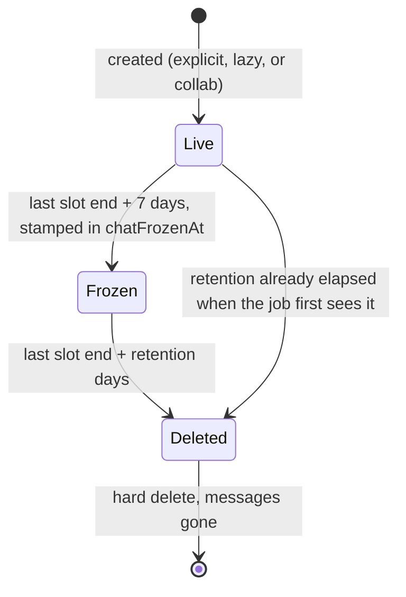

# 17. Channel Lifecycle

> How chat channels come into existence, how duplicate-create races resolve,
> how they age out (freeze, then delete), how access is revoked when an
> entitlement ends, and the contract that keeps the dashboard sync from
> resurrecting the dead.

## Table of Contents

- [Two stores, two responsibilities](#two-stores-two-responsibilities)
- [Channel ID taxonomy & 4-Part DM / Trial policy](#channel-id-taxonomy--4-part-dm--trial-policy)
- [Contextual booking receipt cards](#contextual-booking-receipt-cards)
- [How a channel comes into existence](#how-a-channel-comes-into-existence)
- [The duplicate-create race](#the-duplicate-create-race)
- [Aging: freeze, then delete](#aging-freeze-then-delete)
- [Revoking access when an entitlement ends](#revoking-access-when-an-entitlement-ends)
- [The daily membership reconciler](#the-daily-membership-reconciler)
- [Organisation wind-down completion](#organisation-wind-down-completion)
- [The sync expected-set contract](#the-sync-expected-set-contract)
- [Stream's per-request & rate-limit ceilings](#streams-per-request--rate-limit-ceilings)
- [Security surface rules](#security-surface-rules)
- [Testing map](#testing-map)
- [Deprecated & Superseded Approaches](#deprecated--superseded-approaches)

---

## Two stores, two responsibilities

Stream Chat is the system of record for message content and channel state:
messages, read state, and membership live only on Stream, and a deleted channel
is unrecoverable. Postgres is the system of record for entitlements and
scheduling truth: who booked what, when the last slot ends, and which
organization's retention dial applies. Neither store can answer the other's
questions — a Postgres appointment proves the _right_ to be in a channel, not
that the channel exists, and a Stream channel proves nothing about why it was
created. Every mechanism in this document exists to manage the boundary between
the two: creation copies entitlements forward into Stream, expiry retires
channels once their entitlements are historic, and the sync repairs drift in
one direction only — Postgres decides, Stream obeys.

## Channel ID taxonomy & 4-Part DM / Trial policy

Every channel ID is derived deterministically from domain entities (`lib/stream-channel-ids.ts`, `lib/stream-utils.ts`) using UTF-16 code-unit ordering (`a < b ? [a, b] : [b, a]`, never `localeCompare`) and capped at Stream's 64-character ceiling. `MANAGED_CHANNEL_PREFIXES` lists the prefixes whose membership Postgres derives: `webinar-`, `class-`, `collab-`, `dm-`, `dmo-` and `dmh-`. Three mechanisms act on that list. `syncUserEventChannels` tidies the viewer's own stale memberships, the daily membership reconciler (`lib/stream/membership-reconciler.ts`) removes anyone Postgres no longer justifies, and `addMemberToChannel` refuses manual adds. `isManagedChannel` in `lib/stream-channel-ids.ts` is the predicate. The legacy `consultation-` and `subscription-` prefixes are **not** managed, and neither are support channels or the legacy underscore event ids (`webinar_`, `class_`), because Postgres cannot derive their rosters.

Channel provisioning and eligibility follow a strict **4-Part DM & Trial Policy** (`lib/stream/dm-eligibility.ts`, `lib/stream/dm-eligibility-statuses.ts`):

1. **One human pair = one DM channel (`dm-` / `dmo-`)**:
   - Personal B2C conversations between a consultant and consultee use `dm-${userIdA}-${userIdB}` (or `dmh-${sha256}` when $> 64$ chars) with no `organization_id` field.
   - Enterprise B2B conversations scoped to an organization use `dmo-${sha256(orgId).slice(0, 12)}-${sha256(`${orgId}:${a}:${b}`).slice(0, 36)}` and stamp `organization_id: orgId` on the channel's custom data.
   - Consultee-to-consultee peer DMs are never permitted (`canDirectMessage` requires a consultant ↔ consultee link).
2. **Paid/confirmed gate (`DM_ELIGIBLE_STATUSES`)**:
   - `DM_ELIGIBLE_STATUSES = ["APPROVED", "COMPLETED"]`.
   - `APPROVED_PENDING_PAYMENT` and `PENDING` are excluded — no DM channel can be created, searched, or opened until payment succeeds or an appointment is approved without pending payment.
3. **Webinars & Classes provision both the group event channel and a 1:1 personal DM**:
   - Confirmed enrollment (`OPENABLE_EVENT_STATUSES = ["SCHEDULED", "COMPLETED"]`) provisions both the shared `team` channel (`webinar-${id}` / `class-${id}`) **and** a 1:1 DM (`dm-` / `dmo-`) between the hosting consultant and each confirmed enrollee (`hasWebinarLink`, `hasClassLink`).
   - `ACCEPTED` `Collaborator` co-hosts (`consultantProfile.deletedAt: null`) are included in the group channel roster (`lib/stream/event-channel-service.ts`) and in `syncUserEventChannels`'s expected-set so co-hosts are never evicted during reconciliation.
4. **A free trial never grants chat**. Three separate checks enforce it:
   - **No provisioning.** `ensureChannelsForAppointment` (`lib/payments/webhooks/ensure-channels.ts`) stamps `chatChannelEnsuredAt` on a `TRIAL` appointment so the sweep never revisits it, creates nothing, and returns `skipped: "trial_chat_blocked"`.
   - **No DM eligibility.** `canDirectMessage` and `pairBookingContexts` exclude any consultation or subscription whose appointment is a `TRIAL` or whose client seat is `REFUNDED` (`excludeNonDmDirectBooking` in `lib/stream/dm-eligibility-statuses.ts`), whatever status the booking row carries. A relationship that consists only of a trial therefore never opens a DM, and a trial never keeps an existing DM alive.
   - **No in-call chat.** `isInCallChatAllowed("TRIAL")` is false (`lib/meetings/room-ready.ts`). `app/meetings/[id]/components/MeetingRoom.tsx` hides the chat and Q&A tabs, and the stage Q&A route (`app/api/meetings/[meetingId]/qa/route.ts`) answers 403 with `trial_chat_disabled`.

## Booking context in a shared DM

All bookings between a `(consultant, consultee, orgScope)` pair share one DM, and opening it from an appointment posts nothing. The composer offers a removable booking chip that tags the sender's next message with `booking_appointment_id`; the tag is rendered only from the server-verified `GET /api/stream/booking-tag` answer. See [04. Chat Implementation](./04-chat-implementation.md#appointment-chat-sheet-and-booking-tag).

## How a channel comes into existence

There are three server-side creation paths:

1. **Explicit creators** — `actions/stream/chat/channel.action.ts`
   (`createChannel` plus `createWebinarChannel`, `createClassChannel`,
   `createDirectMessageChannel`). Called from `POST /api/stream/channels/open`,
   authenticated API routes under `app/api/`, and `lib/payments/webhooks/handlers.ts`
   at booking confirmation and payment settlement.
2. **Lazy create-on-miss** — `lib/stream/event-channel-service.ts`
   (`addUserToEventChannel`, wrapped for browser callers by
   `actions/stream/chat/event-channel.action.ts`). Attempts `addMembers` first;
   when the channel does not exist, builds the full roster from Postgres
   (host + `ACCEPTED` collaborators + live `AppointmentParticipant` rows),
   filters out unconsented users (`droppedIds` from `upsertUsersToStream`), and
   creates atomically with `createMemberChunk` + `addRemainingMembers`.
3. **Collaborator reconcile** — `createCollaboratorChannel` in
   `channel.action.ts`. Get-or-create only (`collab-{webinar|class}-{planId}`)
   with 100-member chunking (`createMemberChunk` + `addRemainingMembers`) plus
   a full member diff against the `ACCEPTED` collaborator list. It never
   unfreezes an existing channel and returns `frozen` so the caller can see the
   state. `POST /api/stream/channels/open` refuses a frozen collaborator
   channel with `423 CHANNEL_FROZEN`, and refuses any non-staff caller when the
   owning organization is `DEACTIVATED` with `403 ORG_DEACTIVATED`. The
   deactivation check runs before the host and collaborator checks, so a
   wound-down organization's own members cannot reopen its chat. Both
   refusals carry `{ error, code }`, which the chat UI shows as a toast. Staff
   (`ADMIN`/`STAFF`) are exempt from the deactivation check.

Creation is server-side by necessity, not preference: the Node SDK holds the
API secret, and every create call must carry `created_by_id` set to a real
member (the consultant host, or the DM initiator) — Stream rejects server-side
creates without it, and a synthetic "system" creator would break the
channel-scoped `channel_moderator` grant via `assignRoles`.

## The duplicate-create race

Lazy creation can encounter a concurrent-create race: two users join an event
at the same instant, both `addMembers` calls miss because the channel does not
exist yet, and both proceed to `create()`. One wins; the loser's `create()`
rejects with Stream's duplicate-create error.

The contract is: **lose the race, adopt the winner's channel.** The
predicate is `isChannelAlreadyExistsError` in `lib/stream-utils.ts`, which
matches three shapes — `error.code === 17`, HTTP status 409, and a
message-text `/already exists/i` fallback.

What adoption guarantees:

- The channel exists and was built from the same deterministic ID and roster
  inputs, so the loser continues down the normal post-create path:
  `addRemainingMembers`, the channel-scoped `channel_moderator` grant via
  `assignRoles`, and the `markChannelExists` cache stamp.
- The caller resolves successfully with the channel ID it asked for. On the
  explicit path (`createChannel`) the raw create response is dropped
  (`channelData: null`) — callers consume the ID and members, never the payload.

What adoption does **not** guarantee is the joining user's membership if the
winner's roster snapshot predated them. Therefore, the lazy paths
(`addUserToEventChannel`, `addUserToDmChannel`) retry `addMembers([userId])`
once after adopting. If that retry fails, `addUserToEventChannel` returns
`success: false` with `reason: "member_not_added"` and leaves the membership
cache unwritten. A Stream or consent refusal of the account returns
`reason: "account_refused"` instead. The open route answers `503` for
`member_not_added`, and `ensureChannelsForAppointment` returns
`event_channel_member_not_added` without stamping `chatChannelEnsuredAt`, so
the `reconcile-orphaned-confirmations` sweep retries the appointment. A refused account is a deliberate
skip and does not hold the stamp back.

## Aging: freeze, then delete

Group event channels age through three states so dormant cohorts do not
accumulate writable channels indefinitely:

The thresholds are defined in `lib/stream/channel-lifecycle.ts` —
`FREEZE_AFTER_DAYS = 7`, `DEFAULT_RETENTION_DAYS = 90`, `DAY_MS`, and
`isPastRetention()` — and shared between the expiry job and the dashboard sync
so the two never drift apart.

The daily job `expire-event-channels` (a registered job in
`lib/cron/cleanup-registry.ts`, run by the Netlify ticker through the Stream
lifecycle background worker at :55 in the 08:00 UTC window) applies two stages:

- **Freeze (+7d after the last slot ends).** `updatePartial({ set: { frozen:
true } })`: history stays readable, nobody can post. After a successful
  Stream call, the job stamps `Webinar.chatFrozenAt` / `Class.chatFrozenAt`.
  Stamping after the Stream write ensures a missed stamp costs at most one
  redundant freeze on the next run rather than leaving a channel unfrozen.
- **Delete (at the org's retention window).**
  `deleteChannels(cids, { hard_delete: true })`, capped at 100 CIDs per
  request and paced with a `10_000ms` delay between 100-CID chunks to stay well
  under Stream's `60/min` `DeleteChannels` rate limit. The retention window uses
  `resolveEventRetentionDays` (`organization.chatRetentionDays ?? organization.streamRecordingRetentionDays ?? 90`).
  Nothing records that a channel was already deleted, so later runs send the same CIDs again. Stream refuses a batch that names a channel it no longer has, with a 404 "channels not found" (code 16), so `deleteChannelBatch` treats that refusal as a cue: it looks up which CIDs still exist (`queryChannels`, 30 per page), deletes only those, and counts the rest in `missingChannels`. The run stays successful. Any other error still fails the batch and is reported once per run.

A webinar or class may span multiple appointments across cohorts but owns
**one** event channel, so its age is computed from the **latest** slot `endsAt`
across all non-deleted occurrences.

## Revoking access when an entitlement ends

Postgres decides who may be in a channel or a room, and Stream obeys. Every action that ends a seat or a booking persists a revocation intent first, drives it inside the request (except the parked-consultation sweep, which only persists), and leaves the rest to the retry sweep. It does not depend on the affected user's browser doing anything.

1. **Intent first.** The action writes the obligation through `lib/stream/access-revocation.ts` before any lookup or Stream call, inside the transaction that ends the seat where the action has one:
   - The appointment cancel route (`app/api/appointments/[appointmentId]/cancel/route.ts`) and `leaveEventSeat` (`lib/booking/seat-leave.ts`) write one `SEAT_ACCESS_REVOKE` row per user, keyed by the appointment, with `persistSeatRevocationInTx(tx, appointmentId, userIds)`. The rows go through the transaction's own client, right after the statement that ends the seats, so the seats and the owed rows commit or roll back together: a function killed right after the commit still leaves every row owed, and a refused or failed transaction leaves none. Both transactions run under a retry wrapper, and a retried attempt re-runs the insert from scratch; the open-row unique index and the re-arm-then-insert shape of `enqueueStreamRevocationRetries` keep it to one open row per user. For a whole webinar or class the users are exactly the client seats the cancel's own transaction moved to `CANCELLED`, which `transitionParticipantSeats` (`lib/booking/participants.ts`) returns from the same statement that releases them. A seat checkout that landed between the pre-lock roster read and the lock is therefore revoked, and a seat that had already ended before the cancel (an attendee who left, or a seat refunded earlier) is not: its own door wrote and drove its row then. For a 1:1 the user is the consultee. After the commit and the refund work, each door calls `revokeEndedSeatAccess(appointmentId, userIds, generation)` with the generation its transaction returned, which drives the rows and settles only that generation, so a row another writer re-armed meanwhile stays owed. A retried 1:1 click that replays an already-committed cancel runs no transaction, so it calls `revokeEndedSeatAccess` without a generation, which persists the consultee's row first and then drives it. A repeated whole-event cancel answers `409 NOT_CANCELLABLE` and revokes nothing; the rows its first click committed are still owed, and `retry-moderation-enforcement` drives them after their two-minute grace.
   - The parked-consultation sweep (`cancelAgedParkedConsultations` in `lib/booking/parked-consultation-sweep.ts`) only persists the client's row with `persistSeatRevocation` after its cancel commits and never drives it. It runs inside the 20-second money job `expire-stale-requests`, and the booking has no confirmed session left, so `retry-moderation-enforcement` removes the access after the two-minute grace.
   - `refundBookingPayment` (`lib/payments/operations/booking-refund.ts`) owes a revocation only when the refund ends the seat. A `keepSeat` refund, or a `keepSeatIfPartial` refund given an explicit amount that leaves part of the payment refundable, owes none; a retry answered by its dedupe key applies the decision its refund stored. Otherwise it owes one `REFUND_ACCESS_REVOKE` row keyed by the `Refund` row id (`planId`) with the payer as `userId`. The internal and credits rails write that row inside the same Serializable transaction that commits the refund and stamps the seat `REFUNDED`, through the transaction's own client (`persistRefundRevocationInTx`), so the refund, the stamp and the owed row commit or roll back together and a function killed right after the commit still leaves the row owed. A retried transaction re-runs the insert from scratch, and the open-row unique index keeps it to one row. On the gateway rail the decision waits for the refund to settle: the transaction that moves the row to `SUCCEEDED`, whether it is the live call's, the refund webhook's or the `reconcile-refunds` job's, decides from the stored seat intent (`settleRefundSeatTx`) and writes the stamp and the row with it, so a `PENDING` refund owes nothing yet and a refund that fails never ends the seat. A replay applies nothing new, except on the credits rail, whose replay persists the row after the fact. The live call then drives the row with `revokeRefundedSeatAccess({ refundId, payerUserId }, generation)`, settling only the generation its transaction wrote; a webhook or job settle leaves the row to the sweep. Each remaining `REFUNDED` seat becomes a `SEAT_ACCESS_REVOKE` row, except one that an open `SEAT_ACCESS_REVOKE` row for that appointment and user already owes, whatever the booking's status (`seatsWithoutOpenSeatIntent`). The cancel route, `leaveEventSeat` and the parked-consultation sweep write that row before their refund work starts, and the first two drive it themselves at the end of the request; the sweep never abandons a seat row, so a skipped seat is still revoked, and the same Stream removals run once per request instead of twice. For example, an attendee who leaves a free webinar seat leaves two rows, the seat row and the refund row, and Stream is asked to remove them from the channel, the host DM and each room once. Other doors that cancel or refund write no seat row: an admin refund, the trial cancel route (through `refundCancelledTrial`), the moderation and maintenance cancels, and the expiry sweeps. Their seats, and a seat whose earlier row has already settled, are written and driven by the refund path like any other refunded seat; at worst a seat whose access is already gone gets one extra, harmless removal.
   - A fresh intent's `nextRetryAt` sits two minutes out, so the sweep does not race the request that wrote it.
2. **The drive.** For each user the join gate no longer admits (a paid seat for a webinar or class, a live seat on an active booking for a one-to-one), the drive removes, in this order:
   - the `webinar-` or `class-` channel;
   - each host and accepted-presenter DM that `isDmContextEligible` says the pair no longer shares in that DM's scope (personal for `dm-`/`dmh-`, the organization for `dmo-`). A refunded direct booking no longer counts toward that (`excludeNonDmDirectBooking`), and a second booking between the same pair keeps the thread open;
   - every room the appointment provisioned, paged 50 `Meeting` rows at a time. A Postgres end stamp such as `session_timeout` does not seal a room at Stream, so only Stream's own `ended_at`, read when a removal is refused, excuses one.
     The channel and DM removals get at most half of the slice, so a stalled chat API never starves the room removals. The request spends at most 8 seconds on Stream; each sweep attempt spends at most 20, and never past the sweep's own run deadline (point 5). A row is marked `SUCCEEDED` only once every part has landed.
   - Staff are never revoked. The drive skips the plan owner, every accepted collaborator and each occurrence's host (the people `lib/meetings/access.ts` admits as host), even if one of them also holds a seat.
   - Room progress is durable. Rooms are scanned in `(createdAt, id)` order. After a budget-limited attempt, `StreamRevocationRetry.resumeAfter` on each still-owed `SEAT_ACCESS_REVOKE` row holds the last room up to which that user is confirmed removed, and the next attempt starts after it. Re-enqueueing a row (a re-bought seat) resets `resumeAfter`, a saved room that no longer exists restarts the scan from the first room, and the cursor write is skipped if the row changed meanwhile (it matches on `updatedAt`). Without this, a class with seven rooms at 5 seconds per removal would never get past the first four.
3. **The grant fence.** A `/join` that passed its check before a cancel committed could re-add the member after the drive removed it. So `/join` (also when a Stream write after the membership write throws), the registration sync (`ensureChannelsForAppointment`, once in a `finally` after its chat, DM and call writes, whether or not a call is open or a write threw), event channel creation (`createWebinarChannel` / `createClassChannel` behind the create route, and every `addUserToEventChannel` join, which fences the joining user and any roster it created with, in a `finally`) and room provisioning (`provisionAppointmentMeeting`) call `fenceSeatGrants` after writing membership. It returns `{ verified: true, lost }` or `{ verified: false }`. A seat holder in `lost` gets `revokeEndedSeatAccess` again, and `/join` answers 403 `BOOKING_ENDED`. When the seat read fails the fence is unverified: it persists `SEAT_ACCESS_REVOKE` rows for the users it just granted (the sweep re-checks them), reports once to Sentry, and `/join` answers 503 `SEAT_UNVERIFIED` to a non-host, so an unconfirmed client is never admitted. A host is admitted as normal. The fence and the drive both exclude staff, so neither removes a host or crew member. Room provisioning creates the Stream call with its seat holders as members before it saves the `Meeting` row, and the drive finds rooms only through `Meeting` rows. So when that save fails (the caller is refused on the re-check, maintenance began, or the database is down), `provisionRoom` calls `releaseUnsavedRoom`, which removes the members it just added from that call within 5 seconds, unless a concurrent provision has saved a row for the same call id. It is best effort and never replaces the original error; the join route re-adds anyone Postgres still admits.
4. **The table.** The `kind` column of `StreamRevocationRetry` (`StreamRevocationKind`) is `ERASURE_REVOKE` (the default, used by the DPDP erasure scrub), `COLLAB_REVOKE`, `EVENT_CHANNEL_REMOVE`, `DM_REMOVE`, `ORG_REVOKE`, `SEAT_ACCESS_REVOKE` or `REFUND_ACCESS_REVOKE`. `planId` holds each kind's target: the plan for the two collaborator kinds, the webinar or class for `EVENT_CHANNEL_REMOVE`, the DM channel id for `DM_REMOVE`, the organization for `ORG_REVOKE`, the appointment for `SEAT_ACCESS_REVOKE` and the `Refund` row for `REFUND_ACCESS_REVOKE`. `counterpartUserId` is set only for `DM_REMOVE`. The database enforces the shape with the CHECK `stream_revocation_retry_owner` and allows one open row per target through the partial unique index `stream_revocation_retry_open_key` (both in `prisma/sql/check-constraints.sql`), so a cancel and a refund of the same seat share one row. Enqueueing against an open row re-arms it, so a row that hit its attempt cap cannot swallow a new revocation. Every write gives the row a fresh `nextRetryAt`, which names its generation: a request settles only the generation it wrote, and the sweep records an attempt only if the row still holds the `attempts` and `nextRetryAt` it read, so a row re-armed mid-attempt stays owed without losing an attempt. Booking actions no longer write `EVENT_CHANNEL_REMOVE` or `DM_REMOVE`; the sweep still drains any that remain.
5. **The retry sweep.** `retry-moderation-enforcement` (`scripts/cleanup/retry-moderation-enforcement.ts`, every 30 minutes on the ticker) drains rows whose attempts are below the cap through `redriveAccessRevocation`, which treats a target Postgres has since re-granted as settled: a re-accepted collaborator, a re-enrolled seat, a DM pair that is eligible again, or a member who rejoined the organization. Otherwise it redoes the work. The sweep stops starting revocation rows once `SWEEP_START_DEADLINE_MS` (16 seconds, `lib/cron/run-deadline.ts`) has passed since the run began, and bounds each in-flight row by that deadline because the ticker aborts a job request at about 24 seconds. It does not start a `SEAT_ACCESS_REVOKE` or `REFUND_ACCESS_REVOKE` row with less than 5 seconds (`MIN_SEAT_REVOCATION_SLICE_MS`) of that deadline left, so a sliver of time never spends one of the row's attempts. Unstarted rows stay due for the next run.
6. **Attempts, missing keys and retention.** The waits between attempts come from `lib/retry/backoff.ts` (1 minute, 5 minutes, 30 minutes, 2 hours, then 8 hours). `EVENT_CHANNEL_REMOVE`, `DM_REMOVE` and `ORG_REVOKE` give up at `REVOCATION_ATTEMPT_CAP` (6, `lib/stream/revocation-retry-policy.ts`). The kinds in `UNCAPPED_REVOCATION_KINDS` (`SEAT_ACCESS_REVOKE`, `REFUND_ACCESS_REVOKE`, `ERASURE_REVOKE`, `CONDUCT_CALL_BLOCK` and `COLLAB_REVOKE`) never give up: giving up would leave someone access the database already took away, so past the cap they retry once a day. The crossing raises one Sentry error, and the ops digest's _Access revocations_ section counts every row still owed past the cap, and separately every `COLLAB_REVOKE` row not yet done with the age of the oldest. When Stream's keys are missing or refused (`isStreamConfigured()` is false), no vendor call happens. The request's drive leaves every intent owed (`STREAM_UNCONFIGURED`), and the sweep leaves Stream rows and `STREAM` vendor erasures due without spending an attempt; it counts those erasures rather than fetching them, so they cannot fill the page ahead of other vendors' rows. Organisation-member removal follows the same rule: `revokeMemberStreamAccess` (`lib/stream/org-access-revocation.ts`) reports the removal incomplete, so `removeMember` queues an `ORG_REVOKE` row, and that row spends no attempt while the keys are missing. The run reports `streamUnconfigured` with a 207. The sweep's warning goes through `reportStandingFinding`, so it reaches Sentry at most once a day across all instances. The request drive's warning reaches Sentry at most once an hour per instance. `prune-system-job-executions` deletes a settled access row 30 days after it settled.
7. **Collaborator endings.** Every ending of an accepted collaborator (removal, leaving, lost standing, removal from the organisation) writes its `COLLAB_REVOKE` row inside the ending transaction: `endCollaboration` (`lib/collaborators/ending.ts`) calls `persistCollaboratorRevocationInTx`. After the commit `afterCollaborationEnded` drives it through `revokeCollaboratorAccess` inside an 8-second budget and settles only the generation it wrote; the sweep finishes the rest. An invitation that was never accepted writes no row. The full sequence is in [the collaborators' Stream chat page](../collaborators/04-stream-chat-integration.md#revocation).
8. **Org member removal.** `revokeMemberStreamAccess` (`lib/enterprise/member-removal.ts`) revokes the member's Stream tokens issued before the removal (`revokeUserToken` with a cutoff), removes them from the member lists of the organization's live and upcoming calls, and removes them from the organization's channels. `tokenRevoked` is now reported truthfully, and an incomplete result queues `ORG_REVOKE`. The wind-down drain (`jobs/stream/wind-down-deactivated-orgs.ts`) passes the membership's `updatedAt` as the cutoff, so a re-run never revokes a token the member legitimately minted after rejoining. The call-member removal is safe against a rejoin because the meeting join route re-adds anyone Postgres still admits.
9. **The client re-mints.** `providers/StreamProviderImpl.tsx` wraps each SDK's token provider in `sdkTokenProvider`. The first call serves the cache, and every later call clears the cached token and mints a fresh one, because the SDK only asks again to replace a token Stream refused as expired or revoked. A revoked member then reconnects only if the server still mints them a token.

**Worked example (illustrative).** Hannah hosts a class and Priya holds a seat. The host cancels the whole class on Mon 2026-10-26 at 10:00 IST. The cancel route commits and writes a `SEAT_ACCESS_REVOKE` row (target the class appointment, user Priya) before any Stream call. The drive removes Priya from `class-<id>`; she also has a second paid consultation with Hannah in the personal scope, so `isDmContextEligible` returns true and she stays in the DM. It then removes her from the class's rooms. If Stream returns a 5xx on the second room, the route still answers success, and the row stays owed until the 30-minute sweep finishes the remaining room.

## The daily membership reconciler

`reconcile-stream-memberships` (`lib/stream/membership-reconciler.ts`) is the audit that catches whatever the inline path and the retry queue missed, including channels changed outside this application. It is registered once in `lib/cron/cleanup-registry.ts` as an `/api/cleanup/[job]` twin and runs from the ticker, not from any GitHub Actions workflow. The ticker (`netlify/functions/cron-tick.mts`) fires it hourly at `:20` inside a 00:00 to 03:00 UTC window (so 00:20, 01:20 and 02:20 UTC, which is 05:50, 06:50 and 07:50 IST), with a bite of 50 channels, a 24-second timeout and a 16-second drain deadline.

- **Walk.** It lists Stream channels of type `messaging` and `team` by a `created_at` keyset (`created_at > checkpoint`, never an offset), and resumes from the checkpoint the previous run left in its `SystemJobExecution` result. `withCronLock` persists a returned `checkpoint` string and `readJobCheckpoint` reads it back, and a run that reaches the newest channel returns `null` so the next window starts over. Channel members are paged with a `user_id` cursor.
- **Compare.** For each channel with a managed prefix it asks the same access predicate the open path uses, so the two can never disagree. Event channels use `eventParticipantsAmong` in `lib/stream/event-channel-service.ts`, the batched form of `isEventParticipant` (which is that function called for one user): the host while the host profile is not deleted, `ACCEPTED` collaborators and paid seats (see `paidParticipant` in `lib/booking/participants.ts` for the full rule), on an openable event inside retention. An unpaid `HELD` seat is not a member, and the roster that seeds a new channel (`getEventData`) uses the same predicate. `collab-` channels use `collabChannelAccess` in `lib/stream/channel-access.ts`, the same function `POST /api/stream/channels/open` calls, which also admits staff and active org members holding `messaging.read` or `catalog.manage`. A missing plan, a DEACTIVATED org, or an event that is missing, not openable (for example `CANCELLED`) or past retention is left to the lifecycle jobs, so the host of a cancelled event is never removed here.
- **DMs are skipped.** The reconciler never touches `dm-`, `dmo-` or `dmh-` channels, and skips them before any read, so they do not count against the 50-channel bite. DM revocation belongs to the synchronous cancellation path and its retry queue, and whether a finished relationship keeps its thread is a product-policy question.
- **Brake.** If the predicate would remove more than half of a channel's human members, the channel is left alone and counted in `channelsSkippedSuspicious`, because a verdict that empties most of a channel is more likely a bad read than a real revocation.
- **Never removes** the Familiarise Support user or any `system-` user, and on event channels never an `ADMIN`/`STAFF` user, who join derived channels only through the audited staff add.
- **Reporting.** It sends one Sentry event per run, and only when it removed someone (a missed inline revocation), braked a channel or failed. The route answers 207 when any removal failed.

## Organisation wind-down completion

The ticker queues this background core at 03:55, 04:55 and 05:55 UTC. Each slice
rotates across at most two organizations and ten removed memberships using
separate persisted ID bounds. Related database scans select at most 5,001 rows
and withhold completion when truncated; vendor loops share a five-minute start
budget. These bounds do not establish complete vendor discovery.

`wind-down-deactivated-orgs` records `STREAM_ORG_WOUND_DOWN` only after the
organisation's call/channel work completes without errors. The tagged-channel
query uses `frozen: false`; a truncated vendor page is unfinished work, even if
every returned messaging channel was frozen successfully. A thrown enumeration
error is also incomplete, including a not-found-shaped query error. Expected
not-found responses for an individual channel retain their idempotent handling.

Neither the wind-down marker nor `STREAM_ORG_RETENTION_COMPLETE` may be written
after a scan or channel failure in that organisation's current pass. The retention
marker checks the error count from before that organisation's wind-down, so a
successful empty purge cannot hide an earlier incomplete channel scan. An earlier
organisation's failure does not prevent a later organisation from recording its
own completed work; the overall invocation remains unsuccessful. Unexpected
member-removal, circuit-breaker and recording-delete errors share one invocation
reporter, including failures caught by shared helpers. Its final flush sends one
event with a bounded sample and the highest observed severity. A billing refusal retains its classification even after that sample is full; other callers retain their existing reporting.

The shared pager reads at most 30 channels per page and stops before requesting an
offset above 1000, returning up to 1020 channels. A successfully frozen messaging
prefix leaves the `frozen: false` query, so a retry can reach its tail. This is not
general continuation: an unchanged prefix of non-messaging channels or persistent
failures can keep hiding that tail. Those workloads remain unsupported until a
reviewed bounded progress repair exists. Existing completion markers are not
re-audited or backfilled by this change. Organization/member cursors do not
provide per-channel continuation through a permanently unchanged vendor prefix.

Recording purge claims EXPIRED with status, pointer and purchase guards before
vendor deletion, then uses the shared asset-cleanup implementation. A lost claim,
active transfer, full ten-recording purge slice or failed pointer cleanup prevents
retention completion. Failed known pointers remain available to later cleanup.

The 100-organisation and 250-removed-member outer caps do not bound their related
surface, recording or vendor work. Keep the current scheduling owner and require a
separate runtime/capacity review before putting this core on a short HTTP ticker.
No schedule, retention policy, global token revocation or source repair is enabled
by these completion checks.

Sources: [Stream channel query limits](https://getstream.io/chat/docs/javascript/query-channels/),
`jobs/stream/wind-down-deactivated-orgs.ts`, `lib/stream/batch.ts`.

## The sync expected-set contract

`syncUserEventChannels` in `actions/stream/chat/event-channel.action.ts` tidies the signed-in viewer's own channel list: Postgres defines which channels the user _should_ belong to, and the sync removes any managed Stream channel membership absent from that set. It is **not** the enforcement path. The server-side suppression gates it once had (the `initialSyncCompletedUsers` set and the browser `stream_sync_<id>` flag) are gone, and so is its `force` parameter, because enforcement is the synchronous revocation, the retry sweep and the reconciler described above.

It builds the expected-set from:

1. **Webinars (`getWebinarIdsForUser`)**: Active webinars (`OPENABLE_EVENT_STATUSES`) not past retention where the user is the host (`webinarPlan.consultantProfile.userId`), an `ACCEPTED` `Collaborator`, or a live `AppointmentParticipant`.
2. **Classes (`getClassIdsForUser`)**: Active classes (`OPENABLE_EVENT_STATUSES`) not past retention where the user is the host (`classPlan.consultantProfile.userId`), an `ACCEPTED` `Collaborator`, or a live `AppointmentParticipant`.
3. **Direct Messages (`getDmPairsForUser`)**: Canonical `dm-` / `dmo-` channel IDs for every consultant ↔ consultee pair linked by a consultation or subscription in `DM_ELIGIBLE_STATUSES` (`APPROVED`, `COMPLETED`) or a webinar/class in `OPENABLE_EVENT_STATUSES` (`SCHEDULED`, `COMPLETED`). It applies the same trial exclusion as `canDirectMessage`, so a trial never keeps a DM in the expected set. The sync never creates a DM; it only keeps or removes them.
4. **Collaborator channels (`collab-`)**: The `collab-{webinar|class}-{planId}` channel of every plan the user hosts or holds an `ACCEPTED` collaboration on, plus the presenter DM pairs those collaborations imply.

Excluding events where `isPastRetention` is true prevents resurrection: Postgres
rows outlive their Stream channels, so if a finished event remained in the
expected-set after `expire-event-channels.ts` hard-deleted its channel, a lazy
open or sync would re-create the deleted channel with `chatFrozenAt` already
stamped in Postgres, leaving it permanently unfrozen. **An event past retention
must appear in neither the cron's freeze queue nor the sync's expected-set.**

## Stream's per-request & rate-limit ceilings

`lib/stream/batch.ts` and our background jobs enforce three hard Stream ceilings:

1. **`queryChannels` returns at most 30 channels per call (`QUERY_CHANNELS_PAGE_LIMIT = 30`).**
   Asking for `limit: 100` still returns 30 rows. `queryChannelsPaged` pages at
   the real 30-row cap, advances `offset` by the number of rows returned, sorts
   by `created_at` ascending (a stable sort order, unlike `last_message_at`
   which shifts during multi-page walks), and stops at Stream's maximum `offset`
   of 1000 (`truncated: true`).
2. **`channel.create()` and `upsertUsers()` accept at most 100 members per request.**
   Both `createChannel` and `addUserToEventChannel` pass the first 100 members
   via `createMemberChunk(syncedMembers)` (keeping the host and joining user at
   the front of the array) and backfill the remainder in 100-member batches via
   `addRemainingMembers`.
3. **Batch deletion rate limits (`DeleteChannels: 60/min`, `DeleteUser: 60/min`).**
   `jobs/stream/expire-event-channels.ts` and `scripts/stream/stream-sync.ts`
   enforce a `10_000ms` pause between 100-item chunks so batch sweeps never trip
   Stream's 60 requests/minute ceiling.

## Security surface rules

- **`actions/stream/chat/channel.action.ts` and `lib/stream/event-channel-service.ts` must NEVER carry `"use server"`.**
  Stream's server-side SDK bypasses all permission checks when given the API
  secret. Keeping internal channel-creation and service primitives out of
  `"use server"` modules prevents browsers from invoking them as unauthenticated
  RPC endpoints.
- **`actions/stream/chat/event-channel.action.ts` is a thin `"use server"` boundary.**
  Its exports (`syncUserEventChannels`, `addUserToEventChannel`,
  `removeUserFromEventChannel`, `checkEventChannelExists`) verify a fresh
  database session (`getSession()`), reject banned users, and enforce
  self/host/privileged authorization before delegating to
  `lib/stream/event-channel-service.ts`.
- **`actions/stream/chat/member.action.ts` (`addMemberToChannel`) refuses adds to managed channels.**
  A non-staff caller adding to any managed (Postgres-derived) channel receives the typed refusal `DERIVED_CHANNEL_MEMBERSHIP` (403) as a value. A staff add is allowed and audited through `recordOpsAction` (`stream.channel.member.add`). DMs stay closed to everyone. The channel info dialog (`components/chat/ChannelInfoAndManageDialog.tsx`) hides **Add Members** and **Clear chat** on managed channels, because truncate wipes the thread for every member; before this, the consultant in a DM could wipe both sides.
- **`actions/stream/chat/user.action.ts` enforces actor checks and PII stripping.**
  Browser-initiated calls require an authenticated session (`requireAuthenticatedStreamActor`),
  filter out users without `STREAM_DATA_PROCESSING` consent (`droppedIds`), and
  strip `email` fields (`stripStreamUserEmails`) from returned Stream user objects.
  The payload it sends to Stream is built only by `toStreamUser()` and carries no email; `stripStreamUserEmails` remains for users whose older Stream copy has not yet been scrubbed by `stream-sync`.

## Testing map

| Suite                                            | Pins                                                                                                                                                                                                                                                                                               |
| ------------------------------------------------ | -------------------------------------------------------------------------------------------------------------------------------------------------------------------------------------------------------------------------------------------------------------------------------------------------- |
| `__tests__/stream/channel-actions.test.ts`       | Explicit-path adoption: losing `create()` still returns the id, `channelData` is null, `assignRoles` and `markChannelExists` still run; non-duplicate failures rethrow; 100-member `createMemberChunk` + `addRemainingMembers` on event and collaborator channels; `droppedIds` consent filtering. |
| `__tests__/stream/event-channel-actions.test.ts` | Lazy-path adoption plus one-shot post-adoption `addMembers` retry; session gate (another user as non-privileged → Forbidden, banned user → account suspended); `ACCEPTED` collaborator retention in `syncUserEventChannels`; 30-row `queryChannelsPaged` paging and `created_at` sort.             |
| `__tests__/stream/batch.test.ts`                 | `queryChannelsPaged` 30-row cap, offset advancement, and `truncated` flag at offset 1000; `createMemberChunk` / `addRemainingMembers` chunking.                                                                                                                                                    |
| `__tests__/stream/access-revocation.test.ts`     | Intent-first seat and refund revocation, room paging and Stream-confirmed ends, the grant fence, queued retries per kind, and re-grant detection in `redriveAccessRevocation`.                                                                                                                     |
| `__tests__/stream/collab-channel-open.test.ts`   | The open route refuses a frozen collaborator channel (`CHANNEL_FROZEN`) and a deactivated organization (`ORG_DEACTIVATED`).                                                                                                                                                                        |
| `__tests__/fixtures/stream-mocks.ts`             | Shared mocks including `assignRoles` for channel-scoped moderator grants.                                                                                                                                                                                                                          |

---

## Deprecated & Superseded Approaches

- **Per-Booking `consultation-*` and `subscription-*` Channels**: Retired in favor of one canonical 1:1 DM channel per `(consultant, consultee, orgScope)` pair (`dm-<a>-<b>` / `dmo-<orgHash>-<pairHash>`), with per-booking context carried by the verified booking tag on a message. The legacy `consultation-` and `subscription-` prefixes are no longer in `MANAGED_CHANNEL_PREFIXES`; nothing sweeps them.
- **Client-Cooperative Revocation via the Sync Gates**: Revocation once depended on the affected user's browser running `syncUserEventChannels`, behind a server `initialSyncCompletedUsers` set, a `stream_sync_<id>` session flag and a `force` parameter. Replaced by synchronous revocation on the mutating action, the `StreamRevocationRetry` queue and the daily membership reconciler. Delete any residue of those gates.
- **Unfreeze-on-Open for Collaborator Channels**: `createCollaboratorChannel` used to set `frozen: false` on every open, which undid wind-down and moderation freezes. It is now get-or-create only, and the open route refuses a frozen channel.
- **Server-Posted Booking Cards (`booking-ctx-`, `system-booking-context`)**: Opening a DM from an appointment used to post a receipt card as a server user named "Familiarise". People read it as a support message, it showed a Get help link and a duplicate title line, its date was the first session rather than the next, and it was written for both people even when nobody replied. Replaced by the booking tag on the sender's next message. Old cards in Stream are hidden by `CustomMessage`, and `LEGACY_BOOKING_CONTEXT_USER_ID` survives only for that and to keep the user out of DM member counts.
- **DM "Clear chat" for the Consultant**: Truncate on a 1:1 DM wiped the thread for both sides. It is no longer offered on any managed channel.
- **Trial Session (`TRIAL`) Chat Channels & DMs**: Retired (`skipped: "trial_chat_blocked"` in `lib/payments/webhooks/ensure-channels.ts`). Free trials no longer provision channels or unlock DMs, and the DM gate excludes trial-backed bookings.
- **Unpaid (`APPROVED_PENDING_PAYMENT`) DM Provisioning**: Removed from `DM_ELIGIBLE_STATUSES` so chat opens strictly after payment confirmation (`APPROVED`, `COMPLETED`).
- **Unpaginated `queryChannels({ limit: 100 })` Sweeps**: Replaced by `queryChannelsPaged` (`lib/stream/batch.ts`) paging at Stream's 30-channel hard limit sorted by `created_at` ascending.
- **Monolithic `"use server"` Channel Modules**: `lib/stream/event-channel-service.ts` was extracted from `actions/stream/chat/event-channel.action.ts` so server-side callers (`POST /api/stream/channels/open`, webhooks, cron jobs) can invoke event-channel primitives without going through browser-facing `"use server"` wrappers.

---

**See also:** [06. Channel Management](./06-channel-management.md) for the
membership policy and sync signature; [09. Background Sync](./09-background-sync.md)
for scheduled sweeps; [troubleshooting.md](./troubleshooting.md) for
operational diagnostics.
