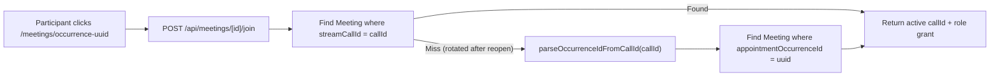
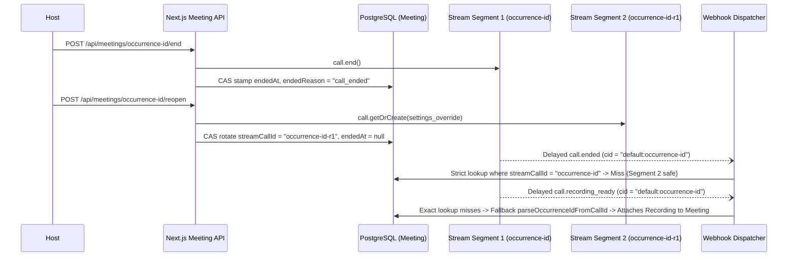

# 18. Architecture Decision Records (ADRs)

> Authoritative architecture decision records governing Stream Video call lifecycle isolation, call-ID rotation, synchronous CAS state convergence, the immutable booked end with extension state on `Meeting`, meeting exit controls, the attendance witness behind session outcomes, the launch participant cap, staff-editable video quality, the unread digest, synchronous access revocation, and the recording copy and Stream-copy deletion.

## Table of Contents

- [Overview & Decision Matrix](#overview--decision-matrix)
- [ADR-01: Strict Per-Occurrence Stream Call Isolation (`1 Occurrence = 1 Active Call ID`) vs Permanent Link Reuse](#adr-01-strict-per-occurrence-stream-call-isolation-1-occurrence--1-active-call-id-vs-permanent-link-reuse)
- [ADR-02: Call-ID Rotation (`occurrence-<id>-r<base36>`) + Asymmetric Webhook Lookup for Reopened Rooms](#adr-02-call-id-rotation-occurrence-id-rbase36--asymmetric-webhook-lookup-for-reopened-rooms)
- [ADR-03: Synchronous CAS Termination Stamp (`recordMeetingEndedSynchronously`) + Monotonic Webhook Convergence (`supersedesRecordedEnd`)](#adr-03-synchronous-cas-termination-stamp-recordmeetingendedsynchronously--monotonic-webhook-convergence-supersedesrecordedend)
- [ADR-04: Immutable Booked End; Extension State on `Meeting`](#adr-04-immutable-booked-end-extension-state-on-meeting)
- [ADR-05: Single Exit Control (`CallExitButton`) over Dual Hangup Buttons](#adr-05-single-exit-control-callexitbutton-over-dual-hangup-buttons)
- [ADR-06: Stream Participant Sessions Are the Attendance Witness](#adr-06-stream-participant-sessions-are-the-attendance-witness)
- [ADR-07: Interactive WebRTC with a 200-participant cap, not HLS, at launch](#adr-07-interactive-webrtc-with-a-200-participant-cap-not-hls-at-launch)
- [ADR-08: Staff-editable platform video quality, 720p default](#adr-08-staff-editable-platform-video-quality-720p-default)
- [ADR-09: Unread Digest via Stream Unread Reminders](#adr-09-unread-digest-via-stream-unread-reminders)
- [ADR-10: Synchronous Server-Side Revocation with a Durable Retry and a Daily Reconciler](#adr-10-synchronous-server-side-revocation-with-a-durable-retry-and-a-daily-reconciler)
- [ADR-11: Recordings Are Pulled into R2, Stream's Copy Is Deleted After a Verified Copy, and There Is No Second Store](#adr-11-recordings-are-pulled-into-r2-streams-copy-is-deleted-after-a-verified-copy-and-there-is-no-second-store)
- [Deprecated & Superseded Approaches](#deprecated--superseded-approaches)

---

## Overview & Decision Matrix

Stream Video SFU and PostgreSQL (`PG_POOL_MAX=1`) enforce distinct operational constraints across real-time media sessions and durable relational billing records:

| ADR        | Core Architectural Decision                                                                   | Primary Enforcing Modules                                                                                                        | Invariant Protected                                                                                                                  |
| ---------- | --------------------------------------------------------------------------------------------- | -------------------------------------------------------------------------------------------------------------------------------- | ------------------------------------------------------------------------------------------------------------------------------------ |
| **ADR-01** | `1 AppointmentOccurrence = 1 active Stream Call ID`                                           | `actions/stream/meetings/meeting.action.ts`, `lib/stream/call-cid.ts`, `lib/meetings/access.ts`                                  | Prevents cross-session attendance contamination, recording mix-ups, and stale room admission across series                           |
| **ADR-02** | Rotate `streamCallId` (`occurrence-<id>-r<base36>`) + asymmetric lookup                       | `app/api/meetings/[meetingId]/{end,reopen}/route.ts`, `lib/stream/{session-handlers,recording-handlers}.ts`                      | Bypasses Stream's permanent `ended_at` seal without losing prior recording egress or dying from late webhooks                        |
| **ADR-03** | Synchronous CAS end stamp + monotonic `supersedesRecordedEnd`                                 | `app/api/meetings/[meetingId]/end/route.ts`, `lib/stream/session-handlers.ts`                                                    | Eliminates webhook lag on dashboard cards while preventing out-of-order webhooks from rewinding terminal state                       |
| **ADR-04** | Immutable booked `endsAt`; `+15m` extension on `Meeting.extendedSeconds`                      | `app/api/meetings/[meetingId]/extend/route.ts`, `lib/meetings/duration-cap.ts`, `app/meetings/[id]/components/OverrunBanner.tsx` | Keeps the sold end intact for outcome and money, while the Stream cap, banner and conflict horizon derive from one Postgres value    |
| **ADR-05** | Unified `<CallExitButton />` (participant leave vs host 2-way popover)                        | `app/meetings/[id]/components/EndCallButton.tsx`, `app/meetings/[id]/components/MeetingRoom.tsx`                                 | Prevents accidental room termination when a host leaves early while keeping room closure one deliberate choice                       |
| **ADR-06** | Stream participant sessions resolve every assumed or missing interval                         | `lib/booking/session-outcome-sweep.ts`, `lib/stream/{call-presence,session-handlers}.ts`, `lib/meetings/segment-presence.ts`     | A lost webhook can neither stretch a host's presence into a `HELD` verdict nor turn a delivered session into `NOBODY_JOINED`         |
| **ADR-07** | Interactive WebRTC with a 200-participant cap, no HLS at launch                               | `lib/events/capacity.ts`, `schemas/plans.ts`, `lib/meetings/room-ready.ts`, `lib/meetings/call-provisioning.ts`                  | Keeps every attendee able to ask a question or be brought on stage, and bounds the per-room cost and SFU load                        |
| **ADR-08** | Staff-editable `PlatformVideoConfig`, 720p default                                            | `lib/stream/{video-quality,video-config}.ts`, `lib/meetings/room-ready.ts`, `app/api/admin/video-config/route.ts`                | Keeps video and recording quality a priced, audited staff decision instead of a constant in code or an environment variable          |
| **ADR-09** | Chat unread digest from Stream's `user.unread_message_reminder`                               | `lib/stream/chat/unread-digest.ts`, `lib/stream/control-plane-contract.ts`                                                       | One durable email and bell per user per 30-minute window, never quoting message text                                                 |
| **ADR-10** | Remove access synchronously on the action, queue failures, reconcile daily                    | `lib/stream/access-revocation.ts`, `scripts/cleanup/retry-moderation-enforcement.ts`, `lib/stream/membership-reconciler.ts`      | A cancelled or removed user loses chat access without waiting for their own browser, and a Stream failure cannot lose the revocation |
| **ADR-11** | Pull recordings into R2, delete Stream's copy 24 hours after a verified copy, no second store | `lib/stream/recording-transfer-service.ts`, `lib/stream/recording-retention.ts`, `lib/stream/recording-stream-delete.ts`         | A recording is never lost to a failed push, and Stream does not keep a playable copy after we hold a verified one                    |

---

## ADR-01: Strict Per-Occurrence Stream Call Isolation (`1 Occurrence = 1 Active Call ID`) vs Permanent Link Reuse

### Context & Problem Statement

Multi-occurrence appointments (`SUBSCRIPTION` weekly calls and multi-session `CLASS` cohorts) span weeks or months under a single parent `Appointment`. Reusing a permanent Stream call identifier per `Appointment` or per human pair creates four severe distributed systems failure modes:

1. **Cross-Occurrence Attendance Contamination**: `MeetingPresence` and `MeetingAttendance` (`firstJoinedAt`, `lastLeftAt`, `joinCount`) key settlement (`HELD`, `CUT_SHORT`, `NO_SHOW_*`) and payout release (`release-earnings.ts`) per occurrence. Sharing one Stream call across occurrences conflates late departures from session $N$ with early arrivals for session $N+1$.
2. **Recording Ownership & Retention Ambiguity**: Each `Recording` row inherits per-occurrence titles, participant consent decisions (`MeetingRecordingConsent`), and retention expiries.
3. **Permanent `call.end()` Seal**: Once Stream stamps `ended_at` on a call object, subsequent `call.join()` calls from non-admin roles fail at the SFU boundary. If week 1 calls `call.end()`, week 2 cannot reuse the same `cid`.
4. **Duration Cap Drift**: Each occurrence computes its own `max_duration_seconds = clamp(bookedDuration + 45m, 45m, 12h)` (`resolveMaxCallDurationSeconds`) and independent `+15m` host extension budget.

### Decision

Enforce strict **1-to-1 isolation between an `AppointmentOccurrence` row and one active `Meeting` row (`Meeting.appointmentOccurrenceId @unique`)**:

- **Canonical Call Identifier**: Initial provisioning (`provisionAppointmentMeeting` in `actions/stream/meetings/meeting.action.ts`) mints `streamCallId = "occurrence-<occurrenceUuid>"` on the hardened `default` call type (`STREAM_CALL_TYPE = "default"`).
- **Bare Call ID Storage**: `Meeting.streamCallId` always stores the bare identifier (`occurrence-<uuid>` or rotated `occurrence-<uuid>-r<base36>`), never prefixed with `default:`. `toCallId(cidOrId)` and `toCallCid(callId)` in `lib/stream/call-cid.ts` normalize identifiers idempotently at every API and webhook boundary.
- **Transparent Stale-Link Alias Resolution**: When a participant clicks an email calendar invite or browser bookmark containing an older call alias for the same occurrence (e.g., `occurrence-<uuid>` after the host reopened the room as `occurrence-<uuid>-r<base36>`), `loadMeeting(callId)` in `lib/meetings/access.ts` executes a two-step lookup:
  1. Primary exact match: `prisma.meeting.findUnique({ where: { streamCallId: callId } })`.
  2. Canonical occurrence fallback: extracts `<uuid>` via `parseOccurrenceIdFromCallId(callId)` (`/^occurrence-([0-9a-f-]{36})(?:-r[a-z0-9]+)?$/i`) and queries `prisma.meeting.findUnique({ where: { appointmentOccurrenceId: occurrenceId } })`, transparently returning the current active `meeting.streamCallId` in `POST /api/meetings/[meetingId]/join`.



### Consequences

- Every occurrence has deterministic lifecycle boundaries, isolated `MeetingAttendance` / `MeetingPresence` ledger rows, isolated Q&A namespaces (`stage-qa:<callId>:<questionId>`), and isolated recording pipelines.
- Bookmarks and transactional booking emails (`occurrence-<uuid>`) remain permanently valid even if a room is rotated one or more times before or during the session.

---

## ADR-02: Call-ID Rotation (`occurrence-<id>-r<base36>`) + Asymmetric Webhook Lookup for Reopened Rooms

### Context & Problem Statement

In Stream Video's control plane, invoking `call.end()` irreversibly stamps `call.ended_at` on that Stream call document (`default:occurrence-<uuid>`). Stream does not provide an un-end RPC to reopen a terminated call segment, and emitting `call.end()` triggers asynchronous background workers on Stream's infrastructure:

1. **Recording Egress Transcoding**: If recording was active in segment 1 (`occurrence-<uuid>`), Stream's transcoding cluster emits `call.recording_stopped` and `call.recording_ready` (or `call.recording_failed`) **seconds to minutes after** `call.end()` returns.
2. **Delayed Termination Webhooks**: `call.ended` and `call.session_ended` webhooks for segment 1 (`occurrence-<uuid>`) can arrive **after** a host has already clicked **Reopen Session Room** (`POST /api/meetings/[meetingId]/reopen`) and entered segment 2 (`occurrence-<uuid>-r<base36>`).

If reopening simply overwrote `Meeting.streamCallId = "occurrence-<uuid>-r<base36>"` and all webhook handlers used the same lookup query, one of two catastrophic bugs would occur:

- If all webhooks only queried `where: { streamCallId }`, `call.recording_ready` and late `call.session_participant_left` events from segment 1 would fail with `Meeting not found`, silently dropping paid recordings and participant attendance intervals.
- Conversely, if all webhooks fell back to `appointmentOccurrenceId`, a delayed `call.ended` or `call.session_ended` webhook from segment 1 would match segment 2's active `Meeting` row and prematurely stamp `endedAt` on the live reopened room!

### Decision

Combine **atomic call-ID rotation (`occurrence-<uuid>-r<base36>`)** with **strictly asymmetric webhook resolution** based on event domain semantics:

1. **Rotation Formula & CAS Transition**:
   - On pre-start early end (`endedAt < startsAt` -> `"ended_early"`) or explicit host reopen (`POST /api/meetings/[meetingId]/reopen` within `[startsAt - 15m, roomEndsAt + 30m]`, where the room end is the booked end plus any extension), the server mints:
     ```text
     nextCallId = `occurrence-${occurrenceId}-r${Date.now().toString(36)}`
     ```
   - Reopen builds the fresh call with the same payload the provisioner uses (`buildRoomCallPlan` in `lib/meetings/call-provisioning.ts`: `settings_override`, members, custom fields and the cap from the room end) and creates it on Stream first with `getOrCreate` on the new id. Only then does it update `Meeting` atomically via compare-and-set (`updateMany` predicated on the expected `streamCallId` and `endedAt`), clearing `endedAt = null`, `endedReason = null`, and `isRecording = false`. A Stream failure therefore rotates nothing, and a lost CAS leaves the fresh call unused and answers `reopened: false` with the current id.
2. **Asymmetric Webhook Lookup Matrix**:

| Webhook Event Family                                               | Lookup Strategy                                                                               | Architectural Rationale                                                                                                               |
| ------------------------------------------------------------------ | --------------------------------------------------------------------------------------------- | ------------------------------------------------------------------------------------------------------------------------------------- |
| `call.ended`, `call.session_ended`                                 | **Strict exact match only**: `where: { streamCallId }`                                        | Termination belongs strictly to one Stream call segment. A delayed end webhook from segment 1 must **never** kill reopened segment 2. |
| `call.recording_ready`, `call.recording_failed`                    | **Exact match + occurrence fallback**: `where: { streamCallId }` -> `appointmentOccurrenceId` | Transcoding finishes asynchronously after segment 1 closes; every segment's MP4 belongs to the occurrence's `Meeting` row.            |
| `call.session_participant_joined`, `call.session_participant_left` | **Exact match + occurrence fallback**: `where: { streamCallId }` -> `appointmentOccurrenceId` | Participant stay durations (`userSessionId` intervals) from segment 1 must be preserved for accurate `deliveredMinutes` settlement.   |



### Consequences

- Hosts can safely run a pre-session camera/audio device test (`endedAt < startsAt`) and click **End session for everyone**, or recover from an accidental live hangup via **Reopen Session Room**, with zero risk of late webhooks killing the new room or dropping prior segment recordings.

---

## ADR-03: Synchronous CAS Termination Stamp (`recordMeetingEndedSynchronously`) + Monotonic Webhook Convergence (`supersedesRecordedEnd`)

### Context & Problem Statement

Relying solely on Stream's `call.ended` webhook to stamp `Meeting.endedAt` introduces a 1–10 second asynchronous propagation window (or longer during webhook retries). When a host ends a session and immediately navigates back to `/dashboard/...`, the dashboard server component queries Postgres before the webhook lands, rendering the ended room as still live (`Join Now`). Conversely, writing `Meeting.endedAt` naively from both the HTTP route and the webhook handler risks race conditions, lost `endedReason` classifications, and backward timestamp rewinds when out-of-order webhooks arrive.

### Decision

Implement **Synchronous CAS Dual-Write + Monotonic Webhook Convergence** in `lib/stream/session-handlers.ts`:

1. **Synchronous Route Execution (`POST /api/meetings/[meetingId]/end`)**:
   - Invokes `getStreamVideoClient().video.call("default", resolvedCallId).end()` inside `withStreamCircuitBreaker` (outside any DB transaction per `PG_POOL_MAX=1`).
   - Immediately executes `recordMeetingEndedSynchronously(resolvedCallId, now)`:
     - Evaluates pre-start vs live termination:
       - If `endedAt < startsAt` (**Pre-Start Device Check**): stamps `endedReason = "ended_early"` and immediately rotates `streamCallId = occurrence-<id>-r<base36>` while keeping the occurrence upcoming (`SCHEDULED`). `ended_early` is rejoinable, so real session entry makes the provisioner build a clean room and clear the end stamp.
       - If `endedAt >= startsAt` (**Live Session Termination**): stamps `endedReason = "call_ended"`, closes all open `MeetingPresence` intervals (`leftAt = endedAt`) and `MeetingAttendance` (`lastLeftAt = endedAt`) inside a single CAS transaction predicated on `where: { id: meeting.id, endedAt: meeting.endedAt }`.
     - If the synchronous DB update throws an unexpected exception, the route reports to Sentry and returns **HTTP `500`** (`"Could not end this meeting. Please try again."`) rather than returning a false HTTP `200`.
2. **Monotonic Webhook Convergence (`supersedesRecordedEnd`)**:
   - Both `recordMeetingEndedSynchronously` and async webhook handlers (`handleCallEnded`, `handleSessionEnded`) enforce:
     ```typescript
     function supersedesRecordedEnd(
       recorded: Date | null,
       incoming: Date,
     ): boolean {
       return !recorded || incoming.getTime() > recorded.getTime();
     }
     ```
   - All three end writers (`recordMeetingEndedSynchronously`, `handleCallEnded`, `handleSessionEnded`) also refuse to overwrite a deliberate end. `isDeliberateEnd` (`lib/appointments/occurrences.ts`) reads the `deliberate` column of the end-reason table (`END_REASON_POLICY` in `lib/meetings/end-reasons.ts`, tabulated in `05-video-implementation.md`). A later `call.ended` can therefore no longer turn a `maintenance` or `org_deactivated` close into `call_ended`, and an SFU inactivity timeout can never downgrade a deliberate closure into a rejoinable one. A sealed, non-deliberate end such as `stream_ended` is kept too unless the newcomer is deliberate (`recordedEndHolds` in `lib/meetings/end-reasons.ts`).
   - The end route returns `callId`, the id that now represents the room (the rotated id after a pre-start `ended_early`), and `404 MEETING_NOT_FOUND` when no `Meeting` matched; `recordMeetingEndedSynchronously` returns `{ kind: "not_found" | "already_ended" | "recorded" }`.

### Consequences

- Dashboard cards transition from `Join Now` to `Ended` on the exact first frame after a host leaves the room.
- Duplicate or out-of-order `call.ended` / `call.session_ended` webhooks converge deterministically without overwriting terminal state.

---

## ADR-04: Immutable Booked End; Extension State on `Meeting`

### Context & Problem Statement

Every call starts with an SFU duration cap of `max_duration_seconds = clamp(bookedDuration + 15m early + 30m grace, 45m, 12h)` (`resolveMaxCallDurationSeconds` in `lib/meetings/duration-cap.ts`). Near the end of a session the host may grant one free 15-minute extension (`POST /api/meetings/[meetingId]/extend`, offered by `<OverrunBanner />` from five minutes before the booked end).

The booked end, `AppointmentOccurrence.endsAt`, is read by several parts of the system as a statement of what was sold: the outcome classifier (`classifySessionOutcome`), the outcome sweep's selection, reminders, earnings, and recording retention. The room end is a different fact: how long the video room may stay open. The extension must therefore be recorded somewhere that does not change the sold end, and it must survive a reopen of the room.

### Decision

Keep the booked end immutable and store the extension on the `Meeting` row.

1. **Where the extension lives.** `Meeting.extendedSeconds` (seconds granted, default 0) and `Meeting.extensionsUsed` (count, default 0) hold the extension. The room end is `endsAt + extendedSeconds`, computed by `resolveRoomEndsAt`. `MEETING_EXTENSION_SECONDS` is 900 and `MAX_MEETING_EXTENSIONS` is 1.
2. **Who reads which end.** Everything that means "when the room closes" reads the room end: the Stream cap and call `custom` written by the provisioner, by reopen (both through `buildRoomCallPlan` in `lib/meetings/call-provisioning.ts`) and by the extend mirror; the join window and `canReopen` window in `lib/meetings/access.ts`; the reopen route's window; the outcome sweep's live-overrun deferral (`decideSlotOutcome`); the orphan reconciler (`lib/meetings/reconcile-orphaned-sessions.ts`); and the extend conflict check. Everything that means "what was booked" keeps `endsAt`.
3. **One CAS claims the extension.** The extend route (host only, `meetingControlLimiter`) first refuses with `409 SESSION_NOT_EXTENDABLE` when the meeting has ended, the occurrence is deleted, is not `SCHEDULED`, or already has an outcome. It then runs the schedule-conflict check over `[startsAt, max(roomEnd, now) + 15m]` for the host, co-host commitments, presenter collaborators, and active participants. It claims the extension with one `prisma.meeting.updateMany` whose `WHERE` requires `endedAt: null`, `extensionsUsed` still equal to the value read and below the maximum, and the occurrence still `SCHEDULED`, without an outcome, and not deleted. The `data` increments both columns.
4. **Stream is a derived mirror.** Only after the claim, and outside any transaction, `mirrorExtensionToStream` reads the call and writes `max_duration_seconds = max(existing, derived room cap)` plus `custom = { ...existing, sessionEndsAt, sessionBaseEndsAt, extendedSeconds, extensionsUsed }`. Every value is computed from Postgres and never added to what Stream holds, so repeating the mirror cannot add time twice.
5. **Retry converges.** If Stream fails, the route answers `503 EXTEND_SYNC_PENDING`: the extension is kept in Postgres and the host retries. A retry finds `extensionsUsed` at the maximum, re-mirrors, and answers `200` if Stream was behind or `409 alreadyExtended` if it was already in sync.

Example. Hannah (consultant) has a 10:00–11:00 IST session with Priya. The booked end stays 11:00 IST. At 10:56 IST Hannah extends: `extendedSeconds` becomes 900, the room end becomes 11:15 IST and the Stream cap grows by 15 minutes. If Hannah leaves at 11:00 IST, the classifier still compares the delivered time with the 11:00 IST booked end, so the session is not marked as cut short.

### Consequences

- "Extend, then leave on time" no longer loses the 15 minutes, because the classifier never sees a moved end.
- The extension budget lives on `Meeting`, so reopening a room (a new Stream call) cannot reset it.
- Residual risk. The database overlap guard `occurrence_no_confirmed_overlap` sees only booked ends and never extensions. The extension is protected only by the application conflict check at the moment the host extends.
- Lead-time finding. Checkout and request-for-approval enforce a 15-minute lead time and the :00/:30 grid (`slotStartRefusal` in `lib/payments/utils/slot-validation.ts`, `MINIMUM_BOOKING_LEAD_TIME_MS`), and the extend button appears only from five minutes before the booked end. A client-picked booking made after an extension therefore cannot start inside it when the booked end is on the grid. Server-picked allocations (`ScheduleValidationService.validateSlotsInFuture` uses a 5-second buffer), reschedules, and host-created webinar or class times do not apply that lead time, so one of them could place a session at the booked end while a 15-minute extension is live. That case remains application-enforced only.

---

## ADR-05: Single Exit Control (`CallExitButton`) over Dual Hangup Buttons

### Context & Problem Statement

Rendering two adjacent red hangup buttons in the bottom control bar (one to leave the room locally and a second to terminate the call for all participants) caused high rates of accidental room closures when hosts intended to step out briefly or refresh audio/video devices, disconnecting paying learners mid-session and sealing the Stream `cid`.

### Decision

Standardize all meeting rooms on a single primary red exit control (`CallExitButton` in `app/meetings/[id]/components/EndCallButton.tsx`):

- **Participants (`!isHost`)**: Clicking the red exit button immediately executes `onLeaveForSelf()` (`leaveCallAndReleaseMedia(call)` -> navigate to role dashboard), leaving the room open for all other attendees.
- **Hosts & Co-Presenters (`isHost`)**: Clicking the red trigger opens an explicit two-choice popover menu (`End or leave session?`):
  1. **Leave call** (`outline` action): Disconnects only the host's local media session (`Keep session open for others · Rejoin anytime`), allowing the room to stay active for remaining attendees or co-presenters.
  2. **End session for everyone** (`destructive` red action): Invokes `POST /api/meetings/[meetingId]/end` (`AbortSignal.timeout(10_000)`), closing the Stream call for all participants, stopping active recordings, stamping `Meeting.endedAt` synchronously, and tearing down local hardware tracks.
  3. **Early-End Caution Guard (`EARLY_END_WARNING_THRESHOLD_MS = 10m`)**: Whenever more than 10 minutes remain before `info.endsAt`, the popover displays a high-visibility amber warning banner (`"{N} min remaining in this booked slot. Ending for everyone disconnects all participants."`) directly above the buttons.

### Consequences

- Eliminates accidental host session terminations while keeping deliberate room closure two clicks away.
- Combined with `ADR-02` (`Reopen Session Room`), even an intentional premature room closure can be recovered cleanly within the room end plus 30 minutes.

---

## ADR-06: Stream Participant Sessions Are the Attendance Witness

### Context & Problem Statement

The outcome classifier (`classifySessionOutcome` in `lib/booking/session-outcome.ts`) decides refunds and voids from `MeetingPresence` intervals, one row per device stay. Those rows come from the `call.session_participant_joined` and `call.session_participant_left` webhooks, and any single delivery can be lost. Three failures followed from treating our rows as the whole truth:

1. Every end stamp closed all open rows at the room end. A host whose leave webhook was lost therefore looked present until the end, which could turn `CUT_SHORT` or `HOST_ABSENT` into `HELD` and suppress a refund. The classifier's own rule that an open interval is `INCONCLUSIVE` could never fire, because no interval was ever open by the time it ran.
2. Rows carried no call id. After a reopen or a pre-start rotation, a late join from the old call was written against the current segment, could reopen it, and was closed at the later segment's end.
3. With zero rows (a total webhook outage), the sweep never asked Stream and wrote `NOBODY_JOINED`.

Stream keeps its own per-device record of each call session (`queryCallParticipantSessions`), independent of our webhook pipeline, and that record outlives the call report's participant summary.

### Decision

Treat Stream's participant sessions as the attendance witness, and keep our rows honest about which closes are evidence.

1. **Evidence versus assumption.** `MeetingPresence.closedByEnd` is true while `leftAt` is a room end stamp rather than a leave Stream reported. Every end stamp (`stampEnd`, the pre-start `ended_early` rotation, the orphan reconciler, and a join that arrives after the room ended) closes rows through `closeSegmentPresences` (`lib/meetings/segment-presence.ts`) with `closedByEnd = true`. A reported leave always replaces an assumed close and clears the flag, whatever the order of arrival.
2. **Segments.** `MeetingPresence.streamCallId` names the call each row belongs to. A participant event that matches the current call id is the current segment; one that only matches through the occurrence id is a prior segment, recorded under its own call id, and never reopens or takes the end of the current room. An end stamp closes only its own segment's rows plus legacy rows with a null call id.
3. **Resolution before classification.** `decideSlotOutcome` (`lib/booking/session-outcome-sweep.ts`) reads the call report and, for every segment with an open or assumed interval, Stream's participant sessions (`getCallParticipantSessionsFromStream` in `lib/stream/call-presence.ts`). It also reads the current segment whenever our rows may be missing someone: when we hold no rows, when the call report has no participant count, or when Stream saw more people than we did. A matching device session with a leave replaces the assumed close (a CAS on `closedByEnd = true OR leftAt IS NULL`); a device stay we never recorded is added. All of this runs before, and outside, the outcome transaction.
4. **No fabricated presence.** When Stream is unreachable or has no record, the interval stays open and the classifier returns `INCONCLUSIVE`, which parks the session `UNVERIFIED` for ops. With zero rows and no Stream record the verdict remains `NOBODY_JOINED`, also `UNVERIFIED`. A webhook outage alone therefore never voids a delivered session.
5. **Bounded reads, one report.** One run of `auto-complete-appointments` may spend `STREAM_WITNESS_READS_PER_RUN` (100) Stream reads. A slot that needs a read after the budget is spent is deferred to the next run with nothing written. Reads that could not resolve an interval are counted and reported as one `attendance witness unavailable` Sentry message per run.

Example. Hannah hosts a 10:00–11:00 IST subscription session with Priya. Hannah's laptop drops at 10:20 IST and the leave webhook is lost; Priya waits until 11:00 IST and Stream ends the idle session at 11:01 IST. The end stamp closes Hannah's row at 11:01 IST with `closedByEnd = true`. At the sweep, Stream's participant sessions show Hannah's device leaving at 10:20 IST, so the row is corrected and the session is `CUT_SHORT` with 40 lost minutes, which returns the session to Priya's allowance. Had Stream been unreachable, the session would have parked `UNVERIFIED` for ops instead of being paid out as `HELD`.

### Consequences

- A lost leave or join no longer moves money in either direction; it either resolves from Stream or waits for a person.
- A Stream outage during the sweep parks sessions with a lost leave as `UNVERIFIED`, so ops review more sessions during an outage instead of the platform guessing.
- `MeetingPresence` rows written before this change carry `closedByEnd = false` and a null call id, so they keep the earlier behaviour.
- The participant-sessions read covers the latest Stream session of each call id. A call that Stream split into two sessions (an idle timeout followed by a rejoin on the same id) resolves only the latest one; an assumed close from the earlier session stays open and parks the outcome for ops.

## ADR-07: Interactive WebRTC with a 200-participant cap, not HLS, at launch

### Context & Problem Statement

Webinars and classes are the only rooms with more than a handful of people. They rely on live interaction: attendees raise a hand, the host brings them on stage, and the Q&A drawer and reactions have to feel immediate. The product therefore needs a ceiling on how many people a room can hold, and a decision about whether very large audiences are served by something other than interactive WebRTC.

### Decision

Webinars and classes are capped at 200 participants at launch (`MAX_GROUP_SESSION_PARTICIPANTS` in `lib/events/capacity.ts`). The cap is enforced in three places:

- **At authoring.** Every plan and per-instance capacity goes through `maxParticipantsSchema` in `schemas/plans.ts` (the plan editor, the crud-with-plan routes, the legacy plan routes and the organisation catalog route), and the editor input carries the same maximum.
- **At purchase.** Checkout already refuses a sale past the effective capacity through the Serializable seat count, so the cap needs no new checkout logic.
- **At the room.** Each 1-to-Many call is created with Stream `limits.max_participants` equal to the effective capacity plus a headroom of 5, with the call owner and the `co_presenter` and `admin` roles excluded from the count (`resolveCallParticipantLimits`). This is the last line of defence if a room is ever joined outside the seat count.

We stay on interactive WebRTC and do not add HLS. Stream delivers WebRTC through an SFU with adaptive simulcast (Dynascale), which the video SDK already uses, so a 200-person room is a supported shape and not a special mode. HLS would add 10 to 30 seconds of latency, which breaks Q&A and stage requests, and Stream bills it as a separate per-viewer add-on (see `14-pricing-and-cost-model.md`).

### Consequences

- The worst-case cost of one session is bounded: 200 attendees for 90 minutes is 18,000 participant minutes.
- A host who needs more than 200 seats cannot sell them until the cap is lifted. The cap can be raised by changing one constant after the load test tracked in the Stream productionization umbrella confirms the SFU, the stage-request flow and the client render path at the new size.
- Stream documents the `limits` fields but not their exact counting rules, so the headroom is deliberately generous and the authoritative sell-out stays the Postgres seat count. A client that hits the room limit sees the SFU error `CALL_PARTICIPANT_LIMIT_REACHED`; no server route observes it, because the join route admits users by membership and never joins the SFU.
- No stored row is above the cap: the seed data never creates a plan or instance above 100 seats. Rows created through a path that bypassed these schemas (direct database writes) would still need a manual review; nothing is backfilled.

---

## ADR-08: Staff-editable platform video quality, 720p default

### Context & Problem Statement

Video and recording quality are the two largest per-minute levers on the Stream bill, and they change with the plan we are on and with what customers ask for. Until now 1-to-Many rooms hard-coded 720p in `buildCallSettingsOverride`, 1:1 rooms inherited whatever the `default` call type held, and recording quality lived only on the call type. Changing any of them meant a code change or a Stream dashboard edit with no record of who did it or why.

### Decision

Quality is one `PlatformVideoConfig` row, edited by staff and admin on the Video quality page through `PATCH /api/admin/video-config` (surface `videoConfig.manage`, mandatory reason, one `OpsActionLog` row). It follows the single-row precedent of `PlatformPricingConfig` and `ReferralProgramConfig`: an `id = "singleton"` row, no backfill, and a missing row reads as the defaults (720p calls, 720p recordings, 1080p screen share). There is no environment variable and no cache; the reader is one primary-key lookup per room creation.

The values are strings guarded by a CHECK, and `lib/stream/video-quality.ts` is the single place that lists them, maps them to Stream's `target_resolution` and `recording.quality`, and holds the cost hints. The shared builder applies them to every call it creates or updates, 1:1 and 1-to-Many alike. Stream supports `recording.quality` in a per-call `settings_override` (`RecordSettingsRequest`, which requires `mode`), so recording quality travels with the call and no call-type change is needed.

### Consequences

- 4K is not offered, and recording stops at 1080p in the UI although Stream accepts up to 1440p.
- A change reaches calls created, reopened or extended after it; rooms already running keep their quality.
- A 1:1 room now sends a full video block copied from the `default` call type, so changing the call type's camera defaults no longer affects 1:1 rooms.
- The `PlatformVideoConfig` table and its CHECK must exist before this code runs; the repository never applies them (see the schema skill).

---

## ADR-09: Unread Digest via Stream Unread Reminders

### Context & Problem Statement

Chat is a booking-scoped, text-only thread and is pull-only: every Stream push provider is disabled and the only event hook carried video events. A consultee's question before a session went unseen until the consultant happened to open the dashboard. The owner chose one durable unread digest, an email plus an in-app bell, deduplicated per user per window and respecting opt-out, rather than a full messenger.

### Decision

The digest is driven by Stream's built-in [unread reminders](https://getstream.io/chat/docs/node/unread-reminders/) rather than by a polling job:

- The contract (`TARGET_CHAT_REMINDERS`) turns on `reminders` and `read_events` for the `messaging` channel type and sets `reminders_interval` to 1800 seconds. Stream then emits `user.unread_message_reminder` for channels with ten or fewer members, which covers every DM, and the event already names the user, the channels and their members, so the handler makes no Stream API call.
- A second V2 event hook with `product: "chat"` delivers that one event to the existing `/api/stream/webhooks` route, which verifies chat and video deliveries with the same `X-Signature` HMAC and keeps the durable receipt-then-process pattern. The drift detector requires one hook per product.
- `handleUnreadMessageReminder` (`lib/stream/chat/unread-digest.ts`) maps the Stream id to our user, skips the support user, unknown ids, banned and erased users, and stages one bell and one email in a transaction guarded by an `IdempotencyRecord` claim on `(stream.chat-digest, <windowStart>, <userId>)`. The opt-out switch is the `appointments` category, and the bell reuses the `appointment` Novu family, so no Novu workflow is added.
- Message text is never read: the Zod schema does not declare it, so it is neither parsed nor stored, and the digest names only counterparts, counts and session dates.

The fallback, a ticker job calling `unread_counts_batch` for users with recent bookings, was not needed: the live app already exposes `reminders` on the `messaging` channel type and a `reminders_interval` setting (300 seconds by default), no plan restriction is documented below the ten-member limit, and the event carries everything the digest needs.

### Consequences

- The unread count is derived from the last five messages (new messages since the recipient's own latest one), because the event carries no unread count; the digest shows "5+" when all five are new.
- A user who wants appointment notices but no chat digest cannot separate the two until a dedicated preference column exists.
- Turning the feature on is an owner action: `npx tsx scripts/stream/ensure.ts --apply --routes-are-deployed` for the reminder settings and `NEXT_PUBLIC_APP_URL=https://familiarisenow.com npx tsx scripts/stream/ensure-webhook-subscription.ts --apply` for the chat hook, after the handler is deployed.

---

## ADR-10: Synchronous Server-Side Revocation with a Durable Retry and a Daily Reconciler

### Context & Problem Statement

Stream keeps a user in a channel or call until something removes them. Revocation was once client-cooperative: it ran only when the affected user's own browser performed a channel sync, behind a server-side "already synced" set and a per-tab session flag. A cancelled booking, a removed organisation member or a removed collaborator therefore kept chat access until, and unless, that person's browser happened to run the sync. Booking cancellation removed no one at all. Postgres knows who is entitled, so the system needs a way to push that fact to Stream that does not depend on the revoked user.

### Decision

Revoke on the server, in the action that ends the entitlement, and back it with two repair layers.

1. **Intent first, removal after the commit.** The cancel route and the seat-leave path call `revokeEndedSeatAccess`, and a seat-ending refund calls `revokeRefundedSeatAccess` (`lib/stream/access-revocation.ts`), with its intent keyed by the `Refund` row. Each persists a revocation intent before any lookup or Stream call, then removes the user from the event channel, from each direct-message channel the ended booking no longer justifies (after `isDmContextEligible` confirms no other booking still justifies it), and from every room the appointment provisioned, inside an 8-second budget. Collaborator removal and organisation-member removal follow the same pattern.
2. **Durable retry.** A removal Stream refuses, or one the request's time budget ran out before reaching, becomes a `StreamRevocationRetry` row (kinds `COLLAB_REVOKE`, `EVENT_CHANNEL_REMOVE`, `DM_REMOVE`, `ORG_REVOKE`, `SEAT_ACCESS_REVOKE`, `REFUND_ACCESS_REVOKE`; the seventh kind, `ERASURE_REVOKE`, is written by the DPDP erasure scrub and drained by the same job). The `retry-moderation-enforcement` job drains the queue every 30 minutes, re-checks Postgres eligibility before acting, waits 1 minute, 5 minutes, 30 minutes, 2 hours and 8 hours between attempts, and stops after `MAX_ATTEMPTS = 6` with one Sentry error. Budget exhaustion leaves an owed retry row that the sweep resumes from a saved room cursor, within the sweep's start deadline. A new revocation for the same target re-arms a capped row.
3. **Daily reconciler.** `reconcile-stream-memberships` (`lib/stream/membership-reconciler.ts`) walks webinar, class and collaborator channels by `created_at` from a persisted checkpoint and removes members the channel's own access predicate no longer admits. It skips direct messages, refuses to act on a channel where more than half the members would go, and never removes the support user, `system-` users or staff.

The enforcement of "who may be here" stays a Postgres predicate in every layer; Stream is only told the answer.

### Consequences

- A user can keep access for the time between a failed removal and its retry, at most hours in the normal case, but the cancellation itself is never blocked by a Stream outage.
- A direct message has no daily reconciler. Its backstops are the synchronous removal and the retry queue, because whether a finished relationship keeps its thread is a policy question.
- The client no longer takes part. The browser sync gates, the process-local set and the session flag are deleted.
- The retry sweep runs on the Netlify ticker. The reconciler runs on the ticker in a 00:00 to 03:00 UTC window.

---

## ADR-11: Recordings Are Pulled into R2, Stream's Copy Is Deleted After a Verified Copy, and There Is No Second Store

### Context & Problem Statement

Stream records a call and keeps its own copy for 14 days. The platform needs the file for far longer (90 days for a 1:1, 365 days for a group session), so it must move the file somewhere it controls. Three questions came up: who moves it (Stream pushing to our bucket, or us pulling), where it lands (one store or a fallback), and what happens to Stream's copy afterwards. The [storage, retention and visibility ADR](../decisions/2026-10-09-recording-storage-retention-visibility.md) chose the pull model and R2. This record adds the decisions about the second store and about Stream's copy, which that ADR did not settle.

### Decision

1. **The platform pulls; Stream does not push.** `transfer-recordings` (`lib/stream/recording-transfer-service.ts`) streams Stream's CDN copy into R2. Stream's external-storage feature is not used: it documents no retry for a failed push and a failed push loses the recording. With a pull, Stream's own copy stays as the retry source for the whole 14 days.
2. **R2 is the only store.** There is no Supabase or other fallback copy. The danger to a recording is that the copy job does not run or is not watched, not that R2 loses an object, and a second copy path would double the failure surface. Supabase's Free plan also caps objects at 50 MB.
3. **A copy is verified before it counts.** The object is written under an attempt-scoped key (`recordings/<id>/attempt-<n>.mp4`), its stored size is compared with the streamed bytes and the source length, and only then does a compare-and-set move the row from `TRANSFERRING` to `AVAILABLE`. A failure returns the row to `READY` and is retried up to `MAX_TRANSFER_ATTEMPTS = 12` while the Stream copy lives.
4. **Stream's copy is deleted a day after the verified copy.** `deleteTransferredStreamCopies` in `lib/stream/recording-retention.ts`, part of the daily `expire-recordings` job, deletes Stream's copy of any `AVAILABLE` row copied at least 24 hours earlier, through `deleteStreamRecordingCopy`, and then clears `recordingUrl`. The day is the window in which a bad R2 object can still be re-pulled. Retention expiry, a host delete and DPDP erasure delete Stream's copy too, and keep the Stream pointer on the row until Stream confirms.

Example. Grace's session ends at 17:12 IST on Tuesday 3 November 2026 and the recording is copied at 00:03 IST on Wednesday. Stream's copy would live until 17 November. The expiry run on Thursday 5 November 08:30 IST deletes it, 12 days earlier.

### Consequences

- Personal data does not sit in Stream for up to 14 days after we hold our own copy.
- If the expiry job does not run, Stream's copy simply lapses on its own at 14 days; nothing is lost, but the earlier deletion is.
- A recording whose copy never succeeds is lost when Stream's copy lapses. The only protections are the retries, the one Sentry message per run for exhausted attempts, and the schedule; there is no fallback store. Until the Stream jobs move to the ticker (slice S1, pending) the schedule is a manual trigger.

---

## Deprecated & Superseded Approaches

- **Permanent Per-Appointment / Per-Consultant Stream Call IDs**: Superseded by strict `1 AppointmentOccurrence = 1 active Stream Call ID` isolation (`occurrence-<uuid>`) so recurring `SUBSCRIPTION` and `CLASS` sessions never bleed attendance, duration caps, or recording state across occurrences.
- **Uniform `where: { streamCallId }` Webhook Lookup Across All Events**: Superseded by asymmetric webhook lookup (`ADR-02`) so recordings and presence from pre-reopen segments attach via `parseOccurrenceIdFromCallId`, while late `call.ended` / `call.session_ended` webhooks strictly check `where: { streamCallId }`.
- **Dual-Synced Extension (`endsAt` Advanced in Postgres plus Stream `custom`)**: Superseded by ADR-04. Advancing `AppointmentOccurrence.endsAt` moved the column the classifier reads as the booked end, so "extend, then leave on time" lost 15 minutes. The extension counter lived in Stream `custom`, which a reopen reset, and a failed revert let a retry add time. Delete any code that writes `AppointmentOccurrence.endsAt` from the extend path or reads the extension count from Stream.
- **Fire-and-Forget End Endpoint Swallowing DB Errors as HTTP 200**: Superseded by `recordMeetingEndedSynchronously` CAS dual-write that rotates pre-start `"ended_early"` rooms and returns HTTP `500` on database failure.
- **Pull-Only Chat With No Unread Notification**: Superseded by the unread digest (`ADR-09`), one email and bell per user per 30-minute window from Stream's unread reminders.
- **Dual Red Hangup Buttons in `MeetingRoom.tsx`**: Superseded by the single Zoom/Meet-style `<CallExitButton />` with role-aware direct leave vs host two-action popover and `< 10m` remaining caution banner.
- **End Stamps Closing Every Open Presence Row as Fact**: Superseded by ADR-06. `stampEnd` and the outcome sweep's `capOpenSlotPresences` closed every open row at the room end before classification, so a lost leave read as presence until the end. Delete any code that closes `MeetingPresence` at an end stamp without `closedByEnd = true`, or that classifies an assumed close without first asking Stream.
- **Hard-coded 720p in the 1-to-Many builder and quality left on the call type**: Superseded by `PlatformVideoConfig` (ADR-08). Delete any literal `target_resolution` in `lib/meetings/**` and any environment variable that tunes video quality.
- **Client-cooperative revocation (browser sync gates and a session flag):** Superseded by ADR-10. Delete any residue of the `initialSyncCompletedUsers` set and the `stream_sync_<id>` flag.
- **Leaving Stream's copy of a recording until its 14-day expiry, and Supabase or a push to our bucket as recording stores:** Superseded by ADR-11. Delete any code that treats Stream's copy as permanent or adds a second recording destination.
