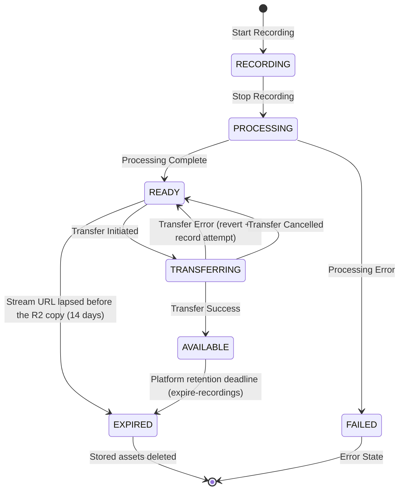
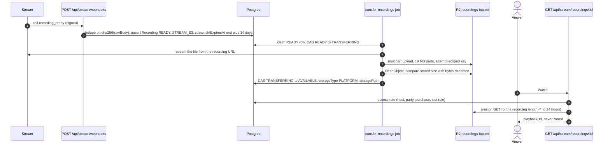
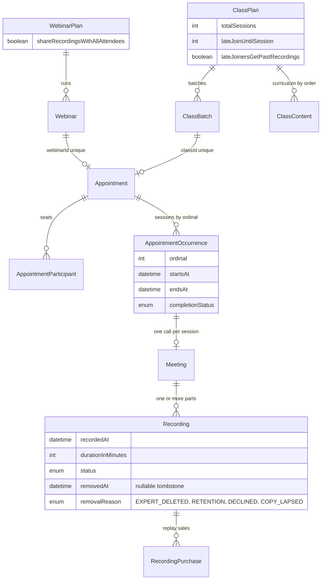
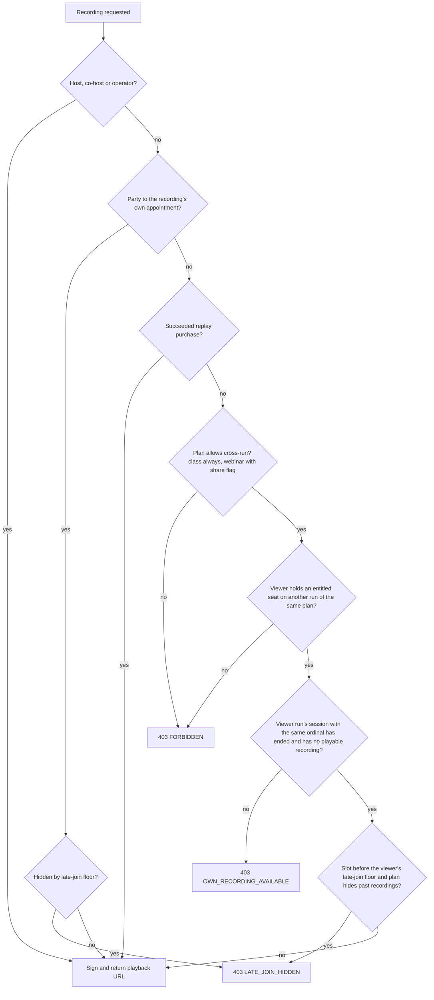
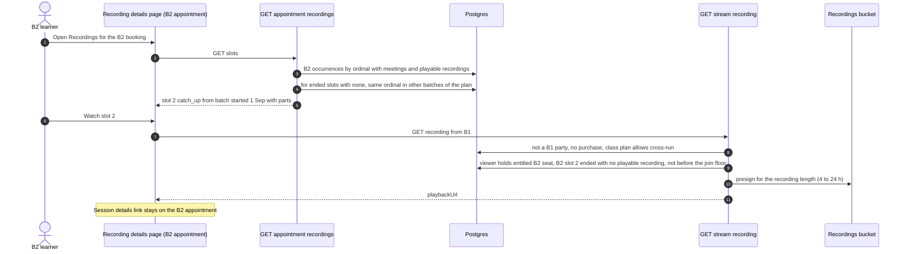

# 19. Recordings: Lifecycle, Retention and Access

> How a session recording moves from Stream to our private R2 bucket, how long it lives, and who may watch which recording when a plan has several runs or batches. [13. Recording Webhooks](./13-recording-webhooks.md) covers the webhook handlers, transfer internals and API routes; this document covers the lifecycle as a whole, the retention rules and the shared-run access model. Decisions are in [the ADR](../decisions/2026-10-12-session-documents-and-recordings.md). Session documents are in [documents/README](../documents/README.md).

## Lifecycle

A recording is a `Recording` row hanging off a `Meeting`, which hangs off one `AppointmentOccurrence`. The host starts it by hand after the consent gate. Stream stores the file for 14 days and the platform copies it into R2 before that copy lapses.



A failed copy never lands in `FAILED`; every transfer failure returns the row to `READY` so the next run retries it. `FAILED` is reached only through `call.recording_failed`.

### The removal tombstone

Every path that makes a recording unplayable writes `EXPIRED` together with two nullable `Recording` columns, `removedAt` and `removalReason` (`RecordingRemovalReason`), so attendees can tell why a session has nothing to play. The migration is additive and nullable.

| `removalReason`  | Written by                                                                                                      | What the slot shows                                                 |
| ---------------- | --------------------------------------------------------------------------------------------------------------- | ------------------------------------------------------------------- |
| `EXPERT_DELETED` | `DELETE /api/stream/recordings/:id`, which also notifies the booking's learners (`recording-removal-notice.ts`) | "Removed by the expert on 5 Oct." for 30 days, then "Not recorded." |
| `RETENTION`      | `expire-recordings` when the platform or organisation deadline passes                                           | "The recording's retention period has ended."                       |
| `DECLINED`       | The 1:1 decline discard (`recording-decline.ts`)                                                                | "No recording: a participant chose not to be recorded."             |
| `COPY_LAPSED`    | `expire-recordings` for a `READY` row whose Stream link lapsed before the R2 copy                               | "The recording's retention period has ended."                       |

The tombstone row keeps no media: the object, preview clip and thumbnail are deleted by the same flow that wrote it (or retried by `expire-recordings`).

## Webhook, R2 copy and playback

The webhook only records that a file exists. The copy is a separate, retried job, and playback links are minted per request, never stored.



- The transfer job runs in GitHub Actions and is registered in `lib/cron/cleanup-registry.ts`, so the HTTP twin and the back-office runner can dispatch it. A failed copy aborts the multipart upload, leaves the row `READY` (still playable from Stream's link) and retries up to the attempt limit. Exhausted rows are reported to Sentry once per run.
- A host may record a session nobody booked, and a call can produce several recordings (a restarted recording, a dropped and rejoined call, a 2-hour split), so one session can have several `Recording` rows.
- In a 1:1 session, a participant's decline before the recording's end discards the recording from Stream and expires any row, so no playable copy exists.

## Retention rules

One platform schedule applies, evaluated by the daily `expire-recordings` job (`lib/stream/recording-retention.ts`).

| Session type                                                            | Deleted after                                                 |
| ----------------------------------------------------------------------- | ------------------------------------------------------------- |
| 1:1 consultation                                                        | 90 days after the session                                     |
| Subscription / trial                                                    | 90 days after the subscription ends (kept while it is active) |
| Webinar                                                                 | 365 days after the session                                    |
| Class                                                                   | 365 days after the class's final session                      |
| Published replay, or any recording with a pending or succeeded purchase | Never auto-deleted                                            |

- An organisation can shorten retention for org-scoped recordings (`Organization.streamRecordingRetentionDays`); the effective deadline is the earlier of the two, and sold replays are exempt.
- Expiry deletes the R2 object, the preview clip and the thumbnail, marks the row `EXPIRED`, and (org-scoped) writes an audit row.
- A `READY` row whose Stream link lapsed without a copy is also expired; its holders get `410`.
- **Cancelled bookings.** A cancelled, rejected or expired booking keeps its recordings watchable by the parties until their retention date, exactly like its documents. Released or refunded seats lose access, because playback checks the seat on every request. Recording surfaces show "Available until <date>", "Kept while the booking is active" or "Kept permanently" (`keptUntilText` in `lib/stream/recording-copy.ts`).
- **Hard delete.** Only untouched offerings can be hard-deleted. The database cascade removes the `Meeting` and `Recording` rows, so `lib/booking/offering-delete.ts` selects each recording's `storagePath` with `tx` before the guarded delete and, after the transaction commits, calls `deleteRecordingAssets` best effort, reporting failures once per request. No sweeper is added.

## Plans, runs, batches and sessions

A group offering has layers, and recordings hang off the bottom one.

1. The **plan** is the listing a learner buys. `WebinarPlan` carries `shareRecordingsWithAllAttendees`; `ClassPlan` carries the curriculum, `totalSessions` and the late-join controls `lateJoinUntilSession` and `lateJoinersGetPastRecordings`.
2. The **run** (webinar) or **batch** (class) is one scheduled delivery of the plan, with exactly one wrapper `Appointment` (`webinarId` and `classId` are unique). Seats are `AppointmentParticipant` rows.
3. The **session** is an `AppointmentOccurrence`. `ordinal` is its 1-based position in the programme, inherited by a reschedule replacement and unique among live rows per appointment (partial index in `prisma/sql/check-constraints.sql`). A voided session keeps its ordinal history while its make-up is owed.
4. The **call** is a `Meeting`, one per occurrence.
5. The **recording** is a `Recording` with `meetingId`. A meeting has many recordings.



No curriculum-position column is needed: `AppointmentOccurrence.ordinal` is the position, and `ClassContent.order` or `SubscriptionContent.order` supplies the slot title. Content order is not constrained to be contiguous or unique, so the title is best-effort and falls back to "Session k". A batch is labelled by its start date ("Batch that started 3 Oct"); no label column exists.

## Shared-run and multi-batch access

A class plan runs batches B1, B2 and B3, each with sessions 1 to N, and any session may have several recordings. A learner holds a seat in B2 only. The rule is: **your own batch, plus what your batch is missing.**

1. **Own batch by slot.** The learner's recordings are organised by their own batch's sessions in `AppointmentOccurrence.ordinal` order, as "Session 1 · <ClassContent title> · 3 Oct" through "Session N". Other batches never appear as separate cards, and there is no "Other batches" browser.
2. **Several recordings of one session** are ordered by the occurrence's `startsAt`, then by `recordedAt` ascending, and labelled "Part 1 of 3", "Part 2 of 3". A single recording gets no part label. When a slot's parts come from a voided session and its make-up, the make-up parts carry a "Make-up · 10 Oct" marker. The player offers "Next part".
3. **Catch-up.** A slot whose own occurrence has ended (or was cancelled or voided) with **no playable recording** shows the same-ordinal recording from the most recent other batch, labelled "From the batch that started 3 Oct".
   - Classes: always. Webinars: only when `shareRecordingsWithAllAttendees` is on.
   - Never for an upcoming slot, so a later batch cannot watch ahead of its own cohort.
   - Never before the learner's late-join floor unless the plan sets `lateJoinersGetPastRecordings`.
   - Missing one's own live session is not a reason for catch-up: if the learner's batch recorded it, they watch that recording.
   - The candidate batch is the one whose same-ordinal session ended most recently and has a playable recording; ties break on batch id so the choice is deterministic.
4. **One server rule** decides both what the list shows and what playback signs, so the list can never show a recording that playback refuses.
5. **"Session details" always opens the learner's own booking**, focused on the slot (`.../appointments/<ownAppointmentId>/recordings?slot=<k>`). A purchased replay with no own appointment links to the public listing when published, otherwise has no link. Hosts and co-hosts open their batch's appointment.

The resolver is `lib/stream/recording-slots.ts` (`resolveRecordingViewer`, `readRecordingSlots`, `catchUpPlaybackAccess`, `viewerPlaybackAccess`). Each slot is in exactly one state: `recorded`, `catch_up`, `upcoming`, `processing`, `not_recorded`, `declined`, `removed`, `expired` or `before_you_joined`. A slot that is `not_recorded`, `declined`, `removed` or `expired` also carries a `missingReason`, and a `catch_up` slot keeps the reason its own session has nothing to play.

### The access check

The playback route keeps its existing order (operator, host, own party, purchase) and replaces the plan-wide arm with the slot-aware rule.



The slot query is one indexed walk: plan, then the viewer's seat appointments on that plan, then the live occurrence with the same `ordinal` (served by the partial unique index), then its meeting's playable recordings. It runs on the global client outside any transaction, so the single-connection pool rule is not involved.

### A B2 learner's catch-up playback from B1



### Who may play, by session type

| Session type                          | Who may play                                                                                                      |
| ------------------------------------- | ----------------------------------------------------------------------------------------------------------------- |
| 1:1 consultation, subscription, trial | Only that appointment's participants. Never plan-wide, never sellable.                                            |
| Webinar                               | Attendees (paid or seated) of that run; catch-up from another run only when the plan shares recordings.           |
| Class                                 | Enrolled members of the batch; catch-up from another batch for sessions their batch lacks; late-join rules apply. |

The owner and accepted co-presenters always have access, a platform `ADMIN` has full access (audited), `STAFF` and organisation roles see metadata only, and buyers of a published replay may play it. Clients never receive a raw storage URL in a payload.

## The Recording details page

One route per appointment serves 1:1, multi-session and catch-up cases: `.../appointments/[appointmentId]/recordings`, with `?slot=<ordinal>&r=<recordingId>` selecting a slot and part. Routes exist in the consultant, consultee and organisation trees. The appointment hub shows a snapshot card (sessions recorded of total, latest, "Kept until") that links here. Playback links are minted by each Watch click and never cached.

```
+----------------------------------------------------------------------------------+
| <- Back to session   Recordings · Beginner Class (batch that started 1 Oct)       |
| Private to this batch's members · Available until 5 Oct 2027                      |
+----------------------------------------------------------------------------------+
| Session 1 · Variables      3 Oct   1 part · 52 min                      [Watch]   |
| Session 2 · Conditions     5 Oct   Not recorded. Catch-up from the batch that     |
|                                    started 1 Sep · 49 min                [Watch]   |
| Session 3 · Loops          8 Oct   Part 1 of 2 · 31 min                  [Watch]   |
|                                    Part 2 of 2 · 18 min                  [Watch]   |
| Session 4 · Functions     10 Oct   No recording: a participant chose not to be   |
|                                    recorded. Catch-up from the batch that started  |
|                                    1 Sep                                          |
| Session 5 · Lists         15 Oct   Upcoming                                       |
+----------------------------------------------------------------------------------+
```

"Watch" opens the player modal (`RecordingPlayerModal`), which mints the playback link on open and offers "Next part" within a session; there is no download action. For a host the list has no catch-up rows (a host sees their own batch), plus a "Manage" action per part that opens the existing `RecordingManageSheet`. The **recordings library** is the same grouped list, one group per own appointment with the same slot rows, plus a "Purchased" group; other batches never appear as groups.

```ts
type Slot = {
  ordinal: number;
  title: string; // ClassContent/SubscriptionContent title or "Session k"
  startsAt: string;
  state:
    | "recorded"
    | "catch_up"
    | "upcoming"
    | "processing"
    | "not_recorded"
    | "declined"
    | "removed"
    | "expired"
    | "before_you_joined";
  missingReason: "not_recorded" | "declined" | "removed" | "expired" | null;
  removedAt: string | null; // when an expert removed the session's recording
  source:
    | { kind: "own" }
    | { kind: "catch_up"; batchLabel: string; startsAt: string }
    | null;
  parts: {
    recordingId: string;
    title: string;
    partNo: number;
    partCount: number; // "Part k of n" only when partCount > 1
    recordedAt: string;
    durationInMinutes: number;
    makeUp: boolean;
    keptUntil:
      | { kind: "DATE"; until: string }
      | { kind: "WHILE_ACTIVE" }
      | { kind: "NEVER" }
      | null;
    listing: { status: string; hasBuyers: boolean } | null; // hosts only
  }[];
};
```

| Method and path                                                   | Response                                                                                                                                           |
| ----------------------------------------------------------------- | -------------------------------------------------------------------------------------------------------------------------------------------------- |
| `GET /api/appointments/:id/recordings`                            | `{ appointmentId, kind, title, batchLabel, viewerRole, audience, sharedAcrossRuns, slots: Slot[] }`; `audience` is `one_to_one`, `run` or `batch`  |
| `GET /api/stream/recordings/:recordingId`                         | Playback URL minted per request under the slot rule; metadata also carries `removedAt` and `removalReason`                                         |
| `PATCH`, `DELETE /api/stream/recordings/:recordingId`             | Host manage actions; `DELETE` writes the `EXPERT_DELETED` tombstone                                                                                |
| `GET /api/dashboard/{consultant,consultee}/:profileId/recordings` | `LibraryPage`: `{ groups: { session, files, summary? }[], purchased?, total, page, pageSize, facets? }`, each file one part with its session label |
| `GET /api/organizations/:orgId/recordings?scope=mine\|everyone`   | The same `LibraryPage`; `everyone` needs `operations.read` and returns counts only                                                                 |

The library reads each booking with the same slot rule as its Recording details page, so a row there always plays there. The earlier plan-level and per-profile recording list routes no longer exist.

Player failures use the shared typed error codes (`OWN_RECORDING_AVAILABLE`, `LATE_JOIN_HIDDEN`, `GONE`, `RATE_LIMITED`, `SERVER_ERROR`) described in [documents/README](../documents/README.md#typed-error-model-and-copy).

## Replay sales

A host can publish a recording as a replay, but purchase is not open yet. The public replay page (`/explore/recordings/[slug]`) shows "Coming soon" with "Replays can't be bought yet. Attendees of the session can watch it from their dashboard." to anyone without access, and "You can watch the full recording." to anyone with it. The purchase route and the `RecordingPurchase` model exist, and a pending or succeeded purchase exempts a recording from retention, but the storefront does not offer checkout.

## Storage

Recordings live in the private R2 bucket and are served by per-request presigned links of 4 to 24 hours by recording length, so long sessions never expire mid-watch. Documents and plan materials live in the private Supabase `documents` bucket. The reasoning for the split (object size, egress cost, per-plan upload caps, one signing helper per store) is in [documents/README](../documents/README.md#storage-supabase-for-documents-r2-for-recordings) and [storage management](../storage/management-strategy.md).

## References

- Design: [#2111](https://github.com/Practitionist/familiarise_web/issues/2111). Recordings follow-up: [#2084](https://github.com/Practitionist/familiarise_web/issues/2084). Cleanup: [#2112](https://github.com/Practitionist/familiarise_web/issues/2112).
- Earlier storage and visibility decision: [recording storage, retention and visibility](../decisions/2026-10-09-recording-storage-retention-visibility.md).

---

## Deprecated & Superseded Approaches

- **Plan-wide class access.** A viewer with an entitled seat on any batch could play every batch of a class plan (`lib/stream/recording-attendee-scope.ts`, applied in the playback route), and the webinar arm let one share flag widen access to every run. Superseded by the slot-aware catch-up rule; delete the plan-wide arm.
- **Each other run as its own library card.** The consultee resources route listed other runs and batches as separate cards linked to appointments the learner could not open, tripling lists for multi-batch plans. Superseded by one grouped list of the learner's own slots with catch-up rows.
- **Three different cross-run rules.** The list, the consultee API (pinned to the own batch) and playback disagreed. Superseded by one rule shared by all three.
- **"Session N" labels from the still-joinable list.** Past recordings never matched a session, so labels were wrong or missing. Superseded by `AppointmentOccurrence.ordinal` and "Part k of n".
- **Per-plan storage tiers and the manual transfer route, and Supabase as a recording destination.** Replaced by automatic R2 transfer and one platform retention schedule (see [13](./13-recording-webhooks.md)).
- **Plan-level and per-profile recording lists.** `/api/consultants/:id/recordings`, `/api/consultees/:id/recordings` and `/api/plans/{classes,webinars}/:id/recordings` each applied their own cross-run rule. They are deleted along with `lib/stream/session-recordings.ts` and `lib/stream/recording-attendee-scope.ts`.
- **Recording objects surviving a hard delete.** The cascade removed rows but not R2 objects. Superseded by post-commit asset deletion.
