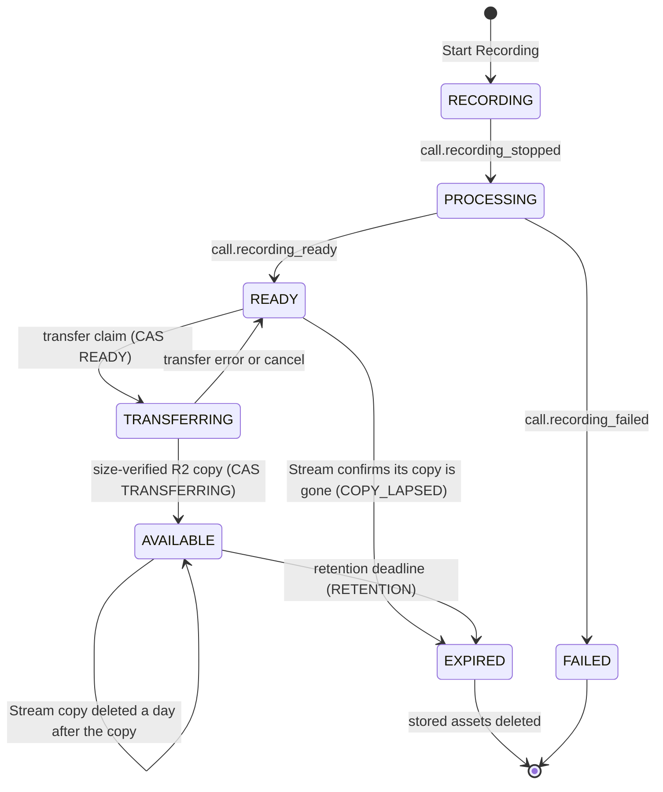
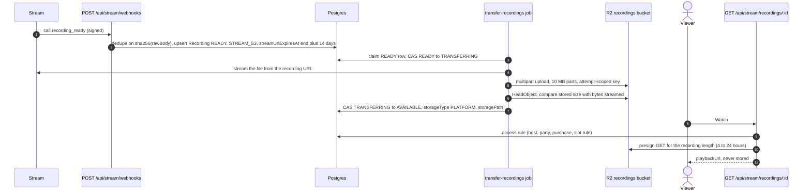
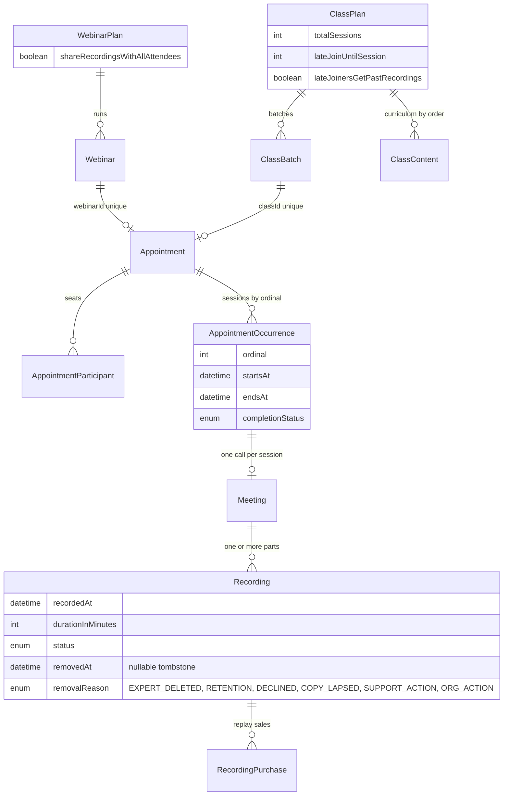
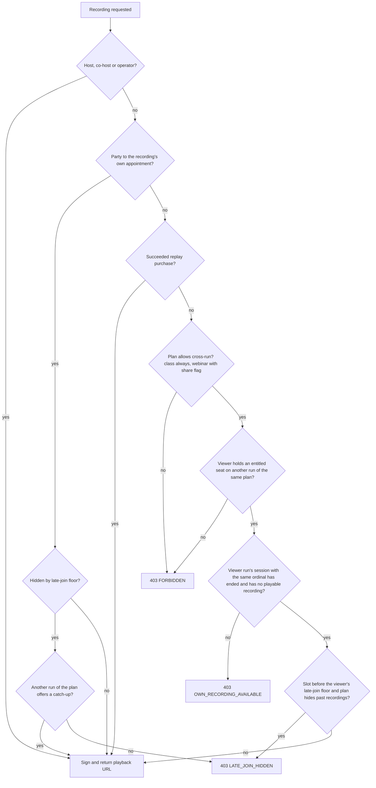
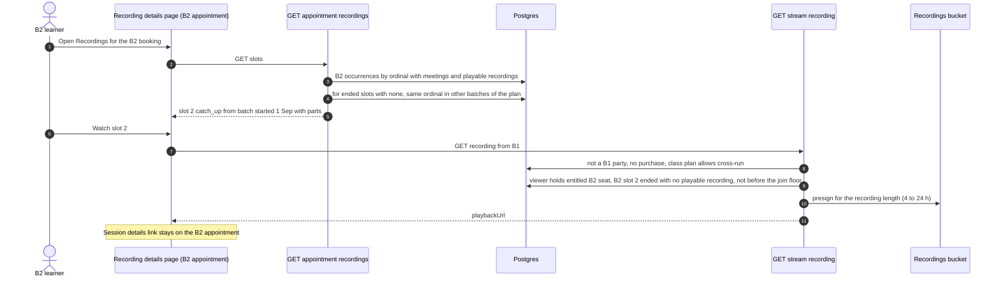

# 19. Recordings: Lifecycle, Retention and Access

> How a session recording moves from Stream to our private R2 bucket, how long it lives, and who may watch which recording when a plan has several runs or batches. [13. Recording Webhooks](./13-recording-webhooks.md) covers the webhook handlers, transfer internals and API routes; this document covers the lifecycle as a whole, the retention rules and the shared-run access model. Decisions are in [the ADR](../decisions/2026-10-12-session-documents-and-recordings.md). Session documents are in [documents/README](../documents/README.md).

## Lifecycle

A recording is a `Recording` row hanging off a `Meeting`, which hangs off one `AppointmentOccurrence`. The host starts it by hand after the consent gate. Stream stores the file for 14 days, and the platform keeps it only if `transfer-recordings` copies it into R2 before that copy lapses. The Netlify ticker dispatches the existing background worker every 15 minutes, with one eligible copy per invocation. A copy that remains blocked or fails through its source deadline is still lost after 14 days; `expire-recordings` marks `COPY_LAPSED` only after confirmed absence under its retention rules. See the transfer notes below for the separate admission, completion and expiry-risk signals.



Each transition has one enforcer, and every write is a conditional `updateMany` on the prior status.

| Transition                                        | Enforcer                                                                                                    |
| ------------------------------------------------- | ----------------------------------------------------------------------------------------------------------- |
| `PROCESSING` or placeholder to `READY`            | `handleRecordingReady` in `lib/stream/recording-handlers.ts`, CAS on the pre-ready statuses                 |
| `READY` to `TRANSFERRING` to `AVAILABLE`          | `lib/stream/recording-transfer-service.ts`; `transferredAt` is written only after a HEAD size check matches |
| `READY` to `EXPIRED` (`COPY_LAPSED`)              | `expireLapsedCopies` in `lib/stream/recording-retention.ts`                                                 |
| Stream copy deleted on `AVAILABLE`                | `deleteTransferredStreamCopies` in the same file, which clears `recordingUrl`                               |
| `AVAILABLE` or `READY` to `EXPIRED` (`RETENTION`) | `expireGroup` in the same file, CAS on `retainableWhere`                                                    |
| Any live status to `EXPIRED` by a person          | `DELETE /api/stream/recordings/:id`, the decline discard and erasure                                        |

A failed copy never lands in `FAILED`; every transfer failure returns the row to `READY` so the next run retries it. `FAILED` is reached only through `call.recording_failed`.

### The removal tombstone

Every path that makes a recording unplayable writes `EXPIRED` together with two nullable `Recording` columns, `removedAt` and `removalReason` (`RecordingRemovalReason`), so attendees can tell why a session has nothing to play. The migration is additive and nullable.

| `removalReason`  | Written by                                                                                                                                                 | What the slot shows                                                                                     |
| ---------------- | ---------------------------------------------------------------------------------------------------------------------------------------------------------- | ------------------------------------------------------------------------------------------------------- |
| `EXPERT_DELETED` | `DELETE /api/stream/recordings/:id` by the session host or an accepted co-host, which also notifies the booking's learners (`recording-removal-notice.ts`) | "Removed by the expert on 5 Oct." until the recording's retention date, then the expired text.          |
| `SUPPORT_ACTION` | The same route when a platform `ADMIN` or support operator removes the recording through an operator grant                                                 | "Removed by Familiarise support on 5 Oct." until the recording's retention date, then the expired text. |
| `RETENTION`      | `expire-recordings` when the platform or organisation deadline passes                                                                                      | "The recording's retention period has ended."                                                           |
| `DECLINED`       | The 1:1 decline discard (`recording-decline.ts`)                                                                                                           | "No recording: a participant chose not to be recorded."                                                 |
| `ORG_ACTION`     | The same route when an organisation's catalog manager removes a recording of a webinar or class plan the organisation owns                                 | "Removed by <organisation name> on 5 Oct." until the recording's retention date, then the expired text. |
| `COPY_LAPSED`    | `expire-recordings` for a `READY` row whose Stream link lapsed before the R2 copy                                                                          | "The recording's retention period has ended."                                                           |

The notice lasts as long as the booking's recordings would have been kept (`tombstoneVisible` in `lib/stream/recording-slots.ts`): a retention label with a date ends it on that date, and a label that keeps recordings while the plan is active, or forever, never ends it. After that the slot reads as `expired`. A session that was recorded never reads "Not recorded": that text is only for a session where nothing was ever recorded.

The removal notice is sent after the row has expired, on a best-effort basis: it names the actual remover (the host's name, or "Familiarise support"), and a notice failure is logged and never fails the delete.

When a session has several parts and one is removed, that part shows as its own "Part 2 of 2 · Removed by the expert on 11 Oct 2026" row in its slot, and the remaining parts keep their k-of-n numbers.

The tombstone row keeps no media: the object, preview folder (clip and thumbnail), transcript and Stream's copy are deleted by the same flow that wrote it (or retried by `expire-recordings`).

**Delete answers 200 once the tombstone is written.** `DELETE /api/stream/recordings/:id` returns 200 after the conditional `EXPIRED` write. It also deletes Stream's copy for that segment; a failure there is logged and leaves `streamRecordingId` in place so the row can be retried. The removal notice, the asset purge and the pointer clear that follow are best-effort, and anything left over is finished by the expiry sweep. A storage object that is already missing counts as deleted, so a retry never fails on it. A `DELETE` on a recording that is already `EXPIRED` answers `GONE` and writes nothing, so a repeat never re-stamps `removedAt` or notifies the learners twice. The manage sheet re-reads the list after any failure.

**The `Recording_storage_and_publish_check` constraint matches `prisma/sql/check-constraints.sql`.** An active `PLATFORM` row needs a `storagePath`, and an `EXPIRED` platform row may have a null `storagePath` once its object is gone. A `PUBLISHED` listing still requires the path, a positive price and the consent attestation.

### Erasure during an in-flight transfer

`scrubUser` first claims each eligible unsold 1:1 recording with one `updateManyAndReturn` that repeats the eligibility predicate, writes `EXPIRED`, stamps `removedAt` at the claim and returns the row's current R2 path, preview path and Stream ids. It then deletes Stream's copy and every stored asset (object, preview folder with the thumbnail, transcript) for exactly those identities, and throws on any failure so the pointers stay on the row for the retry. Only after both deletions succeed does it clear the pointers, the thumbnail, the transcript and `streamRecordingId` with a conditional update whose `WHERE` carries `EXPIRED` and the returned identities, keeping any earlier `removedAt`. The claim covers `FAILED` rows as well as live ones, because a late `recording_ready` could otherwise promote them; a row that is already `EXPIRED` is claimed again only to finish clearing its pointers. Storage-vendor failures during an erasure run are reported once per run, not once per object. Group recordings keep their existing unpublish policy, and recordings with purchases remain excluded.

If a transfer publishes before this write, erasure deletes the returned current
object. If erasure wins first, the transfer's `TRANSFERRING` publication CAS
loses and the transfer attempts to remove its own unpublished key. After
confirmed deletion, erasure clears pointers only while they still match the
returned identities and the row remains `EXPIRED`. Vendor failure leaves those
pointers on the expired row. If the expiry sweep clears the same pointers while
erasure is deleting the assets, erasure accepts that already-cleared `EXPIRED`
row (both storage pointers and `streamRecordingId` null); any pointer still set
reports an unfinished cleanup.

Another `scrubUser` call actively retries eligible expired rows that still
hold an R2 path, a preview path or a `streamRecordingId`. Repeated vendor
failure keeps the admin request `IN_PROGRESS` with HTTP 202; the request can complete after deletion is confirmed and the pointers
are cleared. These retries preserve removal timestamps. The existing
`expire-recordings` entry also selects expired rows with asset pointers
independently of the normal retention deadline, providing a fallback when
that entry runs. The ticker queues the `expire-recordings` background slices at 00:05, 01:05 and 02:05 UTC; recording transfer is independently queued every 15 minutes. Both currently require Netlify as active cron host.

An unpublished attempt whose transfer cleanup fails has no recorded storage
pointer. That separate orphan-cleanup gap remains open; the erasure claim and
the expiry scan cannot recover a key that was never published.

## Webhook, R2 copy and playback

The webhook only records that a file exists. The copy is a separate, retried job, and playback links are minted per request, never stored.



`transfer-recordings` is configured on the Netlify ticker every 15 minutes (:00/:15/:30/:45 UTC), dispatching `recording-transfer-background.mts`. The six-hour Actions step is removed. The cleanup route and staff run door queue the same worker and return 202 for admission only; successful environment-scoped `SystemJobExecution` completion is the health evidence (45-minute absence budget). The fail-closed 15-minute lease admits one copy at a time. Every claim consumes an attempt, including a later crash; stale reclaim preserves it. Exact claim CAS and attempt-specific R2 keys prevent a late worker from publishing or deleting a newer copy. Future-expiring READY Stream sources within 72 hours of expiry or with at least three attempts enter a bounded aggregate alarm. A conditional claim throttles each recording to six hours, excludes expired sources and preserves its transfer retry timestamp. Retryable copy failure leaves READY and retains backoff. See the [background worker runbook](recording-background-worker.md) for deployment evidence and recovery; configured cadence is not proof of deployed progress.

- A host may record a session nobody booked, and a call can produce several recordings (a restarted recording, a dropped and rejoined call, a 2-hour split), so one session can have several `Recording` rows.
- In a 1:1 session, a participant's decline before the recording's end discards the recording from Stream and expires any row, so no playable copy exists. The decline needs no `session_id` from the webhook: it stamps the filename onto one expired row so `expire-recordings` can retry Stream's copy, or, when no row can carry it, deletes the copy directly through `deleteStreamRecordingCopy` and fails loudly if that does not succeed.
- A `recording_ready` for a row that was erased or host-deleted before Stream named its file never revives it. `absorbIntoErasedRecording` (`lib/stream/recording-handlers.ts`) stamps the filename onto one such `EXPIRED` row (`removedAt` set, no filename, no transfer), which stays `EXPIRED`, and deletes Stream's copy; a failed delete leaves the filename on the row for `expire-recordings`. A ready notice for a row that is already `EXPIRED` is logged and ignored.

## Retention rules

One platform schedule applies, evaluated by the daily `expire-recordings` job (`lib/stream/recording-retention.ts`).

| Session type                                                            | Deleted after                                                 |
| ----------------------------------------------------------------------- | ------------------------------------------------------------- |
| 1:1 consultation or trial                                               | 90 days after the session                                     |
| Subscription                                                            | 90 days after the subscription ends (kept while it is active) |
| Webinar                                                                 | 365 days after the session                                    |
| Class                                                                   | 365 days after the class's final session                      |
| Published replay, or any recording with a pending or succeeded purchase | Never auto-deleted                                            |

- An organisation can shorten retention for org-scoped recordings (`Organization.streamRecordingRetentionDays`); the effective deadline is the earlier of the two, and sold replays are exempt.
- Expiry deletes every R2 object under `recordings/<id>/` (listed with `listR2Keys`, so abandoned transfer attempts go too, up to 100 keys per run, with a longer listing finished next run), the preview clip and the thumbnail, marks the row `EXPIRED`, and (org-scoped) writes an audit row.
- **A lapsed copy expires only on Stream's word.** A `READY` row whose Stream link lapsed before the R2 copy is re-listed from Stream, ten rows per default slice (explicit limits clamp to 1–25) and at most 10 calls at a time (`mapBounded` in `lib/stream/batch.ts`). A listing that still holds the file refreshes the link; a 404 for the call, or a listing without the file, expires the row as `COPY_LAPSED`, and its holders get `410`. A failed read (a 429, an outage or an open circuit breaker) leaves the row `READY` for the next run and counts as a failure. A row recorded more than 15 days ago is past Stream's 14-day retention, so it expires without asking. For example, if Stream answers 429 for three of 40 lapsed rows, those three stay `READY`, the run reports `failed: 3`, and the next rotating slice asks again.
- **One report per run.** `RecordingService.getCallRecordingsFromStream` returns a `listed`, `call-not-found` or `unavailable` result and never reports to Sentry itself. `expire-recordings` collects every failed row and sends one warning at the end of the run, so a Stream outage costs one Sentry event a day rather than one per row.
- **Cancelled bookings.** A cancelled, rejected or expired booking keeps its recordings watchable by the parties until their retention date, exactly like its documents. Released or refunded seats lose access, because playback checks the seat on every request. Recording surfaces show "Available until <date>", "Kept while the booking is active" or "Never expires" (`retentionText` in `lib/stream/recording-copy.ts`). A trial is a single 1:1 session, so it is kept 90 days after the session whatever it later converted into.
- **Hard delete.** Only untouched offerings can be hard-deleted. The database cascade removes the `Meeting` and `Recording` rows, so `lib/booking/offering-delete.ts` selects each recording's `storagePath` with `tx` before the guarded delete and, after the transaction commits, calls `deleteRecordingAssets` best effort, reporting failures once per request. No sweeper is added.

### Deleting Stream's copy after the R2 copy

Stream keeps its own copy of every recording for 14 days. Once our R2 copy is verified there is no reason to leave a second, vendor-held copy of a personal recording, so the daily `expire-recordings` run deletes it (`deleteTransferredStreamCopies` in `lib/stream/recording-retention.ts`).

- **Which rows.** An `AVAILABLE` `PLATFORM` row with a `storagePath`, a `streamRecordingId`, a non-empty `recordingUrl`, and a `transferredAt` at least 24 hours old and less than 15 days old. Up to 50 rows a run, at most 10 Stream calls at a time.
- **Why the R2 copy is trustworthy.** The transfer writes `transferredAt` only after `HeadObject` returns a size equal to the bytes streamed, so a row in this arm has a verified object.
- **Why 24 hours.** For one day after the copy, Stream's copy remains a second source if the R2 object turns out to be bad, and the daily cadence means the delete actually lands between 24 and 48 hours after the copy. Stream would otherwise hold the copy for about 12 more days.
- **How it is marked.** `deleteStreamRecordingCopy` (`lib/stream/recording-stream-delete.ts`) treats a call Stream does not know, or a filename its listing lacks, as already gone. On success the run clears `recordingUrl` with a CAS on the row's status and its previous URL. Playback of an `AVAILABLE` row reads only `storagePath`, so the cleared URL changes nothing a viewer sees, and the next run no longer selects the row. A failed delete keeps the URL, counts as a failure, and is retried the next day.
- **Older rows.** A row transferred more than 15 days ago is past Stream's own retention and is not selected, so the arm never spends calls on copies Stream already removed.

## Plans, runs, batches and sessions

A group offering has layers, and recordings hang off the bottom one.

1. The **plan** is the listing a learner buys. `WebinarPlan` carries `shareRecordingsWithAllAttendees`; `ClassPlan` carries the curriculum, `totalSessions` and the late-join controls `lateJoinUntilSession` and `lateJoinersGetPastRecordings`.
2. The **run** (webinar) or **batch** (class) is one scheduled delivery of the plan, with exactly one wrapper `Appointment` (`webinarId` and `classId` are unique). Seats are `AppointmentParticipant` rows.
3. The **session** is an `AppointmentOccurrence`. `ordinal` is its 1-based position in the programme, inherited by a reschedule replacement and unique among live rows per appointment (partial index in `prisma/sql/check-constraints.sql`). A voided session keeps its ordinal history while its make-up is owed.
4. The **call** is a `Meeting`, one per occurrence.
5. The **recording** is a `Recording` with `meetingId`. A meeting has many recordings.



No curriculum-position column is needed: `AppointmentOccurrence.ordinal` is the position, and `ClassContent.order` or `SubscriptionContent.order` supplies the slot title. Content order is not constrained to be contiguous or unique, so the title is best-effort and falls back to "Session k". A batch is labelled by its start date ("Batch that started 3 Oct"); no label column exists.

## Shared-run and multi-batch access

A class plan runs batches B1, B2 and B3, each with sessions 1 to N, and any session may have several recordings. A learner holds a seat in B2 only. The rule is: **your own batch, plus what your batch is missing.**

1. **Own batch by slot.** The learner's recordings are organised by their own batch's sessions in `AppointmentOccurrence.ordinal` order, as "Session 1 · <ClassContent title> · 3 Oct" through "Session N". Other batches never appear as separate cards, and there is no "Other batches" browser.
2. **Several recordings of one session** are ordered by the occurrence's `startsAt`, then by `recordedAt` ascending, and labelled "Part 1 of 3", "Part 2 of 3". A single recording gets no part label. When a slot's parts come from a voided session and its make-up, the make-up parts carry a "Make-up · 10 Oct" marker. The player offers "Next part".
3. **Catch-up.** A slot whose own occurrence has ended (or was cancelled or voided) with **no playable recording** shows the same-ordinal recording from the most recent other batch, labelled "From the batch that started 3 Oct".
   - Classes: always. Webinars: only when `shareRecordingsWithAllAttendees` is on.
   - Never for an upcoming slot, so a later batch cannot watch ahead of its own cohort.
   - Never before the learner's late-join floor unless the plan sets `lateJoinersGetPastRecordings`.
   - Missing one's own live session is not a reason for catch-up: if the learner's batch recorded it, they watch that recording.
   - The candidate batch is the one whose same-ordinal session ended most recently and has a playable recording; ties break on batch id so the choice is deterministic.
4. **One server rule** decides both what the list shows and what playback signs, so whatever the list offers plays. Catch-up playback takes precedence over the late-join refusal: a learner whose seat on the source batch came late can still play the catch-up that their other batch offers, and the source batch's late-join rule applies only when no catch-up covers the session. Catch-up playback is exact: it plays only the recordings the catch-up slot lists, which are every playable part of the chosen source session.
5. **"Session details" always opens the learner's own booking**, focused on the slot (`.../appointments/<ownAppointmentId>/recordings?slot=<k>`). A purchased replay with no own appointment links to the public listing when published, otherwise has no link. Hosts and co-hosts open their batch's appointment.

The rule lives in `lib/stream/recording-slots.ts` as one pure core and one batched loader:

- **Pure core.** `recordingViewerOf` decides the viewer's role (hosts and 1:1 learners are matched by profile id), `catchUpOrdinals` and `pickCatchUpSources` choose which sessions need a catch-up and from which run, and `buildRecordingView` turns the loaded rows into slots. None of them touch the database.
- **Batched loader.** `loadRecordingViews` reads identity, bookings with their sessions, late-join floors, catch-up candidates and retention labels once per request for any number of bookings.
- **Shared by every caller.** The library, the per-appointment recordings route and page, and playback access (`catchUpPlaybackAccess`, `viewerPlaybackAccess`) all call the same core, so the list and playback cannot disagree. Each slot is in exactly one state: `recorded`, `catch_up`, `upcoming`, `processing`, `not_recorded`, `declined`, `removed`, `expired`, `before_you_joined` or `cancelled`. A slot that is `not_recorded`, `declined`, `removed` or `expired` also carries a `missingReason`, and a `catch_up` slot keeps the reason its own session has nothing to play.

### Who may rename or delete

Rename and delete follow the session-content rule (`resolveRecordingWriteAccess` in `lib/stream/recording-write-access.ts`):

- The session host or an accepted co-host may act.
- An organisation's catalog managers may act only on a webinar or class plan that the organisation owns, never on a 1:1 consultation, subscription or trial. The removal is written as `ORG_ACTION`, the Removed row and the attendee notice name the organisation.
- Operators act through their own grant and write `SUPPORT_ACTION`.

### The access check

The playback route keeps its existing order (operator, host, own party, purchase) and replaces the plan-wide arm with the slot-aware rule.



The slot query is one indexed walk: plan, then the viewer's seat appointments on that plan, then the live occurrence with the same `ordinal` (served by the partial unique index), then its meeting's playable recordings. It runs on the global client outside any transaction, so the single-connection pool rule is not involved.

### A B2 learner's catch-up playback from B1



### Who may play, by session type

| Session type                          | Who may play                                                                                                      |
| ------------------------------------- | ----------------------------------------------------------------------------------------------------------------- |
| 1:1 consultation, subscription, trial | Only that appointment's participants. Never plan-wide, never sellable.                                            |
| Webinar                               | Attendees (paid or seated) of that run; catch-up from another run only when the plan shares recordings.           |
| Class                                 | Enrolled members of the batch; catch-up from another batch for sessions their batch lacks; late-join rules apply. |

The owner and accepted co-presenters always have access, a platform `ADMIN` has full access (audited), `STAFF` and organisation roles see metadata only, and buyers of a published replay may play it. Clients never receive a raw storage URL in a payload.

**A full refund revokes a 1:1 replay.** `PaymentStatus` has no `REFUNDED` value, so a fully refunded payment still reads `SUCCEEDED`. `loadRecordingViews` nets the refunds (`isPaymentEntitled`) and passes `paymentRevoked` to `recordingViewerOf`: a 1:1 learner whose only succeeded payment for the booking is fully refunded is no longer a viewer, so neither the list nor playback signs a link. A partial refund keeps access, and a free 1:1 booking with no payment row keeps it. A replay the learner bought separately is unaffected. A credit-funded booking is revoked the same way: its payment row has amount 0 and a free-credit intent (`isFreeCreditIntent`), and it revokes once it has one `SUCCEEDED` or `PENDING` credit restoration (`isFullyRefundedPurchase` in `lib/payments/utils/refund-balance.ts`); a `FAILED` or `CANCELLED` restoration moved no value and revokes nothing. Group seats follow the seat/payment rule.

## The Recording details page

One route per appointment serves 1:1, multi-session and catch-up cases: `.../appointments/[appointmentId]/recordings`, with `?slot=<ordinal>&r=<recordingId>` selecting a slot and part. Routes exist in the consultant, consultee and organisation trees. The appointment hub shows a snapshot card (sessions recorded of total, latest, "Kept until") that links here. Playback links are minted by each Play click and never cached.

### The session timeline

The Library and the booking's Recordings page render the same component, `RecordingTimeline`, for every booking type. The rows come from the pure `lib/stream/recording-timeline.ts` (`timelineRows`, `timelineOf`, `truncateUpcoming`, `rowRetention`) over the slot core, so a row in the Library always plays on the booking page.

```
Beginner Class · Ananya Anderson                    Open booking →
Your batch 5 Oct – 26 Oct 2026 · 4 sessions
Recordings available until 28 Sept 2027

SESSION          RECORDING                              LENGTH
1 · Mon 5 Oct    Foundations and vocabulary            56 min  ▶ Play
                 [Catch-up · recorded 7 Sept, other batch]
  ⌄ 2 parts      ▶ Part 1 of 2                          32 min
                 ▶ Part 2 of 2                          24 min
2 · Mon 12 Oct   Workshop: your first end-to-end build 55 min  ▶ Play
                 [Catch-up · recorded 14 Sept, other batch]
3 · Mon 19 Oct   Upcoming                                 —
4 · Mon 26 Oct   Upcoming                                 —
```

**Card header.**

- The title reads "<plan> · <expert>", with "Open booking" on the right.
- The subline depends on the booking type: a class reads "Your batch <start> – <end> · n sessions" for a learner and "Batch <start> – <end> · n sessions" for a host, a subscription reads "Started <date> · n sessions", and a consultation, trial or webinar shows the session date (`timelineSubline`).
- The header carries one retention line, phrased by type (`retentionText`): "Available until <date>", "Never expires", "Kept while your subscription is active, then 90 days" ("Kept while the subscription is active, then 90 days" for a host), or for a running class "Kept until 1 year after the last session".
- A row shows its own retention only when it differs from the header or ends within 30 days (`rowRetention`).

**Rows.** There is one row per session of the viewer's own booking, in session order. The columns are Session (number and the viewer's own date), Recording (title plus a state badge), Length and Play. Parts expand under the same columns, and Play on the parent row starts part 1. A removed part appears as a "Part k of n · Removed by … on <date>" row among its siblings. When every part of a session is gone, the session row reads "Removed by <name> on <date>" for a single remover. When different people removed the parts, it names all of them without a date, for example "Removed by LearnPro Academy and Angela Anderson", and each part row keeps its own remover and date.

**States.** A row's badge comes from `rowBadge` in `lib/stream/recording-copy.ts`.

| State             | Badge                                                                                                                                                                                                                                                                       |
| ----------------- | --------------------------------------------------------------------------------------------------------------------------------------------------------------------------------------------------------------------------------------------------------------------------- |
| Recorded          | None                                                                                                                                                                                                                                                                        |
| Catch-up          | "Catch-up · recorded <source session date> with another batch" (or "run"), with a tooltip explaining that the viewer's own session wasn't recorded                                                                                                                          |
| Removed           | "Removed by <expert name> on <date>", "Removed by <organisation name> on <date>" for `ORG_ACTION`, or "Removed by Familiarise support on <date>" for `SUPPORT_ACTION`; several removers are listed by name with no date ("Removed by LearnPro Academy and Angela Anderson") |
| Cancelled         | "Cancelled" (every session of that ordinal was cancelled or moved and nothing was recorded); the row is muted                                                                                                                                                               |
| Declined          | "Not recorded · <name> declined recording" (1:1 only)                                                                                                                                                                                                                       |
| Not recorded      | "Not recorded"                                                                                                                                                                                                                                                              |
| Being prepared    | "Being prepared"                                                                                                                                                                                                                                                            |
| Upcoming          | "Upcoming"                                                                                                                                                                                                                                                                  |
| Before you joined | "Before you joined"                                                                                                                                                                                                                                                         |
| Expired           | "Expired"                                                                                                                                                                                                                                                                   |

**Upcoming sessions.** The timeline lists every past session, then the next upcoming one, then "<n> more upcoming sessions" (`moreUpcoming`).

**By booking type.**

| Booking type        | Rows                                                                                          |
| ------------------- | --------------------------------------------------------------------------------------------- |
| Consultation, trial | One row                                                                                       |
| Subscription        | Many rows, one per session; the header says "Started <date>"                                  |
| Webinar             | The run's session; a catch-up row only when the plan shares recordings                        |
| Class               | Catch-up rows always when the viewer's batch lacks the session, plus "Before you joined" rows |
| Purchased replays   | Their own group at the end of the Library, marked "Never expires"                             |

**Card order and display zone.** Cards are ordered by latest session, the booking whose sessions run latest first. Every time and date on the Library and the booking page, including date-only values such as retention dates, is formatted in the same display zone as the booking pages (`useZonedFormat`).

**Parts.** A collapsed row with removed parts reads "k of n parts available". On a multi-part session Play names the part ("Play part 1"), and the player shows its metadata in the same formats as the rows.

**Catch-up dates.** A catch-up is dated by the source session's own recording (`slot.source.recordedAt`), not by the start of the source batch or run.

**Hosts.** A host sees their own batch with no catch-up rows. In the expert Library the per-row Manage is a link to the booking's Recordings page, shown only on a session that still has a part; the manage sheet itself (`RecordingManageSheet`) opens from the booking page.

"Play" opens the player modal (`RecordingPlayerModal`), which mints the playback link on open and offers "Next part" within a session; there is no download action. The player offers Retry only for failures a retry can change (server, network, storage, vendor or rate-limit errors); access refusals and removals show no Retry. The Library paginates by booking, a "Purchased" group follows the bookings, and other batches never appear as groups.

```ts
type Slot = {
  ordinal: number;
  title: string; // ClassContent/SubscriptionContent title or "Session k"
  startsAt: string;
  state:
    | "recorded"
    | "catch_up"
    | "upcoming"
    | "processing"
    | "not_recorded"
    | "declined"
    | "removed"
    | "expired"
    | "before_you_joined"
    | "cancelled";
  missingReason: "not_recorded" | "declined" | "removed" | "expired" | null;
  removedAt: string | null; // when the session's recording was removed
  removedBy: "expert" | "support" | "org" | null;
  removers: ("expert" | "support" | "org")[]; // every distinct remover, first remover first
  declinedBy: string | null; // 1:1 only
  source:
    | { kind: "own" }
    | { kind: "catch_up"; batchLabel: string; recordedAt: string } // recordedAt: the source session's recording
    | null;
  parts: {
    recordingId: string;
    title: string;
    partNo: number;
    partCount: number; // "Part k of n" only when partCount > 1
    recordedAt: string;
    durationInMinutes: number;
    makeUp: boolean;
    keptUntil:
      | { kind: "DATE"; until: string }
      | { kind: "WHILE_ACTIVE" }
      | { kind: "NEVER" }
      | null;
    listing: { status: string; hasBuyers: boolean } | null; // hosts only
  }[];
  removedParts: {
    partNo: number;
    partCount: number;
    title: string;
    removedAt: string | null;
    removedBy: "expert" | "support" | "org" | null;
  }[];
};
```

| Method and path                                                   | Response                                                                                                                                                               |
| ----------------------------------------------------------------- | ---------------------------------------------------------------------------------------------------------------------------------------------------------------------- |
| `GET /api/appointments/:id/recordings`                            | `{ appointmentId, kind, title, batchLabel, viewerRole, audience, sharedAcrossRuns, slots: Slot[] }`; `audience` is `one_to_one`, `run` or `batch`                      |
| `GET /api/stream/recordings/:recordingId`                         | Playback URL minted per request under the slot rule; metadata also carries `removedAt` and `removalReason`                                                             |
| `PATCH`, `DELETE /api/stream/recordings/:recordingId`             | Rename and delete follow the session-content rule (see below); `DELETE` writes `EXPERT_DELETED`, `ORG_ACTION` for an organisation, or `SUPPORT_ACTION` for an operator |
| `GET /api/dashboard/{consultant,consultee}/:profileId/recordings` | `LibraryPage`: `{ groups: { session, files, timeline, summary? }[], purchased?, total, page, pageSize, facets? }`; see the library response below                      |
| `GET /api/organizations/:orgId/recordings?scope=mine\|everyone`   | The same `LibraryPage`; `everyone` needs `operations.read` and returns counts only                                                                                     |

**The library response.** Each group is one booking. `session` carries the booking's identity, `sessionCount`, `expertName` and `counterpartName`, and `timeline` carries the header summary: `{ sessionCount, firstSessionAt, lastSessionAt, retention, moreUpcoming }`, where `retention` is a date, "never", "while active", or the running-subscription or running-class phrasing. `files` holds one `LibraryRecording` per session shown:

```ts
type LibraryRecording = {
  id: string; // "<appointmentId>:slot-<ordinal>", or the recording id for a purchased replay
  title: string;
  slotOrdinal: number | null; // null for a purchased replay
  sessionAt: string; // the viewer's own session date
  state:
    | "recorded"
    | "catch_up"
    | "removed"
    | "declined"
    | "not_recorded"
    | "preparing"
    | "expired"
    | "upcoming"
    | "before_you_joined"
    | "cancelled";
  durationInMinutes: number;
  catchUp: { from: "batch" | "run"; recordedAt: string } | null;
  removed: { at: string | null; by: string[] } | null; // every distinct remover, by name
  declinedBy: string | null;
  keptUntil: RetentionLabel | null;
  parts: {
    id: string;
    title: string;
    partLabel: string | null;
    recordedAt: string;
    durationInMinutes: number;
    keptUntil: RetentionLabel | null;
  }[];
  removedParts: {
    partNo: number;
    partCount: number;
    removedAt: string | null;
    removedBy: string; // the expert, the organisation or Familiarise support, by name
  }[];
};
```

The slot view carries the expert and 1:1 learner names, read once per page, so the Library does not read them separately.

The library builds each booking's view with the same core as its Recording details page, so a row there always plays there. `loadRecordingViews` reads the newest 200 candidate bookings, decides in memory which of them render, and paginates only the groups that render, so `total` and `pages` always match what the pages show. The 200 bound applies to candidate bookings, not to rendered groups: a viewer with more than 200 candidate bookings sees the newest 200 that render. The catch-up query admits only ended runs of sharing plans that have a playable recording. The organisation `everyone` view sums recordings in one read.

All six library routes (documents and recordings, for consultant, consultee and organisation) run their read inside `timedLibraryRead` (`lib/library/timed-read.ts`), which logs one `[Library:SLOW_READ]` line when a read takes longer than 10 s, or while it is still running at 20 s, whichever comes first, and never more than once per read.

When the URL carries no filters, each of the six library pages seeds page 1 on the server (`seedLibraryPage` in `lib/library/library-seed.ts`) so the list renders without a client round trip. A filtered URL, and an operator inspecting another profile, fetch on the client. The earlier plan-level and per-profile recording list routes no longer exist.

The recording playback, manage, publish, preview, start, stop and sync routes, the recording lists and the public replay list answer failures with the shared `{ code, message }` body from `lib/documents/file-errors.ts` (for example `OWN_RECORDING_AVAILABLE`, `LATE_JOIN_HIDDEN`, `GONE`, `RATE_LIMITED`, `RECORDING_DECLINED` when a start is refused after a 1:1 decline, `RECORDING_IN_PROGRESS`, `RECORDING_NOT_IN_PROGRESS`, `RECORDING_NOT_ENABLED`, `RECORDING_HAS_BUYERS`, `RECORDING_CHANGED` and `SERVER_ERROR`), and in-call controls show the code's fixed copy rather than server text. The replay purchase route and the meeting recording-consent and recording-info routes keep their own error shapes. The codes are described in [documents/README](../documents/README.md#typed-error-model-and-copy).

**Player failures.** `MEDIA_UNPLAYABLE` is raised only by the browser. `RecordingPlayerModal` reloads the video on each retry even when the URL is unchanged, treats a source that never reaches its metadata as a failure, and shows "This recording can't be played" after one failed retry. File routes write one function-log line per unhandled error, because previews send Sentry only 10% of errors other than uncaught Next server errors. Signed-out API calls receive a coded 401 `{ code, message }` from the middleware.

### Performance

- **Statement budget.** A library page costs a fixed number of statements, independent of how many bookings it shows, because the loader batches every relation arm. It skips arms for booking kinds that are not on the page, and retention labels walk each subscription renewal chain once per call.
- **Round-trip cost.** With `PG_POOL_MAX=1` every statement is serial, and one round trip costs about 95 ms from the function to the database, so cost tracks statement count rather than query speed. The per-booking loop this loader replaced issued about 495 statements for one learner's page (about 20 s locally, and a gateway timeout on the deploy preview), while the batched loader issues about 40.
- **Late-join floor.** The loader reads a learner's late-join floor from the seat row it already loads, takes the booking kinds from the library's candidates, and skips host-only and catch-up relations the viewer cannot use.
- **Pattern.** Do not call a per-booking resolver in a loop. Load every input for the page in one batched read, then run the pure core over the rows in memory. Catch-up playback access likewise reuses the loaded views and plays a recording only when its id is among the parts the learner's catch-up slot lists, with no further read.

## Replay sales

Replays are not sold at launch: recordings are included with the booking. Publishing is closed (there is no publish endpoint), so no recording is listed, `/explore/products` has no Replays tab, and the purchase route refuses every recording as not listed. The `RecordingPurchase` model and its settlement path remain, and a pending or succeeded purchase would still exempt a recording from retention. Replays return as a `ReplayListing` product that groups a webinar run's or a class batch's recordings (#2412); see [the marketplace doc](./recordings-marketplace.md).

## Storage

Recordings live in the private R2 bucket and are served by per-request presigned links of 4 to 24 hours by recording length, so long sessions never expire mid-watch. The `familiarise-recordings` bucket aborts incomplete multipart uploads after 7 days, so the billed partial parts a killed copy leaves behind are bounded. Preview clips and thumbnails live in the public `recordings-previews` bucket under one policy (`lib/storage/bucket-policies.ts`): 50 MB, MP4/WebM and image types. Documents and plan materials live in the private Supabase `documents` bucket, whose type list comes from `lib/documents/file-policy.ts`. The reasoning for the split (object size, egress cost, per-plan upload caps, one signing helper per store) is in [documents/README](../documents/README.md#storage-supabase-for-documents-r2-for-recordings) and [storage management](../storage/management-strategy.md).

## References

- Design: [#2111](https://github.com/Practitionist/familiarise_web/issues/2111). Recordings follow-up: [#2084](https://github.com/Practitionist/familiarise_web/issues/2084). Cleanup: [#2112](https://github.com/Practitionist/familiarise_web/issues/2112).
- Earlier storage and visibility decision: [recording storage, retention and visibility](../decisions/2026-10-09-recording-storage-retention-visibility.md).

---

## Deprecated & Superseded Approaches

- **`resolveRecordingViewer` and `readRecordingSlots`.** They resolved the viewer and read slots once per booking, so a learner page issued hundreds of serial statements and hit the platform timeout. Superseded by the pure core plus `loadRecordingViews`; delete any remaining caller.

- **Plan-wide class access.** A viewer with an entitled seat on any batch could play every batch of a class plan (`lib/stream/recording-attendee-scope.ts`, applied in the playback route), and the webinar arm let one share flag widen access to every run. Superseded by the slot-aware catch-up rule; delete the plan-wide arm.
- **Each other run as its own library card.** The consultee resources route listed other runs and batches as separate cards linked to appointments the learner could not open, tripling lists for multi-batch plans. Superseded by one grouped list of the learner's own slots with catch-up rows.
- **Three different cross-run rules.** The list, the consultee API (pinned to the own batch) and playback disagreed. Superseded by one rule shared by all three.
- **"Session N" labels from the still-joinable list.** Past recordings never matched a session, so labels were wrong or missing. Superseded by `AppointmentOccurrence.ordinal` and "Part k of n".
- **Per-plan storage tiers and the manual transfer route, and Supabase as a recording destination.** Replaced by automatic R2 transfer and one platform retention schedule (see [13](./13-recording-webhooks.md)).
- **Plan-level and per-profile recording lists.** `/api/consultants/:id/recordings`, `/api/consultees/:id/recordings` and `/api/plans/{classes,webinars}/:id/recordings` each applied their own cross-run rule. They are deleted along with `lib/stream/session-recordings.ts` and `lib/stream/recording-attendee-scope.ts`.
- **Recording objects surviving a hard delete.** The cascade removed rows but not R2 objects. Superseded by post-commit asset deletion.
- **Erasure deleting a selected snapshot before expiring the row.** A concurrent transfer could publish a new pointer that erasure then cleared without deleting its object. Superseded by conditional expiration that returns the current pointers before vendor deletion.
- **A 30-day limit on the expert-removal notice.** The notice used to turn into "Not recorded" 30 days after the delete, so a recorded session looked unrecorded. Superseded by the retention-date rule; delete any `TOMBSTONE_DAYS` constant.
- **One library row per recording part, with the part's session label.** Superseded by one row per session that expands into its parts.
- **`lib/stream/late-join-recordings.ts`.** A separate late-join helper. The late-join rule now lives in the `loadRecordingViews` loader and the slot core; delete any import of the old module.
- **`RecordingTable` and per-row `catchUpFrom`, `notice` and `sessionLabel` fields.** The Library's flat session table and its text fields. Superseded by `RecordingTimeline` and the `LibraryRecording` state fields.
- **Catch-up dated by the source batch's start.** Superseded by the source session's own recording date.
- **A trial kept as long as its converted subscription.** Superseded by the 1:1 rule: 90 days after the session.
- **Deleting only the R2 object and the preview clip.** The row was marked `EXPIRED` while Stream's copy stayed playable for up to 14 days and the thumbnail stayed public. Superseded by `lib/stream/recording-stream-delete.ts` and a purge that clears the thumbnail and transcript; the row keeps its Stream ids until the vendor confirms.
- **A full refund leaving 1:1 replay access on.** Entitlement was matched by profile id alone. Superseded by `paymentRevoked`; a partially refunded booking keeps access. The recordings list (`lib/api/scope/list-recordings.ts`) applies the same `isFullyRefundedPurchase` predicate and returns no thumbnail or preview clip for such a booking. It now reads `paymentIntent` so the credit-funded case is caught too.
- **Expiring every lapsed `READY` row.** One blanket `updateMany` expired a row even when its Stream lookup had failed, and 200 lookups ran at once, which is what produced the 429s. Superseded by bounded lookups and expiry on a confirmed absence only.
- **Leaving Stream's copy until its own 14-day expiry.** Superseded by the Stream-copy arm above.
