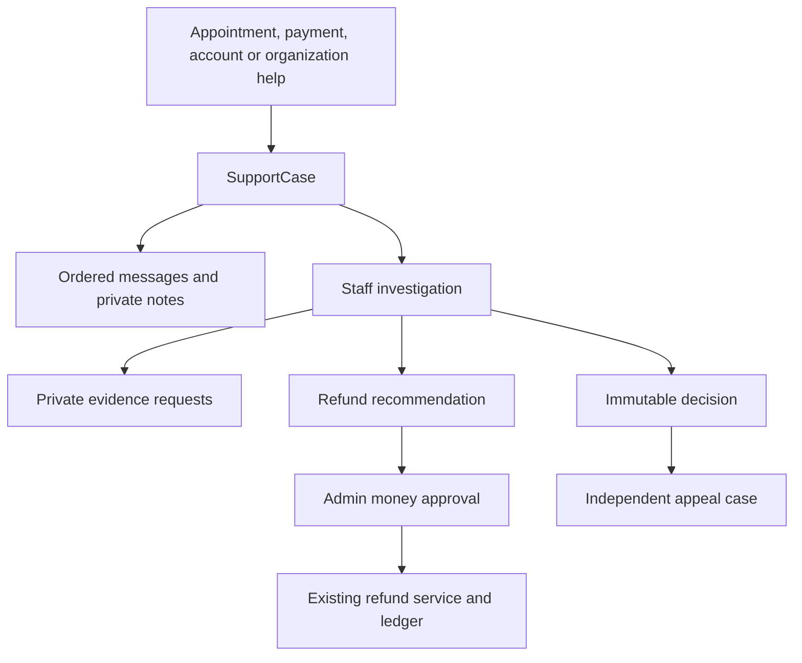

# Support architecture

All support correspondence is persisted as a `SupportCase`. A support request or
ticket is the customer-facing name for that record; its conversation is the
ordered set of `SupportCaseMessage` rows. A service dispute is investigated in a
case. A gateway `Dispute` is a separate bank chargeback with provider deadlines.

`lib/support/service.ts` runs appointment self-service against live booking
context. Platform flows persist a case on formal handoff. Both use
`createOrReuseSupportCase` and the same reference, receipt and deadline rules.
Guided self-service starts no operator SLA clock. A signed-in public grievance is
an ordinary account case. An anonymous one stores explicit external contact
fields and receives staff content by email only after its address is confirmed.

Personal cases stay private to the customer and platform. Organization-owned
operations/billing cases are accessible only through the corresponding current
membership grant. A booking's organization tag does not grant its team access to
customer messages. Evidence recipients receive a prompt and their own evidence
view without the customer transcript.

Case decisions, financial recommendations, payment holds and moderation appeals
are linked records with separate authority checks. Staff can recommend a refund;
admin executes it through the shared money door, with conditional second approval.
Payment holds block eligible unpaid earnings; complaints alone do not freeze them.
Notifications use the durable outbox and the existing leased SLA sweep.

See [production architecture](10-production-architecture.md) for complete policy.

## Deprecated & Superseded Approaches

Separate support tickets and appointment threads, import aliases and legacy API
stubs were removed during pre-MVP cleanup. There is no secondary transcript or
backfill path. New support flows use the canonical case service directly.
