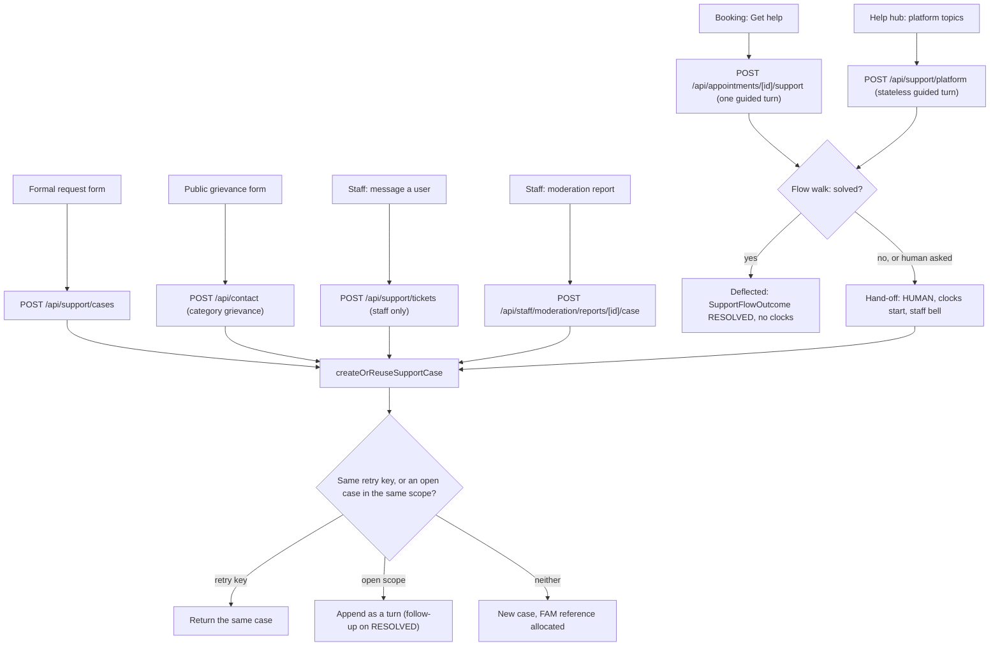

# Intake, flows and deflection

A person can ask for help in four ways: from a booking ("Get help" on an appointment), from the platform help hub, through the formal request form, or through the public grievance form. All four end in the same place, one `SupportCase`, created or reused by `createOrReuseSupportCase()` in `lib/support/case-service.ts`. Before a case reaches a person, a guided **flow** (a small decision tree) tries to answer the question. When the flow solves it, the turn is counted as **deflected** and no operator clock starts. When it cannot, the case is **handed off** to a person: the channel becomes HUMAN, the clocks start, and staff are notified.

## Intake routes

| Route                                                | Who                                                   | What it does                                                                                                                                                                            | Limits                                   |
| ---------------------------------------------------- | ----------------------------------------------------- | --------------------------------------------------------------------------------------------------------------------------------------------------------------------------------------- | ---------------------------------------- |
| `POST /api/appointments/[appointmentId]/support`     | Booking participants, organization parties, operators | Advances the caller's appointment case by one turn through `runSupportTurn()` (`lib/support/service.ts`). A turn may name the ended session it is about (see "A no-show report" below). | 60 turns per hour (`supportTurnLimiter`) |
| `POST /api/support/platform`                         | Signed-in users                                       | Walks a platform flow without storing anything until a hand-off.                                                                                                                        | 5 escalations per hour (`spamLimiter`)   |
| `POST /api/support/cases`                            | Signed-in users; staff with a wider schema            | The formal form. Validates ownership, membership, booking and payment links server-side.                                                                                                | 5 per hour for non-staff                 |
| `POST /api/contact` (grievance)                      | Anyone                                                | Creates a grievance case, owned by the account if signed in, otherwise by a system intake user with the stated name and email.                                                          | 5 per hour per IP, a honeypot field      |
| `POST /api/support/tickets`                          | Staff (`tickets.manage`)                              | Opens an outbound case to a user (found by id or email) as a staff message.                                                                                                             | none                                     |
| `POST /api/staff/moderation/reports/[reportId]/case` | Staff (`tickets.manage`)                              | Opens a case for the reporter from a chat report (see [chat access](06-chat-access-and-intervention.md#opening-a-case-from-a-chat-report)).                                             | none                                     |

There is no CAPTCHA on the public form. Intake keeps working in DEGRADED maintenance and stops only in OFFLINE maintenance, when the middleware answers every non-exempt API call with 503; money doors close separately ([money remedies](05-money-remedies.md)).

## Create or reuse

`createOrReuseSupportCase()` runs one transaction (default isolation, 8 s wait, 30 s timeout) and decides in this order:

1. **Retry.** A case with the same `(submitterUserId, clientIntakeId)` is returned as is (`dedupeReason: "client_intake_id"`). The database enforces it with `@@unique([submitterUserId, clientIntakeId])`.
2. **Open scope.** An open case (not closed, not deleted) with the same ownership scope, organization, scope key, requester, submitter and category receives the new description as a turn instead of creating a second case (`dedupeReason: "open_scope"`, or `"resolved_case"` when the matched case is RESOLVED). The scope key is `OCCURRENCE:<id>`, else `APPOINTMENT:<id>`, else the primary subject, else `ACCOUNT` (`caseScopeKey()`). Among the guided booking turns only a no-show report names its session; the formal form can link a session too. The database backstop is the partial unique index `support_case_open_scope_key`.
3. **Hand-off on reuse.** If the incoming intake asks for a person and the matched case is still self-service and not decided, the case is handed off (see below).
4. **New case.** Otherwise a FAM reference is allocated and the case, its first message and a CREATED event are inserted. Only a HUMAN intake gets clocks.

If two intakes race and one loses on a unique index, the loser re-reads the winner: a retry winner is returned, an open-scope winner gets the turn appended. A collision while re-scoping a case to another queue is 409 `OPEN_CASE_EXISTS`, naming the open case. The intake route answers 201 for a new case and 200 for a reused one, with `{ data, reused, dedupeReason }`.

## Guided flows

A flow is a tree of PROMPT and TERMINAL nodes. `walkFlow()` (`lib/support/flow-walk.ts`) is a pure function: it takes the cursor and the choice and returns the next node, any action to offer (for example "cancel with refund" or "reschedule"), and whether the terminal resolves or escalates. An unknown cursor fails safe to a hand-off.

**Appointment flows** (`lib/support/flows.ts`, keyed by `SupportThreadCategory`) are offered according to the booking's stage and the caller's role (`buildSupportContext()` in `lib/support/context.ts`): no-show (separate attendee and provider trees), cancel and refund, reschedule, payment status, recording access, quality complaint, technical, documents, sponsorship billing (organization context) and organization admin dispute (organization operators). **Safety concern** is offered to both sides at any stage; every branch escalates with an URGENT reason, and the copy tells a person in danger to call 112.

### A no-show report

The no-show flow doubles as the participant's report about a session verdict, so it has its own case rules. They exist because the window-close pass (`confirmClosedOutcomes`) reads the linked case to decide whether a negative verdict may be confirmed; the decision record is [the report-window record](../decisions/2026-11-23-session-outcome-report-window.md).

1. **One case per session.** A turn that carries the category `NO_SHOW`, from a person who is not acting as an organisation operator, opens or reuses a case of its own: category `NO_SHOW`, scope `OCCURRENCE:<id>`, requester and submitter the caller. A no-show case is never booking-wide. It never reuses the booking's other open thread, so a payment question and a no-show report on one booking are two cases, and two sessions of one booking are two reports. An organisation operator's turn keeps the booking thread (`openBookingThread()`) and its case is `ORG_OPERATIONS`, which can never count toward a verdict.
2. **Which session.** A report is about one ended session, chosen before it opens. Each ended session on the booking page links to its own report page (`?intent=NO_SHOW&occurrence=<id>`, `sessionReportHref()`), and "Get help" offers the report beside any open thread: with one ended session it starts on that session, with several it asks which one, by date and time in the viewer's zone, and with none it is not offered. A session's page has its own cache entry and shows only that session's report, seeding it when there is none, whatever else is open on the booking. The server takes the session the turn names, else the booking's only ended session, and refuses with 400 `SESSION_REQUIRED` otherwise (`reportOccurrenceId` in `lib/support/context.ts`). A retried intent first finds the case already holding its `clientTurnId` in the same booking and scope, open or closed, and the intake key is scoped to the booking, so a token never replays another booking's case. Every turn returns its case and session, and each follow-up names both, fixed when it is first sent so a retry resends them unchanged. The server accepts a named case only when it is the caller's own open case in the same scope, booking and session (`openNamedCase()`, else 404 `CASE_UNAVAILABLE`), so an answer lands on the report it answers, never on another session's or another topic's case. A guided choice that reaches a case a person now handles is refused (409 `OPTION_NOT_AVAILABLE`), never answered as accepted while storing nothing. The booking's page shows the case it names, else the newest booking-wide thread, else a fresh start with the intents menu, never a session's report (`readShownThread()`); it links each open session report to its session's page (`readOpenSessionReports()`), and a fresh turn that lands on another case moves the page there. A session's page that such a turn moved to the booking-wide thread keeps showing it: its reads name the case and the session, and `readShownThread()` answers a named case that is that session's or the caller's own booking-wide one on the booking, never another session's. A session's page names that session on its context card ("Report about your 14 Nov 2026, 5:00 pm session"). The route refuses a report on a session that belongs to another booking, is deleted, cancelled or rescheduled, or has not ended yet.
3. **The reason is stored.** When the flow reaches a no-show terminal on a case linked to a session that has ended, the transaction also writes its reason to `SupportCase.flowReason`, a column validated by `SupportFlowReasonEnum`, and the time of that answer to `SupportCase.flowReasonAt` (`recordFlowReasonTx()`). A reason fills an empty column or replaces one that counts for no verdict, so a later "I was there" is not lost behind a neutral first answer. A reason that counts is never replaced: `provider_no_show`, `provider_join_issue`, `provider_attended`, `attendee_join_issue` and `attendee_attended` are the counted ones (`CLASSIFIED_REPORT_REASONS`). The rule is a compare-and-set in the update's `WHERE`, so a counted reason already stored makes the update match no row, and it keeps the time it was answered.
4. **"I was there" on both sides.** The attendee flow offers "I was there" ending in `attendee_attended`, and the provider flow ends in `provider_attended` (`lib/support/flows.ts`). The provider flow goes to the host side as `sessionHostUserIds()` reads it, a paid trial's expert included. Both escalate to a person at MEDIUM priority with no issue type.

What each reason does to a verdict is in `REPORT_EFFECT` (`lib/booking/outcome-reports.ts`). A host-side reason counts only from a host and a learner-side reason only from a learner seat holder, and only when its reason was answered (`flowReasonAt`, not the time the case was opened) between the session's booked end and 48 hours after the verdict was written. Example: Hannah's consultation with Priya ends at 11:00 IST on Mon 23 Nov 2026 and the sweep writes `LEARNER_ABSENT` at 17:15 IST. Priya opens "Get help" on Tue 24 Nov at 12:00 IST, picks "No-show" and "I was there". Her case `OCCURRENCE:<session id>` gets `flowReason` `attendee_attended`, and because she answered it after the booked end and before Wed 25 Nov 17:15 IST, it counts as a dispute: the pass will not confirm the verdict and Hannah's earning stays held until ops decide. Had she opened the case on Wed 25 Nov at 16:00 IST but only answered "I was there" at 09:00 IST on Thu 26 Nov, the case would still reach support, but the verdict would already be confirmed.

**Platform flows** (`lib/support/platform-flows.ts`) are stateless: payments and billing, account access, platform technical, organization operator billing, expert tax, and general. Expert tax is offered only to experts and covers TDS certificates and PAN mismatches; GST invoice problems arrive through payments and billing as `TAX_GST`. All three tax issue types land in the payments topic. A platform hand-off within 30 minutes of a matching open case appends to it instead of opening another.

**When a turn escalates.** In order (`decideEscalation()` in `lib/support/escalation.ts`, plus `runSupportTurn()`):

- the flow reaches an escalating terminal;
- the person types a human keyword (`human`, `agent`, `representative`, `complaint`, `legal`, `chargeback`, `fraud`, or "speak to someone") or picks "Talk to a person";
- the refund at stake (payment × the cancellation refund percentage) is at least ₹500 (50,000 paise), reason `high_value_refund`;
- the category has no flow (`no_flow`);
- a recording request for a session that ended more than 48 hours ago (`recording_missing`);
- two unrecognized replies in a row (`repeated_unrecognized`).

**Hand-off.** The escalation transaction checks the [transition table](02-case-lifecycle.md) as the customer, moves the case to ESCALATED and HUMAN, writes a brief for staff (the customer's ask, topic, flow path, what the bot said and promised, and the reason), sets the priority and issue type from the reason, starts the clocks, writes STATUS_CHANGED and CHANNEL_CHANGED, and stages the intake notifications. A guided turn never changes the channel, and nothing ever moves a case back from HUMAN.

**Priority and issue type.** `provider_no_show`, `double_charge` and `high_value_refund` are HIGH; the three safety reasons are URGENT; everything else is MEDIUM, including `provider_attended` and `attendee_attended`. A customer who marks the hand-off urgent gets at least HIGH, and the flag never lowers URGENT (`escalationPriority()` in `lib/support/priority.ts`). `issueTypeForReason()` maps each reason to a `SupportIssueType`; safety reasons map to `GENERAL_INQUIRY`, because the category carries the meaning.

**The formal form has no priority field.** Customers do not set priority; the intake rules and staff do. The "New support case" dialog offers no priority control, and a requester-created case keeps the priority intake assigns (`ClientCreateCaseBodySchema` in `app/api/support/cases/route.ts` omits it). Option not chosen: honouring the customer's choice as a hint capped at HIGH. It was rejected because customers would get faster reply deadlines by asking for them, and staff would have to downgrade those cases. Staff change priority from the case workspace, which is unaffected.

**Organization billing.** When an organization operator's appointment escalation has reason `org_billing_dispute`, the case moves to the ORG_BILLING queue only if the filer holds `supportCases.billing.manage`; otherwise it stays with operations as a billing question (`escalationOwnershipTx()`). A platform operator-billing escalation files as ORG_BILLING for a billing manager and as PERSONAL otherwise.

## References and clocks

Every case gets a reference such as `FAM-2026-000123`: the IST year and a six-digit sequence, allocated by an upsert on `SupportCaseCounter` inside the case's transaction, so a rollback leaves no gap (`allocateTicketReference()` in `lib/support/reference.ts`).

Clocks start at the first hand-off to a person (`receivedAt`), never at a bot turn:

| Clock                  | Rule                                                                                                                                                                                                   | Where                                                   |
| ---------------------- | ------------------------------------------------------------------------------------------------------------------------------------------------------------------------------------------------------ | ------------------------------------------------------- |
| Acknowledgement target | URGENT 2 h, HIGH 8 h, MEDIUM and LOW 24 h. Never pauses. A reopen restarts it only when nobody has replied yet (see below).                                                                            | `slaDeadlinesFor()` in `lib/support/sla.ts`             |
| Resolution target      | URGENT 1 day, HIGH 3 days, MEDIUM and LOW 7 days. Pauses while waiting on the customer, but never past the statutory deadline. A reopen restarts it (see below).                                       | `effectiveResolutionDueAt()`                            |
| Statutory deadline     | Captured at receipt and never paused: 7 days for general and grievance cases (policy `IN-2026-02:GENERAL` or `:GRIEVANCE`); the content-removal policies (36 h, 2 h, 3 h) apply to moderation reports. | `supportDeadline()` in `lib/support/deadline-policy.ts` |

**A reopen restarts the resolution clock, and the first-reply clock if nobody has replied.** When a resolved human case is reopened, whether by the customer's explicit request or by staff moving it back to an active status, the resolution target is set again from the reopen time at the case's current priority (`reopenedClockPatch()` in `lib/support/sla.ts`, applied by `advanceUserTurnState()` and `buildLifecycleUpdateData()` in `lib/support/case-service.ts`). The customer-wait time banked against the old target (`pausedSeconds`) is reset to zero. Acknowledgement means the first public agent reply, and staff can resolve a case by a status change without one. So when the reopened case has no `acknowledgedAt`, its acknowledgement target (`ackDueAt`) is also set again from the reopen time at the current priority, with the same targets intake uses (`slaDeadlinesFor()`); when it was already acknowledged, `ackDueAt` is left alone. A self-serve case has no acknowledgement target at intake and gets none at reopen. The statutory deadline keeps its original date, because it is a promise made at receipt. Example: Priya's HIGH case `FAM-2026-000123` is resolved on Thu 12 Nov 2026 at 10:00 IST and she reopens it on Fri 20 Nov 2026 at 09:00 IST. The new resolution target is Mon 23 Nov 2026 at 09:00 IST (3 days later), whatever the old target was. A statutory deadline of Thu 19 Nov 2026 stays as it was and has passed; the reopen stamps `reopenedAt`, and a case reopened after its statutory deadline works to its new target, so it does not read as breached on reopening (`effectiveResolutionDueAt()`). The statutory deadline itself is still what compliance reporting uses. Had she reopened on Wed 18 Nov at 09:00 IST, while the statutory deadline was still ahead, the new target would be the earlier of Sat 21 Nov and that statutory deadline: Thu 19 Nov. Her case had a public staff reply before it was resolved, so its acknowledgement target stays where it was. Had staff resolved it with no public reply, the reopen at 09:00 IST on Fri 20 Nov would also set a first-reply deadline of 17:00 IST that day (HIGH is 8 hours), and the case would read as due rather than "Reply overdue".

Raising the priority tightens the internal targets and never extends them. An automated receipt does not count as a human acknowledgement. Breach state is computed on read, never stored. The monthly compliance report counts human cases by IST month of receipt, acknowledgement within 24 hours and resolution by the statutory deadline (`supportMonthlyComplianceReport()`).

## Public grievances

A grievance from someone without an account is owned by the system user `system-public-grievance-intake` and keeps the stated name and email in `externalRequesterName` and `externalRequesterEmail`. It is HIGH priority, has the 7-day grievance deadline, and its scope key is unique per case, so grievances are never merged. The receipt email carries only the reference and a confirmation link. `GET /api/support/external-verify` renders a form and only its `POST` confirms the address, so a mail scanner's prefetch cannot confirm it. The link lasts 7 days. Until the address is confirmed, staff emails carry only the reference; on confirmation, confirmation stages both a copy of the complaint as recorded and a digest of the withheld replies and decisions, in no promised delivery order (`lib/support/external-requester.ts`). The copy is never sent before confirmation, so the form cannot be used to mail text to an address nobody has confirmed.

## Deflection and helpfulness

Each terminal turn writes one `SupportFlowOutcome` row (scope APPOINTMENT or PLATFORM, flow key, terminal, reason, RESOLVED or ESCALATED), after commit and never inside the turn, so a failed analytics write cannot roll back help (`recordFlowOutcome()` in `lib/support/deflection.ts`). The deflection rate is resolved ÷ (resolved + escalated); the seven-day re-contact rate shows whether "resolved" people came back. `supportHealthMetrics()` adds CSAT, acknowledgement within 24 hours, resolution within deadline and median first reply, served at `app/api/admin/support/health/route.ts`.

After a self-service answer, the person may rate it 1–5 once (`POST /api/support/flow-outcomes/[id]/rating`, a compare-and-set on `helpfulRating IS NULL`). Nothing aggregates `helpfulRating` yet, and the route does not restrict ratings to RESOLVED outcomes.

## Worked example

Priya Anderson's consultation with Hannah Anderson, booked for Mon 10:00 IST for one hour and paid ₹1,180 (118,000 paise), ends at 11:00 IST. At Mon 11:20 IST Priya opens "Report a problem with this session" on the booking page.

1. **11:20.** The session's report page opens and starts the no-show intent on that session. The service creates her report case (SELF_SERVE, scope `OCCURRENCE:<session id>`, reference `FAM-2026-000123`, no clocks) and presents the no-show tree.
2. **11:21.** She picks "The expert never showed up". The terminal `provider_no_show` escalates, and its reason is stored with `flowReasonAt` 11:21. The case becomes ESCALATED and HUMAN, priority HIGH, issue type `CONSULTANT_NO_SHOW`. `receivedAt` is 11:21, the acknowledgement target is 19:21 IST (8 h), the resolution target Thu 11:21 IST (3 days), and the statutory deadline next Mon 11:21 IST (7 days). Staff get a bell; Priya gets "Request received".
3. **11:24.** Priya's browser retries the same turn. The `clientTurnId` matches, so the stored turn is replayed and nothing is written twice.
4. **11:30.** Priya also fills in the formal form about the same booking without naming the session. It files on the booking scope, a separate case from her report; had it linked the session, her text would have been appended to `FAM-2026-000123` with `dedupeReason: "open_scope"`.

What if she had opened "Get help" at 10:20 IST, while the call was still running? No session had ended, so the no-show report was not offered; it appears once the session ends at 11:00.

What if the bot had answered and she had not needed a person? The case would stay SELF_SERVE with no clocks, a RESOLVED outcome row would count toward deflection, and she could rate the answer.

## Where in code

- `lib/support/service.ts` (`runSupportTurn()`, `openBookingThread()`, `recordFlowReasonTx()`, the escalation transaction, `escalationOwnershipTx()`), `lib/support/flows.ts`, `lib/support/platform-flows.ts`, `lib/support/flow-walk.ts`, `lib/support/escalation.ts`, `lib/support/priority.ts`, `lib/support/context.ts`, `lib/booking/outcome-reports.ts` (what a counted reason does to a verdict), `schemas/support.ts` and `schemas/enums.ts` (`SupportTurnSchema`, `SupportFlowReasonEnum`).
- `lib/support/case-service.ts` (`createOrReuseSupportCase()`, `appendOpenScopeTurn()`), `lib/support/create-ticket.ts`, `lib/support/reference.ts`, `lib/support/sla.ts`, `lib/support/deadline-policy.ts`, `lib/support/external-requester.ts`, `lib/support/deflection.ts`.
- `app/api/appointments/[appointmentId]/support/route.ts`, `app/api/support/platform/route.ts`, `app/api/support/cases/route.ts`, `app/api/contact/route.ts`, `app/api/support/external-verify/route.ts`, `app/api/support/flow-outcomes/[id]/rating/route.ts`.

The appointment thread GET retains the guided prompt metadata (`nodeId` and
`options`) when restoring a conversation. It returns presenter attribution
separately and strips other message metadata from this projection.

## Deprecated & Superseded Approaches

- **Separate tickets and appointment threads.** Platform requests were `SupportTicket` rows and booking help was an `AppointmentSupportThread`, each with its own reference series and status. Both now create or reuse one `SupportCase`. The old words survive in identifiers (`createSupportTicket()`, `supportTicketId` in responses, `SupportThreadCategory`).
- **Channel downgrade on a new intent.** Starting a new guided topic on a resolved human case used to drop it back to SELF_SERVE. A new topic now starts a new case, and the channel never leaves HUMAN.
- **A universal 15-day clock with customer-wait extensions.** Replaced by fixed category deadlines captured at receipt and internal targets that can pause but never pass them.
- **Callback markers in text.** Callback requests were once written into the description as `[Callback Requested: …]`. They are structured columns (`callbackPhone`, `callbackWindow`); code only strips or reads old markers.
- **Session-scoped issue types on the platform form.** `SESSION_SCOPED_ISSUE_TYPES` in `lib/support/create-ticket.ts` once kept booking-only types off the platform form. No route enforces it now; it is referenced only by tests.
- **Intake closed during maintenance while money stayed open.** Appointment-help intake was once blocked by the maintenance freeze while case refunds and holds were not, the reverse of what is safe. Intake now stays open in DEGRADED maintenance, and the money doors check maintenance themselves.
- **Grievances mailed to an unverified address and owned by a staff account.** A public grievance used to email staff replies to whatever address was typed, even for signed-in users, and anonymous grievances were owned by the oldest staff user. Signed-in grievances now belong to the account, anonymous ones to a dedicated system user, and staff text waits for address confirmation.
- **A no-show report on the booking thread.** The no-show turn used to reuse the booking's newest open thread, carried no session, and left the flow's reason only in the staff brief and on the analytics row. It is now its own case on its session with the reason in `SupportCase.flowReason`. Do not store a report's reason in a message body, and do not file a no-show report on the booking scope when a session is known.
