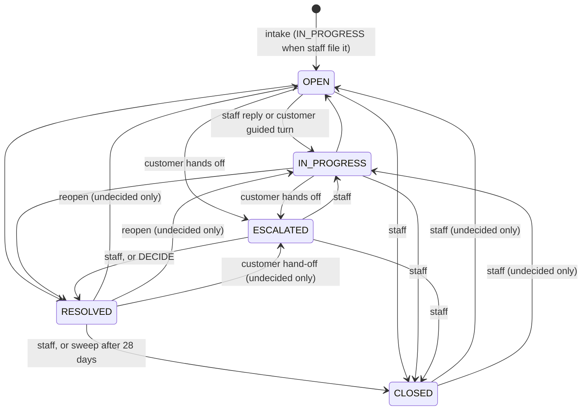
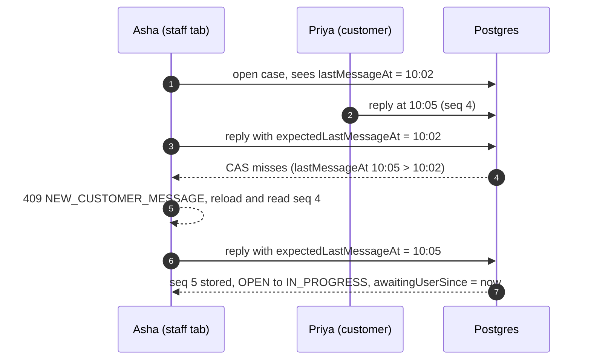

# Case lifecycle and the transition table

Every support request is one `SupportCase` row. It owns the conversation (`SupportCaseMessage` rows in a strict sequence), the audit timeline (`SupportCaseEvent`), the clocks, the CSAT score, and links to decisions, evidence, recommendations and attachments. This page explains how a case moves between statuses, who may move it, how messages are written safely under concurrency, and what happens on resolve, reopen and close.

How a case is created is in [intake and flows](01-intake-and-flows.md). What the formal decision does is in [decisions, appeals and supersede](03-decisions-appeals-and-supersede.md).

## Statuses and the transition table

A case is OPEN, IN_PROGRESS, ESCALATED, RESOLVED or CLOSED. `CASE_TRANSITIONS` in `lib/support/case-transitions.ts` lists every move a writer may make and who may make it. A pair missing from the table is refused. A move marked "undecided only" is refused once the case has a decision in force.

| From \ To   | OPEN                             | IN_PROGRESS                      | ESCALATED                 | RESOLVED                | CLOSED        |
| ----------- | -------------------------------- | -------------------------------- | ------------------------- | ----------------------- | ------------- |
| OPEN        | —                                | customer, staff                  | customer                  | customer, staff, system | staff         |
| IN_PROGRESS | customer, staff                  | —                                | customer                  | customer, staff, system | staff         |
| ESCALATED   | not allowed                      | staff                            | —                         | staff, system           | staff         |
| RESOLVED    | customer, staff (undecided only) | customer, staff (undecided only) | customer (undecided only) | —                       | staff, system |
| CLOSED      | staff (undecided only)           | staff (undecided only)           | not allowed               | not allowed             | —             |

`caseTransitionRefusal()` returns `{ status, code, error }`: 409 `CASE_DECIDED` for an undecided-only move on a decided case, and 409 `INVALID_TRANSITION` otherwise. It carries no decision detail: `reopenRefusalTx()` and `patchTransitionRefusalTx()` add the decision id and `appealUntil` with `caseDecidedDetail()`, while `assertCaseTransition()` throws the bare body as a `CaseConflictError`. A same-status write is not a move and is never refused. Callers keep their own compare-and-set; the table only says whether the move is legal.

Who calls the table, and as which actor:

- the customer's intake hand-off (`appendOpenScopeTurn()` in `lib/support/case-service.ts`), the customer reopen check (`reopenRefusalTx()`), guided turns and the guided escalation (`lib/support/service.ts`) pass CUSTOMER;
- a staff status change through PATCH (`patchTransitionRefusalTx()`) passes STAFF.

No caller passes SYSTEM today. The two system writers, the sweep's 28-day auto-close and the problem cascade, write their own guarded updates (see [the SLA sweep](07-sla-sweep.md)). The SYSTEM entries document what they are allowed to do.

## Invariants

| Rule                                                                                           | Enforcer                                                                                                                                                      | Test                                                   |
| ---------------------------------------------------------------------------------------------- | ------------------------------------------------------------------------------------------------------------------------------------------------------------- | ------------------------------------------------------ |
| Only listed moves by listed actors happen.                                                     | App: `assertCaseTransition()` / `caseTransitionRefusal()`.                                                                                                    | `__tests__/support/lifecycle-transitions.test.ts`      |
| A decided case never reopens.                                                                  | App: the `undecidedOnly` rule and `reopenRefusalTx()`.                                                                                                        | `__tests__/support/lifecycle-case-service.test.ts`     |
| One open case per ownership scope, organization, scope key, requester, submitter and category. | The database: partial unique index `support_case_open_scope_key` (NULLS NOT DISTINCT, open and not deleted).                                                  | `__tests__/db/support/intake-scope.db.test.ts`         |
| Messages have unique, gap-free per-case sequence numbers.                                      | The database: `@@unique([caseId, seq])`; the app increments `messageSeq` inside the case compare-and-set.                                                     | `__tests__/db/support/turn-replay.db.test.ts`          |
| A retried message is stored once.                                                              | The database: `@@unique([caseId, clientTurnId])`; the app replays first (`replayClientTurnIfExists()`).                                                       | `__tests__/db/support/turn-replay.db.test.ts`          |
| A staff reply cannot silently cross an unseen customer message.                                | App: compare-and-set on `lastMessageAt <= expectedLastMessageAt` (409 `NEW_CUSTOMER_MESSAGE`).                                                                | No dedicated test.                                     |
| Metadata edits never overwrite a newer version.                                                | App: compare-and-set on `expectedUpdatedAt` (409 `CONFLICT`).                                                                                                 | `__tests__/support/lifecycle-case-service.test.ts`     |
| A problem link is one level deep.                                                              | The database: `support_case_scope_and_shape_chk` (`problemCaseId IS NULL OR caseKind = 'INCIDENT'`); the app refuses linking to a RESOLVED or CLOSED problem. | `__tests__/support/lifecycle-case-service.test.ts`     |
| A case has a category or a flow key; an occurrence implies an appointment; CSAT is 1–5.        | The database: `support_case_scope_and_shape_chk`.                                                                                                             | `__tests__/support/case-service-and-sla-sweep.test.ts` |
| An organization-owned case has an organization.                                                | The database: `support_case_ownership_and_appeal_shape`.                                                                                                      | `__tests__/support/case-intake-scope.test.ts`          |
| At most one primary subject per case.                                                          | The database: `support_case_subject_primary_key`.                                                                                                             | No dedicated test.                                     |
| The channel never goes back from HUMAN.                                                        | App: no writer sets anything other than HUMAN after creation; guided turns never write the channel.                                                           | `__tests__/support/lifecycle-service.test.ts`          |

## Messages and concurrency

**Writing a turn.** `appendSupportCaseTurn()` runs one transaction at the database's default isolation, with the allocation timeouts `ALLOCATION_TX_MAX_WAIT_MS` (8 s) and `ALLOCATION_TX_TIMEOUT_MS` (30 s) from `lib/prisma.ts`. In order it:

1. replays first: if a message with the same `(caseId, clientTurnId)` exists, it returns that message and the ones after it (up to 200) with `replayed: true`;
2. refuses a public message on a CLOSED case (400 `CASE_CLOSED`); internal notes are still allowed;
3. runs the reopen checks if the customer asked to reopen;
4. updates the case with a compare-and-set that increments `messageSeq`, sets `lastMessageAt`, and banks customer-wait time;
5. reads the new `messageSeq` and inserts the message at that sequence number;
6. stages a bell (`case-message:<messageId>`) and, for a staff or presenter reply, response emails, in the same transaction; a presenter's emails go to the case correspondents only, never the staff assignee.

A unique violation on a `clientTurnId` (two tabs sending the same draft) is retried as a replay. The guided path uses its own allocator (`allocateMessageSeq()` in `lib/support/service.ts`) that reserves several sequence numbers at once for a bot turn.

**Customer turn.** The compare-and-set matches the status, `awaitingUserSince` and `pausedSeconds`. It closes the open customer wait and adds it to `pausedSeconds` (`userRepliedPatch()` in `lib/support/sla.ts`).

**Staff public reply.** The compare-and-set also matches `updatedAt` and `lastMessageAt <= expectedLastMessageAt`, the newest message the agent saw. If the customer wrote since, the reply fails with 409 `NEW_CUSTOMER_MESSAGE` ("Customer replied since you opened this case."). On success it sets `acknowledgedAt` and `firstAgentReplyAt` if empty, starts a customer wait (`awaitingUserSince = now`), moves OPEN to IN_PROGRESS, and assigns the author if the case is unassigned.

**Presenter reply.** An ACCEPTED PRESENTER on the linked booking replies through the same route and is stored as `sender: AGENT` with `metadata: { actorKind: "PRESENTER" }`; the database has no presenter sender value. Reads expose that marker as `actorKind`, so the UI labels the bubble Presenter rather than Familiarise support, and the external-requester digest skips it. Its state update only increments `messageSeq` and sets `lastMessageAt`. It does not reopen a resolved case, assign the presenter, set `firstAgentReplyAt` or `acknowledgedAt`, start a customer wait, or count as the first staff response. A presenter cannot write an internal note and cannot reply on a CLOSED case, an anonymous grievance, or a sensitive complaint about delivery or safety (`isSensitivePresenterCase()`).

**Internal notes, bot and system turns** only increment the sequence. Notes never change `lastMessageAt`.

**Who sends as whom.** The messages route (`app/api/support/cases/[caseId]/messages/route.ts`) maps a caller with `tickets.manage` to AGENT, an accepted presenter to AGENT with `actorKind: PRESENTER`, and everyone else to USER. A non-staff caller asking for an internal note gets 403. Only non-staff may pass `reopen`; operators and presenters reply without it, and operators reopen through PATCH. Non-staff posts are rate-limited to 5 per hour (`spamLimiter`, key `ticket-response:<userId>`).

**Reading.** Case reads include the newest 200 messages in ascending order. `GET .../messages` pages older messages with `beforeSeq` and `limit` (1–200), returning `hasMore` and `nextBeforeSeq` with `Cache-Control: private, no-store`. Customers never see internal notes, the assignee, or staff-only events; their timeline keeps only CREATED, STATUS_CHANGED, REOPENED and AUTO_CLOSED, with actor and note removed (`readSupportCaseForViewer()`).

## Staff edits (PATCH)

`PATCH /api/support/cases/[caseId]` needs `tickets.manage` and an `expectedUpdatedAt`. It can change status, priority, assignee, problem link and legal hold, and can add an internal note or a closing message. It cannot change the channel or the case kind. `executePatchLifecycleTx()` runs the checks in this order inside one transaction:

1. 404 `NOT_FOUND`;
2. 403 `INDEPENDENT_REVIEW_REQUIRED` when the actor or the new assignee decided or moderated the thing an appeal case appeals;
3. 400 `CASE_CLOSED` for any change to a CLOSED case other than a status move or a legal-hold toggle;
4. 400 `VALIDATION_FAILED` for a bad problem link or an assignee who is not STAFF or ADMIN;
5. the transition table, as STAFF;
6. the payout-hold gate: 409 `RECOMMENDATION_OPEN`, then 403 `REAUTH_REQUIRED`, then 503 `MAINTENANCE` (see [money remedies](05-money-remedies.md#payout-holds));
7. the compare-and-set on `updatedAt` (409 `CONFLICT`).

Only an ADMIN may send `legalHold` (403 `FORBIDDEN` otherwise). Raising the priority tightens unacknowledged and unresolved targets and never extends them (`tightenDeadlinesForPriorityRaise()`). Audit rows are written in a fixed order: the status row (REOPENED when leaving RESOLVED or CLOSED for an active status, STATUS_CHANGED otherwise), LEGAL_HOLD_CHANGED, PRIORITY_CHANGED, ASSIGNED or UNASSIGNED, and LINKED_PROBLEM. A closing message is stored as the note on the RESOLVED status row; the problem cascade later reuses it.

A staff reopen that collides with a newer open case on the same scope violates `support_case_open_scope_key`. The service maps that to 409 `OPEN_CASE_EXISTS` with the other case's id, reference and key (`openCaseConflict()`).

Status notifications for a PATCH are staged after the transaction commits, unlike message and intake notifications, which are staged inside it.

## Resolve, reopen and close

**Resolving** (by PATCH or by a DECIDE action) sets `resolvedAt`, releases every payout hold on the case with one `support.case.release-holds` ops-log row, ends every live chat-access grant as `CASE_RESOLVED`, and stages a CSAT bell keyed `csat:<caseId>:<resolvedAt>` that is delivered no earlier than 24 hours later. Anonymous grievance cases get no CSAT prompt, and the prompt goes only to case correspondents, never to presenters.

**A customer reply on a RESOLVED case** is a follow-up: it is stored and the status does not change. A presenter reply is also a follow-up: it is stored as a provider turn and neither reopens nor moves the status. To reopen, the customer must ask explicitly ("This didn't fix it" in the UI, `reopen: true` on the API). The reopen is refused, in order:

1. 403 `REOPEN_NOT_ALLOWED` when the author is neither the requester nor the submitter;
2. 409 `CASE_DECIDED` (with `appealUntil` and `decisionId`) when the case has a decision; the only path is an appeal;
3. 409 `REOPEN_WINDOW_EXPIRED` when `resolvedAt` is more than 14 days old (`REOPEN_WINDOW_MS` in `lib/support/deadline-policy.ts`).

A successful reopen moves the case to IN_PROGRESS if it has an assignee and OPEN otherwise, clears `resolvedAt`, and writes REOPENED. It also restarts the resolution clock: a new resolution target from the reopen time, `pausedSeconds` back to zero, the acknowledgement and statutory deadlines unchanged (`reopenedClockPatch()` in `lib/support/sla.ts`; the rule and an example are in [intake and flows](01-intake-and-flows.md#references-and-clocks)). The SLA sweep keys each resolution notice by the deadline it was raised for, so the reopened case can be warned and breached again. A reopened case does not regain chat grants that ended at resolution.

**A matching intake on a RESOLVED case** appends the description as a follow-up and returns `reused: true, dedupeReason: "resolved_case"`. If the intake asks for a person and the case is undecided, it hands the case to a person instead.

**Closing.** Staff may close a case from any active status. The sweep closes RESOLVED cases 28 days after `resolvedAt` and writes AUTO_CLOSED. Auto-close stages no notice. In the same transaction it releases any payout holds the case still has (as the system, with one `support.case.release-holds` ops-log row whose actor role is SYSTEM) and ends live chat-access grants, like a staff close (`releaseAutoClosedCaseTx()` in `lib/support/sla-sweep.ts`). A CLOSED case takes no public messages, and the open-scope lookup ignores it, so new intake creates a new case. Staff may reopen a CLOSED case only if it is undecided.

## CSAT

`POST /api/support/cases/[caseId]/csat` accepts one integer from 1 to 5 from anyone who can correspond on the case, rate-limited to 5 per hour. Presenters are thread parties, not correspondents, so they cannot rate. The case must be RESOLVED or CLOSED and resolved no more than 28 days ago. The write is a compare-and-set on `csatRating IS NULL`, so a second rating gets 409, and it writes CSAT_RATED. The database CHECK `support_case_scope_and_shape_chk` also limits the score to 1–5. Self-service helpfulness ratings are separate; see [intake and flows](01-intake-and-flows.md#deflection-and-helpfulness).

## Errors and Sentry

Expected refusals (a lifecycle refusal or a `CaseConflictError`) return plain JSON `{ error, code, ...detail }` with their status and create no Sentry event. Unexpected failures go through `supportError()` in `lib/api/support-http.ts`, which captures 5xx at error level and 4xx as warnings, never captures 401, 429 or causeless NOT_FOUND and FORBIDDEN, and never echoes 5xx detail to the client. The client treats a fixed set of 409 codes as final rather than retryable (`DEFINITE_CONFLICTS` in `lib/support/error-copy.ts`).

Case actions, appeals, external-requester intake and attachments run Serializable with `withSerializableRetry()` (`lib/db/serializable-retry.ts`: up to 3 retries on serialization failures and deadlocks, 50, 100 and 200 ms backoff plus jitter). The case service itself runs at default isolation and relies on compare-and-set updates and unique indexes.

## Verifying changes

- Unit and route tests: `npx jest __tests__/support/lifecycle-transitions.test.ts __tests__/support/lifecycle-case-service.test.ts __tests__/support/lifecycle-routes.test.ts`.
- The database race tier runs in CI (`db-guards` job in `.github/workflows/ci.yaml`), or locally per booking verification §11 (`.claude/skills/booking/references/verification.md`), against a disposable Postgres 17: `jest -c jest.db.config.ts` over `__tests__/db/**/*.db.test.ts`. Its guard (`__tests__/db/guard.ts`) refuses to run unless `CI=true` and `DATABASE_URL` points at a local `/ci` database. Never point it at the shared database.

## Where in code

- `lib/support/case-transitions.ts`: `CASE_TRANSITIONS`, `caseTransitionRefusal()`, `assertCaseTransition()`, `CaseConflictError`.
- `lib/support/case-service.ts`: `createOrReuseSupportCase()`, `appendSupportCaseTurn()`, `executePatchLifecycleTx()`, `reopenRefusalTx()`, `appendOpenScopeTurn()`, `readSupportCaseForViewer()`, `submitSupportCaseCsat()`, `openCaseConflict()`.
- `lib/support/sla.ts`, `lib/support/deadline-policy.ts`, `lib/support/case-workspace.ts`, `lib/support/own-case-read.ts`, `lib/support/inbox-query.ts`.
- `app/api/support/cases/[caseId]/route.ts`, `.../messages/route.ts`, `.../csat/route.ts`.

## Deprecated & Superseded Approaches

- **Separate tickets and appointment threads.** `SupportTicket`, `SupportResponse`, `AppointmentSupportThread` and `SupportMessage` were replaced by one `SupportCase` with its messages. Names survive in identifiers only: `createSupportTicket()`, the `support-ticket-update` Novu workflow, `SupportThreadCategory`, `supportKeys.threads`. They all act on `SupportCase`. `app/api/support/tickets/route.ts` remains as a staff-only outbound intake that creates a case; nothing in the UI calls it.
- **Resuming the original clock on reopen.** The resolution deadline used to stay as it was at receipt, so a reopened case could be born already breached. A reopen now starts a fresh target from the reopen time; the statutory deadline still keeps its date.
- **Implicit reopen.** Any customer reply used to reopen a resolved case, including a decided one. Only an explicit reopen on an undecided case within 14 days does now. The saved replies and the RESOLVED status email now say a reply won't reopen the request and point to "This didn't fix it" within 14 days, or an appeal if the request was decided.
- **Channel downgrade.** A resolved human case could drop back to SELF_SERVE with no audit row and leave the queues. The channel now only moves to HUMAN, with a CHANNEL_CHANGED event.
- **Unhandled reopen collisions.** Reopening a closed case or switching intent used to hit `support_case_open_scope_key` as a 500. It is now 409 `OPEN_CASE_EXISTS` naming the open case.
- **A universal 15-day clock with customer-wait extensions.** Replaced by fixed category deadlines captured at receipt; see [intake and flows](01-intake-and-flows.md#references-and-clocks).
- **Staff reopening decided cases, and silent hand-offs.** Staff could reopen a decided case, and a hand-off changed the channel without a STATUS_CHANGED row. The transition table now refuses the reopen with 409 `CASE_DECIDED`, and every hand-off writes both events.
- **A stale version from the resolution panel.** The staff panel once sent an old `expectedUpdatedAt`, so evidence and refund actions failed right after a reply. The client now reads one `updatedAt` from a single query-key factory (`lib/support/support-keys.ts`).
