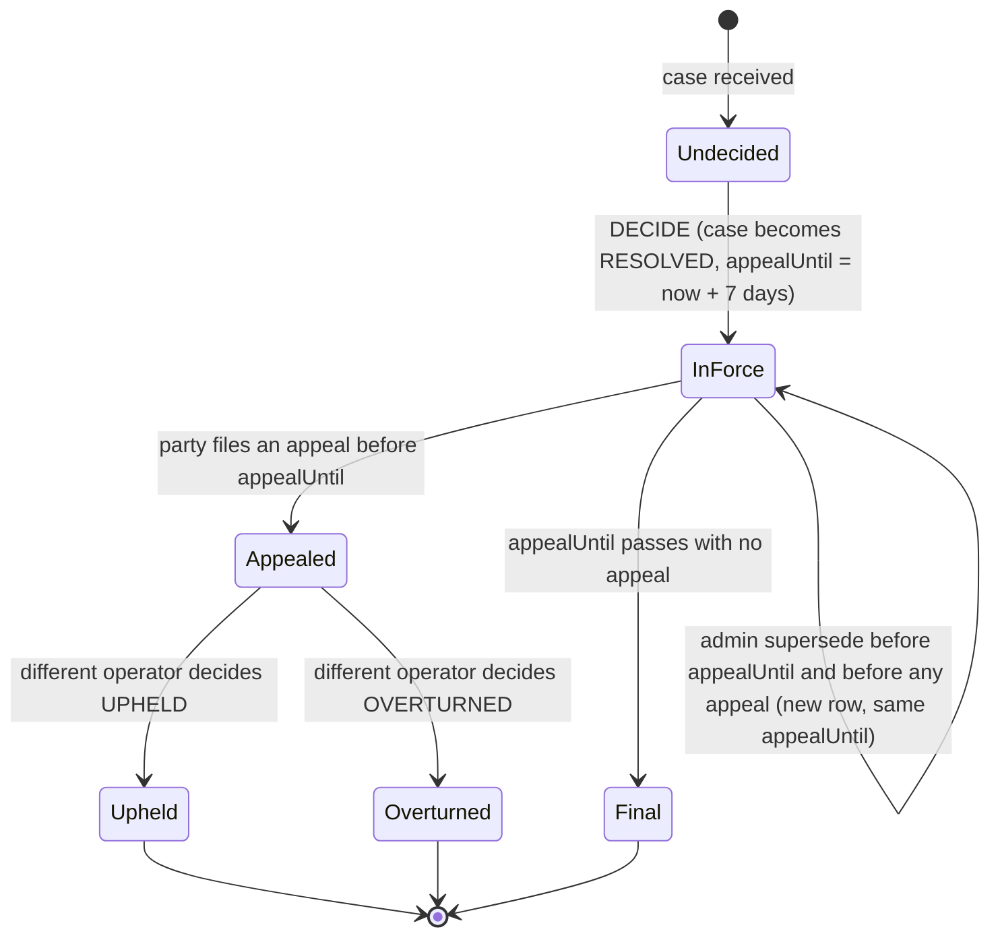
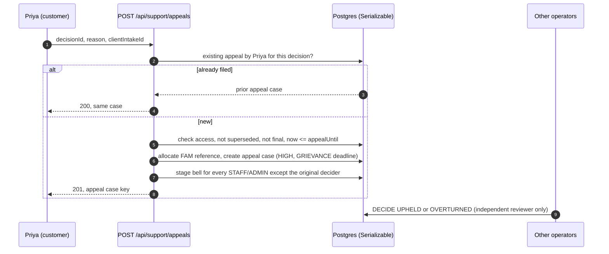

# Decisions, appeals and supersede

A **decision** is the platform's formal answer to a support case: an outcome, an explanation the customer reads, and an optional private rationale only staff read. Recording the first decision resolves the case and opens a seven-day **appeal window**. A decision row can never be edited or deleted. If staff got it wrong, an admin records a new decision that **supersedes** the old one, and the customer can still appeal. An **appeal** is a separate case, reviewed by a different operator, and its own decision is final.

This page is the reference for those rules. The case states themselves are in [the case lifecycle](02-case-lifecycle.md), and the refunds that a decision may describe are in [money remedies](05-money-remedies.md).

## The rules and who enforces them

| Rule                                                                                                                                                    | Enforcer                                                                                                                                                  | Test                                                                             |
| ------------------------------------------------------------------------------------------------------------------------------------------------------- | --------------------------------------------------------------------------------------------------------------------------------------------------------- | -------------------------------------------------------------------------------- |
| A decision row is never updated or deleted.                                                                                                             | The database: trigger `support_case_decision_immutable` (function `assert_support_decision_immutable`) in `prisma/sql/check-constraints.sql`.             | `__tests__/db/support/decision-race.db.test.ts`                                  |
| A case has exactly one original decision; every later decision supersedes exactly one other.                                                            | The database: partial unique index `support_decision_one_original_per_case` plus the unique `supersedesDecisionId` column.                                | `__tests__/db/support/decision-race.db.test.ts`                                  |
| A second plain DECIDE on a decided case is refused with 409 `CASE_ALREADY_DECIDED`, including the loser of a race.                                      | App check in `recordCaseDecisionTx()`, and the unique-violation handler in `performCaseAction()` (both `lib/support/case-actions.ts`).                    | `__tests__/support/lifecycle-decisions.test.ts`                                  |
| A PROBLEM case is resolved, never decided (400 `DECISION_NOT_ALLOWED`); a CLOSED case cannot be decided (409 `CASE_CLOSED`).                            | App check `assertDecisionFitsCase()`.                                                                                                                     | `__tests__/support/lifecycle-decisions.test.ts`                                  |
| Appeals are decided only `UPHELD` or `OVERTURNED`; ordinary cases never are (400 `OUTCOME_NOT_ALLOWED`).                                                | App check `assertDecisionFitsCase()`.                                                                                                                     | `__tests__/support/lifecycle-decisions.test.ts`                                  |
| `REFUND_APPROVED` needs an approved recommendation whose refund is PENDING or SUCCEEDED; `REFUND_DECLINED` is refused while any approval stands.        | App check `assertDecisionMatchesMoney()`.                                                                                                                 | `__tests__/support/case-money-hardening.test.ts`                                 |
| No decision while a refund recommendation awaits review (409 `RECOMMENDATION_OPEN`).                                                                    | App check `assertNoOpenRecommendation()`.                                                                                                                 | `__tests__/support/case-money-hardening.test.ts`                                 |
| Only an admin supersedes, only the decision in force, only before its `appealUntil`, and never once an appeal exists on the chain.                      | App checks in `supersedeDecisionTx()`.                                                                                                                    | `__tests__/support/lifecycle-decisions.test.ts`                                  |
| An appeal is reviewed by someone other than the original decider or moderator (403 `INDEPENDENT_REVIEW_REQUIRED`).                                      | App check `assertIndependentReviewer()`, called for every action on an appeal case by `actionableCase()` and by the refund door's pricing step.           | `__tests__/support/case-action-claims.test.ts`                                   |
| One appeal per decision per person.                                                                                                                     | The database: `@@unique([appealOfDecisionId, submitterUserId])` and `@@unique([appealOfModerationActionId, submitterUserId])` on `SupportCase`.           | No dedicated test; the route replays the prior appeal before the index can fire. |
| An appeal names exactly one thing it appeals.                                                                                                           | The database: `support_case_ownership_and_appeal_shape` (`num_nonnulls(appealOfDecisionId, appealOfModerationActionId) <= 1`) and the route's Zod refine. | No dedicated test.                                                               |
| A retried DECIDE with the same `clientActionId` replays the stored decision; the same key with other details is refused (409 `IDEMPOTENCY_KEY_REUSED`). | App check `replayCaseActionTx()` plus `@@unique([caseId, clientActionId])` on `SupportCaseDecision`.                                                      | `__tests__/support/lifecycle-decisions.test.ts`                                  |

## Outcomes

`DECIDE` accepts six outcomes (`CaseActionSchema` in `lib/support/case-actions.ts`). The column is a `VarChar(32)`, not a Postgres enum, so the Zod schema is the only list.

| Outcome           | Allowed on           | Meaning                                                                                   |
| ----------------- | -------------------- | ----------------------------------------------------------------------------------------- |
| `NO_REMEDY`       | An ordinary incident | The complaint was reviewed and nothing is owed.                                           |
| `SERVICE_REMEDY`  | An ordinary incident | A non-money fix was given (for example a reschedule done through the booking tools).      |
| `REFUND_APPROVED` | An ordinary incident | Money is going back; a live refund must already exist under an approved recommendation.   |
| `REFUND_DECLINED` | An ordinary incident | A refund was asked for and declined; no approval may stand.                               |
| `UPHELD`          | An appeal case only  | The original decision or moderation action stands.                                        |
| `OVERTURNED`      | An appeal case only  | The original is reversed. For a moderation appeal this runs the reversal described below. |

Who may record each outcome follows the back-office surface the action needs (`caseActionSurface()`): the two refund outcomes need `supportRefunds.executeBounded`, every other outcome needs `tickets.manage`.

## What recording a decision does

`recordCaseDecisionTx()` runs inside the Serializable transaction that `performCaseAction()` opens (retried by `withSerializableRetry()`). In order, it:

1. checks the case and outcome fit (`assertDecisionFitsCase()`), that no decision exists yet, that the money matches the outcome, and that no recommendation is open;
2. for an `OVERTURNED` moderation appeal, runs `reverseAppealedModeration()` (see below) and fails the whole decision if the reversal cannot be done;
3. moves the case to RESOLVED through `executePatchLifecycleTx()` (in `lib/support/case-service.ts`), which applies the [transition table](02-case-lifecycle.md), the case's `expectedUpdatedAt` compare-and-set, the release of the case's payout holds and the delayed CSAT prompt;
4. inserts the `SupportCaseDecision` row with `appealUntil = now + 7 days`;
5. writes a `DECISION_RECORDED` case event whose `toValue` is the decision id and whose note is the outcome;
6. stages notifications (`stageDecisionNotificationsTx()`): a bell to every case correspondent (or an email to an anonymous grievance requester), and a separate bell to each evidence recipient that links only to their own evidence page.

Because resolving releases the case's payout holds, a DECIDE on a case that still holds a payment needs a fresh session (403 `REAUTH_REQUIRED` otherwise) and open money doors (`holdReleaseRefusalTx()` in `lib/support/case-service.ts`). The actions route also demands a fresh session for every `OVERTURNED` decision, because it may reverse a moderation action. See [money remedies](05-money-remedies.md#payout-holds).

## Decision, appeal and supersede states

A superseded row stays in the table with a successor pointing at it. The **decision in force** is the one no later decision supersedes (`latestCaseDecisionTx()` in `lib/support/case-service.ts`).

## Supersede

Supersede is an admin correction, not a second opinion. `supersedeDecisionTx()` accepts it only when all of these hold:

- the actor's role is ADMIN (otherwise 403 `FORBIDDEN`);
- `supersedesDecisionId` names the decision in force (otherwise 409 `DECISION_SUPERSEDED`, with the id and `appealUntil` of the decision in force);
- the current time is not past that decision's `appealUntil` (otherwise 409 `SUPERSEDE_WINDOW_CLOSED`);
- no appeal case has been filed on any decision of the case (otherwise 409 `DECISION_APPEALED`);
- the correction does not orphan an effect the decision in force already had. Moving away from `OVERTURNED` on a moderation appeal is refused, because reinstating a reversed moderation action is not automated (409 `COMPENSATING_ACTION_REQUIRED`). Moving away from `REFUND_APPROVED` is refused while a refund under it is PENDING or SUCCEEDED (409 `REFUND_APPROVED_EXISTS`).

The new row inherits the original `appealUntil`, so a correction never extends the appeal deadline. The case is only touched (its `updatedAt` compare-and-set via `touchCase()`); `resolvedAt`, the 28-day auto-close clock and the CSAT prompt are left alone. The event is `DECISION_RECORDED` with `fromValue` set to the replaced decision.

## Appeals

A party files an appeal with `POST /api/support/appeals` (`app/api/support/appeals/route.ts`). The body names exactly one of `decisionId` or `moderationActionId`, a reason, and a `clientIntakeId` for retries. The route is rate-limited (`spamLimiter`, key `support-appeal:<userId>`) and runs Serializable.

**Who may appeal a case decision.** Anyone who can correspond on the original case, and any evidence recipient on it (`decisionAppealScope()`). The appeal inherits the original case's organization and ownership scope only for a correspondent; an evidence recipient's appeal is always PERSONAL, so it never lands in an organization's queue.

**Who may appeal a moderation action.** The reporter, the reported user, the review's author or subject, or the rated feedback's author (`moderationAppealScope()`). The window is six months from the moderation action.

**What is refused.** A decision that already follows an appeal (409 `FINAL_DECISION`), a superseded decision (409 `DECISION_SUPERSEDED` with `latestDecisionId`), and an expired window (400 `APPEAL_EXPIRED`).

**What is created.** A new `SupportCase` with category `SERVICE_APPEAL` or `MODERATION_APPEAL`, `appealOfDecisionId` or `appealOfModerationActionId` set, scope key `CASE_DECISION:<id>` or `MODERATION_ACTION:<id>`, channel HUMAN, priority HIGH, the HIGH internal targets from `slaDeadlinesFor()`, and the `GRIEVANCE` statutory deadline from `supportDeadline()` (seven days, policy `IN-2026-02:GRIEVANCE`). Every non-banned STAFF and ADMIN user except the original decider gets an "Independent appeal review needed" bell keyed `appeal:<caseId>`. A retry with the same appeal target returns the existing appeal case.

**Independent review.** Every action on an appeal case passes `assertIndependentReviewer()`: the decider of the appealed decision, or the moderator who took the appealed action, gets 403 `INDEPENDENT_REVIEW_REQUIRED`.

## Overturning a moderation action

When an appeal of a moderation action is decided `OVERTURNED`, `reverseAppealedModeration()` (`lib/support/appeal-reversal.ts`) restores what can be restored and keeps the original enforcement row:

- it needs the `users.moderate` surface; otherwise the decision fails with 409 `COMPENSATING_ACTION_REQUIRED` and the message that an administrator must execute the reversal;
- a removed review, removed reply or review excluded from the aggregate is restored, and a matching `REVIEW_RESTORED`, `REVIEW_REPLY_RESTORED` or `RATING_REINSTATED` moderation action is written;
- a private rating excluded from the aggregate is reinstated with `RATING_REINSTATED`;
- an account enforcement counts as reversed only if a later `USER_REINSTATED` action already exists on the same report. Otherwise the decision is refused until the moderator reverses it in the moderation workspace.

After the transaction commits, `performCaseAction()` purges the public review caches for the restored consultant (`purgeReviewSurfaces()`).

## Worked example

Priya Anderson paid ₹1,180 (118,000 paise) for a consultation with Hannah Anderson and reported that Hannah did not join.

1. **Mon 10:40 IST.** Staff member Asha asks Hannah for evidence, then recommends a full refund. An admin, Vikram, approves it; the refund of 118,000 paise is PENDING on the gateway.
2. **Mon 12:05 IST.** Asha records `REFUND_APPROVED`. The checks pass because an approved recommendation has a PENDING refund. The case moves to RESOLVED, the decision gets `appealUntil = Mon 12:05 IST + 7 days`, and Priya and Hannah get bells.
3. **Tue 09:00 IST.** Vikram notices the explanation cites the wrong session date. He supersedes with `REFUND_APPROVED` and a corrected explanation. That is allowed even though the refund is live, because the outcome is unchanged. The new decision keeps the original Monday-plus-seven-days deadline.
4. **Wed 18:30 IST.** Hannah, an evidence recipient, appeals the decision in force (Vikram's row). Her appeal case is PERSONAL, HIGH priority, with a seven-day statutory deadline. Every operator except Vikram, the decider of the appealed row, gets the "Independent appeal review needed" bell. If she had appealed the superseded Monday row, the route would answer 409 `DECISION_SUPERSEDED` with the id of Vikram's row.
5. **Thu 11:00 IST.** Another operator, Neha, decides `UPHELD`. Vikram may not act on the appeal case at all (403 `INDEPENDENT_REVIEW_REQUIRED`). The independence check looks only at the decider of the appealed row, so Asha, who decided the superseded row, is not blocked by code. Neha's decision is final, and a further appeal returns 409 `FINAL_DECISION`.

What if Asha had tried to record `REFUND_APPROVED` before Vikram approved? The decision would fail with 409 `RECOMMENDATION_OPEN`, and after a decline it would fail with 409 `REFUND_NOT_LIVE`.

## Failure modes

| Symptom                                               | Cause                                                                                   | What to do                                                                                                                                                                                        |
| ----------------------------------------------------- | --------------------------------------------------------------------------------------- | ------------------------------------------------------------------------------------------------------------------------------------------------------------------------------------------------- |
| 409 `CASE_ALREADY_DECIDED` on DECIDE                  | The case already has a decision in force, or another operator won the race.             | Refresh. Before `appealUntil`, ask an admin to supersede or tell the customer to appeal; after it, neither is open (the appeal returns 400 `APPEAL_EXPIRED`).                                     |
| 409 `COMPENSATING_ACTION_REQUIRED` on an `OVERTURNED` | The account enforcement was not reversed first, or the operator lacks `users.moderate`. | If the operator lacks `users.moderate`, an operator who holds it decides instead. Otherwise reverse the enforcement in the moderation workspace (it writes `USER_REINSTATED`), then decide again. |
| 409 `REFUND_APPROVED_EXISTS` on supersede or decline  | A refund under the decision is live, or an approval stands.                             | Void the approval if its refund failed ([runbook](12-runbooks.md#stuck-or-failed-support-refund)), then retry.                                                                                    |
| 409 `SUPERSEDE_WINDOW_CLOSED`                         | `appealUntil` passed.                                                                   | No correction path exists after the window. Record the error in an internal note.                                                                                                                 |
| Database error "Case decisions are immutable"         | Code tried to update or delete a decision row.                                          | Append a superseding decision instead; never edit the row.                                                                                                                                        |

## Where in code

- `lib/support/case-actions.ts`: `recordCaseDecisionTx()`, `supersedeDecisionTx()`, `assertDecisionFitsCase()`, `assertDecisionMatchesMoney()`, `assertNoOpenRecommendation()`, `assertSupersedeKeepsEffects()`, `assertIndependentReviewer()`, `replayCaseActionTx()`, `stageDecisionNotificationsTx()`.
- `lib/support/case-service.ts`: `latestCaseDecisionTx()`, `caseDecidedDetail()`, `executePatchLifecycleTx()`.
- `lib/support/appeal-reversal.ts`: `reverseAppealedModeration()`.
- `app/api/support/appeals/route.ts`, `app/api/support/cases/[caseId]/actions/route.ts`.
- `prisma/sql/check-constraints.sql`: `support_case_decision_immutable`, `support_decision_one_original_per_case`, `support_case_ownership_and_appeal_shape`.

## Deprecated & Superseded Approaches

- **Repeatable DECIDE.** A second DECIDE used to append a new decision and reset the seven-day appeal clock. It now needs an explicit admin supersede that keeps the original deadline, and the database refuses a second original decision.
- **Reopening a decided case by replying.** A reply or a matching intake used to reopen a decided case, which bypassed the independent appeal. Decided cases now refuse reopening with 409 `CASE_DECIDED`; the only path is an appeal ([case lifecycle](02-case-lifecycle.md)).
- **Decisions not tied to money.** `REFUND_APPROVED` could once be recorded with no refund behind it. `assertDecisionMatchesMoney()` now requires a live refund.
- **Problem-case decisions broadcast to incidents.** Deciding a PROBLEM case used to copy its explanation onto other customers' incidents. Problems are now resolved, never decided, and the [bounded cascade](07-sla-sweep.md#3-problem-to-incident-cascade) carries the closing note.
- **Outcomes not checked against the case.** Any outcome could be recorded on any case, including UPHELD on an ordinary complaint or a refund outcome on an appeal. `assertDecisionFitsCase()` now ties appeal outcomes to appeal cases and refuses decisions on problems and closed cases.
- **One-click immutable decisions.** The first staff panel recorded an immutable decision, a close or a "mark duplicate" on a single click, with one reason box shared across appeal, hold, refund and handover forms. The staff resolution panel (`components/support/resolution/StaffCaseResolution.tsx`) now asks for confirmation before a decision, and each action keeps its own reason.
