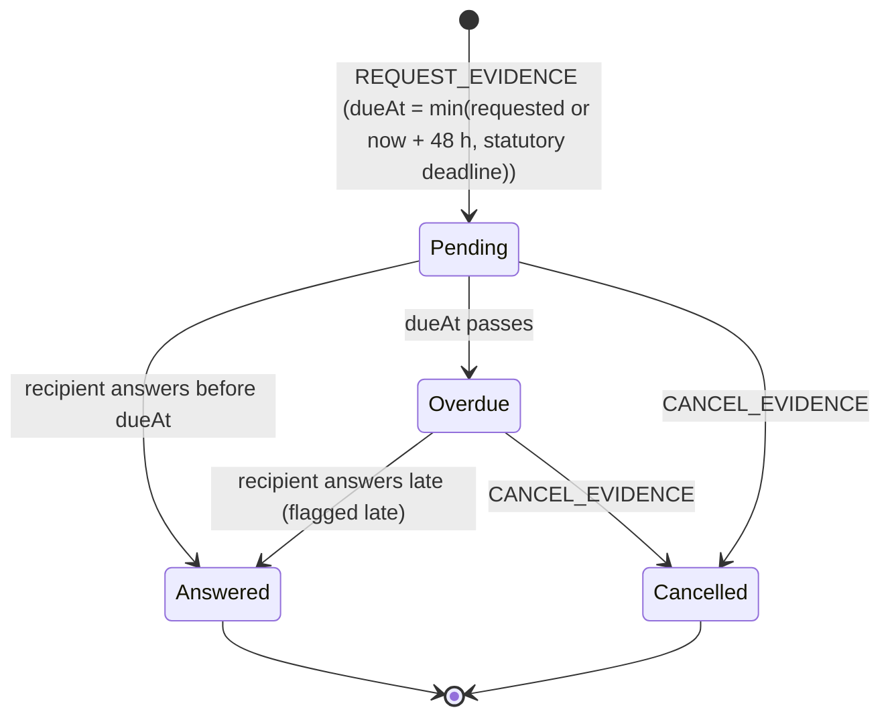
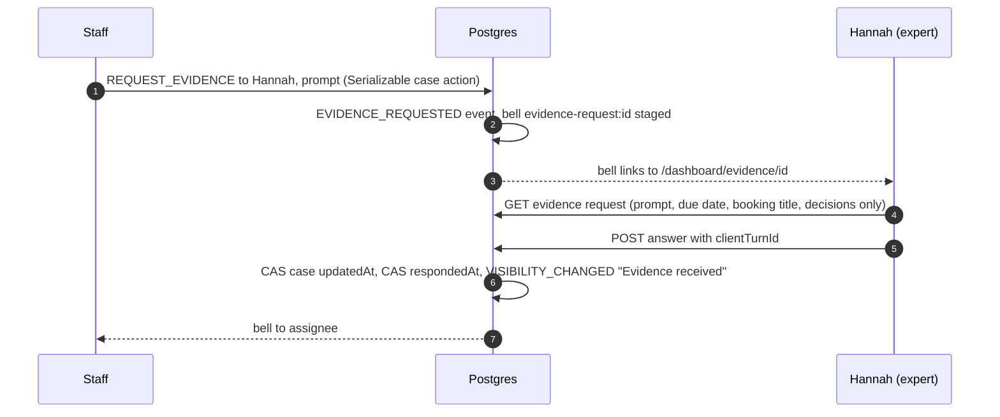
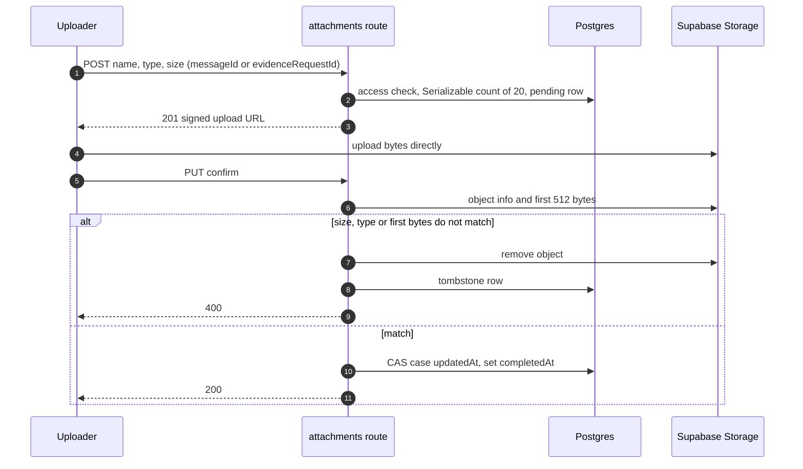

# Evidence requests and attachments

When a customer complains about a session, staff usually need the other side's account. An **evidence request** asks one delivering party, such as the expert or a host-organization operator, a private question with a deadline. The recipient answers once, in their own workspace, and never sees the customer's conversation. **Attachments** are the files a correspondent or an evidence recipient adds to a case; they live in a private bucket, are checked by their first bytes, and are only ever served through short-lived signed links.

## Evidence requests

### Who can be asked

`evidenceRecipientsByAppointment()` in `lib/support/case-actions.ts` lists the eligible recipients for the case's booking:

- consultant participants with status CONFIRMED or ATTENDED;
- the plan's consultant (consultation, subscription, webinar or class plan);
- ACCEPTED collaborators with tier PRESENTER on webinar and class plans (crew never answers for a session);
- ACTIVE OWNER, MAINTAINER, MANAGER and SUPPORT members of the host organization of a captured payment on the booking (`CAPTURED_PAYMENT_WHERE` in `lib/support/evidence-parties.ts`: SUCCEEDED and not deleted). A failed or abandoned payment makes no organization a party.

Banned users are excluded. A case with no booking has no eligible recipients. The delivering-party part is `deliveringPartiesByAppointment()` in `lib/support/evidence-parties.ts`, which chat access also uses.

### Lifecycle

**Request.** `requestEvidenceTx()` refuses a recipient outside the eligible list (400 `INVALID_RECIPIENT`). The deadline is the requested time, or 48 hours from now by default, but never later than the case's statutory deadline. If that is already in the past the request is refused (409 `DEADLINE_PASSED`), because the case needs immediate review instead. The request writes `EVIDENCE_REQUESTED` and stages a bell to the recipient keyed `evidence-request:<requestId>` that links to `/dashboard/evidence/<requestId>`, not to the case. A retry with the same `clientActionId` returns the same request; the same key with another recipient or prompt is 409 `IDEMPOTENCY_KEY_REUSED`.

**Overdue.** The sweep sends the requesting operator one "Evidence response overdue" bell ([SLA sweep](07-sla-sweep.md#8-overdue-evidence)). An overdue request is also a verified basis for a chat intervention.

**Answer.** `POST /api/support/evidence/[requestId]` (`app/api/support/evidence/[requestId]/route.ts`) accepts one answer of 1–10,000 characters with a `clientTurnId`, rate-limited to 5 per hour. It refuses a cancelled, answered, resolved or deleted request (409) and a recipient who is no longer an eligible party (403 "Your delivery or organization access has changed"). It compare-and-sets the case `updatedAt` and then `respondedAt IS NULL AND cancelledAt IS NULL`, so it is answered exactly once. A late answer is accepted and flagged. It writes a `VISIBILITY_CHANGED` event with the note "Evidence received: <id>" (plus "(late)") and bells the assignee, or the operator who asked.

**Cancel.** `CANCEL_EVIDENCE` compare-and-sets `cancelledAt` on an unanswered request and writes `EVIDENCE_CANCELLED` with the reason.

**Decision.** When the case is decided, each evidence recipient gets their own bell keyed `decision:<decisionId>:<recipientUserId>`, linking to their evidence page. They may appeal the decision; their appeal is always PERSONAL ([decisions](03-decisions-appeals-and-supersede.md#appeals)).

### What the recipient sees

`GET /api/support/evidence/[requestId]` returns the prompt, due date, their own answer, the cancel date, whether the case is closed, the case's decisions (id, outcome, `appealUntil`, date) and the booking's title, start time and organization name. It never returns the case messages. A non-recipient, or a recipient who has stopped being eligible, gets 404. `GET /api/support/evidence` lists up to 100 of the caller's requests; with an `organizationId` it scopes to bookings that organization sponsors or hosts (`evidenceAppointmentScope()` in `lib/support/evidence-scope.ts`).

## Attachments

### Policy

| Rule          | Value                                                                                                                                                                                             | Where                                                                 |
| ------------- | ------------------------------------------------------------------------------------------------------------------------------------------------------------------------------------------------- | --------------------------------------------------------------------- |
| Bucket        | `support-attachments`, private; storage enforces the size and type list on signed uploads.                                                                                                        | `lib/support/attachment-policy.ts`, `lib/support/case-attachments.ts` |
| Types         | PDF, JPEG, PNG, WebP, plain text, Word (.docx).                                                                                                                                                   | `SUPPORT_ATTACHMENT_MIME_TYPES`                                       |
| Size          | 20 MiB per file.                                                                                                                                                                                  | `SUPPORT_ATTACHMENT_MAX_BYTES`                                        |
| Content check | The first 512 bytes must match the declared type (PDF `%PDF-`, JPEG `FF D8 FF`, PNG signature, WebP `RIFF…WEBP`, DOCX `PK`); text must have no control characters other than tab and line breaks. | `headMatchesMimeType()`                                               |
| Count         | At most 20 files per uploader per case, counting completed files and pending ones from the last 24 hours.                                                                                         | `app/api/support/cases/[caseId]/attachments/route.ts`                 |
| Rate          | 10 upload starts per minute per user (`documentUploadLimiter`).                                                                                                                                   | same                                                                  |
| Path          | `support-cases/<caseId>/<uuid>`, unique.                                                                                                                                                          | `SupportCaseAttachment.storagePath`                                   |
| Download      | A redirect to a 60-second signed URL with `Cache-Control: private, no-store`.                                                                                                                     | `app/api/support/attachments/[attachmentId]/route.ts`                 |

There is no virus scanning; the first-bytes check is the only content check.

### Upload, confirm, download

- **Who may upload.** Staff with `tickets.manage`; anyone who can correspond on the case; and, for an evidence attachment, the request's recipient while still an eligible party (`attachmentCaseAccess()`). An attachment belongs to at most one message or one evidence request; the database enforces it with `support_case_attachment_shape`.
- **Closed records.** Upload is refused (409 "This evidence record is closed") on a CLOSED case or a cancelled or answered request.
- **Confirm.** `PUT` is idempotent. An unreadable head returns 503 and can be retried; a mismatch discards the object and tombstones the row.
- **Listing.** Only completed, non-deleted files are listed; customers never see files on internal notes.
- **Delete.** An uploader may withdraw only a pending upload. Submitted evidence stays with the case (409 once the file is completed, the case is decided or closed).
- **Retention.** Files are deleted by the [180-day purge](08-privacy-and-retention.md#the-180-day-evidence-purge) or on [erasure](08-privacy-and-retention.md#erasure). The daily storage reconciliation (`scripts/cleanup/reconcile-document-storage.ts`) protects only objects whose row is live (not tombstoned, and completed or pending for under 24 hours) and removes other objects older than 7 days.

## Invariants

| Rule                                                                                 | Enforcer                                                                   | Test                                                                                                                 |
| ------------------------------------------------------------------------------------ | -------------------------------------------------------------------------- | -------------------------------------------------------------------------------------------------------------------- |
| Only eligible parties are asked, and they lose access when they stop being eligible. | App: `requestEvidenceTx()`, the evidence routes, `attachmentCaseAccess()`. | `__tests__/support/evidence-route-authz.test.ts`, `__tests__/support/org-filed-subject-and-evidence-parties.test.ts` |
| Recipients never see the case transcript.                                            | App: the evidence GET projection.                                          | `__tests__/support/evidence-route-authz.test.ts`                                                                     |
| An evidence request is answered once.                                                | App: compare-and-set on `respondedAt IS NULL AND cancelledAt IS NULL`.     | `__tests__/support/evidence-route-authz.test.ts`                                                                     |
| One request per `(caseId, clientActionId)`.                                          | The database: `@@unique([caseId, clientActionId])`.                        | `__tests__/support/lifecycle-decisions.test.ts`                                                                      |
| An attachment hangs off at most one message or request; size is not negative.        | The database: `support_case_attachment_shape`.                             | No dedicated test.                                                                                                   |
| A file's first bytes match its type.                                                 | App: `headMatchesMimeType()` at confirm.                                   | `__tests__/support/attachment-verification.test.ts`                                                                  |
| Files are served only through access-checked, 60-second signed links.                | App: `attachmentDownload()`.                                               | `__tests__/support/route-authz-matrix.test.ts`                                                                       |

The 20-file cap has no dedicated test.

## Where in code

- `lib/support/case-actions.ts`: `requestEvidenceTx()`, `cancelEvidenceTx()`, `evidenceRecipientsByAppointment()`.
- `app/api/support/evidence/route.ts`, `app/api/support/evidence/[requestId]/route.ts`, `lib/support/evidence-scope.ts`.
- `lib/support/attachment-policy.ts`, `lib/support/case-attachments.ts`, `app/api/support/cases/[caseId]/attachments/route.ts`, `app/api/support/attachments/[attachmentId]/route.ts`.

## Deprecated & Superseded Approaches

- **Ticket attachment wrappers and legacy URL signing.** Attachments used to be wrapped per ticket, with stored URLs, aliases and a legacy signing path. They are now `SupportCaseAttachment` rows on the case with private storage metadata, and every download goes through the access-checked route. Test fixtures with the old `support-tickets/` storage prefix are the only trace.
- **No evidence record.** The old ticket and thread tables had no evidence model, so the other party's account could only arrive as messages. The canonical case added `SupportCaseEvidenceRequest`, with its own page and bell, linked to the case but never showing the customer's correspondence.
- **Trusting the declared type, and uploads that ignored note visibility.** Uploads were accepted on the browser's MIME type, without bucket limits, and a staff file attached while writing a private note was visible to the customer. The bucket now enforces size and type, confirmation checks the first bytes, and attachments follow the visibility of the message they belong to.
