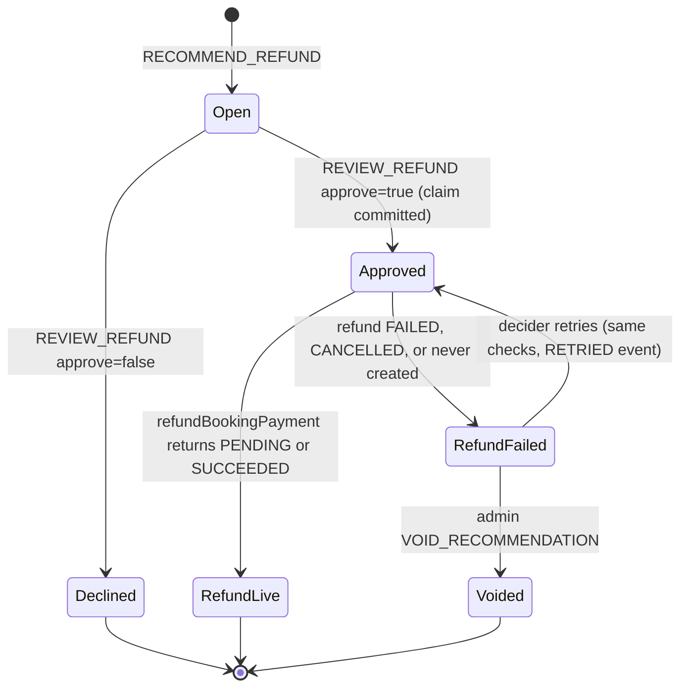
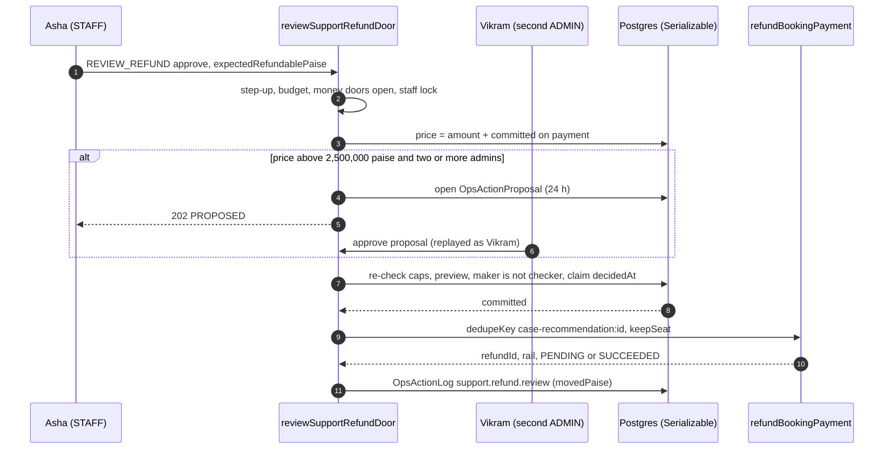
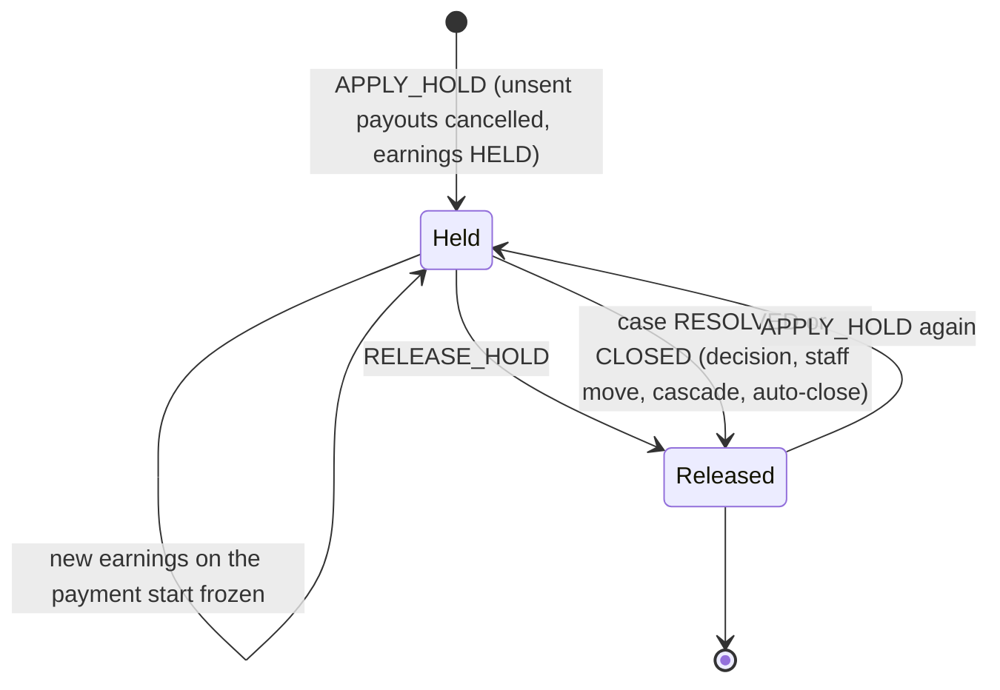

# Money remedies: recommendations, refunds, staff caps and holds

A support case never moves money by itself. It **deliberates**: staff link the payment, investigate, and write a **refund recommendation** (a payment, an amount in paise, a reason, and whether to release the seat). The **finance domain executes**: an operator reviews the recommendation through an audited door, and the approved amount goes back through the same refund service a normal cancellation uses. A **payout hold** works the same way. The case asks, and the shared `EarningsHold` model freezes the expert's unpaid earnings.

This page is the reference for those doors, their limits and their failure modes. Decisions that describe the money are in [decisions, appeals and supersede](03-decisions-appeals-and-supersede.md); the general admin money doors are in [`docs/finance/70-operations/02-admin-money-doors.md`](../finance/70-operations/02-admin-money-doors.md).

## The doors at a glance

Every case-scoped money or hold door is reached through `POST /api/support/cases/[caseId]/actions` (`app/api/support/cases/[caseId]/actions/route.ts`). The route parses the body with `CaseActionRequestSchema` and forwards the four door actions (`REVIEW_REFUND`, `VOID_RECOMMENDATION`, `APPLY_HOLD`, `RELEASE_HOLD`) to their ops doors (`OPS_DOORS`); `RECOMMEND_REFUND` stays a plain `performCaseAction()` action, and platform cancel and reschedule use their own staff appointment routes (last two rows). Each door is built with `withOpsAction()` (`lib/backoffice/ops-action-log.ts`), which checks the back-office surface, requires a fresh session (step-up), writes one `OpsActionLog` row with the operator's reason, and maps refusals to a plain JSON error.

| Action                | Door                                                          | Surface                          | Ops-log action                    | Who holds the surface | Extra gates                                                                                                   |
| --------------------- | ------------------------------------------------------------- | -------------------------------- | --------------------------------- | --------------------- | ------------------------------------------------------------------------------------------------------------- |
| `RECOMMEND_REFUND`    | none (plain case action in `performCaseAction()`)             | `tickets.manage`                 | none                              | STAFF and ADMIN       | Case `expectedUpdatedAt` compare-and-set; one open recommendation per payment.                                |
| `REVIEW_REFUND`       | `reviewSupportRefundDoor` (`lib/support/refund-door.ts`)      | `supportRefunds.executeBounded`  | `support.refund.review`           | STAFF and ADMIN       | Money budget, money doors open, staff caps, per-staff lock, maker is not checker, second admin above ₹25,000. |
| `VOID_RECOMMENDATION` | `voidSupportRecommendationDoor` (`lib/support/case-doors.ts`) | `refunds.manage`                 | `support.recommendation.void`     | ADMIN only            | Only an approval whose refund failed, was cancelled, or never started within 15 minutes.                      |
| `APPLY_HOLD`          | `applySupportHoldDoor` (`lib/support/case-doors.ts`)          | `supportHolds.manage`            | `support.hold.apply`              | STAFF and ADMIN       | Money doors open; a payout already sending refuses the hold.                                                  |
| `RELEASE_HOLD`        | `releaseSupportHoldDoor` (`lib/support/case-doors.ts`)        | `supportHolds.manage`            | `support.hold.release`            | STAFF and ADMIN       | Money doors open.                                                                                             |
| Platform cancel       | `POST /api/staff/appointments/[appointmentId]/cancel`         | `appointments.cancelForPlatform` | `appointment.cancel.platform`     | STAFF and ADMIN       | Money budget, money doors open, the same staff caps and lock as a support refund.                             |
| Platform reschedule   | `POST /api/staff/appointments/[appointmentId]/reschedule`     | `appointments.manage`            | `appointment.reschedule.platform` | STAFF and ADMIN       | Booking doors open (`assertBookingDoorsOpen()`). No money moves.                                              |

Surface-to-role mapping lives in `lib/auth/backoffice-permissions.ts`. Holding `supportRefunds.executeBounded` is not the limit; the door applies the staff caps on top.

The last two rows are booking doors that support staff use beside a case. They reuse the participant cancel and reschedule routes under a one-request grant (`grantPlatformCancel()` in `lib/booking/platform-cancel.ts`, `grantPlatformReschedule()` in `lib/booking/platform-reschedule.ts`), so the booking locks, compare-and-set transitions and notices stay the booking domain's own. Non-party operators see an Ops-panel hint instead of the participant Reschedule and Cancel buttons (`operatorOpsHref()` in `lib/backoffice/booking-href.ts`), and the participant routes refuse them without the grant (403 `PLATFORM_CANCEL_DOOR_REQUIRED`, `PLATFORM_RESCHEDULE_DOOR_REQUIRED`).

## Invariants

| Rule                                                                                                                                                                                                                                                                                                                                     | Enforcer                                                                                                                                                                                                                                       | Test                                                                                               |
| ---------------------------------------------------------------------------------------------------------------------------------------------------------------------------------------------------------------------------------------------------------------------------------------------------------------------------------------- | ---------------------------------------------------------------------------------------------------------------------------------------------------------------------------------------------------------------------------------------------- | -------------------------------------------------------------------------------------------------- |
| At most one undecided recommendation per payment.                                                                                                                                                                                                                                                                                        | The database: partial unique index `support_recommendation_one_open_per_payment`; the app checks first in `recommendRefundTx()` (409 `RECOMMENDATION_OPEN`).                                                                                   | `__tests__/support/case-money-hardening.test.ts`                                                   |
| A decided recommendation has a decider, a time and a verdict; a voided one was approved and now reads `approved = false`.                                                                                                                                                                                                                | The database: CHECK `support_recommendation_shape`.                                                                                                                                                                                            | No dedicated test.                                                                                 |
| A refund belongs to at most one recommendation.                                                                                                                                                                                                                                                                                          | The database: `@unique` on `SupportFinancialRecommendation.refundId`.                                                                                                                                                                          | No dedicated test.                                                                                 |
| Exactly one reviewer claims a recommendation.                                                                                                                                                                                                                                                                                            | Compare-and-set on `decidedAt IS NULL` in `reviewRefundTx()`, inside a Serializable transaction.                                                                                                                                               | `__tests__/support/case-action-claims.test.ts`, `__tests__/db/support/refund-claim.db.test.ts`     |
| An approval moves money only if the refundable balance still equals the figure the reviewer previewed.                                                                                                                                                                                                                                   | App check `assertRefundExecutable()` (409 `PREVIEW_CHANGED`).                                                                                                                                                                                  | `__tests__/support/case-money-hardening.test.ts`                                                   |
| No support refund while a gateway chargeback is live, or before the payment is captured.                                                                                                                                                                                                                                                 | App check `quoteCaseRefund()` (409 `REFUND_BLOCKED_BY_DISPUTE`, 409 `PAYMENT_NOT_SUCCEEDED`), using `DISPUTE_INACTIVE_FOR_GATING`.                                                                                                             | `__tests__/support/case-money-hardening.test.ts`                                                   |
| STAFF refund at most ₹5,000 (500,000 paise) per payment, counting every live refund and approved remedy on it.                                                                                                                                                                                                                           | App check `assertBoundedRefund()` in `lib/support/money-policy.ts` (403 `ADMIN_REQUIRED`).                                                                                                                                                     | `__tests__/backoffice/support-money-doors.test.ts`                                                 |
| STAFF refund at most ₹50,000 (5,000,000 paise) in any rolling 24 hours.                                                                                                                                                                                                                                                                  | App check `assertBoundedRefund()` summing `after.movedPaise` from the staff member's own ops-log rows (403 `STAFF_DAILY_LIMIT`).                                                                                                               | `__tests__/backoffice/support-money-doors.test.ts`                                                 |
| One staff member's bounded refunds run one at a time.                                                                                                                                                                                                                                                                                    | Redis lock `staff-refund:<userId>`, 120 s TTL (`lockStaffRefunds()`; 409 `STAFF_REFUND_IN_PROGRESS`).                                                                                                                                          | `__tests__/backoffice/support-money-doors.test.ts`                                                 |
| With two or more active admins, the author of a recommendation cannot approve it.                                                                                                                                                                                                                                                        | App check `assertNotOwnRemedy()` (403 `SAME_AUTHOR`).                                                                                                                                                                                          | `__tests__/support/case-money-hardening.test.ts`                                                   |
| A support refund approval priced above ₹25,000 (2,500,000 paise) needs a second admin when two or more admins are active. The price is this recommendation plus the money already committed on the same payment (other approved, unvoided remedies and live refunds no remedy owns), so the rule cannot be split across recommendations. | `withOpsAction()` `secondApprover` priced by `priceCaseRefundReview()`; `requiresSecondApprover()` and `SECOND_APPROVAL_THRESHOLD_PAISE` in `lib/backoffice/ops-proposals.ts` (strictly above). Other money doors price only their own action. | `__tests__/backoffice/ops-proposals.test.ts`                                                       |
| Money and hold doors close in any maintenance phase other than OFF, and fail closed when the phase cannot be read.                                                                                                                                                                                                                       | App check `assertMoneyDoorsOpen()` in `lib/backoffice/maintenance-gate.ts` (503 `MAINTENANCE` / `MAINTENANCE_UNKNOWN`).                                                                                                                        | `__tests__/backoffice/support-money-doors.test.ts`                                                 |
| A session-count remedy refunds exactly `min(floor(paid × k / sold), refundable)` and removes k sessions from the plan in the approval's commit; a void restores them.                                                                                                                                                                    | `assertSessionShare()` in `recommendRefundTx()`; `removePlanSessions()` / `restorePlanSessions()` CAS on `Subscription.sessionsRefunded`; CHECKs `subscription_sessions_refunded_range` and `support_recommendation_sessions_removed_min`.     | `__tests__/db/booking/train-b-schema.db.test.ts`, `__tests__/payments/train-b-refund-math.test.ts` |
| A refund is sent at most once per recommendation, on every rail.                                                                                                                                                                                                                                                                         | `dedupeKey = case-recommendation:<recommendationId>` passed to `refundBookingPayment()`.                                                                                                                                                       | `__tests__/support/case-money-hardening.test.ts`                                                   |
| A support refund keeps the buyer's seat unless the recommendation says `releaseSeat`, except on the credits rail, which always marks the seat `REFUNDED`.                                                                                                                                                                                | `executeApprovedRefund()` passes `keepSeat: !releaseSeat`.                                                                                                                                                                                     | `__tests__/support/case-money-hardening.test.ts`                                                   |
| One active support hold per earning per case.                                                                                                                                                                                                                                                                                            | The database: `earnings_hold_active_consultant_key` and `earnings_hold_active_org_key` on `(earning, reason, sourceRef)`.                                                                                                                      | `__tests__/support/case-holds.test.ts`                                                             |
| A case cannot resolve or close while it holds a payment, unless the operator is freshly authenticated, money doors are open and no recommendation is open. The 28-day auto-close is the exception: it releases as the system.                                                                                                            | App check `holdReleaseRefusalTx()` in `lib/support/case-service.ts` (403 `REAUTH_REQUIRED`, 409 `RECOMMENDATION_OPEN`).                                                                                                                        | `__tests__/support/case-hold-lifecycle.test.ts`                                                    |

## Recommendation to refund

**Recommend.** `recommendRefundTx()` checks the payment is linked to the case (`linkedPayment()`), takes a positive amount (or exactly 0 for a credit-funded `free_` payment, which restores credits in full), refuses a second open recommendation on the same payment, and writes `RECOMMENDATION_PROPOSED`. A payment is linked when it is a `PAYMENT` subject of the case or belongs to the case's appointment, and it must sit inside the case's financial scope: the requester's own payments for a PERSONAL case, the organization's billing account for ORG_BILLING, and billing, hosted or org-earning payments for ORG_OPERATIONS (`financialPaymentScope()`).

**A plan refunded by session count.** For a 1:1 plan payment the form also takes a number of sessions k (`RECOMMEND_REFUND` `sessions`). The amount is then fixed: `min(floor(paid × k / sessions sold), refundable balance)`, shown to staff as the per-session sum ("9 of 78 sessions × about ₹200 each = ₹1,800 … 69 stay on it"), and the server refuses any other amount (409 `PREVIEW_CHANGED`), a k above the sessions not yet booked or delivered (409 `SESSIONS_EXCEED_PLAN`), a credit-paid plan or a payment that is not a plan (400 `INVALID_SESSIONS`). The recommendation stores k as `sessionsRemoved`. The approval's commit adds k to `Subscription.sessionsRefunded` by compare-and-set on the count it read (`removePlanSessions()` in `lib/booking/plan-refund.ts`; a lost race is 409 `CONFLICT`), so those sessions leave the plan and the expert never delivers a session whose earnings the refund reversed. When the refund fails (or never starts) and an admin voids the approval, the void's commit puts the sessions back by the same compare-and-set (`restorePlanSessions()`); a lost race refuses the void (409 `CONFLICT`) rather than voiding without the give-back. The Refunds needs-human item for that failed refund says so ("9 sessions go back to the plan if you void this refund"), and so does the void dialog. A retry keeps the sessions removed. A session count is accepted only on an open plan: live, before its end and with no owed refund marker on the payment (`planRefundBasis().open`), checked at the recommendation and again at the approval; a cancelled, ended or settling plan answers 400 `INVALID_SESSIONS` (refund by amount if anything is still owed). The plan-end settlement waits (`PlanWaiting`) while an approved session-count remedy's refund is failed or not sent, so ops retries or voids it first; once the plan has settled (completed or cancelled) without those sessions, their refund is still owed: a retry pays it once (its dedupe key) and a void is refused (409 `NOT_VOIDABLE`). The needs-human item says which applies, and names the plan when its end refund is waiting on this one. A cancel re-quotes (409 `REFUND_QUOTE_CHANGED`) if an approval removes sessions while it is quoting, because its CAS is pinned to the count it read. A cancel quote after a session-count refund leaves the removed sessions out of what it owes (the denominator stays the sessions sold), and nets money-only support refunds (goodwill is an advance against what the plan owes, as at plan end), so a session is paid once whichever door closes the plan. The plan-end settlement keeps dividing by the sessions sold and subtracts what was already returned, so a session is never paid twice. A money-only remedy (no session count) leaves the plan as it is. The staff caps apply to the amount as for any support refund.

**Preview.** `GET /api/support/cases/[caseId]/recommendations/[recommendationId]/preview` returns the side-effect-free quote from `quoteCaseRefund()`: the refundable balance less other approved remedies whose refund is not live yet, the money already committed on the payment, the funding rail, and any blocker.

**Review.** The reviewer posts `REVIEW_REFUND` with `approve`, a reason of 5–1,000 characters, and, for an approval, the `expectedRefundablePaise` they saw. `reviewSupportRefundDoor` then:

1. refuses an approval without the preview figure (400 `INVALID_BODY`);
2. checks the operator's money budget (`assertMoneyOpsBudget()` in `lib/backoffice/money-limit.ts`: 10 money actions per minute per operator, otherwise 429 `RATE_LIMITED`) and, for an approval, that money doors are open;
3. takes the per-staff lock for a STAFF approver;
4. prices the review for the second-admin rule: this amount (the credit value, for a credit restoration) plus everything already committed on the payment (`priceCaseRefundReview()`). If that exceeds ₹25,000 and two or more admins are active, the door stores the request as an `OpsActionProposal` (24-hour TTL, `PROPOSAL_TTL_MS`) and answers 202 `PROPOSED`. A different admin approves it through `POST /api/admin/ops-proposals/[id]/approve` (`payments.manage`, step-up), which replays the stored body through the same door as that admin. The proposer approving their own proposal gets 403 `SAME_ADMIN`; a replay that fails leaves the proposal APPROVED with the failure code noted;
5. runs `performCaseAction()`, whose `reviewRefundTx()` re-checks independence, the decision state, the blockers, the preview, maker-not-checker and the staff caps, then claims the row with a compare-and-set on `decidedAt IS NULL`;
6. after the claim commits, `executeApprovedRefund()` calls `refundBookingPayment()` (`lib/payments/operations/booking-refund.ts`) with the recommendation's amount, `dedupeKey = case-recommendation:<id>`, the recommendation id and `keepSeat`.

The claim is guarded by the recommendation's own row and the previewed balance, not by the case's `updatedAt`, so a second-admin replay a day later still works after customers and the sweep have touched the case.

**Rails.** `refundBookingPayment()` returns the money through the payment's original funding rail: the gateway (Razorpay) for card and UPI payments, the internal rail for organization-funded bookings, and credit restoration for credit-funded bookings. The gateway call happens outside the claim transaction; the webhook or reconcile sweep then adopts provider truth and runs the ledger reversal, earnings reversal and GST credit-note cascade in `refundPayment()` (`lib/payments/operations/refund.ts`). The ops-log row records `movedPaise`, the new money or restored credit this call sent (0 on a retry of a live refund), which is what the staff rolling limit sums; a credit restoration is read before the restoration, which gives the consumed credit back.

**The seat.** By default a support refund returns money only and the buyer keeps their seat. When the recommendation has `releaseSeat` ("Also release the customer's seat"), the participant seat the payment funded is marked `REFUNDED` once the refund is sent: the customer loses access to the sessions, recordings and session documents (those reads filter on a live participant, `liveParticipant()` in `lib/booking/participants.ts`), and a class or webinar seat can be booked by someone else. It does **not** cancel the booking or its sessions; staff use **Cancel booking** on the booking's Ops panel, which goes through the platform cancel door and its policy refund. On the credits rail the seat is always marked `REFUNDED` when the credits are restored, whatever the recommendation says. On the gateway rail the seat stamp happens after the refund commits and a failure only logs a warning; on the internal rail it happens in the refund transaction.

**Retry and void.** If the refund failed or was never created, the decider can retry the approval. `claimRefundRetry()` re-runs every executable check, locks the row against a concurrent void, and writes a `RECOMMENDATION_DECIDED` event with note `RETRIED`. Only an admin can void (`voidRecommendationTx()`), and only when the refund is FAILED or CANCELLED, or when no refund exists and the approval is older than the 15-minute send grace (`SUPPORT_REFUND_SEND_GRACE_MS`). A void refuses with 409 `NOT_VOIDABLE` if a refund with the recommendation's dedupe key is PENDING or SUCCEEDED, or a retry happened inside the grace. A void sets `approved = false`, `voidedAt` and `voidedById`, and writes `RECOMMENDATION_VOIDED`. The [runbook](12-runbooks.md#stuck-or-failed-support-refund) walks through it.

## Staff caps across every refund door

The caps are defined once in `lib/support/staff-refund-limits.ts` (`STAFF_REFUND_PER_PAYMENT_PAISE = 500_000`, `STAFF_REFUND_ROLLING_PAISE = 5_000_000`), a client-safe module so the dialogs can quote them, and enforced in `lib/support/money-policy.ts`.

- **Per payment.** `assertBoundedRefund()` refuses a STAFF refund when `priorPaise + newPaise` exceeds ₹5,000. `priorPaise` comes from `committedSupportPaiseByPayment()`: every live (PENDING or SUCCEEDED) refund on the payment that no remedy owns, plus every approved, unvoided remedy. A remedy's own refund is counted once, as the remedy. The new amount is the remedy's value: its cash amount, or, on a credit-funded payment, the referral credit it restores (`remedyValuePaise` in `lib/support/case-actions.ts`, using `creditStillUsedPaise`). A credit-funded payment carries no card money, so counting its cash amount would let staff restore credit without limit.
- **Rolling 24 hours.** The same check sums `after.movedPaise` across the staff member's ops-log rows for `support.refund.review` and `appointment.cancel.platform` (`BOUNDED_REFUND_ACTIONS`).
- **Platform cancels count too.** The platform cancel door prices the refunds its cancel will send (`platformCancelCharges()`): the confirmed quote for a 1:1 booking, and every live seat's whole refundable balance for a webinar or class, each with the same `priorPaise`. It then runs the participant cancel route under a grant and logs `movedPaise`. A 5xx from the cancel keeps the staff lock until its TTL, so a refund of unknown outcome cannot let another one slip past the rolling count. The support refund door does the same: it releases the lock only for a typed refusal decided before money could move (a 4xx `CaseActionError` or `OpsRefusal`, via `refusedBeforeMoney` in `lib/support/refund-door.ts`) and keeps it for its 120-second time-to-live on anything else.
- **ADMIN** skips both caps. Any role other than STAFF or ADMIN gets 403 `FORBIDDEN`.
- **No second admin on platform cancels.** The platform cancel door has no `secondApprover`, so an ADMIN platform cancel above ₹25,000 runs without a second admin, unlike a support refund of the same size. A privileged non-party who calls the participant cancel route directly gets 403 `PLATFORM_CANCEL_DOOR_REQUIRED`.

The per-operator spend view (`lib/backoffice/support-spend.ts`) reads the same ops-log rows over 30 days: STAFF see only their own row, ADMIN see everyone.

### Worked example: caps

Priya Anderson's consultation payment is ₹1,180 (118,000 paise). Earlier a platform cancel by an admin refunded ₹590 (59,000 paise).

- Staff member Asha recommends ₹400 (40,000 paise) of goodwill. `priorPaise` is 59,000 and `newPaise` is 40,000, a total of 99,000 paise, under the 500,000 cap. If Asha has already moved ₹49,800 (4,980,000 paise) today, the rolling check fails: 4,980,000 + 40,000 = 5,020,000 is above 5,000,000, so the door answers 403 `STAFF_DAILY_LIMIT` and an admin must send it.
- For a webinar with a ₹30,000 (3,000,000 paise) seat, a staff approval of the whole seat fails the per-payment check (403 `ADMIN_REQUIRED`). An admin approval is priced at 3,000,000 paise, above the 2,500,000 threshold, so with two active admins it becomes a 24-hour proposal for a second admin.

## Payout holds

A support payout hold freezes an expert's or host's **unpaid** earnings on one payment while a case is investigated. It is not a separate model: it is `EarningsHold` rows with reason `SUPPORT_CASE` and `sourceRef = caseId` (`lib/support/case-holds.ts`). The case timeline owns the intent. The latest `HOLD_APPLIED` or `HOLD_RELEASED` event for a payment (`toValue` = payment id) says whether the case still holds it.

**Apply.** `holdPaymentForCase()` refuses with 409 `PAYOUT_IN_FLIGHT` when a linked payout is PROCESSING, cancels payouts that were batched but not sent (`cancelOpenPayoutsForPayment()`), refuses again if an earning is still BATCHED, and then places holds on every earning in a holdable status through `placeEarningsHolds()`, the single writer of `HELD` in `lib/payments/payouts/earnings-holds.ts`. A race with a payout raises 409 `EARNING_CHANGED`. A second APPLY on a payment the case already holds is a replay. The door's ops-log row records `heldPaise`, the payee money net of refunds that the hold froze.

**New earnings.** When earnings are written later for a held payment, `applyCaseHoldsToNewEarnings()` (called from `lib/payments/payouts/earnings-service.ts`) freezes them too, for every unresolved case that holds that payment.

**Release.** `RELEASE_HOLD` releases one payment's holds. Moving the case into RESOLVED or CLOSED releases all of them through `releaseAllCaseHolds()`, writes a `HOLD_RELEASED` event per payment, and records one `support.case.release-holds` ops-log row. That is why resolving needs step-up and open money doors. Releasing a support hold never releases a chargeback (`DISPUTE`) hold on the same earning, because the unique key and the release both match on reason and source.

A hold blocks the payout because payout batching picks only `READY` earnings, and a held earning is `HELD`. A payout that was already sent cannot be recalled by a hold.

`applyHoldTx()` does not check the case status, so a hold can be applied to a RESOLVED case; the 28-day auto-close then releases it as the system, in the same transaction as the close (`releaseAutoClosedCaseTx()` in `lib/support/sla-sweep.ts`, ops-log actor role SYSTEM), with no step-up because no person acts. The hold and void doors run at the database's default isolation inside `withOpsAction()`, not Serializable; they rely on the event-log replay check and the `EarningsHold` unique indexes.

## Planned changes (owner decisions 2026-11-04)

Not built yet; the rules above still apply until each one lands.

- **No second admin.** The second-admin proposal (₹25,000), the author-versus-approver rule (`assertNotOwnRemedy`) and the payout maker-checker are removed. An ADMIN's money action is their own call, with step-up sign-in, a typed confirm, warning banners and the ops log; a daily digest lists actions over ₹10,000. ([#2572](https://github.com/Practitionist/familiarise_web/issues/2572); the future multi-admin model is [#2573](https://github.com/Practitionist/familiarise_web/issues/2573).)
- **STAFF caps.** ₹5,000 per payment (unchanged) and ₹30,000 per rolling 24 hours (was ₹50,000); above either, an ADMIN. ([#2572](https://github.com/Practitionist/familiarise_web/issues/2572))
- **Class-wide cancel.** STAFF recommend; an ADMIN executes one action that refunds every attendee for the sessions not yet held through the normal refund rails. ([#2563](https://github.com/Practitionist/familiarise_web/issues/2563))
- **Make-up remedy.** A no-money remedy from a case ("add N sessions" or "add up to 4 weeks"), logged and visible to both sides; the same mechanism as the plan-end extra-weeks choice. ([#2563](https://github.com/Practitionist/familiarise_web/issues/2563), [#2561](https://github.com/Practitionist/familiarise_web/issues/2561))
- **Per-class payout hold.** A half-missed class automatically holds only that class's unpaid host earnings (`SUPPORT_CASE` `EarningsHold`) until its case closes. ([#2563](https://github.com/Practitionist/familiarise_web/issues/2563))

## Failure modes

| Symptom                                             | Cause                                                                                                   | Recovery                                                                                                                             |
| --------------------------------------------------- | ------------------------------------------------------------------------------------------------------- | ------------------------------------------------------------------------------------------------------------------------------------ |
| Approved recommendation, no refund or refund FAILED | The gateway refused the refund, or the process stopped between the committed claim and the refund call. | Retry as the decider, or have an admin void it after the 15-minute grace ([runbook](12-runbooks.md#stuck-or-failed-support-refund)). |
| 409 `PREVIEW_CHANGED`                               | Another refund or remedy changed the refundable balance after the preview.                              | Reload the preview and approve again.                                                                                                |
| 202 `PROPOSED` and nothing happens                  | Waiting for a second admin; the proposal expires after 24 hours.                                        | A different admin approves from the approvals queue; after expiry, review again.                                                     |
| 403 `ADMIN_REQUIRED` or `STAFF_DAILY_LIMIT`         | Staff caps.                                                                                             | An admin reviews.                                                                                                                    |
| 503 `MAINTENANCE`                                   | Maintenance phase is not OFF.                                                                           | Wait. Intake and correspondence stay open; only money and hold doors close.                                                          |
| 409 `PAYOUT_IN_FLIGHT` on APPLY_HOLD                | A payout for the payment is being sent.                                                                 | Review the payout in the payouts console; the hold cannot recall it.                                                                 |
| 403 `REAUTH_REQUIRED` when resolving                | The case holds a payment and the session is not fresh.                                                  | Re-authenticate, then resolve.                                                                                                       |

## Where in code

- `lib/support/case-actions.ts`: `recommendRefundTx()`, `quoteCaseRefund()`, `priceCaseRefundReview()`, `assertRefundExecutable()`, `reviewRefundTx()`, `claimRefundRetry()`, `voidRecommendationTx()`, `applyHoldTx()`, `releaseHoldTx()`, `executeApprovedRefund()`, `linkedPayment()`, `financialPaymentScope()`.
- `lib/support/refund-door.ts`, `lib/support/case-doors.ts`, `lib/support/money-policy.ts`, `lib/support/case-holds.ts`.
- `lib/backoffice/ops-action-log.ts` (`withOpsAction()`), `lib/backoffice/ops-proposals.ts`, `lib/backoffice/maintenance-gate.ts`, `lib/backoffice/support-spend.ts`.
- `lib/booking/platform-cancel.ts`, `app/api/staff/appointments/[appointmentId]/cancel/route.ts`, `lib/booking/platform-reschedule.ts`, `app/api/staff/appointments/[appointmentId]/reschedule/route.ts`, `lib/backoffice/booking-href.ts`.
- `lib/payments/operations/booking-refund.ts` (`refundBookingPayment()`), `lib/payments/payouts/earnings-holds.ts`.
- `lib/booking/plan-refund.ts` (`sessionShareOf()`, `planRefundBasis()`, `removePlanSessions()`, `restorePlanSessions()`); `components/support/resolution/FinancialPanel.tsx` (the session-count form).
- `prisma/sql/check-constraints.sql`: `support_recommendation_shape`, `support_recommendation_one_open_per_payment`, `support_recommendation_sessions_removed_min`, `subscription_sessions_refunded_range`, `earnings_hold_one_earning`, `earnings_hold_active_consultant_key`, `earnings_hold_active_org_key`, `ops_action_proposal_one_open_key`.

## Deprecated & Superseded Approaches

- **`SupportPaymentHold`.** Holds used to be their own table with no ops-log row, no budget and no release, so payouts stayed stuck while dashboards still showed the money as ready. They now use `EarningsHold` reason `SUPPORT_CASE` behind `withOpsAction()` doors and release automatically at resolution.
- **Seat eviction on goodwill refunds, and a misleading seat label.** A partial refund once marked the buyer's seat REFUNDED, which revoked recordings and class access. `keepSeat` is now the default and `releaseSeat` is explicit. The option was first labelled "Also cancel the service", which it never did; it is now "Also release the customer's seat", and the hint points to Cancel booking for a real cancellation.
- **Case-version guard on second-admin approval.** The approval used to replay a stale `expectedUpdatedAt`, so any message in the 24-hour window left the proposal stuck. The claim is now guarded by the recommendation row and the previewed balance.
- **Admin-only execution and split approvals.** Every support refund once needed an admin, the ₹25,000 rule could be split across several recommendations, and the author could approve their own. STAFF now execute within caps, the rule prices cumulatively per payment, one recommendation per payment can be open, and maker cannot be checker.
- **Money doors open during maintenance and STAFF refunds through the participant cancel route.** Both are closed: money doors check `assertMoneyDoorsOpen()`, and a non-party operator cancels only through the platform cancel door, whose refunds count toward the staff caps.
- **Approval with no way back.** An approval committed before money moved, so a failed refund (a live chargeback, or a Razorpay `notes` field over 512 characters) left the recommendation "Approved" with no retry or void and no chargeback precondition. Approvals now check blockers first, retry and void exist, and the refund reason is the short `Support remedy <reference>`.
- **Partial refunds on a plan as goodwill money only.** A partial refund once left the plan's sessions untouched, so the expert still delivered sessions whose earnings had been reversed. A refund priced in sessions now removes them (`sessionsRefunded`).
- **The HANDOVER action.** An organization "handover" action, shown even to customers, was removed with the money hardening; a test asserts the action is rejected.
