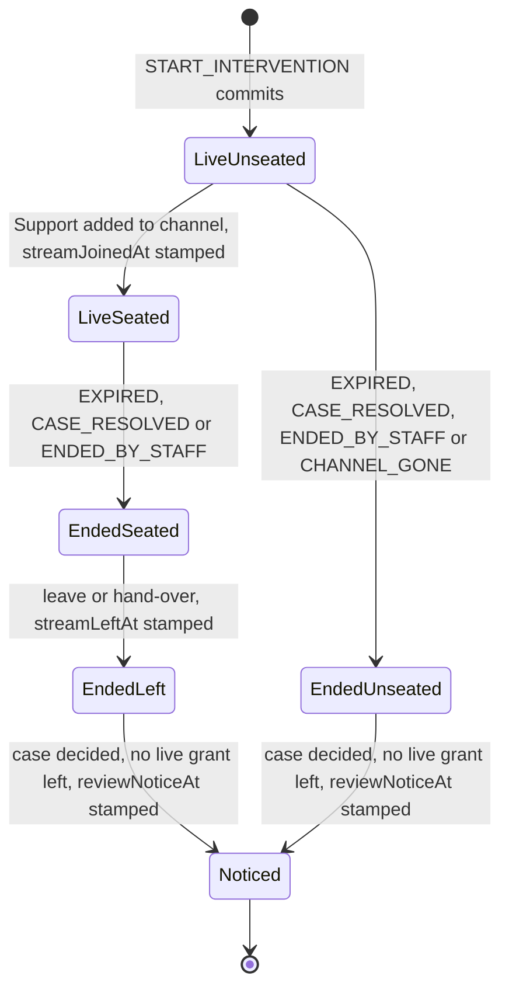
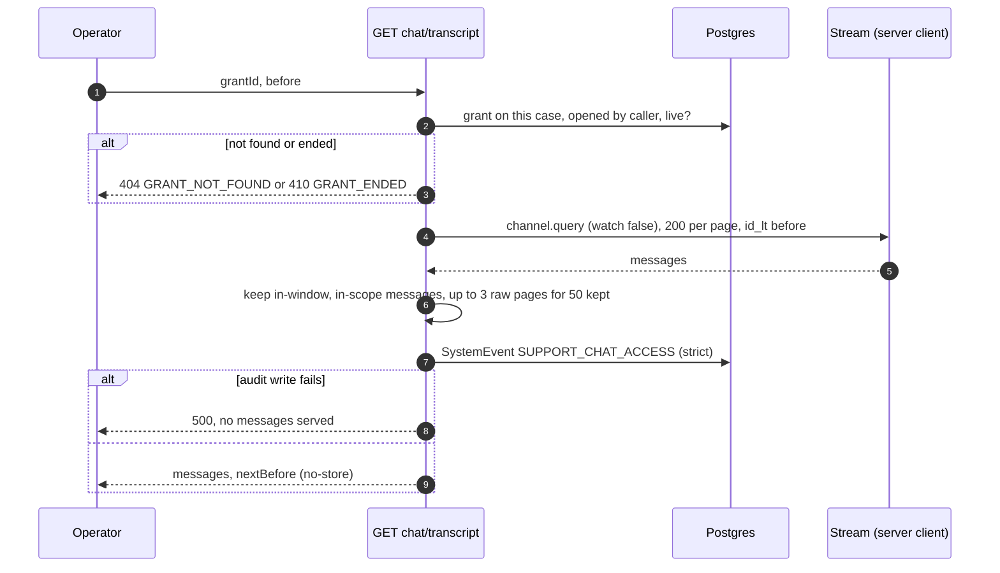
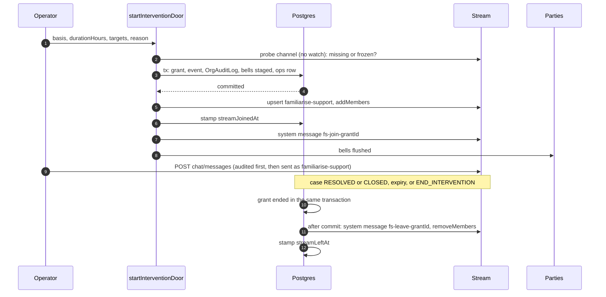

# Chat access, transcripts and intervention

Booking chats are private between the parties. Operators cannot read them by default: operators are plain Stream `user`s, and no account can mint a Stream token for another user (`mapRoleToStream()` in `lib/user.ts`, `assertCanMintToken()` in `actions/stream/chat/stream.action.ts`). When a support case needs the chat, staff open a **chat-access grant** on that case. A **READ** grant opens an audited, time-boxed transcript viewer. An **INTERVENE** grant also seats a visible "Familiarise Support" member in the channel, so staff can post there. Every grant is written to an append-only access log, and once the case is decided the parties get a "we reviewed messages from your booking chat" notice.

> [!NOTE]
> Everything on this page except the Stream role and token rules above lives on the `feat/support-chat-intervention` branch, which merges before this documentation lands. Paths such as `lib/support/chat-access.ts` exist on that branch.

## Who can do what

| Action                         | Route                                                | Surface                 | Step-up            | Ops-log action                 |
| ------------------------------ | ---------------------------------------------------- | ----------------------- | ------------------ | ------------------------------ |
| See grant status and parties   | `GET /api/support/cases/[caseId]/chat`               | `supportChat.read`      | No                 | none                           |
| Open a READ grant              | `POST /api/support/cases/[caseId]/chat` `OPEN_READ`  | `supportChat.read`      | Yes                | `support.chat.read.grant`      |
| End your own READ grant        | `POST .../chat` `END_READ`                           | `supportChat.read`      | Yes                | `support.chat.read.end`        |
| Start an intervention          | `POST .../chat` `START_INTERVENTION`                 | `supportChat.intervene` | Yes                | `support.chat.intervene.start` |
| End an intervention            | `POST .../chat` `END_INTERVENTION`                   | `supportChat.intervene` | Yes                | `support.chat.intervene.end`   |
| Read a transcript page         | `GET /api/support/cases/[caseId]/chat/transcript`    | `supportChat.read`      | No (paid at grant) | none; a `SystemEvent` per page |
| Post as Familiarise Support    | `POST /api/support/cases/[caseId]/chat/messages`     | `supportChat.intervene` | No (paid at grant) | `support.chat.message.post`    |
| Open a case from a chat report | `POST /api/staff/moderation/reports/[reportId]/case` | `tickets.manage`        | No                 | `moderation.report.open-case`  |

Both chat surfaces belong to STAFF and ADMIN (`lib/auth/backoffice-permissions.ts`). The four grant doors are `withOpsAction()` transaction doors in `lib/support/chat-doors.ts`; each needs a reason of 5–1,000 characters and a session re-authenticated within 15 minutes (403 `REAUTH_REQUIRED`). Customers, experts and organization admins get 403 on every chat route (`__tests__/support/route-authz-matrix.test.ts`). Organization admins never receive transcripts.

## Which cases qualify

`caseChatRefusal()` and `resolveCaseChat()` in `lib/support/chat-access.ts` refuse, in order:

1. a soft-deleted case (404 `CASE_NOT_FOUND`);
2. a case that is not OPEN, IN_PROGRESS or ESCALATED (409 `CASE_NOT_OPEN`);
3. a case not handed to a person, `activeChannel` other than HUMAN (409 `CASE_NOT_HUMAN`);
4. a case with no linked booking, or a deleted one (409 `NO_BOOKING`);
5. a trial booking, which has no chat (409 `CHAT_DISABLED`);
6. a booking with no canonical channel, or only a collaborator channel (404 `CHAT_NOT_FOUND`).

The canonical channel is the booking's 1:1 DM for consultations and subscriptions, or its cohort channel for webinars and classes (`resolveCanonicalMeetingChannel()` in `lib/meetings/mirror-room-chat.ts`). A moderation report on its own never unlocks a chat. Staff first open a case from the report (see below), then grant on the case.

## Bases, kinds and durations

| Kind      | Basis allowed                                   | Duration                                                                       | What it unlocks                                                      |
| --------- | ----------------------------------------------- | ------------------------------------------------------------------------------ | -------------------------------------------------------------------- |
| READ      | `OPEN_CASE` only                                | 24 hours (`CHAT_READ_TTL_MS`)                                                  | The opener's transcript viewer.                                      |
| INTERVENE | `EVIDENCE_OVERDUE`, `SAFETY` or `FRAUD_OR_SCAM` | 24, 72 or 168 hours; the UI defaults to 72 (`SUPPORT_CHAT_INTERVENTION_HOURS`) | A visible Support seat, posting, and the opener's transcript viewer. |

`verifiedInterventionBases()` marks a basis **verified** when the system can prove it: `EVIDENCE_OVERDUE` when an evidence request on the case is unanswered, uncancelled and past `dueAt`, and `SAFETY` and `FRAUD_OR_SCAM` when the case category is `SAFETY_CONCERN`. Staff may also **assert** `SAFETY` or `FRAUD_OR_SCAM` on any qualifying case, with their reason kept in the ops log. An asserted `EVIDENCE_OVERDUE` is refused (409 `BASIS_NOT_MET`). `OPEN_CASE` can never justify an intervention: the Zod schema `StartInterventionBody` excludes it and the database CHECK `support_chat_access_shape` refuses it.

No grant can be extended. Staff open a new grant with a new reason. The database trigger forbids changing `expiresAt`.

## Scope: whose messages a grant covers

`scopeFor()` decides `scopeUserIds`:

- **1:1 DM.** Always both members of the pair. A target outside the pair is refused (400 `TARGET_NOT_PARTY`).
- **Group channel.** The reporter (the case requester, if they are a party) plus the targets staff pick at grant time. Every target must be a live party: a delivering party (the plan's consultant, confirmed consultant participants, accepted PRESENTER collaborators; crew never counts) or a live attendee (`deliveringPartiesByAppointment()` in `lib/support/evidence-parties.ts`). If the reporter is an attendee and picks nobody, the delivering parties are used. Otherwise an empty pick is refused (400 `TARGETS_REQUIRED`). At most 20 targets.
- **Time window.** Messages from `appointment.createdAt` minus 7 days (`CHAT_DM_LEAD_IN_MS`) onwards, for both DM and group grants. There is no end bound; the grant's expiry bounds access instead.

## Grant states

A READ grant has only Live, Ended and Noticed. The CHECK `support_chat_access_shape` forbids Stream stamps on it.

## Opening a grant

Each door runs one transaction (READ COMMITTED, Prisma's default). Concurrency is handled by the partial unique indexes and compare-and-set updates, not by row locks. Inside it, the door:

1. reloads the case and runs the eligibility checks and `scopeFor()`;
2. ends grants that expired but were not yet swept, so the unique slot frees up (`endExpiredGrantsTx()`);
3. inserts the `SupportCaseChatAccess` row. A second live READ by the same operator on the case violates `support_chat_one_live_read_per_operator` (409 `READ_ACTIVE`); a second live intervention on the channel from any case violates `support_chat_one_live_intervention_per_channel` (409 `INTERVENTION_ACTIVE`);
4. writes a `CHAT_ACCESS_GRANTED` case event (staff-only on the timeline);
5. writes one `OrgAuditLog` row per organization tied to the booking (the booking's organization, plan organizations, and payment host organizations), with action `SUPPORT_CHAT_REVIEWED` or `SUPPORT_CHAT_INTERVENTION` and no content or case reference;
6. for an intervention, stages "joined by Familiarise Support" bells to the parties;
7. writes the ops-log row; the grant's `opsActionId` is that row's id.

Opening a READ notifies nobody at that moment. Parties learn about it from the review notice after the case is decided, unless the grant was opened with `withholdNotice` because telling would create risk.

## Transcript reads

`readTranscriptPage()` (`lib/support/chat-transcript.ts`) keeps messages written by a scoped user, by Familiarise Support, or by the system, at or after the window start. Soft-deleted messages show their original text (up to 20 lookups per page) flagged as deleted by the sender. Attachments show only their type and name, never a URL. Every page writes a `SystemEvent` (category `SUPPORT_CHAT_ACCESS`, severity WARN, `correlationId` = grant id, with the message ids) before it is returned, and the write is strict: if it fails, the page is not served. A channel Stream no longer has returns 404 `CHAT_NOT_FOUND` with no audit row.

Only the grant's opener can read with it, whether it is a READ or an INTERVENE grant. Another operator opens their own READ.

## Intervention: join, post, leave

**The Support user.** `familiarise-support` (display name "Familiarise Support") is a Stream user with role `user`, no `User` row, and no token (`lib/stream/support-user.ts`). All Stream calls use the server client behind `withStreamCircuitBreaker`, never inside a database transaction, and never `watch()`.

**Join.** The route refuses before the transaction when the channel was never started (404 `CHAT_NOT_FOUND`) or is frozen (409 `CHANNEL_FROZEN`), probing with `queryChannels` so it never creates a channel. After commit, `joinIntervention()` upserts the user, adds it as a member, stamps `streamJoinedAt`, and sends a system message with the fixed id `fs-join-<grantId>`. The join text is generic, so a group never learns who reported.

**Post.** `postSupportMessage()` requires a live, joined INTERVENE grant (409 `NOT_JOINED` before the seat is taken). It writes a `CHAT_SUPPORT_MESSAGE` case event and the ops-log row first, then sends with id `fs-<grantId>-<clientActionId>` as `familiarise-support`. The operator's identity never enters the Stream payload. Any operator holding `supportChat.intervene` may post on a live grant of the case. A retry by the same operator replays; the same id from another operator is 409 `IDEMPOTENCY_KEY_REUSED`. Text is 1–2,000 characters.

**Leave.** `leaveIntervention()` sends `fs-leave-<grantId>` ("Familiarise Support has left this chat."), removes the member and stamps `streamLeftAt`. If another live, seated intervention exists on the same channel, it only stamps (`handed-over`), so the seat stays. A missing channel counts as left. Duplicate system-message ids are swallowed, so retries are safe.

**What parties see.** A banner while `familiarise-support` is a channel member (`SupportInterventionBanner`), system lines for join and leave, and Support messages without edit, delete or report menus. Support never turns a DM into a group in the UI, and the remove, block and report controls are hidden for it. These UI guards are client-side only.

## The Stream boundary

While an INTERVENE grant on a channel is live, `syncSupportBoundary()` (`lib/stream/support-boundary.ts`) sets per-channel grant modifiers (`config_overrides.grants`) that revoke `update-channel-members`, `update-channel-members-owner` and `truncate-channel-owner` for the `user` and `channel_moderator` roles. No party can remove Familiarise Support, add or remove members, or clear the chat history while staff are in it. The start door locks the channel before Familiarise Support joins. When the last live intervention on the channel ends, the same call clears the modifiers. The desired state is re-read from the database on every call, so repeats and late retries converge, and nothing else writes `config_overrides`.

A covert READ changes nothing in Stream, so parties cannot tell it is happening. The residual risk is that a party could truncate their own DM during a READ; when evidence must be protected, staff open an intervention instead.

## Ending, the sweep and the review notice

- **Staff end.** A READ ends only by its opener; any `supportChat.intervene` holder may end an intervention on the case. A missing grant is 404 `GRANT_NOT_FOUND`; an ended one is 410 `GRANT_ENDED`.
- **At resolution.** When `executePatchLifecycleTx()` moves a case to RESOLVED or CLOSED, it ends every live grant as `CASE_RESOLVED` in the same transaction (`endCaseChatAccessTx()` in `lib/support/chat-access-end.ts`) and schedules the Stream leave after commit. The problem cascade ends its incidents' grants the same way; the sweep's chat arm handles their leave. The sweep's 28-day auto-close ends grants in its close transaction too, and the chat arm later in the same run removes any seat still taken.
- **Sweep backstop.** The chat arm of `runSupportSlaSweep()` (`sweepSupportChatAccess()` in `lib/support/chat-sweep.ts`, at most 10 rows per step) runs five steps: end grants that expired or whose case is resolved, closed or deleted; retry Stream leaves for ended interventions still seated; re-sync the Stream boundary of every channel whose grants started or ended in the last hour; retry joins for live unseated interventions older than 2 minutes (ending them `CHANNEL_GONE` if the channel is gone), so Support is seated only in a locked channel; and send review notices. See [the SLA sweep](07-sla-sweep.md#5-chat-access-backstop).
- **Review notice.** Once a case is RESOLVED or CLOSED and no live grant remains, the sweep stamps `reviewNoticeAt` on every ended grant of the case in one transaction and writes `CHAT_REVIEW_NOTIFIED`. It stages a "reviewed: our team read messages from your booking chat" bell keyed `chat-reviewed:<firstGrantId>`, unless any grant on the case has `withholdNotice`, in which case the whole batch is withheld.
- **Reopen.** A reopened case does not regain its ended grants; staff open new ones.

## Opening a case from a chat report

`POST /api/staff/moderation/reports/[reportId]/case` (`lib/moderation/report-case.ts`, `openReportCaseTx()`) turns a moderation report into a PERSONAL, HUMAN, OPEN case for the reporter on a booking both users share. The category is `SAFETY_CONCERN` (priority reason `safety_other`, URGENT), `QUALITY_COMPLAINT` or `OTHER`. The description carries only the reporter's own words; the reported message and target are never copied. `SupportCase.moderationReportId` is unique, so a report has at most one case (409 `REPORT_HAS_CASE`). Other refusals: 400 `NOT_BOOKING_PARTIES`, 409 `CHAT_DISABLED` for a trial, 400 `CHANNEL_MISMATCH` when the report's channel is not the booking's canonical channel, and 409 `OPEN_CASE_EXISTS`.

## Invariants

| Rule                                                                                                                               | Enforcer                                                                                                          | Test                                                                                            |
| ---------------------------------------------------------------------------------------------------------------------------------- | ----------------------------------------------------------------------------------------------------------------- | ----------------------------------------------------------------------------------------------- |
| Grants are an access log: never deleted; only end, Stream and notice stamps may be set, once each.                                 | The database: trigger `support_chat_access_append_only` (function `assert_support_chat_access_append_only`).      | No test yet; the DB tier does not cover it.                                                     |
| An ended grant names its reason; only interventions carry Stream stamps; `OPEN_CASE` is READ-only; the notice comes after the end. | The database: CHECK `support_chat_access_shape`.                                                                  | No test yet; the DB tier does not cover it.                                                     |
| One live Familiarise Support seat per channel, across all cases.                                                                   | The database: `support_chat_one_live_intervention_per_channel`.                                                   | `__tests__/support/chat-doors.test.ts`                                                          |
| One live READ per operator per case.                                                                                               | The database: `support_chat_one_live_read_per_operator`.                                                          | `__tests__/support/chat-doors.test.ts`                                                          |
| No transcript page is served without its audit row.                                                                                | App: strict `recordSystemEvent()` in `readTranscriptPage()`.                                                      | `__tests__/support/chat-transcript.test.ts`                                                     |
| No party can remove Support, change members or clear history while an intervention is live.                                        | Stream: per-channel `config_overrides.grants` set by `syncSupportBoundary()`; the sweep re-syncs recent channels. | `__tests__/stream/support-boundary.test.ts`                                                     |
| A Support message is audited before it is sent.                                                                                    | App: `postSupportMessage()`.                                                                                      | `__tests__/stream/support-intervention.test.ts`                                                 |
| Grants end when the case resolves or closes.                                                                                       | App: `endCaseChatAccessTx()` inside `executePatchLifecycleTx()`, plus the sweep's `endDueGrants`.                 | `__tests__/support/case-hold-lifecycle.test.ts`, `__tests__/support/sla-sweep-chat-arm.test.ts` |
| Only cases with a person on them and a linked, non-trial booking qualify.                                                          | App: `caseChatRefusal()`, `resolveCaseChat()`.                                                                    | `__tests__/support/chat-access-eligibility.test.ts`                                             |

## Failure modes

| Symptom                                                                  | Cause                                                                                                     | Recovery                                                                                                            |
| ------------------------------------------------------------------------ | --------------------------------------------------------------------------------------------------------- | ------------------------------------------------------------------------------------------------------------------- |
| Intervention live, posting returns 409 `NOT_JOINED`                      | The Stream join failed or the channel is frozen; `streamJoinedAt` is null.                                | The sweep retries every run after 2 minutes. See [the runbook](12-runbooks.md#intervention-seat-stuck).             |
| Grant ended, Support still in the channel                                | The leave failed; `streamLeftAt` is null.                                                                 | The sweep retries the leave. See [the runbook](12-runbooks.md#intervention-seat-stuck).                             |
| Parties got "joined" bells but no Support member appeared                | Bells are staged in the grant transaction, before the Stream join.                                        | Wait for the join retry, or end the grant.                                                                          |
| Support member present with no live grant                                | `addMembers` succeeded but the stamp failed and the grant ended before a retry. No reconciliation exists. | Remove `familiarise-support` from the channel by hand in Stream.                                                    |
| Parties can still remove members or clear history during an intervention | The boundary call failed after commit.                                                                    | The sweep re-syncs channels whose grants changed in the last hour; check sweep errors `chat-access boundary <cid>`. |
| 409 `INTERVENTION_ACTIVE`                                                | Another case already holds the seat on this channel.                                                      | Work on that case, or end its intervention first.                                                                   |

## Where in code

- `lib/support/chat-access.ts`, `lib/support/chat-doors.ts`, `lib/support/chat-access-end.ts`, `lib/support/chat-sweep.ts`, `lib/support/chat-transcript.ts`, `lib/support/chat-notices.ts`, `lib/support/evidence-parties.ts`.
- `lib/stream/support-intervention.ts`, `lib/stream/support-boundary.ts`, `lib/stream/support-user.ts`, `lib/moderation/report-case.ts`, `schemas/support-chat.ts`.
- `app/api/support/cases/[caseId]/chat/route.ts`, `.../chat/transcript/route.ts`, `.../chat/messages/route.ts`, `app/api/staff/moderation/reports/[reportId]/case/route.ts`.
- `components/chat/SupportInterventionBanner.tsx`, `components/chat/SystemMessage.tsx`, `components/dashboard/backoffice/support/CaseChatPanel.tsx`.
- `prisma/sql/check-constraints.sql`: `support_chat_access_shape`, `support_chat_one_live_intervention_per_channel`, `support_chat_one_live_read_per_operator`, `support_chat_access_append_only`.

## Deprecated & Superseded Approaches

- **Silent operator reads.** Operators used to hold Stream global `admin`, and STAFF and ADMIN could mint a Stream token for any user, which allowed unaudited chat reads. Every account is now a Stream `user`, cross-user tokens are refused, and staff reach chats only through these audited server routes. Stream users created before the change keep a stored `admin` role until they are upserted again.
- **Participant-submitted excerpts only.** The first design proposal had staff never read chats and relied on parties pasting excerpts as evidence. Excerpts still work as evidence, but a case-linked, time-boxed grant is now the way staff read a chat.
- **Design alternatives not adopted.** The intervention design considered marking a channel as "under support review" through channel extra data, calling `watch()` from the server to read transcripts, and extending a live grant. The banner is derived from channel membership instead, transcripts are read with `channel.query` without watching, and a longer need means a new grant with a new reason.
- **Member counting in the chat UI.** The chat list decided whether a 1:1 chat was usable from the raw member list, so an extra member would have changed how a DM displayed. `partyMembers()` in `components/chat/utils/channelUtils.ts` now leaves Familiarise Support out, and the remove, block and report controls skip it.
- **Safety reports without their own category.** Before `SAFETY_CONCERN`, a threat or scam could be filed only as a quality complaint or "other", so nothing marked it urgent or let staff intervene on a verified basis. The category now sets URGENT priority, is hidden from organization views, and verifies the SAFETY and FRAUD_OR_SCAM bases.
