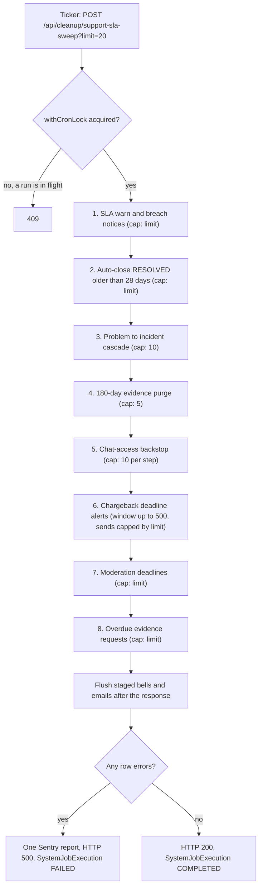
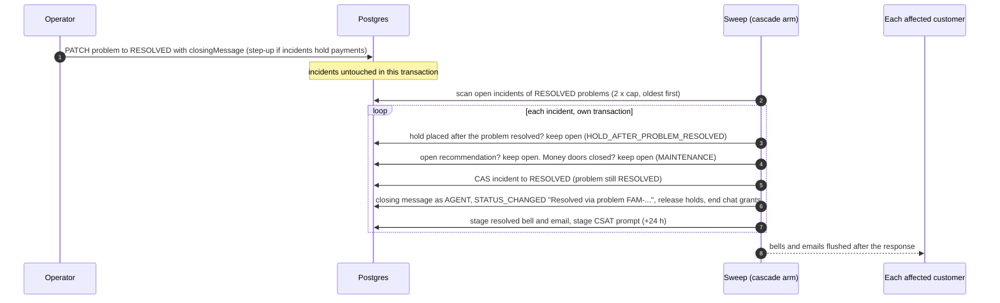

# The SLA sweep and its arms

Support has one background job, `support-sla-sweep`, implemented by `runSupportSlaSweep()` in `lib/support/sla-sweep.ts`. Every 30 minutes it works through a fixed list of **arms**: deadline warnings, the 28-day auto-close, the problem-to-incident cascade, the 180-day evidence purge, the chat-access backstop, chargeback deadline alerts, moderation deadlines, overdue evidence, and host conduct-removal reviews. Each arm handles a bounded slice per run, and each row commits in its own short transaction, so one bad row never blocks the rest and a crash leaves at most one row half-considered.

There is no second scheduler, no Redis lock and no `jobs/` wrapper (AGENTS.md §1.1, §1.4).

## Scheduling and the lock

| Fact        | Value                                                                                                                                                                                                      | Where                                                                  |
| ----------- | ---------------------------------------------------------------------------------------------------------------------------------------------------------------------------------------------------------- | ---------------------------------------------------------------------- |
| Trigger     | The 5-minute ticker posts `/api/cleanup/support-sla-sweep?limit=20` every 30 minutes at offset 10 (UTC :10 and :40), on the active platform only.                                                          | `netlify/functions/cron-tick.mts`                                      |
| Entry       | `CLEANUP_JOB_BUILDERS["support-sla-sweep"]`, bearer `CRON_SECRET`; 401 without it, 400 `INVALID_LIMIT`, limit capped at 500.                                                                               | `lib/cron/cleanup-registry.ts`, `lib/cron/cleanup-route.ts`            |
| Lock        | `withCronLock("support-sla-sweep", { failMode: "open" })`: a `SystemJobExecution` RUNNING row, unique per job name, default lease 15 minutes; Netlify caps it at 90 seconds with renewal every 30 seconds. | `lib/cron/with-cron-lock.ts`, `SystemJobExecution_running_jobName_key` |
| Maintenance | Blocked only in OFFLINE maintenance (503). It is not a financial job, so DEGRADED does not stop it; the money-moving parts check money doors themselves.                                                   | `lib/maintenance-cron.ts`, `lib/cron/financial-jobs.ts`                |
| Result      | HTTP 200 when every row succeeded, 500 if any row errored (the body lists `errors`), 409 if a run is in flight.                                                                                            | `lib/cron/cleanup-route.ts`                                            |
| Errors      | Collected as strings and reported to Sentry once per run (`support-sla-sweep completed with N error(s)`).                                                                                                  | `runSupportSlaSweep()`                                                 |

The job is not in the admin "run now" list (`app/api/admin/system-jobs/run/route.ts` answers 400 `Unknown job ID`). To re-run by hand, see the [runbook](12-runbooks.md#re-running-the-support-sweep).

## The arms, in order

Every per-row transaction uses `ALLOCATION_TX_MAX_WAIT_MS` (8 s) and `ALLOCATION_TX_TIMEOUT_MS` (30 s) at default isolation; the purge uses a 60 s timeout. Rows run one after another on one connection.

### 1. SLA warn and breach notices

Candidates are open cases with an acknowledgement or resolution target breached in the last 30 days, an acknowledgement due within 2 hours, a resolution due within 24 hours, or a statutory deadline breached or due within 24 hours (`fetchSlaSweepCandidates()`). Breach state is pause-aware (`slaStateOf()` in `lib/support/sla.ts`). Each threshold has its own identity, `sla:<caseId>:<ack|res>:<warn|breach>`, used as the bell's dedupe key and outbox `entityRef`; the sweep preloads the last 35 days of those rows and excludes cases already notified, so old overdue cases cannot eat the batch. The bell (`support-ticket-activity` workflow) goes to the assignee, or every operator if unassigned; operators also get a `support-sla-alert` email. On a breach of an organization-owned case, the organization's escalation contact gets a `support-sla-alert-org` email. Personal cases never email an organization.

### 2. Auto-close

RESOLVED cases with `resolvedAt` at least 28 days old move to CLOSED with `closedAt = now`, each through its own compare-and-set and AUTO_CLOSED event. In the same transaction, `releaseAutoClosedCaseTx()` releases permitted payout holds and ends live chat-access grants. A case with an open recommendation or closed money doors stays RESOLVED. No customer notice is sent. The closed timestamp starts the existing 180-day evidence-purge clock; polling progress does not shorten it.

The auto-close arm examines at most `limit * HELD_OPEN_SCAN_FACTOR` candidates and
closes at most `limit` cases. It selects never-attempted cases first, then the
oldest `autoCloseLastAttemptAt`, with `resolvedAt` and ID as stable tie breakers.
A conditional Prisma `updateMany` stamp commits before each closing transaction,
checking the selected attempt time, fetched `updatedAt`, RESOLVED status, cutoff
and tombstone. A held case or failed transaction rotates across later runs and
process restarts. A stale claim, reopened case or tombstone cannot take that attempt. The stamp changes
only polling metadata; `resolvedAt` and `updatedAt` retain their business meaning.

The existing payout-hold and recommendation checks still decide whether closing
is allowed. An open recommendation or intentional maintenance leaves the case
resolved and appears in
`autoCloseHeldOpen` with at most ten `{ caseId, reason }` samples in
`autoCloseHolds`; these holds do not make the run fail or send a Sentry error.
Unreadable maintenance (`MAINTENANCE_UNKNOWN`), unexpected refusal codes and genuine
exceptions still enter `errors` and the single aggregated error report.
`autoClosedCount` remains the number closed. `autoCloseHasMore` conservatively
reports holds, failures, unstarted selected rows or a cap-sized sample, so a
successful sweep does not mean the resolved backlog is drained.

Auto-close admits no new attempt after 16 seconds from the invocation's start.
It checks before reading candidates and before each progress stamp; reaching the
close limit also leaves later candidates unstamped. This is a start budget for
this arm, not cancellation of in-flight work or a deadline for the complete SLA
sweep. Other arms retain their existing bounds.

### Auto-close schema rollout

Before deploying these readers, an operator must apply
`prisma/sql/support-auto-close-progress.sql` to add the nullable polling column
and its compound index. No backfill is needed: existing rows start unattempted.
Run it with `psql -v ON_ERROR_STOP=1 -f prisma/sql/support-auto-close-progress.sql`
using the operator's configured direct/session connection. The script sets a
five-second lock timeout, commits the column addition, then builds the index
concurrently outside a transaction. A final catalog gate rejects an invalid or
unready index, including an invalid prior build skipped by `IF NOT EXISTS`.
If a build or gate fails, inspect `pg_index.indisvalid`; use `DROP INDEX CONCURRENTLY`
on that invalid index outside a transaction, rerun the file, and verify the gate
passes before deploying. Do not wrap the complete script in a transaction. Treat rollout as held until the owner confirms the column and valid index exist;
check the live catalog read-only before every handoff.
The reviewed B-tree uses default ascending nulls-last ordering, while the polling query asks for ascending nulls-first. PostgreSQL may sort eligible candidates before applying the returned-row cap; the cap is not a bound on physical scans or sort work. This is a known capacity limitation, not a cursor-correctness guarantee. Benchmark the actual cohort before choosing a null/non-null query split or a dedicated nulls-first sidecar index, keeping the cursor semantics and Prisma/sidecar ownership consistent. See [PostgreSQL index ordering](https://www.postgresql.org/docs/17/indexes-ordering.html).

### 3. Problem-to-incident cascade

A **problem** case (`caseKind = PROBLEM`) groups many customers' **incident** cases about one platform failure. Resolving the problem does not touch its incidents in the same transaction. This arm (`cascadeResolvedProblems()` in `lib/support/problem-cascade.ts`) then resolves up to 10 open incidents per run, oldest first, each in its own transaction.

The compare-and-set also requires the problem to still be RESOLVED, so a problem reopened mid-run stops its cascade (`__tests__/db/support/problem-cascade.db.test.ts`). Incidents kept open are counted in `incidentsHeldOpen` but are not errors and raise no alert. Problems cannot be decided, and incidents cannot be linked to a RESOLVED or CLOSED problem; see [case lifecycle](02-case-lifecycle.md). Refunds stay per customer through the refund door.

### 4. Evidence purge

Closed cases 180 days past `closedAt` have their evidence deleted and their free text scrubbed, unless a legal hold, an open or recent appeal, or a live chargeback holds them (`purgeExpiredSupportEvidence()` in `lib/support/evidence-retention.ts`). At most 5 cases per run. The full rules are in [privacy and retention](08-privacy-and-retention.md#the-180-day-evidence-purge).

### 5. Chat-access backstop

`sweepSupportChatAccess()` (`lib/support/chat-sweep.ts`) runs five bounded steps, 10 rows each: end grants that expired or whose case is resolved, closed or deleted; retry Stream leaves for ended interventions still seated; re-sync the channel lock for channels whose grants started or ended in the last hour; retry joins for live interventions unseated after 2 minutes (ending them `CHANNEL_GONE` if the channel is gone); and send the post-decision "we reviewed messages" notice once per case. See [chat access](06-chat-access-and-intervention.md#ending-the-sweep-and-the-review-notice).

### 6. Chargeback deadline alerts

Gateway disputes in `NEEDS_RESPONSE` or `WARNING_NEEDS_RESPONSE` with `dueBy` between 24 hours ago and 72 hours ahead are read, up to 500. Each gets one admin alert at the 72-hour window and one at the 24-hour window, keyed `dispute-due:<disputeId>:<72|24>` (bell on `DISPUTE_UPDATED`, email `dispute-deadline-alert`), with already-sent pairs matched on outbox `entityRef` so they never consume the send limit. Disputes due within 12 hours or past due are a money exception to the escalations-only policy: `reportStandingFinding()` writes one `SystemEvent` (key `dispute-deadline:critical`) and sends one Sentry warning per run that holds a dispute not paged before. Its seven-day window outlives the 36-hour critical span, so each dispute pages once. The bells and emails above still go out.

### 7. Moderation deadlines

Open moderation reports whose `resolutionDueAt` is due within 24 hours or breached in the last 30 days get a bell keyed `moderation-deadline:<reportId>:<warn|breach>` to the assignee or all operators.

### 8. Overdue evidence

Unanswered, uncancelled evidence requests past `dueAt` (within the last 30 days) on unresolved cases get one bell to the operator who asked, keyed `evidence-overdue:<requestId>`. An overdue request also makes `EVIDENCE_OVERDUE` a verified basis for a chat intervention.

### 9. Conduct removal reviews

`sweepRemovalReviews()` (`lib/support/removal-review.ts`) handles `ParticipantRemoval` rows still `PENDING_REVIEW`, at most `REMOVAL_REVIEW_CAP` (5) of each kind per run, in two steps. A removal whose case is RESOLVED or CLOSED is marked `OVERTURNED` when a PENDING or SUCCEEDED refund was created for the attendee's payment on that appointment after the removal, and `UPHELD` otherwise; the update is a compare-and-set on `PENDING_REVIEW`. A removal whose case is still open past its `resolutionDueAt` is refunded in full through `refundRemovedAttendeeSeat()` under the key `removal-review:<removalId>`, with the refund read back before anything else changes. Only then does one transaction mark the removal `OVERTURNED`, release the case's holds, add a visible case message and stage a bell to the attendee (`removal-review:<removalId>:refunded`). A refund that did not land leaves the removal pending and adds a line to the run's `errors`, so the next run tries again. The idle probe is `hasRemovalReviewWork()`.

## Invariants

| Rule                                                                                                | Enforcer                                                                                                                | Test                                                 |
| --------------------------------------------------------------------------------------------------- | ----------------------------------------------------------------------------------------------------------------------- | ---------------------------------------------------- |
| One owned RUNNING lease per sweep; unavailable fail-open admission or lease loss can overlap cores. | The database: `SystemJobExecution_running_jobName_key`; `withCronLock()`.                                               | `__tests__/maintenance/with-cron-lock.test.ts`       |
| Each arm is bounded per run.                                                                        | App: `PROBLEM_CASCADE_CAP` (10), `EVIDENCE_PURGE_CAP` (5), `CHAT_ACCESS_CAP` (10), `REMOVAL_REVIEW_CAP` (5), the limit. | `__tests__/support/sla-sweep-lifecycle-arms.test.ts` |
| Each threshold notifies once.                                                                       | App: outbox `entityRef` identities and the preloaded exclusion lists; outbox `transactionId` unique.                    | `__tests__/support/dispute-deadline-alerts.test.ts`  |
| A cascade never resolves an incident of a problem that was reopened.                                | App: compare-and-set includes the problem's status.                                                                     | `__tests__/db/support/problem-cascade.db.test.ts`    |
| One failing row never stops the run, and Sentry hears about it once.                                | App: per-row transactions, collected `errors`, one `reportSentryError()`.                                               | `__tests__/support/sla-sweep-lifecycle-arms.test.ts` |

The auto-close regressions are in `__tests__/support/sla-sweep-auto-close.test.ts`; they cover held-prefix progress, refusal classification, stamp races, unchanged business clocks and admission bounds. Moderation-deadline and overdue-evidence coverage remains separate work.

## Failure modes

| Symptom                                        | Likely cause                                                                                                       | Where to look                                                                                               |
| ---------------------------------------------- | ------------------------------------------------------------------------------------------------------------------ | ----------------------------------------------------------------------------------------------------------- |
| No SLA notices, no auto-close                  | The ticker is not firing on the active platform, or every run fails.                                               | `SystemJobExecution` rows for `support-sla-sweep` ([runbook](12-runbooks.md#re-running-the-support-sweep)). |
| HTTP 500 every run with the same error         | One row fails repeatedly, for example a purge whose files are not confirmed deleted.                               | The Sentry event's error list ([runbook](12-runbooks.md#failed-evidence-purge)).                            |
| Incidents stay open after the problem resolved | Held open by a newer hold, an open recommendation or maintenance; 20 or more held incidents can starve newer ones. | `incidentsHeldOpen` in the run log; the incident's holds and recommendations.                               |
| Purge does nothing                             | 2,000 or more live disputes skip the arm; or every candidate is held.                                              | The run's errors (`evidence-purge: 2000+ live disputes`).                                                   |

## Where in code

- `lib/support/sla-sweep.ts`: `runSupportSlaSweep()`, `fetchSlaSweepCandidates()`, `autoCloseResolvedRows()`, `processDisputeDeadlineAlerts()`, `pageCriticalDisputeDeadlines()`.
- `lib/support/problem-cascade.ts`, `lib/support/evidence-retention.ts`, `lib/support/chat-sweep.ts`.
- `lib/cron/cleanup-registry.ts`, `lib/cron/with-cron-lock.ts`, `netlify/functions/cron-tick.mts`.

## Deprecated & Superseded Approaches

- **In-transaction cascade.** Resolving a problem used to resolve every linked incident inside one long, sometimes Serializable transaction, with notices staged after commit and easily lost. The cascade is now a bounded sweep arm with one short transaction per incident and notices staged in that transaction.
- **Mixed-table queues.** The sweep once read both the old ticket table and appointment threads; when those tables were dropped, the deployed sweep failed on every run. It now reads only `SupportCase` and related rows.
- **Repeated overdue notices.** Old overdue rows could re-qualify every run and consume the batch. Notice identities in the durable outbox and the preloaded exclusion lists stop that.
- **Storage-reconcile purge.** The design first put the 180-day purge in the storage reconciliation job. It runs as a sweep arm instead, and reconciliation only removes objects whose rows are tombstoned.
- The ticker's comment for this target still lists only three arms; the list above is current.
- **Counters only in the response.** The sweep's per-arm counters live in the HTTP body and the run log; `withCronLock()` does not store them in `SystemJobExecution`, so history has only COMPLETED or FAILED.

The former fixed oldest-resolution sample could revisit held cases forever. Durable last-attempt ordering now rotates admitted cases across invocations; an in-memory cursor cannot preserve that progress after a crash.
