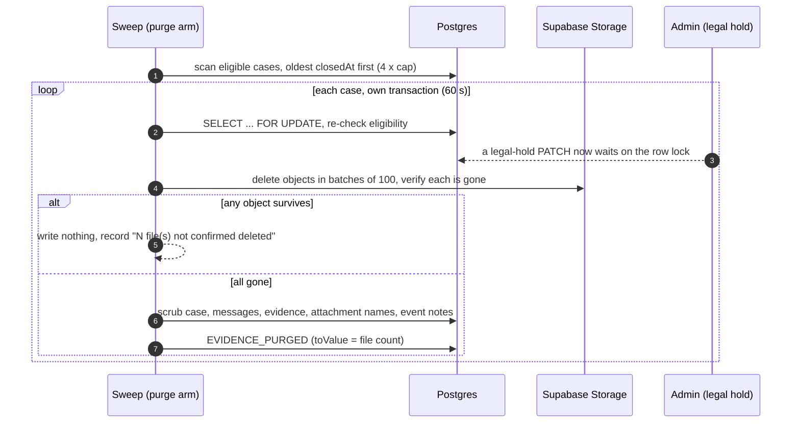
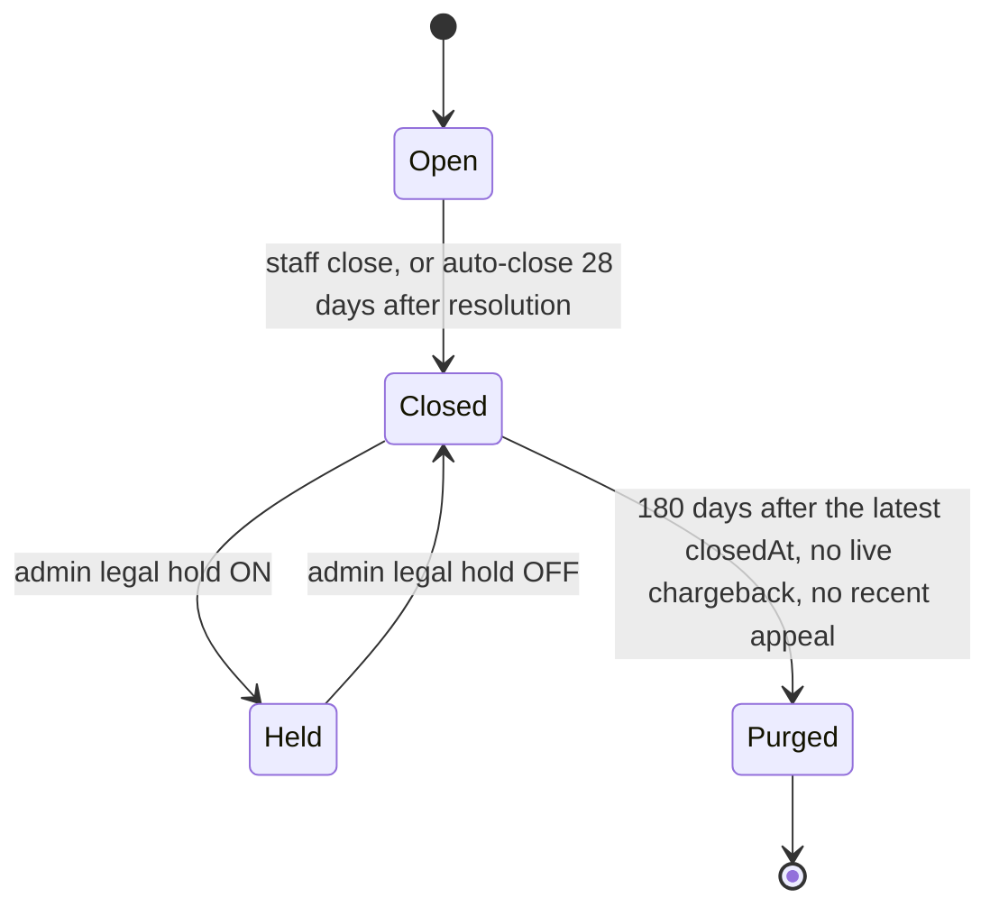

# Privacy: export, erasure, retention and legal hold

Support holds some of the most personal text on the platform: complaints, evidence, files and phone numbers. Four mechanisms govern it. A **data export** gives a person a copy of their support record (DPDP Act §11). **Erasure** scrubs a deleted account's support text and files while keeping the decisions and money links that other people rely on. The **180-day purge** deletes evidence files and scrubs free text from cases closed more than 180 days ago. A **legal hold** stops that purge for a case, either because an admin set it or because a live chargeback or appeal implies it.

Decision records (with their explanation), refund and payment-hold reasons, and payment and refund records are kept after a purge. The privacy policy says so (`app/(pages)/privacy/page.tsx`), and that split and the 180-day period carry open counsel sign-off notes in the page source.

## Data export

`GET /api/user/privacy/export` (`app/api/user/privacy/export/route.ts`) returns a JSON file (`schemaVersion: "dpdp-2023-s11-v1"`, `Cache-Control: no-store`). `readSupportExport()` in `lib/support/privacy-export.ts` adds the support part:

| Key                       | Contents                                                                                                                                                                                       |
| ------------------------- | ---------------------------------------------------------------------------------------------------------------------------------------------------------------------------------------------- |
| `supportTickets`          | The person's cases. An organization-filed case about them appears only as a summary (`filedByOrganization`). The callback phone appears only if they filed the case.                           |
| `supportGrievances`       | Their cases with category GRIEVANCE.                                                                                                                                                           |
| `supportMessages`         | Their own non-internal messages. Staff internal notes are never exported.                                                                                                                      |
| `supportEvidenceRequests` | Evidence they were asked for and what they answered.                                                                                                                                           |
| `supportAttachments`      | Metadata of files they uploaded; no file contents or URLs.                                                                                                                                     |
| `supportRatings`          | Their CSAT scores.                                                                                                                                                                             |
| `supportChatAccess`       | Staff chat-access grants on their booking chats: date, kind, expiry and end, plus the basis and case reference only if they filed the case. Never the operator's identity or any chat content. |
| `supportExportComplete`   | False if any collection hit the 20,000-row stop (`EXPORT_MAX_ROWS`; pages of 500).                                                                                                             |

A chat-access grant is exported only after its post-decision "we reviewed messages" notice went out: `reviewNoticeAt` is set, neither it nor any other grant on the case was withheld, the case is not deleted, and the person is in the grant's scope or is the case's requester or submitter. A withheld grant therefore never appears, which keeps the export consistent with what the person was told. A party who did not file the case, such as the reported user, sees that access happened but not whose case it was or why: `basis` and `caseReferenceNumber` are null for them.

The export has no rate limit.

## Erasure

When an account is deleted, `supportRetainedHistoryCount()` (`lib/support/erasure.ts`) counts support rows that a hard delete cannot remove because other people's records reference them: the person's cases that have decisions, evidence, attachments or recommendations; evidence requests they received or sent; attachments they uploaded; decisions they made; recommendations they proposed or decided; and chat-access grants they opened and their cases with chat access. Any non-zero count sends the account down the scrub path.

`scrubSupportPiiTx()` then, in the erasure transaction:

- renames the person's cases to "Erased support request" with description "[erased]" and clears callback and external-requester fields;
- replaces messages they wrote, and authorless customer messages on their personal cases, with "[erased]";
- replaces their evidence answers and the prompts they wrote with "[erased]";
- renames their attachments "[erased]" and tombstones them (`deletedAt`).

After commit, `removeSupportAttachmentObjects()` deletes the files with verified deletes. A failure reports to Sentry and returns "support_attachments: N file(s) not confirmed deleted — re-run required"; the daily storage reconciliation later removes tombstoned objects older than 7 days. Decision explanations stay. An erased user's id remains in `SupportCaseChatAccess.scopeUserIds`, because the append-only access log cannot be changed.

## The 180-day evidence purge

`purgeExpiredSupportEvidence()` in `lib/support/evidence-retention.ts` runs as an arm of the [SLA sweep](07-sla-sweep.md), at most 5 cases per run.

**Eligible** when all of these hold (`purgeEligibleWhere()`):

- the case closed at least 180 days ago (`SUPPORT_EVIDENCE_RETENTION_MS`);
- `legalHoldAt` is null;
- it has never been purged (no `EVIDENCE_PURGED` event);
- no appeal of its decisions is open or closed within the last 180 days, and, for an appeal case, its original case also closed at least 180 days ago. In effect the clock is the latest `closedAt` across the case and its appeals;
- no live gateway chargeback (a dispute outside `DISPUTE_INACTIVE_FOR_GATING`) is linked through the case's appointment, a PAYMENT, APPOINTMENT or REFUND subject, or a recommendation on the payment.

**Scrubbed:** the case title becomes "Support request" and its description "[deleted after the retention period]"; callback and external-requester fields are cleared; every message body (internal notes included) and message metadata; evidence prompts and answers; attachment names (rows tombstoned, files deleted); and event notes, except on record kinds (holds, recommendations, decisions, legal hold, purge, and the chat-access events, which follow the security-log period).

**Kept:** the case skeleton (reference, status, dates, category, ids), decisions, recommendations, holds, subjects and payment links, attachment rows with their storage path, and the CSAT score.

A case is purged once. If staff reopen a purged case, new text is not purged again.

If 2,000 or more disputes are live (`LIVE_DISPUTE_CAP`), the arm purges nothing that run and records an error, rather than build a huge exclusion list.

## Legal hold

An admin sets or lifts a legal hold with `PATCH /api/support/cases/[caseId]` and `legalHold: true | false` (`app/api/support/cases/[caseId]/route.ts`). Anyone else gets 403 `FORBIDDEN`. It sets `legalHoldAt` (or clears it) and writes `LEGAL_HOLD_CHANGED` with ON or OFF and the note. A closed case accepts this change without being reopened. The purge's row lock means a hold placed while that case is being purged waits, then the purge's re-check sees it.

## Invariants

| Rule                                                                           | Enforcer                                                           | Test                                                  |
| ------------------------------------------------------------------------------ | ------------------------------------------------------------------ | ----------------------------------------------------- |
| Nothing under a legal hold, a live chargeback or a recent appeal is purged.    | App: `purgeEligibleWhere()`, re-checked under `FOR UPDATE`.        | `__tests__/support/evidence-retention.test.ts`        |
| A purge writes nothing unless every file is confirmed deleted.                 | App: verified `removeObjects()` in `lib/supabase-storage-core.ts`. | `__tests__/support/evidence-retention.test.ts`        |
| Decisions survive purge and erasure unchanged.                                 | The database: trigger `support_case_decision_immutable`.           | `__tests__/db/support/decision-race.db.test.ts`       |
| Only an admin changes a legal hold.                                            | App: the PATCH route.                                              | `__tests__/support/lifecycle-routes.test.ts`          |
| The export never contains internal notes, operator identities or chat content. | App: `readSupportExport()`.                                        | `__tests__/compliance/support-privacy-export.test.ts` |
| Erasure routes accounts with shared history to the scrub path.                 | App: `supportRetainedHistoryCount()`.                              | `__tests__/compliance/support-erasure.test.ts`        |
| The purge scan stays cheap.                                                    | The database: partial index `support_case_closed_at_idx`.          | n/a                                                   |

## Failure modes

See the runbooks for [a failed purge](12-runbooks.md#failed-evidence-purge) and [placing or lifting a legal hold](12-runbooks.md#placing-or-lifting-a-legal-hold).

## Where in code

- `lib/support/privacy-export.ts`, `app/api/user/privacy/export/route.ts`.
- `lib/support/erasure.ts`, `lib/compliance/erasure/scrub-user.ts`.
- `lib/support/evidence-retention.ts`, `lib/supabase-storage-core.ts`, `scripts/cleanup/reconcile-document-storage.ts`.
- `app/api/support/cases/[caseId]/route.ts` (legal hold), `prisma/sql/check-constraints.sql` (`support_case_closed_at_idx`).

## Deprecated & Superseded Approaches

- **Export and metrics on dropped tables.** The export and staff metrics read the old ticket tables, so they failed once those tables were dropped. Both now read `SupportCase` and related rows.
- **A promised purge with no job.** The privacy copy promised deletion before any job existed, so promotion of that copy to production waited on the purge. The purge arm now enforces it, with legal and derived holds.
- **Purge in storage reconciliation.** The purge was first planned inside `reconcile-document-storage`. It runs as a sweep arm with row locks and verified deletes; reconciliation only cleans up objects whose rows are tombstoned.
- The DPDP export key is still named `supportTickets`; it holds `SupportCase` rows.
- **Account deletion failing on support history.** Deleting an account with formal support history returned 500, because restrict foreign keys and the decision trigger blocked the delete, and the erasure scrub ignored support text. Support history now routes the account to the scrub path, which redacts bodies, phone numbers and files.
- **Grievances missing from the export.** Signed-in users' grievances were attached to a staff owner and did not appear in their own export. They are now account-owned and exported under `supportGrievances`.
